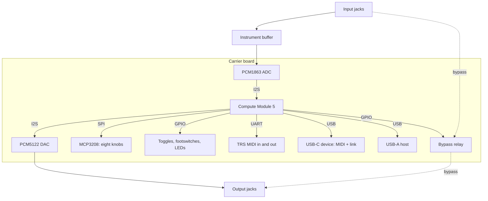

# Prism device designs [DEVICE]

Designs for the reference Prism device and its face in Prism. Specification: [Prism device](../../specs/instruments/PrismDevice.md) and [Instrument builder](../../specs/instruments/PrismInstrument.md). Typed model: [device.td](device.td).

## Top panel [DEVICE-HW-CONTROLS]

The reference box is a Hammond 1590XX-size enclosure. The panel is laid out for a foot at the bottom edge and hands at the top:

| Row | Controls |
| --- | --- |
| Top | Four knobs, K1–K4 |
| Second | Four knobs, K5–K8 |
| Third | Two two-way toggles (S1, S2) and two three-way toggles (S3, S4), with the RGB status LED between them |
| Bottom | Left and right footswitches with their LEDs |

The sides carry the audio jacks (inputs on the right, outputs on the left, as on a pedalboard) and the line/instrument switches. The back carries the barrel power jack, USB-C, USB-A and the two TRS MIDI jacks. The printed overlay ([PRISM-INSTRUMENT-DEVICE-LABELS]) puts each macro's name under its control.

## Device face in Prism [PRISM-INSTRUMENT-DEVICE]

Choosing a profile in the Instrument view's Edit mode draws the panel above at its real proportions with the same Instrument dial used across Prism ([PRISM-INSTRUMENT](../prism-timeline/README.md#instrument-builder-prism-instrument)). Controls cannot be moved or resized. Selecting a control lists the patch's macros that fit its kind; choosing one assigns it, and a macro already on another control moves with a notice. Unassigned controls are drawn dimmed with "Unassigned". A connected device's knob moves turn the on-screen dials live ([DEVICE-LINK-LIVE]).

The Devices panel lists each connected device with its name, firmware, role, active slot and the patch it is playing, with **Open patch**, **Deploy to device…** and **Update firmware…**. Deploy shows the profile check first: every refusal by node and reason, and the patch's cost against the budget as one bar.

Design screenshots to produce, in the style of the [Prism timeline designs](../prism-timeline/README.md): the device face with four assigned knobs and a footswitch, assigning a macro to a three-way switch, the Devices panel with a device playing an unknown patch, and a deploy refused for budget.
