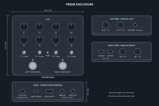
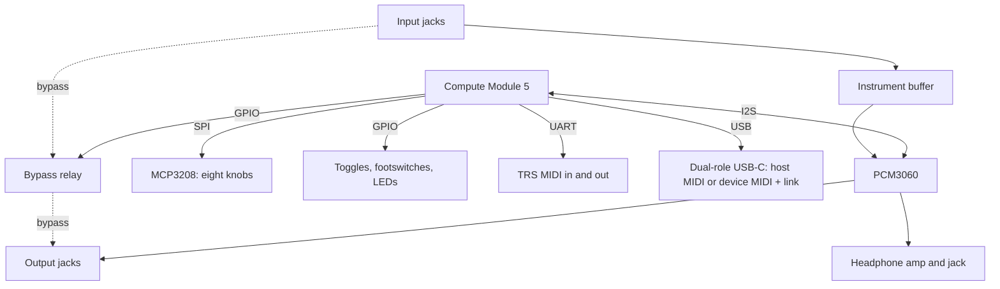

# Prism device designs [DEVICE]

Designs for the reference Prism device and its face in Prism. See [Prism device hardware](../../specs/synth/PrismDeviceHardware.md), the [Instrument builder](../../specs/synth/PrismInstrument.md) and the [typed device model](device.td).

## Top panel [DEVICE-HW-CONTROLS]

The front edge faces the player, with the footswitches closest and the knobs above them.

| Row | Controls |
| --- | --- |
| Top | Four knobs, K1–K4 |
| Second | Four knobs, K5–K8 |
| Third | Two two-way toggles (S1, S2) and two three-way toggles (S3, S4), with the RGB status LED between them |
| Bottom | Left and right footswitches with their LEDs |

The printed overlay ([PRISM-INSTRUMENT-DEVICE-LABELS]) puts each macro's name under its control. Use a charcoal shell, the PRISM wordmark and high-contrast control and connector legends. Leave the area between the footswitches plain.

## Enclosure [DEVICE-HW-ENCLOSURE]

The first build uses a charcoal 3D-printed case with the PRISM wordmark and the control layout shown here. Size the printed case around the Raspberry Pi 5, audio HAT, plug bodies and controls at dry fit. The three website renders are views of one starter-case concept with a provisional 53 mm exterior height.

### Eventual road case

The gasketed Hammond 1590WXX sets the eventual die-cast case envelope at 145.2 × 121.2 × 39.3 mm with the bottom lid and about 35.05 mm nominal internal height. Use the silicone gasket and O-ring cover screws. Check the complete CM5 carrier and controls against the casting taper, corner bosses and lid lip. The deeper 1590X gives about 52.4 mm internal height on the same footprint if the selected parts need clearance. Confirm the wall thickness against [DEVICE-HW-RUGGED] before selecting a production casting. The [panel layout](enclosure.svg) gives nominal centres and 61.2 mm footswitch spacing. Footswitch centres sit 20 mm from the player edge, and their row is 28 mm from the toggle row. Apertures depend on the selected parts. [1590WXX model downloads](https://www.hammfg.com/part/1590WXX) · [1590X mechanical drawing](https://www.hammfg.com/files/parts/pdf/1590X.pdf)

| Face (player's orientation) | Hardware and access |
| --- | --- |
| Top | Two rows of four low-profile 10 kΩ linear pots with metal shafts and knobs up to 16 mm in diameter, four short panel toggles, central RGB status light, and two soft-touch momentary footswitches with indicator LEDs. The shell takes the footswitch load through washers and locknuts. |
| Left | ¼-inch L/R line outputs and the amplified 3.5 mm stereo headphones. |
| Right | ¼-inch L/R inputs and separate recessed L/R line/instrument switches. Check switch access with both inputs already plugged in. |
| Rear, looking at the connectors | One dual-role USB-C, insulated 2.1 mm centre-negative DC barrel, then 3.5 mm Type A TRS MIDI in and out. Check access with all four cables connected, including right-angle plugs. |
| Bottom | Removable lid, non-slip feet and serial label. The factory jig reaches the knob wiper header and eMMC provisioning strap with the lid open. |

### Connecting a MIDI keyboard

A keyboard can play Prism directly in sound-source mode. Use the cable that matches the keyboard's MIDI output.

| Keyboard connection | Cable to Prism |
| --- | --- |
| Class-compliant USB MIDI | A USB-C data cable to the keyboard's USB device port, often USB-B or USB-C. Power Prism from the barrel jack. The USB-C port supplies up to 500 mA to the keyboard. A keyboard with higher current draw uses its own power supply. |
| 5-pin DIN MIDI OUT | A 5-pin MIDI cable and a **3.5 mm TRS MIDI Type A** adapter into Prism's **MIDI IN**. |
| 3.5 mm TRS MIDI Type A OUT | A straight-through 3.5 mm TRS cable into Prism's **MIDI IN**. A Type B keyboard uses an A-to-B adapter or cable. |

When a computer plays Prism, the same USB-C port carries MIDI and the Prism link. Plug a USB keyboard into the computer if you want to play while editing a patch. Prism forwards its notes to the pedal. [MIDI Association USB MIDI guide](https://midi.org/basic-of-usb) · [TRS MIDI specification](https://midi.org/specification-for-trs-adapters-adopted-and-released)

Mount the conformally coated CM5 carrier on a removable internal bracket. Clamp the module facing the shell and keep the footswitch volumes at the player end clear. Use restrained, latched harnesses and leave space for harness bends, fasteners and tool access. Secure every jack to the casting. Use one through-hole USB-C receptacle at the rear board edge and tie its panel mount to the wall so cable loads bypass the solder joints. Seal the panel openings and lid. The Pi 5 and HiFiBerry DAC2 ADC Pro are the bench prototype. [CM5 mechanical and thermal data](https://pip-assets.raspberrypi.com/categories/944-raspberry-pi-compute-module-5/documents/RP-008180-DS-8-cm5-datasheet.pdf) · [HiFiBerry prototype board](https://www.hifiberry.com/docs/data-sheets/datasheet-dac2-adc-pro/)

Use a supported, electrically isolated heat spreader between the CM5 and aluminium. Set its height and compression without loading the module's connectors or fouling the controls. Keep the enclosure fanless and verify cooling and touch temperature on an insulated pedalboard as well as on the bench.

Keep the PCM3060 codec and its clocks, instrument buffers, bypass relay and headphone amp away from the power converter and USB wiring. Insulated audio jacks let the electrical design establish the codec ground join and chassis bonds deliberately. The normally closed relay gives each input a direct path to its corresponding line output during bypass, reset and loss of power. The headphone jack has its own amplified path. Verify power margins with startup transients, headphone load and a bus-powered keyboard attached. Keep the barrel and USB-C supplies isolated. Verify USB-C-only operation against the source's advertised current. [USB Type-C current advertisement](https://www.usb.org/sites/default/files/USB%20Type-C%20Spec%20R2.0%20-%20August%202019.pdf)

### Enclosure release checks

- [x] Draw the control and connector layout against the manufacturer's envelope.
- [ ] Freeze the actual parts and verify the 3D stack at tolerance, including full switch travel, all plugged connectors, bosses, ground hardware, cable tails and bottom lid removal.
- [ ] Dry-fit the parts in a mockup. Check boot clearance for both footswitches, hand access to all controls, glare and LED visibility, and readable labels with cables fitted.
- [ ] Check the eventual die-cast case against [DEVICE-HW-RUGGED-VERIFY], including the IEC 60068 drop, shock and vibration tests, 100 kg standing load at either footswitch and 50 N cable pulls. Recheck audio and unpowered bypass after each test.
- [ ] Verify shell grounding and audio noise with USB, barrel power and two grounded audio devices connected. Check channel-by-channel unpowered bypass, watchdog/restart bypass and separate headphone behaviour.
- [ ] Verify USB-C device mode with the Prism link, adequate input power and TRS MIDI active. Verify host mode with barrel power, a keyboard at the 500 mA limit and overcurrent injected. Exercise role changes, brownout bypass and VBUS isolation.
- [ ] Play a source patch without a computer from USB, 5-pin DIN and native Type A keyboards, and a Type B keyboard with the correct adapter. Check note-on, note-off, sustain and controller messages, and startup with a bus-powered keyboard attached.
- [ ] Verify USB-C MIDI playback from a computer, phone and tablet. Exercise simultaneous USB-C and TRS inputs in both USB-C roles and check merged event timing. Check MIDI OUT loopback for control changes from the panel.
- [ ] Run [DEVICE-VERIFY] in the assembled case. Record thermal throttling, touch temperature, MIDI note-to-sound latency and audio dropouts on the 24-hour run.

## Device face in Prism [PRISM-INSTRUMENT-DEVICE]

Choosing a profile in the Instrument view's Edit mode draws the panel above at its real proportions with the same Instrument dial used across Prism ([PRISM-INSTRUMENT](../prism-timeline/README.md#instrument-builder-prism-instrument)). Controls cannot be moved or resized. Selecting a control lists the patch's macros that fit its kind; choosing one assigns it, and a macro already on another control moves with a notice. Unassigned controls are drawn dimmed with "Unassigned". A connected device's knob moves turn the on-screen dials live ([DEVICE-LINK-LIVE]).

The Devices panel lists each connected device with its name, firmware, role, active slot and the patch it is playing, with **Open patch**, **Deploy to device…** and **Update firmware…**. Deploy shows the profile check first: every refusal by node and reason, and the patch's cost against the budget as one bar.

Design screenshots to produce, in the style of the [Prism timeline designs](../prism-timeline/README.md): the device face with four assigned knobs and a footswitch, assigning a macro to a three-way switch, the Devices panel with a device playing an unknown patch, and a deploy refused for budget.
