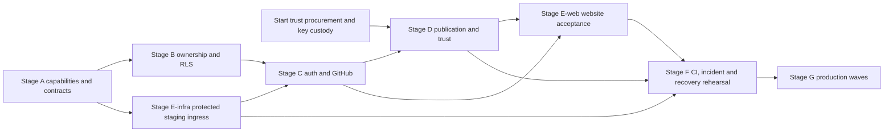

# Plan 0020 — Hosted Registry Rollout

**Status:** planned, 25 October 2026. No cloud resources were provisioned and no deployment or live security verification was performed in preparing this plan. This is the deployment track of [plan 0020](0020-package-manager.md), governed by [deployment and ownership spec 0044](../specs/ecosystem/0044-PackageRegistryDeploymentAndOwnership.md), [organization/package governance spec 0045](../specs/ecosystem/0045-OrganizationPackageGovernance.md) and the existing [publication/trust contract](../specs/ecosystem/0030-PackageRegistryTrustAndDiscovery.md).

The launch target is a Cloudflare-fronted package website and Osprey API, Supabase GitHub login, database-enforced organization/package ownership, and source-derived publication with separate publisher signatures. There is no tarball-upload product. Hosted publication stays off until the complete acceptance gates pass; a read-only stage must not be presented as secure public publishing.

## Repository evidence and reference pattern

The current implementation is the folder registry: `packages/manager/api/lib/server.osp` routes method/path through a startup catalog; its callback deliberately does not use request headers/body. `api/lib/config.osp` reads folder/bind/port from JSON. Neither is a hosted authentication/ownership implementation. `packages/manager/README.md` lists missing host primitives, and `packages/manager/blockers/` holds probes. The eleven-table ownership migration and typeDiagram now exist; the migration intentionally grants no runtime access and its tool verification is blocked below. The dedicated website, hosted authentication/permission handlers, allow policies and release services remain planned in parent plan phases 6–12.

The following sibling repository paths were inspected as source references, not as proof of their current production configuration. They are external local references, not dependencies of an Osprey checkout; the chosen Osprey requirements live in spec 0044.

| Reference source | Observed pattern | Osprey decision |
| --- | --- | --- |
| NAP `docs/external/cloudflare-gcp-supabase.md`, sections `[STACK-CF-WORKER]`, `[STACK-CF-EDGE-SECRET]`, `[STACK-RUN-INGRESS]`, `[STACK-SUPABASE-RLS]` | Cloudflare proxy/WAF, host rewrite to Cloud Run, edge secret, Supabase Auth, restricted-role tenant RLS and transaction-local context; load balancer ingress is described as stronger hardening | Keep the service boundaries; require the stronger origin restriction before launch |
| NAP `scripts/cloudflare-gateway-setup.sh`, `docs/infra/cloudflare-gateway.md`, `src/nap/app.py` | Provisioned-rule shape and constant-time origin-secret middleware; NAP-specific hostnames/rates | Reuse the approach, not accounts, secrets, rate values or executable language |
| NAP `scripts/deploy_immutable_backend.py`, `cloudbuild.yaml` | Immutable backend deployment machinery and separated runtime/deployment configuration | Exact-SHA artifacts, no-traffic validation, pinned secret versions and measured rollback |
| TradiSite `cloudflare/host-rewrite.js`, `cloudflare/wrangler.toml` | API forwarded to Cloud Run; portal served through GitHub Pages; separate Storage website path; internal worker fetch explicitly needs edge-secret injection | Separate static website/API/content origins; do not copy wildcard tenant-site routing or depend on transforms re-firing on subrequests |
| TradiSite `cloudbuild.yaml` | Build → registry push → Cloud Run; migrations explicitly outside build/startup; runtime secrets from Secret Manager | Separate schema deployment and artifact promotion; fresh unconditional vulnerability audit added to every deployment path |
| TradiSite `backend/src/AiCms.Api/Services/IDbConnectionFactory.cs` | Source uses a `postgres` connection, SET ROLE and session-scoped `set_config(..., false)`, with an `app_admin` mode described as broad RLS access | Do not copy this credential/pooling model: use a restricted login, explicit transactions and transaction-local settings; no generic admin connection in the API |
| TradiSite `backend/src/AiCms.Api/Middleware/EdgeSecretMiddleware.cs` | Secret gate with health/OPTIONS exemptions, production startup requirement and constant-time comparison | Keep fail-closed startup and comparison; restrict health to a minimal probe and prove OPTIONS cannot enter business handlers |

Research roots: `/Users/christianfindlay/Documents/Code/NimblesiteAgenticPlatform` and `/Users/christianfindlay/Documents/Code/TradiSite`. Reviewers can reproduce these source comparisons there. Differences between reference docs and code are recorded above rather than treating the reference as automatically safe.

Cloudflare's current [availability table](https://developers.cloudflare.com/rules/origin-rules/) puts Host overrides on Enterprise, despite the NAP reference's older “Pro” wording. A copied JavaScript Worker would also violate Osprey's implementation contract. The selected launch route is Cloudflare → GCP HTTPS load balancer/serverless NEG → restricted-ingress Cloud Run → Supabase. Declarative routing removes both problems. Additional load-balancer/Cloud Armor cost must be included in the provisioned budget; the cheaper unrestricted `run.app` arrangement is not the launch plan.

## Deployment inventory and deliverables

Before implementation, record a reviewed environment inventory containing the exact website/API/content hostnames, Cloudflare zone/plan and rules, GCP project/region and service accounts, artifact registry, load balancer/certificate/NEG, Cloud Run services, Supabase project/region and role names, private buckets, GitHub OAuth callback/App installation, secret resource names/versions and trust custody. Use the [inventory schema and review instructions](../../packages/manager/ops/README.md); structural validation does not prove provisioning or authorize rollout. Values are not known from the reference projects and must not be fabricated. Default region is `australia-southeast1`; measure the selected Supabase link.

Inventory launch-critical external commitments at the start: five offline root custodians, separate release/status HSM operators, two independently administered build platforms, four witness organizations, an external cross-log and the governance repository/DNSSEC root-fingerprint publication path. Assign a named owner, provider commitment, provisioning lead time and readiness evidence to each; missing independent operators/custody are procurement blockers, not unassigned code tasks. Also inventory registrar/account MFA/recovery, authenticated notification delivery and privacy/retention operations.

Keep website, API, schemas and jobs in the existing parent-plan seams. Planned deliverables are `packages/manager/web/`, the existing `api/` and `host/`, `packages/manager/supabase/migrations/`, and Osprey deployment/rehearsal tooling in `packages/manager/ops/`. Use a dedicated Cloudflare Pages Direct Upload project for the prebuilt static WASM artifact, with deployment-ID rollback and no Functions/automatic push deployment. These paths describe work to deliver, not existing commands. New runnable CLI/Make entry points must be added to repository instructions only when implemented and verified; this plan does not invent a working deploy command.

Every stage has a named accountable owner and retained evidence manifest before execution. The implementer owns code/tests, the deployment owner owns account/secret provisioning and rollback, independent key custodians own trust ceremonies, and an independent security reviewer owns adversarial acceptance. A blank owner or missing credential/capability is a blocker, not a reason to skip a gate.

The committed language-site configuration (`website/src/CNAME`, `website/src/_data/site.json`) uses `www.ospreylang.dev`. Proposed registry hostnames are `packages.ospreylang.dev` (website), `packages-api.ospreylang.dev` (API) and `package-content.ospreylang.dev` (cookieless content), with separate `-staging` counterparts. These are planning defaults, not claims of DNS ownership/provisioning. Confirm zone access and collision-free records during inventory before creating them. Pin the environment API callback to `/v1/auth/github/callback`; GitHub still returns first to that environment's Supabase callback. Pages preview/default hostnames never join the credentialed CORS/OAuth allowlist.

Use GitHub CI federation into the narrowly scoped GCP deploy identity; provider API tokens that cannot be exchanged this way are separate project/zone-scoped Secret Manager entries with pinned versions, rotation and revocation tests. This includes the Cloudflare Pages/rules credential; federation does not make that credential disappear. The DataProvider migration role, website deploy role, API runtime role and incident operator remain distinct.

## Execution dependencies and blocker ownership

The stage letters group deliverables; they are not a reason to expose callbacks before ingress is secured. Split Stage E into infrastructure preparation (`E-infra`, started immediately after A) and completed website acceptance (`E-web`, after C/D). Implement every website flow against `[PACKAGE-HOSTED-ROUTES]`; that table is the authoritative API/actor inventory for the Stage F rehearsal.

Start supplier/operator engagement at Stage A kickoff, not after publication code is finished. Record actual supplier lead times and committed ready dates in the inventory; no production launch date is credible until they are known. Independent builders, HSM/root custody and witness/cross-log agreements must be ready before Stage D integration can exit. If a supplier slips, continue local adversarial development with explicitly labelled fixtures and retain a public-write hold; fixtures and same-operator substitutes cannot pass independence gates. The deployment owner re-plans the milestone rather than reducing quorum or trust requirements.

| Execution blocker | Accountable role and concrete next action | Evidence required to clear it |
| --- | --- | --- |
| DataProvider 0.9.11-beta custom-schema inspection | Dependency maintainer, coordinated by deployment owner: track a DataProvider fix deriving all inspected schemas from the desired YAML for both diff and post-apply verification; add an upstream CLI regression for a precreated non-`public` schema; release/review and pin the fixed tool version | Fresh creation, existing-schema upgrade, actual eleven-table constraint/RLS probes, and rerun yielding zero operations all pass through the unmodified verifier. A new version invalidates the earlier migration receipt: rerun and bind the replacement evidence to that exact tool/artifact version and audit its dependencies |
| `schema-check: long whitespace and identifiers` SIGBUS | Compiler/runtime maintainer: retain the exact failing case and 100,000-character bounds; isolate and correct the parser/runtime defect without weakening the assertion, limits or gate | The original case and the full registry schema/fixture suites pass with recorded compiler/runtime digests and applicable backend results; then repeat the Stage F exact-SHA checks |
| Missing hosted Osprey capabilities, handlers or allow policies | Package implementation owner: close Stage A probes and Stage B–E contracts with test-first changes; readiness remains `ownership.not-ready` | Positive and negative route/RLS/publication tests prove working authorized flows, not only denial from the closed bootstrap |
| Missing independent trust operators or real deployment inventory | Deployment owner and named trust custodians: obtain provider commitments, account access, secret custody and actual environment assignments | Complete inventory and independent ceremonies/rehearsals before Stage D/F exits; no borrowed NAP/TradiSite credentials or invented resource IDs |

## Stage A — Prove capabilities and contracts

- [ ] Map spec 0044 IDs to the existing packages and add named failing Osprey regressions before each implementation change.
- [ ] Run the existing `make registry-test` baseline; keep its folder-registry behavior while extending the same API.
- [ ] Inventory/probe JWT/JWKS verification, WebAuthn/DSSE, entropy, secure time, constant-time comparisons, TLS verification, credential storage, PostgreSQL transactions/pooling, headers/cookies, secret delivery and browser/WASM host interfaces. Record absent capabilities in the existing blocker suite with failing assertions; resolve through Osprey, never a native/JavaScript package shim.
- [ ] Verify the native API image's Cloud Run bind/port behavior and secret access. The current JSON bind/port config and missing environment support need an explicit tested solution; no shell secret interpolation or credentials baked into JSON/images.
- [ ] Extend the canonical domain model for stable principal/org/package IDs, accepted org memberships, the single administrator FK, explicit permission grants, epochs, sessions, invitations and handovers; reconcile spec 0031 and `schemas/package-registry.td` before generating implementation types. No duplicate handwritten model.

Exit: executable probes prove required capabilities, existing regression suites pass, and unresolved capabilities prevent advancement to hosted writes.

## Stage B — Supabase ownership and RLS first

[Spec 0045](../specs/ecosystem/0045-OrganizationPackageGovernance.md) and `packages/manager/supabase/migrations/schema.yaml` govern this stage. Provision the private `registry` schema as a platform resource before applying table migrations. The initial migration is intentionally FORCE-RLS/default-deny with no runtime grants; readiness must reject `ownership.not-ready` until the narrow policies/handlers and tests arrive together.

Measured blocker on 25 October 2026: pinned DataProviderMigrate 0.9.11-beta applies the custom-schema tables but its CLI inspection/verifier searches `public`, falsely reports `registry` tables missing and cannot prove convergence. A disposable PostgreSQL probe retains that failure; no deployment may suppress it, switch to exposed tables or skip verification. The dependency needs custom-schema inspection/verification support before this stage can pass. Source inspection confirms `PostgresPolicyCatalogNormalizer.Inspect` hardcodes `public` and the CLI calls it for both the initial diff and post-apply verification; no supported CLI flag changes that. Use a mounted PostgreSQL passfile or provider secret mechanism; this installed CLI logs its output connection string, so never place a password in that argument.

- [ ] Create isolated local/staging projects and apply the pinned DataProvider migration YAML: same-org composite FKs, one non-null active-member administrator, organization/name uniqueness, immutable identities and non-cascading history. No handwritten SQL/ORM schema.
- [ ] Provision restricted runtime logins with no owner/BYPASSRLS/elevated role membership; separate migration/collector/eligibility/audit permissions. Remove default grants and unused Data API/GraphQL/Realtime exposure.
- [ ] Implement one transaction/context boundary and the exact RLS predicates/column permissions for organization memberships and package permissions. Prove pooled request isolation across success, cancellation and rollback.
- [ ] Implement spec 0045: organization-only ownership, organization custodians/members, one package administrator, explicit per-package permissions, targeted invitations, admin handover, maintenance responsibility and 30-day exceptional recovery. Organization custodians cannot grant package permissions unless they hold that package's sole administrator reference. All mutations produce atomic audit/outbox evidence.
- [ ] Implement durable rollout-mode/version checks from `[PACKAGE-HOSTED-CONTROL]`, including deny-on-store-failure and epoch invalidation of queued writes; package permissions cannot change deployment modes.
- [ ] Test two orgs, multiple packages and an outsider against every CRUD/join/view/storage path using actual production-shaped roles, including direct Supabase requests. Include positive controls, row/column escalation attempts, stale sessions, same-connection reuse and concurrent removal/finalization.
- [ ] Prove the anti-name-sitting requirement end to end: reserving, publishing, tombstoning or moderating `@org-a/helper-functions` cannot block `@org-b/helper-functions`. Database uniqueness and website/API availability checks use `(organization_id, name)`; no global leaf-name claim or reservation exists.
- [ ] Audit actual `pg_roles`, memberships, schema/column/default grants, policies, function execution, exposed schemas and storage policies. A textual policy-name check alone is insufficient.

Measured local evidence on 25 October 2026: eleven tables from the YAML were applied to disposable PostgreSQL; 36 structural/default-denial assertions passed, including same leaf names across two orgs, multiple publishers, single-human-admin enforcement, handover bounds, rejoin/renewal history and same-org FKs. Name fixtures and five fixture-audit groups passed. Six native schema cases passed (parity, declarations, accepted/rejected values, datetime and floats), but the unchanged `schema-check: long whitespace and identifiers` stress case terminated with SIGBUS. Keep that exact failing case and close the parser/stress failure before the conformance gate can pass; these observations do not establish hosted authorization or a successful DataProvider migration.

Exit: denied operations leave state unchanged; the API role cannot escape RLS, impersonate a worker through role switching, or mutate ownership keys through ordinary updates. No service-role fallback.

## Stage C — GitHub login and publication authority

- [ ] Configure separate staging/production Supabase GitHub OAuth apps and exact provider/API callback URLs; implement API-managed PKCE/state and opaque browser sessions.
- [ ] Implement bounded sessions, logout/revocation, CSRF, exact-origin CORS, fresh WebAuthn proof and the CLI browser handoff/credential-store path.
- [ ] Prove identity linking/recovery cannot transfer package authority through email, username reuse or Supabase automatic linking. Restore and rotate credentials through logged principal proofs.
- [ ] Prove revoked/unapproved linked identities lose private reads as well as mutations; positive anonymous reads use the separate published-projection reader. Every human CLI publication uses browser WebAuthn; OS-store access tokens do not sign releases.
- [ ] Configure the separate least-privilege selected-repository GitHub App; implement dual-authority binding, stable provider IDs, signed webhook validation, replay rejection and synchronous installation/branch/owner revalidation.
- [ ] Exercise all of `[PACKAGE-HOSTED-AUTH]`, including uninstallation/repository transfer with delayed webhooks and a removed maintainer retaining a valid JWT.

Exit: a new user can log in and receive only explicitly granted scope/package authority; a login token alone cannot authorize a release.

Stages B–D develop against local or access-controlled staging fixtures. No live OAuth/App callback or webhook listener may be exposed until Stage E's full ingress chain is installed in that environment. Stage C can validate its adapters against recorded/signed fixtures before that cutover; production provider registrations remain inactive until the protected-route rehearsal passes.

## Stage D — Source publication, workers and independent trust

- [ ] Extend the existing API with signed intent/challenge/finalization endpoints sharing core policy. Reject tarballs, multipart bytes, public storage writes and arbitrary repository URLs.
- [ ] Collect only a bound exact commit, freeze canonical source in private CAS, allocate immutable ordinal/digest reservations and enforce one-use expiring challenges and authority epochs.
- [ ] Implement serializable ownership/publication transitions with consistent locks, idempotency and an outbox. Revalidate authority before collection, signing and eligibility; prove races with grant removal, transfers, duplicate requests and process crashes.
- [ ] Complete parent-plan phases 5 and 7–10 prerequisites: independent reproducible builders, scanning/evidence, signing custody, TUF/status, witnessed log and fresh-client verification. No single database row or worker result grants eligibility.
- [ ] Complete the external operator/custody commitments from the inventory, embed the reviewed initial TUF root in the CLI and publish its version/five fingerprints through the governance repository and DNSSEC. Verify the fresh-client bootstrap and sequential root rotation independently.
- [ ] Prove storage overwrite/upsert/list/signed-upload refusal and quarantine isolation. Run malicious source/prose, archive/path, SSRF and build-sandbox tests.

Exit: an authorized publisher can produce exactly one independently verifiable source release; every unauthorized actor/path fails without publishing anything. Outstanding trust gates keep publication disabled.

## Stage E — Cloudflare and read-only staging

- [ ] Provision Cloudflare proxy/TLS/WAF, separate static website deployment, cookieless content origin, GCP load balancer/Cloud Armor/NEG, restricted Cloud Run and DNS-validated origin certificates.
- [ ] Install the hostname-scoped header-overwrite transform and constant-time API secret guard. Test secret rotation with a short dual-version overlap, then prove the retired secret fails; test missing-secret startup failure.
- [ ] Verify registrar lock, zone DNSSEC/DS, individual administrator MFA/recovery and least-privilege ruleset edits. Validate Cloud Run's isolated probe port without a public health bypass; serverless NEGs need no load-balancer health check.
- [ ] Block direct run.app/revision/LB-IP traffic and traffic via a different Cloudflare tenant; test public success through the intended hostname, including OPTIONS and CLI requests.
- [ ] Implement the Osprey WASM website's login, organization/membership/package-admin/permission controls, repository binding, publication progress and rejection reasons. Escape/sanitize hostile content and never expose credentials or quarantined source.
- [ ] Wire and test every flow in `[PACKAGE-HOSTED-ROUTES]`, including org-scoped name availability, existing warnings, targeted invitation acceptance, exact single-admin handover, operational grants, maintenance and pending/rejected publication states. Incomplete screens stay hidden.
- [ ] Prove private/cookie/Authorization responses never enter CDN caches; immutable source caches verify digests and mutable signed status remains fresh. Load-test numeric API/worker/instance limits and set cost alerts.
- [ ] Cut over GitHub OAuth/App webhooks only through the tested protected ingress. Test invitation/owner/recovery notifications, SPF/DKIM/DMARC, failure alerts and the authenticated inbox; complete private-data retention/deletion handling before public enrollment.

Exit: the staged website supports the full flows, read-only public delivery works through Cloudflare, and origin/cache/tenancy controls pass. Cloudflare DNS is not evidence that origin bypass is closed.

## Stage F — Deploy/recover rehearsal and release gates

- [ ] End plan 0020's deferred CI arrangement before hosting: add registry/security/database/browser/edge suites to required checks, preserving every existing gate and coverage floor. Update required-check configuration and its verification together.
- [ ] Add dedicated registry build/deploy workflows; every staging/production/frontend/manual deployment depends on a fresh unconditional exact-SHA `audit` job. Run `make audit`, `make ci`, `make registry-test` and all hosted conformance checks. Do not reuse a passing audit from another SHA.
- [ ] Build the native image/static artifacts once, record immutable digests, apply reviewed additive schema changes separately, verify RLS drift/tests, deploy a no-traffic revision and run release smoke checks through an operator-restricted candidate route retaining the ingress/edge controls. Prove it reaches the candidate revision without public run.app/tag access; unavailable safe routing blocks promotion. Never migrate at build/startup.
- [ ] Rehearse traffic/artifact rollback to the exact prior release, checking schema compatibility and preserving consumed nonces, authority epochs, revocations and log history.
- [ ] Provision and rehearse `[PACKAGE-HOSTED-CONTROL]`: named mode-promotion authority, narrow independent incident job/credentials, freeze under edge/API outage, and jointly approved unfreeze. Prove neither operator mode changes nor the independent incident path can grant package permissions or eligibility.
- [ ] Restore off-provider database/CAS/ownership/trust backups into an isolated replacement project. Measure RPO ≤ five minutes and RTO ≤ four hours, reconcile all acknowledged security state with the signed log, and keep writes frozen until reconciliation passes.
- [ ] Rehearse from an empty account: GitHub login → create org → invite member → explicit publishing-permission grant → selected-repo binding → publish → fresh-client fetch/build → remove maintainer → reject queued/replayed publish → yank/revoke → transfer/recovery → restore. Retain positive results and every expected denial.
- [ ] Obtain an independent application/RLS/crypto/infrastructure audit and close all critical/high findings, including review of provider identity linking and pooler behavior.

Exit: complete signed release evidence binds exact source/artifact/schema/policy/configuration digests, test and audit results, actual runtime privileges, recoverability timings, operator ownership and rollback artifacts. Do not enable public writes on a partially green checklist.

## Stage G — Controlled production rollout

Promote the same artifacts from staging. Use explicit server-side modes: `read-only`, `allowlisted-publishers`, `public-publishers`, and `write-frozen`. The allowlist is an additional restriction over RLS/proofs; it never grants authority. Reads, ownership administration and publication have separate switches so an incident can freeze all sensitive mutations while retaining eligible public reads. Suspensions/revocations must remain available through the independent incident path.

The first production wave exposes anonymous reads only; login/callback smoke tests are operator-restricted and general signup/scope enrollment stay disabled. The internal and invited waves enable login/enrollment only for those explicit principal lists. General login/enrollment opens only in the final wave. Provider callbacks/webhooks remain reachable where protocol-required, but cannot create an unauthorized registry session or scope; the API enforces the wave restriction after verified identity.

| Wave | Traffic and duration | Promotion evidence |
| --- | --- | --- |
| Read-only | Production website/API, all writes frozen | Synthetic reads, GitHub callback configuration and direct-origin probes pass; no private data in CDN/logs |
| Internal publishers | Explicit enrolled staff/org allowlist for at least 24 hours | Full production publication and revoked-maintainer rehearsal; independent verification and alerts work |
| Invited organizations | Fixed invited organizations for at least 48 hours | Zero authorization/isolation failures; all expected denials observed; no unexplained eligibility, queue exhaustion or audit lag |
| Public enrollment | Open GitHub login/scope enrollment and publishing only after every prerequisite passes | Same RLS/proof gates, independent audit closure, healthy rate/resource limits and recovery evidence |

For a new API revision within each wave, progress traffic 1% → 10% → 50% → 100%, holding each step at least thirty minutes and requiring at least one hundred successful synthetic/API checks plus completed publication/revocation probes. With sparse traffic, actively run synthetic probes; elapsed time alone never promotes. Use separate artifact promotion for the static website, compatibility-test it against current and previous API versions, and keep prior digest rollback available.

Initial operational gates: API 5xx below 1% over fifteen minutes, metadata p95 below one second excluding explicit cold-start probes, no outbox item stalled beyond five minutes, zero unexplained proof/RLS/origin failures, and all signed metadata within its freshness window. These are launch targets to measure, not claimed current performance. Any suspected cross-org access, unauthorized acceptance, leaked credential or corrupt artifact immediately enters `write-frozen`; isolate the affected revision and investigate without weakening RLS. Availability-only regressions roll traffic back to the compatible saved artifact.

Alert on denied cross-scope attempts, privilege/policy drift, identity/owner changes, secret/JWKS failures, GitHub suspension, queue/outbox age, signature/witness freshness, digest mismatches and unexpected storage writes. Log request/trace/principal/scope/package/operation IDs and policy versions, but never cookies, tokens, private source or secret values. Retain access-controlled audit evidence and an operator incident/rotation runbook; test alert delivery before opening enrollment.

## Completion evidence

Completion requires spec `[PACKAGE-HOSTED-CONFORMANCE]` plus parent-plan public registry conformance, not just a successful deploy. Record actual hostnames, account inventory, exact deployed digests, named test results, independent review, observed wave metrics, recovery/rollback timings and incident ownership. Until that evidence exists, status stays planned/in progress and public publication remains disabled.

## Planning completion audit

The requested deliverable is the rollout design and its ownership/data contracts. That design can be complete while the execution checklist remains open. None of the unchecked implementation, procurement, audit or deployment items above is marked shipped by this audit.

| Requested requirement | Authoritative design/artifact evidence | Current conclusion |
| --- | --- | --- |
| Learn from NAP and TradiSite | Reference comparison above names the inspected gateway, Cloud Run, pooling/RLS and immutable-deploy source paths and records rejected insecure assumptions | Pattern investigated and decisions documented; no claim of live inspection of those deployments |
| Cloudflare in front of website/API | Spec 0044 `[PACKAGE-HOSTED-TOPOLOGY]`/`[PACKAGE-HOSTED-EDGE]`, proposed environment hostnames and Stage E-infra | Selected topology, origin bypass controls, caching/TLS and provisioning prerequisites mapped |
| Authentication and GitHub | Spec 0044 `[PACKAGE-HOSTED-AUTH]`/`[PACKAGE-HOSTED-ROUTES]`, Stage C | OAuth vs GitHub App, PKCE/session flow, identity linking, WebAuthn and credential/route authority mapped |
| Organization responsibility, one package admin, multiple permission holders | Spec 0045, the single active-human-admin composite FK, permission enum and scoped API actor table | Contract and structural schema defined; live transition/RLS policies remain closed and unimplemented |
| Prevent global package-name sitting | `[PACKAGE-NAMES-NO-SITTING]`, `(organization_id, name)` uniqueness, org-scoped availability route and Stage B acceptance | Same leaf name is legal in different orgs; a registration/tombstone cannot reserve it globally; 36 recorded local probes include the structural positive controls |
| DataProvider-defined tables | `.config/dotnet-tools.json` and `packages/manager/supabase/migrations/schema.yaml` | Eleven-table source and constraints exist; failed private-schema verification is an explicit execution blocker with an owner/remediation/acceptance path |
| typeDiagram model and consistency | `schemas/package-registry.td`, spec 0031's byte-identical projection and its parity/schema fixtures | Governance types exist and render; recorded schema checks passed except the separately retained long-input SIGBUS stress failure |
| Whole publication and ownership lifecycle | Specs 0030/0045, route inventory and Stages B–D | Source-derived publication, permission changes, admin handover, maintenance, yank/revoke, succession and recovery mapped; no unsigned file-upload shortcut |
| Safe execution and production rollout | Dependency graph, blocker/procurement ownership, `[PACKAGE-HOSTED-CONTROL]`, Stages F/G | Ordered implementation, separate control authorities, exact-SHA audit, rehearsals, waves, stop conditions, rollback and recovery mapped |

Planning is complete when these linked artifacts and contracts are present, mutually consistent and checked. Deployment readiness requires the stronger execution exits above, including both recorded defects being fixed, actual runtime policy/handler tests, independent trust operators and the independent audit. The next implementation action is Stage A capability triage in parallel with the named DataProvider/parser remediation and Stage E-infra preparation; public writes stay off.
