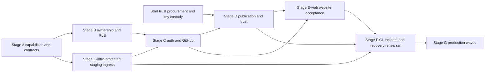

# Plan 0020 — Package Registry and Manager

**Status:** in progress. The folder registry, verified fetching, deterministic resolution, folder locks, local overrides, folder publication and uv integration are implemented under [`packages/manager/`](../../packages/manager/README.md). `make -C packages registry-test` exercises fixtures, manifests, the client, core/API suites and a loopback consumer. Real compiler checks on 25 October 2026 passed all eight build forms across Default and Python flavors: bare build, run, relative project path and absolute project path from another directory. Derived manifests now live in the selected project's `.osprey/build/` with manifest-relative source paths. The second-machine probe remains open.

Crash-safe activation, canonical build-plan/release artifacts, authenticated public publishing, the hosted package website and the trust plane remain delivery work. Current filesystem handlers use POSIX shell commands; cross-platform acceptance remains open. Checked-off items below record specific delivered subsets, not completion of every requirement in their phase.

**Contracts:** [package management](../specs/ecosystem/0029-PackageManagement.md), [trust and discovery](../specs/ecosystem/0030-PackageRegistryTrustAndDiscovery.md), [domain types](../specs/ecosystem/0031-PackageDomainModel.md) and [evidence](../specs/ecosystem/0032-PackageEvidenceAndDiscovery.md). [Research references](../package-manager-research.md) support the fixed design; phases validate it rather than reopening product decisions.

**Ownership:** [organization-only packages, one package admin and explicit permissions](../specs/ecosystem/0045-OrganizationPackageGovernance.md); tables are defined by DataProvider migration YAML and the canonical typeDiagram. No personal scopes or global package leaf names.

**Hosted rollout:** [deployment and ownership spec 0044](../specs/ecosystem/0044-PackageRegistryDeploymentAndOwnership.md) and the [staged rollout plan](0020-package-manager.md) govern Cloudflare ingress, website/API deployment, Supabase GitHub authentication, organization/package RLS, maintainer grants, source-derived publication, recovery and launch gates. They extend phases 6–12; hosted writes stay disabled until their conformance and independent review pass. The deferred local-only registry CI arrangement below ends before hosted deployment.

## Delivery target

First, ship a working, self-hostable registry: an Osprey API that serves
working packages from a folder, and an Osprey client that fetches and verifies
them (`[PACKAGE-FOLDER-REGISTRY]`). Then grow it into a public, source-derived Osprey package registry with a small local command
surface, complete deterministic dependency resolution, end-to-end provenance,
non-executable installation, evidence-based maintenance scoring, and fair
discovery. Local development can replace any canonical package key globally with
a checkout and switch it back in one command. Release builds reject those
overlays, pin every input, and contain exactly one source for each package key.
The complete package system MUST be implemented in Osprey, including the CLI, manifest parser, domain model, resolver, locks, cache, cryptography, filesystem transactions, process isolation, HSM/forge adapters, registry API, publication pipeline, scoring, and WebAssembly frontend. Package tests, independent reference implementations, and operational tooling are also Osprey. There is no Rust host, CLI bridge, or other implementation-language exception. The binding contract is `[PACKAGE-IMPLEMENTATION-LANGUAGE]` in spec 0029.

The launch package format is Osprey source plus closed-format declared data. SQLite and
other native components are explicit system capabilities installed separately
through operating-system package managers. Osprey package installation never downloads native provider binaries, runs lifecycle hooks or invokes operating-system installers. Declared CPython interop dependencies use the separate uv environment described in spec 0029.

## Current repository seams

- `crates/osprey-project` assembles mixed-flavor source graphs. Its compiler manifest reader handles `[project]` and `[modules]`; package metadata and resolution belong to the Osprey package client.
- `crates/osprey-cli` supplies the existing compiler, project build, tests, documentation, formatter and target drivers. `packages/manager/cli` is the separate Osprey package frontend, including its folder-lock model, verified install and derived compiler project.
- `packages/manager/core`, `manifest` and `resolver` implement package identities, canonical manifests/source digests, capability surfaces and deterministic resolution. A derived compiler manifest is not the complete canonical build plan with toolchain/provenance inputs required below.
- `packages/manager/api` serves the database-free folder registry. The hosted browser UI, Supabase data plane, TUF client, transparency log, provenance builders and discovery index remain planned.
- The folder registry proves source integrity, not publisher authority. Authenticated publication and trust proofs belong to Milestone B; source verification must remain usable without those services.

These compiler crates are build tools for the Osprey package application, not implementation locations for package semantics. The binding language requirement is `[PACKAGE-IMPLEMENTATION-LANGUAGE]` in spec 0029. Missing host capabilities remain explicit blockers with regression probes.

## One-source architecture

The implementation is placed deliberately:

```text
schemas/package-registry.td       canonical typeDiagram model
packages/manager/core/                    Osprey manifests, domain, policy, resolver, scoring
packages/manager/cli/                     Osprey command parsing, presentation, compiler invocation
packages/manager/host/                    Osprey effect handlers, crypto, filesystem and process adapters
packages/manager/api/                     Osprey REST server: folder registry first, hosted data plane later
packages/manager/sample-registry/         a folder of real packages the server serves and the tests fetch
packages/manager/web/                     Osprey browser application -> WebAssembly
packages/manager/tests/                   Osprey conformance tests, independent oracles, fuzz drivers
packages/manager/blockers/                Osprey probes for host capabilities Osprey lacks (red by design)
packages/manager/ops/                     Osprey publication, migration and operational tooling
packages/manager/supabase/migrations/     DataProvider migration YAML for PostgreSQL schema/RLS (Phase 6)
```

`schemas/package-registry.td` is the source of generated Osprey domain types as
soon as typeDiagram's Osprey target lands. Handwritten copies are forbidden.
Until generation is available, implementation uses serialized conformance
fixtures directly and does not duplicate the model in service code.

`packages/manager/core` owns every rule shared by CLI, API, and web: identities,
manifest semantics, catalog projection, solver clauses/objectives, score
methodology, and ranking policy. `packages/manager/host` implements effect handlers in Osprey and cannot choose policy. API preview resolution and local lock resolution run the same compiled core and policy digest. Schema, manifest, fixture, and deployment data are declarative inputs; they cannot hide executable package logic in another language.

The Osprey command frontend owns the planned `osprey package`, `add`, `use`, `lock`, and other package commands. It invokes the existing compiler for compilation through Osprey process effects. Bootstrap and command routing must not require edits to the existing Rust CLI or a non-Osprey launcher.

## Milestone 0 — Working registry API serving working packages

**First and foremost.** Spec `[PACKAGE-FOLDER-REGISTRY]` is the contract. Exit
criterion: one person starts the Osprey server over a folder of packages on
one machine, and another fetches a package from it over the network, has its
digest verified, and builds a project that uses it. All of it is Osprey, and
every item lands with tests.

### Phase F1 — Folder catalog and source bundles

- [x] Parse a release directory path `@scope/name/<epoch>.<ordinal>` into key,
      epoch, and ordinal, rejecting every malformed segment with a stable code.
- [x] Walk the registry root through a `Host` directory effect. Until Osprey has
      a directory builtin (`files.directory` blocker), the native handler lists
      files through the `Process` effect, and the blocker records it.
- [x] Validate each release with the shared source rules, compute its
      `SourceDigest`, and report every invalid release with its reason.
      `ReleaseFiles::assemble` adds the LFS-pointer and submission-bound rules;
      `tests/src/loader_tests.osp` drives the loader over
      `fixtures/folder/refusals.json`: two releases served, nine refused, each
      with its stable code.
- [x] Encode and decode the canonical JSON source bundle, with round-trip,
      ordering, escaping, and tamper tests.
- [x] Build the catalog keyed by digest and by key, ordered by key, epoch,
      ordinal.

### Phase F2 — Osprey registry server

- [x] Serve `GET /v1/health`, `/v1/packages`, `/v1/packages/{scope}/{name}`,
      `/v1/releases/{digest}`, and `/v1/releases/{digest}/source` from
      `packages/manager/api/`, with `ETag`s and `application/problem+json` errors.
- [x] Route through one pure function from request to response, tested for
      every endpoint and every error without opening a socket.
- [x] Read root, bind address, and port from a JSON config file, because
      Osprey has no argv or environment builtin yet.
- [x] Ship `packages/manager/sample-registry/` with at least three real packages, one
      depending on another, each compiling with the existing compiler.
- [x] End-to-end test: start the server on a loopback port, request every
      endpoint with the Osprey HTTP client, and assert the bodies byte for byte.
      `packages/manager/e2e` builds and starts the server on `127.0.0.1:18797` and
      compares status, ETag and body of every endpoint with the pure `Router`.
- [x] `make -C packages registry-serve-sample` starts the server over the sample registry.
- [x] Local registry `[PACKAGE-LOCAL-REGISTRY]`: `make -C packages registry-serve` publishes the
      repository's own `packages/*` into `target/local-registry` with
      `publish --folder` and serves it on `127.0.0.1:8787`. All 19 packages
      stage. The VS Code extension bundles the server and the staged
      tree, starts and stops it from commands, the `osprey.toml` explorer menu
      and the status bar, and offers to start it when the package manager opens
      against a silent loopback registry (`test/suite/local-registry.test.ts`).
- [x] Every package in `packages/` is served. `@osprey/jinja2`,
      `@osprey/numpy` and `@osprey/safetensors` bound native panics, which
      capability confinement refuses and [FAILURE-EXPLICIT] forbids: jinja2's
      unused `quarantine` is gone (its `halt` already reports render errors),
      safetensors' unused binding is gone, and numpy's GPU product now answers
      a failed `mat_mul` as numpy's `ValueError`
      (`errors.product_lengths` in its suite, under both storage handlers).
      `crates/osprey-cli/tests/no_osprey_panics.rs` refuses any package or
      example that binds a native panic, abort or exit.
- [x] Harden the server to `[PACKAGE-HARDENING]` S1–S3: `405` carries
      `Allow: GET`; every response carries `nosniff`, `default-src 'none'` and
      `no-referrer`; digest-addressed responses are `immutable`, the rest
      `no-cache`; traversal, percent-encoded and method probes are answered from
      the catalog alone. `Router::hardeningHeaders`, asserted by
      `router_tests` ("hardening headers", "hostile probes"); the runtime's
      request bounds (1 MiB, 32 KiB headers, 5 s) are recorded in S4.
- [x] Publish `SECURITY.md` (`[PACKAGE-HARDENING]` D1: private reporting,
      scope, response target).

### Phase F3 — Download client

- [x] `fetch @scope/name[@epoch]` and `fetch <digest>` download a bundle from
      the configured registry URL, verify its digest, and write
      `.osprey/packages/@scope/name/<digest>/`.
- [x] Reject a tampered bundle, a wrong key, a missing release, and an
      unreachable registry, each with a stable code and a test.
- [x] A consumer project builds against a fetched package: the end-to-end
      demo of the exit criterion, run on loopback by `make -C packages registry-test`.
      `packages/manager/e2e` fetches every release by name, epoch and digest, checks the
      installed bytes, then builds and runs `e2e/consumer/` against the fetched
      `@demo/report`, `@demo/maths` and `@demo/greeting` sources.

### Phase F4 — Stand it up anywhere

- [x] Document running a registry on any host, port, and folder, and pointing
      a client at it, in `packages/manager/README.md`.
- [ ] Bind to a non-loopback address and serve a second machine on the same
      network; record the measured result. Needs a second machine; binding
      `0.0.0.0` from an automated session was refused by its permission policy,
      so this stays a manual step.

Registry suites run through `make -C packages registry-test` only until the package system
stabilises. Wiring them into `make test` and CI is deferred to the last phase
of this plan, "Deferred — CI integration".

## Milestone A — Local package engine

### Phase 0 — Schemas and adversarial fixtures

- [x] Establish `packages/manager/core`, `packages/manager/cli`, `packages/manager/host`, and `packages/manager/tests` as ordinary Osprey projects built by the existing compiler; prove an Osprey command reaches the shared core and returns a tested result. Projects share source through `source_roots`; `osprey-pkg doctor` reaches `registry::Capabilities` and `packages/manager/tests` covers it with fixture hosts.
- [x] Inventory required argument, byte-buffer, filesystem, atomicity, process, cryptographic, and network capabilities. Exercise each through Osprey tests and record unavailable capabilities before depending on them. No substitute implementation in another language is permitted. Recorded in `packages/manager/README.md` and `packages/manager/core/src/capabilities.osp`; argv, exit status, environment, binary-safe reads, directory operations (including atomic rename and fsync) and a UTC clock remain blocked. Bitwise builtins now exist and are covered by an inventory regression; the registry SHA-256 still uses lookup tables. The network is exercised by `packages/manager/e2e` (server and client on loopback); SHA-256 runs in Osprey.
- [x] Add an Osprey conformance gate that rejects non-Osprey executable source in the package system, including tests, host adapters, operational tools, and handwritten browser glue; validate declarative inputs separately. `registry::Conformance` plus the checked-in-tree suite.
- [x] Extract the typeDiagram block from spec 0031 into
      `schemas/package-registry.td` and make documentation import/render it. The spec keeps the rendered block and a suite fails when the two differ.
- [x] Add canonical JSON fixtures for manifests; proof-free publication payloads
      and detached ordered-proof envelopes; release IDs/statuses; typed TUF,
      inclusion/consistency and witness bundles; both locks/proofs; build receipts;
      evidence, attestations, advisories, and state transitions.
      `fixtures/canonical/` holds 44 values with RFC 8785 bytes and `H(d, x)`,
      bound by 46 digest/equality relations; `fixtures/transitions/` holds
      release-status chains; `fixtures/schema/` holds accept/reject cases.
- [x] Add malicious fixtures for path traversal, case collisions, symlinks,
      submodules, LFS pointers, devices, executable modes, Unicode confusables,
      oversized trees, decompression bombs, and digest substitution.
      `fixtures/malicious/confusables.json` and `png-bombs.json` (asserted by
      `registry::Png` header and chunk checks) join `paths.json` and
      `source/minimal-tree.json`. The IDAT inflate-overrun case is recorded for
      the PNG decoder, which does not exist yet.
- [x] Add bounded dependency graphs covering satisfiable, unsatisfiable,
      downgrade, epoch, target, capability, revocation, technical-lag, and
      cycle-rejection cases, each with the one expected lock/explanation.
      `fixtures/graphs/` (14 cases) agree with an exhaustive bounded oracle in
      `tests/src/graph_oracle.osp`; the CDCL resolver of Phase 3 must match them.
- [x] Record TUF, transparency, DSSE/in-toto, RFC 8785, SHA-256 agility, and
      compromised-mirror vectors from their primary specifications.
      `fixtures/vectors/`: FIPS 180-4 SHA-256, digest agility, RFC 8785
      sorting/escaping, the DSSE PAE example, RFC 9162 Merkle roots, inclusion and
      consistency proofs, TUF 1.0 client-workflow and compromised-mirror cases,
      asserted through `registry::Merkle`, `Dsse` and `TufCheck`.
- [x] Add golden vectors for exact UTC millisecond timestamps, every list sort/
      duplicate rule, detached PAE/WebAuthn bytes, every digest preimage/omission,
      and acyclic dependency-selection/build-plan/full-lock staging.
      `fixtures/time/datetimes.json`, `fixtures/order/lists.json` (104 cases over
      `registry::SetOrder`), `vectors/dsse.json`, and
      `fixtures/canonical/relations.json` for omissions and staging.
- [x] Run schema/fixture validation as a fail-fast stage of `make -C packages registry-test`, covering every suite and fixture. Joining `make test` is deferred to "Deferred — CI integration". `packages/manager/fixture-check` runs first: data-only fixtures, strict JSON, defined spec citations, complete indexes, and every value named in `fixtures/schema-map.json` valid against `schemas/package-registry.td` and in canonical list order; it also rejects undefined spec citations in registry source.

Exit gate: the package application and test harness compile from Osprey source without a package-specific host or launcher in another language, and every serialized form and security state transition has a reviewed, byte-exact fixture before storage or API code exists.

### Phase 1 — Manifest and canonical identity

The TOML parser and manifest validators live in `packages/manager/manifest/` with
their own test project, `packages/manager/manifest/tests` (`make -C packages registry-test` runs
it). They stay out of the shared core because of type-check cost, measured
with `--check` on the assembled `packages/manager/tests` program: 38 s wall (307 s CPU)
without the parser, 115 s (662 s CPU) with it. Only the parser-free
`ManifestModel` types are in `core/`; projects that parse manifests add
`../manifest/src` themselves. The `doctor` manifest verdict waits on that cost.

- [x] Implement one typed TOML parser in `packages/manager/core`, written in Osprey, that preserves current `[project]`/`[modules]` behavior and adds
      `[package]`, bounded discovery metadata, all three dependency tables,
      `[[assets]]`, and `[system.*]` from `[PACKAGE-MANIFEST]`.
      `registry::Toml` (strict TOML subset: tables, arrays of tables, dotted
      and quoted keys, inline tables, integers, strings, booleans; floats,
      datetimes and non-ASCII are rejected with located codes) and
      `registry::Manifest` with `ManifestSections`/`ManifestDeps` project
      `osprey.toml` onto the canonical `PackageManifest`; the spec example
      round-trips to `fixtures/manifests/ledger/canonical.json` and its digest.
      Lives in `packages/manager/manifest/` for now (see above).
- [x] Have the Osprey frontend validate manifests and prepare deterministic compiler inputs through the existing compiler interface. Keep package parsing and resolution out of the compiler's Rust project loader. `build` parses `osprey.toml` with `Manifest::parse`, verifies the lock, writes the derived project `.osprey/build/osprey.toml` (absolute roots, TOML-escaped strings; exact bytes asserted in `cli/tests` build suite) and invokes the compiler on it; the compiler's loader reads only that derived file and knows nothing of packages.
- [x] Accept `[project].python_sources` in published manifests as part of the
      canonical manifest (`pythonSources`), keep every listed path inside a
      source root when `[package]` is present (`manifest.python-source-unrooted`),
      and refuse any `.py` file in a release tree that does not begin with
      `# osprey: flavor=python` (`source.python-flavor-header`), so Python-flavor
      ports such as `@osprey/numpy` publish as Osprey source
      (`[PACKAGE-MANIFEST]`, `[PACKAGE-SOURCE-CANONICAL]`, spec 0043).
      `ManifestSections`/`Manifest`/`ManifestJson`, `ReleaseFiles::treeCode`,
      `schemas/package-registry.td`; `manifest/tests` 15/15, `bundle_tests`,
      the ledger canonical fixture and digest re-derived.
- [x] Reject SemVer/version fields, upper ranges, peer/optional dependencies,
      forge dependencies, published path dependencies, and unknown security-
      relevant keys with actionable source spans. `manifest_tests.osp`
      "rejects dependency selectors" and "rejects structure": every forbidden
      selector key and every unknown table or key fails with its code at the
      offending `line:column`, before any hashing.
- [x] Validate scoped ASCII names, SPDX expressions, source roots, dependency
      epochs/minimum ordinals, and system-capability declarations.
      `manifest_tests.osp` "rejects package metadata" and "rejects systems and
      assets": names via `Names`, licenses via `Spdx`, roots via `Paths`
      (duplicates and case-fold collisions), epochs and floors via the bounded
      integer rules, capability grammar and once-per-manifest, asset kinds,
      roles, extensions and digests.
- [ ] Implement the exact ASCII path grammar, entry encoding, root selection and
      domain-separated SourceDigest in `[PACKAGE-SOURCE-CANONICAL]`, plus
      manifest, build-plan, and ReleaseDigest generation. Path grammar, case-fold
      collisions, exclusions, forbidden entry kinds, LFS pointers, submission
      bounds, envelope bytes, `SourceDigest` and `H(d, x)` are in `registry::Paths`,
      `registry::Source`, `registry::Digests` and a pure-Osprey `registry::Sha256`,
      golden-tested against independently computed fixtures in
      `packages/manager/tests/fixtures/source`. Canonical manifest parsing/digests and source-root selection now exist. The complete canonical build-plan and release-artifact contract remains open; the derived compiler manifest does not close it.
- [ ] Generate a deterministic build plan from the project graph, toolchain,
      target, dependencies, and inferred type/effect/capability surface.
- [ ] Add cross-platform golden vectors proving identical digests on Linux,
      macOS, and Windows.
- [x] Compute each release's ambient capability surface
      (`[PACKAGE-CAPABILITY-CONFINEMENT]`) in `registry::Conformance` from a
      builtin-to-capability fixture, reject shadowed builtin names, accept
      `capabilities = [...]` grants on `[dependencies]` entries, and golden-test
      the surfaces of every sample-registry release. The scan lives in
      `registry::Surface` (not `Conformance`, which stays the
      implementation-language gate): its table equals
      `fixtures/capabilities/builtins.json`; a builtin's name declared with
      `fn`, `let` or `mut` is `source.shadowed-builtin` at publication
      (`ReleaseFiles::treeCode`); grants parse per the item above; and
      `fixtures/capabilities/sample-surfaces.json` records every sample
      release's surface, asserted by `surface_tests` over the real files.
- [x] Accept `[system.python]` with `capability = "python/interop"` and a
      CPython floor, and golden-test that a package's `pyproject.toml` and
      `uv.lock` are ordinary `SourceDigest` entries (`[PACKAGE-PYTHON-UV]`).

Exit gate: the same source project produces the same canonical identity on all
supported hosts, and every forbidden package input fails before hashing.

### Phase 2 — Release locks, local overlays, CAS, and atomic activation

- [ ] Implement RFC 8785 `osprey.lock` read/write and bind it to manifest,
      selected-root source, the complete typed TUF/status/log verification bundle,
      catalog snapshot/`asOf`, policy, complete
      compiler/runtime/toolchain/SDK/sysroot, target/CPU/flags, sandbox,
      normalized environment/time/randomness, exact system artifacts/native
      closure/provenance, and complete transitive graph.
- [ ] Canonically sort and deduplicate every set-like lock array, encode
      exact UTC millisecond times, non-negative integers and digests once, retain
      Merkle proof order, and store deterministic structured reason-code proofs
      instead of localized explanation strings.
      Done for the folder lock: packages by `ReleaseId`, overrides by key,
      edges in canonical edge order, surfaces as canonical sets, every digest
      once, strict decoding (`lock.order`, `lock.shape`). Times, Merkle proofs
      and structured resolution proofs belong to the Milestone B lock.
- [x] Implement `osprey.local.toml` as a package-key overlay and
      `osprey.local.lock` as its graph selection. Apply an override globally to
      every active edge; never retain a published candidate for the same key.
      `packages/manager/cli/lib/overlay.osp` reads and renders the `[overrides]` table
      (`path`, `epoch`, optional `baseline`); `lock --local` removes every
      published candidate of an overridden key, adds the checkout as the one
      candidate (its source digest, overlay epoch, baseline ordinal, surface and
      dependencies) so every edge resolves to it, and writes
      `osprey.local.lock` with the `overrides` member; `osprey.lock` never sees
      an override (`overlay_tests`).
- [x] Resolve root Runtime/Build/Test plus non-root Runtime/Build edges; exclude
      every non-root Test edge and apply one-key uniqueness to their union.
      `Clauses::rootClauses` fires every root edge, `edgeClauses` only the
      Runtime/Build edges of candidates (`ManifestModel::activeEdges`), and
      `uniquenessClauses` admits one release per key across epochs; the lock
      stores each package's Runtime/Build edges (`graphs/test-edge-not-activated.json`,
      `lockfile_tests`).
- [ ] Resolve each system capability through the threshold-signed provider
      catalog, selecting one catalog entry/input per capability and one digest per
      provider identity across the graph; publishers never choose host packages.
- [ ] CAS-stage manifest, optional release lock and immutable development state;
      commit one fsynced recovery journal and replay it before every read so all
      package mutations expose exactly old or new state. Ignore nested overlays.
- [ ] Permit live local source edits without resolution, rehash them into each
      development build's CAS snapshot, recheck contracts/effects/policy, emit a
      signed build receipt with actual derived digests, and invalidate only the
      local topology lock when a local manifest changes.
- [ ] Make release mode reject active overlays and external paths, verify every
      pinned digest, allow one pinned selected root plus registry ReleaseIds only,
      and reject duplicate package keys without an exception. Multi-root repos
      select the nearest ancestor manifest, keep state adjacent, emit one lock per
      root, and cannot release-depend on unpublished siblings.
      Done: `build --release` refuses any override, verifies every pinned
      digest and surface, and a duplicate key is `lock.duplicate-key`; the
      release lock holds registry `ReleaseId`s only. Open: nearest-ancestor
      root selection and multi-root repositories (`--project` names the root).
- [ ] Add a per-user content-addressed cache partitioned by hash algorithm and
      digest; verify on every ingress and before materialization.
- [ ] Materialize package graphs read-only through staging plus atomic rename;
      never run package content during fetch, install, build-plan creation, or
      activation.
- [ ] Make bare `build`, `run`, `test`, and `docs` always select the live-root
      development lock without network or resolution; only `build --release`
      selects the release lock after an empty-overlay check.
      Done for `build`: while the overlay is active a bare `build` selects
      `osprey.local.lock` (`build.no-local-lock` with the `lock --local`
      remediation when it is missing) and compiles overridden keys from their
      checkouts, and `build --release` refuses any override with
      `build.overrides-active`; without an overlay `build` still reads
      `osprey.lock`, which a development lock with no overrides equals byte for
      byte. `run`, `test` and `docs` are not package commands yet.
- [ ] Require unexpired TUF state for resolve/fetch/activate; allow a cached
      verified graph to rebuild after expiry only with an explicit stale-
      freshness/non-activation report, and confine known revoked bytes to
      capability-denied `--audit-revoked` reproduction.
- [ ] Implement cache locks, concurrent fetch deduplication, interrupted-write
      recovery, garbage collection from lock roots, and corruption self-healing.
- [x] Add `fetch`, `verify --offline`, `tree`, `why`, and `doctor` in Osprey with Osprey host-effect handlers
      with stable machine-readable output beneath concise terminal rendering.
      `packages/manager/cli/lib/{fetch,install,verify,tree,why,doctor}.osp` over
      `registry_host::Host`; `tree` prints the locked graph indented with
      `(build)` and ` *` marks, `why @scope/name` every edge chain from the
      root, both from `osprey.toml` and `osprey.lock` alone
      (`tree.no-lock`, `why.not-locked`, `why.no-path`). The machine-readable
      layer is the stable code-first lines every command prints; a JSON
      rendering is the Phase 4 "stable JSON" item. `packages/manager/cli/tests` 56/56.
- [x] Pin every locked release's capability surface in `osprey.lock` and fail
      `fetch` and `build` with `capability.surface` when an installed tree's
      recomputed surface differs (`[PACKAGE-CAPABILITY-CONFINEMENT]`).
      `packages/manager/core/src/surface.osp` scans the verified bundle's source for
      the ambient builtins (outside comments and string literals, whole
      identifiers, `http*`/`websocket*` by prefix; the table equals
      `fixtures/capabilities/builtins.json`) and adds the `[system.*]`
      capabilities; `lock` writes the set as `surface` on each lock package
      (`Lockfile`, canonical set or `lock.shape`); target-less `fetch`
      (`Install`), `verify --offline` and therefore `build` recompute it from
      the installed files and report `capability.surface @scope/name`.
- [x] Harden the client to `[PACKAGE-HARDENING]` C1–C8: the lock decoder
      applies the name and digest grammars (`lock.shape`); `lock` refuses
      `lock.release-replaced` and `lock.release-vanished` (the latter overridable
      with `--accept-removals`, which the refusal names) and a current lock
      that does not decode; every printed line passes the control-byte
      sanitizer; derived-project strings are TOML-escaped and compiler
      invocations shell-quoted; each probe of the spec's table is a named test.
      The 128 MiB body bound (`Bundle::sizeCode`, `bundle_tests`); the lock
      grammar (`Lockfile::keyOf`, `digestMember`; five grammar cases in
      `fixtures/lock/rejections.json`); the sanitizer (`Reports::printable`,
      wired in `cli/src/main.osp`, `reports_tests`); TOML escaping
      (`Build::quote`) and shell quoting (`Host::shellWord`, `build_tests`);
      the lock refusals (`packages/manager/cli/lib/lock.osp`, `lock_tests`).
- [x] The `lock` command of the folder registry (`[PACKAGE-FOLDER-REGISTRY]`
      "Folder lock", `[PACKAGE-RESOLUTION]`): one `GET /v1/packages`, every
      listed release fetched and verified through the same path as `fetch`,
      each manifest parsed (a rejected one excluded with
      `lock.invalid-manifest`), `Resolve::solve` run, `osprey.lock` written
      through `Lockfile::encode` with `+`/`=`/`~`/`-` lines; an Explain
      outcome prints its code and keys and writes nothing. `build` compiles
      each locked package through its own `source_roots` and `python_sources`
      (`build.manifest` when an installed manifest is rejected). Every command
      parses `--registry`/`--project`/switches through one `Flags` module and
      the suites share one `Fixture` module (the first draft duplicated the
      argument loop in four commands and the fixture handlers in five suites).
      `packages/manager/cli/tests` 56/56; `packages/manager/e2e` runs the real flow
      (`lock`, `fetch`, `verify --offline`, `build --run` on `e2e/consumer/`,
      lock bytes pinned in `fixtures/lock/consumer.json`).
- [x] Consume the folder lock: target-less `fetch` installs every locked
      release through the verified download and skips a tree whose digest
      matches; `verify --offline` reports `verify.no-lock`,
      `verify.manifest-digest`, `verify.dependencies`, `verify.missing`,
      `verify.digest` or `verified N packages`; `build [--run]` verifies, writes
      the derived project under `.osprey/build/` and runs the compiler.
      `packages/manager/cli/lib/{lockfile,install,verify,build,project}.osp`;
      `packages/manager/cli/tests` 31/31, `packages/manager/e2e` 30/30, `fixtures/lock/`
      (`[PACKAGE-FOLDER-REGISTRY]` "Folder lock").
- [x] Drive uv for the Python interop plane (`[PACKAGE-PYTHON-UV]`): `lock`
      composes `.osprey/python/pyproject.toml` from the root and every locked
      `python/interop` release by path source, runs `uv lock` and pins both
      digests under `root.python`; `fetch` runs `uv sync --frozen`;
      `verify --offline`, `build` and `run` regenerate, compare and run
      `uv lock --check --offline`, never syncing. Unit tests drive the uv
      invocations through a fixture `Process` handler; the end-to-end case
      uses uv when available; without it, the end-to-end probe asserts
      `python.uv-lock-failed status 127` and that no Osprey lock is written.
      `doctor` reports uv's path or installation guidance.

Exit gate: a fetched release graph rebuilds offline byte-for-byte with one node
per key; local source can switch both directions without manifest edits; process
termination at every write boundary leaves either the old graph or the new one.

### Phase 3 — Complete Osprey resolver

- [x] Implement candidate normalization and hard-clause generation for
      closure, epoch/minimum ordinal, target, capabilities, trust state and
      release uniqueness: `packages/manager/resolver/src/candidates.osp` (eligible,
      yanked-but-current, target, granted capabilities, with exclusion reasons)
      and `clauses.osp` (root edges, candidate Runtime/Build edges, per-key
      at-most-one, key-level acyclicity, and support clauses so no package
      outside the closure is selected). The clauses carry no origin tags yet
      (see the explanation item below). Lives beside the engine in
      `packages/manager/resolver/` rather than `core/` for the type-check-cost reason
      recorded in the README. Key and identity equality, ordering and the
      blank fallbacks are the single `Names`/`Identity` definitions; the
      first draft duplicated them in four modules.
- [x] Feed ambient capability surfaces and the root's per-dependency grants
      into the capability clauses, so an ungranted `io/network` release is not
      a candidate and `resolution.capability` names the key and capability;
      add the fixture graphs (`[PACKAGE-CAPABILITY-CONFINEMENT]`). `lock`
      gives each candidate its recomputed surface (`Surface::ofRelease`);
      the manifest grammar accepts `capabilities = [...]` on a dependency
      entry (`ManifestDeps::grants`, `manifest.dependency.capability`,
      canonical `grants` in the manifest JSON and spec 0031); the graph
      carries `grants` and `Candidates::capsOk` admits a capability granted to
      every key or to that release's key, never transitively. Fixtures:
      `graphs/grant.json` (granted, locked) beside `graphs/capability.json`
      (ungranted, explained); `cli/tests` lock suite drives both through a
      release that names `readFile`.
- [x] Implement deterministic CDCL with two watched literals, first-UIP
      learned clauses, backjumping, assumption cores and proof tracing:
      `packages/manager/resolver/src/sat*.osp`, `packages/manager/resolver/tests` 8/8 in 18 s
      and 1.0 GB (trivial, oracle, pigeonhole php(3,2)/php(4,3) with core and
      implied-learned-clause checks, learning, assumptions, determinism,
      rejects, 200-variable random 3-SAT). Restarts and clause minimization are
      deliberately absent (recorded in the module comment); the engine learned
      asserting literals one level too deep and relearned the same clause
      without bound until fixed.
- [x] Implement lexicographic partial-MaxSAT optimization in the exact order in
      `[PACKAGE-RESOLUTION]`, including its integer cost tuple and canonical final
      graph vector; freeze every earlier component before optimizing the next.
      `packages/manager/resolver/src/optimize.osp`: sequential-counter "at most k" with
      linear search over the components the folder registry has (changed
      identities, package count, lag; `V`, `D`, `U`, `E` are zero without a
      trust plane), then the package-tuple tie-break through `Sat::assume`.
      `Resolve::solve` matches all 14 graph fixtures byte for byte and agrees
      with the exhaustive oracle on each (`packages/manager/tests` 335/335). The graph
      suites were vacuous before this work (`test` ignores its thunk's result
      and the fixture decoder read the wrong JSON level); both fixed.
- [x] Derive minimal conflict cores and human explanations from learned
      incompatibilities; never synthesize explanations after the fact. Every
      hard clause records the package keys it is about
      (`Clauses::Problem.mentions`); on a refutation `Resolve` takes the
      solver's UNSAT core, minimises it by deletion (a clause whose removal
      keeps the formula refuted is dropped, one solve each) and hands
      `Explain::fromCore` the keys the minimal core mentions, so the packages
      an explanation names come from the proof; the stable code is the first
      of the spec's causes that holds for one of those keys. The oracle keeps
      the reachability path (`Explain::of`); both agree on all 14 fixtures
      (`packages/manager/tests` 335/335). Open: a `why` for a refutation that prints
      the core's clauses themselves rather than the keys.
- [ ] Evaluate every time-dependent objective at the signed catalog `asOf`, not
      the host clock, and include it in deterministic inputs. The folder
      registry carries no time-dependent component (`V`, `D`, `U`, `E` are
      zero, `Objective::overdueDays` takes its milliseconds as an input) and
      the resolver never reads a clock; the `asOf` input arrives with the
      signed catalog of Milestone B.
- [x] Property-test soundness, bounded completeness, determinism, safe
      downgrade, global one-key/one-source uniqueness, overlay replacement, and
      objective ordering; differentially test against an independent exhaustive
      Osprey oracle on small graphs. `packages/manager/tests/src/graph_gen.osp` seeds 60
      small graphs deterministically (one to three keys, one or two releases
      each, random Runtime edges including cycles, random floors);
      `graph_tests` asserts the resolver's lock equals the exhaustive oracle's
      byte for byte and that both refute the same graphs (soundness and
      bounded completeness, since the oracle enumerates every assignment; a
      refutation's code and packages differ by design when a graph has several
      causes: the resolver reports the cause its minimal core used and that
      core's keys, the oracle the first cause in spec order over every key),
      and that reversing the catalog
      and the root edges changes no outcome (determinism; `Resolve::solve`
      canonicalises its input first, which the generated graphs showed was
      needed for core-derived explanations). Safe downgrade, uniqueness,
      overlay replacement and objective ordering are the named fixtures
      `downgrade`, `revocation`, `technical-lag`, `tie-break` and the
      overlay suite's locks.
- [ ] Benchmark a representative 100,000-release catalog after metadata load:
      ordinary add/update p95 below two seconds and adversarial unsat below ten
      seconds on the CI reference machine. Performance work cannot weaken
      completeness or determinism.

Exit gate: no valid bounded graph is missed, invalid graph is emitted, or input
permutation changes a lock or explanation.

### Phase 4 — Simple transactional CLI

- [ ] Add `login`, `package init`, `add`, `remove`, `lock`, `update`, `use`,
      `fetch`, `tree`, `why`, `audit`, `verify`, `doctor`, `publish`, and `yank`
      as Osprey modules in `packages/manager/cli`, sharing `packages/manager/core` and `packages/manager/host`.
      Done as Osprey modules under `packages/manager/cli/lib`: `package init`, `add`,
      `remove`, `lock`, `update`, `use`, `fetch`, `tree`, `why`, `verify`,
      `build`, `doctor`, and `publish --folder <registry-root> [--breaking]`,
      the folder-registry publish: the release tree (manifest, source roots,
      python sources, declared assets) is checked and digested exactly as the
      server will and placed at the next ordinal of the newest epoch, or the
      next epoch, or `1.1` (`publish_tests`). Open: `login`, `audit`, `yank`
      and the authenticated `publish` of the trust plane (Milestone B);
      `Dispatch` answers them with the not-implemented status.
- [ ] Make `add`, `remove`, `lock`, and `update` show dependency, capability,
      vulnerability, and epoch deltas before one atomic manifest/lock update.
      Dependency deltas (`+`, `=`, `~`, `-` per package) and epoch deltas
      (`epoch @scope/name eN -> eM` from `update --breaking`) are printed;
      capability and vulnerability deltas wait for the surfaces and the
      advisory feed. `Transaction::commit` resolves against a proposed manifest through a file
      effect handler, then writes the manifest immediately before its lock.
      Interrupted network resolution leaves the manifest untouched; a reported
      lock-write failure writes the previous manifest text back.
      This is rollback on a reported failure; crash-safe atomicity remains
      blocked on filesystem rename and fsync support.
- [ ] Make `add`, `remove`, and `update` atomically recompute the registry-only
      base, rebase matching per-key baselines, validate the overlay graph, and
      write release/`publishedBaseLock` only for a complete registry solution.
      Retain an override while its key remains transitively reachable.
      The registry-only recompute and the complete-solution-only write are
      done (`packages/manager/cli/lib/{transaction,add,remove,update}.osp`,
      `transaction_tests`); baselines and overlays do not exist yet.
- [x] Make `add @scope/name` choose the current eligible epoch and
      `--epoch N` choose an older contract lineage; write exact digest pins only
      to the lock. `Add` takes the key's newest listed epoch, or `--epoch N`,
      and that epoch's newest ordinal as the manifest floor; the digest goes
      only to the lock (`add.exists`, `listing.unknown-package`,
      `listing.unknown-epoch`).
- [x] Make `add <path>` infer the key, write the canonical dependency with
      a published baseline ordinal and exact per-override `ReleaseId` even when no
      full base exists, or floor zero/epoch 1 when unpublished (`--epoch N` selects
      another lineage); after publication, `lock` establishes its first baseline.
      `Add` takes the key from the checkout's `[package]`, writes
      `{ epoch, min_release }` with the published baseline's epoch and ordinal
      (or epoch 1 / `--epoch N` and floor 0 when nothing is published,
      printing `development-only`), relocks the release lock only when a
      baseline exists, then maps the checkout through `Use::mapLocal` and
      relocks the development lock; a failed development relock writes the
      manifest and the release lock back (`overlay_tests` "add <path>").
- [x] Make ordinary `update` remain inside epochs and `update --breaking`
      evaluate newer epochs one by one with a generated migration report.
      `Update` relocks with the current lock's choices non-sticky
      (`Lock::relock(fresh)`), so a key moves to its epoch's newest release and
      prints `~`; `--breaking` retargets each root dependency with a newer
      listed epoch to that epoch at floor 1 and prints one
      `epoch @scope/name eN -> eM` line per move before the lock's delta. It
      moves to the newest epoch directly rather than one epoch at a time; the
      per-epoch walk belongs with the migration report of the trust plane.
- [x] While overrides are active, make `update` re-resolve their published base,
      atomically replace matching baselines, then revalidate locals; only
      `update --breaking` may change an override epoch, and failure changes none.
      `Update::overlayUpdate`: the release lock is relocked first, each
      mapping's baseline becomes the base's node for its key (printed as
      `baseline @scope/name <old> -> <new>`), only `--breaking` moves a
      mapping's epoch, and the development lock is relocked through the
      overlay transaction; a failed development relock restores both the
      overlay and the previous release lock (`overlay_tests`
      "update rebases an active overlay").
- [x] Make `use <path>` infer the package key/current epoch/baseline, apply it
      globally, and resolve a local lock; make `use <key> --published` remove it
      and `use --list` expose replacements; `use --clear` restores all or none.
      `packages/manager/cli/lib/use.osp`: the key comes from the checkout's
      `[package]` (`use.no-package`) and must already be in the graph
      (`use.not-a-dependency`; a new key goes through `add`); the baseline is
      the development lock's published node, else the release lock's, else the
      newest listed release of the epoch in force; the overlay and the
      development lock change in one `Transaction` (a failed relock restores
      the overlay). `--published`, `--list` (with each checkout's current
      source digest) and `--clear` as specified.
- [x] Make `lock` release-only and `lock --local` development-only. Capture the
      exact pre-override lock/ReleaseIds; switching back restores that baseline,
      never an opportunistic update, and preserves the overlay on revocation.
      `lock` ignores the overlay and writes `osprey.lock`; `lock --local`
      writes only `osprey.local.lock`; each mapping records its baseline
      `ReleaseId`, and the development lock's resolver keeps the current
      development lock's choices sticky, so switching back does not move other
      keys. Revocation handling waits for the trust plane.
- [x] Make `build --release` ignore no error: any override, duplicate key,
      unpinned source/system/toolchain input, mismatch, or fallback is fatal.
      Any override is `build.overrides-active` before anything is read from a
      checkout; a duplicate key is `lock.duplicate-key` at decode; every
      digest, surface and manifest pin is verified first and any mismatch
      stops the build; nothing resolves or falls back. Toolchain and system
      inputs are not pinned by the folder-registry lock (Milestone B).
- [ ] Snapshot-test terse success, offline, auth, quarantine, revocation,
      conflict-core, missing-system-capability, and recovery diagnostics.
      Exact-line assertions exist for terse success (`+`/`=`/`~`/`-` lines,
      `verified N packages`, `added`/`removed`/`published`), offline
      (`verify.*`), conflict (`resolution.*` with the keys the minimal core
      names), capability (`resolution.capability`, `capability.surface`) and
      recovery (`transaction.restore`, `lock --local` remediation). Auth,
      quarantine and revocation diagnostics wait for the trust plane.
- [x] Expose stable JSON for editor/automation integration without creating a
      second semantic API. `osprey-pkg --json <command> …` prints the command's
      report as one RFC 8785 line, `{"lines":[…],"status":N}`
      (`Reports::json`, routed by `Dispatch`): the same value the terminal
      shows, sanitized by the same path, with the same status
      (`dispatch_tests` "--json rendering").

Exit gate: init, add, switch local/published, build exact release offline,
explain, audit, update, and recover fit the command surface and never silently
mutate compatibility epochs or admit two sources for a package key.

## Milestone B — Verifiable public registry

### Phase 5 — Client trust plane

- [ ] Embed and out-of-band fingerprint the initial 3-of-5 TUF root; implement
      sequential old-and-new-threshold root updates, 2-of-3 release-bearing
      roles, consistent snapshots, expiry, and persisted version floors.
- [ ] Implement the 2-of-3 `release-status` role and monotonic typed
      `Eligible`/`Yanked`/`Revoked` record chain; require one fresh exact record,
      inclusion proof, and stored-checkpoint consistency proof per locked release.
- [ ] Verify distinct OIDC ephemeral-key and WebAuthn publisher proofs,
      DSSE/in-toto attestations, SLSA provenance, Merkle inclusion/consistency,
      3-of-4 witness quorum, gossip, and external cross-log receipts locally.
- [ ] Implement `Eligible`, `Yanked`, and `Revoked` client behavior exactly;
      cached locks survive yanks and known revocations block activation.
- [ ] Fetch source from interchangeable mirrors, distrust transport/storage,
      and accept bytes only after metadata, proof, closure, and digest checks.
- [ ] Run compromise simulations for every TUF role, publisher, forge, mirror,
      API, database, builder, scanner, log, witness, and local cache.

Exit gate: no single compromised online component can cause acceptance of
unauthorized, rolled-back, expired, targeted, substituted, or revoked source;
acceptance of still-valid frozen state is bounded by its signed expiry.

### Phase 6 — Hosted Supabase data plane behind the same Osprey API

- [ ] Create append-only identifiers plus mutable projections for principals,
      scopes, packages, release intents/releases, dependency edges,
      provider catalog/status records, assessments/evidence, advisories, appeals,
      ownership, and exposure ledgers.
- [ ] Store CAS replicas at digest-derived keys with create-only service policy;
      keep TUF/log authority and all signing material outside Supabase.
- [ ] Configure Supabase Auth for passkeys/OIDC, short sessions, MFA for
      privileged actions, RLS defense in depth, and no browser service role.
- [ ] Build the Osprey `/v1` REST API with cursor pagination, digest ETags,
      idempotent writes, `application/problem+json`, rate limits, and audit IDs.
- [ ] Ensure the browser uses only the API and every authorization decision is
      repeated server-side against stable principal/scope IDs.
- [ ] Prove the catalog and immutable objects can be reconstructed from CAS,
      TUF, and the transparency log after deleting the Supabase project.

Exit gate: the API passes contract/security tests and a total Supabase loss does
not invalidate identity, trust history, or recoverability.

### Phase 7 — Source collection and publication orchestration

- [ ] Bind package/subdirectory to a stable forge repository and release branch
      with scope plus forge-admin proof; log rebinding and quarantine it 24 hours.
- [ ] Implement proof-free RFC 8785 payloads plus detached ordered-proof envelopes
      for binding, intent, one-use challenge and final authorization, using exact
      DSSE/WebAuthn bytes and threshold principal sets from spec 0030.
- [ ] Bind the intent to the publisher-computed canonical SourceDigest and forge
      hash algorithm; recompute commit identity, reachability, manifest, and
      source digests before admitting the snapshot to CAS.
- [ ] Require the CLI to recompute and compare every challenge field, including
      source/manifest/context/dependency-lock/build-plan/release digests,
      compatibility, identity, ordinal and nonces, before final signing.
- [ ] Implement the GitHub App adapter using stable repository IDs, exact
      commits, configured release-branch reachability, and least privilege;
      implement the same adapter contract for GitLab and Codeberg fixtures.
- [ ] Fetch source server-side, validate/canonicalize it, archive it in CAS, and
      reject every upload, archive substitution, native payload, hook, generator,
      or undeclared asset before work enters the build queue.
- [ ] Allocate ordinal/epoch under a serializable package lock, enforce
      compatibility claims, and map each release digest permanently to one
      epoch/ordinal. Expired challenges retry that reserved identity; no digest or
      later submission can reuse it.
- [ ] Implement quarantine, independent appeal, publication, yank, revocation,
      transfer, recovery, and tombstone workflows as logged state machines.
- [ ] Produce and publish TUF metadata only after evidence, reproducibility, and
      policy gates complete.
- [ ] Compute and sign each release's capability surface at publication and
      serve it in catalog metadata, so a client never fetches an excluded
      candidate (`[PACKAGE-CAPABILITY-CONFINEMENT]`).

Exit gate: a source commit can become exactly one immutable release, while no
publisher-supplied artifact can reach the catalog.

### Phase 8 — Hermetic build and deterministic assessment

- [ ] Provision two separately administered SLSA Build L3 platforms with
      ephemeral workers, independent images/control planes, declared CAS inputs,
      resource ceilings, isolated caches, and protected attestation keys.
- [ ] Compile/type/effect check, run registry tests, infer capabilities, compare
      public contract/ABI/behavior claims, analyze affected clients, and require
      bit-identical reference outputs from both pools.
- [ ] Generate canonical Osprey-profile SPDX 3.0.1 SBOMs and in-toto/DSSE
      attestations with separate subjects for source assembly and each reference
      output; test byte equality independently of SLSA conformance.
- [ ] Integrate OSV-style advisories, reachability, secrets, licenses, SAST,
      taint, dependency intelligence, and sandboxed dynamic behavior analysis.
- [ ] Add Osprey branch coverage, mutation operators, property/fuzz runner, and
      client-impact testing with disclosed denominators, exclusions, and limits.
- [ ] Fail publication on confirmed malware, secrets, provenance failure,
      non-reproducibility, forbidden capabilities, or reachable critical/high
      vulnerabilities; send uncertain findings to quarantine and appeal.

Exit gate: every published release has reproducible source/build evidence and a
complete signed assessment without claiming that a clean result means safe.

### Phase 9 — AI review under measured authority

- [ ] Build complete signed temporal receipt frames and a finite generated
      adversarial frame with no repository/author/family/near-duplicate leakage;
      draw each one-use sample through the pre-window independent evaluator VRF.
- [ ] Add whole-source and semantic-diff review after deterministic analysis;
      treat package text as prompt injection and expose no tools, network,
      credentials, mutable memory, or production actions to the model.
- [ ] Deterministically chunk every raw token and AST node, add cross-file graph
      context, and sign a complete byte/token/AST coverage ledger; any omission,
      truncation, timeout, or model error remains quarantined.
- [ ] Permit automatic authority only for content-addressed weights, runtime,
      deterministic kernels/hardware profile, tokenizer, decoding/RNG/retry rules,
      prompt, tools, chunker, aggregation, threshold and policy; mutable APIs stay
      advisory, and every behavior change starts unqualified.
- [ ] Enforce the simultaneous exact package-level recall, false-positive,
      prevalence-derived precision and adversarial-recall finite-population
      hypergeometric bounds with logged alpha spending in
      `[PACKAGE-ASSESSMENT]`; report exact worst-interval ECE as diagnostic only.
- [ ] Shadow each candidate model and report PR-AUC, recall at FPR, false
      positives per million, Brier score, abstention, latency, and cost at the
      observed class prior.
- [ ] Ensure no AI-only pass, rejection, publication, yank, or revocation path
      exists and appeal reviewers do not receive the original model verdict.

Exit gate: the AI path can improve triage but cannot weaken deterministic gates
or exercise authority unsupported by measured evidence.

## Milestone C — Quality and fair discovery

### Phase 10 — Maintenance evidence and scoring

- [ ] Implement the fixed five-component, 24-month methodology and neutral
      confidence prior from spec 0032 in integer-only `packages/manager/core`; version
      and sign every calculation. `registry::Arithmetic` holds the canonical
      `roundDiv`/`higher`/`lower`/`ratio`/`weighted`/percentile primitives with
      fault-on-domain-violation; the methodology itself is not started.
- [ ] Measure median/p90 vulnerability response and propagation, reachable
      overdue risk, recurrence, continuity/handover, release reliability,
      tests/mutation/fuzz/client impact, normalized static findings, and response
      quality from immutable evidence.
- [ ] Treat missing data as `Unknown`; exclude raw vulnerabilities, commits,
      issues, stars, downloads, dependents, fame, age, and activity volume.
- [ ] Render score, confidence, component vector, raw evidence, timestamps,
      sample sizes, tools/rules, exclusions, and method changes on every page.
- [ ] Add counterfactual tests proving disclosure, a new package, a small
      community, or absence of popularity cannot mechanically lower rank.
- [ ] Differentially replay every normalizer, percentile, confidence and score
      against a second independent Osprey implementation and the signed basis-point golden vectors.

Exit gate: every score is independently reproducible and no aggregate conceals
which evidence changed it.

### Phase 11 — Fair search and Osprey WebAssembly UI

- [ ] Implement eligibility, the fixed merit formula, query-intent cohorts,
      28-day exposure debt, eight-merit/two-exploration allocation, 80% intent
      floor, and two-results-per-publisher cap in shared Osprey core.
- [ ] Enforce the signed 512-byte summary/12-keyword grammar and exact bounded
      key/summary/keyword/compiler-API lexical and semantic serialization; never
      index arbitrary package documentation as ranking text.
- [ ] Implement publisher-normalized entitlement, exact apportionment/ties, and
      auditable client-nonce VRF exploration with deterministic/degraded modes.
- [ ] Exclude all popularity/commercial features from default ranking and model
      training; expose `Most used` only as a separately selected sort.
- [ ] Collect randomized propensity-logged exploration events without raw IPs
      or retained raw queries and expire aggregate cohort ledgers after 28 days.
- [ ] Gate ranker releases on NDCG, coverage@10, new-package exposure, Gini,
      publisher share, exposure/merit, exploration conversion, and utility loss.
- [ ] Build the Osprey-to-WASM web UI for search, source, dependencies,
      effects/capabilities, evidence, proofs, advisories, release history,
      publishing, transfers, quarantine, and appeals.
- [ ] Meet keyboard, screen-reader, responsive, no-JavaScript evidence-download,
      and clear `No blocking finding` language requirements.

Exit gate: a relevant vetted newcomer receives controlled exposure without
lowering security eligibility or allowing the ranker to learn its own bias.

## Milestone D — Operational launch

### Phase 12 — Hardening and general availability

- [ ] Verify `[PACKAGE-IMPLEMENTATION-LANGUAGE]` across the complete delivered source and build graph: all package-system executable implementation, tests, adapters, and operational tooling are Osprey; no package-specific Rust/C/JavaScript/Python component or launcher is present.
- [ ] Operate independent CAS replicas, log monitors, four external witnesses
      with 3-of-4 quorum, cross-logging, 3-of-5 offline root custody, 2-of-3
      release-role HSMs, documented ceremonies, and compromise runbooks.
- [ ] Complete SLSA Build L3 for all packages and Source L4 for privileged
      packages; publish evidence only after independent verification.
- [ ] Run disaster recovery without Supabase, mirror/CDN, either independent
      build platform, one witness, and each online signing role in turn.
- [ ] Fuzz every parser/protocol boundary and pass all conformance suites from
      specs 0029-0032 on Linux, macOS, and Windows.
- [ ] Commission an independent security/cryptography/privacy/fairness audit and
      close every critical/high finding; publish the report and remediations.
- [ ] Launch with scoped source packages only. Do not add binary publication,
      lifecycle hooks, SemVer selectors, direct database clients, or pay-to-rank
      as post-audit shortcuts.
- [ ] Run `make ci` and the registry deployment rehearsal from an empty account
      to published package, fresh-client add, offline rebuild, update, yank,
      revoke, restore, and appeal.

Exit gate: every `[PACKAGE-CONFORMANCE]` and
`[PACKAGE-REGISTRY-CONFORMANCE]` requirement passes with retained evidence.

## CI integration

- [x] Run the folder-registry loopback demo, including a consumer build against fetched sources, in CI. `.github/workflows/ci.yml` runs `_test_registry` in separate GC and ARC jobs; both are required by the coverage gate.
- [x] Include both managed-backend registry suites in `make test` through `_test_registry`.
- [x] Run fixture/schema validation first, followed by manifest, CLI, core/API and loopback suites, with failures propagated. The target also runs the real native publication, installed-source integrity and interrupted-Add regressions. These checks do not establish the deferred hosted trust plane or crash-atomic activation.

## Fixed risk controls

| Risk | Required control |
| --- | --- |
| Package manager bootstraps itself | The entire package application, including CLI and host effects, is checked-in Osprey built by the existing compiler; no non-Osprey package bootstrap is introduced. Its released source later enters the same pipeline. |
| Required capability is unavailable in Osprey | Record the blocker with an Osprey regression case and resolve it through Osprey source or an existing platform interface. Never substitute package implementation in another language or weaken a security gate. |
| Solver complexity or slowness | Complete CDCL/MaxSAT remains mandatory; indexing, incremental reuse, and objective encodings optimize it. There is no greedy mode. |
| Supabase compromise or lock-in | Clients trust TUF/log/digests; all authoritative objects are reconstructable and storage/API are replaceable. |
| AI false positives or evasion | Real-prior gates, abstention, drift demotion, quarantine, independent appeal, and no AI-only authority. |
| New-package cold start | Neutral maintenance prior plus security-gated exploration and exposure debt, never fabricated quality history. |
| Vulnerability disclosure bias | Raw vulnerability count has zero weight; unresolved reachable risk and response/propagation speed are scored. |
| Native ecosystem pressure | System capabilities and explicit provider guidance; no native code or installer execution enters the registry. |
| Malicious code inside a dependency | Capability confinement: a published package reaches no file, process, network or terminal except through effects the consumer handles or capabilities the root granted; the resolver excludes ungranted releases, and fetch and build re-scan every installed tree. A compiler check that refuses ambient builtins in dependency roots is requested as a compiler issue, never implemented in the registry. |
| Python plane drift | uv owns Python resolution and installation; `osprey.lock` pins the generated uv project and `uv.lock` by digest, `build`/`run` verify offline, and the registry never carries a Python package. |
| Local override leaks into release | Separate development overlay/lock, prominent diagnostics, release-mode rejection, exact workspace digests, and one-key/one-source validation. |
| Forge/tag mutation | Dual-authority repository binding, publisher-computed digest, frozen CAS challenge, final signed authorization, and permanent log. |
| Key compromise | 3-of-5 offline root, 2-of-3 release roles, independent custody/control planes, witnessed rotation, and client version floors. |

## Definition of done

Every executable component delivered by this plan is implemented in Osprey, including the CLI, host effects, cryptography, adapters, tests, and operational tools. A mixed-language package implementation does not satisfy this plan.

The work is complete only when an unknown new publisher can publish a small
Osprey library from a reviewed forge commit with one command; a fresh client can
resolve it deterministically, verify every trust edge, install without executing
package code, switch a transitive dependency to a local checkout and back without
editing its manifest, reproduce the exact one-version-per-key release build
offline, understand every conflict and score, and find it through security-gated
fair exploration. The same exercise must survive a malicious mirror, compromised
database, revoked release, expired online key, failed builder, and full Supabase
loss without accepting different bytes or silently weakening policy.

# Plan 0020 — Hosted Registry Rollout

**Status:** planned, 25 October 2026. No cloud resources were provisioned and no deployment or live security verification was performed in preparing this plan. This is the deployment track of [plan 0020](0020-package-manager.md), governed by [deployment and ownership spec 0044](../specs/ecosystem/0044-PackageRegistryDeploymentAndOwnership.md), [organization/package governance spec 0045](../specs/ecosystem/0045-OrganizationPackageGovernance.md) and the existing [publication/trust contract](../specs/ecosystem/0030-PackageRegistryTrustAndDiscovery.md).

The launch target is a Cloudflare-fronted package website and Osprey API, Supabase GitHub login, database-enforced organization/package ownership, and source-derived publication with separate publisher signatures. There is no tarball-upload product. Hosted publication stays off until the complete acceptance gates pass; a read-only stage must not be presented as secure public publishing.

## Repository evidence and reference pattern

The current implementation is the folder registry: `packages/manager/api/lib/server.osp` routes method/path through a startup catalog; its callback deliberately does not use request headers/body. `api/lib/config.osp` reads folder/bind/port from JSON. Neither is a hosted authentication/ownership implementation. `packages/manager/README.md` lists missing host primitives, and `packages/manager/blockers/` holds probes. The eleven-table ownership migration and typeDiagram now exist; the migration intentionally grants no runtime access and its tool verification is blocked below. The dedicated website, hosted authentication/permission handlers, allow policies and release services remain planned in parent plan phases 6–12.

The following sibling repository paths were inspected as source references, not as proof of their current production configuration. They are external local references, not dependencies of an Osprey checkout; the chosen Osprey requirements live in spec 0044.

| Reference source | Observed pattern | Osprey decision |
| --- | --- | --- |
| NAP `docs/external/cloudflare-gcp-supabase.md`, sections `[STACK-CF-WORKER]`, `[STACK-CF-EDGE-SECRET]`, `[STACK-RUN-INGRESS]`, `[STACK-SUPABASE-RLS]` | Cloudflare proxy/WAF, host rewrite to Cloud Run, edge secret, Supabase Auth, restricted-role tenant RLS and transaction-local context; load balancer ingress is described as stronger hardening | Keep the service boundaries; require the stronger origin restriction before launch |
| NAP `scripts/cloudflare-gateway-setup.sh`, `docs/infra/cloudflare-gateway.md`, `src/nap/app.py` | Provisioned-rule shape and constant-time origin-secret middleware; NAP-specific hostnames/rates | Reuse the approach, not accounts, secrets, rate values or executable language |
| NAP `scripts/deploy_immutable_backend.py`, `cloudbuild.yaml` | Immutable backend deployment machinery and separated runtime/deployment configuration | Exact-SHA artifacts, no-traffic validation, pinned secret versions and measured rollback |
| TradiSite `cloudflare/host-rewrite.js`, `cloudflare/wrangler.toml` | API forwarded to Cloud Run; portal served through GitHub Pages; separate Storage website path; internal worker fetch explicitly needs edge-secret injection | Separate static website/API/content origins; do not copy wildcard tenant-site routing or depend on transforms re-firing on subrequests |
| TradiSite `cloudbuild.yaml` | Build → registry push → Cloud Run; migrations explicitly outside build/startup; runtime secrets from Secret Manager | Separate schema deployment and artifact promotion; fresh unconditional vulnerability audit added to every deployment path |
| TradiSite `backend/src/AiCms.Api/Services/IDbConnectionFactory.cs` | Source uses a `postgres` connection, SET ROLE and session-scoped `set_config(..., false)`, with an `app_admin` mode described as broad RLS access | Do not copy this credential/pooling model: use a restricted login, explicit transactions and transaction-local settings; no generic admin connection in the API |
| TradiSite `backend/src/AiCms.Api/Middleware/EdgeSecretMiddleware.cs` | Secret gate with health/OPTIONS exemptions, production startup requirement and constant-time comparison | Keep fail-closed startup and comparison; restrict health to a minimal probe and prove OPTIONS cannot enter business handlers |

Research roots: `/Users/christianfindlay/Documents/Code/NimblesiteAgenticPlatform` and `/Users/christianfindlay/Documents/Code/TradiSite`. Reviewers can reproduce these source comparisons there. Differences between reference docs and code are recorded above rather than treating the reference as automatically safe.

Cloudflare's current [availability table](https://developers.cloudflare.com/rules/origin-rules/) puts Host overrides on Enterprise, despite the NAP reference's older “Pro” wording. A copied JavaScript Worker would also violate Osprey's implementation contract. The selected launch route is Cloudflare → GCP HTTPS load balancer/serverless NEG → restricted-ingress Cloud Run → Supabase. Declarative routing removes both problems. Additional load-balancer/Cloud Armor cost must be included in the provisioned budget; the cheaper unrestricted `run.app` arrangement is not the launch plan.

## Deployment inventory and deliverables

Before implementation, record a reviewed environment inventory containing the exact website/API/content hostnames, Cloudflare zone/plan and rules, GCP project/region and service accounts, artifact registry, load balancer/certificate/NEG, Cloud Run services, Supabase project/region and role names, private buckets, GitHub OAuth callback/App installation, secret resource names/versions and trust custody. Use the [inventory schema and review instructions](../../packages/manager/ops/README.md); structural validation does not prove provisioning or authorize rollout. Values are not known from the reference projects and must not be fabricated. Default region is `australia-southeast1`; measure the selected Supabase link.

Inventory launch-critical external commitments at the start: five offline root custodians, separate release/status HSM operators, two independently administered build platforms, four witness organizations, an external cross-log and the governance repository/DNSSEC root-fingerprint publication path. Assign a named owner, provider commitment, provisioning lead time and readiness evidence to each; missing independent operators/custody are procurement blockers, not unassigned code tasks. Also inventory registrar/account MFA/recovery, authenticated notification delivery and privacy/retention operations.

Keep website, API, schemas and jobs in the existing parent-plan seams. Planned deliverables are `packages/manager/web/`, the existing `api/` and `host/`, `packages/manager/supabase/migrations/`, and Osprey deployment/rehearsal tooling in `packages/manager/ops/`. Use a dedicated Cloudflare Pages Direct Upload project for the prebuilt static WASM artifact, with deployment-ID rollback and no Functions/automatic push deployment. These paths describe work to deliver, not existing commands. New runnable CLI/Make entry points must be added to repository instructions only when implemented and verified; this plan does not invent a working deploy command.

Every stage has a named accountable owner and retained evidence manifest before execution. The implementer owns code/tests, the deployment owner owns account/secret provisioning and rollback, independent key custodians own trust ceremonies, and an independent security reviewer owns adversarial acceptance. A blank owner or missing credential/capability is a blocker, not a reason to skip a gate.

The committed language-site configuration (`website/src/CNAME`, `website/src/_data/site.json`) uses `www.ospreylang.dev`. Proposed registry hostnames are `packages.ospreylang.dev` (website), `packages-api.ospreylang.dev` (API) and `package-content.ospreylang.dev` (cookieless content), with separate `-staging` counterparts. These are planning defaults, not claims of DNS ownership/provisioning. Confirm zone access and collision-free records during inventory before creating them. Pin the environment API callback to `/v1/auth/github/callback`; GitHub still returns first to that environment's Supabase callback. Pages preview/default hostnames never join the credentialed CORS/OAuth allowlist.

Use GitHub CI federation into the narrowly scoped GCP deploy identity; provider API tokens that cannot be exchanged this way are separate project/zone-scoped Secret Manager entries with pinned versions, rotation and revocation tests. This includes the Cloudflare Pages/rules credential; federation does not make that credential disappear. The DataProvider migration role, website deploy role, API runtime role and incident operator remain distinct.

## Execution dependencies and blocker ownership

The stage letters group deliverables; they are not a reason to expose callbacks before ingress is secured. Split Stage E into infrastructure preparation (`E-infra`, started immediately after A) and completed website acceptance (`E-web`, after C/D). Implement every website flow against `[PACKAGE-HOSTED-ROUTES]`; that table is the authoritative API/actor inventory for the Stage F rehearsal.



Start supplier/operator engagement at Stage A kickoff, not after publication code is finished. Record actual supplier lead times and committed ready dates in the inventory; no production launch date is credible until they are known. Independent builders, HSM/root custody and witness/cross-log agreements must be ready before Stage D integration can exit. If a supplier slips, continue local adversarial development with explicitly labelled fixtures and retain a public-write hold; fixtures and same-operator substitutes cannot pass independence gates. The deployment owner re-plans the milestone rather than reducing quorum or trust requirements.

| Execution blocker | Accountable role and concrete next action | Evidence required to clear it |
| --- | --- | --- |
| DataProvider 0.9.11-beta custom-schema inspection | Dependency maintainer, coordinated by deployment owner: track a DataProvider fix deriving all inspected schemas from the desired YAML for both diff and post-apply verification; add an upstream CLI regression for a precreated non-`public` schema; release/review and pin the fixed tool version | Fresh creation, existing-schema upgrade, actual eleven-table constraint/RLS probes, and rerun yielding zero operations all pass through the unmodified verifier. A new version invalidates the earlier migration receipt: rerun and bind the replacement evidence to that exact tool/artifact version and audit its dependencies |
| `schema-check: long whitespace and identifiers` SIGBUS | Compiler/runtime maintainer: retain the exact failing case and 100,000-character bounds; isolate and correct the parser/runtime defect without weakening the assertion, limits or gate | The original case and the full registry schema/fixture suites pass with recorded compiler/runtime digests and applicable backend results; then repeat the Stage F exact-SHA checks |
| Missing hosted Osprey capabilities, handlers or allow policies | Package implementation owner: close Stage A probes and Stage B–E contracts with test-first changes; readiness remains `ownership.not-ready` | Positive and negative route/RLS/publication tests prove working authorized flows, not only denial from the closed bootstrap |
| Missing independent trust operators or real deployment inventory | Deployment owner and named trust custodians: obtain provider commitments, account access, secret custody and actual environment assignments | Complete inventory and independent ceremonies/rehearsals before Stage D/F exits; no borrowed NAP/TradiSite credentials or invented resource IDs |

## Stage A — Prove capabilities and contracts

- [ ] Map spec 0044 IDs to the existing packages and add named failing Osprey regressions before each implementation change.
- [ ] Run the existing `make -C packages registry-test` baseline; keep its folder-registry behavior while extending the same API.
- [ ] Inventory/probe JWT/JWKS verification, WebAuthn/DSSE, entropy, secure time, constant-time comparisons, TLS verification, credential storage, PostgreSQL transactions/pooling, headers/cookies, secret delivery and browser/WASM host interfaces. Record absent capabilities in the existing blocker suite with failing assertions; resolve through Osprey, never a native/JavaScript package shim.
- [ ] Verify the native API image's Cloud Run bind/port behavior and secret access. The current JSON bind/port config and missing environment support need an explicit tested solution; no shell secret interpolation or credentials baked into JSON/images.
- [ ] Extend the canonical domain model for stable principal/org/package IDs, accepted org memberships, the single administrator FK, explicit permission grants, epochs, sessions, invitations and handovers; reconcile spec 0031 and `schemas/package-registry.td` before generating implementation types. No duplicate handwritten model.

Exit: executable probes prove required capabilities, existing regression suites pass, and unresolved capabilities prevent advancement to hosted writes.

## Stage B — Supabase ownership and RLS first

[Spec 0045](../specs/ecosystem/0045-OrganizationPackageGovernance.md) and `packages/manager/supabase/migrations/schema.yaml` govern this stage. Provision the private `registry` schema as a platform resource before applying table migrations. The initial migration is intentionally FORCE-RLS/default-deny with no runtime grants; readiness must reject `ownership.not-ready` until the narrow policies/handlers and tests arrive together.

Measured blocker on 25 October 2026: pinned DataProviderMigrate 0.9.11-beta applies the custom-schema tables but its CLI inspection/verifier searches `public`, falsely reports `registry` tables missing and cannot prove convergence. A disposable PostgreSQL probe retains that failure; no deployment may suppress it, switch to exposed tables or skip verification. The dependency needs custom-schema inspection/verification support before this stage can pass. Source inspection confirms `PostgresPolicyCatalogNormalizer.Inspect` hardcodes `public` and the CLI calls it for both the initial diff and post-apply verification; no supported CLI flag changes that. Use a mounted PostgreSQL passfile or provider secret mechanism; this installed CLI logs its output connection string, so never place a password in that argument.

- [ ] Create isolated local/staging projects and apply the pinned DataProvider migration YAML: same-org composite FKs, one non-null active-member administrator, organization/name uniqueness, immutable identities and non-cascading history. No handwritten SQL/ORM schema.
- [ ] Provision restricted runtime logins with no owner/BYPASSRLS/elevated role membership; separate migration/collector/eligibility/audit permissions. Remove default grants and unused Data API/GraphQL/Realtime exposure.
- [ ] Implement one transaction/context boundary and the exact RLS predicates/column permissions for organization memberships and package permissions. Prove pooled request isolation across success, cancellation and rollback.
- [ ] Implement spec 0045: organization-only ownership, organization custodians/members, one package administrator, explicit per-package permissions, targeted invitations, admin handover, maintenance responsibility and 30-day exceptional recovery. Organization custodians cannot grant package permissions unless they hold that package's sole administrator reference. All mutations produce atomic audit/outbox evidence.
- [ ] Implement durable rollout-mode/version checks from `[PACKAGE-HOSTED-CONTROL]`, including deny-on-store-failure and epoch invalidation of queued writes; package permissions cannot change deployment modes.
- [ ] Test two orgs, multiple packages and an outsider against every CRUD/join/view/storage path using actual production-shaped roles, including direct Supabase requests. Include positive controls, row/column escalation attempts, stale sessions, same-connection reuse and concurrent removal/finalization.
- [ ] Prove the anti-name-sitting requirement end to end: reserving, publishing, tombstoning or moderating `@org-a/helper-functions` cannot block `@org-b/helper-functions`. Database uniqueness and website/API availability checks use `(organization_id, name)`; no global leaf-name claim or reservation exists.
- [ ] Audit actual `pg_roles`, memberships, schema/column/default grants, policies, function execution, exposed schemas and storage policies. A textual policy-name check alone is insufficient.

Measured local evidence on 25 October 2026: eleven tables from the YAML were applied to disposable PostgreSQL; 36 structural/default-denial assertions passed, including same leaf names across two orgs, multiple publishers, single-human-admin enforcement, handover bounds, rejoin/renewal history and same-org FKs. Name fixtures and five fixture-audit groups passed. Six native schema cases passed (parity, declarations, accepted/rejected values, datetime and floats), but the unchanged `schema-check: long whitespace and identifiers` stress case terminated with SIGBUS. Keep that exact failing case and close the parser/stress failure before the conformance gate can pass; these observations do not establish hosted authorization or a successful DataProvider migration.

Exit: denied operations leave state unchanged; the API role cannot escape RLS, impersonate a worker through role switching, or mutate ownership keys through ordinary updates. No service-role fallback.

## Stage C — GitHub login and publication authority

- [ ] Configure separate staging/production Supabase GitHub OAuth apps and exact provider/API callback URLs; implement API-managed PKCE/state and opaque browser sessions.
- [ ] Implement bounded sessions, logout/revocation, CSRF, exact-origin CORS, fresh WebAuthn proof and the CLI browser handoff/credential-store path.
- [ ] Prove identity linking/recovery cannot transfer package authority through email, username reuse or Supabase automatic linking. Restore and rotate credentials through logged principal proofs.
- [ ] Prove revoked/unapproved linked identities lose private reads as well as mutations; positive anonymous reads use the separate published-projection reader. Every human CLI publication uses browser WebAuthn; OS-store access tokens do not sign releases.
- [ ] Configure the separate least-privilege selected-repository GitHub App; implement dual-authority binding, stable provider IDs, signed webhook validation, replay rejection and synchronous installation/branch/owner revalidation.
- [ ] Exercise all of `[PACKAGE-HOSTED-AUTH]`, including uninstallation/repository transfer with delayed webhooks and a removed maintainer retaining a valid JWT.

Exit: a new user can log in and receive only explicitly granted scope/package authority; a login token alone cannot authorize a release.

Stages B–D develop against local or access-controlled staging fixtures. No live OAuth/App callback or webhook listener may be exposed until Stage E's full ingress chain is installed in that environment. Stage C can validate its adapters against recorded/signed fixtures before that cutover; production provider registrations remain inactive until the protected-route rehearsal passes.

## Stage D — Source publication, workers and independent trust

- [ ] Extend the existing API with signed intent/challenge/finalization endpoints sharing core policy. Reject tarballs, multipart bytes, public storage writes and arbitrary repository URLs.
- [ ] Collect only a bound exact commit, freeze canonical source in private CAS, allocate immutable ordinal/digest reservations and enforce one-use expiring challenges and authority epochs.
- [ ] Implement serializable ownership/publication transitions with consistent locks, idempotency and an outbox. Revalidate authority before collection, signing and eligibility; prove races with grant removal, transfers, duplicate requests and process crashes.
- [ ] Complete parent-plan phases 5 and 7–10 prerequisites: independent reproducible builders, scanning/evidence, signing custody, TUF/status, witnessed log and fresh-client verification. No single database row or worker result grants eligibility.
- [ ] Complete the external operator/custody commitments from the inventory, embed the reviewed initial TUF root in the CLI and publish its version/five fingerprints through the governance repository and DNSSEC. Verify the fresh-client bootstrap and sequential root rotation independently.
- [ ] Prove storage overwrite/upsert/list/signed-upload refusal and quarantine isolation. Run malicious source/prose, archive/path, SSRF and build-sandbox tests.

Exit: an authorized publisher can produce exactly one independently verifiable source release; every unauthorized actor/path fails without publishing anything. Outstanding trust gates keep publication disabled.

## Stage E — Cloudflare and read-only staging

- [ ] Provision Cloudflare proxy/TLS/WAF, separate static website deployment, cookieless content origin, GCP load balancer/Cloud Armor/NEG, restricted Cloud Run and DNS-validated origin certificates.
- [ ] Install the hostname-scoped header-overwrite transform and constant-time API secret guard. Test secret rotation with a short dual-version overlap, then prove the retired secret fails; test missing-secret startup failure.
- [ ] Verify registrar lock, zone DNSSEC/DS, individual administrator MFA/recovery and least-privilege ruleset edits. Validate Cloud Run's isolated probe port without a public health bypass; serverless NEGs need no load-balancer health check.
- [ ] Block direct run.app/revision/LB-IP traffic and traffic via a different Cloudflare tenant; test public success through the intended hostname, including OPTIONS and CLI requests.
- [ ] Implement the Osprey WASM website's login, organization/membership/package-admin/permission controls, repository binding, publication progress and rejection reasons. Escape/sanitize hostile content and never expose credentials or quarantined source.
- [ ] Wire and test every flow in `[PACKAGE-HOSTED-ROUTES]`, including org-scoped name availability, existing warnings, targeted invitation acceptance, exact single-admin handover, operational grants, maintenance and pending/rejected publication states. Incomplete screens stay hidden.
- [ ] Prove private/cookie/Authorization responses never enter CDN caches; immutable source caches verify digests and mutable signed status remains fresh. Load-test numeric API/worker/instance limits and set cost alerts.
- [ ] Cut over GitHub OAuth/App webhooks only through the tested protected ingress. Test invitation/owner/recovery notifications, SPF/DKIM/DMARC, failure alerts and the authenticated inbox; complete private-data retention/deletion handling before public enrollment.

Exit: the staged website supports the full flows, read-only public delivery works through Cloudflare, and origin/cache/tenancy controls pass. Cloudflare DNS is not evidence that origin bypass is closed.

## Stage F — Deploy/recover rehearsal and release gates

- [ ] End plan 0020's deferred CI arrangement before hosting: add registry/security/database/browser/edge suites to required checks, preserving every existing gate and coverage floor. Update required-check configuration and its verification together.
- [ ] Add dedicated registry build/deploy workflows; every staging/production/frontend/manual deployment depends on a fresh unconditional exact-SHA `audit` job. Run `make audit`, `make ci`, `make -C packages registry-test` and all hosted conformance checks. Do not reuse a passing audit from another SHA.
- [ ] Build the native image/static artifacts once, record immutable digests, apply reviewed additive schema changes separately, verify RLS drift/tests, deploy a no-traffic revision and run release smoke checks through an operator-restricted candidate route retaining the ingress/edge controls. Prove it reaches the candidate revision without public run.app/tag access; unavailable safe routing blocks promotion. Never migrate at build/startup.
- [ ] Rehearse traffic/artifact rollback to the exact prior release, checking schema compatibility and preserving consumed nonces, authority epochs, revocations and log history.
- [ ] Provision and rehearse `[PACKAGE-HOSTED-CONTROL]`: named mode-promotion authority, narrow independent incident job/credentials, freeze under edge/API outage, and jointly approved unfreeze. Prove neither operator mode changes nor the independent incident path can grant package permissions or eligibility.
- [ ] Restore off-provider database/CAS/ownership/trust backups into an isolated replacement project. Measure RPO ≤ five minutes and RTO ≤ four hours, reconcile all acknowledged security state with the signed log, and keep writes frozen until reconciliation passes.
- [ ] Rehearse from an empty account: GitHub login → create org → invite member → explicit publishing-permission grant → selected-repo binding → publish → fresh-client fetch/build → remove maintainer → reject queued/replayed publish → yank/revoke → transfer/recovery → restore. Retain positive results and every expected denial.
- [ ] Obtain an independent application/RLS/crypto/infrastructure audit and close all critical/high findings, including review of provider identity linking and pooler behavior.

Exit: complete signed release evidence binds exact source/artifact/schema/policy/configuration digests, test and audit results, actual runtime privileges, recoverability timings, operator ownership and rollback artifacts. Do not enable public writes on a partially green checklist.

## Stage G — Controlled production rollout

Promote the same artifacts from staging. Use explicit server-side modes: `read-only`, `allowlisted-publishers`, `public-publishers`, and `write-frozen`. The allowlist is an additional restriction over RLS/proofs; it never grants authority. Reads, ownership administration and publication have separate switches so an incident can freeze all sensitive mutations while retaining eligible public reads. Suspensions/revocations must remain available through the independent incident path.

The first production wave exposes anonymous reads only; login/callback smoke tests are operator-restricted and general signup/scope enrollment stay disabled. The internal and invited waves enable login/enrollment only for those explicit principal lists. General login/enrollment opens only in the final wave. Provider callbacks/webhooks remain reachable where protocol-required, but cannot create an unauthorized registry session or scope; the API enforces the wave restriction after verified identity.

| Wave | Traffic and duration | Promotion evidence |
| --- | --- | --- |
| Read-only | Production website/API, all writes frozen | Synthetic reads, GitHub callback configuration and direct-origin probes pass; no private data in CDN/logs |
| Internal publishers | Explicit enrolled staff/org allowlist for at least 24 hours | Full production publication and revoked-maintainer rehearsal; independent verification and alerts work |
| Invited organizations | Fixed invited organizations for at least 48 hours | Zero authorization/isolation failures; all expected denials observed; no unexplained eligibility, queue exhaustion or audit lag |
| Public enrollment | Open GitHub login/scope enrollment and publishing only after every prerequisite passes | Same RLS/proof gates, independent audit closure, healthy rate/resource limits and recovery evidence |

For a new API revision within each wave, progress traffic 1% → 10% → 50% → 100%, holding each step at least thirty minutes and requiring at least one hundred successful synthetic/API checks plus completed publication/revocation probes. With sparse traffic, actively run synthetic probes; elapsed time alone never promotes. Use separate artifact promotion for the static website, compatibility-test it against current and previous API versions, and keep prior digest rollback available.

Initial operational gates: API 5xx below 1% over fifteen minutes, metadata p95 below one second excluding explicit cold-start probes, no outbox item stalled beyond five minutes, zero unexplained proof/RLS/origin failures, and all signed metadata within its freshness window. These are launch targets to measure, not claimed current performance. Any suspected cross-org access, unauthorized acceptance, leaked credential or corrupt artifact immediately enters `write-frozen`; isolate the affected revision and investigate without weakening RLS. Availability-only regressions roll traffic back to the compatible saved artifact.

Alert on denied cross-scope attempts, privilege/policy drift, identity/owner changes, secret/JWKS failures, GitHub suspension, queue/outbox age, signature/witness freshness, digest mismatches and unexpected storage writes. Log request/trace/principal/scope/package/operation IDs and policy versions, but never cookies, tokens, private source or secret values. Retain access-controlled audit evidence and an operator incident/rotation runbook; test alert delivery before opening enrollment.

## Completion evidence

Completion requires spec `[PACKAGE-HOSTED-CONFORMANCE]` plus parent-plan public registry conformance, not just a successful deploy. Record actual hostnames, account inventory, exact deployed digests, named test results, independent review, observed wave metrics, recovery/rollback timings and incident ownership. Until that evidence exists, status stays planned/in progress and public publication remains disabled.

## Planning completion audit

The requested deliverable is the rollout design and its ownership/data contracts. That design can be complete while the execution checklist remains open. None of the unchecked implementation, procurement, audit or deployment items above is marked shipped by this audit.

| Requested requirement | Authoritative design/artifact evidence | Current conclusion |
| --- | --- | --- |
| Learn from NAP and TradiSite | Reference comparison above names the inspected gateway, Cloud Run, pooling/RLS and immutable-deploy source paths and records rejected insecure assumptions | Pattern investigated and decisions documented; no claim of live inspection of those deployments |
| Cloudflare in front of website/API | Spec 0044 `[PACKAGE-HOSTED-TOPOLOGY]`/`[PACKAGE-HOSTED-EDGE]`, proposed environment hostnames and Stage E-infra | Selected topology, origin bypass controls, caching/TLS and provisioning prerequisites mapped |
| Authentication and GitHub | Spec 0044 `[PACKAGE-HOSTED-AUTH]`/`[PACKAGE-HOSTED-ROUTES]`, Stage C | OAuth vs GitHub App, PKCE/session flow, identity linking, WebAuthn and credential/route authority mapped |
| Organization responsibility, one package admin, multiple permission holders | Spec 0045, the single active-human-admin composite FK, permission enum and scoped API actor table | Contract and structural schema defined; live transition/RLS policies remain closed and unimplemented |
| Prevent global package-name sitting | `[PACKAGE-NAMES-NO-SITTING]`, `(organization_id, name)` uniqueness, org-scoped availability route and Stage B acceptance | Same leaf name is legal in different orgs; a registration/tombstone cannot reserve it globally; 36 recorded local probes include the structural positive controls |
| DataProvider-defined tables | `.config/dotnet-tools.json` and `packages/manager/supabase/migrations/schema.yaml` | Eleven-table source and constraints exist; failed private-schema verification is an explicit execution blocker with an owner/remediation/acceptance path |
| typeDiagram model and consistency | `schemas/package-registry.td`, spec 0031's byte-identical projection and its parity/schema fixtures | Governance types exist and render; recorded schema checks passed except the separately retained long-input SIGBUS stress failure |
| Whole publication and ownership lifecycle | Specs 0030/0045, route inventory and Stages B–D | Source-derived publication, permission changes, admin handover, maintenance, yank/revoke, succession and recovery mapped; no unsigned file-upload shortcut |
| Safe execution and production rollout | Dependency graph, blocker/procurement ownership, `[PACKAGE-HOSTED-CONTROL]`, Stages F/G | Ordered implementation, separate control authorities, exact-SHA audit, rehearsals, waves, stop conditions, rollback and recovery mapped |

Planning is complete when these linked artifacts and contracts are present, mutually consistent and checked. Deployment readiness requires the stronger execution exits above, including both recorded defects being fixed, actual runtime policy/handler tests, independent trust operators and the independent audit. The next implementation action is Stage A capability triage in parallel with the named DataProvider/parser remediation and Stage E-infra preparation; public writes stay off.
