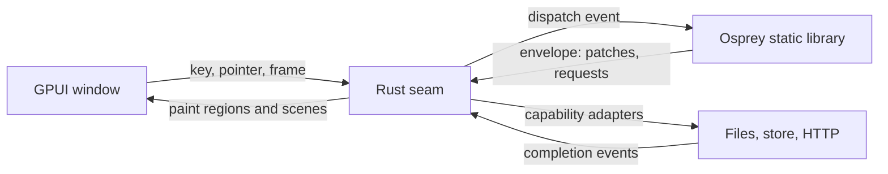

# Plan 0036 — GPUI desktop host: Osprey Native on the GPU, first on the Mac

Contract: [spec 0046](../specs/platforms/0046-GpuiDesktopHost.md). Framework: [`packages/native`](../../packages/native/README.md). Status: **phase 0 seam proven, phase 1 framework landed; window and Flock in progress.**

## Summary

[GPUI](https://gpui.rs) is Zed's GPU-accelerated UI framework. It becomes the second host of `@osprey/native`, after Vigil's SwiftUI host, and the first that runs on macOS, Linux and Windows. The direction is Rust calling Osprey: a small Rust crate links the Osprey static library, calls `start`/`dispatch` over the existing C boundary, patches keyed regions and draws them with GPUI. Osprey owns every rule; Rust owns pixels, input devices and platform services. No generics, closures or Rust ABI cross the boundary, so GPUI and rustc updates stay inside the crate.

**Priority: a working, useful app on an Apple silicon Mac.** Linux and Windows library targets come after that app runs.



## The example: Flock

An original arcade game, all in Osprey. The player steers one bird and herds a flock of thousands of boids (separation, alignment, cohesion) across a field while hawks dive at stragglers; rescued birds raise the score, and the flock grows each round. The game owns its physics, collisions, scoring, difficulty and pause/settings screens. The HUD, settings and high-score table use the ordinary `Node` components (`Screen`, `Section`, `Rows`, `Toggle`, `Picker`, `Badge`), so one app shows both the GUI components and the `Scene` surface. The boids count is the frame-rate gate: **5,000 boids at the display's refresh rate on an M-series Mac**, measured and recorded here before the plan claims a result.

Why a game and not another tool: a game needs a frame clock, a large scene patch every frame and a stable memory profile over minutes, which no existing Osprey host exercises. Those are the three risks of this host; the game is the test that drives them out.

## Rust holds the seam only

Rust code in `hosts/gpui` is reviewed against one rule: it may not encode application behaviour. The loader, region store, node-to-element mapping, scene painter, input forwarding, frame clock and capability adapters are Rust. Boid steering, hawk logic, scoring, round rules, pause, settings and every string the user reads are Osprey. A reviewer who finds a game rule in Rust moves it into Osprey before merge.

## Phases

### Phase 0 — prove the seam (macOS)

1. [x] Create `hosts/gpui` (Cargo crate) that links `libOspreyApp.a` built with `--target=macos`, calls `osprey_main()`, `start` and `dispatch`, and prints the envelope. Done: the probe lives in `hosts/gpui/probe` (the test suite's probe cannot be the library entry, because every scalar function in an entry namespace becomes a C export); `run.sh --smoke` starts it, taps Add by the ordinal the node carries and asserts "Count 1" through the real boundary.
2. [x] Render the probe application's regions. `src/render.rs` and `src/render/controls.rs` map `stack`, `text`, `label`, `icon`, `badge`, `button`, `field`, `toggle`, `slot`, `section`, `screen`, `divider`, `spacer`, `empty`, `progress`, `rows` and `picker`; the window shows the probe's count, Add, the prefilled Note and Load, and taps and edits round-trip through `dispatch` by the ordinal the node carries. Field editing state is keyed by region, revision and ordinal. Not yet mapped: `evidence`, `link`, `segments`, `swatch`, `layer`, `split`, `tabs`, `disclosure`, `alert`, `context-menu`, `aside`, `scene`.
3. [x] Unknown node kinds draw a red box naming the kind and record one diagnostic; every capability request is completed with an error naming it and listed in the diagnostics strip, until phase 1 step 3 adds adapters.

Exit: **met for the window**; the probe app runs in a GPUI window. The envelope comparison against the SwiftUI smoke waits on the shared conformance fixtures of [plan 0037](0037-osprey-native-hosts.md) phase 2.

### Phase 1 — frame clock, scene and memory

1. [x] `Frame elapsed` on `Message<A>`, decoded from a `{"kind":"frame","elapsed":s}` event; the clock is requested with the `Animate` capability rather than a start-envelope flag, so an application can stop it while paused (`message.ospml`, `runtime.ospml`, `capability.ospml`). `Messages::route` gained the frame and scene-input handlers; the three in-repo callers were updated, and Vigil needs the same two lambdas when it takes the new package.
2. [x] `Scene` node, `Primitive` union, `Scenes` constructors, `SceneInput` binding, `Input`/`Controlled` messages and `Inputs::route` (`node.ospml`, `scene.ospml`, `encode.ospml`, `message.ospml`). Encoding: one small array per primitive with a type code first, built by one `mapList`. The first version appended value by value into one flat array and spent 60% of each frame in ARC retain/release from tail clones; the per-primitive array halved the frame cost.
3. [ ] Implement the scene painter in Rust with instanced sprites and one pass per layer, the `Animate` adapter and the frame clock.
4. [x] Memory: the CLI defaults every hosted target to ARC (`crates/osprey-cli/src/invocation.rs`, `apply_default_memory`), so the macOS archive frees per-frame garbage; the README line claiming the Apple allocator never frees was stale and is fixed. Flat memory over ten minutes is still to be observed in the window.
5. [x] Measured with `hosts/gpui/bench` (Osprey only, no host; 120 frame events at 5,000 sprites, M-series Mac, `--memory=arc`, user time). "Framework" is the dispatch minus the bench's own parse of the returned envelope, which the Rust host does instead with serde.

   | Sprites | Envelope | Dispatch + envelope parse | Envelope parse alone | Framework per frame |
   | --- | --- | --- | --- | --- |
   | 1,000 | 86 KB | 3.5 ms | 0.7 ms | 2.8 ms |
   | 5,000 | 437 KB | 19.5 ms | 4.8 ms | 14.7 ms |
   | 20,000 | 1.77 MB | 93 ms | 19 ms | 74 ms |

   Profile at 5,000: 28% `Doc::write` of which 20% is `osp_float_spelling` (shortest round-trip spelling of about 45,000 floats per frame: the scene's and the saved store's), 11% `Encode::scene`, 5% store restore, 5% store save, the rest ARC traffic and allocation.

Exit: **not met at 120 Hz.** 5,000 sprites cost 14.7 ms in the framework alone, which holds 60 Hz with little room for the game's own simulation and none for a ProMotion display. Decision: JSON per frame stays for now and Flock's default flock size is whatever holds the display rate on the measured machine, shown in its HUD. Levers, in order: a faster float spelling in `compiler/runtime/float_spelling.c` (a binary search over precisions with `strtod` per probe today; Ryu-style would cut the 20%), a smaller saved store (positions as integers in hundredths spell and parse as integers), and only then the `scene(saved) -> const float *` export, which removes the scene's share but not the store round trip.

### Phase 2 — Flock

1. [x] `examples/gpui/flock`: slices `World` (birds, hawks, player, held keys, pointer target, round, score, clock), `Settings` and `Scores`; `update` per `Frame` and per input; regions `field` (the scene), `hud`, `panel` and `root`; eight tests driving `Runtime::start`/`dispatch` with fixture stores and events (movement, rescue, predation, pause, start requests, round transition, scene contents, score load). Boids use a 16-unit grid in a `Map`; the first version concatenated the nine neighbour cells per bird and spent 54% of each frame copying lists, and its change detection re-encoded every bird twice per frame. Both fixed: cells are folded in place and the world's signal stamp is its scalars and counts.
2. [x] Keyboard and pointer steering in the application (`Simulation::key`, `Simulation::pointer`); the host side is phase 1 step 3.
3. [x] High scores: `StoreRead` at start, top five written through a slice and `StoreWrite` when a round changes the table.
4. [ ] `run.sh` builds the archive and the crate and opens the window; `run.sh --smoke` drives recorded events and asserts envelopes; `run.sh --bench` reports the frame-rate numbers. The Osprey suite is the recorded-event check today; the window bench is in progress with the painter.

Measured without a host (60 frame events through `start`/`dispatch`, M-series Mac, ARC, user time, minus nothing: the bench's own envelope parse is included, about 5 ms at 5,000):

| Birds | Per frame | Holds |
| --- | --- | --- |
| 1,000 | 8.7 ms | 60 Hz and 120 Hz with the host's share to spare |
| 2,000 | 21 ms | 60 Hz is the edge |
| 5,000 | 45 ms | neither |

The default flock is 1,000 and the settings picker offers 2,000, 5,000 and 10,000 for anyone who wants to watch the rate fall. The gate stays at 5,000 and is not met; the framework levers above come first, then the simulation's density (the starting grid packs about twenty birds per cell).

Exit: Flock is playable, the gate passes, the README shows the measured numbers with the machine they came from.

### Phase 3 — make native host-agnostic

The framework was shaped by one Apple host and one product. Each row is either generalized or removed before a second host inherits it.

| Shape | Where | Action |
| --- | --- | --- |
| `symbol : string` SF Symbols names on `Icon`, `Label`, `Badge`, `Button`, `Empty`, `Tab`, `Row` | [node.ospml](../../packages/native/src/node.ospml) | Replace with a typed `Symbol` union; each host maps it to its icon set. The only change a second host cannot work around cleanly. |
| `ReadPropertyLists` | [capability.ospml:24](../../packages/native/src/capability.ospml#L24) | Vigil's macOS `.plist` scanning. Move behind `HostCall`. |
| `RunningApplications`, `Fingerprint` | [capability.ospml:34](../../packages/native/src/capability.ospml#L34) | Vigil security probes. Move behind `HostCall`. |
| `OpenSettings pane` | [capability.ospml:74](../../packages/native/src/capability.ospml#L74) | Pane names are macOS System Settings. Move behind `HostCall`. |
| `Evidence label value` | [node.ospml:68](../../packages/native/src/node.ospml#L68) | A security-product idea. Rename to a generic key/value row or fold into `Label`. |
| `Brand` | [node.ospml:95](../../packages/native/src/node.ospml#L95) | A hardcoded logo slot with no payload. Delete, or give it a `Symbol`. |
| `platform : string` `macos`/`ios` | [message.ospml:10](../../packages/native/src/message.ospml#L10) | Make a union and add `linux`, `windows`. |
| `Reveal`, `ChooseFile`, `ChooseFolder`, `SaveFile` | capability.ospml | Keep; every desktop has them. |

Vigil is updated in the same change so its build stays green; the Vigil-only capabilities become `HostCall` namespaces its SwiftUI host answers.

### Phase 4 — Linux and Windows

1. Desktop static-library targets `linux-x64` and `windows-x64` in the CLI, sharing export selection and header generation with the Mac slice (`crates/osprey-cli/src/ios_abi*.rs`), with ARC runtimes.
2. Capability adapters for file dialogs, reveal and store on each platform.
3. CI: the Flock smoke on all three platforms; the frame-rate bench on macOS only until Linux and Windows runners with GPUs exist.

## Risks

- **Per-frame JSON.** The single biggest unknown; Phase 1 measures it before Flock is built on it.
- **GPUI churn.** Pre-1.0, Zed-driven, thin docs. Pin the crate version; isolate GPUI calls to the renderer module.
- **Memory.** Contradictory README claims about Apple ARC; settled in Phase 1 step 4.
- **Stack depth.** The mobile README warns that Osprey does not turn tail calls into loops; boid steering must use the built-in list functions, not recursion over the flock.
- **Native look.** GPUI draws its own controls. Accessibility and IME lag SwiftUI; acceptable for a game and a cross-platform host, recorded as a limit.

## Commands (to exist by the end of Phase 2)

```sh
make macos
hosts/gpui/run.sh --smoke              # the probe through the real boundary, no window
hosts/gpui/bench                       # framework-only per-frame cost, see hosts/gpui/README.md
examples/gpui/flock/run.sh            # build and open
examples/gpui/flock/run.sh --smoke    # recorded events, asserted envelopes
examples/gpui/flock/run.sh --bench    # frame-rate gate
./target/release/osprey test examples/gpui/flock/test
```
