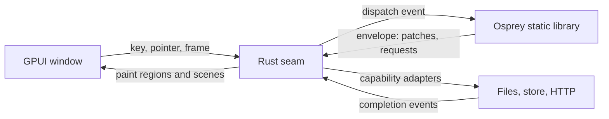

# Plan 0036 — GPUI desktop host: Osprey Native on the GPU, first on the Mac

Contract: [spec 0046](../specs/platforms/0046-GpuiDesktopHost.md). Framework: [`packages/native`](../../packages/native/README.md). Status: **phases 0 to 3 built; Flock's frame at 5,000 birds costs 4.7 ms of a 120 Hz frame's 8.3 ms; phase 4 (Linux and Windows) built and green in CI on macOS, Ubuntu and Windows on 2026-10-28.**

## Summary

[GPUI](https://gpui.rs) is Zed's GPU-accelerated UI framework. It becomes the second host of `@osprey/native`, after Vigil's SwiftUI host, and the first that runs on macOS, Linux and Windows. The direction is Rust calling Osprey: a small Rust crate links the Osprey static library, calls `start`/`dispatch` over the existing C boundary, patches keyed regions and draws them with GPUI. Osprey owns every rule; Rust owns pixels, input devices and platform services. No generics, closures or Rust ABI cross the boundary, so GPUI and rustc updates stay inside the crate.

**Priority: a working, useful app on an Apple silicon Mac.** Linux and Windows library targets come after that app runs.



## The example: Flock

An original arcade game, all in Osprey. The player steers one bird and herds a flock of thousands of boids (separation, alignment, cohesion) across a field while hawks dive at stragglers; rescued birds raise the score, and the flock grows each round. The game owns its physics, collisions, scoring, difficulty and pause/settings screens. The HUD, settings and high-score table use the ordinary `Node` components (`Screen`, `Section`, `Rows`, `Toggle`, `Picker`, `Badge`), so one app shows both the GUI components and the `Scene` surface. The boids count is the frame-rate gate: **5,000 boids at the display's refresh rate on an M-series Mac**, measured and recorded here before the plan claims a result.

Why a game and not another tool: a game needs a frame clock, a large scene patch every frame and a stable memory profile over minutes, which no existing Osprey host exercises. Those are the three risks of this host; the game is the test that drives them out.

## Rust holds the seam only

Rust code in `hosts/gpui` is reviewed against one rule: it may not encode application behaviour. The loader, region store, node-to-element mapping, scene painter, input forwarding, frame clock and capability adapters are Rust. Boid steering, hawk logic, scoring, round rules, pause, settings and every string the user reads are Osprey. A reviewer who finds a game rule in Rust moves it into Osprey before merge.

## Phases

### Phase 0 — prove the seam (macOS)

1. [x] Create `hosts/gpui` (Cargo crate) that links `libOspreyApp.a` built with `--target=macos`, calls `osprey_main()`, `start` and `dispatch`, and prints the envelope. Done: the probe lives in `hosts/gpui/probe` (the test suite's probe cannot be the library entry, because every scalar function in an entry namespace becomes a C export); `run.sh --smoke` starts it, taps Add by the ordinal the node carries and asserts "Count 1" through the real boundary.
2. [x] Render the probe application's regions. `src/render.rs` and `src/render/controls.rs` map `stack`, `text`, `label`, `icon`, `badge`, `button`, `field`, `toggle`, `slot`, `section`, `screen`, `divider`, `spacer`, `empty`, `progress`, `rows` and `picker`; the window shows the probe's count, Add, the prefilled Note and Load, and taps and edits round-trip through `dispatch` by the ordinal the node carries. Field editing state is keyed by region, revision and ordinal. Not yet mapped: `evidence`, `link`, `segments`, `swatch`, `layer`, `split`, `tabs`, `disclosure`, `alert`, `context-menu`, `aside`, `scene`.
3. [x] Unknown node kinds draw a red box naming the kind and record one diagnostic; every capability request is completed with an error naming it and listed in the diagnostics strip, until phase 1 step 3 adds adapters.

Exit: **met for the window**; the probe app runs in a GPUI window. The envelope comparison against the SwiftUI smoke waits on the shared conformance fixtures of [plan 0037](0037-osprey-native-hosts.md) phase 2.

### Phase 1 — frame clock, scene and memory

1. [x] `Frame elapsed` on `Message<A>`, decoded from a `{"kind":"frame","elapsed":s}` event; the clock is requested with the `Animate` capability rather than a start-envelope flag, so an application can stop it while paused (`message.ospml`, `runtime.ospml`, `capability.ospml`). `Messages::route` gained the frame and scene-input handlers; the three in-repo callers were updated, and Vigil needs the same two lambdas when it takes the new package.
2. [x] `Scene` node, `Primitive` union, `Scenes` constructors, `SceneInput` binding, `Input`/`Controlled` messages and `Inputs::route` (`node.ospml`, `encode.ospml`, `message.ospml`, and `scene.ospml` now in `packages/graphics`). Encoding: one small array per primitive with a type code first, built by one `mapList`. The first version appended value by value into one flat array and spent 60% of each frame in ARC retain/release from tail clones; the per-primitive array halved the frame cost.
3. [x] Scene painter, `Animate` adapter and frame clock in Rust (`hosts/gpui/src/scene.rs` with `scene/decode.rs`, `scene/paint.rs`, `scene/input.rs`; `clock.rs`; `store.rs`). Shapes are decoded once per region revision and sorted by depth; rects, sprites and discs paint as quads, strips as stroked paths, glyphs through the text system, all clipped to the letterboxed field. The clock dispatches `frame` from `on_next_frame` with `elapsed` clamped to 0.1 s; scene keys are filtered to the spec vocabulary and pointers are converted through the same letterbox transform; scene input names the region's live revision because a scene re-renders every frame. The window activates on open, since macOS throttles the display clock of a window behind the terminal. Not done: textured sprites (the atlas is not loaded; Flock draws discs) and rotation. Measured in the window with `--bench` (M-series Mac, 120 Hz display, window focused): Flock at 1,000 birds runs 107 to 120 fps, dispatch 5.8 to 7.3 ms, paint 0.3 ms, envelope 90 to 140 KB.
4. [x] Memory: the CLI defaults every hosted target to ARC (`crates/osprey-cli/src/invocation.rs`, `apply_default_memory`), so the macOS archive frees per-frame garbage; the README line claiming the Apple allocator never frees was stale and is fixed. Flat memory over ten minutes is still to be observed in the window.
5. [x] Measured with `hosts/gpui/bench` (Osprey only, no host; 120 frame events at 5,000 sprites, M-series Mac, `--memory=arc`, user time). "Framework" is the dispatch minus the bench's own parse of the returned envelope, which the Rust host does instead with serde.

   | Sprites | Envelope | Dispatch + envelope parse | Envelope parse alone | Framework per frame |
   | --- | --- | --- | --- | --- |
   | 1,000 | 86 KB | 3.5 ms | 0.7 ms | 2.8 ms |
   | 5,000 | 437 KB | 19.5 ms | 4.8 ms | 14.7 ms |
   | 20,000 | 1.77 MB | 93 ms | 19 ms | 74 ms |

   Profile at 5,000: 28% `Doc::write` of which 20% is `osp_float_spelling` (shortest round-trip spelling of about 45,000 floats per frame: the scene's and the saved store's), 11% `Encode::scene`, 5% store restore, 5% store save, the rest ARC traffic and allocation.

Exit: **met.** The JSON-per-frame path above could not hold 120 Hz at 5,000 sprites, so two framework features replace it for hosts that link the application in-process:

6. [x] **Resident session** ([UI-RESIDENT]): `Runtime::begin` and `Runtime::proceed` take and return the live `Session`; the application's boundary keeps it in a file-scope cell, which the compiler now allows in a project's entry source ([MODULES-FILE-SCOPE-BINDING], `crates/osprey-project`, tests in `tests/entry_cells.rs`). No frame parses, restores, saves or re-encodes the store; the envelope's `state` is the marker `"resident"`.
7. [x] **Scene stream** ([UI-SCENE-STREAM]): a changed scene's rects, discs and sprites go to the host one `native_shape` call at a time instead of as JSON; the scene node carries only the count. The host gives each scene its run in the encoder's walk order and paints runs of same-depth quads inside one GPUI layer, so they take one draw order instead of one bounds-tree insertion each.

   Measured with `hosts/gpui/bench` mode 3 (resident, streamed; M4 Max, ARC): 120 frames of 5,000 sprites, start-up included, in **0.12 s of CPU, under 1 ms per frame** against 14.7 ms on the JSON path.

### Phase 2 — Flock

1. [x] `examples/gpui/flock`: slices `World` (birds, hawks, player, held keys, pointer target, round, score, clock), `Settings` and `Scores`; `update` per `Frame` and per input; regions `field` (the scene), `hud`, `panel` and `root`; eight tests driving `Runtime::start`/`dispatch` with fixture stores and events (movement, rescue, predation, pause, start requests, round transition, scene contents, score load). Boids use a 16-unit grid in a `Map`; the first version concatenated the nine neighbour cells per bird and spent 54% of each frame copying lists, and its change detection re-encoded every bird twice per frame. Both fixed: cells are folded in place and the world's signal stamp is its scalars and counts.
2. [x] Keyboard and pointer steering in the application (`Simulation::key`, `Simulation::pointer`); the host side is phase 1 step 3.
3. [x] High scores: `StoreRead` at start, top five written through a slice and `StoreWrite` when a round changes the table.
4. [x] `run.sh` builds the archive and the crate and opens the window; `run.sh --smoke` replays `examples/gpui/flock/smoke.jsonl` (eleven steps: start regions and requests, frames, Pause and Resume found by label, a scene key, a pointer far off the field, the size picker) through the real C boundary and asserts patches, requests, region text and zero diagnostics, answering `animate` and store capabilities generically; `run.sh --bench <seconds>` prints fps, dispatch, paint and envelope size. Without a `smoke.jsonl` the host keeps the probe's smoke. The Osprey suite (13 tests) and an `osprey hunt` harness (`examples/gpui/flock/hunt`, 95 paths, no findings under `--memory=arc`) cover the game's rules.

Measured without a host (60 frame events through `start`/`dispatch`, M-series Mac, ARC, user time, minus nothing: the bench's own envelope parse is included, about 5 ms at 5,000):

| Birds | Per frame | Holds |
| --- | --- | --- |
| 1,000 | 8.7 ms | 60 Hz and 120 Hz with the host's share to spare |
| 2,000 | 21 ms | 60 Hz is the edge |
| 5,000 | 45 ms | neither |

The default flock is 1,000 and the settings picker offers 2,000, 5,000 and 10,000; `run.sh --flock N` starts with N.

5. [x] **The 5,000-bird gate.** Flock now runs resident and streamed (phase 1 steps 6 and 7) and steers on the CPU by each bird's first seven flockmates over float lists sorted by cell (`examples/gpui/flock/src/steering.ospml`), allocating once per bird. Moving the steering to Osprey's GPU compute surface was tried and rejected: Metal emulates binary64, so the kernels took 28 ms a frame on an M4 Max, and the host backend's `gpuGet` made them slower still. Measured with `run.sh --bench 10 --flock 5000` on an M4 Max MacBook Pro, 120 Hz display: **frame 4.7 ms** (main-thread time from the frame event to the end of its paint: dispatch 4.0 ms, envelope apply and layout 0.5 ms, paint 0.2 ms), envelope 1.7 KB, against the 8.3 ms a 120 Hz frame allows. The window's fps reading at the time was 26, because the screen was locked and macOS slows the display clock of a window that is not visible; the frame cost does not depend on that clock. Before this step, 5,000 birds cost 29 ms of dispatch and ran at 27 fps.

Exit: **met on frame cost**: Flock is playable, 5,000 birds cost 4.7 ms of the 8.3 ms a 120 Hz frame allows, and the README shows the numbers with the machine they came from. A focused-window fps reading at 5,000 birds is still to be recorded with the screen unlocked.

### Phase 3 — make native host-agnostic

The framework was shaped by one Apple host and one product. Every shape below is generalized or removed, with tests in the package, both in-repo hosts and every consumer.

1. [x] **Symbols.** `symbol : string` (SF Symbols names) on `Icon`, `Label`, `Badge`, `Button`, `Empty`, `Tab` and `Row` is now the typed `Symbol` union in [symbol.ospml](../../packages/native/src/symbol.ospml), sent as each member's lowercase name ([UI-COMPONENTS-SYMBOLS]). The GPUI host maps every member to a Lucide icon and the webview to a Codicon; both have a test that fails if a member is unmapped, and the native suite checks the names are distinct and that every symbol-carrying node sends its name.
2. [x] **Product capabilities.** `ReadPropertyLists`, `Fingerprint`, `RunningApplications`, `OpenSettings` and `Run`'s property-list flag are gone. Work only one host or product can do is a `HostCall` in that host's namespace; the suite encodes one.
3. [x] **`Evidence`** is now `Pair` (`Ui::pair`, wire kind `pair`), a label and its value; drawn by both hosts and tested in each.
4. [x] **`Brand`** is deleted. `Keyed::region` used it as the stand-in for a retained region's never-sent node; that is now `Spacer`. The webview rejects a `brand` node as unknown.
5. [x] **Platform.** `Context.platform` is the `Platform` union (`Macos`, `Ios`, `Linux`, `Windows`, `Android`, `Web`, `OtherPlatform name`), decoded by `Symbols::platform` ([UI-CONTEXT-PLATFORM]). The GPUI host sends `std::env::consts::OS` instead of a hard-coded `macos`.
6. [x] `Reveal`, `ChooseFile`, `ChooseFolder` and `SaveFile` stay: every desktop has them.

Consumers updated in the same change: the manager's VS Code editor (rebuilt `package-workspace.wasm`), `packages/vscode`, the GPUI probe and bench, Flock, painting and the VS Code SDK end-to-end probe. Vigil builds against a vendored copy of the package (`.osprey/packages/@osprey/native`), so it keeps working unchanged; when it upgrades, its product capabilities become a `vigil` `HostCall` namespace and its SwiftUI host maps the symbol names to SF Symbols.

Exit: met. `packages/native` names no host, product or operating system outside the `Platform` union.

### Phase 4 — Linux and Windows

1. [x] Desktop static-library targets `linux-x64`, `linux-arm64` and `windows-x64` in the CLI (`crates/osprey-cli/src/desktop.rs`), with the Apple and Android slices' export selection and header generation, ARC by default, `clang -fPIC` (`OSPREY_CC`) and `llvm-ar` (`OSPREY_AR`) bundling the host's native runtime ([GPUI-HOST-TARGETS]). A slice builds on its own system; elsewhere `--compile` is refused naming where to build it, and `--check` works anywhere. Unit tests cover parsing, the host check and C `bool` extension. The macOS runtime slices now carry the Metal device adapter. The host's `build.rs` and `run.sh` choose the target and system libraries by operating system, and its home, log and store folders follow each system's conventions.
2. [x] Capability adapters (pi #6, reviewed): `run` (no shell, deadline kill, output limit), `list-directories`, `read-texts`, `store-*` with a per-system root, `choose-file` (types enforced after the panel, which cannot filter), `choose-folder`, `save-file`, `reveal` through GPUI's own cross-platform panels, and `cancel`. Blocking adapters run on GPUI's background executor; an unknown kind is a diagnostic and an error completion. 15 unit tests.
3. [x] CI: `.github/workflows/gpui.yml` runs the native, Flock and painting suites, the host's tests and clippy, and the probe and Flock smoke runs on macOS, Ubuntu and Windows. On Windows the host builds with MSYS2 UCRT64's own Rust, so the host, GPUI and the MinGW runtime link one UCRT; rustup's Rust with the GNU target had built GPUI's resource script as an MSVC library and linked msvcrt. The Windows job then links Flock and Painting into the host in turn and pictures each window on the runner's desktop. The frame-rate bench stays on a Mac with a display. First observed on 2026-10-28, through a manual run of `ci-windows.yml`, which calls the workflow: green on all three systems.

Exit: Linux and Windows smoke runs green in CI. Met on 2026-10-28.

## Risks

- **Per-frame JSON.** The single biggest unknown; Phase 1 measures it before Flock is built on it.
- **GPUI churn.** Pre-1.0, Zed-driven, thin docs. Pin the crate version; isolate GPUI calls to the renderer module.
- **Memory.** Contradictory README claims about Apple ARC; settled in Phase 1 step 4.
- **Stack depth.** The mobile README warns that Osprey does not turn tail calls into loops; boid steering must use the built-in list functions, not recursion over the flock.
- **Native look.** GPUI draws its own controls. Accessibility and IME lag SwiftUI; acceptable for a game and a cross-platform host, recorded as a limit.

## Commands (to exist by the end of Phase 2)

```sh
make macos
hosts/gpui/run.sh --smoke              # the probe through the real boundary, no window
hosts/gpui/bench                       # framework-only per-frame cost, see hosts/gpui/README.md
examples/gpui/flock/run.sh            # build and open
examples/gpui/flock/run.sh --smoke    # recorded events, asserted envelopes
examples/gpui/flock/run.sh --bench    # frame-rate gate
./target/release/osprey test examples/gpui/flock/test
```
