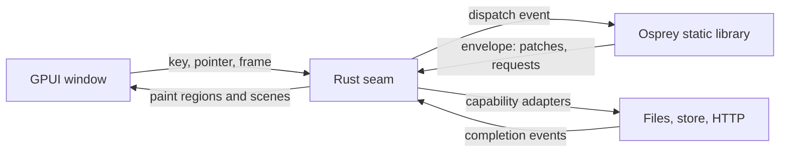
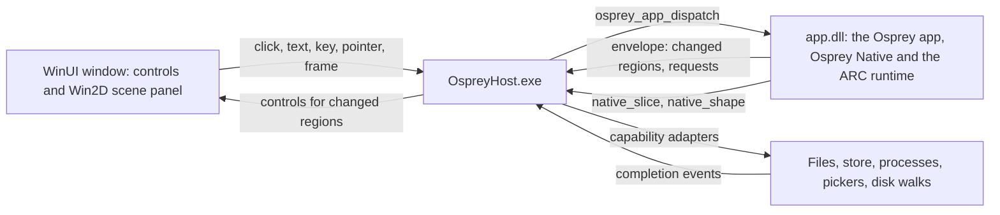
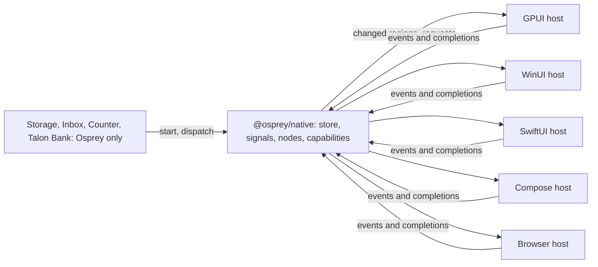

# Plan 0037 — Osprey Native hosts: one framework, every renderer

Contract: [spec 0047](../specs/applications/0047-OspreyNativeHosts.md). Framework: [`packages/native`](../../packages/native/README.md). Sibling: [plan 0037](0037-osprey-native.md) delivers the GPUI host; this plan delivers what every host shares.

## Summary

Osprey Native already has two hosts that were built separately: Vigil's SwiftUI host and the VS Code webview host. The GPUI host will be the third and a standalone browser host the fourth. Nothing today states what a host must do, which nodes each one draws, or proves two hosts agree. This plan makes the host family explicit: a written aim, a conformance suite every host runs, a generated coverage matrix, a shared web renderer, and a framework with nothing host-specific left in it.

## Decisions

- **The package keeps the name `@osprey/native`.** Renaming it would break Vigil and the VS Code SDK for a word. The spec defines the name; the guide explains it.
- **Hosts are named by what they draw with:** SwiftUI, Webview, Browser, GPUI. Not by platform.
- **HTML/CSS is one renderer, two hosts.** The webview renderer in `vscode-extension/client/src/osprey-ui` is extracted into a package the VS Code extension and a plain browser page both import. Editor capabilities stay in the extension.
- **A host is listed as running only when it runs the conformance suite.**

## Phases

### Phase 1 — say what it is

1. [`website/src/docs/osprey-native.md`](../../website/src/docs/osprey-native.md): the aim, the host family and the boundary, written for someone choosing a framework. Done with this plan.
2. [`packages/native/README.md`](../../packages/native/README.md): open with the aim and the host table, link spec 0047, and fix the contradictory memory statements (line 44 says the Apple allocator never frees; line 152 says Apple archives default to ARC).

### Phase 2 — conformance suite

1. `packages/native/conformance/`: the probe application's start context, a recorded event sequence and the expected envelopes, produced once from `Runtime::start`/`dispatch` and checked into the repository.
2. An Osprey test that regenerates the envelopes from the fixtures and diffs them, so a framework change that alters the wire shape fails here first.
3. Each host runs the set through its own entry: the SwiftUI host in Vigil's smoke, the webview host in `npm test --prefix vscode-extension`, GPUI in `run.sh --smoke`.

### Phase 3 — coverage matrix

1. A script reads `node.ospml` and `capability.ospml` for constructor names and each host's mapping table for what it handles, and writes `packages/native/COVERAGE.md`.
2. CI regenerates it and fails on a diff, so a new constructor cannot land without every host's cell.
3. Each host README links its column.

### Phase 4 — shared web renderer

1. Extract `osprey-ui` (`protocol.ts`, `render.ts`, `styles.ts`, `theme.ts`, `icons.ts`, `session.ts`, `wasi.ts`) into `packages/web` as an npm package; `capabilities.ts` and the webview plumbing stay in the extension.
2. A browser host page that loads the WASI module in a worker and renders into a `div`, with file and store capabilities on the browser APIs that exist.
3. The probe application running in a browser tab and passing the conformance set.

### Phase 5 — framework neutrality

Tracked in [plan 0037 phase 3](0037-osprey-native.md): typed `Symbol` union, Vigil capabilities behind `HostCall`, `Evidence` and `Brand` generalized or removed, `platform` as a union. Landed once, benefits every host.

## Risks

- **Symbol vocabulary.** Done: a typed `Symbol` union with neutral lowercase names replaced the SF Symbols strings. The GPUI and webview hosts map every member and test it. Vigil keeps its vendored copy of the package until it upgrades, when its SwiftUI host maps the same names to SF Symbols.
- **Two renderers drifting.** The conformance suite is the only thing that stops the SwiftUI and HTML hosts disagreeing about a node. Phase 2 comes before any new host code.
- **Webview extraction.** `capabilities.ts` and `webview-client.ts` are intertwined with VS Code's message channel; the split needs the existing `OSPREY_TEST_GREP='compiled SDK renderer E2E'` tests green before and after.

# Plan 0037 — GPUI desktop host: Osprey Native on the GPU, first on the Mac

Contract: [spec 0046](../specs/platforms/0046-GpuiDesktopHost.md). Framework: [`packages/native`](../../packages/native/README.md). Status: **phases 0 to 3 built; Flock's frame at 5,000 birds costs 4.7 ms of a 120 Hz frame's 8.3 ms; phase 4 (Linux and Windows) built and green in CI on macOS, Ubuntu and Windows on 2026-10-28.**

## Summary

[GPUI](https://gpui.rs) is Zed's GPU-accelerated UI framework. It becomes the second host of `@osprey/native`, after Vigil's SwiftUI host, and the first that runs on macOS, Linux and Windows. The direction is Rust calling Osprey: a small Rust crate links the Osprey static library, calls `start`/`dispatch` over the existing C boundary, patches keyed regions and draws them with GPUI. Osprey owns every rule; Rust owns pixels, input devices and platform services. No generics, closures or Rust ABI cross the boundary, so GPUI and rustc updates stay inside the crate.

**Priority: a working, useful app on an Apple silicon Mac.** Linux and Windows library targets come after that app runs.



## The example: Flock

An original arcade game, all in Osprey. The player steers one bird and herds a flock of thousands of boids (separation, alignment, cohesion) across a field while hawks dive at stragglers; rescued birds raise the score, and the flock grows each round. The game owns its physics, collisions, scoring, difficulty and pause/settings screens. The HUD, settings and high-score table use the ordinary `Node` components (`Screen`, `Section`, `Rows`, `Toggle`, `Picker`, `Badge`), so one app shows both the GUI components and the `Scene` surface. The boids count is the frame-rate gate: **5,000 boids at the display's refresh rate on an M-series Mac**, measured and recorded here before the plan claims a result.

Why a game and not another tool: a game needs a frame clock, a large scene patch every frame and a stable memory profile over minutes, which no existing Osprey host exercises. Those are the three risks of this host; the game is the test that drives them out.

## Rust holds the seam only

Rust code in `hosts/gpui` is reviewed against one rule: it may not encode application behaviour. The loader, region store, node-to-element mapping, scene painter, input forwarding, frame clock and capability adapters are Rust. Boid steering, hawk logic, scoring, round rules, pause, settings and every string the user reads are Osprey. A reviewer who finds a game rule in Rust moves it into Osprey before merge.

## Phases

### Phase 0 — prove the seam (macOS)

1. [x] Create `hosts/gpui` (Cargo crate) that links `libOspreyApp.a` built with `--target=macos`, calls `osprey_main()`, `start` and `dispatch`, and prints the envelope. Done: the probe lives in `hosts/gpui/probe` (the test suite's probe cannot be the library entry, because every scalar function in an entry namespace becomes a C export); `run.sh --smoke` starts it, taps Add by the ordinal the node carries and asserts "Count 1" through the real boundary.
2. [x] Render the probe application's regions. `src/render.rs` and `src/render/controls.rs` map `stack`, `text`, `label`, `icon`, `badge`, `button`, `field`, `toggle`, `slot`, `section`, `screen`, `divider`, `spacer`, `empty`, `progress`, `rows` and `picker`; the window shows the probe's count, Add, the prefilled Note and Load, and taps and edits round-trip through `dispatch` by the ordinal the node carries. Field editing state is keyed by region, revision and ordinal. Not yet mapped: `evidence`, `link`, `segments`, `swatch`, `layer`, `split`, `tabs`, `disclosure`, `alert`, `context-menu`, `aside`, `scene`.
3. [x] Unknown node kinds draw a red box naming the kind and record one diagnostic; every capability request is completed with an error naming it and listed in the diagnostics strip, until phase 1 step 3 adds adapters.

Exit: **met for the window**; the probe app runs in a GPUI window. The envelope comparison against the SwiftUI smoke waits on the shared conformance fixtures of [plan 0037](0037-osprey-native.md) phase 2.

### Phase 1 — frame clock, scene and memory

1. [x] `Frame elapsed` on `Message<A>`, decoded from a `{"kind":"frame","elapsed":s}` event; the clock is requested with the `Animate` capability rather than a start-envelope flag, so an application can stop it while paused (`message.ospml`, `runtime.ospml`, `capability.ospml`). `Messages::route` gained the frame and scene-input handlers; the three in-repo callers were updated, and Vigil needs the same two lambdas when it takes the new package.
2. [x] `Scene` node, `Primitive` union, `Scenes` constructors, `SceneInput` binding, `Input`/`Controlled` messages and `Inputs::route` (`node.ospml`, `encode.ospml`, `message.ospml`, and `scene.ospml` now in `packages/graphics`). Encoding: one small array per primitive with a type code first, built by one `mapList`. The first version appended value by value into one flat array and spent 60% of each frame in ARC retain/release from tail clones; the per-primitive array halved the frame cost.
3. [x] Scene painter, `Animate` adapter and frame clock in Rust (`hosts/gpui/src/scene.rs` with `scene/decode.rs`, `scene/paint.rs`, `scene/input.rs`; `clock.rs`; `store.rs`). Shapes are decoded once per region revision and sorted by depth; rects, sprites and discs paint as quads, strips as stroked paths, glyphs through the text system, all clipped to the letterboxed field. The clock dispatches `frame` from `on_next_frame` with `elapsed` clamped to 0.1 s; scene keys are filtered to the spec vocabulary and pointers are converted through the same letterbox transform; scene input names the region's live revision because a scene re-renders every frame. The window activates on open, since macOS throttles the display clock of a window behind the terminal. Not done: textured sprites (the atlas is not loaded; Flock draws discs) and rotation. Measured in the window with `--bench` (M-series Mac, 120 Hz display, window focused): Flock at 1,000 birds runs 107 to 120 fps, dispatch 5.8 to 7.3 ms, paint 0.3 ms, envelope 90 to 140 KB.
4. [x] Memory: the CLI defaults every hosted target to ARC (`crates/osprey-cli/src/invocation.rs`, `apply_default_memory`), so the macOS archive frees per-frame garbage; the README line claiming the Apple allocator never frees was stale and is fixed. Flat memory over ten minutes is still to be observed in the window.
5. [x] Measured with `hosts/gpui/bench` (Osprey only, no host; 120 frame events at 5,000 sprites, M-series Mac, `--memory=arc`, user time). "Framework" is the dispatch minus the bench's own parse of the returned envelope, which the Rust host does instead with serde.

   | Sprites | Envelope | Dispatch + envelope parse | Envelope parse alone | Framework per frame |
   | --- | --- | --- | --- | --- |
   | 1,000 | 86 KB | 3.5 ms | 0.7 ms | 2.8 ms |
   | 5,000 | 437 KB | 19.5 ms | 4.8 ms | 14.7 ms |
   | 20,000 | 1.77 MB | 93 ms | 19 ms | 74 ms |

   Profile at 5,000: 28% `Doc::write` of which 20% is `osp_float_spelling` (shortest round-trip spelling of about 45,000 floats per frame: the scene's and the saved store's), 11% `Encode::scene`, 5% store restore, 5% store save, the rest ARC traffic and allocation.

Exit: **met.** The JSON-per-frame path above could not hold 120 Hz at 5,000 sprites, so two framework features replace it for hosts that link the application in-process:

6. [x] **Resident session** ([UI-RESIDENT]): `Runtime::begin` and `Runtime::proceed` take and return the live `Session`; the application's boundary keeps it in a file-scope cell, which the compiler now allows in a project's entry source ([MODULES-FILE-SCOPE-BINDING], `crates/osprey-project`, tests in `tests/entry_cells.rs`). No frame parses, restores, saves or re-encodes the store; the envelope's `state` is the marker `"resident"`.
7. [x] **Scene stream** ([UI-SCENE-STREAM]): a changed scene's rects, discs and sprites go to the host one `native_shape` call at a time instead of as JSON; the scene node carries only the count. The host gives each scene its run in the encoder's walk order and paints runs of same-depth quads inside one GPUI layer, so they take one draw order instead of one bounds-tree insertion each.

   Measured with `hosts/gpui/bench` mode 3 (resident, streamed; M4 Max, ARC): 120 frames of 5,000 sprites, start-up included, in **0.12 s of CPU, under 1 ms per frame** against 14.7 ms on the JSON path.

### Phase 2 — Flock

1. [x] `examples/gpui/flock`: slices `World` (birds, hawks, player, held keys, pointer target, round, score, clock), `Settings` and `Scores`; `update` per `Frame` and per input; regions `field` (the scene), `hud`, `panel` and `root`; eight tests driving `Runtime::start`/`dispatch` with fixture stores and events (movement, rescue, predation, pause, start requests, round transition, scene contents, score load). Boids use a 16-unit grid in a `Map`; the first version concatenated the nine neighbour cells per bird and spent 54% of each frame copying lists, and its change detection re-encoded every bird twice per frame. Both fixed: cells are folded in place and the world's signal stamp is its scalars and counts.
2. [x] Keyboard and pointer steering in the application (`Simulation::key`, `Simulation::pointer`); the host side is phase 1 step 3.
3. [x] High scores: `StoreRead` at start, top five written through a slice and `StoreWrite` when a round changes the table.
4. [x] `run.sh` builds the archive and the crate and opens the window; `run.sh --smoke` replays `examples/gpui/flock/smoke.jsonl` (eleven steps: start regions and requests, frames, Pause and Resume found by label, a scene key, a pointer far off the field, the size picker) through the real C boundary and asserts patches, requests, region text and zero diagnostics, answering `animate` and store capabilities generically; `run.sh --bench <seconds>` prints fps, dispatch, paint and envelope size. Without a `smoke.jsonl` the host keeps the probe's smoke. The Osprey suite (13 tests) and an `osprey hunt` harness (`examples/gpui/flock/hunt`, 95 paths, no findings under `--memory=arc`) cover the game's rules.

Measured without a host (60 frame events through `start`/`dispatch`, M-series Mac, ARC, user time, minus nothing: the bench's own envelope parse is included, about 5 ms at 5,000):

| Birds | Per frame | Holds |
| --- | --- | --- |
| 1,000 | 8.7 ms | 60 Hz and 120 Hz with the host's share to spare |
| 2,000 | 21 ms | 60 Hz is the edge |
| 5,000 | 45 ms | neither |

The default flock is 1,000 and the settings picker offers 2,000, 5,000 and 10,000; `run.sh --flock N` starts with N.

5. [x] **The 5,000-bird gate.** Flock now runs resident and streamed (phase 1 steps 6 and 7) and steers on the CPU by each bird's first seven flockmates over float lists sorted by cell (`examples/gpui/flock/src/steering.ospml`), allocating once per bird. Moving the steering to Osprey's GPU compute surface was tried and rejected: Metal emulates binary64, so the kernels took 28 ms a frame on an M4 Max, and the host backend's `gpuGet` made them slower still. Measured with `run.sh --bench 10 --flock 5000` on an M4 Max MacBook Pro, 120 Hz display: **frame 4.7 ms** (main-thread time from the frame event to the end of its paint: dispatch 4.0 ms, envelope apply and layout 0.5 ms, paint 0.2 ms), envelope 1.7 KB, against the 8.3 ms a 120 Hz frame allows. The window's fps reading at the time was 26, because the screen was locked and macOS slows the display clock of a window that is not visible; the frame cost does not depend on that clock. Before this step, 5,000 birds cost 29 ms of dispatch and ran at 27 fps.

Exit: **met on frame cost**: Flock is playable, 5,000 birds cost 4.7 ms of the 8.3 ms a 120 Hz frame allows, and the README shows the numbers with the machine they came from. A focused-window fps reading at 5,000 birds is still to be recorded with the screen unlocked.

### Phase 3 — make native host-agnostic

The framework was shaped by one Apple host and one product. Every shape below is generalized or removed, with tests in the package, both in-repo hosts and every consumer.

1. [x] **Symbols.** `symbol : string` (SF Symbols names) on `Icon`, `Label`, `Badge`, `Button`, `Empty`, `Tab` and `Row` is now the typed `Symbol` union in [symbol.ospml](../../packages/native/src/symbol.ospml), sent as each member's lowercase name ([UI-COMPONENTS-SYMBOLS]). The GPUI host maps every member to a Lucide icon and the webview to a Codicon; both have a test that fails if a member is unmapped, and the native suite checks the names are distinct and that every symbol-carrying node sends its name.
2. [x] **Product capabilities.** `ReadPropertyLists`, `Fingerprint`, `RunningApplications`, `OpenSettings` and `Run`'s property-list flag are gone. Work only one host or product can do is a `HostCall` in that host's namespace; the suite encodes one.
3. [x] **`Evidence`** is now `Pair` (`Ui::pair`, wire kind `pair`), a label and its value; drawn by both hosts and tested in each.
4. [x] **`Brand`** is deleted. `Keyed::region` used it as the stand-in for a retained region's never-sent node; that is now `Spacer`. The webview rejects a `brand` node as unknown.
5. [x] **Platform.** `Context.platform` is the `Platform` union (`Macos`, `Ios`, `Linux`, `Windows`, `Android`, `Web`, `OtherPlatform name`), decoded by `Symbols::platform` ([UI-CONTEXT-PLATFORM]). The GPUI host sends `std::env::consts::OS` instead of a hard-coded `macos`.
6. [x] `Reveal`, `ChooseFile`, `ChooseFolder` and `SaveFile` stay: every desktop has them.

Consumers updated in the same change: the manager's VS Code editor (rebuilt `package-workspace.wasm`), `packages/vscode`, the GPUI probe and bench, Flock, painting and the VS Code SDK end-to-end probe. Vigil builds against a vendored copy of the package (`.osprey/packages/@osprey/native`), so it keeps working unchanged; when it upgrades, its product capabilities become a `vigil` `HostCall` namespace and its SwiftUI host maps the symbol names to SF Symbols.

Exit: met. `packages/native` names no host, product or operating system outside the `Platform` union.

### Phase 4 — Linux and Windows

1. [x] Desktop static-library targets `linux-x64`, `linux-arm64` and `windows-x64` in the CLI (`crates/osprey-cli/src/desktop.rs`), with the Apple and Android slices' export selection and header generation, ARC by default, `clang -fPIC` (`OSPREY_CC`) and `llvm-ar` (`OSPREY_AR`) bundling the host's native runtime ([GPUI-HOST-TARGETS]). A slice builds on its own system; elsewhere `--compile` is refused naming where to build it, and `--check` works anywhere. Unit tests cover parsing, the host check and C `bool` extension. The macOS runtime slices now carry the Metal device adapter. The host's `build.rs` and `run.sh` choose the target and system libraries by operating system, and its home, log and store folders follow each system's conventions.
2. [x] Capability adapters (pi #6, reviewed): `run` (no shell, deadline kill, output limit), `list-directories`, `read-texts`, `store-*` with a per-system root, `choose-file` (types enforced after the panel, which cannot filter), `choose-folder`, `save-file`, `reveal` through GPUI's own cross-platform panels, and `cancel`. Blocking adapters run on GPUI's background executor; an unknown kind is a diagnostic and an error completion. 15 unit tests.
3. [x] CI: `.github/workflows/gpui.yml` runs the native, Flock and painting suites, the host's tests and clippy, and the probe and Flock smoke runs on macOS, Ubuntu and Windows. On Windows the host builds with MSYS2 UCRT64's own Rust, so the host, GPUI and the MinGW runtime link one UCRT; rustup's Rust with the GNU target had built GPUI's resource script as an MSVC library and linked msvcrt. The Windows job then links Flock and Painting into the host in turn and pictures each window on the runner's desktop. The frame-rate bench stays on a Mac with a display. First observed on 2026-10-28, through a manual run of `ci-windows.yml`, which calls the workflow: green on all three systems.

Exit: Linux and Windows smoke runs green in CI. Met on 2026-10-28.

## Risks

- **Per-frame JSON.** The single biggest unknown; Phase 1 measures it before Flock is built on it.
- **GPUI churn.** Pre-1.0, Zed-driven, thin docs. Pin the crate version; isolate GPUI calls to the renderer module.
- **Memory.** Contradictory README claims about Apple ARC; settled in Phase 1 step 4.
- **Stack depth.** The mobile README warns that Osprey does not turn tail calls into loops; boid steering must use the built-in list functions, not recursion over the flock.
- **Native look.** GPUI draws its own controls. Accessibility and IME lag SwiftUI; acceptable for a game and a cross-platform host, recorded as a limit.

## Commands (to exist by the end of Phase 2)

```sh
make -C apps macos
hosts/gpui/run.sh --smoke              # the probe through the real boundary, no window
hosts/gpui/bench                       # framework-only per-frame cost, see hosts/gpui/README.md
examples/gpui/flock/run.sh            # build and open
examples/gpui/flock/run.sh --smoke    # recorded events, asserted envelopes
examples/gpui/flock/run.sh --bench    # frame-rate gate
./target/release/osprey test examples/gpui/flock/test
```

# Plan 0037 — WinUI host: Osprey Native apps on Windows

Contract: [spec 0048](../specs/platforms/0048-WinUiHost.md) [WINUI-HOST]. Framework: [`packages/native`](../../packages/native/README.md). Siblings:

- [Plan 0037](0037-osprey-native.md) ports every example to Osprey Native, starting with Osprey Storage.
- [Plan 0023](0023-gpu.md) puts the direct-GPU graphics scenes in a WinUI window.

Status: **in progress.** Branch: `feat/windows-native-winui`. Done on 2026-10-28, every item tested without a window:

- [x] Spec 0048, and a WinUI row in spec 0047's host family and coverage table.
- [x] The Windows dead-code errors in the CLI's test targets, gated like their users.
- [x] The MSVC build of `osprey-runtime-sys`: `std::path::absolute` replaces `canonicalize`, whose `\\?\` path `cl.exe` cannot open.
- [x] Phase 1: `osprey build --target=windows-x64 -o app.dll` with import slots and binders. Six CLI tests cover the slots, the C `bool` convention, the entry's check, the exports and binder clashes.
- [x] Decision 6: the imports are `native_slice` and `native_shape` in every entry source, the GPUI host and spec 0046.
- [x] Phase 2's host core: DLL loading, UTF-8 strings, envelopes, the region store, the symbol map and the theme. The renderer draws 29 kinds, refuses `scene`, and checks itself against the coverage declaration at start.
- [x] Phase 3's adapters: `measure-folders` with the Windows walk, `reveal`, `choose-folder` and `cancel`. Osprey Storage starts, walks and dispatches through its real DLL in a test.
- [x] Phase 4's coverage test on all three hosts, `winui.yml`, and the no-XAML, package and neutrality guards.
- [x] Phase 0's AOT publish with warnings as errors: a 6.1 MB `OspreyHost.exe`, and 90 MB in 237 files with the WinUI runtime, on the WinUI component package alone.
- [x] Real windows in CI: the Windows runner's steps run on its signed-in desktop (session 2), and `ci-windows.yml` runs `winui.yml` on demand. The first real window found the start-up crash, a resource index the publish left out, and `EnableMsixTooling` fixed it.
- [x] `--self-test` [WINUI-HOST-SELF-TEST]: scripts beside Storage, Flock and Painting drive the real window through the controls' automation peers and keep a picture of each step; a failing run leaves its start-up trail, a desktop picture and the crash dump's analysis.
- [x] The scene painter and the frame clock, in WinUI's own shapes rather than Win2D: every primitive, paths with dashes and joins, CSS-angled gradients blended in Oklab, streamed shapes, scene input and `animate`. Flock streams 1,000 birds a frame and Painting takes a pointer stroke through their real DLLs in tests.
- [x] The store capabilities, under `%APPDATA%\Osprey\<app>` as the GPUI host keeps them.
- [x] Storage, Flock and Painting passing their self-tests in a real window, with their pictures reviewed. All three passed on the runner's desktop on 2026-10-28. Getting there took three fixes:
    - Theme styles are cast through WinRT, because under Native AOT a style can come back as a bare WinRT object.
    - Row handlers are keyed by a name their list carries, because a list's managed wrapper can be collected and remade.
    - A slot fills only when its region does, as on GPUI, and a split's panes take the window's full height.
- [x] Storage measuring the whole C drive in a real window, then opening Users from its row (`self-test-drive.json`). On the runner the walk listed C:'s 43 items and said it had stopped at its deadline. Users then measured 5.4 GB in 6 items, with its hidden folders greyed and its two links not counted. `choose` scrolls a row the list has not made yet into view first.
- [ ] The Win2D gate is no longer needed for correctness; whether WinUI shapes hold 5,000 birds at 60 Hz is still to measure.
- [ ] The `windows` `HostCall` for the elevated restart, the C fixture host, and phase 4's remaining adapters.

## Summary

On Windows, every example is the same Osprey Native app that runs on every other host, drawn by one WinUI executable. WinUI is the UI framework of the Windows App SDK (stable 2.6.4, released 2026-10-27). Since Build 2026, Microsoft has called it WinUI rather than WinUI 3. No XAML markup is used anywhere.

Osprey Native is the application framework. The app's store, signals, screens, words and rules are all Osprey, and the signals decide which regions change. The host only does what Osprey cannot:

- builds WinUI controls for the nodes in a changed region;
- paints scenes;
- returns input by binding ID;
- completes capabilities.

It contains no C# UI framework and no code from any example.

| App | Reaches WinUI in |
| --- | --- |
| The GPUI probe | Phase 2 |
| [Osprey Storage](../../examples/storage/README.md), ported by plan 0037 phase 1 | Phase 3 |
| [Flock](../../examples/gpui/flock/README.md) and [Painting](../../examples/gpui/painting/README.md) | Phase 4 |
| [Issue Inbox](../../examples/mobile/README.md) | After plan 0037 phase 4 |
| [Graphics scenes](../../examples/graphics/README.md): direct GPU, not Osprey Native | Plan 0023 |



## Decisions

1. **Toolkit: WinUI from Windows App SDK 2.6.4, with no XAML markup [WINUI-HOST-NO-XAML].**
   - WPF, WinForms, UWP, MAUI, Avalonia and Uno are out.
   - "No XAML" means no `.xaml` files, no XAML compiler output and no `XamlReader.Load` strings. Every control is constructed in C#.
   - `Microsoft.UI.Xaml` is WinUI's own namespace for its controls and cannot be avoided.
   - A test fails if `hosts/winui` gains a `.xaml` file or a `XamlReader` call.
2. **Osprey Native is the only UI framework [WINUI-HOST-THIN].** Osprey's signals already decide which regions changed, and each patch carries a region's nodes. The host therefore keeps controls by key and needs no element tree, state model or reconciler of its own.
   - The host uses no C# UI framework, no MVVM library, no WinUI data binding (`Binding`, `INotifyPropertyChanged`) and no templates.
   - The project references only `Microsoft.Graphics.Win2D` and the Windows App SDK component packages it uses. A test fails on any other package reference [WINUI-HOST-PACKAGES].
   - The host contains no example's name, words, rules or layout ([NATIVE-HOSTS-NEUTRAL]). A test fails when its source names an example.
   - Everything an app decides is Osprey, including per-platform choices, which it reads from `Context.platform` (`windows`).
3. **C# 14 on .NET 10, published with Native AOT.** WinUI is projected only to C# and C++, and C# makes the smaller host of the two. Native AOT, supported since Windows App SDK 1.6, compiles it to one machine-code executable: no JIT and no separate .NET install.
4. **One executable runs every app.** `OspreyHost.exe <app.dll>` is the WinUI twin of the GPUI binary.
   - No example has a C# project of its own. Each example's `run.sh --host=winui` builds its DLL and starts the host with it.
   - The window title is the root `Screen`'s title, and the icon is a path the example passes.
   - `hosts/winui/` holds two projects: `OspreyHost` (bootstrap, region store, node mapping, scene painter, capabilities and frame clock) and `OspreyHost.Tests` (headless tests).
5. **The boundary is GPUI's, in a DLL [WINUI-HOST-DLL].** MinGW clang (UCRT64) builds the `windows-x64` slice. It bundles a runtime that uses winpthreads, so an MSVC-linked Native AOT executable cannot link `libOspreyApp.a`. Instead, when `-o` names a `.dll`, the CLI links that slice into a DLL with the GPUI boundary:
   - exports `osprey_main`, `osprey_app_start` and `osprey_app_dispatch`;
   - imports `native_slice` and `native_shape`;
   - follows the [IOS-HOST-ABI] string rules: inputs borrowed, outputs copied by the host, and `osprey_main` called first.

   No allocation crosses the boundary in either direction.
   - **Imports [WINUI-HOST-IMPORTS].** The two imports are slots. Before `osprey_main`, the host fills them with `[UnmanagedCallersOnly]` functions through the exported `osprey_imports_bind`.
     - Any other `extern` that no `// @link(windows)` library defines fails the build, naming the extern. The CLI asks `llvm-nm` which symbols those libraries define.
     - The import thunks already exist: `import_thunk` and `adapt_import` in [`ios_abi.rs`](../../crates/osprey-cli/src/ios_abi.rs). DLL mode makes them call through the slot.
   - Because the boundary is fixed, the host declares its three exports by hand, and nothing is generated per app.
6. **Host-neutral import names.** Flock, Painting and the probe import `native_slice` and `native_shape`, renamed from `gpui_slice` and `gpui_shape` in the three entry sources, the GPUI host's `ffi.rs` and spec 0046, so no host's name crosses the boundary. Done.
7. **Scenes are painted with Win2D (`Microsoft.Graphics.Win2D` 1.4.0) [WINUI-HOST-SCENE].**
   - The surface is a `CanvasSwapChainPanel`. Rects and discs use `FillRectangle` and `FillCircle`.
   - Strips and paths use `CanvasGeometry` and `CanvasStrokeStyle`; the stroke style supplies Painting's dashes. Gradients use `CanvasLinearGradientBrush`.
   - Glyphs go through DirectWrite with `CanvasTextFormat`. Sprites use `CanvasSpriteBatch` over the atlas.
   - If Win2D fails the Native AOT gate in phase 0, the painter switches to Direct2D through source-generated COM interfaces on a `SwapChainPanel`. The interface stays the same: a decoded draw list in, a frame out.
8. **Threading [WINUI-HOST-THREAD].** Every Osprey call runs on the UI thread, as on GPUI's main thread.
   - `native_slice` is answered during the call, on that thread. A re-entrant `start` or `dispatch` fails with a diagnostic.
   - Blocking adapter work (walks, file reads, processes and HTTPS) runs on the thread pool. Its completions are queued back to the UI thread.
   - No C# exception unwinds through a native frame. Each `[UnmanagedCallersOnly]` import catches, records a diagnostic and returns its failure value.
9. **Deployment: unpackaged and self-contained [WINUI-HOST-DEPLOY].** The project sets `WindowsPackageType=None`, `WindowsAppSDKSelfContained=true`, `PublishAot=true` and `win-x64`. The result is one folder holding the executable, the Windows App SDK runtime and the app DLL, with no installer and no Developer Mode. MSIX is phase 5.
10. **Build.** MSYS2 UCRT64 builds the runtime and the app DLL, as `.github/workflows/gpui.yml` already does for Windows. `dotnet publish` builds the host.
11. **Accessibility is a gate [WINUI-HOST-A11Y].** Every control carries `AutomationProperties.Name` from its node's label.
    - `OspreyHost.exe --self-test` walks its own window's automation peers in process, clicks by name and checks the patches that come back. No UI-automation library is needed.
    - The self-test also proves that the same actions return the same binding IDs.
    - Native accessibility is what users gain over GPUI on Windows, which draws its own controls.

## Node mapping [WINUI-HOST-RENDER]

Every `Node` constructor in [`node.ospml`](../../packages/native/src/node.ospml) maps to stock WinUI controls built in code. The host rejects a kind it does not support the way GPUI does: a red box naming the kind, plus one diagnostic.

When a region's revision changes, the host rebuilds that region's controls but keeps every control whose key survives. Focus, caret, selection and scroll position therefore survive an edit.

| Node | WinUI |
| --- | --- |
| `Text` | `TextBlock` with the type-ramp style for its role and a theme brush for its tone |
| `Stack` | `Grid` with auto tracks and a star track per `Spacer`, because `StackPanel` cannot stretch |
| `Section` | Card `Grid` with title and footer |
| `Screen` | Page with title, subtitle, a `CommandBar` toolbar and a `ScrollViewer` |
| `Split`, `Aside` | `Grid` columns with a host-drawn splitter whose drag sends `resize` |
| `Layer` | Overlaid `Grid` |
| `Tabs` | `SelectorBar` |
| `Rows` | `ListView` of `ListViewItem` elements, or for long lists `ItemsRepeater` with a code `IElementFactory` |
| `Picker` | `ComboBox` |
| `Button` | `Button`, accent style for `Prominent` |
| `Toggle` | `ToggleSwitch` |
| `Field` | `TextBox` or `PasswordBox`, committing on edit or on Enter |
| `Disclosure` | `Expander` |
| `Alert` | `ContentDialog` while visible |
| `ContextMenu` | `ContextFlyout` holding a `MenuFlyout` |
| `Label`, `Icon` | `FontIcon` glyphs from the symbol map, with `TextBlock`s |
| `Badge` | Toned pill |
| `Empty` | Empty-state stack |
| `Pair` | Two-column row |
| `Link` | `HyperlinkButton` |
| `Divider` | 1 px themed rule |
| `Segments` | Toned bar segments |
| `Swatch` | Themed colour chip |
| `Progress` | Indeterminate `ProgressBar` with label |
| `Meter` (plan 0037) | `ProgressBar` with `Value` and `Maximum` |
| `Slot` | `ContentPresenter` bound to a region key |
| `Scene` | Win2D panel, letterboxed to `sceneWidth` by `sceneHeight` |

- **Symbols** map to Segoe Fluent Icons code points through the `SymbolThemeFontFamily` resource. As with GPUI's `every_framework_symbol_has_a_kit_icon`, a test fails when a member of [`symbol.ospml`](../../packages/native/src/symbol.ospml) has no glyph.
- **Theme tokens** resolve to WinUI theme brushes and refresh on `ActualThemeChanged`.
- **The window** uses a Mica backdrop.

## Phases

### Phase 0 — prove the toolchain (gates measured and recorded here)

1. Write spec 0048 [WINUI-HOST]: every ID in this plan with its contract, and a row for this host in spec 0047's [NATIVE-HOSTS-FAMILY].
2. Fix the compiler build under MSVC. `crates/osprey-runtime-sys/build.rs` canonicalizes `compiler/runtime` into a `\\?\` verbatim path. `cl.exe` 14.38 rejects it with `Cannot open source file: '\\ffi_runtime.c'` (observed 2026-10-28). Use a plain absolute path.
3. Make the Windows test targets compile. On Windows, `cargo check --workspace --all-targets` reports five dead-code errors in test-only code whose users are Unix-only:
   - `crate::testkit::shows`
   - `super::*` in `report_artifact_tests.rs`
   - `position_of`
   - `implementations`
   - field `dir`

   Gate the five items the same way as their users.
4. Build a code-only window spike in `hosts/winui`:
   - An `Application` subclass implementing `IXamlMetadataProvider` through `XamlControlsXamlMetaDataProvider`, with `XamlControlsResources` merged in code.
   - `DISABLE_XAML_GENERATED_MAIN` with `Application.Start`, unpackaged and self-contained.
   - A Native AOT publish with trim and AOT warnings as errors.
   - Exit: the published window opens on `windows-latest`, and `--self-test` clicks its button through the automation peer and reads back its text.
5. Run the Win2D gate: the AOT build paints 5,000 discs per frame from `CompositionTarget.Rendering`, and the paint time is recorded. If it fails, apply decision 7's fallback.
6. Add the no-XAML, package and neutrality guard tests, and record the published folder size.

Exit: the gates recorded in this plan, each with its numbers, machine and date.

### Phase 1 — the Windows DLL boundary (CLI)

1. `osprey build <project> --target=windows-x64 -o app.dll` links the slice into a DLL with decision 5's boundary [WINUI-HOST-DLL]. ARC is the default, and winpthreads is linked statically.
2. The import thunks call through slots, and the header states the slot order and count [WINUI-HOST-IMPORTS].
   - `osprey_main` fails while a slot is empty, naming the first one.
   - An extern that no library defines fails the build.
3. A MinGW C fixture host and a C# fixture host each load the probe's DLL, bind both imports and call both exports. A missing import produces the diagnostic. Both run in `ci-windows.yml`.
4. Add the command and its expected result under Commands in `AGENTS.md`.

### Phase 2 — the host and the probe

1. **Interop:**
   - DLL loading through `NativeLibrary`, and import binding.
   - UTF-8 strings: inputs borrowed, and outputs copied before the next call. `native_slice` results are kept for the life of the process, as GPUI's `put_slice` keeps them.
   - The re-entrancy guard and the one-thread rule.
2. **Envelopes and regions:** envelope decoding with System.Text.Json source generation, which is AOT-safe, and a region store that:
   - applies `patches` and `removed`;
   - holds `slices`;
   - keeps controls by key;
   - carries the resident session marker [UI-RESIDENT].
3. **The probe's kinds,** the set GPUI mapped in its phase 0: stack, text, label, icon, badge, button, field, toggle, slot, section, screen, divider, spacer, empty, progress, rows and picker. The phase also adds the symbol map, the theme and the rejection box.
4. **`hosts/winui/run.sh`** builds the probe DLL, publishes the host and opens the window. `--smoke` replays the probe's recorded events through the real DLL with no window, in GPUI's `smoke.jsonl` format, and asserts the patches, requests and text.

Exit: the probe's count, Add, Note and Load round-trip in a WinUI window, and the smoke is green in CI.

### Phase 3 — Osprey Storage, the first ported app

1. The kinds Storage uses beyond the probe: split, the screen toolbar, context menu and `Meter` (plan 0037 phase 1).
2. Capability adapters with the GPUI host's semantics [WINUI-HOST-CAPABILITIES]:
   - `measure-folders`, with the Windows rules in plan 0037 phase 2;
   - `reveal`, through `SHOpenFolderAndSelectItems`;
   - `choose-folder`, through `Microsoft.Windows.Storage.Pickers`;
   - `cancel`;
   - the `windows` `HostCall` namespace, for the elevated restart.
3. `examples/storage/run.sh --host=winui` opens Storage on `C:`.
   - `--smoke` walks a fixture tree with no window.
   - `--self-test` toggles hidden items, opens a folder, goes up and reads the totals by automation name.

Exit: Storage measures `C:` in a WinUI window, and its smoke and self-test are green in CI.

### Phase 4 — every node, every capability, Flock and Painting

1. The remaining kinds: pair, link, segments, swatch, layer, tabs, disclosure, alert and aside.
2. The remaining adapters:
   - `run`: no shell, a deadline kill and an output limit;
   - `list-directories` and `read-texts`;
   - `store-*`, under the per-user root from `ApplicationData.GetForUnpackaged`;
   - `choose-file` and `save-file`;
   - `http`, on `HttpClient`.
3. **Coverage.** A test lists every `Node` and `Capability` constructor against this host's tables.
   - Once plan 0037 phase 3's coverage matrix exists, this host has a column in it.
   - Once `packages/native/conformance` lands (plan 0037 phase 2), this host's smoke runs it.
4. The import rename in decision 6, with the GPUI host's suites and smokes green on all three systems.
5. **Scene painter:**
   - Decode once per region revision, sort by depth and letterbox into the panel.
   - Draw rects, discs, sprites, strips, glyphs and paths. sRGB and HSL tints stay unrounded floats, as GPUI receives them.
   - Pointer and key input go through the same letterbox transform.
   - The `Animate` frame clock sends `frame` events from `CompositionTarget.Rendering`, with `elapsed` clamped to 0.1 s [WINUI-HOST-FRAME].
6. **Flock:** `examples/gpui/flock/run.sh --host=winui`, with its `--smoke` run through this host. `--bench 10 --flock 5000` prints frame, dispatch and paint times. Gate: 5,000 birds inside a 60 Hz frame on a named Windows machine, recorded here.
7. **Painting:** drag, Shift-straightened lines, Dashed, Solid and Clear. Screenshots are compared against GPUI on Windows within a stated perceptual tolerance; pixel identity is not claimed.
8. **CI:** `.github/workflows/winui.yml` runs on `windows-latest`.
   - It builds the runtime, compiler, app DLLs and the AOT host.
   - It runs the host's tests, every smoke and the self-tests.
   - Once it has passed on `main`, it becomes a required check, set through `scripts/verify-branch-protection.mjs` and the ruleset together.

### Phase 5 — packaging and ARM64

1. Optional MSIX packaging, signed with a test certificate in CI.
2. A `windows-arm64` slice (MSYS2 CLANGARM64) and a `win-arm64` publish.

## Risks

- **Code-only WinUI is not Microsoft's documented path.** The reference sample calls it unsupported, and some features assume markup. The host therefore uses no `DataTemplate`: list items are elements, and `ItemsRepeater` takes a code factory. It looks up theme resources in code.
- **Native AOT with C#/WinRT.** Casts to WinRT runtime classes and `[ComImport]` interfaces are not trim-safe. `ISwapChainPanelNative` and similar interfaces use `GeneratedComInterface`, and phase 0 fails on any trim or AOT warning.
- **Per-frame cost on Windows is unmeasured.** Flock's dispatch at 5,000 birds takes 4.0 ms on an M4 Max, but no figure exists yet for x64 Windows or for Win2D paint. Phases 0 and 4 measure both.
- **The `windows-x64` slice has never run in CI** (plan 0037 phase 4). Its failures are fixed in the slice, never worked around in a host.
- **Two Windows hosts.** GPUI and WinUI both run on Windows, and the conformance set keeps the two consistent with each other.

## Commands (to exist by the end of phase 4)

```sh
hosts/winui/run.sh                                  # the probe in a WinUI window
hosts/winui/run.sh --smoke                          # the probe's recorded events through the real DLL; no window
examples/storage/run.sh --host=winui                # Osprey Storage on C:
examples/gpui/flock/run.sh --host=winui --bench 10 --flock 5000
examples/gpui/painting/run.sh --host=winui
make winui-test                                     # CLI DLL tests, host tests, smokes and self-tests
```

## Authorities (verified 2026-10-28)

- Microsoft Learn, [Latest Windows App SDK downloads](https://learn.microsoft.com/en-us/windows/apps/windows-app-sdk/downloads): stable 2.6.4, released 2026-10-27.
- Microsoft Learn, [Windows App SDK 2.0 release notes](https://learn.microsoft.com/en-us/windows/apps/windows-app-sdk/release-notes/windows-app-sdk-2-0):
  - SemVer aligned with NuGet;
  - Storage Pickers enhancements (2.0.1);
  - `ApplicationData.GetForUnpackaged` (2.2.0).
- Windows Developer Blog, [What's new in Windows App SDK 1.6](https://blogs.windows.com/windowsdeveloper/2024/09/04/whats-new-in-windows-app-sdk-1-6/) (2024-09-04): Native AOT support.
- NuGet, [Microsoft.Graphics.Win2D 1.4.0](https://www.nuget.org/packages/Microsoft.Graphics.Win2D) (2026-03-16), which depends on `Microsoft.WindowsAppSDK.WinUI` 1.8 or later.
- Windows Latest, [2026-10-25](https://www.windowslatest.com/2026/10/25/windows-11s-native-app-framework-isnt-being-killed-this-time-microsoft-promises-after-silverlight-and-uwp/): "WinUI 3" is now "WinUI", and XAML is not deprecated.
- [sotanakamura/winui3-without-xaml](https://github.com/sotanakamura/winui3-without-xaml): the code-only bootstrap (`IXamlMetadataProvider` through `XamlControlsXamlMetaDataProvider`, with `XamlControlsResources` merged in code) and its note that this is an unsupported scenario.

# Plan 0037 — Every example on Osprey Native, Osprey Storage first

Contract: [spec 0047](../specs/applications/0047-OspreyNativeHosts.md) [NATIVE-HOSTS] and the framework contract in [`packages/native/README.md`](../../packages/native/README.md) ([UI-STORE], [UI-SIGNALS], [UI-EFFECTS]). Hosts: GPUI ([plan 0037](0037-osprey-native.md)), WinUI ([plan 0037](0037-osprey-native.md)) and the shared host work in [plan 0037](0037-osprey-native.md). Status: **phase 1 in progress.** Branch: `feat/windows-native-winui`. `Meter` and `MeasureFolders` are in the framework, with 54 framework tests green under ARC and GC. [`examples/storage`](../../examples/storage/README.md) is the app, all Osprey, with 19 tests, and it runs on the WinUI host's adapters. The GPUI adapter and GPUI's `Meter`, `Split` and `ContextMenu` remain.

## Summary

Every example with a user interface becomes an Osprey Native app:

- its state is one Osprey store, read through Osprey's built-in signals;
- its screens are typed `Node` values;
- its platform work is typed `Capability` requests.

A host only draws nodes and completes capabilities. Each app is written once and runs on every host: GPUI, WinUI, SwiftUI, Compose and the browser. The owner set this direction on 2026-10-28.

The port starts with the app that needs the least: Osprey Storage. Every screen it draws maps onto nodes the framework already has, except a proportional bar, and its disk walk becomes one generic capability. Issue Inbox follows. It needs HTTPS in every host, a rich-text node and a new home for its SQL tables.



## Rules [NATIVE-APPS-ALL]

1. **Every example with a user interface runs on Osprey Native.** No example keeps its own node protocol, renderer or host executable. Its README names the hosts it runs on.
2. **As much as possible is Osprey.** State, rules, words, formatting, ordering, layout and per-platform choices are Osprey, decided from `Context.platform` ([UI-CONTEXT-PLATFORM]). A host contains no example's name, words or rules ([NATIVE-HOSTS-NEUTRAL]), and a test fails when a host's source names an example.
3. **A missing feature grows the framework, not a host.** When an app needs something Osprey Native lacks, the framework gains a typed node or capability, every host implements it, and the coverage matrix (plan 0037 phase 3) shows it. Work only one platform can do is a `HostCall` in that platform's namespace ([UI-EFFECTS]).
4. **Two exceptions, each stated in its README.**
   - The graphics scenes run their own shaders on the GPU every frame through `ospgfx`, which `Scene` primitives cannot express ([plan 0023](0023-gpu.md)).
   - The API browser in `examples/tui` draws to a terminal, where no native toolkit exists.
5. **Web clients come last.** They move onto the shared browser renderer (plan 0037 phase 4) after the native apps, with no deadline.

## Order: least friction first

| App | Today | What its port needs | Order |
| --- | --- | --- | --- |
| GPUI probe, [Flock](../../examples/gpui/flock/README.md), [Painting](../../examples/gpui/painting/README.md) | Osprey Native on GPUI | Nothing; plan 0037 draws them on WinUI | Done |
| [Osprey Storage](../../examples/macos/README.md) | Its own node protocol, 17 synchronous `storage_*` imports and a SwiftUI host | A `Meter` node and a `MeasureFolders` capability; every other screen maps onto existing nodes | **First** |
| [Issue Inbox](../../examples/mobile/README.md) | Its own node protocol, SQL and HTTPS commands, and SwiftUI and Compose renderers | HTTPS in every host, a `Rich` node, its SQL tables as store documents and a Compose host | Second |
| [iPhone counter](../../examples/ios/README.md) | 18 lines of Osprey and a Swift host | The SwiftUI host from phase 3 | Third |
| [Talon Bank](../../examples/projects/modules/mobile/README.md) clients | Its own web, Android and iOS clients | The browser, Compose and SwiftUI hosts | Last |
| [Graphics scenes](../../examples/graphics/README.md) | Direct GPU through `ospgfx` | Stays direct ([plan 0023](0023-gpu.md)) | Exception |

## Phase 1 — Osprey Storage on Osprey Native

The app moves to `examples/storage/`, because it is no longer only a Mac app. The old `examples/macos` keeps building and passing until phase 3 retires it, so the Mac and iPhone builds never break.

1. **`Meter` [UI-COMPONENTS-METER].** A node with a label, a value, a total and a tone, drawn as a bar filled to value over total. The encoder clamps the value into `0..total` and sends a total of at least 1. GPUI, WinUI and the webview draw it. `Progress` stays the indeterminate activity indicator it is today.
2. **`MeasureFolders` [UI-EFFECTS-MEASURE].** A capability with folders, an entry limit, a deadline and a slice. For each folder the host writes `{path, error, missing, truncated, unreadable, volume, entries}` into the slice:
   - `volume` is `{name, total, available}`.
   - Each entry is `{name, path, bytes, items, hidden, folder, link, guarded}` for one child, measured to the bottom.

   The rules are the same on every host:
   - `bytes` are allocated bytes, and a file with several hard links counts once per walk.
   - A link is reported and never followed; its target's size is excluded.
   - The walk does not cross into another volume. It never opens a cloud placeholder, so it triggers no download.
   - A folder that cannot be read adds one to `unreadable` and is not an error.
   - `Cancel` with the request's ticket stops the walk. A walk that reaches its deadline completes with `truncated` set.
   - The adapter sorts, hides, formats and decides nothing.
3. **The GPUI adapter** in `hosts/gpui/src/adapters/measure.rs`: Rust on `std::fs`, using `st_blocks` and `(st_dev, st_ino)` on Unix, and the Windows rules from phase 2. Its tests run on a temporary tree: a hidden file, a symbolic link, a hard link counted once, an unreadable folder, a deadline and a cancel.
4. **The app, Osprey only** (`examples/storage/src`):
   - Slices:
     - `Place`: the folder and the way back.
     - `Options`: whether hidden items show.
     - `Walk`: the current ticket and its state.
     - `Measured`: host-held, holding the walk's result, so a large listing never enters the opaque state ([UI-STORE]).
   - Actions: one `StorageAction` union grouped by value kind: taps for Open, Up, Rescan, Choose and Reveal, and a flag for Show Hidden.
   - `update`: opening a folder cancels the old ticket and requests `MeasureFolders` with a new one. A completion whose ticket is stale is dropped.
   - Today's `disk.ospml` (formatting, ranking and the hidden rule) is already pure Osprey and is kept.
   - Words and per-platform choices come from `Context.platform`, such as "Show in Finder" on macOS and "Show in File Explorer" on Windows.
   - Regions: `places`, `folder` and `listing`, so a walk's completion refreshes only the listing.
5. **The suite** in `examples/storage/test` drives the real `start`/`dispatch` path with fixture completions. It covers the first walk, ranking, the hidden toggle, a link row, the unreadable footer, a stale ticket, Up at a root and a chosen folder, and it runs on every operating system.
6. **`examples/storage/run.sh`** builds the app and opens it on GPUI.
   - `--host=winui` opens it on WinUI once plan 0037 phase 3 lands.
   - `--smoke` replays recorded events against a fixture tree with no window.

| Today's kind | Osprey Native |
| --- | --- |
| `navigation` | `Split`: a sidebar `Screen` with `Rows` for home and the volumes, beside the folder's `Screen` |
| Toolbar `button` | `Screen` toolbar: `Button`s for Up, Rescan and Choose Folder, and a `Toggle` for Show Hidden |
| `pathbar` | A horizontal `Stack` of plain `Button`s, one per ancestor folder |
| `gauge` | `Meter` of used against total, with `Pair`s for used and available |
| `entry` | A `Rows` row led by `Folder`, `Document`, `External` (a link) or `Lock` (unreadable), holding the name, the size and a share `Meter` |
| `menu` | `ContextMenu` with Reveal |
| `progress` | `Progress` while a walk runs |
| `empty`, `section`, `stack`, `toggle`, `button` | `Empty`, `Section`, `Stack`, `Toggle`, `Button` |
| `key` | Phase 2: [UI-COMPONENTS-SHORTCUT] |
| Photo `segment`s | Phase 3, on the Apple host only |

Exit:

- Storage runs from Osprey Native on GPUI on macOS.
- Its suite is green on every operating system.
- No host contains Storage code.

## Phase 2 — Storage on Windows, and parity

1. **The Windows walk.** The WinUI adapter for `measure-folders` (plan 0037 phase 3) and the GPUI adapter on Windows follow the same rules:
   - Capacity comes from `GetDiskFreeSpaceExW`. `available` is what this user may still write, after quotas.
   - The walk makes one `GetFileInformationByHandleEx(FileIdExtdDirectoryInfo)` batch per directory. Each batch gives names, attributes, `AllocationSize`, reparse tag and file id without opening each file.
   - Hidden means `FILE_ATTRIBUTE_HIDDEN`, which is what File Explorer hides by default. A leading dot is not hidden on Windows.
   - Only `IO_REPARSE_TAG_SYMLINK` and `IO_REPARSE_TAG_MOUNT_POINT` are links.
   - `WOF` files count their allocated bytes, and `APPEXECLINK` aliases count as 0 bytes.
   - Cloud placeholders are never opened or entered: any `CLOUD_*` tag, or the `RECALL_ON_DATA_ACCESS`, `RECALL_ON_OPEN` or `OFFLINE` attribute.
   - Hard links count once, keyed by volume serial number and 128-bit file id. This keeps `C:\Windows\WinSxS` from being counted twice.
   - A folder that answers `ERROR_ACCESS_DENIED` adds one to `unreadable`.
   - A shared fixture tree with its expected JSON runs against both adapters, so the Rust and C# walkers cannot disagree.
2. **`Shortcut` [UI-COMPONENTS-SHORTCUT].** A `Button` may carry a typed `Chord`.
   - `Primary` is Command on Apple systems and Control elsewhere.
   - The host shows the chord in its menu or tooltip.
   - Osprey picks each chord per platform: Alt+Up, F5 and Ctrl+O on Windows; Command+Up, Command+R and Command+O on the Mac.
3. **Elevation on Windows.** "Restart as administrator" is a `HostCall` in the `windows` namespace. The WinUI host answers it with `ShellExecuteExW` and `runas`, and passes `--elevated` back in the launch arguments. Osprey decides when to offer it: on Windows, when the walk could not read some folders and the process is not elevated.
4. **Measurements.** On a full `C:` drive, record the walk time, the peak memory and the gap between the measured total and the used capacity. They go in `examples/storage/README.md` with the machine.

Exit: Storage measures `C:` in a WinUI window, with shortcuts and elevation, and its smoke and the host's self-test pass in CI.

## Phase 3 — the SwiftUI host, and the old Storage app retired

1. **`hosts/swiftui`**: a SwiftUI Osprey Native host for macOS and iOS.
   - It is built from the renderer Storage and Inbox use today and from the SwiftUI host Vigil runs.
   - It maps every node, every symbol (to SF Symbols) and every capability.
   - It runs the conformance set (plan 0037 phase 2).
2. **Apple-only requests.** Two of Storage's requests become `HostCall`s that only this host answers:
   - The Photos summary is `HostCall "photos" "summary"`. The Photos section appears only when the answer arrives.
   - Full Disk Access is `HostCall "macos" "privacy-settings"`.
3. **Retirement.** Storage runs on the Mac and the iPhone through this host. `examples/macos`, both its Osprey and its Swift, is deleted. Every link to it moves to `examples/storage`, and the website keeps a redirect.

Exit: one Storage app, running on GPUI, WinUI and SwiftUI.

## Phase 4 — Issue Inbox

1. Every host completes `Http` with its platform's HTTPS client, within the framework's limits.
2. **`Rich` [UI-COMPONENTS-RICH].** A paragraph of styled runs: strong, emphasis, code and link. Markdown parsing stays in Osprey, in today's `markdown.ospml`.
3. The SQL tables become JSON documents in the app's private store, through `StoreRead` and `StoreWrite`. Each query becomes an Osprey list function, so no host runs SQL.
4. **`hosts/compose`**: the Android host, built from today's `NativeRenderer.kt`.
5. The Inbox's own protocol, `NativeRenderer.swift` and `NativeRenderer.kt` are deleted. The Inbox runs on GPUI, WinUI, SwiftUI and Compose.

## Phase 5 — the rest, without a deadline

1. The iPhone counter on `hosts/swiftui`.
2. Talon Bank's Android and iOS apps on the Compose and SwiftUI hosts.
3. Talon Bank's web client on the browser host (plan 0037 phase 4).

## Risks

- **Two walkers on Windows.** GPUI's Rust walker and WinUI's C# walker must agree. The check is phase 2's shared fixture tree and its expected JSON.
- **Walk time on large volumes.** The host-held slice keeps the listing out of the opaque state. A walk reports `truncated` at its deadline instead of hanging the app. Phase 2 measures before any claim is made.
- **Framework growth.** `Meter`, `MeasureFolders`, `Shortcut` and `Rich` each need every host. The coverage matrix (plan 0037 phase 3) fails CI when a host lacks one.
- **Compiler limits.** The framework README lists the open issues an app must work around (#273, #274, #277, #278 and #282). The Storage port follows those workarounds instead of waiting for fixes.

## Commands (to exist by the end of phase 2)

```sh
./target/release/osprey test examples/storage/test        # the suite, every operating system
examples/storage/run.sh                                   # Osprey Storage on GPUI
examples/storage/run.sh --host=winui                      # Osprey Storage on WinUI
examples/storage/run.sh --smoke                           # fixture tree, recorded events, no window
cargo test --manifest-path hosts/gpui/Cargo.toml measure  # the GPUI walker on a temporary tree
```

# Plan 0037 — Every app in one make folder, on Windows in a sandbox, tested by screenshot goldens

Rules: [AGENTS.md § Apps](../../AGENTS.md#apps). Hosts: WinUI ([spec 0048](../specs/platforms/0048-WinUiHost.md), [plan 0037](0037-osprey-native.md)), GPUI ([spec 0046](../specs/platforms/0046-GpuiDesktopHost.md)). Ports: [plan 0037](0037-osprey-native.md). Graphics: [plan 0023](0023-gpu.md). Status: **started 2026-11-01.**

## What the owner asked for (2026-11-01)

1. **Every app has a working Windows implementation.** Use WinUI on the latest Windows App SDK, not WPF, WinForms or raw Win32 windows. The GPUI examples may use whatever approach works best on Windows. Here that is the WinUI host, because it already draws them and can be sandboxed.
2. **Sandbox the apps and lock them down with permissions.** Prefer AppContainer over unsandboxed full-trust Win32. Each app declares only the capabilities it uses.
3. **Group the root make targets into folders, as `Book/` is grouped.** One folder holds all the apps: `apps/Makefile`. Running an app's target builds what it needs and opens the app, with no other steps.
4. **Automated app tests run headless or with a window.** Both modes take screenshots and compare them with committed goldens. These tests are part of the required `CI` check.
5. Commit and push regularly, even though others work on the same branch. Hand legwork to pi agents.

## Apps and their Windows state

| App | Sources | Windows before this plan | Windows target |
| --- | --- | --- | --- |
| Storage | `examples/storage` | WinUI host, unpackaged, full trust | WinUI host, MSIX AppContainer: picker-granted folders plus `broadFileSystemAccess` for a whole drive |
| Flock | `examples/gpui/flock` | WinUI host, unpackaged | MSIX AppContainer, no capabilities |
| Painting | `examples/gpui/painting` | WinUI host, unpackaged | MSIX AppContainer, no capabilities |
| Signal flow | `packages/signal_flow/app` | none (GPUI on macOS only) | WinUI host, MSIX AppContainer, no capabilities |
| Casting | `examples/casting` | none (GPUI, `dns-sd`, Homebrew OpenSSL) | WinUI host, AppContainer with `privateNetworkClientServer` and `internetClientServer`: Windows often classes a home Wi-Fi as Public, where only the second lets the app dial the TV and the TV fetch the file. Discovery uses `DnsServiceBrowse`, the file comes from the picker, and TLS uses the MinGW OpenSSL runtime |
| Graphics scenes | `examples/graphics` | Raw Win32 window with Direct3D 12 | `OspreyHost.exe --scene` draws into a `SwapChainPanel` (plan 0023 phase 2). The Win32 window code is deleted. AppContainer |
| Issue Inbox | `examples/mobile` | none (iOS, Android) | Osprey Native port (plan 0037 phase 4) on the WinUI host. AppContainer with `internetClient` |
| iPhone counter | `examples/ios` | none (iOS) | Osprey Native port on the WinUI host. AppContainer, no capabilities |
| Talon Bank | `examples/projects/modules` | Web server; the browser is the client | Web server in an AppContainer with `internetClientServer`, opened in the default browser |
| Proof Workbench | `apps/workbench` | none (Mac host, VS Code webview) | WinUI host, AppContainer |
| GPT-2 | `examples/gpt2` | console | Console in an AppContainer launched by the apps Makefile. Weights are read from the package |

## Decisions

1. **One package per app.** `hosts/winui/package.ps1 -App <name>` lays out `OspreyHost.exe`, the Windows App SDK runtime (self-contained), the app's DLL and an `AppxManifest.xml` generated from `apps/<name>.appx.json`. That file holds the app's name, display name, logo and capabilities. The manifest sets `uap10:TrustLevel="appContainer"` and `uap10:RuntimeBehavior="packagedClassicApp"`, and does not declare `runFullTrust`. The layout is registered with `Add-AppxPackage -Register`, which needs Developer Mode and no signing, and launched through `shell:AppsFolder`. CI signs a real `.msix` with a test certificate.
2. **The host finds its app beside itself.** With no DLL argument, a packaged host loads `app.dll` and reads `app.args` from its package folder. An AppContainer process can read its own package and nothing it was not granted.
3. **The store moves into the package.** When packaged, the store capabilities use `ApplicationData.GetDefault()` (the package's LocalState) in place of `%APPDATA%\Osprey\<app>`.
4. **Files go through the broker.** The folder walk opens directories with `CreateFile2FromApp`, which honours picker grants and `broadFileSystemAccess`. A folder the sandbox refuses counts as `unreadable`, as a folder its ACL denies does today.
5. **Elevation is refused in the sandbox.** Storage's "Restart as administrator" `HostCall` completes with an error while the host runs in an AppContainer, and Osprey does not offer it there.
6. **Screenshot goldens.** `--self-test` already captures the window after each `shot` step. Each app keeps goldens in `<app>/goldens/windows/<shot>.png`. `hosts/winui/self-test.ps1 -Goldens <folder>` compares every shot by per-channel tolerance and the fraction of differing pixels, writes a diff image beside each failure and fails the run. `-Update` rewrites the goldens. Headless runs render each region into a `RenderTargetBitmap` off screen in an offscreen window (`--headless`), so they need no visible desktop, and their goldens are the same files.
7. **Make folders.** Public targets move out of the root into folder Makefiles, as `Book/Makefile` does. Each folder target calls a private `_` target in the root that holds its recipe, so recipes are not copied. The root keeps `build`, `test`, `lint`, `fmt`, `ci`, `clean`, `install`, `audit`, `setup`, `run` and `help`, and `help` lists every folder's targets.

| Folder | Targets |
| --- | --- |
| `apps/` | One per app: `storage`, `flock`, `painting`, `signal-flow`, `casting`, `graphics`, `inbox`, `counter`, `bank`, `workbench`, `gpt2`. Plus `test` (every app's suite and screenshot goldens) and the per-platform build, smoke and bench targets of today's `gpui-*`, `ios*`, `android*`, `mobile-*`, `bank-*`, `macos*`, `workbench-*` and `graphics-*` |
| `benchmarks/` | `bench`, `bench-osprey` |
| `packages/` | `package-coverage`, `package-checks`, `package-coverage-record`, `registry-*` |
| `tests/hunt/` | `hunt`, `hunt-sample`, `hunt-crashes`, `hunt-corpus`, `hunt-demo` |
| `vscode-extension/` | `vsix-*` |
| `website/` | `wasm`, `wasm-site`, `wasm-serve`, `docs-html-test` |
| `examples/proof/` | `proof` |

## Phases

1. **Make folders.** Add the folder Makefiles and move the targets. Update every workflow, doc and script that names a moved target. `make help` lists them all.
2. **Sandboxed packages for the apps that already run on WinUI.** Storage, Flock and Painting: the package script, the packaged host (decisions 2 to 5) and `make -C apps <app>` on Windows. Add AppContainer checks to the host's tests: the process token is an AppContainer, a write outside the package fails, and the store writes to LocalState.
3. **Screenshot goldens in CI.** Add golden comparison and the headless mode. Commit goldens for Storage, Flock and Painting. `winui.yml` runs the packaged apps, compares their shots with the goldens and uploads the diffs. It is called from `ci.yml`, so the root `CI` job gates on it.
4. **Graphics in WinUI.** Plan 0023 phases 2 and 3.
5. **Signal flow and Casting on Windows.** Signal flow first; it needs only the WinUI host. Casting runs as its table row says. Built as of 2026-11-01:
   - The file server and TLS client compile under MinGW. Media render returns "" there, so a Windows sender casts plain audio.
   - The WinUI host answers `run` and `choose-file` (`Processes`, a `FileOpenPicker`).
   - `--browse` names `examples/casting/windows/cast-browse.c`, which prints the dns-sd lines `Discovery.browse` reads.
   - DLLs that use TLS link static OpenSSL.
   - `apps/windows.json` has the casting entry, and `app.ps1` builds its helper.

   Not yet run on Windows. The `make _ui-test` step is in `ci-windows.yml`.
6. **Counter, Inbox and Workbench on Osprey Native.** Counter, then Inbox (plan 0037 phase 4), then Workbench on the WinUI host.
7. **Bank and GPT-2 sandboxed.** Both are launched in an AppContainer.

Each phase ends with its apps opened by `make -C apps <app>` on Windows and their goldens passing in CI.

## Risks

- **WinUI in an AppContainer.** Packaged WinUI 3 apps support `appContainer` trust, but some Windows App SDK components refuse it. One example is `DeploymentManager.Initialize`, which needs the `packageManagement` restricted capability. Self-contained deployment avoids it. Phase 2 proves this on Flock before the other apps move.
- **The whole drive in a sandbox.** `broadFileSystemAccess` is a restricted capability. The person grants it in Settings › Privacy › File system. Without it, Storage measures only picker-granted folders and says so.
- **Golden flakiness.** Animation and fonts vary by machine. Goldens are captured at fixed frames (`OSPREY_GFX_FRAMES`, the self-test's frame clock), and the comparison uses a tolerance, not exact bytes. Goldens are recorded on the CI runner image.

# Plan 0037 — UI machines, the casting player and the UI test framework

Specs: [UiMachines](../specs/platforms/UiMachines.md) ([UI-MACHINE-TEST], [UI-MACHINE-A11Y]), [0019](../specs/compiler/0019-FFI.md) ([FFI-TLS-CLIENT], [FFI-FILE-SERVER-FOLDER], [FFI-MEDIA-RENDER]), casting design ([CAST-DESIGN-NATIVE]). Status: **done 2026-11-01.** Casting on Windows is [plan 0037](0037-osprey-native.md) phase 5.

## What the owner asked for

Finish the casting app, the UI toolkit it runs on with full accessibility, and the automated test framework that drives it. Keep JSON at the edges: one decoder, typed records past it.

## Checklist

- [x] Typed machine document: `MachineDocs::load` decodes once into `Value`, `Condition`, `Template`, `Stamp` and `Area` records; nothing past it reads JSON
- [x] `@osprey/json` (`Doc`) is the only JSON layer for machines, encode and uitest
- [x] Machines, Templates and Canvases on typed records: layers, transitions, `each`, menus, skins
- [x] Accessible semantics: role, label, bounds, value, min and max for every control
- [x] GPUI host maps each element to an AccessKit node and turns screen-reader click, set-value, increment and decrement into pointer events
- [x] `@osprey/uitest`: `Read`, `Views`, `Semantics`, `Events` and `Drive`, with its own suite
- [x] Casting test drives the player by accessible label alone, asserting roles, values and ranges
- [x] Signal-flow suite ported to the framework
- [x] `make _ui-test` and the CI step run the framework, casting and signal-flow suites
- [x] Casting: open files, MP3 association, TLS deadline fix, HLS visualiser
- [x] `make -C apps/macos casting`; desktop apps split into `apps/macos` and `apps/windows`
- [x] Cast to a real TV and record the result here: 2026-11-01, "Family room TV" (Chromecast Ultra), `packages/chromecast/live` through `Wire.Native`, the player the casting app runs: the HLS visualiser played, paused, resumed, sought, kept its volume and finished, 7 of 7. The first run found the receiver refusing the media because the file server sent no CORS header; it now sends `Access-Control-Allow-Origin: *` ([FFI-FILE-SERVER-FOLDER])
- [x] Windows: the WinUI host runs UI machines; signal flow is a sandboxed package with a self-test (`make -C apps/windows signal-flow`, `make -C apps/windows test`)
