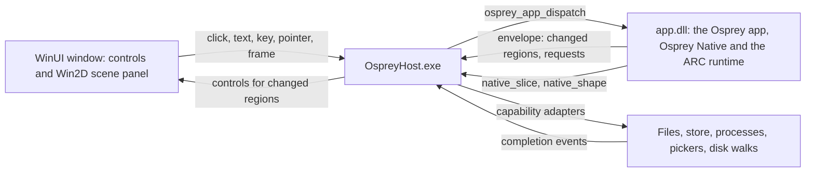

# Plan 0038 — WinUI host: Osprey Native apps on Windows

Contract: [spec 0048](../specs/platforms/0048-WinUiHost.md) [WINUI-HOST]. Framework: [`packages/native`](../../packages/native/README.md). Siblings:

- [Plan 0039](0039-examples-on-osprey-native.md) ports every example to Osprey Native, starting with Osprey Storage.
- [Plan 0040](0040-winui-graphics-scenes.md) puts the direct-GPU graphics scenes in a WinUI window.

Status: **in progress.** Branch: `feat/windows-native-winui`. Done on 2026-10-28, every item tested without a window:

- [x] Spec 0048, and a WinUI row in spec 0047's host family and coverage table.
- [x] The Windows dead-code errors in the CLI's test targets, gated like their users.
- [x] The MSVC build of `osprey-runtime-sys`: `std::path::absolute` replaces `canonicalize`, whose `\\?\` path `cl.exe` cannot open.
- [x] Phase 1: `osprey build --target=windows-x64 -o app.dll` with import slots and binders. Six CLI tests cover the slots, the C `bool` convention, the entry's check, the exports and binder clashes.
- [x] Decision 6: the imports are `native_slice` and `native_shape` in every entry source, the GPUI host and spec 0046.
- [x] Phase 2's host core: DLL loading, UTF-8 strings, envelopes, the region store, the symbol map and the theme. The renderer draws 29 kinds, refuses `scene`, and checks itself against the coverage declaration at start.
- [x] Phase 3's adapters: `measure-folders` with the Windows walk, `reveal`, `choose-folder` and `cancel`. Osprey Storage starts, walks and dispatches through its real DLL in a test.
- [x] Phase 4's coverage test on all three hosts, `winui.yml`, and the no-XAML, package and neutrality guards.
- [x] Phase 0's AOT publish with warnings as errors: a 6.1 MB `OspreyHost.exe`, and 90 MB in 237 files with the WinUI runtime, on the WinUI component package alone.
- [ ] The window seen on a desktop, and its self-test. This machine's shell runs in session 0, where WinUI cannot create a window.
- [ ] The Win2D gate, the scene painter and the frame clock; Flock and Painting.
- [ ] The `windows` `HostCall` for the elevated restart, the C fixture host, and phase 4's remaining adapters.

## Summary

On Windows, every example is the same Osprey Native app that runs on every other host, drawn by one WinUI executable. WinUI is the UI framework of the Windows App SDK (stable 2.6.4, released 2026-10-27). Since Build 2026, Microsoft has called it WinUI rather than WinUI 3. No XAML markup is used anywhere.

Osprey Native is the application framework. The app's store, signals, screens, words and rules are all Osprey, and the signals decide which regions change. The host only does what Osprey cannot:

- builds WinUI controls for the nodes in a changed region;
- paints scenes;
- returns input by binding ID;
- completes capabilities.

It contains no C# UI framework and no code from any example.

| App | Reaches WinUI in |
| --- | --- |
| The GPUI probe | Phase 2 |
| [Osprey Storage](../../examples/storage/README.md), ported by plan 0039 phase 1 | Phase 3 |
| [Flock](../../examples/gpui/flock/README.md) and [Painting](../../examples/gpui/painting/README.md) | Phase 4 |
| [Issue Inbox](../../examples/mobile/README.md) | After plan 0039 phase 4 |
| [Graphics scenes](../../examples/graphics/README.md): direct GPU, not Osprey Native | Plan 0040 |



## Decisions

1. **Toolkit: WinUI from Windows App SDK 2.6.4, with no XAML markup [WINUI-HOST-NO-XAML].**
   - WPF, WinForms, UWP, MAUI, Avalonia and Uno are out.
   - "No XAML" means no `.xaml` files, no XAML compiler output and no `XamlReader.Load` strings. Every control is constructed in C#.
   - `Microsoft.UI.Xaml` is WinUI's own namespace for its controls and cannot be avoided.
   - A test fails if `hosts/winui` gains a `.xaml` file or a `XamlReader` call.
2. **Osprey Native is the only UI framework [WINUI-HOST-THIN].** Osprey's signals already decide which regions changed, and each patch carries a region's nodes. The host therefore keeps controls by key and needs no element tree, state model or reconciler of its own.
   - The host uses no C# UI framework, no MVVM library, no WinUI data binding (`Binding`, `INotifyPropertyChanged`) and no templates.
   - The project references only `Microsoft.Graphics.Win2D` and the Windows App SDK component packages it uses. A test fails on any other package reference [WINUI-HOST-PACKAGES].
   - The host contains no example's name, words, rules or layout ([NATIVE-HOSTS-NEUTRAL]). A test fails when its source names an example.
   - Everything an app decides is Osprey, including per-platform choices, which it reads from `Context.platform` (`windows`).
3. **C# 14 on .NET 10, published with Native AOT.** WinUI is projected only to C# and C++, and C# makes the smaller host of the two. Native AOT, supported since Windows App SDK 1.6, compiles it to one machine-code executable: no JIT and no separate .NET install.
4. **One executable runs every app.** `OspreyHost.exe <app.dll>` is the WinUI twin of the GPUI binary.
   - No example has a C# project of its own. Each example's `run.sh --host=winui` builds its DLL and starts the host with it.
   - The window title is the root `Screen`'s title, and the icon is a path the example passes.
   - `hosts/winui/` holds two projects: `OspreyHost` (bootstrap, region store, node mapping, scene painter, capabilities and frame clock) and `OspreyHost.Tests` (headless tests).
5. **The boundary is GPUI's, in a DLL [WINUI-HOST-DLL].** MinGW clang (UCRT64) builds the `windows-x64` slice. It bundles a runtime that uses winpthreads, so an MSVC-linked Native AOT executable cannot link `libOspreyApp.a`. Instead, when `-o` names a `.dll`, the CLI links that slice into a DLL with the GPUI boundary:
   - exports `osprey_main`, `osprey_app_start` and `osprey_app_dispatch`;
   - imports `native_slice` and `native_shape`;
   - follows the [IOS-HOST-ABI] string rules: inputs borrowed, outputs copied by the host, and `osprey_main` called first.

   No allocation crosses the boundary in either direction.
   - **Imports [WINUI-HOST-IMPORTS].** The two imports are slots. Before `osprey_main`, the host fills them with `[UnmanagedCallersOnly]` functions through the exported `osprey_imports_bind`.
     - Any other `extern` that no `// @link(windows)` library defines fails the build, naming the extern. The CLI asks `llvm-nm` which symbols those libraries define.
     - The import thunks already exist: `import_thunk` and `adapt_import` in [`ios_abi.rs`](../../crates/osprey-cli/src/ios_abi.rs). DLL mode makes them call through the slot.
   - Because the boundary is fixed, the host declares its three exports by hand, and nothing is generated per app.
6. **Host-neutral import names.** Flock, Painting and the probe import `native_slice` and `native_shape`, renamed from `gpui_slice` and `gpui_shape` in the three entry sources, the GPUI host's `ffi.rs` and spec 0046, so no host's name crosses the boundary. Done.
7. **Scenes are painted with Win2D (`Microsoft.Graphics.Win2D` 1.4.0) [WINUI-HOST-SCENE].**
   - The surface is a `CanvasSwapChainPanel`. Rects and discs use `FillRectangle` and `FillCircle`.
   - Strips and paths use `CanvasGeometry` and `CanvasStrokeStyle`; the stroke style supplies Painting's dashes. Gradients use `CanvasLinearGradientBrush`.
   - Glyphs go through DirectWrite with `CanvasTextFormat`. Sprites use `CanvasSpriteBatch` over the atlas.
   - If Win2D fails the Native AOT gate in phase 0, the painter switches to Direct2D through source-generated COM interfaces on a `SwapChainPanel`. The interface stays the same: a decoded draw list in, a frame out.
8. **Threading [WINUI-HOST-THREAD].** Every Osprey call runs on the UI thread, as on GPUI's main thread.
   - `native_slice` is answered during the call, on that thread. A re-entrant `start` or `dispatch` fails with a diagnostic.
   - Blocking adapter work (walks, file reads, processes and HTTPS) runs on the thread pool. Its completions are queued back to the UI thread.
   - No C# exception unwinds through a native frame. Each `[UnmanagedCallersOnly]` import catches, records a diagnostic and returns its failure value.
9. **Deployment: unpackaged and self-contained [WINUI-HOST-DEPLOY].** The project sets `WindowsPackageType=None`, `WindowsAppSDKSelfContained=true`, `PublishAot=true` and `win-x64`. The result is one folder holding the executable, the Windows App SDK runtime and the app DLL, with no installer and no Developer Mode. MSIX is phase 5.
10. **Build.** MSYS2 UCRT64 builds the runtime and the app DLL, as `.github/workflows/gpui.yml` already does for Windows. `dotnet publish` builds the host.
11. **Accessibility is a gate [WINUI-HOST-A11Y].** Every control carries `AutomationProperties.Name` from its node's label.
    - `OspreyHost.exe --self-test` walks its own window's automation peers in process, clicks by name and checks the patches that come back. No UI-automation library is needed.
    - The self-test also proves that the same actions return the same binding IDs.
    - Native accessibility is what users gain over GPUI on Windows, which draws its own controls.

## Node mapping [WINUI-HOST-RENDER]

Every `Node` constructor in [`node.ospml`](../../packages/native/src/node.ospml) maps to stock WinUI controls built in code. The host rejects a kind it does not support the way GPUI does: a red box naming the kind, plus one diagnostic.

When a region's revision changes, the host rebuilds that region's controls but keeps every control whose key survives. Focus, caret, selection and scroll position therefore survive an edit.

| Node | WinUI |
| --- | --- |
| `Text` | `TextBlock` with the type-ramp style for its role and a theme brush for its tone |
| `Stack` | `Grid` with auto tracks and a star track per `Spacer`, because `StackPanel` cannot stretch |
| `Section` | Card `Grid` with title and footer |
| `Screen` | Page with title, subtitle, a `CommandBar` toolbar and a `ScrollViewer` |
| `Split`, `Aside` | `Grid` columns with a host-drawn splitter whose drag sends `resize` |
| `Layer` | Overlaid `Grid` |
| `Tabs` | `SelectorBar` |
| `Rows` | `ListView` of `ListViewItem` elements, or for long lists `ItemsRepeater` with a code `IElementFactory` |
| `Picker` | `ComboBox` |
| `Button` | `Button`, accent style for `Prominent` |
| `Toggle` | `ToggleSwitch` |
| `Field` | `TextBox` or `PasswordBox`, committing on edit or on Enter |
| `Disclosure` | `Expander` |
| `Alert` | `ContentDialog` while visible |
| `ContextMenu` | `ContextFlyout` holding a `MenuFlyout` |
| `Label`, `Icon` | `FontIcon` glyphs from the symbol map, with `TextBlock`s |
| `Badge` | Toned pill |
| `Empty` | Empty-state stack |
| `Pair` | Two-column row |
| `Link` | `HyperlinkButton` |
| `Divider` | 1 px themed rule |
| `Segments` | Toned bar segments |
| `Swatch` | Themed colour chip |
| `Progress` | Indeterminate `ProgressBar` with label |
| `Meter` (plan 0039) | `ProgressBar` with `Value` and `Maximum` |
| `Slot` | `ContentPresenter` bound to a region key |
| `Scene` | Win2D panel, letterboxed to `sceneWidth` by `sceneHeight` |

- **Symbols** map to Segoe Fluent Icons code points through the `SymbolThemeFontFamily` resource. As with GPUI's `every_framework_symbol_has_a_kit_icon`, a test fails when a member of [`symbol.ospml`](../../packages/native/src/symbol.ospml) has no glyph.
- **Theme tokens** resolve to WinUI theme brushes and refresh on `ActualThemeChanged`.
- **The window** uses a Mica backdrop.

## Phases

### Phase 0 — prove the toolchain (gates measured and recorded here)

1. Write spec 0048 [WINUI-HOST]: every ID in this plan with its contract, and a row for this host in spec 0047's [NATIVE-HOSTS-FAMILY].
2. Fix the compiler build under MSVC. `crates/osprey-runtime-sys/build.rs` canonicalizes `compiler/runtime` into a `\\?\` verbatim path. `cl.exe` 14.38 rejects it with `Cannot open source file: '\\ffi_runtime.c'` (observed 2026-10-28). Use a plain absolute path.
3. Make the Windows test targets compile. On Windows, `cargo check --workspace --all-targets` reports five dead-code errors in test-only code whose users are Unix-only:
   - `crate::testkit::shows`
   - `super::*` in `report_artifact_tests.rs`
   - `position_of`
   - `implementations`
   - field `dir`

   Gate the five items the same way as their users.
4. Build a code-only window spike in `hosts/winui`:
   - An `Application` subclass implementing `IXamlMetadataProvider` through `XamlControlsXamlMetaDataProvider`, with `XamlControlsResources` merged in code.
   - `DISABLE_XAML_GENERATED_MAIN` with `Application.Start`, unpackaged and self-contained.
   - A Native AOT publish with trim and AOT warnings as errors.
   - Exit: the published window opens on `windows-latest`, and `--self-test` clicks its button through the automation peer and reads back its text.
5. Run the Win2D gate: the AOT build paints 5,000 discs per frame from `CompositionTarget.Rendering`, and the paint time is recorded. If it fails, apply decision 7's fallback.
6. Add the no-XAML, package and neutrality guard tests, and record the published folder size.

Exit: the gates recorded in this plan, each with its numbers, machine and date.

### Phase 1 — the Windows DLL boundary (CLI)

1. `osprey build <project> --target=windows-x64 -o app.dll` links the slice into a DLL with decision 5's boundary [WINUI-HOST-DLL]. ARC is the default, and winpthreads is linked statically.
2. The import thunks call through slots, and the header states the slot order and count [WINUI-HOST-IMPORTS].
   - `osprey_main` fails while a slot is empty, naming the first one.
   - An extern that no library defines fails the build.
3. A MinGW C fixture host and a C# fixture host each load the probe's DLL, bind both imports and call both exports. A missing import produces the diagnostic. Both run in `ci-windows.yml`.
4. Add the command and its expected result under Commands in `AGENTS.md`.

### Phase 2 — the host and the probe

1. **Interop:**
   - DLL loading through `NativeLibrary`, and import binding.
   - UTF-8 strings: inputs borrowed, and outputs copied before the next call. `native_slice` results are kept for the life of the process, as GPUI's `put_slice` keeps them.
   - The re-entrancy guard and the one-thread rule.
2. **Envelopes and regions:** envelope decoding with System.Text.Json source generation, which is AOT-safe, and a region store that:
   - applies `patches` and `removed`;
   - holds `slices`;
   - keeps controls by key;
   - carries the resident session marker [UI-RESIDENT].
3. **The probe's kinds,** the set GPUI mapped in its phase 0: stack, text, label, icon, badge, button, field, toggle, slot, section, screen, divider, spacer, empty, progress, rows and picker. The phase also adds the symbol map, the theme and the rejection box.
4. **`hosts/winui/run.sh`** builds the probe DLL, publishes the host and opens the window. `--smoke` replays the probe's recorded events through the real DLL with no window, in GPUI's `smoke.jsonl` format, and asserts the patches, requests and text.

Exit: the probe's count, Add, Note and Load round-trip in a WinUI window, and the smoke is green in CI.

### Phase 3 — Osprey Storage, the first ported app

1. The kinds Storage uses beyond the probe: split, the screen toolbar, context menu and `Meter` (plan 0039 phase 1).
2. Capability adapters with the GPUI host's semantics [WINUI-HOST-CAPABILITIES]:
   - `measure-folders`, with the Windows rules in plan 0039 phase 2;
   - `reveal`, through `SHOpenFolderAndSelectItems`;
   - `choose-folder`, through `Microsoft.Windows.Storage.Pickers`;
   - `cancel`;
   - the `windows` `HostCall` namespace, for the elevated restart.
3. `examples/storage/run.sh --host=winui` opens Storage on `C:`.
   - `--smoke` walks a fixture tree with no window.
   - `--self-test` toggles hidden items, opens a folder, goes up and reads the totals by automation name.

Exit: Storage measures `C:` in a WinUI window, and its smoke and self-test are green in CI.

### Phase 4 — every node, every capability, Flock and Painting

1. The remaining kinds: pair, link, segments, swatch, layer, tabs, disclosure, alert and aside.
2. The remaining adapters:
   - `run`: no shell, a deadline kill and an output limit;
   - `list-directories` and `read-texts`;
   - `store-*`, under the per-user root from `ApplicationData.GetForUnpackaged`;
   - `choose-file` and `save-file`;
   - `http`, on `HttpClient`.
3. **Coverage.** A test lists every `Node` and `Capability` constructor against this host's tables.
   - Once plan 0037 phase 3's coverage matrix exists, this host has a column in it.
   - Once `packages/native/conformance` lands (plan 0037 phase 2), this host's smoke runs it.
4. The import rename in decision 6, with the GPUI host's suites and smokes green on all three systems.
5. **Scene painter:**
   - Decode once per region revision, sort by depth and letterbox into the panel.
   - Draw rects, discs, sprites, strips, glyphs and paths. sRGB and HSL tints stay unrounded floats, as GPUI receives them.
   - Pointer and key input go through the same letterbox transform.
   - The `Animate` frame clock sends `frame` events from `CompositionTarget.Rendering`, with `elapsed` clamped to 0.1 s [WINUI-HOST-FRAME].
6. **Flock:** `examples/gpui/flock/run.sh --host=winui`, with its `--smoke` run through this host. `--bench 10 --flock 5000` prints frame, dispatch and paint times. Gate: 5,000 birds inside a 60 Hz frame on a named Windows machine, recorded here.
7. **Painting:** drag, Shift-straightened lines, Dashed, Solid and Clear. Screenshots are compared against GPUI on Windows within a stated perceptual tolerance; pixel identity is not claimed.
8. **CI:** `.github/workflows/winui.yml` runs on `windows-latest`.
   - It builds the runtime, compiler, app DLLs and the AOT host.
   - It runs the host's tests, every smoke and the self-tests.
   - Once it has passed on `main`, it becomes a required check, set through `scripts/verify-branch-protection.mjs` and the ruleset together.

### Phase 5 — packaging and ARM64

1. Optional MSIX packaging, signed with a test certificate in CI.
2. A `windows-arm64` slice (MSYS2 CLANGARM64) and a `win-arm64` publish.

## Risks

- **Code-only WinUI is not Microsoft's documented path.** The reference sample calls it unsupported, and some features assume markup. The host therefore uses no `DataTemplate`: list items are elements, and `ItemsRepeater` takes a code factory. It looks up theme resources in code.
- **Native AOT with C#/WinRT.** Casts to WinRT runtime classes and `[ComImport]` interfaces are not trim-safe. `ISwapChainPanelNative` and similar interfaces use `GeneratedComInterface`, and phase 0 fails on any trim or AOT warning.
- **Per-frame cost on Windows is unmeasured.** Flock's dispatch at 5,000 birds takes 4.0 ms on an M4 Max, but no figure exists yet for x64 Windows or for Win2D paint. Phases 0 and 4 measure both.
- **The `windows-x64` slice has never run in CI** (plan 0036 phase 4). Its failures are fixed in the slice, never worked around in a host.
- **Two Windows hosts.** GPUI and WinUI both run on Windows, and the conformance set keeps the two consistent with each other.

## Commands (to exist by the end of phase 4)

```sh
hosts/winui/run.sh                                  # the probe in a WinUI window
hosts/winui/run.sh --smoke                          # the probe's recorded events through the real DLL; no window
examples/storage/run.sh --host=winui                # Osprey Storage on C:
examples/gpui/flock/run.sh --host=winui --bench 10 --flock 5000
examples/gpui/painting/run.sh --host=winui
make winui-test                                     # CLI DLL tests, host tests, smokes and self-tests
```

## Authorities (verified 2026-10-28)

- Microsoft Learn, [Latest Windows App SDK downloads](https://learn.microsoft.com/en-us/windows/apps/windows-app-sdk/downloads): stable 2.6.4, released 2026-10-27.
- Microsoft Learn, [Windows App SDK 2.0 release notes](https://learn.microsoft.com/en-us/windows/apps/windows-app-sdk/release-notes/windows-app-sdk-2-0):
  - SemVer aligned with NuGet;
  - Storage Pickers enhancements (2.0.1);
  - `ApplicationData.GetForUnpackaged` (2.2.0).
- Windows Developer Blog, [What's new in Windows App SDK 1.6](https://blogs.windows.com/windowsdeveloper/2024/09/04/whats-new-in-windows-app-sdk-1-6/) (2024-09-04): Native AOT support.
- NuGet, [Microsoft.Graphics.Win2D 1.4.0](https://www.nuget.org/packages/Microsoft.Graphics.Win2D) (2026-03-16), which depends on `Microsoft.WindowsAppSDK.WinUI` 1.8 or later.
- Windows Latest, [2026-10-25](https://www.windowslatest.com/2026/10/25/windows-11s-native-app-framework-isnt-being-killed-this-time-microsoft-promises-after-silverlight-and-uwp/): "WinUI 3" is now "WinUI", and XAML is not deprecated.
- [sotanakamura/winui3-without-xaml](https://github.com/sotanakamura/winui3-without-xaml): the code-only bootstrap (`IXamlMetadataProvider` through `XamlControlsXamlMetaDataProvider`, with `XamlControlsResources` merged in code) and its note that this is an unsupported scenario.
