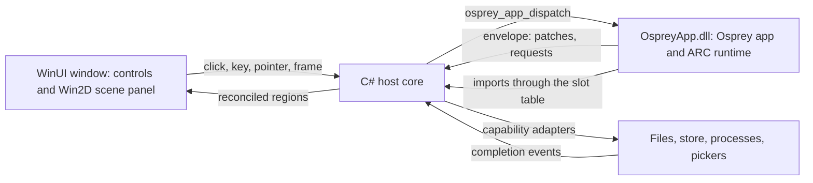

# Plan 0038 — WinUI hosts: the examples as native Windows apps

Contract: spec 0048 `docs/specs/platforms/0048-WinUiHost.md` [WINUI-HOST], written in phase 0 before any host code. Framework: [`packages/native`](../../packages/native/README.md). Siblings: [plan 0039](0039-windows-storage-and-inbox.md) (Osprey Storage and Issue Inbox on Windows) and [plan 0040](0040-winui-graphics-scenes.md) (graphics scenes in a WinUI window). Status: **not started.** Branch: `feat/windows-native-winui`.

## Summary

The examples that have a native macOS or mobile host get a native Windows version drawn by **WinUI**, the UI framework of the Windows App SDK (stable 2.6.4, released 2026-10-27). Since Build 2026 Microsoft calls it WinUI rather than WinUI 3. No XAML markup is used anywhere. Osprey keeps every rule, screen and word, as it does for the SwiftUI, Compose and GPUI hosts. The WinUI host owns windows, controls, input, files and pixels.

This plan builds the part every Windows example shares: the DLL boundary, the host core, the `@osprey/native` renderer and the scene painter. It then runs the GPUI examples (the probe, Flock and Painting) on WinUI. Plans 0039 and 0040 reuse that core for the storage browser, Issue Inbox and the graphics scenes.

| Example | Today | Windows version | Plan |
| --- | --- | --- | --- |
| Probe, [Flock](../../examples/gpui/flock/README.md), [Painting](../../examples/gpui/painting/README.md) | GPUI host (Rust) running on macOS; its Windows CI has never run | `@osprey/native` WinUI host: WinUI controls for nodes, Win2D for scenes | 0038 |
| [Osprey Storage](../../examples/macos/README.md) | SwiftUI, Mac and iPhone | WinUI app measuring Windows volumes | 0039 |
| [Issue Inbox](../../examples/mobile/README.md) | SwiftUI and Compose | WinUI app on the Storage renderer | 0039 |
| [Graphics scenes](../../examples/graphics/README.md) | Swift and Metal; a Direct3D 12 bridge that has never been compiled | WinUI window, `SwapChainPanel`, the same D3D12 bridge | 0040 |

Talon Bank keeps its own web and mobile renderers and is out of scope. So is the iPhone counter, whose subject is an iOS logging callback.



## Decisions

1. **Toolkit: WinUI from Windows App SDK 2.6.4, with no XAML markup.** WPF, WinForms, UWP, MAUI, Avalonia and Uno are out. "No XAML" means three things: no `.xaml` files, no XAML compiler output, and no `XamlReader.Load` strings. Every control is constructed in C#. `Microsoft.UI.Xaml` is WinUI's own namespace for its controls and cannot be avoided. A test fails if `hosts/winui` or any Windows example gains a `.xaml` file or a `XamlReader` call [WINUI-HOST-NO-XAML].
2. **Language: C# 14 on .NET 10, published with Native AOT.** C# and C++/WinRT are WinUI's first-class languages, and Microsoft's code-first work for WinUI (Reactor) is C#. The Windows App SDK has supported Native AOT since 1.6, which makes the host machine code with no JIT and no separate .NET install. C++/WinRT would bring a `vcxproj`/MSBuild build for no visible gain, because the seam is a C ABI either way. Rust already has the GPUI host on Windows, and WinUI has no Microsoft-supported Rust projection.
3. **Microsoft.UI.Reactor is evaluated, not adopted.** Reactor is Microsoft's C# MVU layer that reconciles to WinUI controls; Microsoft labels it experimental and pre-1.0, with an API that may change without notice. Osprey Native already is the MVU layer: state, update and view are Osprey's. Adopting Reactor would add a second element tree and a second state model only to reuse its reconciler, and would put an unstable API under every example. The host keeps its node mapping as one pure function (`Node` to `ControlSpec`) separate from the code that applies it, so Reactor can replace the applier without touching the mapping. Revisit this when Reactor reaches 1.0 with Native AOT support and can host an arbitrary `FrameworkElement`.
4. **One host core, many apps.** `hosts/winui/` contains four projects. `Osprey.Interop` loads the DLL, binds imports and owns the string rules. `Osprey.WinUI` holds the code-only bootstrap, theme, symbols, region store, reconciler, node mapping, scene painter, capabilities and frame clock. `OspreyHost` is the executable that runs any `@osprey/native` app DLL, the WinUI twin of the GPUI binary. `Osprey.WinUI.Tests` holds the headless tests. The Storage, Inbox and graphics executables reference the core, and no example copies host code.
5. **Boundary: a Windows DLL with an import slot table [WINUI-HOST-DLL].** The `windows-x64` slice is built by MinGW clang (UCRT64) and bundles a runtime that uses winpthreads, so an MSVC-linked Native AOT executable cannot link `libOspreyApp.a`. When `-o` names a `.dll`, the CLI links that same slice into `OspreyApp.dll`. The DLL exports `osprey_main`, the entry source's functions and `osprey_imports_bind`. Exports keep the [IOS-HOST-ABI] rules: borrowed inputs, outputs the host copies, `osprey_main` first.
   - Every `extern` that no `// @link(windows)` library defines becomes a slot; the CLI asks `llvm-nm` which symbols the named import libraries define. Before `osprey_main`, the host fills each slot with a C# `[UnmanagedCallersOnly]` function pointer or a native library export.
   - `osprey_main` refuses to run and names the first empty slot [WINUI-HOST-IMPORTS].
   - The import thunks already exist (`import_thunk` and `adapt_import` in [`ios_abi.rs`](../../crates/osprey-cli/src/ios_abi.rs)). The DLL mode makes them call through the slot.
   - UCRT64 and MSVC share the Universal CRT, but no allocation crosses the boundary in either direction.
6. **Generated C# bindings, not hand-written P/Invoke [WINUI-HOST-BINDINGS].** Beside the header, the CLI writes `OspreyApp.g.cs` from the same `HostAbi` that produces the header. It contains `LibraryImport` declarations for the exports and an `Imports` struct of typed `delegate* unmanaged[Cdecl]` slots with their names. A signature change in Osprey then fails the C# build instead of corrupting the stack, which is the graphics ABI guard's idea applied to every app.
7. **Host-neutral import names.** Flock, Painting and the probe import `gpui_slice` and `gpui_shape`. A WinUI host answering imports named after GPUI contradicts [NATIVE-HOSTS-NEUTRAL]. One change renames them to `native_slice` and `native_shape` in the three entry sources, the GPUI host's `ffi.rs`, the WinUI host and specs 0046 and 0047.
8. **Scenes are painted with Win2D (`Microsoft.Graphics.Win2D` 1.4.0) [WINUI-HOST-SCENE].**
   - The surface is a `CanvasSwapChainPanel`. Rects and discs use `FillRectangle` and `FillCircle`.
   - Strips and paths use `CanvasGeometry` and `CanvasStrokeStyle`, which supplies Painting's dashes. Gradients use `CanvasLinearGradientBrush`.
   - Glyphs go through DirectWrite with `CanvasTextFormat`. Sprites use `CanvasSpriteBatch` over the atlas.
   - If Win2D fails the Native AOT gate in phase 0, the painter draws with Direct2D through TerraFX.Interop.Windows on a `SwapChainPanel`. Its interface (decoded draw list in, frame out) does not change either way.
9. **Threading [WINUI-HOST-THREAD].** Every Osprey call runs on the UI thread, as on GPUI's main thread. Imports are answered during the call on that same thread, and a re-entrant `start` or `dispatch` fails with a diagnostic. Blocking adapter work (walks, file reads, processes) runs on the thread pool, and its completion events are queued back to the UI thread. No C# exception unwinds through a native frame: every `[UnmanagedCallersOnly]` import catches, records a diagnostic and returns its failure value. The graphics scenes are the one exception to UI-thread calls (plan 0040).
10. **Deployment: unpackaged and self-contained [WINUI-HOST-DEPLOY].** The project sets `WindowsPackageType=None`, `WindowsAppSDKSelfContained=true`, `PublishAot=true` and `win-x64`. The result is one folder holding the executable, the Windows App SDK runtime and `OspreyApp.dll`, with no installer and no Developer Mode. The host references only the Windows App SDK component packages it uses, so the folder stays small. MSIX is phase 5.
11. **Build orchestration.** MSYS2 UCRT64 builds the runtime and the app DLL, exactly as `.github/workflows/gpui.yml` already does for Windows. `dotnet publish` builds the host. Each example's existing `run.sh` gains `--host=winui`, so an example keeps one entry point instead of growing a second script.
12. **Accessibility is a gate.** Every control carries `AutomationProperties.Name` from its node's label. Smoke tests drive the window through UI Automation (FlaUI, MIT, test-only). That is also how this host proves the conformance requirement that the same user actions return the same binding ids. Native accessibility is the user-visible difference from GPUI on Windows, which draws its own controls (spec 0046 records the lag).

## Node mapping [WINUI-HOST-RENDER]

Every `Node` constructor in [`node.ospml`](../../packages/native/src/node.ospml) maps to stock WinUI controls built in code. A kind the host does not support is rejected the way GPUI rejects it: a red box naming the kind, plus one diagnostic.

| Node | WinUI |
| --- | --- |
| `Text` | `TextBlock` with the type-ramp style for its role and a theme brush for its tone |
| `Stack` | `Grid` with auto tracks and a star track per `Spacer`, which `StackPanel` cannot stretch |
| `Section`, `Screen` | Card `Grid` with title and footer; page with title, subtitle, a `CommandBar` toolbar and a `ScrollViewer` |
| `Split`, `Aside`, `Layer` | `Grid` columns with a host-drawn splitter whose drag sends `resize`; overlaid `Grid` |
| `Tabs`, `Rows`, `Picker` | `SelectorBar`; `ListView` of `ListViewItem` elements, or `ItemsRepeater` with a code `IElementFactory` for long lists; `ComboBox` |
| `Button`, `Toggle`, `Field` | `Button` (accent style for `Prominent`); `ToggleSwitch`; `TextBox` or `PasswordBox`, committing on edit or on Enter |
| `Disclosure`, `Alert`, `ContextMenu` | `Expander`; `ContentDialog` while visible; `ContextFlyout` holding a `MenuFlyout` |
| `Label`, `Icon`, `Badge`, `Empty` | `FontIcon` glyphs from the symbol map with `TextBlock`s; a toned pill; an empty-state stack |
| `Pair`, `Link`, `Divider`, `Segments`, `Swatch`, `Progress`, `Slot` | Two-column row; `HyperlinkButton`; 1 px themed rule; toned bar segments; themed colour chip; `ProgressBar` with label; `ContentPresenter` bound to a region key |
| `Scene` | Win2D panel, letterboxed to `sceneWidth` by `sceneHeight` |

Symbols map to Segoe Fluent Icons code points through the `SymbolThemeFontFamily` resource. As with GPUI's `every_framework_symbol_has_a_kit_icon`, a test fails when a member of [`symbol.ospml`](../../packages/native/src/symbol.ospml) has no glyph. Theme tokens resolve to WinUI theme brushes and are refreshed on `ActualThemeChanged`, and the window uses a Mica backdrop. `Context.platform` is `Windows`.

## Phases

### Phase 0 — prove the toolchain (gates measured and recorded here)

1. Spec 0048 [WINUI-HOST] written: every ID in this plan with its contract, and a row for this host in spec 0047's [NATIVE-HOSTS-FAMILY].
2. Fix the compiler build under MSVC. `crates/osprey-runtime-sys/build.rs` canonicalizes `compiler/runtime` into a `\\?\` verbatim path, which `cl.exe` 14.38 rejects (`Cannot open source file: '\\ffi_runtime.c'`, observed 2026-10-28). Use a plain absolute path instead.
3. Make the Windows test targets compile. On Windows, `cargo check --workspace --all-targets` reports five dead-code errors in test-only code whose users are Unix-only: `crate::testkit::shows`, `super::*` in `report_artifact_tests.rs`, `position_of`, `implementations`, and field `dir`. Gate the five items the same way as their users.
4. Code-only window spike in `hosts/winui`:
   - An `Application` subclass implementing `IXamlMetadataProvider` through `XamlControlsXamlMetaDataProvider`, with `XamlControlsResources` merged in code.
   - `DISABLE_XAML_GENERATED_MAIN` with `Application.Start`, unpackaged and self-contained.
   - A Native AOT publish with trim and AOT warnings as errors.
   - Exit: FlaUI launches the published window on `windows-latest`, clicks its button and reads back its text.
5. Win2D gate: the AOT build paints 5,000 discs per frame from `CompositionTarget.Rendering`, with the paint time recorded. If it fails, apply decision 8's fallback.
6. The no-XAML guard test, and the published folder size recorded.

Exit: the four gates recorded in this plan with numbers, machine and date.

### Phase 1 — the Windows DLL boundary (CLI)

1. `osprey build <project> --target=windows-x64 -o OspreyApp.dll` links the slice, ARC by default and with winpthreads static, into a DLL exporting `osprey_main`, the entry functions and `osprey_imports_bind` [WINUI-HOST-DLL].
2. The import thunks call through slots; the header states the slot order and count; `osprey_main` fails, naming the first empty slot [WINUI-HOST-IMPORTS].
3. Generated `OspreyApp.g.cs` [WINUI-HOST-BINDINGS], with CLI unit tests over a fixture that uses every C type the boundary carries.
4. A MinGW C fixture host and a C# fixture host each load a two-function DLL, bind one import and call both exports. A missing import produces the diagnostic. Both run in `ci-windows.yml`.
5. The command and its expected result go under Commands in `AGENTS.md`.

### Phase 2 — host core and the probe

1. `Osprey.Interop`:
   - DLL loading through `NativeLibrary` and import binding.
   - UTF-8 strings: inputs borrowed, outputs copied before the next call, and import results kept for the life of the process, as the GPUI host's `put_slice` keeps them.
   - The re-entrancy guard and the one-thread rule.
2. Envelope decoding with System.Text.Json source generation (AOT-safe). A region store that applies `patches` and `removed` and holds `slices`, plus the resident session marker [UI-RESIDENT].
3. Reconciler: a pure diff of a region's old and new node trees into operations, and an applier that performs them on WinUI controls. Focus and caret survive a `Field` edit committed on every keystroke. The diff is tested headless.
4. The probe's kinds, which are the set GPUI mapped in its phase 0: stack, text, label, icon, badge, button, field, toggle, slot, section, screen, divider, spacer, empty, progress, rows and picker. Also the symbol map, the theme and the rejection box.
5. `hosts/winui/run.sh` builds the probe DLL, publishes the host and opens the window. `--smoke` replays the probe's recorded events through the real DLL with no window and asserts the patches, requests and text, using GPUI's `smoke.jsonl` format.

Exit: the probe's count, Add, Note and Load round-trip in a WinUI window, and the smoke is green in CI.

### Phase 3 — every node and the capabilities

1. The remaining kinds: pair, link, segments, swatch, layer, split, tabs, disclosure, alert, context menu and aside. That is more than GPUI maps today.
2. Adapters with the GPUI host's semantics [WINUI-HOST-CAPABILITIES]:
   - `run` (no shell, deadline kill, output limit), `list-directories`, `read-texts`, `store-*` under the per-user root from `ApplicationData.GetForUnpackaged`, and `cancel`.
   - `choose-file`, `choose-folder` and `save-file` through `Microsoft.Windows.Storage.Pickers`, and `reveal` through `SHOpenFolderAndSelectItems`.
   - `Http` and `HostCall` are rejected with a diagnostic until an app needs them, matching GPUI's current set.
3. A test lists every `Node` and `Capability` constructor against this host's tables. Once plan 0037 phase 3's generated coverage matrix exists, this host gets a column in it.
4. When `packages/native/conformance` lands (plan 0037 phase 2), this host's smoke runs it.

### Phase 4 — Flock and Painting on WinUI

1. The import rename in decision 7. The GPUI host's suites and smokes stay green on all three systems.
2. Scene painter:
   - Decode once per region revision, sort by depth and letterbox into the panel.
   - Draw rects, discs, sprites, strips, glyphs and paths, with sRGB and HSL tints carried as unrounded floats as GPUI receives them.
   - Pointer and key input go through the same letterbox transform.
   - The `Animate` frame clock sends `frame` events from `CompositionTarget.Rendering`, with `elapsed` clamped to 0.1 s [WINUI-HOST-FRAME].
3. Flock: `examples/gpui/flock/run.sh --host=winui`. `--smoke` replays `smoke.jsonl` through this host, and `--bench 10 --flock 5000` prints frame, dispatch and paint times. Gate: 5,000 birds inside a 60 Hz frame on a named Windows machine, and inside a 120 Hz frame where the display allows. Machine and numbers are recorded here.
4. Painting: drag, Shift-straightened lines, Dashed, Solid and Clear. A screenshot comparison against the GPUI host running the same app on Windows uses a stated perceptual tolerance, because Direct2D and GPUI rasterize differently. Pixel identity is not claimed.
5. CI: `.github/workflows/winui.yml` on `windows-latest` builds the runtime, compiler, app DLLs and the AOT host. It runs the host's tests, the probe, Flock and Painting smokes, and the FlaUI test of the probe. It becomes a required check, through `scripts/verify-branch-protection.mjs` and the ruleset together, once it has passed on `main`.

### Phase 5 — packaging and ARM64

1. Optional MSIX packaging, signed with a test certificate in CI.
2. A `windows-arm64` desktop slice (MSYS2 CLANGARM64) and a `win-arm64` publish.

## Risks

- **Code-only WinUI is not Microsoft's documented path.** The reference sample states it is an unsupported scenario, and some features assume markup. The host uses no `DataTemplate` (list items are elements, and `ItemsRepeater` takes a code factory) and looks up theme resources in code. Windows App SDK 2.5.4-experimental adds code-built theme bindings and `DataTemplate` delegates; they are adopted only once they ship in a stable release.
- **Native AOT with C#/WinRT.** Casts to WinRT runtime classes and `[ComImport]` interfaces are not trim-safe. `ISwapChainPanelNative` and similar interfaces use `GeneratedComInterface`, and phase 0 fails on any trim or AOT warning.
- **Per-frame cost on Windows is unmeasured.** Flock's dispatch at 5,000 birds is 4.0 ms on an M4 Max. No x64 Windows figure or Win2D paint figure exists yet; phase 0 and phase 4 measure both.
- **The `windows-x64` slice has never run in CI** (plan 0036 phase 4). This plan's first Windows job may hit the same failures; they are fixed in the slice, never worked around in a host.
- **Two hosts for the same apps on Windows.** The conformance suite keeps GPUI and WinUI honest against each other.

## Commands (to exist by the end of phase 4)

```sh
hosts/winui/run.sh                                         # the probe in a WinUI window
hosts/winui/run.sh --smoke                                 # the probe's recorded events through the real DLL; no window
examples/gpui/flock/run.sh --host=winui --bench 10 --flock 5000
examples/gpui/painting/run.sh --host=winui
make winui-test                                            # CLI DLL tests, host tests, smokes
```

## Authorities (verified 2026-10-28)

- Microsoft Learn, [Latest Windows App SDK downloads](https://learn.microsoft.com/en-us/windows/apps/windows-app-sdk/downloads): stable 2.6.4 (2026-10-27). 2.5.4-experimental (2026-09-29) adds code-based theme resource bindings and `DataTemplate` construction.
- Microsoft Learn, [Windows App SDK 2.0 release notes](https://learn.microsoft.com/en-us/windows/apps/windows-app-sdk/release-notes/windows-app-sdk-2-0): SemVer aligned with NuGet, Storage Pickers enhancements (2.0.1) and `ApplicationData.GetForUnpackaged` (2.2.0).
- Windows Developer Blog, [What's new in Windows App SDK 1.6](https://blogs.windows.com/windowsdeveloper/2024/09/04/whats-new-in-windows-app-sdk-1-6/) (2024-09-04): Native AOT support.
- NuGet, [Microsoft.Graphics.Win2D 1.4.0](https://www.nuget.org/packages/Microsoft.Graphics.Win2D) (2026-03-16), depending on `Microsoft.WindowsAppSDK.WinUI` 1.8 or later.
- [microsoft/microsoft-ui-reactor](https://github.com/microsoft/microsoft-ui-reactor): experimental, pre-1.0, MIT. Windows Latest, [2026-10-25](https://www.windowslatest.com/2026/10/25/windows-11s-native-app-framework-isnt-being-killed-this-time-microsoft-promises-after-silverlight-and-uwp/): "WinUI 3" is now "WinUI", and XAML is not deprecated.
- [sotanakamura/winui3-without-xaml](https://github.com/sotanakamura/winui3-without-xaml): code-only bootstrap (`IXamlMetadataProvider` through `XamlControlsXamlMetaDataProvider`, `XamlControlsResources` merged in code) and its unsupported-scenario note.
