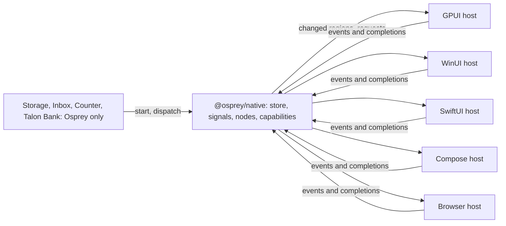

# Plan 0039 — Every example on Osprey Native, Osprey Storage first

Contract: [spec 0047](../specs/applications/0047-OspreyNativeHosts.md) [NATIVE-HOSTS] and the framework contract in [`packages/native/README.md`](../../packages/native/README.md) ([UI-STORE], [UI-SIGNALS], [UI-EFFECTS]). Hosts: GPUI ([plan 0036](0036-gpui-desktop-host.md)), WinUI ([plan 0038](0038-winui-windows-hosts.md)) and the shared host work in [plan 0037](0037-osprey-native-hosts.md). Status: **phase 1 in progress.** Branch: `feat/windows-native-winui`. `Meter` and `MeasureFolders` are in the framework, with 54 framework tests green under ARC and GC. [`examples/storage`](../../examples/storage/README.md) is the app, all Osprey, with 19 tests, and it runs on the WinUI host's adapters. The GPUI adapter and GPUI's `Meter`, `Split` and `ContextMenu` remain.

## Summary

Every example with a user interface becomes an Osprey Native app:

- its state is one Osprey store, read through Osprey's built-in signals;
- its screens are typed `Node` values;
- its platform work is typed `Capability` requests.

A host only draws nodes and completes capabilities. Each app is written once and runs on every host: GPUI, WinUI, SwiftUI, Compose and the browser. The owner set this direction on 2026-10-28.

The port starts with the app that needs the least: Osprey Storage. Every screen it draws maps onto nodes the framework already has, except a proportional bar, and its disk walk becomes one generic capability. Issue Inbox follows. It needs HTTPS in every host, a rich-text node and a new home for its SQL tables.



## Rules [NATIVE-APPS-ALL]

1. **Every example with a user interface runs on Osprey Native.** No example keeps its own node protocol, renderer or host executable. Its README names the hosts it runs on.
2. **As much as possible is Osprey.** State, rules, words, formatting, ordering, layout and per-platform choices are Osprey, decided from `Context.platform` ([UI-CONTEXT-PLATFORM]). A host contains no example's name, words or rules ([NATIVE-HOSTS-NEUTRAL]), and a test fails when a host's source names an example.
3. **A missing feature grows the framework, not a host.** When an app needs something Osprey Native lacks, the framework gains a typed node or capability, every host implements it, and the coverage matrix (plan 0037 phase 3) shows it. Work only one platform can do is a `HostCall` in that platform's namespace ([UI-EFFECTS]).
4. **Two exceptions, each stated in its README.**
   - The graphics scenes run their own shaders on the GPU every frame through `ospgfx`, which `Scene` primitives cannot express ([plan 0040](0040-winui-graphics-scenes.md)).
   - The API browser in `examples/tui` draws to a terminal, where no native toolkit exists.
5. **Web clients come last.** They move onto the shared browser renderer (plan 0037 phase 4) after the native apps, with no deadline.

## Order: least friction first

| App | Today | What its port needs | Order |
| --- | --- | --- | --- |
| GPUI probe, [Flock](../../examples/gpui/flock/README.md), [Painting](../../examples/gpui/painting/README.md) | Osprey Native on GPUI | Nothing; plan 0038 draws them on WinUI | Done |
| [Osprey Storage](../../examples/macos/README.md) | Its own node protocol, 17 synchronous `storage_*` imports and a SwiftUI host | A `Meter` node and a `MeasureFolders` capability; every other screen maps onto existing nodes | **First** |
| [Issue Inbox](../../examples/mobile/README.md) | Its own node protocol, SQL and HTTPS commands, and SwiftUI and Compose renderers | HTTPS in every host, a `Rich` node, its SQL tables as store documents and a Compose host | Second |
| [iPhone counter](../../examples/ios/README.md) | 18 lines of Osprey and a Swift host | The SwiftUI host from phase 3 | Third |
| [Talon Bank](../../examples/projects/modules/mobile/README.md) clients | Its own web, Android and iOS clients | The browser, Compose and SwiftUI hosts | Last |
| [Graphics scenes](../../examples/graphics/README.md) | Direct GPU through `ospgfx` | Stays direct ([plan 0040](0040-winui-graphics-scenes.md)) | Exception |

## Phase 1 — Osprey Storage on Osprey Native

The app moves to `examples/storage/`, because it is no longer only a Mac app. The old `examples/macos` keeps building and passing until phase 3 retires it, so the Mac and iPhone builds never break.

1. **`Meter` [UI-COMPONENTS-METER].** A node with a label, a value, a total and a tone, drawn as a bar filled to value over total. The encoder clamps the value into `0..total` and sends a total of at least 1. GPUI, WinUI and the webview draw it. `Progress` stays the indeterminate activity indicator it is today.
2. **`MeasureFolders` [UI-EFFECTS-MEASURE].** A capability with folders, an entry limit, a deadline and a slice. For each folder the host writes `{path, error, missing, truncated, unreadable, volume, entries}` into the slice:
   - `volume` is `{name, total, available}`.
   - Each entry is `{name, path, bytes, items, hidden, folder, link, guarded}` for one child, measured to the bottom.

   The rules are the same on every host:
   - `bytes` are allocated bytes, and a file with several hard links counts once per walk.
   - A link is reported and never followed; its target's size is excluded.
   - The walk does not cross into another volume. It never opens a cloud placeholder, so it triggers no download.
   - A folder that cannot be read adds one to `unreadable` and is not an error.
   - `Cancel` with the request's ticket stops the walk. A walk that reaches its deadline completes with `truncated` set.
   - The adapter sorts, hides, formats and decides nothing.
3. **The GPUI adapter** in `hosts/gpui/src/adapters/measure.rs`: Rust on `std::fs`, using `st_blocks` and `(st_dev, st_ino)` on Unix, and the Windows rules from phase 2. Its tests run on a temporary tree: a hidden file, a symbolic link, a hard link counted once, an unreadable folder, a deadline and a cancel.
4. **The app, Osprey only** (`examples/storage/src`):
   - Slices:
     - `Place`: the folder and the way back.
     - `Options`: whether hidden items show.
     - `Walk`: the current ticket and its state.
     - `Measured`: host-held, holding the walk's result, so a large listing never enters the opaque state ([UI-STORE]).
   - Actions: one `StorageAction` union grouped by value kind: taps for Open, Up, Rescan, Choose and Reveal, and a flag for Show Hidden.
   - `update`: opening a folder cancels the old ticket and requests `MeasureFolders` with a new one. A completion whose ticket is stale is dropped.
   - Today's `disk.ospml` (formatting, ranking and the hidden rule) is already pure Osprey and is kept.
   - Words and per-platform choices come from `Context.platform`, such as "Show in Finder" on macOS and "Show in File Explorer" on Windows.
   - Regions: `places`, `folder` and `listing`, so a walk's completion refreshes only the listing.
5. **The suite** in `examples/storage/test` drives the real `start`/`dispatch` path with fixture completions. It covers the first walk, ranking, the hidden toggle, a link row, the unreadable footer, a stale ticket, Up at a root and a chosen folder, and it runs on every operating system.
6. **`examples/storage/run.sh`** builds the app and opens it on GPUI.
   - `--host=winui` opens it on WinUI once plan 0038 phase 3 lands.
   - `--smoke` replays recorded events against a fixture tree with no window.

| Today's kind | Osprey Native |
| --- | --- |
| `navigation` | `Split`: a sidebar `Screen` with `Rows` for home and the volumes, beside the folder's `Screen` |
| Toolbar `button` | `Screen` toolbar: `Button`s for Up, Rescan and Choose Folder, and a `Toggle` for Show Hidden |
| `pathbar` | A horizontal `Stack` of plain `Button`s, one per ancestor folder |
| `gauge` | `Meter` of used against total, with `Pair`s for used and available |
| `entry` | A `Rows` row led by `Folder`, `Document`, `External` (a link) or `Lock` (unreadable), holding the name, the size and a share `Meter` |
| `menu` | `ContextMenu` with Reveal |
| `progress` | `Progress` while a walk runs |
| `empty`, `section`, `stack`, `toggle`, `button` | `Empty`, `Section`, `Stack`, `Toggle`, `Button` |
| `key` | Phase 2: [UI-COMPONENTS-SHORTCUT] |
| Photo `segment`s | Phase 3, on the Apple host only |

Exit:

- Storage runs from Osprey Native on GPUI on macOS.
- Its suite is green on every operating system.
- No host contains Storage code.

## Phase 2 — Storage on Windows, and parity

1. **The Windows walk.** The WinUI adapter for `measure-folders` (plan 0038 phase 3) and the GPUI adapter on Windows follow the same rules:
   - Capacity comes from `GetDiskFreeSpaceExW`. `available` is what this user may still write, after quotas.
   - The walk makes one `GetFileInformationByHandleEx(FileIdExtdDirectoryInfo)` batch per directory. Each batch gives names, attributes, `AllocationSize`, reparse tag and file id without opening each file.
   - Hidden means `FILE_ATTRIBUTE_HIDDEN`, which is what File Explorer hides by default. A leading dot is not hidden on Windows.
   - Only `IO_REPARSE_TAG_SYMLINK` and `IO_REPARSE_TAG_MOUNT_POINT` are links.
   - `WOF` files count their allocated bytes, and `APPEXECLINK` aliases count as 0 bytes.
   - Cloud placeholders are never opened or entered: any `CLOUD_*` tag, or the `RECALL_ON_DATA_ACCESS`, `RECALL_ON_OPEN` or `OFFLINE` attribute.
   - Hard links count once, keyed by volume serial number and 128-bit file id. This keeps `C:\Windows\WinSxS` from being counted twice.
   - A folder that answers `ERROR_ACCESS_DENIED` adds one to `unreadable`.
   - A shared fixture tree with its expected JSON runs against both adapters, so the Rust and C# walkers cannot disagree.
2. **`Shortcut` [UI-COMPONENTS-SHORTCUT].** A `Button` may carry a typed `Chord`.
   - `Primary` is Command on Apple systems and Control elsewhere.
   - The host shows the chord in its menu or tooltip.
   - Osprey picks each chord per platform: Alt+Up, F5 and Ctrl+O on Windows; Command+Up, Command+R and Command+O on the Mac.
3. **Elevation on Windows.** "Restart as administrator" is a `HostCall` in the `windows` namespace. The WinUI host answers it with `ShellExecuteExW` and `runas`, and passes `--elevated` back in the launch arguments. Osprey decides when to offer it: on Windows, when the walk could not read some folders and the process is not elevated.
4. **Measurements.** On a full `C:` drive, record the walk time, the peak memory and the gap between the measured total and the used capacity. They go in `examples/storage/README.md` with the machine.

Exit: Storage measures `C:` in a WinUI window, with shortcuts and elevation, and its smoke and the host's self-test pass in CI.

## Phase 3 — the SwiftUI host, and the old Storage app retired

1. **`hosts/swiftui`**: a SwiftUI Osprey Native host for macOS and iOS.
   - It is built from the renderer Storage and Inbox use today and from the SwiftUI host Vigil runs.
   - It maps every node, every symbol (to SF Symbols) and every capability.
   - It runs the conformance set (plan 0037 phase 2).
2. **Apple-only requests.** Two of Storage's requests become `HostCall`s that only this host answers:
   - The Photos summary is `HostCall "photos" "summary"`. The Photos section appears only when the answer arrives.
   - Full Disk Access is `HostCall "macos" "privacy-settings"`.
3. **Retirement.** Storage runs on the Mac and the iPhone through this host. `examples/macos`, both its Osprey and its Swift, is deleted. Every link to it moves to `examples/storage`, and the website keeps a redirect.

Exit: one Storage app, running on GPUI, WinUI and SwiftUI.

## Phase 4 — Issue Inbox

1. Every host completes `Http` with its platform's HTTPS client, within the framework's limits.
2. **`Rich` [UI-COMPONENTS-RICH].** A paragraph of styled runs: strong, emphasis, code and link. Markdown parsing stays in Osprey, in today's `markdown.ospml`.
3. The SQL tables become JSON documents in the app's private store, through `StoreRead` and `StoreWrite`. Each query becomes an Osprey list function, so no host runs SQL.
4. **`hosts/compose`**: the Android host, built from today's `NativeRenderer.kt`.
5. The Inbox's own protocol, `NativeRenderer.swift` and `NativeRenderer.kt` are deleted. The Inbox runs on GPUI, WinUI, SwiftUI and Compose.

## Phase 5 — the rest, without a deadline

1. The iPhone counter on `hosts/swiftui`.
2. Talon Bank's Android and iOS apps on the Compose and SwiftUI hosts.
3. Talon Bank's web client on the browser host (plan 0037 phase 4).

## Risks

- **Two walkers on Windows.** GPUI's Rust walker and WinUI's C# walker must agree. The check is phase 2's shared fixture tree and its expected JSON.
- **Walk time on large volumes.** The host-held slice keeps the listing out of the opaque state. A walk reports `truncated` at its deadline instead of hanging the app. Phase 2 measures before any claim is made.
- **Framework growth.** `Meter`, `MeasureFolders`, `Shortcut` and `Rich` each need every host. The coverage matrix (plan 0037 phase 3) fails CI when a host lacks one.
- **Compiler limits.** The framework README lists the open issues an app must work around (#273, #274, #277, #278 and #282). The Storage port follows those workarounds instead of waiting for fixes.

## Commands (to exist by the end of phase 2)

```sh
./target/release/osprey test examples/storage/test        # the suite, every operating system
examples/storage/run.sh                                   # Osprey Storage on GPUI
examples/storage/run.sh --host=winui                      # Osprey Storage on WinUI
examples/storage/run.sh --smoke                           # fixture tree, recorded events, no window
cargo test --manifest-path hosts/gpui/Cargo.toml measure  # the GPUI walker on a temporary tree
```
