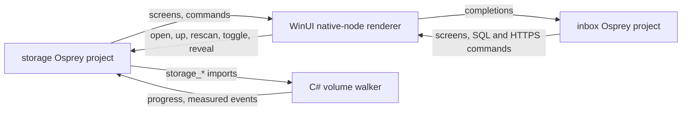

# Plan 0039 — Osprey Storage and Issue Inbox on Windows

Contract: spec 0048 [WINUI-HOST] (plan 0038), the storage browser's boundary in [`examples/macos/README.md`](../../examples/macos/README.md), and [spec 0040](../specs/applications/0040-ReactiveMobileApplications.md) for Issue Inbox. Depends on plan 0038 phases 0 to 2: the DLL boundary, the code-only bootstrap and the host core. Status: **not started.**

## Summary

Osprey Storage gets a Windows version that shows what uses a Windows volume, folder by folder. The Osprey project keeps owning the browser's state, the ranking, the hidden-item rule, the formatting and every screen. It gains Windows as a third platform. A WinUI host measures NTFS and ReFS volumes and draws the screens with stock WinUI controls. Issue Inbox then runs on the same Windows renderer, because both apps speak the same native-node protocol, the one [`NativeRenderer.swift`](../../examples/mobile/ios/IssueInbox/NativeRenderer.swift) and [`NativeRenderer.kt`](../../examples/mobile/android/app/src/main/java/org/ospreylang/issueinbox/NativeRenderer.kt) draw.



## Decisions

1. **One Osprey project, one folder per app, a host per platform.** `examples/macos/` moves to `examples/storage/`: `storage/` (Osprey), `OspreyStorage/` (SwiftUI) and `windows/` (WinUI). This follows Issue Inbox's `examples/mobile/{inbox,ios,android}`. Issue Inbox gains `examples/mobile/windows/`. The move updates every path in the Makefile, `scripts/test-macos.sh`, CI, docs and the website in the same change, and the macOS CI job verifies the Mac app still builds.
2. **Windows is a third `platform` value, decided in Osprey.**
   - `start home "windows" full` opens the system drive (`C:\`). Paths use `\`, roots are drive roots, and guarded names compare case-insensitively.
   - Every Windows word and key is Osprey's: "Show in File Explorer" instead of "Open in Finder", "Restart as administrator" instead of "Allow Full Disk Access", and Alt+Up, F5 and Ctrl+O instead of ⌘↑, ⌘R and ⌘O. The photo rows stay iPhone-only.
   - `full` means the process token is elevated.
   - The domain suite renders Windows screens from fixed data on every operating system, because all of this is pure Osprey.
3. **What the walk counts on Windows, stated as precisely as the Mac's.** The C# host implements the `storage_*` imports, bound through the import slot table:
   - **Capacity:** `GetDiskFreeSpaceExW`. Used is the total less the volume's free bytes, which is what Settings › Storage shows. `available` is the free space available to this user, after quotas.
   - **Walk:** one `GetFileInformationByHandleEx(FileIdExtdDirectoryInfo)` batch per directory gives names, attributes, `AllocationSize`, reparse tag and file id without opening each file. Sizes are allocated bytes, as on the Mac.
   - **Hidden:** `FILE_ATTRIBUTE_HIDDEN`, which is what File Explorer hides by default. A name starting with a dot is not hidden on Windows; Git for Windows marks `.git` hidden explicitly.
   - **Links:** only `IO_REPARSE_TAG_SYMLINK` and `IO_REPARSE_TAG_MOUNT_POINT` (junctions and volume mount points) are links. A link keeps its label, is not entered, and its target's size is excluded, the same rule as the Mac's symbolic links. Other reparse tags are ordinary items under their own rules:
     - `WOF` (CompactOS-compressed system files) counts its allocated bytes.
     - `APPEXECLINK` app aliases count as 0-byte files.
     - Cloud placeholders (`CLOUD_*` tags, or `RECALL_ON_DATA_ACCESS`, `RECALL_ON_OPEN` or `OFFLINE` attributes) are never opened or entered, so the walk triggers no OneDrive download. This is the Mac's evicted iCloud folder rule.
   - **Hard links count once,** keyed by volume serial number and 128-bit file id. This matters more on Windows than on the Mac: `C:\Windows\WinSxS` shares files with `System32` through hard links, and counting each link would overstate Windows' own size. Phase 2 measures the memory of that id set on a full `C:` drive. If it fails its budget, the walk asks `GetFileInformationByName` for link counts where the system offers it.
   - **Unreadable:** a folder that answers `ERROR_ACCESS_DENIED` (`System Volume Information`, other users' profiles) is counted in "could not be read". Explorer's folder-size total silently drops it.
4. **The renderer is the third implementation of the native-node protocol,** after Swift and Kotlin; host renderers differ by platform by nature.
   - Its kind list is taken from the Swift renderer. A parity test fails when the Swift renderer handles a kind this renderer does not.
   - `navigation` is a page with a `CommandBar`, `pathbar` is a `BreadcrumbBar`, and `gauge` is a toned capacity bar. Each `entry` is a list item with icon, title, detail, caption and share bar. `menu` is a `MenuFlyout`, and `key` becomes `KeyboardAccelerators`.
   - The SF Symbols names the two apps send map to Segoe Fluent Icons glyphs. A test fails when a symbol literal in the storage or inbox sources has no glyph.
5. **Imports follow [IOS-HOST-ABI] exactly.** All calls are synchronous on the UI thread. Strings an import returns stay valid for the life of the process; each listing's paths are copied once per walk and never freed, as the Mac host does.

## Phases

### Phase 1 — the Windows platform in Osprey (any machine)

1. The move in decision 1, with the macOS job green.
2. In `browse.ospml`, `disk.ospml` and `view.ospml`: the Windows root, path rules, words, keys, elevation section and Explorer menu item. The Windows `guarded` list is empty, because Windows does not prompt for folders.
3. Domain-suite tests from fixed data: a drive root, the hidden toggle, a junction row, a cloud placeholder row, the unreadable footer with the elevation button, the File Explorer menu, and backslash paths in the breadcrumb.

### Phase 2 — the host measures the disk

1. The walker in decision 3. It runs on the thread pool, reports progress events on the UI thread, and lets the user leave a folder mid-walk with the report ignored, as on the Mac.
2. Tests on a temporary tree:
   - A hidden folder, a hidden-and-system file and a junction.
   - A hard link made with `CreateHardLinkW`, counted once.
   - A folder denied by ACL, counted as unreadable.
   - A sparse file and an NTFS-compressed file, whose allocated sizes are checked against `GetCompressedFileSizeW`.
   - A placeholder-tagged folder that is not entered.
3. `examples/storage/windows/run.sh --smoke` builds that tree and drives Osprey through the events the app sends, asserting what the Mac smoke asserts: the walk counts them, the screen shows them, the toggle leaves hidden items out, and a folder opens.
4. Measured on a full `C:` drive: walk time, peak memory, and the gap between the measured total and used capacity, all recorded in the README.

### Phase 3 — the WinUI app

1. The renderer in decision 4, the window with Mica and the title bar, `Restart as administrator` through `ShellExecuteExW` with `runas`, `reveal` through `SHOpenFolderAndSelectItems`, and Choose Folder through `Microsoft.Windows.Storage.Pickers.FolderPicker`, which also works while elevated.
2. A FlaUI test opens the app on a fixture folder, toggles hidden items, opens a folder, goes up and reads the totals by automation name.
3. CI: the storage job joins `winui.yml`, running the domain suite, the walker tests, the smoke and the FlaUI test.

### Phase 4 — Issue Inbox on Windows

1. `examples/mobile/windows`: the inbox project's DLL and the phase 3 renderer. SQL commands run on `Microsoft.Data.Sqlite` and HTTPS commands on `HttpClient`, in order, each completion returning as an event, as the Swift and Kotlin hosts do. The host does no filtering, bookmarking, SQL choice or response decoding.
2. The inbox builds with ARC, the hosted default for the Windows DLL. Any difference from the mobile archives' memory mode fails a test rather than being assumed.
3. A smoke that mirrors `RendererSmoke.kt`, plus a FlaUI test of the list, detail, note and priority screens.

## Risks

- **Volume walks can be slow.** The batched directory query avoids one file open per item. Phase 2 measures before any claim, and the README states the machine.
- **Allocation size on compressed, sparse and deduplicated volumes.** `AllocationSize` and `GetCompressedFileSizeW` can disagree; the phase 2 fixtures settle which one the walk reports, and the README says so. Data Deduplication volumes on Windows Server are out of scope and are named as such in the README.
- **Elevation changes the walk.** An elevated restart is a new process and a new walk; the screen says so before restarting.
- **Moving `examples/macos`** can break links outside the repository; the website keeps a redirect from the old path.

## Commands (to exist by the end of phase 4)

```sh
./target/release/osprey test examples/storage/storage/test         # the domain suite, Windows screens included
examples/storage/windows/run.sh                                    # build and open the Windows app
examples/storage/windows/run.sh --smoke                            # known tree, walk, toggle, open; no window
examples/mobile/windows/run.sh --smoke
```
