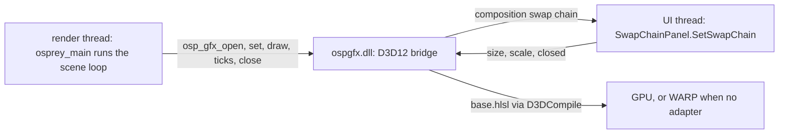

# Plan 0040 — Graphics scenes in a WinUI window

Contract: [`examples/graphics/README.md`](../../examples/graphics/README.md). A spec is still owed, but at plan 0025 stage 5, not in this plan. Host: [plan 0038](0038-winui-windows-hosts.md). Status: **phase 1 done in software on 2026-10-28**; phases 2 and 3 not started.

This plan carries out [plan 0025](0025-gpu-graphics-backends.md)'s deferred stage 2, which verifies the Direct3D 12 backend. The owner asked for Windows versions of the examples on 2026-10-28, so stage 2 can now come ahead of stage 5.

## Summary

The three scenes, `kali`, `opal` and `character`, open in a WinUI window on Windows. They render through Direct3D 12 into a `SwapChainPanel`, just as they render through Metal in an AppKit window on the Mac. The plan 0025 invariant holds: `base/base.osp` and every `scene.osp` stay byte-identical. The D3D12 bridge stays in C, and WinUI supplies only the window, the panel and the panel's thread.

**Why these scenes are not Osprey Native.** They are the stated exception to [NATIVE-APPS-ALL] ([plan 0039](0039-examples-on-osprey-native.md)). Each frame is the scene's own shader running on the GPU through `ospgfx`. Osprey Native's `Scene` primitives are 2D shapes that a host paints, and they cannot express a fragment shader. Everything else stays as close to the rule as it can:

- the scene logic is Osprey;
- the bridge is C;
- the C# is a mode of `OspreyHost.exe`, the same executable that runs every Osprey Native app, not a project of its own.



## Decisions

1. **The Osprey sources do not change.** `base.osp` already links the bridge on Windows with `// @link(windows): ospgfx`. The scene builds as an `--entry-only` DLL that imports the six `osp_gfx_*` functions from `ospgfx.dll`. Externs that a `@link` library resolves are not import slots ([WINUI-HOST-IMPORTS]), so this mode fills no slots.
2. **Direct3D stays in the C bridge.** The C# host contains no D3D12 code and no second bridge. The bridge exports one more function, `ospgfx_host_bind`, which the host calls before `osprey_main` with three callbacks:
   - `attach` hands the swap chain to the panel on the UI thread and waits until it is attached.
   - `state` reports the panel's size, its composition scale and whether the window is closed.
   - `title` shows the scene's title.
3. **Composition swap chain.** In `ospgfx_d3d12_setup.c`, `osp_gfx_swapchain` creates the swap chain with `IDXGIFactory2::CreateSwapChainForComposition` instead of `CreateSwapChainForHwnd`: flip-sequential, B8G8R8A8, two buffers.
   - The host attaches it through `ISwapChainPanelNative::SetSwapChain`, declared with `GeneratedComInterface` so it is AOT-safe.
   - Once this renders, the Win32 window code is deleted: `ospgfx_d3d12_window.c` and the message pump in `ospgfx_d3d12.c`. No Windows build would use it any more, so it would be dead code.
4. **The scene loop runs on its own thread.** Osprey's loop calls `osp_gfx_draw` until it returns 0, so `osprey_main` runs on a render thread while the UI thread runs WinUI.
   - `osp_gfx_open` blocks until `attach` returns.
   - `osp_gfx_draw` records, presents and resizes between frames, all on the render thread. It applies `SizeChanged` and `CompositionScaleChanged` through `state`, and returns 0 once the window has closed.
   - `osp_gfx_close` drains the queue and releases resources on that same thread.
   - This is the only Windows example that runs Osprey off the UI thread. Phase 2 tests that the ARC runtime on Windows does not assume a particular thread.
5. **WARP when no adapter.** When no hardware adapter can create a device, `osp_gfx_device` falls back to `IDXGIFactory4::EnumWarpAdapter`. The info bar and the console both name the adapter, so a WARP run is never mistaken for GPU evidence. CI runners render through WARP.
6. **The shader path is unchanged.** Shaders still go through `D3DCompile` at run time against `vs_5_0` and `ps_5_0`, the legacy path plan 0025 chose. `fxc` checks every entry point at build time.

## Phases

### Phase 1 — verify the bridge as written (plan 0025 stage 2)

1. On this machine, run the README's five Windows steps with MSYS2 UCRT64 and the Windows SDK's `fxc`:
   - compile every shader entry point;
   - build `ospgfx.dll` with warnings fatal;
   - type-check and link the unchanged scenes;
   - run the drift guard;
   - open the Win32 window for twenty seconds.
2. Fix what fails. Fixes are most likely in the two hazards plan 0025 names: cbuffer packing and the matrix convention.
3. Replace every "unverified" notice in the README, the bridge headers, the Makefile and plan 0025 with what was observed, including the machine, adapter and date. Restore `-Werror` (`GFX_WARN`).

Done on 2026-10-28, on GitHub's `windows-latest` runner rather than this machine. This machine's shell runs as a service in session 0, where a flip-model swap chain cannot present. The runner has no GPU, so every scene drew on the Microsoft Basic Render Driver, in software: 10 frames each at 6 to 15 fps, with a picture of each window after twenty seconds. The drift guard ran on this machine. The fixes were two C bindings, one shader preprocessor line, the WARP fallback and `OSPREY_GFX_FRAMES`. A hardware adapter and a frame compared with the Mac's at matched uniforms are still open.

### Phase 2 — the WinUI window

1. Add a scene mode to the plan 0038 executable: `OspreyHost.exe --scene <scene.dll>`. The window holds a `SwapChainPanel` that fills it, with Mica on the title bar and an info bar showing the scene, the adapter and frames per second.
2. Implement decisions 2 to 5 in the bridge and the host. On Windows, `make graphics SCENE=kali` builds the scene DLL, the bridge and the host, then opens the window.
3. Extend the frame-path test in `crates/osprey-cli/tests/graphics_scenes/frame.rs`. It stubs `CreateSwapChainForComposition` and the host callbacks, and its injected-failure cases cover the new path: a failed attach, a closed window and a resize.
4. Add the thread test from decision 4.

### Phase 3 — smoke and CI

1. On Windows, `OSPREY_GFX_FRAMES=120 make graphics-smoke` renders each scene for 120 frames, captures the panel and fails if the frame is a single colour. That catches the "renders black" class of shader and packing errors.
2. Delete the Win32 window path (decision 3), and update the README's layout table and plan 0025's status.
3. Add the graphics job to `.github/workflows/winui.yml`. It runs `fxc` on every entry point, builds the bridge with warnings fatal, runs the drift guard and runs the 120-frame WARP smoke of all three scenes. `winui.yml` already does all but the drift guard, with a 10-frame smoke and a picture of each window, and without the single-colour check.

## Risks

- **Two hazards compile cleanly when wrong** (plan 0025). A wrongly packed cbuffer shifts `res` and `time`, and the wrong matrix order spins every scene backwards. Phase 1 compares the Windows frames with the Mac's at matched uniforms. The bar is that they are indistinguishable, never that they are bit-equal.
- **No GPU on CI runners.** WARP proves the code path, not how hardware behaves. Phase 1 records a hardware run on a named machine.
- **Present on a non-UI thread.** Presenting a composition swap chain from a worker thread is supported, but resizing the panel races the render thread. All swap-chain changes therefore happen on the render thread between frames, and the UI thread only publishes the new size.

## Commands (to exist by the end of phase 3)

```sh
make graphics SCENE=kali                          # Windows: scene DLL, bridge, WinUI host, window
OSPREY_GFX_FRAMES=120 make graphics-smoke         # every scene, 120 frames, single-colour frame check
cargo test --profile ci -p osprey-cli graphics_scenes   # drift guard and frame path, every system
```
