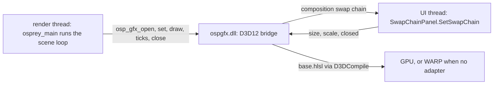

# Plan 0040 — Graphics scenes in a WinUI window

Contract: [`examples/graphics/README.md`](../../examples/graphics/README.md). A spec is still owed at plan 0025 stage 5, not here. Host core: [plan 0038](0038-winui-windows-hosts.md). Status: **not started.** This plan carries out [plan 0025](0025-gpu-graphics-backends.md)'s deferred stage 2, verifying the Direct3D 12 backend. The owner asked for the Windows versions of the examples on 2026-10-28, which makes stage 2 admissible ahead of stage 5.

## Summary

The three scenes, `kali`, `opal` and `character`, open in a WinUI window on Windows and render through Direct3D 12 into a `SwapChainPanel`, as they render through Metal in an AppKit window on the Mac. The plan 0025 invariant holds: `base/base.osp` and every `scene.osp` stay byte-identical. The D3D12 bridge stays C. WinUI supplies only the window, the panel and its thread.



## Decisions

1. **The Osprey sources do not change.** `base.osp` already links the bridge on Windows with `// @link(windows): ospgfx`. The scene builds as an `--entry-only` DLL that imports the six `osp_gfx_*` functions from `ospgfx.dll`. Externs resolved by a `@link` library are not import slots (plan 0038 decision 5), so this host fills no slots.
2. **Direct3D stays in the C bridge.** The C# host contains no D3D12 code and no second bridge. The bridge exports one more function, `ospgfx_host_bind`. The host calls it before `osprey_main` with three callbacks:
   - `attach`: hands the swap chain to the panel on the UI thread and waits until it is attached.
   - `state`: the panel's size, composition scale and whether the window is closed.
   - `title`: shows the scene's title.
3. **Composition swap chain.** In `ospgfx_d3d12_setup.c`, `osp_gfx_swapchain` creates the swap chain with `IDXGIFactory2::CreateSwapChainForComposition` (flip-sequential, B8G8R8A8, two buffers) instead of `CreateSwapChainForHwnd`. The host attaches it through `ISwapChainPanelNative::SetSwapChain`, declared with `GeneratedComInterface` so it is AOT-safe. Once this renders, the Win32 window code (`osp_gfx_make_window` and its message pump) is deleted. A path no Windows build uses would be dead code, and deleting it gives `_setup.c` back the headroom under the 500-line cap that plan 0025 warns about.
4. **The scene loop runs on its own thread.**
   - Osprey's loop calls `osp_gfx_draw` until it returns 0, so `osprey_main` runs on a render thread while the UI thread runs WinUI.
   - `osp_gfx_open` blocks until `attach` returns.
   - `osp_gfx_draw` records, presents and resizes between frames on the render thread. It applies `SizeChanged` and `CompositionScaleChanged` through `state`, and returns 0 once the window has closed.
   - `osp_gfx_close` drains the queue and releases on that thread.
   - This is the one Windows example with Osprey off the UI thread. Phase 2 tests that the ARC runtime assumes no particular thread on Windows.
5. **WARP when no adapter.** When no hardware adapter creates a device, `osp_gfx_device` falls back to `IDXGIFactory4::EnumWarpAdapter`. The info bar and the console both name the adapter, so a WARP run is never mistaken for GPU evidence. CI runners render through WARP.
6. **The shader path is unchanged:** `D3DCompile` at run time against `vs_5_0`/`ps_5_0`, the legacy path plan 0025 chose. `fxc` checks every entry point at build time.

## Phases

### Phase 1 — verify the bridge as written (plan 0025 stage 2)

1. Run the README's five Windows steps on this machine, using MSYS2 UCRT64 and the Windows SDK's `fxc`:
   - compile every shader entry point;
   - build `ospgfx.dll` with warnings fatal;
   - type-check and link the unchanged scenes;
   - run the drift guard;
   - open the Win32 window for twenty seconds.
2. Fix what fails. Fixes are expected in the two hazards plan 0025 names: cbuffer packing and the matrix convention.
3. Replace every "unverified" notice in the README, the bridge headers, the Makefile and plan 0025 with what was observed, including machine, adapter and date. Restore `-Werror` (`GFX_WARN`).

### Phase 2 — the WinUI window

1. `examples/graphics/windows/`: a code-only WinUI executable on the plan 0038 core, with a `SwapChainPanel` filling the window, Mica on the title bar, and an info bar showing the scene, adapter and frames per second.
2. Decisions 2 to 5 in the bridge and the host, plus `make graphics SCENE=kali` on Windows building the scene DLL, the bridge and the host, then opening the window.
3. The frame-path test in `crates/osprey-cli/tests/graphics_scenes/frame.rs` stubs `CreateSwapChainForComposition` and the host callbacks. The injected-failure cases cover the new path: a failed attach, a closed window and a resize.
4. Phase 2 also includes the thread test from decision 4.

### Phase 3 — smoke and CI

1. `OSPREY_GFX_FRAMES=120 make graphics-smoke` on Windows renders each scene for 120 frames, captures the panel, and fails if the frame is uniform. That catches the "renders black" class of shader and packing errors.
2. Delete the Win32 window path (decision 3) and update the README's layout table and plan 0025's status.
3. The graphics job joins `.github/workflows/winui.yml`: `fxc` on every entry point, the bridge built warnings-fatal, the drift guard, and the 120-frame WARP smoke of all three scenes.

## Risks

- **Two hazards compile cleanly when wrong** (plan 0025): a wrongly packed cbuffer shifts `res` and `time`, and the wrong matrix order spins every scene backwards. Phase 1 compares the Windows frames with the Mac's at matched uniforms. The bar is indistinguishable, never bit-equal.
- **No GPU on CI runners.** WARP proves the code path, not hardware behaviour. A hardware run on a named machine is recorded in phase 1.
- **Present on a non-UI thread.** Presenting a composition swap chain from a worker thread is supported, but panel resizing races the render thread. All swap-chain changes happen on the render thread between frames, and the UI thread only publishes the new size.

## Commands (to exist by the end of phase 3)

```sh
make graphics SCENE=kali                          # Windows: scene DLL, bridge, WinUI host, window
OSPREY_GFX_FRAMES=120 make graphics-smoke         # every scene, 120 frames, non-uniform frame check
cargo test --profile ci -p osprey-cli graphics_scenes   # drift guard and frame path, every system
```
