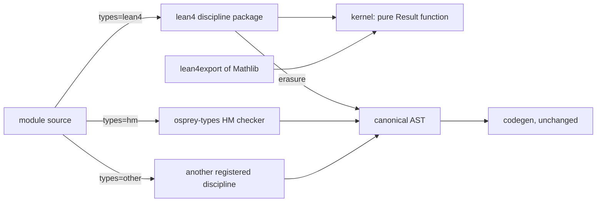

# Plan 0041 — Dependent types as a pluggable discipline, and Mathlib on Osprey

Giant leaps - not baby steps
Violent refactoring

Contracts: [spec 0050](../specs/language/0050-TypeDisciplines.md) for the pluggable discipline seam and [spec 0049](../specs/language/0049-DependentTypesAndProofs.md) for the `lean4` discipline and the Mathlib port. Status: **spec written; no implementation started.** The road test (M0 to M3) is the first work; it needs no compiler change. Stabilization mode holds for the phases after it: none begins without the owner's go.

## Summary

Osprey gets a proof assistant whose checked library is Mathlib, built beside the language rather than into it. The Hindley-Milner type system, effect rows, monomorphisation and codegen of today's compiler are not touched; the compiler gains one dispatch seam ([TYPES-DISCIPLINE-SEAM], [spec 0050](../specs/language/0050-TypeDisciplines.md)) that hands a module marked `// osprey: types=<name>` to the package registered under that name. The first registered discipline is `lean4`: a kernel for Lean 4's type theory, an elaborator, tactics and the `@osprey/mathlib` package, all written in Osprey and compiled through the native backend. Other provers and other type systems register the same way ([TYPES-DISCIPLINE-REGISTRY]); the seam is a feature on its own, delivered and proved by two reference disciplines before any kernel is written, and nothing in this plan is the only way to put a solver on Osprey.

## Checklist

Ticked as the work lands on `feat/type-disciplines`; a box is ticked only when its test or output exists in the repo.

### M0 — a proof checks
- [x] `examples/proof/kernel/`: levels, terms (de Bruijn), environment, β/δ/ζ/η reduction, inference and checking as ML modules
- [x] `osprey examples/proof/kernel --run` prints `checked: id_imp` and rejects `id_imp_bad` and `not_a_type` with the kernel's reason
- [x] Compiler: a positional union constructor applied from another file folds to its construction (`constructor_resolve.rs`, `resolve.rs`)
- [x] Resolver test: imported positional variant accepted, imported record still needs named fields
- [x] `examples/proof/kernel/expectedoutput` and `make _test_proof_kernel` (in `make test`) running the kernel under GC, ARC and wasm32
- [x] `benchmarks/proof/run.sh` and `m0_identity`: Osprey kernel against Lean's kernel on `id_imp`, red when Osprey is slower
- [ ] Lean (elan) installed in CI and the proof benchmark run on every kernel change
- [x] `docs/reports/proof-road-test-2026-10-29.md`: lines, hours, language gaps
- [ ] Compiler: recursive functions no longer need a written signature for codegen (gap 2 of the road test)

### M1 — a Lean proof checks
- [ ] `lean4export` reader for constants, levels and the M0 expression forms
- [ ] `id_imp` from a Lean export checks; a wrong Lean proof is rejected
- [ ] `m1_export` benchmark input

### M2 — a proof is typed
- [ ] ML-layout proof parser for `theorem name (binders) : type := term`
- [ ] Direct elaborator to M0 terms; `id_imp` typed in `.ospml` checks

### M3 — inductives
- [ ] Inductive declarations, constructors, recursors, ι-reduction
- [ ] `And`, `Iff`, `Eq` as Lean declares them
- [ ] `and_swap` checks from a Lean export and from the M2 surface
- [ ] Road-test report and the decision point

### Phase 1 — pluggable disciplines
- [x] `types=` marker and `[project].types`; `[discipline]` registry; `discipline-error`
- [x] `check_module` seam in assembly, checker process, JSON protocol, time limit, result cache
- [x] Erased modules parsed by the ordinary frontend and checked against the written signature
- [ ] `examples/disciplines/passthrough` with the round trip in the differential corpus (GC, ARC, wasm32)
- [ ] `examples/disciplines/bounded`: a real theory erasing to `int`, diagnostics through the protocol
- [ ] Failure tests of [TYPES-DISCIPLINE-VERIFICATION]; grep test over `crates/` for discipline names
- [ ] Byte-identical output and diagnostics for every markerless program; no `hm` benchmark change

### Phase 2 — kernel and trust
- [ ] Kernel specification with every judgement as inference rules
- [ ] Kernel under 5,000 lines in a separate process; `osprey prove import`
- [ ] `tests/proof/adversarial/` seeded; collision and overflow tests
- [ ] Cross-check against `lean4lean` and `nanoda`; core, `Std`, Mathlib gates with speed tests

### Phases 3 to 7
- [ ] Phase 3: proof AST, ML frontend, unifier, classes, `osprey prove check`, LSP goal view
- [ ] Phase 4: tactics, `hammer`, `benchmarks/proof/` with miniF2F and PutnamBench
- [ ] Phase 5: `osprey prove port`, sync job, re-proving, `@osprey/mathlib`, upstream bridge
- [ ] Phase 6: erasure, mixed-discipline corpus program, refinement discipline
- [ ] Phase 7: the workbench, tracked in [plan 0042](0042-proof-workbench.md)

## Verified constraints

Checked against the tree on 2026-10-29.

- `osprey_types::check_program(&Program) -> Vec<TypeError>` (`crates/osprey-types/src/check/driver.rs`) is the single checker entry; the seam goes in front of it. `Type` (`crates/osprey-types/src/ty.rs`) has `Var`, `Con`, `Fun`, `Record`, `Union` and nothing value-indexed, which is why the dependent theory stays outside it.
- [FLAVOR-BOUNDARY] already forbids branching on flavor below the canonical AST; the discipline seam extends the same rule to typing.
- `int` is a 64-bit `i64` and `Map<K, V>` is immutable; there is no arbitrary-precision integer, no mutable array and no structural-key hash map in the specs. The kernel cannot be written until [PROOF-STDLIB] lands.
- The 2026 Lean kernel bugs ([PROOF-TRUST-LESSONS]): nested-inductive projection check plus a hash collision gave an axiom-free `0 = 1` (issue #14576, CVE-2026-72844, fixed in the 4.32 line); three more were found by AI adversarial testing before 4.34.0, one a reference-count overflow turned into use-after-free. `nanoda` accepted the Collatz "disproof" because an old version was run. The public proof of concept exists and becomes a pinned rejection test.
- Independent checkers of Lean's theory exist (`lean4lean`, `nanoda`) and `lean4export` produces a text export; the import path is known work.

## Road test first: the first proof

The plan is ordered so that a proof checks on an Osprey-written kernel before any compiler, standard-library or syntax work starts. Each milestone answers one question about how hard this is going to be, and records the answer in `docs/reports/proof-road-test-<date>.md`: lines of Osprey written, hours taken, and every language or library gap that hurt.

### M0 — a proof checks (days, not weeks)

A plain Osprey program, ML flavor, under `examples/proof/kernel/`, run with `osprey run`. No seam, no new syntax, no runtime change. It implements the Pi fragment of [PROOF-KERNEL-THEORY] only: `Sort u` with level expressions, dependent function types, lambda, application, `let`, de Bruijn indices, β/δ/ζ/η, and an environment of constants. Terms are Osprey union values; `int` and `Map<string, V>` are enough because nothing is a literal yet.

- The proof: the term `fun (p : Prop) (h : p) => h` against the type `∀ (p : Prop), p → p`. `osprey run examples/proof/kernel/main.ospml` prints `checked: id_imp`.
- The control: `fun (p q : Prop) (h : p) => h` against `∀ (p q : Prop), p → q` is rejected with the two terms that failed to be definitionally equal, as a typed `Result`, never a panic.
- Both are corpus programs with `.expectedoutput`, so they run under GC, ARC and wasm32 from day one.
- The first benchmark: `benchmarks/proof/m0_identity` times the Osprey kernel against Lean's kernel on the same identity theorem and fails if Osprey is slower ([PROOF-SPEED]). The harness, the report format and the gate exist from this milestone; every later milestone adds its input to the same harness.

Answers: can a type checker with substitution, whnf and definitional equality be written comfortably in Osprey as it is today, and how fast does it run.

### M1 — a Lean proof checks (the first real signal)

The same kernel reads the `lean4export` text of a one-theorem Lean file (`theorem id_imp : ∀ p : Prop, p → p := fun p h => h`): the export parser for constants, levels and the expression forms of M0, nothing more. The program checks Lean's term and prints the same line. A second Lean file with a wrong proof is a rejection test.

Answers: does the kernel agree with Lean on real terms, and how much of the export format is painful to parse in Osprey. The benchmark gains `m1_export`: the export is checked by both kernels and Osprey must be faster.

### M2 — a proof is typed, not pasted

A minimal ML-layout proof parser in the same package: `theorem id_imp (p : Prop) (h : p) : p := h` in a `.ospml` file elaborates, by a direct elaborator with no metavariables, to the M0 term and checks. This is the first line of [PROOF-SURFACE-FLAVORS] and the moment a person can write a proof on Osprey.

Answers: how far a direct elaborator gets before unification is forced, and what the surface will feel like.

### M3 — inductives, and the first Mathlib-shaped theorem

Inductive declarations, constructors, recursors and ι-reduction. The target is `And`, `Iff` and `Eq` as Lean declares them, then `theorem and_swap (p q : Prop) : p ∧ q → q ∧ p`, checked both from a Lean export and from the M2 surface. Nested and mutual encodings, quotients and literals are still out.

Answers: the size and shape of the real kernel, and whether the structural-key map and term store of [PROOF-STDLIB] are now blocking. From here the standard-library work is pulled in by a measured need, not scheduled ahead of it.

### Decision point

After M3 the report says whether the full kernel proceeds in Osprey as planned or what in the language and library must change first. Phases below start only after that report and the owner's go.

## Phases

### Phase 0 — standard-library prerequisites [PROOF-STDLIB]

Scheduled by M3's findings, in the order the kernel needs them:

1. `bigint` with the accelerated `Nat` operation set, total, `Result`-returning division; both memory backends, native and wasm32; differential corpus programs. Needed at the first `Nat` literal.
2. `Map<K, V>` over structural keys, and a content-addressed term store that resolves hash collisions structurally (a planted-collision test). Needed when M3's environment outgrows string keys.
3. `Array<T>` and `Cell<T>` under [MODULES-STATE]. Needed by the unifier of phase 3, not by the kernel.
4. Benchmarks in `benchmarks/` for bigint arithmetic and term-store lookups against Rust baselines.

Exit: each addition specified in spec 0012, corpus-tested under GC and ARC and on wasm32, with recorded benchmark numbers.

### Phase 1 — pluggable disciplines [spec 0050](../specs/language/0050-TypeDisciplines.md)

A deliverable in its own right: after this phase any type system can be brought to Osprey as a package, with or without the prover that follows.

1. The `types=` marker and `[project].types` ([TYPES-DISCIPLINE-SELECT]), the `[discipline]` manifest table ([TYPES-DISCIPLINE-REGISTRY]), `discipline-error` for an unknown or duplicate name.
2. The seam: `check_module` in project assembly, in front of `check_program`, with the checker process, the JSON protocol, the time limit and the result cache ([TYPES-DISCIPLINE-SEAM], [TYPES-DISCIPLINE-PROTOCOL]). The erased module is parsed by the ordinary frontend and checked by `check_program` against the signature the checker wrote.
3. The `passthrough` reference discipline under `examples/disciplines/`, proving the round trip both ways in the differential corpus under GC, ARC and wasm32.
4. The `bounded` reference discipline: a real theory in about two hundred lines, erasing to `int`, with diagnostics through the protocol; the template every later discipline copies.
5. The failure tests of [TYPES-DISCIPLINE-VERIFICATION] and the grep test over `crates/`.

Exit: both reference packages green; byte-identical output and diagnostics for every markerless program over the whole corpus; no benchmark change for `hm`-only projects.

### Phase 2 — kernel and trust [PROOF-KERNEL], [PROOF-TRUST]

1. The kernel specification document with every judgement as inference rules.
2. The kernel in Osprey, under 5,000 lines, every function naming its rule, pure `Result` interface, separate process.
3. `osprey prove import` for `lean4export`.
4. `tests/proof/adversarial/` seeded with the CVE-2026-72844 proof of concept and the other 2026 cases; the collision test; the overflow test.
5. Cross-check against `lean4lean` and `nanoda` at current release on the same export.

Gates, in order: Lean's core library checks; `Std` checks; the full pinned Mathlib export checks, cross-checked, with the first `docs/reports/proof-trust-<date>.md`. Each gate has its speed test: Osprey's check of the same export is faster than Lean's on the same machine, or the gate is red ([PROOF-SPEED]).

### Phase 3 — surface language and elaborator [PROOF-SURFACE], [PROOF-ELAB]

1. The canonical proof AST and its ML frontend ([PROOF-SURFACE-FLAVORS]); ML first because Lean 4's syntax is already ML-shaped and the port's readers know it. Default and Python frontends are a later step of this phase, gated on cross-flavor equivalence of the elaborated kernel terms.
2. Unifier, type-class resolution, coercions, literals, attributes, notation and macros.
3. `osprey prove check` and the LSP goal view.

Exit: `Mathlib/Algebra/Group/Basic` translated by hand elaborates to terms the kernel finds definitionally equal to the imported ones ([PROOF-MATHLIB-DRIFT]).

### Phase 4 — tactics and automation [PROOF-TACTICS]

1. The metaprogramming API and the core tactic list, each with a Mathlib-derived test corpus.
2. `hammer` over Z3/cvc5 and E/Vampire with kernel reconstruction; unreconstructed answers are hints.
3. `benchmarks/proof/` with miniF2F and PutnamBench against the current Lean release; results recorded with hashes.

Exit: every tactic on the list passes its corpus; the first benchmark report is published. No score is quoted before it is recorded.

### Phase 5 — the Mathlib port [PROOF-MATHLIB]

1. `osprey prove port`: statements, definitions, structures, instances and notations to readable `.ospml` mirroring Mathlib's tree, proofs `by imported`.
2. The sync job ([PROOF-EXPORT-SYNC]) on a fixed cadence, opening the update pull request, red on any failure.
3. Re-proving: translated tactic scripts first, automation second; per-module fraction in the trust report.
4. Licence notices and the `@osprey/mathlib` package through [plan 0020](0020-package-manager.md).
5. The two-way bridge ([PROOF-MATHLIB-UPSTREAM]): every Mathlib defect the port or the adversarial suite finds goes upstream with Osprey's evidence; local patches are pending-only and listed in the trust report with their upstream link; kernel findings about Lean are disclosed to its maintainers before the report is published.

Exit: the pinned Mathlib commit is fully available by Lean name (layer 1), its statements translated with drift checked (layer 2), and the re-proved fraction reported honestly (layer 3).

### Phase 6 — programs and proofs together [PROOF-BOUNDARY], [PROOF-ERASE]

1. Erasure to the canonical AST with `@[erase int]` obligations checked by the kernel.
2. A corpus program in which an HM module calls a verified `lean4` function and a `lean4` module calls HM code, under both backends and on wasm32.
3. A refinement-type discipline over the existing KLEE/Z3 tooling of [plan 0034](0034-symbolic-execution.md), grown from the `bounded` template of phase 1, as the first discipline with a theory that is not Lean's.

Exit: the boundary rules hold in the differential corpus and a second discipline exists outside `crates/`.

### Phase 7 — the proof workbench [PROOF-WORKBENCH]

Delivered by [plan 0042](0042-proof-workbench.md) against [spec 0051](../specs/applications/0051-ProofWorkbench.md); its first three phases run in parallel with M0 to M3 here, and its phase 4 waits on M1 and M3. The steps below are the proof system's side of that plan.

1. Mathematics as the only input: Unicode notation through the Lean abbreviation table and a palette, statements and proof steps written as a mathematician phrases them, translated to the ML proof surface and shown beside the mathematics. The user writes no code; the generated `.ospml` is the saved artifact.
2. The goal pane over the checker protocol's goal-state capability, re-elaborating the declaration under the cursor on every edit without blocking typing; failing steps underlined with the terms that did not unify.
3. Code actions for `cases`, `induction`, `constructor` and `exact?` that edit the proof in place; refining goals from the pane.
4. Statement-shape search over the pinned Mathlib, hover with statement and docstring, jump to Mathlib source and to the Lean original.
5. The rendered document view, which is also the export.
6. The scratch board: freehand strokes rendered as chalk on slate, a chalk theme for typed mathematics, and handwriting recognition feeding the same statement and step input.
7. Hosts: native macOS and iOS, VS Code through `@osprey/vscode`, and the browser through wasm32 with a web host; one application, three hosts, proven by the same fixture-driven `update` tests.

Exit: a mathematician new to Osprey writes and checks `and_swap` in under ten minutes without documentation, recorded in the road-test report; every service used is reachable by any editor through spec 0020 or the checker protocol.

## Pi delegation

Bulk, mechanical work goes to pi under the AGENTS.md rules: the `lean4export` parser, the tactic test corpora, the statement translator's per-module runs and the benchmark harness. Kernel code, the seam and the trust report are written and reviewed here.

## Results first

Every public claim about trust, speed or automation is a link to a dated report in `docs/reports/` ([PROOF-TRUST], [PROOF-TACTICS-BENCH]). The claim that lands is the one the Lean community cannot answer: their own exploit rejected by the adversarial suite, their library checked and cross-checked at current releases, the benchmark against their current release with hashes. The bridge stays two-way while that happens ([PROOF-MATHLIB-UPSTREAM]).

## What this plan never does

- Change `Type`, unification, effect rows or monomorphisation in `crates/osprey-types`.
- Put a discipline name, a theory or a tactic in `crates/`.
- Trust a tactic, a solver, a model or a hash.
- Quote a benchmark, a wall time or a "most trusted" claim without a dated report in `docs/reports/`.
- Merge a kernel, elaborator or tactic change that makes any `benchmarks/proof/` gate slower than Lean on the same input.
