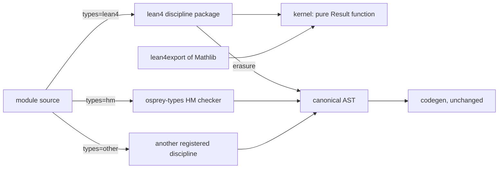

# Plan 0041 — Dependent types as a pluggable discipline, and Mathlib on Osprey

Giant leaps - not baby steps
Violent refactoring

Contracts: [spec 0050](../specs/language/0050-TypeDisciplines.md) for the pluggable discipline seam and [spec 0049](../specs/language/0049-DependentTypesAndProofs.md) for the `lean4` discipline and the Mathlib port. Status: **M0, M1 (a `Prop`/`→` theorem from a recorded Lean export) and M2 implemented and gated by `make _test_proof_kernel` and the speed gate; M3 recorded And/Eq/Iff export checks; broader inductive verification and surface syntax remain unfinished; phase 1 implemented except the two open boxes below.** The road test (M0 to M3) is the first work; it needed one resolver change (positional constructors across files) and one codegen change (recursive `Result` returns). The adversarial reviews [1](../reviews/0041-dependent-types-and-mathlib-review.md), [2](../reviews/0041-dependent-types-and-mathlib-review-2.md) and [3](../reviews/0041-dependent-types-and-mathlib-review-3.md) are each answered item by item at their foot. Stabilization mode holds for the phases after it: none begins without the owner's go.

## Summary

Osprey gets a proof assistant whose checked library is Mathlib, built beside the language rather than into it. The Hindley-Milner type system, effect rows, monomorphisation and codegen of today's compiler are not touched; the compiler gains one dispatch seam ([TYPES-DISCIPLINE-SEAM], [spec 0050](../specs/language/0050-TypeDisciplines.md)) that hands a module marked `// osprey: types=<name>` to the package registered under that name. The planned Lean-compatible discipline is `lean4`: a kernel for Lean 4's type theory, an elaborator, tactics and the `@osprey/mathlib` package, all written in Osprey and compiled through the native backend. Other provers and other type systems register the same way ([TYPES-DISCIPLINE-REGISTRY]); the seam is a feature on its own, delivered and proved by two reference disciplines before any kernel is written, and nothing in this plan is the only way to put a solver on Osprey.

## Current delivery target — run a common Lean proof

Implement [PROOF-RUNNABLE-LIBRARY] before broad source translation. The immediate target is the actual Lean core theorem `Nat.add_comm : ∀ n m : Nat, n + m = m + n`, exported with its complete dependency closure from the pinned Lean toolchain. The initial export is 59 KB and 1,108 NDJSON lines; it includes real recursive `Nat`, indexed `Eq`, structure projections and natural literals. These are measured requirements, not permission to trust unsupported declarations. First get the recorded `and_swap`, `eq_symm` and `iff_refl` export through the new inductive path; then make the smallest kernel additions that the arithmetic proof requires.

Verified on 2026-10-29: the real `Nat.add_comm` export checks from an empty Osprey environment. Its statement matches universal addition commutativity structurally, and the recorded closure contains zero axioms. The expanded suite passes all 164 cases under GC, ARC and wasm32, including projection, literal, annotation and adversarial recursor controls. The canonical example now also checks `Nat.add_comm` and rejects its corrupted proof; its original thirteen output lines remain unchanged. `make BIN=target/ci/osprey _test_proof_kernel` and the existing proof speed gates pass. These controls do not mark the Mathlib port or VSIX visual acceptance complete.

- [x] Recorded And/Eq/Iff export accepted; every modified inductive claim refused, with positive and negative recursor reduction tests.
- [x] Real `Nat.add_comm` dependency export checked from an empty Osprey environment; its statement compared structurally against the intended universal equality and its axiom dependencies recorded ([execution evidence](../reports/proof-m3-export-shape-2026-10-29.md#common-arithmetic-proof-execution)).
- [x] A changed arithmetic statement or corrupted proof rejected by the same checker; no declaration skipped, assumed or replaced with a toy implementation.
- [x] Exact runnable command and expected checked/rejected output documented under AGENTS.md Commands; GC, ARC and wasm32 evidence retained with pinned input/tool versions.
- [ ] Add that exact export to the existing speed gate, then move to a selected Mathlib theorem using the same dependency-driven workflow.

Navier–Stokes is the high-water mark for the solution checker. A successful arithmetic proof does not establish that its analysis library, PDE statements or full proof can be checked. Keep that larger objective and the full Mathlib gates below; pull prerequisites forward only when a selected proof demonstrates the need.

Recorded kernel checkpoint (2026-10-30; predates the retained nested-inductive failure below): all 325 tests passed under GC, ARC and wasm32 on compiler `6f5c55438f39162831fc9c2ccf3dcdb5d45dcc1a9a984deec4c73de768831dae`, sealed before and after the canonical kernel gate. The separate public proof matrix has 103 unchanged recorded inputs. This includes the 56 guarded numeric regressions and exact natural multiplication cases. The separate actual Unicode fixture gate also passes on all three backends with fresh Lean replay and both mutations per root. The final shared application suite passes 108 cases under GC, ARC and wasm32 with 90.8% own-source coverage. Revised host, installed VSIX and visual acceptance gates remain open.

## Current expansion — recent OpenAI proof ports

Port named proofs from the October 2026 `openai/math` release, pinned at `7ef5c0cc5ca4b0e072b7a050fca09ab24bc6fa3a`, through the same Osprey kernel. The first batch now contains eight lemmas about infinite-stack prefixes, three lemmas proving a doubling loop's exact value and work cost, and a finite-index injectivity lemma. These are supporting lemmas from the released research developments, not completed ports of their headline results. Five further integer five-colour orientation statements are now registered from the existing NumberTheory project, with the original certificate retained for statement comparison; canonical three-backend verification is recorded below. Keep Navier–Stokes as the high-water mark.

The corpus lives in `examples/proof/openai/`: retained original sources and license, compatible Lean source hashes, full dependency exports and an explicit axiom ledger. `scripts/proof-openai.py` regenerates each export byte for byte, independently replays the compatible module with Lean, then checks each named theorem and rejects both its corrupted proof and the false replacement statement `∀ p : Prop, p` under GC, ARC and wasm32. Application logic stays in the shared kernel; `examples/proof/batch/` only reads and reports it. This is the checked-export layer; readable Osprey proof frontend translation remains separate work.

- [x] First nine selected statements accepted by Osprey under GC, ARC and wasm32, with all eighteen mutation controls rejected on each target.
- [x] Two exact upstream extensionality lemmas `push_inj` and `push_constant` accepted by Osprey under GC, ARC and wasm32, with fresh Lean replay and corrupted-proof/false-statement refusal; each reports the genuine `Quot.sound` dependency. The twelve-statement matrix passed before the subsequent constructor-alias eta correction; final-revision gating remains below.
- [x] Tenth supporting statement `OAI.PermanentBorder.AmbientPolar.groupIndex_injective` accepted under GC, ARC and wasm32 after universe/K/typed-conversion repairs, with fresh Lean replay and both mutation refusals.
- [x] Gate all 175 selected Lean-core statements through the public command: 175 successful checks under each of GC, ARC and wasm32, plus 1,050 rejected corrupted proofs/false statements, fresh Lean source/export/kernel/axiom checks and 103 unchanged recorded inputs. This comprises 172 original exports and three compatible Nat proof bodies of the exact original statements; the three original Nat certificates remain refused at the nested `Lean.Syntax` boundary. `compatible.json` and `NatCompatible.lean` retain the alternate bodies. The verifier structurally compares their types with the pinned originals after resolving name/universe interning, and rejects statement drift even after re-pinning an export. Canonical relocation changed generated binder hygiene names only; all 101 named proof/type trees and inductive/quotient records were compared unchanged. The earlier 167-root checkpoint remains recorded separately.
- [x] Repair the actual empty and supplementary-Unicode string constructor proofs. Both recorded proofs now pass under GC, ARC and wasm32 with six exact axiom-free receipts, twelve rejected proof/statement mutations, byte-identical fresh Lean export and independent Lean kernel replay. `scripts/test-proof-literals.py` is an unconditional step of the existing proof CI job; `target/proof/openai/final-string-receipt.json` records the compiler, three checker binaries and unchanged 48-input source snapshot. The fix pins numeric declaration bodies before acceleration, preserves nested successor counts and uses the actual `List` constructor universe. Parsing alone is not acceptance.
- [ ] Handle the nested-inductive `Lean.Syntax` closure still required by the original five-colour/Nat lemma exports; compatible proofs of an identical statement do not establish acceptance of those original certificates. The measured first block has one original type former, four constructors, three recursors and two nested targets. Its current “mutual inductive” diagnostic comes from rejecting multiple recursors, and does not prove a fully mutual type group. A genuine 13,602-byte `NestedTree.node_nil` export passes fresh Lean checking and is now pinned by a failing acceptance test in `examples/proof/kernel/tests/export.ospml` at line 215; its source/export pins and exact refusal are retained under `target/proof/openai/syntax-frontier-review/`. Four genuine mutual `Tree`/`Forest` recursor-computation theorems and a nested `Array` computation theorem also pass fresh Lean checking and remain refused by Osprey; their distinct exports and exact refusals are retained alongside the original fixture. Fully mutual groups and further axiom obligations remain separate work.
- [x] Report per-root axiom dependencies independently checked against Lean; keep the full export ledger separate from assumptions used by each theorem.
- [x] Standard `propext` dependency made visible; its exact statement checked against the trust ledger, with unknown, changed or unsafe axioms refused by the corpus harness.
- [x] Historical checker checkpoint: final independent Lean replay and the expanded kernel suite passed on compiler `6f5c55438f39162831fc9c2ccf3dcdb5d45dcc1a9a984deec4c73de768831dae`: all 325 kernel cases under GC, ARC and wasm32, plus the public core/OpenAI/String replay and mutation matrices. The canonical kernel gate exits zero with equal before/after compiler hashes in `target/logs/ci-prep/pi-kernel-host-abi-current.*`; root independently checked each 325/325 output. That historical 103-input snapshot predates the newly retained nested-inductive RED and subsequent notation-matcher API export. This closes that checker checkpoint, not the current successor suite, nested inductives, the Osprey proof frontend, or Mathlib.
- [x] Finish canonical NumberTheory verification. Five five-colour statements are registered in `examples/proof/openai/corpus.json`, using `examples/proof/openai-number-theory/lean/FiveColorOrientation.lean` and its existing project. Three `omega` proof bodies are replaced with core integer lemmas; all five exact original statement trees are compared with the retained original certificate. The upstream source, source/export hashes, license and genuine per-root `propext` dependencies are preserved. Three full public `--memory` commands pass on compiler `6f5c55438f39162831fc9c2ccf3dcdb5d45dcc1a9a984deec4c73de768831dae`, without skips or reused binaries: seventeen OpenAI statements per target, fifty-one successful checks and 102 rejected proof/statement mutations, with fresh Lean source/export/kernel/axiom verification. All recorded checker inputs remain unchanged in `target/proof/openai/number-theory-core-proofs/canonical-parallel-receipt.json`. The shared catalogue now lists the thirteenth export; actual host execution and final package receipts remain separate gates. These are supporting statements, not completed headline-theorem ports or an Osprey proof frontend.
- [ ] Integrate the accepted corpus into the shared workbench flow and meet the screenshot oracle; command-line acceptance alone does not complete the VSIX. The pure shared `proof::ImportedProofs` adapter now passes eight tests under GC, ARC and wasm32 (actual statement, corrupt proof, missing theorem, non-theorem, per-root assumptions, catalogue, empty export and 8 MiB bound); UI event wiring and screenshot acceptance remain open.

## Checklist

Ticked as the work lands on `feat/type-disciplines`; a box is ticked only when its test or output exists in the repo.

### M0 — a proof checks
- [x] `examples/proof/kernel/`: levels, terms (de Bruijn), environment, β/δ/ζ/η reduction, inference and checking as ML modules
- [x] `osprey examples/proof/kernel --run` prints `checked: id_imp` and rejects `id_imp_bad` and `not_a_type` with the kernel's reason
- [x] Compiler: a positional union constructor applied from another file folds to its construction (`constructor_resolve.rs`, `resolve.rs`)
- [x] Resolver test: imported positional variant accepted, imported record still needs named fields
- [x] `examples/proof/kernel/expectedoutput` and `make _test_proof_kernel` (in `make test`) running the kernel under GC, ARC and wasm32
- [x] `benchmarks/proof/run.sh` and `m0_identity`: a process-against-process regression gate (a compiled Osprey kernel with the theorem built in against `lean --run`, elaboration included), red when Osprey is slower; not kernel-speed evidence, which is `m1_export`
- [x] Lean (elan) installed in CI (`test-proof` job, toolchain pinned) and the proof benchmark run on every kernel change
- [x] `docs/reports/proof-road-test-2026-10-29.md`: lines, hours, language gaps
- [x] Compiler: a recursive function returning `Result<T, _>` no longer needs a written signature (`abi_shape_concrete` at the return slot); an open success payload still does
- [x] Review P0.1: `Terms::equal` is structural (indices, every universe argument), never printed; repeated-binder and universe-argument rejections in `tests/terms.ospml` and `tests/infer.ospml`
- [x] Review P0.2: universe parameters instantiated at every constant use and unfold; arity and scope checked; `Levels::equal` structural on normal forms
- [x] Review P1.5/6: `examples/proof/kernel/tests` (81 cases across seven suites) in `make _test_proof_kernel` under GC, ARC and wasm32, `failed=0` required of each; golden regenerated with the M2 and export lines
- [x] Review 3 P0.1: the entry compiles again; two codegen record-tracking fixes rather than a rename (a `...rest` tail keeps its list type, and a call through generic inlining keeps the checker's concrete return type), each with a twin regression in `tests/core/collections/shared_field_list_recursion` that fails without it

### M1 — a recorded Lean export checks (a `Prop`/`→` theorem; inductives wait on M3)
- [x] `lean4export` reader for the NDJSON format 3.1.0 the pinned exporter writes: names, levels, the M0 expression forms, `thm`/`def`/`axiom` (`src/export.ospml`; eleven cases in `tests/export.ospml`); inductives, quotients and the expression forms M3 adds are refused by kind, never skipped
- [x] Review 3 P1.5: every table index is defined once: a re-declared, reserved (name 0, level 0) or negative index is refused with its line, never rebound (six cases in `tests/export_mutations.ospml`, each red without the guard)
- [x] Mutated exports (`tests/export_mutations.ospml`, 29 cases): every single-edit corruption of the recorded export is rejected, asserted on the rejection's kind, the statement as read and the proof's inferred type compared by `Terms::equal` with hand-built terms (`tests/shapes.ospml`), never on a rendering of Lean's hygienic names
- [x] Every declaration of an export goes through `Infer::sort`/`Infer::check` before `Environment::add` (`Checked::exported` in `src/checked.ospml`, shared by the example and the benchmark entry)
- [x] `id_imp` from a Lean export checks; the wrong proof is rejected with the kernel's mismatch (last two lines of `expectedoutput`)
- [x] Fixture regenerated by a recorded Lean and `lean4export` version: `scripts/proof-export.sh` builds `benchmarks/proof/tools` (Lean 4.25.0, `lean4export` and `lean4checker` at their `v4.25.0` tags) and records `examples/proof/kernel/exports/id_imp.ndjson` (sha256 `2adb6bc5…8330d`); `Fixtures::idImp` is that text byte for byte and `idImpBad` is one documented edit of it ([report](../reports/proof-export-fixture-2026-10-29.md))
- [x] `m1_export` benchmark input: `benchmarks/proof/m1_export` reads the recorded export from disk on the Osprey side and replays the same module through `lean4checker` on the Lean side; `lean.setup` re-exports the module every run and byte-compares it with the case's copy
- [x] `m1_export` recorded, 2026-10-29, `PROOF_RUNS=10`, Lean 4.25.0 on arm64 macOS: Osprey 3 ms / 2256 KiB against `lean4checker` 433 ms / 52576 KiB, pass (`osprey_input` `2ab95a53…e053`, `lean_input` `637f6d7d…246d`, `osprey_binary` `748e523c…f7adf0`, `lean_binary` `be06b289…f9201`). Generated rows live in `target/proof/` and are not committed; this line is the record

### M2 — a proof is typed
- [x] ML-layout proof parser for `theorem name (binders) : type := term` (`src/surface.ospml`), over a whitespace-delimited demo tokenizer: `p:=h`, `p→q` and `∀p` without spaces are not read
- [x] Direct elaborator to M0 terms; `id_imp_typed`, `imp_trans`, `forall_typed` check and `wrong_typed` is rejected

### M3 — inductives
- [ ] Inductive declarations, constructors, recursors, ι-reduction
- [ ] `And`, `Iff`, `Eq` as Lean declares them
- [ ] `and_swap` checks from a Lean export and from the M2 surface
- [ ] Road-test report and the decision point

### Phase 1 — pluggable disciplines
- [x] `types=` marker and `[project].types`; `[discipline]` registry; `discipline-error`
- [x] `check_module` seam in assembly, checker process, JSON protocol, time limit, result cache
- [x] Review P0.3: sources visited in dependency order; a request carries the inferred ML signature of every `hm` module it imports and the checker-written signature of every disciplined one (`discipline/imports.rs`; three seam tests)
- [x] Review P0.3, rest / review 2 item 6: an inferred `hm` signature names every exported type and value it leaves out (`omitted[]`, protocol version 2), so no checker trusts a partial signature; an `hm` import that does not type-check is a `discipline-error` and no checker runs after it
- [ ] Exported types and values rendered in an inferred `hm` signature (today named as omitted)
- [x] Review P1.8: one deadline covers checker build, spawn, request write (own thread) and response; real-process regressions for a checker that never reads stdin (`discipline/runner_tests.rs`)
- [x] Review P1.9: checker binary named by the digest of every package source, the manifest and the compiler (`discipline/inputs.rs`); results keyed on the request and the built binary; read failures are errors
- [x] A checker may be a project directory (`[discipline] checker = "<dir>"` with its own `osprey.toml`), built like any project, so a discipline is not confined to one file; the directory's manifest and every module are build inputs
- [x] Review P1.10, harness: a failed timed run is a red case, sha256 of every kernel source and both binaries, `getrusage` peak memory, reports under `target/`, `lean.cmd`/`args` per case
- [x] Review P1.10, comparison: `m1_export` re-checks the same recorded module on both sides (Osprey reader of the export vs `lean4checker` replay, invoked directly with no `lake` start-up on Lean's clock); `osprey_input` hashes every kernel source and the export, `lean_input` the module, `lean.cmd`, `lean.setup` and `lean.bin`, `lean_binary` the `lean4checker` that ran; `osprey_input` follows the manifest's `source_roots`, so the nine kernel modules outside the entry's project are in it
- [x] Erased modules parsed by the ordinary frontend and checked against the written signature
- [x] `osprey <file> --signature` prints the ML export signature the seam renders (`crates/osprey-cli/src/signature.rs`); `options.compiler` in every request
- [x] `examples/disciplines/passthrough` with the round trip under GC, ARC and wasm32 (`make _test_disciplines`; the round trip is a project of its own rather than a `tests/` corpus twin, so the differential harness does not run it — the target diffs it byte-for-byte against its golden on all three)
- [x] `examples/disciplines/bounded`: `// @bound n in lo..hi` checked at every call site by interval arithmetic, erased to `int`, diagnostics through the protocol; the checker is a project of twelve modules under `src/`, its twelve-case protocol suite and the `bounded_roundtrip` goldens under GC, ARC and wasm32 in `make _test_disciplines`
- [x] Failure tests of [TYPES-DISCIPLINE-VERIFICATION] (`discipline/tests.rs`: unknown, duplicate, crash, timeout, malformed, unparsable erased, signature failure, version)
- [x] Purity scan over `crates/` (`tests/discipline_purity.rs`: every registered name in a string literal, the theory words anywhere; green with both reference packages registered)
- [ ] Byte-identical output and diagnostics for every markerless program; no `hm` benchmark change

### Phase 2 — kernel and trust
- [ ] Kernel specification with every judgement as inference rules
- [ ] Kernel under 5,000 lines in a separate process; `osprey prove import`
- [ ] `tests/proof/adversarial/` seeded; collision and overflow tests
- [ ] Cross-check against `lean4lean` and `nanoda`; core, `Std`, Mathlib gates with speed tests

### Phases 3 to 7
- [ ] Phase 3: proof AST, ML frontend, unifier, classes, `osprey prove check`, LSP goal view
- [ ] Phase 4: tactics, `hammer`, `benchmarks/proof/` with miniF2F and PutnamBench
- [ ] Phase 5: `osprey prove port`, sync job, re-proving, `@osprey/mathlib`, upstream bridge
- [ ] Phase 6: erasure, mixed-discipline corpus program, refinement discipline
- [ ] Phase 7: the workbench, tracked in [plan 0042](0042-proof-workbench.md)

## Verified constraints

Checked against the tree on 2026-10-29.

- `osprey_types::check_program(&Program) -> Vec<TypeError>` (`crates/osprey-types/src/check/driver.rs`) is the single checker entry; the seam goes in front of it. `Type` (`crates/osprey-types/src/ty.rs`) has `Var`, `Con`, `Fun`, `Record`, `Union` and nothing value-indexed, which is why the dependent theory stays outside it.
- [FLAVOR-BOUNDARY] already forbids branching on flavor below the canonical AST; the discipline seam extends the same rule to typing.
- `int` is a 64-bit `i64` and `Map<K, V>` is immutable; there is no arbitrary-precision integer, no mutable array and no structural-key hash map in the specs. The M0 to M2 kernel is written on built-in maps and lists; the full kernel of phase 2 (Mathlib-sized environments, structural-key term store) waits on [PROOF-STDLIB], pulled in by measured need.
- The [wrong-structure projection exploit in Lean issue 14576](https://github.com/leanprover/lean4/issues/14576) used the checked declaration path and obtained an axiom-free proof of `False`. Pin its reproducer as an Osprey rejection test under [PROOF-TRUST-LESSONS]. Treat this as an implementation defect, not evidence that the intended theory is inconsistent; any additional exploit attribution needs a primary report and exact affected revision.
- Independent checkers of Lean's theory exist (`lean4lean`, `nanoda`) and `lean4export` produces a text export; the import path is known work.

### 30 October structural metadata repair checkpoint

Two Osprey implementation defects were reproduced in the checked import path: one comma-bearing constructor name impersonated a two-constructor inventory, and one comma-bearing recursor-rule name impersonated the printed description of a complete rule list. The malformed exports were accepted before the repair. The reproduced arithmetic statement remained true; this evidence establishes incorrect metadata acceptance, not a derivation of `False`, an inconsistency in the intended theory or a defect attributed to Lean.

The repair replaces printed-description equality with the shared `DeclarationBodies` structural comparison in `examples/proof/kernel/src/env.ospml`, reused by inductive import checks and numeric/notation identity guards. Lists retain exact element boundaries and order; constructor/rule fields remain separate. The existing rule-type and right-hand-side derivation checks stay in force. The focused repair checkpoint passed all ten adversarial controls under GC, ARC and wasm32, including both previously accepted collisions and the universe-name collision refusal. The source also includes a positive control for a genuine comma-bearing constructor name. Final current-source replay and the broader kernel, corpus, application and host gates remain pending. Historical ten-case results do not certify that later source or complete Milestone 1. Canonical regressions live in [inductive_adversarial.ospml](../../examples/proof/kernel/tests/inductive_adversarial.ospml).

### 30 October final selected-corpus replay

The standard-choice guard and numeric short-circuit repair pass the 400-case kernel suite on GC, ARC and wasm32. A separate post-import-cleanup replay retains all 400 cases on every backend, zero live ARC allocations and unchanged source/compiler hashes (`target/proof/mathlib-v4.25.0/final-clean-kernel-receipt.json`). All five published proof commands also pass: 40 Python guards, 51 OpenAI checks, 525 Lean-core checks, six Unicode checks and 18 recorder guards. Each of the 582 root checks rejects both a corrupted proof and a false statement, giving 1,164 refusals; byte-identical dependency exports and fresh Lean replay remain required (`target/proof/mathlib-v4.25.0/final-public/receipt.json`). The corpus remains 194 selected statements. The `Classical.choice` export is an explicitly axiom-bearing standard-basis control, not another theorem port. The original Euclid certificate still has no accepted Osprey verdict; no frontend, full-Mathlib or host-delivery milestone is completed by these checks.

## Road test first: the first proof

The plan is ordered so that a proof checks on an Osprey-written kernel before any compiler, standard-library or syntax work starts. Each milestone answers one question about how hard this is going to be, and records the answer in `docs/reports/proof-road-test-<date>.md`: lines of Osprey written, hours taken, and every language or library gap that hurt.

### M0 — a proof checks (days, not weeks)

A plain Osprey program, ML flavor, under `examples/proof/kernel/`, run with `osprey run`. No seam, no new syntax, no runtime change. It implements the Pi fragment of [PROOF-KERNEL-THEORY] only: `Sort u` with level expressions, dependent function types, lambda, application, `let`, de Bruijn indices, β/δ/ζ/η, and an environment of constants. Terms are Osprey union values; `int` and `Map<string, V>` are enough because nothing is a literal yet.

- The proof: the term `fun (p : Prop) (h : p) => h` against the type `∀ (p : Prop), p → p`. `osprey run examples/proof/kernel/main.ospml` prints `checked: id_imp`.
- The control: `fun (p q : Prop) (h : p) => h` against `∀ (p q : Prop), p → q` is rejected with the two terms that failed to be definitionally equal, as a typed `Result`, never a panic.
- Both are corpus programs with `.expectedoutput`, so they run under GC, ARC and wasm32 from day one.
- The first benchmark: `benchmarks/proof/m0_identity` is the process regression gate documented in the benchmark README; its Lean invocation includes elaboration, so its numbers are not kernel-speed evidence. Its existing ordering gate remains unchanged ([PROOF-SPEED]). The harness, the report format and the gate exist from this milestone; every later milestone adds its input to the same harness.

Answers: can a type checker with substitution, whnf and definitional equality be written comfortably in Osprey as it is today, and how fast does it run.

### M1 — a recorded Lean export checks (the first real signal)

The same kernel reads the `lean4export` text of a one-theorem Lean file (`theorem id_imp : ∀ p : Prop, p → p := fun p h => h`): the export parser for constants, levels and the expression forms of M0, nothing more. The program checks Lean's term and prints the same line. A second Lean file with a wrong proof is a rejection test.

Answers: does the kernel agree with Lean on real terms, and how much of the export format is painful to parse in Osprey. The benchmark gains `m1_export`: the export is checked by both kernels and Osprey must be faster.

### M2 — a proof is typed, not pasted

A minimal ML-layout proof parser in the same package: `theorem id_imp (p : Prop) (h : p) : p := h` in a `.ospml` file elaborates, by a direct elaborator with no metavariables, to the M0 term and checks. This is the first line of [PROOF-SURFACE-FLAVORS] and the moment a person can write a proof on Osprey.

Answers: how far a direct elaborator gets before unification is forced, and what the surface will feel like.

### M3 — inductives, and the first Mathlib-shaped theorem

Inductive declarations, constructors, recursors and ι-reduction. The target is `And`, `Iff` and `Eq` as Lean declares them, then `theorem and_swap (p q : Prop) : p ∧ q → q ∧ p`, checked both from a Lean export and from the M2 surface. Nested and mutual encodings, quotients and literals are still out.

Answers: the size and shape of the real kernel, and whether the structural-key map and term store of [PROOF-STDLIB] are now blocking. From here the standard-library work is pulled in by a measured need, not scheduled ahead of it.

### Decision point

After M3 the report says whether the full kernel proceeds in Osprey as planned or what in the language and library must change first. Phases below start only after that report and the owner's go.

## Phases

### Phase 0 — standard-library prerequisites [PROOF-STDLIB]

Scheduled by M3's findings, in the order the kernel needs them:

1. `bigint` with the accelerated `Nat` operation set, total, `Result`-returning division; both memory backends, native and wasm32; differential corpus programs. Needed at the first `Nat` literal.
2. `Map<K, V>` over structural keys, and a content-addressed term store that resolves hash collisions structurally (a planted-collision test). Needed when M3's environment outgrows string keys.
3. `Array<T>` and `Cell<T>` under [MODULES-STATE]. Needed by the unifier of phase 3, not by the kernel.
4. Benchmarks in `benchmarks/` for bigint arithmetic and term-store lookups against Rust baselines.

Exit: each addition specified in spec 0012, corpus-tested under GC and ARC and on wasm32, with recorded benchmark numbers.

### Phase 1 — pluggable disciplines [spec 0050](../specs/language/0050-TypeDisciplines.md)

A deliverable in its own right: after this phase any type system can be brought to Osprey as a package, with or without the prover that follows.

1. The `types=` marker and `[project].types` ([TYPES-DISCIPLINE-SELECT]), the `[discipline]` manifest table ([TYPES-DISCIPLINE-REGISTRY]), `discipline-error` for an unknown or duplicate name.
2. The seam: `check_module` in project assembly, in front of `check_program`, with the checker process, the JSON protocol, the time limit and the result cache ([TYPES-DISCIPLINE-SEAM], [TYPES-DISCIPLINE-PROTOCOL]). The erased module is parsed by the ordinary frontend and checked by `check_program` against the signature the checker wrote.
3. The `passthrough` reference discipline under `examples/disciplines/`, proving the round trip both ways in the differential corpus under GC, ARC and wasm32.
4. The `bounded` reference discipline: a real theory in 767 lines over twelve modules, erasing to `int`, with diagnostics through the protocol; the template every later discipline copies.
5. The failure tests of [TYPES-DISCIPLINE-VERIFICATION] and the grep test over `crates/`.

Exit: both reference packages green; byte-identical output and diagnostics for every markerless program over the whole corpus; no benchmark change for `hm`-only projects.

### Phase 2 — kernel and trust [PROOF-KERNEL], [PROOF-TRUST]

1. The kernel specification document with every judgement as inference rules.
2. The kernel in Osprey, under 5,000 lines, every function naming its rule, pure `Result` interface, separate process.
3. `osprey prove import` for `lean4export`.
4. `tests/proof/adversarial/` seeded with the pinned issue 14576 proof of concept and other independently verified published cases; the collision test; the overflow test. Record the primary report and affected/fixed checker revision for each case.
5. Cross-check against `lean4lean` and `nanoda` at current release on the same export.

Gates, in order: Lean's core library checks; `Std` checks; the full pinned Mathlib export checks, cross-checked, with the first `docs/reports/proof-trust-<date>.md`. Each gate has its speed test: Osprey's check of the same export is faster than Lean's on the same machine, or the gate is red ([PROOF-SPEED]).

### Phase 3 — surface language and elaborator [PROOF-SURFACE], [PROOF-ELAB]

1. The canonical proof AST and its ML frontend ([PROOF-SURFACE-FLAVORS]); ML first because Lean 4's syntax is already ML-shaped and the port's readers know it. Default and Python frontends are a later step of this phase, gated on cross-flavor equivalence of the elaborated kernel terms.
2. Unifier, type-class resolution, coercions, literals, attributes, notation and macros.
3. `osprey prove check` and the LSP goal view.

Exit: `Mathlib/Algebra/Group/Basic` translated by hand elaborates to terms the kernel finds definitionally equal to the imported ones ([PROOF-MATHLIB-DRIFT]).

### Phase 4 — tactics and automation [PROOF-TACTICS]

1. The metaprogramming API and the core tactic list, each with a Mathlib-derived test corpus.
2. `hammer` over Z3/cvc5 and E/Vampire with kernel reconstruction; unreconstructed answers are hints.
3. `benchmarks/proof/` with miniF2F and PutnamBench against the current Lean release; results recorded with hashes.

Exit: every tactic on the list passes its corpus; the first benchmark report is published. No score is quoted before it is recorded.

### Phase 5 — the Mathlib port [PROOF-MATHLIB]

1. `osprey prove port`: statements, definitions, structures, instances and notations to readable `.ospml` mirroring Mathlib's tree, proofs `by imported`.
2. The sync job ([PROOF-EXPORT-SYNC]) on a fixed cadence, opening the update pull request, red on any failure.
3. Re-proving: translated tactic scripts first, automation second; per-module fraction in the trust report.
4. Licence notices and the `@osprey/mathlib` package through [plan 0020](0020-package-manager.md).
5. The two-way bridge ([PROOF-MATHLIB-UPSTREAM]): every Mathlib defect the port or the adversarial suite finds goes upstream with Osprey's evidence; local patches are pending-only and listed in the trust report with their upstream link; kernel findings about Lean are disclosed to its maintainers before the report is published.

Exit: the pinned Mathlib commit is fully available by Lean name (layer 1), its statements translated with drift checked (layer 2), and the re-proved fraction reported honestly (layer 3).

### Phase 6 — programs and proofs together [PROOF-BOUNDARY], [PROOF-ERASE]

1. Erasure to the canonical AST with `@[erase int]` obligations checked by the kernel.
2. A corpus program in which an HM module calls a verified `lean4` function and a `lean4` module calls HM code, under both backends and on wasm32.
3. A refinement-type discipline over the existing KLEE/Z3 tooling of [plan 0034](0034-symbolic-execution.md), grown from the `bounded` template of phase 1, as the first discipline with a theory that is not Lean's.

Exit: the boundary rules hold in the differential corpus and a second discipline exists outside `crates/`.

### Phase 7 — the proof workbench [PROOF-WORKBENCH]

Delivered by [plan 0042](0042-proof-workbench.md) against [spec 0051](../specs/applications/0051-ProofWorkbench.md); its first three phases run in parallel with M0 to M3 here, and its phase 4 waits on M1 and M3. The steps below are the proof system's side of that plan.

1. Mathematics as the only input: Unicode notation through the Lean abbreviation table and a palette, statements and proof steps written as a mathematician phrases them, translated to the ML proof surface and shown beside the mathematics. The user writes no code; the generated `.ospml` is the saved artifact.
2. The goal pane over the checker protocol's goal-state capability, re-elaborating the declaration under the cursor on every edit without blocking typing; failing steps underlined with the terms that did not unify.
3. Code actions for `cases`, `induction`, `constructor` and `exact?` that edit the proof in place; refining goals from the pane.
4. Statement-shape search over the pinned Mathlib, hover with statement and docstring, jump to Mathlib source and to the Lean original.
5. The rendered document view, which is also the export.
6. The scratch board: freehand strokes rendered as chalk on slate, a chalk theme for typed mathematics, and handwriting recognition feeding the same statement and step input.
7. Hosts: native macOS and iOS, VS Code through `@osprey/vscode`, and the browser through wasm32 with a web host; one application, three hosts, proven by the same fixture-driven `update` tests.

Exit: a mathematician new to Osprey writes and checks `and_swap` in under ten minutes without documentation, recorded in the road-test report; every service used is reachable by any editor through spec 0020 or the checker protocol.

## Pi delegation

Bulk, mechanical work goes to pi under the AGENTS.md rules: the `lean4export` parser, the tactic test corpora, the statement translator's per-module runs and the benchmark harness. Kernel code, the seam and the trust report are written and reviewed here.

## Results first

Every public claim about trust, speed or automation is a link to a dated report in `docs/reports/` ([PROOF-TRUST], [PROOF-TACTICS-BENCH]). Lean supplies the development oracle for the compatible discipline; Osprey independently checks the evidence and rejects known unsound certificates. Reports track implemented capabilities, exact library coverage, assumptions, retained failures and independent-operation milestones. Performance comparisons are engineering checks rather than competitive positioning. The bridge stays two-way while that happens ([PROOF-MATHLIB-UPSTREAM]).

## What this plan never does

- Change `Type`, unification, effect rows or monomorphisation in `crates/osprey-types`.
- Put a discipline name, a theory or a tactic in `crates/`.
- Trust a tactic, a solver, a model or a hash.
- Make a trust, capability or performance claim without its dated evidence in `docs/reports/`.
- Merge a kernel, elaborator or tactic change that makes any `benchmarks/proof/` gate slower than Lean on the same input.

The shared workbench library now has a canonical thirteen-group catalogue at `apps/workbench/assets/proof-libraries.json`. `scripts/workbench-proof-assets.py` stages the exact accepted exports and both upstream licenses for every host, with missing/stale/extra/symlink guards and no dependency on an installed Lean authoring toolchain. The full proof verifier retains its separate source and fresh Lean gates. Application event wiring, actual bundled-library host interactions and final captures remain open; the catalogue never stores acceptance flags.

## Completion milestones [PROOF-COMPLETION]

These delivery requirements expand the earlier phase checklists; every box below is open until its named evidence exists. Historical checkpoints above remain evidence for their recorded inputs, not completion of these milestones. First close the retained failing regressions and stabilize the existing implementation. Later implementation follows the existing phase authorization and CI gates.

Lean is the development oracle for the initial compatible discipline. Pin its source, toolchain, declarations, proof terms and axiom reports, and use executed comparisons to expose missing behaviour. Osprey's objective is an independently usable proof technology that can grow additional capabilities and theories. The relationship and public wording follow [the messaging contract](../messaging.md#proof-development-and-the-lean-oracle); measurements are engineering evidence, not competitive positioning.

### Milestone 1: complete the reference kernel [PROOF-COMPLETION-KERNEL]

- [ ] Inventory every declaration form, typing judgement and reduction rule required by the pinned Lean core and `Std`, with an implementing function, positive example and rejection control for each. Close the retained nested `Lean.Syntax`, mutual `Tree`/`Forest` and nested `Array` cases without bypasses or assumed declarations. Preserve refusal of malformed recursors, projections, universes, literals and axioms.
- [ ] Check every declaration reachable from the complete pinned core and `Std` roots from an empty environment, including opaque dependencies, inductive metadata and quotient primitives. Selected theorem counts do not close the whole-library gate; an alternative proof body does not close an original-certificate refusal.
- [ ] Retain source/export hashes, independently resolved statement trees, per-root axiom dependencies and corrupted-proof/false-statement controls. Execute the full matrices under GC, ARC and wasm32 with compiler and checker binaries sealed before and after each run.
- [ ] Cross-check the same safe inputs with fresh Lean replay and an independent checker. A disagreement is investigated against the specified judgement; known unsound oracle behaviour must be rejected by Osprey and retained as an explicit regression, even if an affected Lean release accepts it.

Exit evidence: a dated report covers the complete core/`Std` inventory with zero omitted declarations, zero unexplained disagreements, all rejection controls passing and the existing kernel/performance gates green. At this point Osprey independently checks the complete pinned reference kernel input language.

### Milestone 2: replace and fork disciplines safely [PROOF-COMPLETION-DISCIPLINES]

- [ ] Finish the outstanding generic seam obligations: complete HM export signatures without silent omissions, unchanged markerless output/diagnostics and unchanged ordinary-program behaviour. Keep discipline names, logical rules, tactics and theory-specific decisions outside compiler crates.
- [ ] Identify a checked artifact by the discipline package and version, checker binary, logical-rule revision, axiom policy, imported signature identities and source hashes. Include those identities in proof receipts, environments, caches, saved projects and package locks; a dependency or theory change invalidates all affected downstream results.
- [ ] Demonstrate project/module selection, replacement and side-by-side use of independently named discipline packages through the existing registry and protocol. Changing selection triggers a rebuild and fresh validation; a Checked result cannot survive by merely changing a marker or relabelling an old cache.
- [ ] Maintain the compatible discipline as a reference profile. Demonstrate one fork restricting an axiom policy and one independently implemented non-Lean discipline, building on `bounded` and the planned refinement checker. Share theory-neutral infrastructure; keep rule differences explicit and test the generic compiler purity contract with both packages installed.
- [ ] Separate three repair paths: a checker implementation fix preserves intended rules but replays all affected certificates; withdrawing/changing axioms creates a new policy and rejects dependent proofs; changing inference or equality rules creates a distinct theory profile with its own specification and fixtures. Retain the parent revision and a machine-readable migration/recheck report.
- [ ] Pin an unsound-certificate regression before each repair, including the [wrong-structure projection case](https://github.com/leanprover/lean4/issues/14576). For the restricted-axiom fork, use existing concrete controls: removing `Quot.sound` must refuse the current `OAI.PrefixFlows.Interspersed.push_inj` certificate, while the axiom-free `Nat.add_comm` certificate still checks. This demonstrates policy isolation, not an inconsistency in `Quot.sound`. A different proof may restore availability only after fresh checking. Test cross-profile cache reuse, same-name theorem substitution and stale Workbench verdicts as rejections.

Exit evidence: the same ordinary Osprey application runs with two separately selected disciplines; replacing or forking one changes no HM rules and cannot reuse incompatible proof authority. Known defects can be corrected in a discipline package and all dependent artifacts can be located and rechecked. This is compile-time selection and interactive checker selection, not silent runtime mutation of an already checked theory.

### Milestone 3: author proofs from source [PROOF-COMPLETION-FRONTEND]

- [ ] Build the canonical proof AST, source ranges and ML proof frontend for every declaration and binder form in [PROOF-SURFACE](../specs/language/0049-DependentTypesAndProofs.md#proof-surface-proof-surface). Cover dependent functions, universes, inductives, structures, classes, instances, namespaces, notation, macros, term proofs and tactic blocks with real library examples.
- [ ] Implement metavariable scope/occurs/universe checks, higher-order pattern unification, postponed constraints, type-class search with priorities and `outParam`, coercions, overloaded literals, attributes, reducibility and hygienic expansion. Each inference rule needs ambiguous/ill-scoped/false-statement controls; unresolved obligations are errors with locations and goals.
- [ ] Elaborate and kernel-check new proofs that have no imported proof body. Start with identity and conjunction swap, then equality/quantifiers, natural-number induction and a translated algebra module. Keep imported-term checking distinct from source elaboration in reports and tests.
- [ ] Produce fresh terms definitionally equal to the pinned imported statements for the existing `Mathlib/Algebra/Group/Basic` acceptance module and its complete dependencies. Replay the resulting proofs independently, comparing resolved statements and axiom dependencies rather than printed names or binder spellings.
- [ ] Complete Default and Python syntax-flavor frontends over the same proof AST. Round-trip equivalent examples across all three flavors without changes to proof meaning, assumptions, exported interfaces or executable output.
- [ ] Deliver the specified `osprey prove check` path, dependency-aware incremental checking, protocol diagnostics and editor goal/type services. Before advertising any new CLI entry point, add its actual canonical example/test, exact runnable command and expected result to AGENTS.md Commands; proposed commands in this plan are not evidence that they exist.

Exit evidence: a clean environment authors and checks previously unseen proofs from source through CLI and editor, including the algebra acceptance module. Missing metavariables, `sorry`, unrecognised steps and stale generated text cannot produce a completed verdict. This closes the broader proof-frontend milestone, independently of full-library source coverage.

### Milestone 4: usable tactics and proof search [PROOF-COMPLETION-AUTOMATION]

- [ ] Create a versioned behaviour inventory for every tactic in [PROOF-TACTICS-CORE](../specs/language/0049-DependentTypesAndProofs.md#tactics-and-automation-proof-tactics), plus additional tactics used by the pinned library. Include the pinned oracle's applicable `grind`, simplification and arithmetic behaviour rather than treating an older tactic list as permanent coverage.
- [ ] Implement the metaprogramming API over goals, contexts, environments, metavariables and proof terms, with scoped backtracking, reproducible execution traces and bounded time/memory. Tactics may propose terms and update their own state; only the kernel may accept a declaration.
- [ ] Deliver structural tactics, rewriting/simplification, induction, arithmetic/normalisation and premise/instance search in dependency order. Each tactic closes only its documented goal class, with positive corpus cases and false, unsupported, resource-exhausted and axiom-policy controls. No-op tactics and admissions never satisfy the inventory.
- [ ] Add `hammer` adapters for the specified external solvers and optional learned premise/step proposals. Reconstruct every accepted result into an Osprey-checked term; unreconstructed answers remain suggestions and leave the goal open. Make unsupported native/reflection proof mechanisms explicit blockers rather than new trusted assertions.
- [ ] Replay all tactic scripts needed by the translated acceptance modules and record outcomes on fixed miniF2F, PutnamBench and library-derived suites. Pin datasets, splits, oracle toolchains, permitted premises/axioms, solver/model versions, seeds, resource budgets, successful proof terms and all failures. Benchmark tuning cannot inspect the held-out acceptance set.

Exit evidence: every inventory item passes its behavioural suite, supported source proofs replay without hidden admissions, and automation produces independently replayable kernel proofs on the predeclared acceptance set. Publish solve rates, costs and unresolved goals as capability evidence. A timeout or `unknown` is not a proof or a counterexample; this milestone does not promise a decision procedure for arbitrary mathematics.

### Milestone 5: finish the pinned Mathlib library [PROOF-COMPLETION-MATHLIB]

- [ ] Freeze a Mathlib commit and its compatible Lean/exporter toolchains. Generate an exhaustive manifest from the complete library root: module graph, all exported declarations, exact kinds/statements, complete dependency closures, source/export hashes, licences and per-root assumptions. Private/opaque dependencies required for checking belong in the inventory too.
- [ ] Work through dependency closures in order: foundations and algebra/order; arithmetic, number theory and combinatorics; topology, measure theory, analysis, geometry and probability; then every remaining manifest module. Record accepted, unsupported, blocked and failing declarations separately. Counts always use the fixed denominator; no sample, excluded directory or alternate body silently shrinks it.
- [ ] Close **checked-export coverage** only when every original required declaration and dependency in the pinned export passes Osprey's compatible kernel. Validate original statement identity, axiom policies and mutations, with fresh Lean/independent replay. Compatible replacement proofs remain a separately named ledger until the original-certificate gate is also closed.
- [ ] Close **source coverage** only when every statement, definition, structure, instance, notation and required metaprogramming facility has a readable translated source representation that elaborates to its checked meaning. Regenerate the module tree deterministically and reject drift after resolving names, universes and notation.
- [ ] Close **source-proof replay** only when a cold build can reconstruct every theorem in the pinned library from the translated sources and approved kernel primitives. No imported certificate bodies, aliases back to the theorem being reconstructed, `by imported`, `sorry`, unexplained axioms or unchecked solver/reflection answers may stand in for a source proof. Until then, report the exact reconstructed fraction by module.
- [ ] Package the checked library, searchable statements, source maps and notices through the existing package manager. Verify missing/stale/tampered assets, cold and offline installation, dependency locking and explicit trust-profile selection. Noncomputable definitions remain labelled; availability as mathematics does not claim executable erasure.
- [ ] Exercise the specified upstream sync workflow: rebuild a changed dependency closure, compare statements and assumptions, invalidate old receipts and publish a dated reconciliation report. Report defects with reproducible evidence and preserve upstream attribution. Unsupported changes remain red; the previous pin remains reproducible.

Exit evidence: all three coverage ledgers are 100% for the declared pin and a clean machine can install, search, author against and rebuild the library. Only the first ledger establishes full imported-certificate coverage; all three are required to close this completion milestone. Navier-Stokes analysis/PDE statements and any research theorem retain their own exact-definition and proof acceptance gates; numerical flow footage does not close them.

### Milestone 6: verified programs and ordinary Osprey together [PROOF-COMPLETION-PROGRAMS]

- [ ] Complete proof erasure and executable definitions through the existing canonical AST, with kernel-checked representation obligations, arbitrary-precision `Nat`/`Int`, structures, inductives and recursion. Refuse executable erasure that depends on noncomputable assumptions instead of inventing a runtime implementation.
- [ ] Demonstrate dependent-to-HM and HM-to-dependent imports with complete signatures, preserved effects and explicit runtime contracts. Ordinary HM callers do not automatically inherit erased refinements; preserve a guarantee through a checked wrapper, validated construction or an opaque interface, or state that it is not exported.
- [ ] Run one application combining ordinary inferred code, a proved algorithm and a second discipline, under GC, ARC and wasm32 with identical outputs and negative boundary controls. Switching its proof discipline must not change the ordinary language, bypass an effect requirement or reuse a receipt from the old theory.

Exit evidence: independently authored verified code ships in a real Osprey application through the existing backend, with exact interface, erasure and runtime results. A program using no discipline still builds and runs without any checker package or proof-library dependency.

### Milestone 7: a complete proof workflow on every host [PROOF-COMPLETION-WORKBENCH]

- [ ] Connect mathematical input, recognised handwriting, source frontends, tactic actions and goal refinement to the same checker services. Free-form notes and unrecognised strokes remain visibly unverified; ambiguous recognition is reviewed before becoming a proof step.
- [ ] Provide statement-shape and name search over the full pinned library, assumptions, hover, source navigation and portable saved proof documents. Saved output must replay through the CLI independently of the Workbench and preserve its discipline identity; optional generated text alone never establishes acceptance.
- [ ] Tie every goal/verdict to the exact document revision, current imported bytes and checker/theory identity. Cancel or ignore stale results. Editing a proof, changing an assumption, replacing a discipline or losing a dependency immediately withdraws the old accepted verdict.
- [ ] Run the actual application in installed VS Code, browser and native hosts through author/edit/check/refuse, lessons, hints/reveals, save/reopen/export, library import and discipline-switch journeys. Check the entire rendered mathematical statement at real window sizes; clipped hypotheses or conclusions, suppressed diagnostics and screenshot-only prototypes cannot satisfy acceptance.
- [ ] Retain the existing novice `and_swap` usability gate and add independently authored induction and imported-library tasks for programmers and mathematicians. Record successful completion, errors, time and accessibility evidence; examples/templates cannot substitute for authoring an unseen proof.

Exit evidence: the same portable document checks through CLI and every supported real host; users can complete the recorded tasks with visible, consistent goals, assumptions and verdicts. Host parity, usability and proof correctness each retain their own evidence.

### Milestone 8: independent operation and continued capability [PROOF-COMPLETION-INDEPENDENCE]

- [ ] In an isolated environment with no Lean executable, authoring toolchain or Lean service, build the Osprey discipline packages, reconstruct the pinned translated library, author and automate new proofs, replay saved Workbench documents and compile the verified application. Distinguish this independence test from the separate bridge that intentionally uses Lean to create or compare an export.
- [ ] Keep the published judgement specification, independent kernel audits, adversarial cases and formal verification work tied to exact checker revisions and explicit assumptions. Seek checked correspondence between the implementation and its rules, using an independent verifier; passing Osprey's own tests alone does not establish soundness or global consistency.
- [ ] Publish a capability report with the milestone exits, three library ledgers, accepted/rejected proof receipts, axiom policies, unresolved work, actual host interactions and measured costs. Preserve existing proof-speed, coverage, CI and release-audit gates unchanged; measurements name their work/inputs and do not become competitive messaging.
- [ ] Add subsequent capabilities as separately specified, tested discipline/library/tooling work: alternative axiom policies, additional theories and solvers, stronger reconstruction and richer mathematical interaction. A fork's intentional differences from the reference profile are documented and checked under that fork's rules, not hidden as compatibility successes.

Exit evidence: Osprey operates independently for the complete documented scope while Lean and other checkers remain optional external development oracles. A release requires fresh checks and the dependency audit of its exact source SHA. No milestone is complete because a plan, demonstration, benchmark result or badge exists on its own.

### Progress record and dependency order [PROOF-COMPLETION-EVIDENCE]

Each milestone report records its source/checker identities, scope denominator, exact command, expected and actual result, retained failures and the artifact that a reviewer can replay. Reports mark requirements as planned, implemented, verified or blocked; only verified exits close a milestone. Append new evidence rather than restamping an older run after its inputs change.

Kernel stabilization precedes new theory rules. Generic discipline identity and safe invalidation precede switching/forking claims. Source elaboration precedes tactic completion; those feed full source-proof replay. Library inventory/import work and host work may proceed alongside their prerequisites, but full library, verified-program and Workbench exits all precede independence. This ordering refines the existing phases without deleting any retained red test or weakening a gate.
