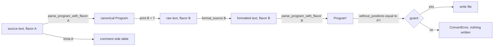

# Plan 0057: Mechanical Flavor Conversion

Convert any Osprey source between the Default, ML and Python flavors by
printing its canonical AST back out as text in the target flavor. A VS Code
command converts one file or a whole folder, so a complete package can move
from Python to Default, or from Default to ML, in one step.

Spec home: [Language Flavors](../specs/language/0023-LanguageFlavors.md). Its
"Converting Between Flavors" section says there is no converter. This plan
replaces that section with the `[FLAVOR-CONVERT-*]` rules below.

> **Gate:** `AGENTS.md` puts the repo in stabilization mode, which bans new
> features. This plan does not start until the user lifts that ban for this
> feature.

## Why it is possible

`[FLAVOR-BOUNDARY]` already guarantees that every flavor lowers into a single
`osprey_ast::Program`, and `[FLAVOR-IR-EQUIV]` proves that twin sources
produce equal ASTs and identical IR. A converter is the missing reverse arrow:
a printer from `Program` to the concrete syntax of each flavor.

## Rules

### `[FLAVOR-CONVERT]` Meaning is preserved or nothing is written

Converting from flavor A to flavor B succeeds only when parsing the output in
flavor B gives a `Program` equal to the input's `Program` once positions are
removed (`osprey_ast::canonical::without_positions`) and generated names are
normalized, which is the same comparison `cross_flavor_equiv.rs` uses. Any
mismatch is a `ConvertError` that names the first node that differs and its
source position. Partial output is never written.

This rule makes the converter purely mechanical. It prints the AST it was
given and never makes the output more idiomatic in a way that changes the
AST:

- An ML curried function stays curried. In Default it prints as a function
  that returns a function, and it is never flattened.
- A Default flat function stays flat. In ML it prints with the tuple-argument
  form described in `[FLAVOR-INTEROP]`.

Their types are therefore unchanged, and so is every caller in other files.

### `[FLAVOR-CONVERT-PRINT]` One printer per flavor, shared precedence

The new module `osprey-fmt/src/print/` has these files, each under 500 lines:

- `mod.rs`: the entry point `convert(src, from, to)` and the guard.
- `precedence.rs`: operator precedence and parenthesization shared by all
  three printers.
- `default.rs`, `ml.rs` and `python.rs`: one `Program -> String` printer each.

Each printer emits the raw text, and the existing `format_source(to)` gives it
its final layout. The printers do not handle indentation width or
line-breaking. Spelling that is shared by all three printers stays in
`precedence.rs`; deslop `find-similar` runs before each printer is written.

A desugared node is printed in its canonical form whenever the target flavor
has no sugar that parses back to the same node. Examples are the shared shapes
in `osprey-syntax/src/desugar.rs`, `Success`/`Error` patterns, and positional
constructions. The output can be longer than handwritten code, but it is
always correct.

### `[FLAVOR-CONVERT-UNPRINTABLE]` Nodes a flavor cannot spell are typed errors

Some nodes cannot be spelled in some flavors. For example, the Python flavor
rejects early `return`, field and index assignment, augmented assignment and
chained comparisons. Its spec also lists unsupported typing forms. The ML-only
surfaces are those in `ML_ONLY_STEMS` in `cross_flavor_ir_equiv.rs`.

When the target flavor has no spelling for a node, the printer returns
`Unprintable { node, position, target, reason }`. It does not approximate the
node. Phase 1 builds a matrix of which nodes each flavor can print, as a
table in the spec, and a test proves every row of that table.

### `[FLAVOR-CONVERT-TRIVIA]` Ordinary comments survive

The canonical AST keeps doc comments (`DocComment`, `[DOC-MODEL]`) but drops
`//` and `#` comments and blank lines. A new function,
`osprey_syntax::trivia(source, flavor) -> Vec<Trivia { position, text, kind }>`,
collects them using the flavor's existing lexer or tree-sitter tree. The
printer then emits each comment before the first statement or arm whose
position follows it, re-spelling the comment marker:

| Flavor | Line comment | Doc comment |
| --- | --- | --- |
| Default | `//` | `///` |
| ML | `//` | `(** *)` |
| Python | `#` | leading `"""` docstring (PEP 257, [Python Flavor Syntax](../specs/language/0041-PythonFlavorSyntax.md)) |

A comment inside an expression is attached to the statement that contains
it. The guard also checks that the set of comment texts is the same before
and after conversion, so a comment can move but can never disappear.

### `[FLAVOR-CONVERT-FILES]` File identity

| Target | Extension | Header |
| --- | --- | --- |
| Default | `.osp` | none |
| ML | `.ospml` | none |
| Python | `.py` | `# osprey: flavor=python` on line 1 |

The converted file is written next to the source and the source file is
deleted, so that `git` records a rename. Conversion refuses, before writing
anything, when the target path already exists. Converting a file to its own
flavor is a no-op that reports "already <flavor>".

Each sibling `.expectedoutput` keeps its name, because the stem does not
change.

### `[FLAVOR-CONVERT-FOLDER]` Folders convert all-or-nothing

Folder conversion works as follows:

1. Find the Osprey sources under the folder recursively. A `.py` file counts
   only when it opted in through its marker or `[project].python_sources`;
   ordinary Python scripts are never touched.
2. Convert every file in memory and collect every `ConvertError`.
3. If any file fails, write nothing and report all of the failures.
4. Otherwise write every file and update `osprey.toml`:
   - Converting to Python adds the new paths to `python_sources`.
   - Converting away from Python removes them.
   - Entry paths are renamed.
5. Rebuild the project graph and type-check it once. A failure here is a bug
   in the converter. Restore every file from the in-memory originals and
   report the failure.

Mixed-flavor projects already compile (`[FLAVOR-INTEROP]`), so converting a
single file inside a package is always valid.

### `[FLAVOR-CONVERT-CLI]` Command line

`osprey convert --to <default|ml|python> [--check] <path>...` takes files
and/or folders.

- `--check` runs the conversion and the guard but writes nothing. It exits
  non-zero and prints the errors when the conversion would fail.
- Without `--check`, it writes the converted files and prints one line per
  file, `old -> new`.

The command gets its own commented target in the `Makefile`, and its usage
and expected result go in `make help`.

### `[FLAVOR-CONVERT-VSIX]` Editor commands

These commands are added to `src/toolchain/vscode-extension/package.json` and
implemented in a new `client/src/convert-commands.ts`. They run the CLI with
`execFile` in the same way as `compile-commands.ts`.

- **`osprey.convertFile`** ("Osprey: Convert File to Flavor…"):
  - Where it appears: the editor title menu, the explorer context menu for
    `.osp`, `.ospml` and opted-in `.py` files, and the command palette.
  - A quick pick lists the two other flavors.
  - Before converting, the user must save any unsaved changes in the editor.
  - On success, the new file opens in place of the old one.
- **`osprey.convertFolder`** ("Osprey: Convert Folder to Flavor…"):
  - Where it appears: the explorer context menu on folders.
  - A quick pick chooses the target flavor.
  - A modal confirmation states how many files will be renamed and whether
    `osprey.toml` will change.
  - Progress is shown in a notification.
- **Failure handling:**
  - Every `ConvertError` goes to the Problems panel, with the file and
    position of each one.
  - The notification states that nothing was written.

## Tests

Following `AGENTS.md`, these are end-to-end tests with many permutations,
added to existing suites wherever possible.

1. **Corpus round trip**, in `osprey-fmt/tests/corpus.rs`:
   - Every program under `src/osprey/tests/` and `src/osprey/examples/` is
     converted in all six directions (A to B for each pair of different
     flavors).
   - The test asserts that the guard passes, or that the expected
     `Unprintable` from the matrix is returned.
   - It asserts that comment texts are preserved.
   - It asserts that the output is a fixed point of `format_source`.
2. **Cycle stability:** Default → ML → Python → Default reproduces
   byte-identical text after the first full cycle, for every program that
   can be printed in all three flavors.
3. **Behavior:**
   - Each converted program in the corpus runs through `run_test_corpus.sh`
     under GC, ARC and wasm32, and its output must match the existing
     `.expectedoutput`.
   - `cross_flavor_ir_equiv.rs` gains converted twins, which must emit IR
     identical to the original.
4. **Rejections:** `src/osprey/examples/failscompilation/` sources are not
   converted. They do not parse to a valid AST, so the converter reports the
   parse errors, and the test asserts those errors.
5. **Folders and the CLI:** `osprey-cli/tests/` converts a copy of a
   mixed-flavor package such as the three-file graph in
   `mixed_flavor_project_graphs_emit_identical_ir`. The test:
   - converts it whole to each flavor and asserts the renames, the
     `osprey.toml` edits, the single type-check, and identical IR;
   - plants one unprintable node and asserts that nothing was written;
   - asserts that a pre-existing target path is refused;
   - asserts that `--check` writes nothing.
6. **VSIX:** an extension test in `test/suite/` drives both commands through
   the quick pick and the confirmation, and asserts the new editor, the files
   on disk, the Problems entries for a failing folder, and that an untouched
   `.py` script stays a Python document.

## Phases

- [ ] 0. The user lifts the stabilization-mode feature ban for this plan.
- [ ] 1. Write the spec: replace "Converting Between Flavors" in
  `0023-LanguageFlavors.md` with the `[FLAVOR-CONVERT-*]` rules and the
  printable-node matrix.
- [ ] 2. Write the tests first: the corpus round trip and the CLI tests, both
  failing.
- [ ] 3. Add `trivia()` for all three flavors, plus the comment-preservation
  assertion.
- [ ] 4. Write the Default printer and the guard, then the ML printer, then
  the Python printer. Each printer turns its rows of the corpus test green.
- [ ] 5. Add the `osprey convert` CLI, folder mode, the `osprey.toml` edits
  and the restore-on-failure step.
- [ ] 6. Add the VSIX commands, menus and test.
- [ ] 7. Run deslop `top-offenders`, `make ci` and the full corpus, and record
  coverage in `coverage-thresholds.json` (thresholds only go up).

## Risks

- **Desugared output is verbose.** The output is correct but less idiomatic
  than handwritten code. Every new sugar rule must keep the guard green.
- **Some comments land in a slightly different place.** Comments inside an
  expression move to the start of the statement that contains them. This is
  a known limitation, and it is stated in the command's output.
- **Python's narrower surface.** Converting to Python will report many
  `Unprintable` errors for Default and ML code. The matrix and the errors
  show the user exactly what to rewrite by hand. The converter never guesses.
