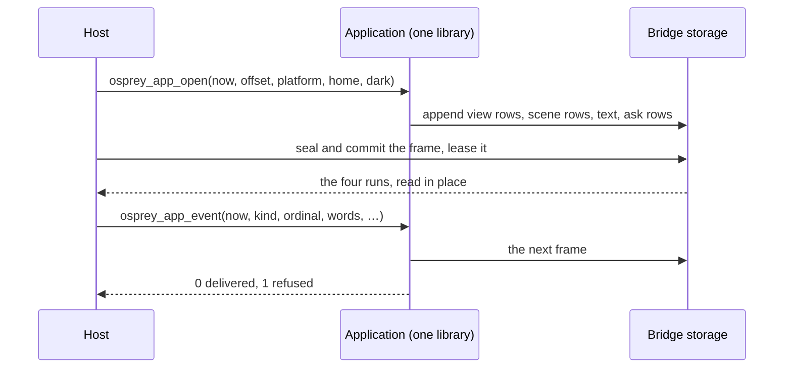

# Osprey Native and its hosts [NATIVE-HOSTS]

**Status:** five hosts run in this repository, all over the one shared-frame boundary ([0053](0053-NativeSharedViews.md)): the GPUI desktop host on macOS and Android ([0046](../platforms/0046-GpuiDesktopHost.md)), the SwiftUI host on macOS and iOS ([`src/toolchain/hosts/swift`](../../../src/toolchain/hosts/swift/README.md)), the Android host ([`src/toolchain/hosts/android`](../../../src/toolchain/hosts/android/README.md)), the WinUI host on Windows ([0048](../platforms/0048-WinUiHost.md)) and the VS Code webview host ([`src/toolchain/vscode-extension/client/src/osprey-ui`](../../../src/toolchain/vscode-extension/client/src/osprey-ui)). There is no other boundary in the code. The host conformance suite in [NATIVE-HOSTS-CONFORMANCE] does not exist yet; [plan 0037](../../plans/0037-osprey-native.md) delivers it.

## Aim [NATIVE-HOSTS-AIM]

Osprey Native is the application framework of the Osprey ecosystem. An application written against it owns everything a test can state: state, update, screens, actions, policy and the words a person reads. A **host** owns what only a platform can do: drawing, input devices, windows, files, network and the clock. The framework's promise is that one application runs on every host unchanged, and that nothing an application does depends on which host is drawing it.

The name is historical and stays for now. "Native" says the application compiles to native code and reaches native platform services; it does not say the host draws with native widgets. The name invites comparison with React Native, which is explicitly not a web framework; Osprey Native is the opposite: a host may draw with SwiftUI, HTML and CSS, GPU primitives or a terminal, and the web hosts are first-class, with the VS Code webview already running. The package keeps its name; hosts are named by what they draw with.

## What a host is [NATIVE-HOSTS-CONTRACT]

A host:

1. runs the library's entry once, then calls only its `argument`, `open` and `event` exports ([NATIVE-SHM-BOUNDARY]), from one thread;
2. seals and leases each call's frame, checks every row before drawing it ([NATIVE-SHM-SAFETY]) and keeps showing the last good frame when one is refused;
3. keeps host-held slices by key and answers the `native_slice` import from them ([NATIVE-SHM-ASK]);
4. draws every view row kind and scene row code ([NATIVE-HOSTS-COVERAGE]) and sends events back as typed calls that name a control by its number ([NATIVE-SHM-EVENT]);
5. answers the capability asks it supports, completing each with one `completed` event, and refuses, with a diagnostic naming it, every capability and row kind it does not;
6. applies every colour, size and space from the rows and maps symbol names to its own icons; it resolves no theme and holds no style of its own;
7. never interprets an action, a model or a string. The exception is layout and drawing optimisation that leaves the drawn result unchanged.

A host that draws a fallback for an unknown kind, invents an event, or keeps application state outside the library is non-conforming: the session — the store, its bindings and the strokes still arriving — never leaves the application.

## One transport [NATIVE-HOSTS-TRANSPORT]

Every host, native or web, drives the same three exports over the shared frame ([NATIVE-SHM]):

| Build | Shape | Hosts |
| --- | --- | --- |
| C ABI static archive (`--target=macos`, `ios`, `ios-sim`, `android-*`, and the desktop targets) | the application links its runtime and exports `osprey_main`, `osprey_app_argument`, `osprey_app_open`, `osprey_app_event` and the `osprey_native_bridge` table | GPUI, SwiftUI |
| C ABI DLL (`--target=windows-x64`) | the same, plus one `osprey_import_<name>` binder per import slot ([WINUI-HOST-DLL](../platforms/0048-WinUiHost.md)) | WinUI |
| WebAssembly (`--target=wasm32`) | a live module exporting the three calls and the bridge entries over its linear memory ([NATIVE-SHM-WASM]) | VS Code webview |

## Host family [NATIVE-HOSTS-FAMILY]

| Host | Draws with | Build | Platforms | Where | Status |
| --- | --- | --- | --- | --- | --- |
| GPUI | GPU primitives via GPUI | C ABI archive | macOS and Android; Linux and Windows have library targets and CI | [`src/toolchain/hosts/gpui`](../../../src/toolchain/hosts/gpui) | [spec 0046](../platforms/0046-GpuiDesktopHost.md), running |
| SwiftUI | SwiftUI views, SF Symbols | C ABI archive | macOS and iOS | [`src/toolchain/hosts/swift`](../../../src/toolchain/hosts/swift/README.md) | running; one library for both platforms ([NATIVE-HOSTS-MOBILE]) |
| WinUI | WinUI controls, Segoe Fluent Icons | C ABI DLL | Windows | [`src/toolchain/hosts/winui`](../../../src/toolchain/hosts/winui) | [spec 0048](../platforms/0048-WinUiHost.md), running |
| Android | Android views | C ABI archive behind a JNI library | Android | [`src/toolchain/hosts/android`](../../../src/toolchain/hosts/android/README.md) | running ([NATIVE-HOSTS-MOBILE]) |
| Webview | HTML, CSS, Codicons | WebAssembly | VS Code on every desktop | [`osprey-ui`](../../../src/toolchain/vscode-extension/client/src/osprey-ui) | running |
| Browser | HTML, CSS | WebAssembly in a worker | any browser | planned, extracted from the webview host | not started |

The webview and browser hosts share one TypeScript renderer; the VS Code one adds editor capabilities through [`@osprey/vscode`](../../../src/osprey/packages/vscode/README.md). A new host gets a row here and a column in the coverage matrix before any code merges.

### Phone hosts [NATIVE-HOSTS-MOBILE]

A phone platform has one host library that every application runs on, and no application carries a renderer of its own. iOS is the SwiftUI host: the same `OspreyShared` library as the Mac, with an iOS entry point and `ios.sh` to package an application folder for the simulator or a device. Android is `src/toolchain/hosts/android`: a JNI library that owns the bridge and hands Kotlin each frame's four runs as direct buffers over the leased bytes, and Kotlin code that checks every row and draws it with Android views. Both read the frame described in [0053](0053-NativeSharedViews.md) and neither names an application; the application folder, bundle identifier and label are arguments of the build.

A phone host opens the application with the platform string `ios` or `android` and the application's own documents folder as home, answers the capabilities the platform allows (no child processes on either) and completes every other ask with the typed refusal for an unknown capability. Each has a view check that opens the application with nobody present, checks the first frame, presses the first control that delivers an event and requires a second frame; it is the `tally-headless` target of the platform's `tests/Makefile`.

[Tally](../../../src/osprey/examples/tally) is the sample application for every platform: macOS and iOS on the SwiftUI host, Android on the Android host and Windows on the WinUI host. Progress is tracked in [plan 0037, section 12](../../plans/0037-osprey-native.md).

## Coverage [NATIVE-HOSTS-COVERAGE]

Every view row kind [`view.ospml`](../../../src/osprey/packages/native/src/view.ospml) numbers, every scene row code [`native.td`](../../../src/toolchain/schemas/native.td) declares and every `Capability` in [`capability.ospml`](../../../src/osprey/packages/native/src/capability.ospml) appears in a coverage matrix, one column per host, each cell `draws`, `rejects` or `n/a` (a capability with no meaning on that platform). The tests read the framework's own sources and fail when a kind is missing from a declaration or declared twice. A host's README links its column.

Each host declares its column in code:

| Host | Column | Test |
| --- | --- | --- |
| GPUI | `DRAWN`, `REFUSED`, `ANSWERED`, `UNANSWERED` and `MOBILE_ONLY` in [`coverage.rs`](../../../src/toolchain/hosts/gpui/src/coverage.rs), checked against the host's match arms | `cargo test coverage`, which also verifies that mobile-only capabilities are restricted to iOS and Android |
| Webview | `RENDERED_KINDS` in [`render.ts`](../../../src/toolchain/vscode-extension/client/src/osprey-ui/webview/render.ts), `ANSWERED_CAPABILITIES` in [`capabilities.ts`](../../../src/toolchain/vscode-extension/client/src/osprey-ui/capabilities.ts) | the renderer and capability suites in `src/toolchain/vscode-extension/test/suite` |
| WinUI | [`Coverage.cs`](../../../src/toolchain/hosts/winui/OspreyHost.Core/Coverage.cs) | `CoverageTests`, with the tests reading the framework's sources so a kind added to `@osprey/native` fails them until this host declares it |

The typed symbol helpers provide a closed, host-neutral vocabulary: the `Symbol` union in [`symbol.ospml`](../../../src/osprey/packages/native/src/symbol.ospml), converted by `Symbols::name` to each member's lowercase string. Existing control constructors also accept string names and bundled SVG registrations. Each host maps every member to its own icon set and tests that it does (the GPUI host's `every_framework_symbol_has_a_kit_icon`, the webview's Codicon test), so no member is drawn as a fallback. The framework holds no host's icon names, capabilities or product vocabulary; work only one host can do is a `HostCall`.

## Conformance [NATIVE-HOSTS-CONFORMANCE]

Not implemented yet ([plan 0037](../../plans/0037-osprey-native.md)): one recorded-event fixture set, kept beside the framework in `src/osprey/packages/native/conformance`, will drive every host through the typed boundary: the launch facts, a sequence of typed events, and the expected checked frames. A host passes when it refuses the same malformed frames, draws the same screens and returns the same control numbers for the same user actions scripted through its own input layer. Each host's smoke command runs the set; the plan names them. Once it exists, a host not in the conformance run is not listed as running in [NATIVE-HOSTS-FAMILY]; until then that table rests on each host's own self-tests.

## Diagnostics [NATIVE-HOSTS-DIAGNOSTICS]

A host shows why it refused a frame, event or capability on its own diagnostic surface — a strip on the GPUI and SwiftUI hosts, an info bar on the WinUI host — so a person sees it, and writes what it does to the platform's structured log where it has one: the SwiftUI backend writes every event, frame lease and capability run to the unified log. Diagnostics never change what the host draws or answers.

## Framework neutrality [NATIVE-HOSTS-NEUTRAL]

`@osprey/native` carries nothing that only one host or one product can honour. Platform-specific work goes through `HostCall` with a namespace the host answers or rejects. Constructors and capabilities that exist for one product are moved out or generalized; [plan 0037](../../plans/0037-osprey-native.md) lists the current ones.

Storage's Apple-only requests are `HostCall`s only the in-repo SwiftUI host answers: the Photos summary is `HostCall "photos" "summary"`, and the Photos section appears only when the answer arrives; Full Disk Access is `HostCall "macos" "privacy-settings"`. Not implemented yet: no host answers the `photos` or `macos` namespaces.

## The shared frame [NATIVE-SHM]

This is the boundary the code has; [0053](0053-NativeSharedViews.md) explains it end to end. An application keeps its session in the library, and every call writes one whole frame — view rows, scene rows, one UTF-8 text run and ask rows — into bridge storage, which the host seals, leases and reads in place when the call returns. Nothing crosses as text in a format in either direction: no event document and no saved session.



### Layout [NATIVE-SHM-LAYOUT]

[`src/toolchain/schemas/native.td`](../../../src/toolchain/schemas/native.td) is the sole logical definition of the bridge's ownership types, the frame's rows and the logical event and accessibility contracts. typeDiagram generates one header, `native_abi.h`: the layouts are the same at both pointer widths, and it names a 64-bit and a wasm32 fingerprint (`TD_SHARED_FINGERPRINT_64`, `TD_SHARED_FINGERPRINT_32`) and selects one by the compiler's pointer width. Rows are fixed-width, little-endian and 8-aligned: a `ViewRow` is 152 bytes, a `SceneShape` 88 and an `AskRow` 32 on the 64-bit layout. Text is UTF-8 bytes of the frame's one text run, named by offset and length. The bridge opens only for a host built against the exact same fingerprint and pointer width; a mismatch is a typed startup error, and an unsupported discriminant fails explicitly. The rows are process-local and never written to a wire or to disk.

### The boundary calls [NATIVE-SHM-BOUNDARY]

An application exports exactly three calls beside its entry, each drawn up by `Surfaces` and handed its events by `Hosting::event` ([`surface.ospml`](../../../src/osprey/packages/native/src/surface.ospml), [`hosting.ospml`](../../../src/osprey/packages/native/src/hosting.ospml)):

```c
int64 osprey_app_argument(const char *text);
int64 osprey_app_open(int64 now, int64 offset, const char *platform, const char *home, bool dark);
int64 osprey_app_event(int64 now, int64 kind, int64 ordinal, const char *words, const char *detail,
                       double x, double y, bool down, bool shift);
```

- `argument` gathers one launch argument, in order, before `open`. Strings are borrowed for the call only.
- `open` runs `init` and draws the first frame from the host facts: the clock, the UTC offset, the platform name, the home folder and whether the dark appearance is showing.
- `event` delivers one typed host event ([NATIVE-SHM-EVENT]) and draws the next frame.
- Every call — an argument, a delivered event, a refused one — writes a whole frame, which the host seals and leases when the call returns. `event` answers 0 when the event was delivered and 1 when it was refused; a refused event changes nothing, and its reason arrives as a diagnostic ask ([NATIVE-SHM-ASK]).
- The store, its bindings and the stroke and lasso still arriving stay in the library between calls. Nothing is saved, sent or restored.
- An application's entry keeps one `Surface` in a file-scope cell and wraps each export in `Views::shared` and `Runtime::guarded`; no application writes its own decoding.

### Typed events [NATIVE-SHM-EVENT]

One host event is one typed call: a kind, the control it names, two texts, two numbers and two flags, and each kind reads only the fields it documents (`Touch` in [`hosting.ospml`](../../../src/osprey/packages/native/src/hosting.ospml)):

| Kind | Meaning |
| --- | --- |
| 0 control | the control numbered `ordinal` delivering `words` |
| 1 key | a key over the scene `ordinal`: its name in `words`, `down` when pressed |
| 2 pointer | the pointer over the scene `ordinal`: `x`, `y` in scene units, `down`, `shift` |
| 3 viewed | the scene `ordinal` measured: `x` wide and `y` tall in scene units |
| 4 point | one more point of the stroke being drawn: `x`, `y` in whole board points |
| 5 stroke | the stroke finished: `x` its width and `y` its clock in milliseconds |
| 6 enclose | one more stroke, numbered `ordinal`, inside the lasso being drawn |
| 7 lasso | the lasso closed around the strokes enclosed so far |
| 8 completed | a capability completed under the ticket in `words`: `down` when it succeeded, its result or reason in `detail` |
| 9 phase | the host reached the lifecycle phase in `words` |
| 10 frame | a display frame, `x` seconds after the last |
| 11 appearance | the appearance changed: `down` when dark |

The framework numbers each control that delivers a binding in drawing order and keeps the bindings in the surface. To resolve an event it looks the number up, checks the value kind and produces the typed message; an unknown number or a mismatched value kind is refused, the same store is drawn again and the reason arrives as a diagnostic ask. The host cannot construct an arbitrary action, and a control number is never an authorization token.

### Component rows [NATIVE-SHM-NODES]

An application built from the component vocabulary ([UI-COMPONENTS]) sends its component tree, not pixels and not lowered controls. Each host rebuilds the tree from the frame and draws it with its own native components, so the same application looks native on every host and a host's look never depends on how the tree crossed. The tree is told as view rows of three kinds; a row's name is its hint and its parent is the record or list it belongs to.

| Kind | Row | Reads as |
| --- | --- | --- |
| 33 | `field` | One named value. Its weight says which: 0 text (the row's text), 1 a whole number (the colour column, read as a signed 64-bit value), 2 a real (the size column), 3 a flag (the colour column is not zero), 4 a negative real (minus the size column). |
| 34 | `record` | A record. The rows that name it as their parent are its members; a member with no name is ignored. |
| 35 | `list` | A list. The rows that name it as their parent are its items, in order, and carry no name. |

The top-level rows are one `theme` record (its `tokens`, each a `name` with `light` and `dark` colours, its `spacing` scale, and its `feedback` and `settle` durations) and one `region` record per region, with its `key` and its `node`. A component is a record with a `kind` and the members that kind declares; [`told.ospml`](../../../src/osprey/packages/native/src/told.ospml) is the one definition of them. A control's `event` is its ordinal: the number a control event names. A `slot` names another region by its key, and the root region's key is `root`. A `scene` record carries its size and its `event`; its shapes, atlas and accessible elements arrive in the scene run, whose marker names the record's row.

A host refuses a frame whose told row has a weight outside 0 to 4, a parent that is not an earlier row or text outside the text run. A frame with no told rows is a frame of plain view rows ([NATIVE-SHM-VIEW]), which a host draws as before.

### Ask rows [NATIVE-SHM-ASK]

Each step's capability requests and slice writes ride beside the view as ask rows ([`capability.ospml`](../../../src/osprey/packages/native/src/capability.ospml)). A row whose `field` is 0 starts an ask: its `number` is the capability's code — its position in `Capability`, counted from 1 — and its text the ticket. The rows after it are that ask's arguments by position: a list repeats its field once per item, a pair (a header or an environment variable) is two rows in order, whole numbers and flags are in `number` and text is in the frame's text run. Code 100 is a slice write (its text the key, then the text to hold) and 101 a diagnostic. The host completes each request with one `completed` event carrying the ticket and its result text; bulk results land in host-held slices, which the application fetches through the `native_slice` import the host answers. Hosts refuse codes they do not know, fields out of range and text ranges outside the run.

### WebAssembly [NATIVE-SHM-WASM]

A `--target=wasm32` build is one live module. Its `_start` runs the application's top level once; after that the module exports the three boundary calls and the bridge entries — `osp_native_open`, `osp_native_frame_commit`, `osp_native_acquire`, `osp_native_child`, `osp_native_length`, `osp_native_view`, `osp_native_release` — over its own linear memory, laid out as `native_abi.h` says, under its wasm32 fingerprint. The embedder opens the bridge with a fresh instance identity and the layout's fingerprint, calls the exports, commits and leases each frame, and copies the four runs out of linear memory; JavaScript reads the generated offsets with `bigint`, never `number`. No standard input, output or filesystem is granted. The VS Code extension runs the module in one worker per panel, and the webview receives one copy of the raw rows across the process boundary ([VSCODE-SDK-WASM](../../../src/osprey/packages/vscode/README.md)).

### Ownership and lifetime [NATIVE-SHM-OWNERSHIP]

Implemented once, in the C runtime's bridge ([`native_bridge.h`](../../../src/toolchain/compiler/runtime/native_bridge.h)), and shared by every host:

- A frame is one branch chunk owning four sealed leaf runs — scene rows, view rows, text and ask rows — each immutable once sealed. Bridge storage is outside the GC and ARC heaps.
- A host reaches memory only through a lease: an owner token unique to one acquire and consumed by one release, naming its application instance, allocation, reuse generation and byte offset. A stale, forged, foreign or double-released lease is refused as a typed `BridgeError`, never followed; reuse-generation exhaustion retires a slot permanently.
- The application is one serialized executor: a host calls it from one thread, and an import may only run inside a call. Chunk retains are established before sealing and released iteratively; accounting covers whole allocations.
- Budgets for bytes, chunks and owners are finite and fixed when the bridge opens; exceeding one refuses the frame instead of growing without bound. Allocation is fallible: no allocation failure yields an empty successful frame.
- The runtime writes rows through its own entries (`osp_native_view_row`, `osp_native_view_extend`, `osp_native_ask`, `osp_native_scene_shape`), which Osprey calls as the typed builtins `nativeViewRow`, `nativeViewExtend`, `nativeAsk` and `nativeSceneShape`. The compiler fixes their C signatures, so `@osprey/native` declares no raw `extern` and the registry publishes it ([PACKAGE-CAPABILITY-CONFINEMENT]). Each returns nonzero once the frame is refused; the host then refuses the frame whole.

### Publication [NATIVE-SHM-PUBLISH]

Each call appends to fresh storage; when the export returns, the host commits the frame (`osp_native_frame_commit`, the wrapper over `osp_native_publish`) and acquires its root lease. A committed frame never changes. The host releases the previous frame only after it holds the next, so a frame a painter still holds outlives its replacements, and memory is reclaimed when the last lease goes. A refused or failed call publishes nothing and the host keeps showing the frame it already holds. Revisions increase monotonically with each commit.

### Ordered delivery [NATIVE-SHM-DELIVERY]

Events are delivered one typed call at a time, serialized on the host's UI thread; an event that arrives while a call runs waits for it. Capability adapters run off the UI thread, and their completions return as further `completed` calls carrying the ticket; the application ignores a completion whose ticket no longer matches, so stale, cancelled and superseded work never overwrites newer state. A refused event draws the same store and sends its reason as a diagnostic ask, so the host always shows the frame it was handed. The schema's reliable-record types (`RecordIdentity`, `ControlEvent` in `native.td`) describe this contract logically; what crosses is the nine-field typed call.

### Accessibility [NATIVE-SHM-ACCESSIBILITY]

The schema carries a complete semantic tree contract — instance-scoped node ids, roles, names, states, relations, supported actions, bounds and text selections, with secure fields exposing no text — and `native.td` marks it a logical contract whose host adapters are not implemented. What ships today: a canvas's `Accessible` elements cross as scene rows (code 22, with a minimum and maximum point row), the GPUI host lays them onto AccessKit and the WinUI host onto UI Automation, and `@osprey/uitest` reads the same tree without a host. The full contract — coherent semantic and render revisions, retained callbacks, stable focus, virtualized lists and reliable announcements — plus web acceptance against WCAG 2.2 A/AA and per-host assistive-technology journeys remain delivery work in [plan 0037](../../plans/0037-osprey-native.md).

### Verification [NATIVE-SHM-VERIFY]

The C bridge's suite ([`host_import_tests.c`](../../../src/toolchain/compiler/runtime/host_import_tests.c)) runs under both memory backends (`host_import_gc_tests`, `host_import_arc_tests`) and covers leases (stale, double release, retained children), limits and counter exhaustion, allocation failure at each step, publication, synchronization failure, and refused scene and view values. Each host additionally drives a real application through its own boundary: the GPUI smoke run taps the probe and asserts the words it drew, the WinUI tests drive real DLLs, and the Swift self-test reads every fact back out of a checked frame.
