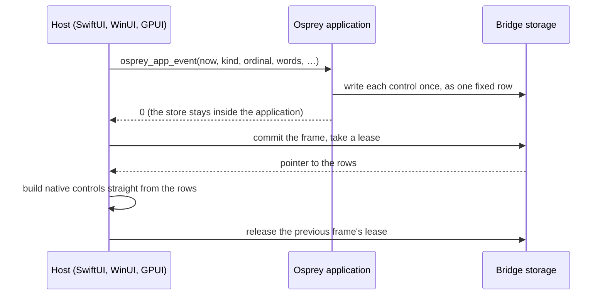

# Osprey Native without a JSON bridge: shared-memory views

This document explains how an Osprey Native application reaches the screen without serializing anything, why that is fast and safe, and how you write and style an interface in Osprey that the hosts draw with their own controls. It is the plain-language companion to the normative contract in [Osprey Native hosts, the shared frame](0047-OspreyNativeHosts.md#the-shared-frame-native-shm). The smallest complete example is [Tally](../../../src/osprey/examples/tally).

**Status.** This is the only boundary the code has: every in-repo host (GPUI, SwiftUI, WinUI, the VS Code webview) and every in-repo application runs it, and the JSON bridge it replaced is deleted. Progress and measurements are tracked in [plan 0037, section 11](../../plans/0037-osprey-native.md).

## What happens now [NATIVE-SHM-VIEW]



1. **An event is a typed call.** A tap or an edit calls `osprey_app_event` with the control's number and its words; a scene sends keys, pointers and sizes; a completion sends its ticket and result text. Nothing is encoded.
2. **The application keeps its own state.** The store lives in the Osprey library between calls. It is never saved, sent or restored.
3. **Each control is written once.** `Views::render` walks the application's `View` tree and writes every control as one fixed-size row (`ViewRow` in [`native.td`](../../../src/toolchain/schemas/native.td): kind, parent, action, text position, colours, sizes, flags) plus its UTF-8 text, directly into storage owned by the bridge.
4. **The host reads the rows where they lie.** After the call returns, the host commits the frame, takes a lease on it and gets a pointer to the rows. It builds its native controls from that memory. There is no string, no parser and no intermediate tree.
5. **Old frames stay valid while anyone holds them.** A frame is immutable once committed. The host releases the previous frame only after it holds the next one, so a control being drawn never has its memory changed or freed underneath it.

## Scenes [NATIVE-SHM-SCENE]

A canvas's scene crosses the same way, as fixed rows in the same frame: each `SceneShape` is an 88-byte row a host reads in place, with no per-shape host call and no copy. A marker row (code 20) names the canvas's view row and carries its width, height and zoom; its atlas entries, shapes and accessible elements follow as rows until the next marker. `native.td` lists every code: rectangles, discs, strips, sprites, glyphs and lettering are one row each; a path is a head row, its steps, an outline and a paint; tints, dash lengths and polygon corners are point rows. `Streams::write` streams them shape by shape after the canvas row they belong to, which is how Flock draws thousands of birds without encoding one: 5,000 sprites cost about 7 ms a frame, `update` included.

## Why it is fast

The boundary does no formatting work at all. An event is numbers and borrowed text; the store never leaves the application; each control is written once as a fixed row instead of a subtree of strings; the host reads rows in place instead of parsing and rebuilding them; and a frame is four growable runs (scene rows, view rows, text, asks) joined by one branch chunk, not per-node allocations on both sides. Unlike React Native there is no JavaScript engine, no interpreter and no asynchronous message queue between the application and the host: the application is ahead-of-time compiled native code in the same process, and the frame is ordinary memory. The framework's per-frame cost is measured by `src/toolchain/hosts/gpui/bench` and recorded in [plan 0037](../../plans/0037-osprey-native.md).

## Why it is safe [NATIVE-SHM-SAFETY]

"Shared memory" here means memory shared between the application and its host **inside one process**. It is ordinary heap memory owned by the bridge. No operating-system shared-memory object, file mapping, socket or named handle is created, so no other process gains anything to attach to, and the design adds no new way into the application from outside.

Inside the process the rules are:

- **Frames are immutable and reference counted.** A host can only reach memory through a lease. A lease names its bridge instance, an owner serial and the chunk's generation; a stale, forged, foreign or double-released lease is refused, never followed. Storage is freed only when the last lease is released.
- **Every read is bounds checked.** `osp_native_view` checks the lease, the chunk's type, and that the requested range lies inside the chunk before it returns a pointer.
- **Writers cannot corrupt a frame.** Osprey fibers are operating-system threads, so two may write controls at once; each row, and the hand-over of a whole frame, is a single step. Every limit (controls, text bytes, shapes, total bytes, chunks, leases) is finite, and exceeding one refuses the frame instead of growing without bound.
- **Unusable values never reach a host.** A number that is not finite, a negative extent, or a parent that is not an earlier row refuses the whole frame. Text positions are produced by the bridge, not by the application.
- **A failed call changes nothing.** If an export fails or a frame is refused, nothing is published and the host keeps showing the frame it already holds.
- **Hosts still do not trust a row.** A host checks row counts, parents and text ranges again, decodes text as UTF-8, draws nothing for a kind it does not know, and never keeps a pointer past its lease. A control number coming back from a host is looked up in the application's own list of bindings; an unknown one is a typed error, so a host can never invent an action.
- **Layout mismatches are refused at start.** The bridge opens only for a host built against the exact same row layout (a fingerprint of the schema), pointer size and byte order.

The bridge's tests ([`host_import_tests.c`](../../../src/toolchain/compiler/runtime/host_import_tests.c)) run under both memory backends and cover stale leases, exhausted limits, allocation failure at each step, publication, synchronization failure, concurrent readers and writers, and refused scene and view values.

## Writing an interface in Osprey

You describe the screen as a `View` and decide every colour, size and space in Osprey with a `Look`. The host applies them and has no style of its own, so restyling an application never means touching Swift or C#.

```ospml
strong colours = ui::Look(ink = Views::colour colours.onAccent, fill = Views::colour colours.accent, points = 17.0, inset = 12.0, gap = 0.0, corner = 10.0, heft = 600)

export view store =
    colours = palette store.night
    ui::Column(columnLook = page colours, columnItems = [
        ui::Wording(wordsLook = title colours, wordsText = heading store),
        ui::Wording(wordsLook = figure colours, wordsText = toString store.count),
        ui::Across(acrossLook = spaced, acrossItems = [
            ui::Press(pressLook = soft colours, pressWords = "Take one", pressAction = Take),
            ui::Press(pressLook = strong colours, pressWords = "Add one", pressAction = Add),
        ]),
        ui::Typing(typingLook = soft colours, typingText = store.owner, typingAction = Named),
    ])
```

The boundary is three exports, which the compiler publishes as `osprey_app_argument`, `osprey_app_open` and `osprey_app_event`. `Views::shared` sends every control to the frame, and `Views::render` answers the actions the controls deliver, in order, so an event's number is looked up in a list the application wrote itself:

```ospml
shown store =
    next = Live(store = store, bound = Views::render (Screen::view store))
    perform Keep.keep next
    0

delivered (held, ordinal, words) = match listGet held.bound ordinal
    Error _ => refused held
    Success action => shown (Screen::update (held.store, action, words))

hosted work =
    handle Keep
        keep next => live := next
    Runtime::guarded (\() => Views::shared work)

argument (_ : string) = 0
open (_ : int, _ : int, _ : string, _ : string, _ : bool) = hosted (\() => shown Screen::first)
event (_ : int, kind, ordinal, words, _ : string, _ : float, _ : float, _ : bool, _ : bool) =
    hosted (\() => touched (live, kind, ordinal, words))
```

An application with more than controls to catch hands the whole typed event to `Hosting::event`, which turns every kind into its message. The whole of Tally's logic, layout and both colour schemes is in [`src/app.ospml`](../../../src/osprey/examples/tally/src/app.ospml); its boundary is [`main.ospml`](../../../src/osprey/examples/tally/main.ospml); a complete host in plain C, which is also its end-to-end test, is [`host/reference.c`](../../../src/osprey/examples/tally/host/reference.c).

### The controls a host draws

A host needs only a small, flexible set of native controls, because everything richer is composed and styled in Osprey:

| Kind | `View` | Native control |
| --- | --- | --- |
| 0 column, 1 line | `Column`, `Across` | vertical and horizontal stacks |
| 2 label | `Wording` | text |
| 3 press | `Press` | button |
| 4 entry, 14 editor | `Typing`, `Writing` | single-line and multi-line text fields |
| 5 gap | `Gap` | flexible space |
| 6 scroll, 7 layer | `Scrolling`, `Layered` | scroll view, overlay stack |
| 8 toggle | `Switch` | switch |
| 9 picker, 10 option | `Choosing`, `Option` | menu and its items |
| 11 rule, 12 image | `Rule`, `Picture` | hairline, image |
| 13 canvas | `Canvas` | the frame's scene rows |
| 15 menu, 16 sheet | `Menu`, `Sheet` | context menu, modal sheet |

`Fitted` gives any control a fixed width or height, a share of the free space, a border, state flags (disabled, chosen, secret, fixed-width, slanted, centred, deliver on commit) and a second text such as a field's prompt.

## Lowering the semantic tree [NATIVE-SHM-LOWER]

Applications written against the older semantic tree (`Section`, `Badge`, `Meter`, `Rows` and the rest) do not have to be rewritten: `Lower::view` turns a `Node` into these primitives using the application's `Theme`, which moves the styling that used to live in each host into one Osprey module. Every colour, size and space is decided in Osprey before a row is written, and each control delivers the `Binding` its node names, in drawing order, so a host event still names a control by its number.

## Where serialization remains

Only three places: the result text a capability completion carries, the contents of host-held slices that capability adapters produce, and the VS Code webview's one copy of the raw rows across its process boundary. Everything else crosses as typed calls and rows in shared memory. Formats owned by the outside world, such as HTTP bodies, stay the business of the adapter that speaks them.
