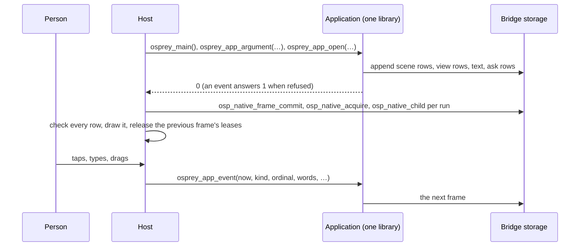

# Osprey Native's bridge: one frame in shared memory

This document explains how an Osprey Native application reaches the screen: every call writes one whole frame into memory the host leases, checks and reads in place. It covers the frame's four runs, the two kinds of view row, asks, events, the ownership and safety rules, and what a host must do. The normative contract — the host family, coverage, conformance — is [Osprey Native hosts](0047-OspreyNativeHosts.md). The smallest complete example is [Tally](../../../src/osprey/examples/tally).

**Status.** This is the only boundary the code has: every in-repo host and every in-repo application runs it. Progress and measurements are tracked in [plan 0037, section 11](../../plans/0037-osprey-native.md).

## The application is a library

An application compiles ahead of time to a library the host loads: a C ABI static archive on Apple, Android and the desktop targets, a DLL on Windows (`--target=windows-x64`), a live WebAssembly module on the web (`--target=wasm32`). The compiler emits a header beside it — see a generated one, [`libOspreyApp.h`](../../../src/toolchain/hosts/swift/Sources/OspreyViewApp/include/libOspreyApp.h) — declaring the exports ([NATIVE-SHM-BOUNDARY]):

```c
int32_t osprey_main(void);
int32_t osprey_host_abi_version(void);
int64_t osprey_app_argument(const char *text);
int64_t osprey_app_open(int64_t now, int64_t offset, const char *platform, const char *home, bool dark);
int64_t osprey_app_event(int64_t now, int64_t kind, int64_t ordinal, const char *words, const char *detail,
                         double x, double y, bool down, bool shift);
```

The host calls `osprey_main` once, then `osprey_app_argument` once per launch argument, then `osprey_app_open`, and `osprey_app_event` for everything after that, always from one thread. Strings are borrowed for the call only. Every call — an argument, an open, an event, an event the application refused — writes one whole frame. `event` answers 0 when the event was delivered and 1 when it was refused; a refused event changes nothing, and its reason arrives as a diagnostic ask.

The Osprey side of the boundary is [`surface.ospml`](../../../src/osprey/packages/native/src/surface.ospml) and [`hosting.ospml`](../../../src/osprey/packages/native/src/hosting.ospml) in `@osprey/native`: an application exports three functions wrapped in `Views::shared` and `Runtime::guarded`, and hands its events to `Hosting::event`.

## One frame, four runs [NATIVE-SHM]



Each call appends to fresh storage owned by the bridge — [`native_bridge.h`](../../../src/toolchain/compiler/runtime/native_bridge.h) and [`native_bridge.c`](../../../src/toolchain/compiler/runtime/native_bridge.c), implemented once in C and shared by every host. A published frame is one branch chunk owning four sealed leaf runs, in this order:

| Run | Row | Bytes | Holds |
| --- | --- | --- | --- |
| Scene rows | `OspNativeShape` | 88 | a canvas's scene, one row per shape ([NATIVE-SHM-SCENE]) |
| View rows | `OspNativeView` | 152 | the controls and component rows of the screen ([NATIVE-SHM-VIEW]) |
| Text | — | — | the UTF-8 bytes every row's offsets name |
| Ask rows | `OspNativeAsk` | 32 | capability requests, slice writes and diagnostics ([NATIVE-SHM-ASK]) |

Rows are fixed-width, little-endian and 8-aligned; the generated [`native_abi.h`](../../../src/toolchain/compiler/runtime/native_abi.h), from [`native.td`](../../../src/toolchain/schemas/native.td), is the one definition of the layouts and names a 64-bit and a wasm32 fingerprint. The bridge opens only for a host built against the exact same fingerprint and pointer width; a mismatch is a typed startup error. A frame holds at most 2^20 scene rows, 2^16 view rows, 2^24 text bytes and 2^16 ask fields; exceeding a limit refuses the frame instead of growing without bound.

When the call returns, the host commits the frame (`osp_native_frame_commit`), acquires its root lease (`osp_native_acquire`), takes each run as a child (`osp_native_child`), asks its length (`osp_native_length`) and reads the rows where they lie (`osp_native_view`). No string is built, nothing is parsed and no intermediate tree exists on the host side of the rows.

## The two kinds of view row [NATIVE-SHM-VIEW]

A view row is either a plain control or a component row. Both are fixed 152-byte rows in drawing order, each with a parent (an earlier row, or -1), an action (the binding a tap or edit delivers, or -1), text by offset and length, resolved colours, sizes and flags.

### Plain controls

Everything simpler is composed and styled in Osprey, so a host needs only a small set of native controls, and the host owns no style of its own:

| Kind | `View` | Native control |
| --- | --- | --- |
| 0 column, 1 line | `Column`, `Across` | vertical and horizontal stacks |
| 2 label | `Wording` | text |
| 3 press | `Press` | button |
| 4 entry, 14 editor | `Typing`, `Writing` | single-line and multi-line text fields |
| 5 gap | `Gap` | flexible space |
| 6 scroll, 7 layer | `Scrolling`, `Layered` | scroll view, overlay stack |
| 8 toggle | `Switch` | switch |
| 9 picker, 10 option | `Choosing`, `Option` | menu and its items |
| 11 rule, 12 image | `Rule`, `Picture` | hairline, image |
| 13 canvas | `Canvas` | the frame's scene rows |
| 15 menu, 16 sheet | `Menu`, `Sheet` | context menu, modal sheet |

`Fitted` gives any control a fixed width or height, a share of the free space, a border, state flags (disabled, chosen, secret, fixed-width, slanted, centred, deliver on commit) and a second text such as a field's prompt; a row's hint names an icon, a prompt or an option's key.

### Component rows [NATIVE-SHM-NODES]

An application built from the component vocabulary (`Button`, `Field`, `Rows`, `Tabs` and the rest) tells its semantic tree instead: view rows of three more kinds, defined once in [`told.ospml`](../../../src/osprey/packages/native/src/told.ospml). A row's name (its hint) is its member name and its parent is the record or list it belongs to.

| Kind | Row | Reads as |
| --- | --- | --- |
| 33 | `field` | One named value. Its weight says which: 0 text (the row's text), 1 a whole number (the colour column, read as a signed 64-bit value), 2 a real (the size column), 3 a flag (the colour column is not zero), 4 a negative real (minus the size column). |
| 34 | `record` | A record. The rows naming it as their parent are its members; a member with no name is ignored. |
| 35 | `list` | A list. The rows naming it as their parent are its items, in order, and carry no name. |

The top-level rows are one `theme` record (its `tokens`, each a `name` with `light` and `dark` colours, its `spacing` scale, and its `feedback` and `settle` durations) and one `region` record per region, carrying its `key` and its `node`. A component is a record with a `kind` and the members that kind declares; a control's `event` member is its ordinal, the number a control event names. Each host rebuilds a typed tree from these rows and draws it with its own renderer: [`Nodes/Tree.swift`](../../../src/toolchain/hosts/swift/Sources/OspreyShared/Nodes/Tree.swift) in the SwiftUI host, [`tree.rs`](../../../src/toolchain/hosts/gpui/src/tree.rs) in the GPUI host, [`Nodes.cs`](../../../src/toolchain/hosts/winui/OspreyHost.Core/Nodes.cs) in the WinUI host and [`nodes.ts`](../../../src/toolchain/vscode-extension/client/src/osprey-ui/nodes.ts) in the VS Code webview — so the same application looks native everywhere and a host's look never depends on how the tree crossed. A frame with no told rows is a frame of plain controls, drawn as before.

## Scenes [NATIVE-SHM-SCENE]

A canvas's scene crosses as fixed rows in the same frame: each `SceneShape` is an 88-byte row a host reads in place, with no per-shape host call and no copy. A marker row (code 20) names the canvas's view row and carries its width, height and zoom; its atlas entries, shapes and accessible elements follow as rows until the next marker. `native.td` lists every code: rectangles, discs, strips, sprites, glyphs and lettering are one row each; a path is a head row, its steps, an outline and a paint; tints, dash lengths and polygon corners are point rows. `Streams::write` streams them shape by shape after the canvas row they belong to, which is how Flock draws thousands of birds: 5,000 sprites cost about 7 ms a frame, `update` included.

## Asks [NATIVE-SHM-ASK]

A step's capability requests and slice writes ride beside the view as ask rows ([`capability.ospml`](../../../src/osprey/packages/native/src/capability.ospml)). A row whose `field` is 0 starts an ask: its `number` is the capability's code — its position in `Capability`, counted from 1; there are 25 today — and its text the ticket. The rows after it are that ask's arguments by position: a list repeats its field once per item, a pair (a header or an environment variable) is two rows in order, whole numbers and flags are in `number` and text is in the frame's text run. Code 100 is a slice write (its text the key, then the text to hold) and 101 a diagnostic — why an event was refused. The host completes each request with one `completed` event carrying the ticket and its result text; bulk results land in host-held slices, which the application fetches through the `native_slice` import the host answers. Hosts refuse codes they do not know, fields out of range and text ranges outside the run.

## Events [NATIVE-SHM-EVENT]

Events come back as `osprey_app_event` calls: a kind, the control it names, two texts, two numbers and two flags, and each kind reads only the fields it documents:

| Kind | Meaning |
| --- | --- |
| 0 control | the control numbered `ordinal` delivering `words` |
| 1 key | a key over the scene `ordinal`: its name in `words`, `down` when pressed |
| 2 pointer | the pointer over the scene `ordinal`: `x`, `y` in scene units, `down`, `shift` |
| 3 viewed | the scene `ordinal` measured: `x` wide and `y` tall in scene units |
| 4 point | one more point of the stroke being drawn: `x`, `y` in whole board points |
| 5 stroke | the stroke finished: `x` its width and `y` its clock in milliseconds |
| 6 enclose | one more stroke, numbered `ordinal`, inside the lasso being drawn |
| 7 lasso | the lasso closed around the strokes enclosed so far |
| 8 completed | a capability completed under the ticket in `words`: `down` when it succeeded, its result or reason in `detail` |
| 9 phase | the host reached the lifecycle phase in `words` |
| 10 frame | a display frame, `x` seconds after the last |
| 11 appearance | the appearance changed: `down` when dark |

A control event is kind 0 with the control's ordinal and its words. The framework numbers each control that delivers a binding in drawing order and keeps the bindings in the surface; to resolve an event it looks the number up, checks the value kind and produces the typed message. An unknown number or a mismatched value kind is refused, the same store is drawn again and the reason arrives as a diagnostic ask. The host cannot construct an arbitrary action, and a control number is never an authorization token.

## Ownership and safety [NATIVE-SHM-SAFETY]

"Shared memory" here means memory shared between the application and its host **inside one process**. It is ordinary heap memory owned by the bridge, outside the GC and ARC heaps. No operating-system shared-memory object, file mapping, socket or named handle is created, so no other process gains anything to attach to.

- **Frames are immutable and reference counted.** A host reaches memory only through a lease that names its application instance, an owner serial and the chunk's reuse generation; a stale, forged, foreign or double-released lease is refused as a typed error, never followed. Storage is freed only when the last lease is released; the host releases the previous frame only after it holds the next, so a control being drawn never has its memory changed or freed underneath it.
- **Every read is bounds checked.** `osp_native_view` checks the lease, the chunk's type, and that the requested range lies inside the chunk before it returns a pointer.
- **Writers cannot corrupt a frame.** Osprey fibers are operating-system threads, so two may write controls at once; each row, and the hand-over of a whole frame, is a single step. Every limit is finite, and exceeding one refuses the frame instead of growing without bound. Allocation is fallible: no allocation failure yields an empty successful frame.
- **Unusable values never reach a host.** A number that is not finite, a negative extent, or a parent that is not an earlier row refuses the whole frame. Text positions are produced by the bridge, not by the application.
- **A failed call changes nothing.** If an export fails or a frame is refused, nothing is published and the host keeps showing the frame it already holds.
- **Hosts still check every row.** A host re-checks row counts, parents and text ranges, decodes text as UTF-8, draws nothing for a kind it does not know, and never keeps a pointer past its lease.
- **Layout mismatches are refused at start.** The bridge opens only for a host built against the exact same row fingerprint, pointer size and byte order.

The bridge's tests ([`host_import_tests.c`](../../../src/toolchain/compiler/runtime/host_import_tests.c)) run under both memory backends and cover stale leases, exhausted limits, allocation failure at each step, publication, synchronization failure, concurrent readers and writers, and refused scene and view values.

## Write a host

1. Build the application for the target and read the generated header beside the library. Open the bridge once (`osp_native_open`) with the layout's fingerprint and budgets, after `osprey_main`, from one thread.
2. Deliver launch arguments with `osprey_app_argument` before `osprey_app_open`; then send every host event with `osprey_app_event`.
3. After every call — refused or not — commit the frame, acquire its root lease, take the four runs as children, and read each with `osp_native_length` and `osp_native_view`.
4. Check every row before drawing it: kinds, codes, parents, counts, finite numbers, text ranges inside the run on UTF-8 boundaries. Refuse a frame whole and keep showing the last good one.
5. Release the previous frame's leases only after you hold the next; never keep a pointer past its lease.
6. Send control events as kind 0 with the control's ordinal and its words; send scene input, strokes, completions and phases as their kinds.
7. Answer the asks you support off the UI thread and complete each with one `completed` event; keep slice writes by key and answer `native_slice` from them; refuse every code you do not know with a diagnostic naming it.
8. Draw plain rows with your own controls and component rows by rebuilding the typed tree; apply every colour, size and space from the rows; map symbol names to your own icons; draw nothing for a kind you do not know.

The reference reader is [`SharedBridge.swift`](../../../src/toolchain/hosts/swift/Sources/OspreyShared/SharedBridge.swift) and [`SharedRows.swift`](../../../src/toolchain/hosts/swift/Sources/OspreyShared/SharedRows.swift) in the SwiftUI host; the smallest complete host is [`reference.c`](../../../src/osprey/examples/tally/host/reference.c), which is also Tally's end-to-end test. The hosts drawing these frames today: SwiftUI ([`src/toolchain/hosts/swift`](../../../src/toolchain/hosts/swift), macOS and iOS), GPUI ([`src/toolchain/hosts/gpui`](../../../src/toolchain/hosts/gpui)), WinUI ([`src/toolchain/hosts/winui`](../../../src/toolchain/hosts/winui)), Android ([`src/toolchain/hosts/android`](../../../src/toolchain/hosts/android), through a JNI library that hands Kotlin the runs as direct buffers) and the VS Code webview ([`src/toolchain/vscode-extension`](../../../src/toolchain/vscode-extension)), which reads the rows out of a wasm module's linear memory. [Tally](../../../src/osprey/examples/tally) is the sample application, and its whole interface crosses this bridge unchanged on every host that runs it.

## Writing an interface in Osprey

You describe the screen as a `View` and decide every colour, size and space in Osprey with a `Look`. The host applies them and has no style of its own, so restyling an application never means touching Swift or C#.

```ospml
strong colours = ui::Look(ink = Views::colour colours.onAccent, fill = Views::colour colours.accent, points = 17.0, inset = 12.0, gap = 0.0, corner = 10.0, heft = 600)

export view store =
    colours = palette store.night
    ui::Column(columnLook = page colours, columnItems = [
        ui::Wording(wordsLook = title colours, wordsText = heading store),
        ui::Wording(wordsLook = figure colours, wordsText = toString store.count),
        ui::Across(acrossLook = spaced, acrossItems = [
            ui::Press(pressLook = soft colours, pressWords = "Take one", pressAction = Take),
            ui::Press(pressLook = strong colours, pressWords = "Add one", pressAction = Add),
        ]),
        ui::Typing(typingLook = soft colours, typingText = store.owner, typingAction = Named),
    ])
```

The boundary is three exports, which the compiler publishes as `osprey_app_argument`, `osprey_app_open` and `osprey_app_event`. `Views::shared` writes every control into the frame, and `Views::render` answers the actions the controls deliver, in order, so an event's number is looked up in a list the application wrote itself — Tally's whole boundary:

```ospml
shown store =
    next = Live(store = store, bound = Views::render (Screen::view store))
    perform Keep.keep next
    0

delivered (held, ordinal, words) = match listGet held.bound ordinal
    Error _ => refused held
    Success action => shown (Screen::update (held.store, action, words))

hosted work =
    handle Keep
        keep next => live := next
    Runtime::guarded (\() => Views::shared work)

argument (_ : string) = 0
open (_ : int, _ : int, _ : string, _ : string, _ : bool) = hosted (\() => shown Screen::first)
event (_ : int, kind, ordinal, words, _ : string, _ : float, _ : float, _ : bool, _ : bool) =
    hosted (\() => touched (live, kind, ordinal, words))
```

An application with more than controls to catch hands the whole typed event to `Hosting::event`, which turns every kind into its message. The whole of Tally's logic, layout and both colour schemes is in [`src/app.ospml`](../../../src/osprey/examples/tally/src/app.ospml); its boundary is [`main.ospml`](../../../src/osprey/examples/tally/main.ospml).

## Why it is fast

The boundary does no formatting work at all. An event is numbers and borrowed text; the store never leaves the application; each control is written once as a fixed row instead of a subtree of strings; the host reads rows in place instead of parsing and rebuilding them; and a frame is four growable runs joined by one branch chunk, not per-node allocations on both sides. The application is ahead-of-time compiled native code in the same process, and the frame is ordinary memory. The framework's per-frame cost is measured by `src/toolchain/hosts/gpui/bench` and recorded in [plan 0037](../../plans/0037-osprey-native.md).

## Where serialization remains

Only three places: the result text a capability completion carries, the contents of host-held slices that capability adapters produce, and the VS Code webview's one copy of the raw rows across its process boundary. Everything else crosses as typed calls and rows in shared memory. Formats owned by the outside world, such as HTTP bodies, stay the business of the adapter that speaks them.
