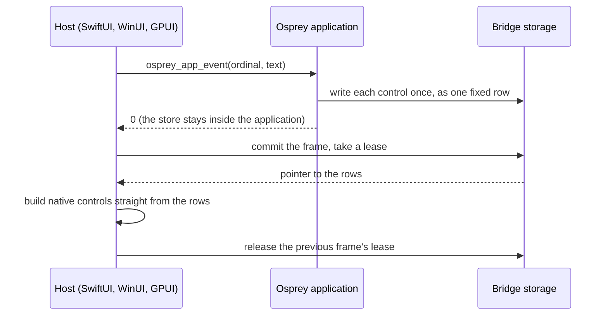

# Osprey Native without a JSON bridge: shared-memory views

This document explains how an Osprey Native application reaches the screen without serializing anything, why that is faster and safer than a JSON bridge, and how you write and style an interface in Osprey that macOS and Windows draw with their own controls. It is the plain-language companion to the normative contract in [Osprey Native hosts, shared-memory replacement](0047-OspreyNativeHosts.md#shared-memory-replacement-native-shm). The smallest complete example is [Tally](../../../src/osprey/examples/tally).

**Status, 2026-11-13.** Tally runs this way end to end on macOS against the reference host. The row format, the Osprey view vocabulary and the bridge are implemented and tested. The SwiftUI and WinUI view hosts, the lowering of the older semantic `Node` tree and the conversion of the other applications are in progress; until they land, those applications still use the JSON envelopes this design replaces. Progress is tracked in [plan 0037, section 11](../../plans/0037-osprey-native.md).

## The JSON bridge it replaces

In the JSON bridge every interaction did this:

1. The host built a JSON string describing the event and called `osprey_app_dispatch(saved, event)`.
2. Osprey parsed the event, and in the oldest form parsed its whole saved store back out of JSON as well.
3. Osprey rendered a tree, encoded it to a JSON envelope and returned the string.
4. The host parsed the envelope, built its own tree of values from it, and only then built controls.

Every frame paid for an encode and a parse on each side, at least two full copies of the interface, and string allocations proportional to the size of the screen. The host also had to decide what each semantic node looked like, so the same application was styled once per platform, in Swift, C# and Rust.

## What happens now [NATIVE-SHM-VIEW]



1. **The event is two machine words.** A tap or an edit calls `osprey_app_event(ordinal, text)`: the number of the control and, for a text field, its text. Nothing is encoded.
2. **The application keeps its own state.** The store lives in the Osprey library between calls. It is never saved, sent or restored.
3. **Each control is written once.** `Views::render` walks the application's `View` tree and writes every control as one fixed-size row (`ViewRow` in [`native.td`](../../../src/toolchain/schemas/native.td): kind, parent, action, text position, colours, sizes, flags) plus its UTF-8 text, directly into storage owned by the bridge.
4. **The host reads the rows where they lie.** After the call returns, the host commits the frame, takes a lease on it and gets a pointer to the rows. It builds its native controls from that memory. There is no string, no parser and no intermediate tree.
5. **Old frames stay valid while anyone holds them.** A frame is immutable once committed. The host releases the previous frame only after it holds the next one, so a control being drawn never has its memory changed or freed underneath it.

Scenes work the same way: shapes are fixed rows in the same frame ([NATIVE-SHM-SCENE]), which is how Flock draws thousands of birds without encoding one.

## Why it is faster

The saving is work that no longer exists, not a faster version of the same work:

| Per interaction | JSON bridge | Shared-memory views |
| --- | --- | --- |
| Event encoding and parsing | one encode, one parse | none: an integer and a borrowed string |
| Store round trip | serialized and parsed (oldest form) | none: the store never leaves the application |
| Interface encoding | whole changed regions to JSON text | each control written once as a fixed row |
| Host parsing | full JSON parse, then a second tree | none: rows are read in place |
| Copies of the interface | at least three (tree, text, host tree) | one (the rows) |
| Allocation | per string, per node, on both sides | three growable runs per frame |

Unlike React Native there is no JavaScript engine, no interpreter and no asynchronous message queue between the application and the host: the application is ahead-of-time compiled native code in the same process, and the frame is ordinary memory. Measured before-and-after figures for Storage, Flock, Casting and Agent are still owed by plan 0037 and will be published in the native package README; this document makes no numeric claim until they are.

## Why it is safe [NATIVE-SHM-SAFETY]

"Shared memory" here means memory shared between the application and its host **inside one process**. It is ordinary heap memory owned by the bridge. No operating-system shared-memory object, file mapping, socket or named handle is created, so no other process gains anything to attach to, and the design adds no new way into the application from outside.

Inside the process the rules are:

- **Frames are immutable and reference counted.** A host can only reach memory through a lease. A lease names its bridge instance, an owner serial and the chunk's generation; a stale, forged, foreign or double-released lease is refused, never followed. Storage is freed only when the last lease is released.
- **Every read is bounds checked.** `osp_native_view` checks the lease, the chunk's type, and that the requested range lies inside the chunk before it returns a pointer.
- **Writers cannot corrupt a frame.** Osprey fibers are operating-system threads, so two may write controls at once; each row, and the hand-over of a whole frame, is a single step. Every limit (controls, text bytes, shapes, total bytes, chunks, leases) is finite, and exceeding one refuses the frame instead of growing without bound.
- **Unusable values never reach a host.** A number that is not finite, a negative extent, or a parent that is not an earlier row refuses the whole frame at the writer. Text positions are produced by the bridge, not by the application.
- **A failed call changes nothing.** If an export fails or a frame is refused, nothing is published and the host keeps showing the frame it already holds.
- **Hosts still do not trust a row.** A host checks row counts, parents and text ranges again, decodes text as UTF-8 with replacement, draws nothing for a kind it does not know, and never keeps a pointer past its lease. An action number coming back from a host is looked up in the application's own list of bindings; an unknown one is a typed error, so a host can never invent an action.
- **Layout mismatches are refused at start.** The bridge opens only for a host built against the exact same row layout (a fingerprint of the schema), pointer size and byte order.

The bridge's tests run under AddressSanitizer, UndefinedBehaviorSanitizer and ThreadSanitizer and cover stale leases, exhausted limits, allocation failure at each step, concurrent readers, concurrent writers and refused values ([`host_import_tests.c`](../../../src/toolchain/compiler/runtime/host_import_tests.c)).

## Writing an interface in Osprey

You describe the screen as a `View` and decide every colour, size and space in Osprey with a `Look`. The host applies them and has no style of its own, so restyling an application never means touching Swift or C#.

```ospml
strong colours = ui::Look(ink = Views::colour colours.onAccent, fill = Views::colour colours.accent, points = 17.0, inset = 12.0, gap = 0.0, corner = 10.0, heft = 600)

export view store =
    colours = palette store.night
    ui::Column(columnLook = page colours, columnItems = [
        ui::Wording(wordsLook = title colours, wordsText = heading store),
        ui::Wording(wordsLook = figure colours, wordsText = toString store.count),
        ui::Across(acrossLook = spaced, acrossItems = [
            ui::Press(pressLook = soft colours, pressWords = "Take one", pressAction = Take),
            ui::Press(pressLook = strong colours, pressWords = "Add one", pressAction = Add),
            ui::Press(pressLook = soft colours, pressWords = "Clear", pressAction = Clear),
        ]),
        ui::Typing(typingLook = soft colours, typingText = store.owner, typingAction = Named),
        ui::Gap,
        ui::Press(pressLook = soft colours, pressWords = restyle store, pressAction = Restyled),
    ])
```

The boundary is two exports, which the compiler publishes as `osprey_app_start` and `osprey_app_event`. `Views::shared` sends every control to the frame, and `Views::render` answers the actions the controls deliver, in order, so an event's number is looked up in a list the application wrote itself:

```ospml
shown store =
    next = Live(store = store, bound = Views::render (Screen::view store))
    perform Keep.keep next
    0

delivered (held, ordinal, words) = match listGet held.bound ordinal
    Error _ => 1
    Success action => shown (Screen::update (held.store, action, words))

start () = hosted (\() => shown Screen::first)
event (ordinal, words) = hosted (\() => delivered (live, ordinal, words))
```

The whole of Tally's logic, layout and both colour schemes is in [`src/app.ospml`](../../../src/osprey/examples/tally/src/app.ospml); its boundary is [`main.ospml`](../../../src/osprey/examples/tally/main.ospml); a complete host in plain C, which is also its end-to-end test, is [`host/reference.c`](../../../src/osprey/examples/tally/host/reference.c).

### The controls a host draws

A host needs only a small, flexible set of native controls, because everything richer is composed and styled in Osprey:

| Kind | `View` | Native control |
| --- | --- | --- |
| 0 column, 1 line | `Column`, `Across` | vertical and horizontal stacks |
| 2 label | `Wording` | text |
| 3 press | `Press` | button |
| 4 entry, 14 editor | `Typing`, `Writing` | single-line and multi-line text fields |
| 5 gap | `Gap` | flexible space |
| 6 scroll, 7 layer | `Scrolling`, `Layered` | scroll view, overlay stack |
| 8 toggle | `Switch` | switch |
| 9 picker, 10 option | `Choosing`, `Option` | menu and its items |
| 11 rule, 12 image | `Rule`, `Picture` | hairline, image |
| 13 canvas | `Canvas` | the frame's scene shapes |
| 15 menu, 16 sheet | `Menu`, `Sheet` | context menu, modal sheet |

`Fitted` gives any control a fixed width or height, a share of the free space, a border, state flags (disabled, chosen, secret, fixed-width, slanted, centred, deliver on commit) and a second text such as a field's prompt.

Applications written against the older semantic tree (`Section`, `Badge`, `Meter`, `Rows` and the rest) do not have to be rewritten: `Lower::view` turns a `Node` into these primitives using the application's `Theme` ([NATIVE-SHM-LOWER]), which moves the styling that used to live in each host into one Osprey module.

## Where serialization remains

Only where memory genuinely cannot be shared: a VS Code webview is a different process from the extension that runs the application, and a file on disk outlives the process. Those boundaries use the canonical tdbin encoding generated from the same schema, verified once on arrival ([NATIVE-SHM-WIRE]). Formats owned by the outside world, such as HTTP bodies, stay the business of the adapter that speaks them.
