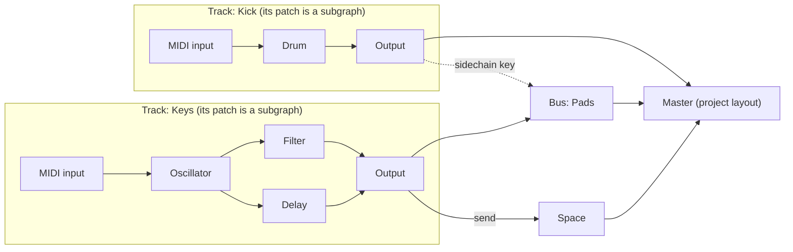

# The daw [DAW]

Status: in progress. The daw runs on the FerroUI host. It opens a project, shows the Timeline, Mix and patch pages, saves edits into the project file, and plays bars through the renderer. The [delivery plan](../../plans/daw.md) records what is verified.

The daw is the [Prism](../../../src/osprey/examples/daw/PRISM.md) patch studio with a song around it. A project is **one big graph of cables** ([DAW-GRAPH]): tracks, buses, the Space reverb and Master are its nodes, and every route ends at Master. **A patch is a subgraph**: the same kind of graph, nested inside a track. The app opens a project, shows its tracks on a timeline and lets you edit a track's notes, mix and patch. It plays the song as it currently stands and saves everything back to the same file.

## Built around the person using it [DAW-HUMAN]

The daw is designed from the work of the person using it: writing a part, hearing it, mixing it and routing it. Each change to a screen starts from one of those tasks, is tried in the running app by someone doing that task, and is revised from what they found, the process ISO 9241-210 describes for human-centred design. The rules below are what that process has settled so far, and each one is checked in the app.

- **A screen holds what its task needs.** Timeline is for notes, Bus routing for the mix and where sound goes, Track patch for the sound itself. An element stays only if it does something or tells the user something they act on. Captions that repeat a title, controls that do nothing yet and pointers to another panel are removed.
- **A value is changed where it is shown.** A slider, a note or a cable is edited in place. No screen asks the user to go somewhere else to change what it displays ([DAW-INSPECTOR]).
- **Every command is in the menu bar, with a shortcut** ([DAW-KEYS]). The canvas keeps only what is used all the time: the page tabs and the transport. Nothing can be done with the pointer only.
- **The user's habits come first.** Shortcuts follow a keymap the user chooses or writes, so hands trained on another studio keep working ([DAW-KEYS]).
- **Targets fit a hand.** A socket, a fader or a key is large enough to hit without aiming, and a control under the pointer wins over artwork that overlaps it.
- **The app says what it is doing.** The footer names what is sounding and the last thing that happened. A failure says what failed in the user's terms and leaves the work as it was.
- **Nothing is lost by exploring.** Edits undo in one step each, a page with nothing to show says so and offers the way forward, and leaving a page saves what was changed or keeps it open with the reason.
- **One look, one set of controls.** Every control is drawn in the Prism skin on a dark canvas, whatever the system's appearance, and every panel uses the controls of [DAW-CONTROLS]. A control that looks like it came from another app is a defect.
- **Everything undoes.** Undo and Redo are standard editor commands and reach every edit on every page: notes, mix, routing, patch modules, cables and parameters. One user action is one undo step.

## Infinitely modular [DAW-MODULAR]

Modularity is the principle the daw is built on. A patch holds any number of modules and cables, a track any patch, a project any number of tracks, buses and sends, and a bus can feed another bus.

- **A module has fixed ports ([DAW-MODULAR-PORTS]).** Each module has a fixed set of inputs (audio, MIDI, control) and a single audio output, plus MIDI or OSC outputs where it makes them. The number of modules and cables is unbounded; a module's ports are not.
- **An output fans out by itself ([DAW-MODULAR-FANOUT]).** A single output can feed any number of inputs. The user drags cables from the same output to each input they want, and every one receives the same signal. Splitting a signal needs no Split module, no extra step and no loss of level.
- **Only what reaches the Output sounds ([DAW-PATCH-HEARD]).** A patch can hold any number of modules, but none of them does anything until its audio is cabled, directly or through other modules, to the patch's Output. Unwired modules are silent and cost nothing.
- **Every channel has the project's layout ([DAW-MODULAR-LAYOUT]).** Every audio channel (track, bus, Space and Master) carries as many physical audio channels as the project's layout sets: mono, stereo (the default), 5.1, 7.1 or any other. Changing the layout changes it everywhere. A feature is added as a module, a command or a store that plugs into what exists, never as a special case in one screen.

### The project is a graph [DAW-GRAPH]

**The project is one big graph of cables. A patch is a subgraph.** There is no other structure: no fixed mixer strip, no separate per-track pipeline, no second path for rendering. Everything the daw does with sound follows from these two sentences.

A project is one graph. Its nodes are tracks, buses, the Space, the Master channel and the modules inside every patch. Its cables carry audio, MIDI and OSC between them. A patch is a subgraph: a graph of the same kind, nested inside a track node, whose inputs are the track's inputs and whose one Output is the track's output. Opening a track's patch is looking inside that node; the cables inside it and the cables between tracks, buses and Master are the same kind of cable in the same graph.

- **Tracks are where sound starts.** A track originates audio from its patch. It can also take inputs: MIDI (its own notes, another track's MIDI, a live keyboard or OSC control) and audio (another track's output, a sidechain, a live instrument).
- **Every track can go anywhere.** Audio and MIDI tracks alike can be cabled to any other node that accepts them: a bus, another track's input, a sidechain, the Space or Master. A track is not tied to a fixed strip.
- **Master is the main output.** The Master channel is the graph's one output, and every route ends there, directly or through other nodes ([DAW-MIX-MASTER]). Master carries the project's channel layout: stereo by default, or mono, 5.1, 7.1 or any other layout.
- **Play and render run the whole graph at once.** Every node runs together, block by block, and the result leaves through Master ([DAW-RENDER-PLAY]). Nothing is played or rendered one track at a time.
- **A patch is a subgraph ([DAW-GRAPH-SUBGRAPH]).** A track's patch is part of the project graph, nested inside the track node: any number of modules and cables, audio and MIDI inputs, and exactly one audio Output, which is the track's output into the rest of the graph. Play and render run the patch's modules in the same block loop as every bus and Master; a patch is never rendered on its own and then mixed in.

The system's power is that routing is free. Any output can be cabled to any input that fits, so the ways to route a project are without limit.

- **A patch has an Output, not a master.** A patch ends in an **Output** module. There is no "Master" module inside a patch. A track's Output is routed to the project's main channel (Master) by default, and the user can route it to any bus instead ([DAW-MIX-BUS]).
- **A patch has inputs.** A patch can declare audio inputs and MIDI inputs as modules of its own. What arrives on them (the track's notes, another track's audio, a sidechain, a live instrument) is whatever is routed to them, and the patch decides what to do with it by its cables. A patch that ignores an input simply leaves it unwired.
- **Routing is cables.** Inside a patch and between tracks and buses, sound and control go where a cable or a route sends them and nowhere else. Nothing is connected implicitly except a track's Output to Master.

## Controls [DAW-CONTROLS]

Every panel uses the same small set of controls, drawn as the design draws them: the toggle, the dial, the slider, the menu and the button. A parameter looks and behaves the same in a module's card, in the inspector and in the Patch Controls panel.

- **Dial ([DAW-CONTROLS-DIAL]).** A number is a round dial with its value beside it. Press on the dial or the number, hold, and move the pointer up to raise the value or down to lower it. The pointer's sideways movement does nothing, so the hand can drift. Holding Shift moves in fine steps. Double-press returns the default. The number can be typed. The arrow keys step it when the dial has focus. The dial shows its value as an arc from the minimum, and its unit beside the number.
- **Slider.** A number can instead be a horizontal or vertical slider where a length reads better than an angle: a fader in the mixer, a send level, a position in time. It is set by a press or a drag along its length and has the same fine step, default, typing and arrow keys as the dial.
- **Toggle, menu, button.** An on/off value is a toggle. One choice from a few names is a menu showing the current name. An action is a button named for what it does.

A text box that reformats while the user types, a control that only points at another panel, and a platform-styled widget in place of one of these are defects.

## Accessibility [DAW-ACCESS]

Accessibility is taken as far as it goes, not to a minimum. Every command and every control can be used without a pointer, without sight and without sound.

- **Keyboard.** Every control takes focus, shows that it has it, and is operated by the keyboard. Tab order follows reading order. Every command has a shortcut and is in the command palette ([DAW-COMMANDS]).
- **Assistive technology.** Every control reports its role, its name, its value with its unit, and its state to the platform's accessibility interface, and every change is announced. A control drawn on the canvas reports the same as a platform control would.
- **Seeing.** Text and controls keep a contrast of at least 4.5 to 1. Nothing is told by colour alone: a cable's kind, a selected track and a playing transport each also have a shape, a label or a position. The app follows the system's larger-text and reduced-motion settings.
- **Hearing.** What is sounding is always shown as well as heard: the transport state, the position and the meters.
- **Targets.** A target is at least 24 points across.

## Commands [DAW-COMMANDS]

Everything the daw can do is a **command**: a stable name, a title, its arguments and whether it can run now. One list of commands feeds the menus, the shortcuts ([DAW-KEYS]), the command palette and automation, so a command added once appears in all four.

- **Command palette.** A shortcut opens a box in the middle of the window, as in VS Code. Typing filters the commands by any part of their title, Return runs the highlighted one, and Escape closes it. Each row shows the command's shortcut. A command that needs an argument asks for it in the same box (a track, a bus, a number).
- **Stacks.** A stack is a command made of other commands: a name, a title, its own parameters and an ordered list of steps, each a command with its arguments. A step's argument is a fixed value or one of the stack's parameters, so "New bus, send the selected track to it" is one command that asks for a level. A stack may contain stacks; one that would contain itself is refused when it is defined, with the reason. A stack is one step of undo. It stops at the first step that is refused, says which step and why, and leaves the project as it was before the stack began. Stacks are kept in a file the user can edit, checked on loading the way a keymap is, and they appear in the palette, in the menus and to an agent like any other command.
- **Shortcuts.** A shortcut runs a command, plain or stacked, with or without arguments ([DAW-KEYS]). So one key can run one command, one command with a fixed argument (send level to −6 dB), or a whole stack.
- **For an AI agent.** The same commands run from outside the window: by name with their arguments, one line in and one line out saying what happened or why it was refused. The list of commands with their arguments and current availability can be read the same way, so an agent can discover what it may do. A command run this way goes through the same checks and the same undo history as one run by hand.

## Storage [DAW-STORE]

Where a project is kept is a pluggable layer behind one interface: open, save, list and history. The project model does not know which store is in use.

**Persistence is an abstraction ([DAW-STORE-ABSTRACT]).** Projects will move off the local file: they can live in the cloud or on local disk, and they will most likely be kept in a database. So nothing outside the store may read or write a project directly. The editor, the renderer and the commands open and save through the store interface, and the store is an effect, so a test or the app can swap the store without changing the code that uses it. **Not built yet:** today the daw calls `SongFiles` and file reads and writes directly. Putting them behind the store interface comes before any second store is added.

- **JSON file.** One project file on disk ([DAW-PROJECT]). This is what ships today.
- **Database.** The project as rows, for large projects and shared libraries.
- **Git.** Every save is a commit, so the project has versions, a history to browse and a way back to any of them.

## Keyboard [DAW-KEYS]

Every command has a name, a place in the menu bar and a shortcut. The menus are File (open, save, render), Edit (undo, redo), View (the three pages, Modules, Patch Controls, Keyboard) and Transport (return to start, play and stop the song, play, audition and stop the patch). A menu shows each command's shortcut beside it, so the menu bar is also the list of shortcuts.

A **keymap** assigns the shortcuts. The daw ships three: **Prism**, **Ableton style** and **Logic style**, the last two following those studios' habits where the daw has the same command (Space plays and stops, Tab or a single letter changes view). The user picks one from the menu, and the choice is kept for the next launch. A keymap is also a file the user can edit: a name and one line per command with its keys. Loading a file checks it first: an unknown command or two commands on one shortcut is refused with the reason, and the keymap in use stays. A command the file leaves out keeps its Prism shortcut, so no command is ever without one. A line may name a stack as well as a plain command, and may give arguments after the name, so the same command can sit on several keys with a different argument on each ([DAW-COMMANDS]).

## One project file [DAW-PROJECT]

A song is one JSON file, and nothing about a song lives anywhere else. Its root holds exactly five things ([DAW-PROJECT-ROOT]): `title`, `tempo`, `sampleRate`, `buses` and `tracks`. Nothing else belongs at the root: there is no master drive, no shared reverb, no intro recording and no sustains. Drive and reverb are modules a user puts in a patch or on a bus. Each track stores its notes, gain, pan, destination bus, sends and the complete patch it plays. The JSON file is today's store only; the project reaches it through the persistence abstraction ([DAW-STORE-ABSTRACT]).

- **One model ([DAW-PROJECT-MODEL]).** [daw.td](../../../src/osprey/examples/daw/daw.td) declares the project. The Osprey types are generated from it. The JSON keys are the typeDiagram field names. The editor and the file both follow this model; neither keeps a parallel format.
- **Patches in the project ([DAW-PROJECT-PATCH]).** A built-in instrument opens in Prism as one voice node wired to the output. A routed patch opens as its own graph. A patch edited in Prism is written back into its track in the project file. Opening the file again restores the same graph, its pitch and velocity bindings, and its cables.
- **Lossless round trip ([DAW-PROJECT-ROUNDTRIP]).** `SongFiles::encode` writes every key that `SongFiles::decode` reads. A decoded project re-encodes to identical text. A JSON encoding failure is an error, never a `"null"` file.
- **Checked edits ([DAW-PROJECT-EDIT]).** Gain must be 0–4 and pan −1 (left) to 1 (right). A refused edit, or an edit to a track that does not exist, leaves the project unchanged and says why.
- **Saving ([DAW-PROJECT-SAVE]).** Save reads its own encoded text back before writing. A project that would not reopen is never written over the old file. A path containing a quote is refused. Osprey has no file-rename primitive, so the final write is not atomic.

## Transport [DAW-TRANSPORT]

**Play is real time ([DAW-TRANSPORT-LIVE]).** This is the daw's first requirement: an app that makes the user wait for a render before hearing the song is not usable. Play makes sound at once and keeps making it at the speed the music is written, and the playhead moves with what is heard. Play never renders the range to a file first and plays the file afterwards.

1. **Range ([DAW-TRANSPORT-RANGE]).** Play runs from the start marker to the end marker. The start marker is the playhead's bar. The end marker is the song's end until the user moves it. Both markers are lines down the lanes with handles on the ruler, and the user drags either one left or right. The end marker is always after the start marker: an end at or before the start counts as the song's end.
2. **Loop ([DAW-TRANSPORT-LOOP]).** A Loop toggle in the transport. With Loop on, Play repeats the range from the start marker to the end marker until Stop. With Loop off, Play runs once and rings out.
3. **Live stream.** The app encodes the current project, unsaved edits included, to `<song>/live/project.json` beside the renderer and runs `daw <project.json> <folder> <from-beat> <beats> live|loop`. The renderer plays the graph forward block by block ([DAW-RENDER-PLAY]) and prints each block as soon as it is made; the blocks go straight into the audio device adapter (`osprey-vst-worker audio-device`). Nothing is written to a WAV and nothing waits for the range to finish.
4. **Following ([DAW-TRANSPORT-FOLLOW]).** The device answers every block with the frames it has accepted and the frames it has finished playing. While the song plays, every display frame moves the playhead to the beat being heard: the frame clock, held between those two counts ([TimelineGeometry.lean](../../../src/osprey/examples/daw/src/TimelineGeometry.lean), `heardSeconds`). The lanes scroll to keep the playhead in view, the piano roll turns its page every two bars, and the position readout shows `bar.beat`. When sound waits, the playhead waits.
5. **Stop** cancels the stream's whole process group at once and puts the playhead back on the start marker. While anything is in flight, Play refuses with "The song is already playing; Stop first."
6. A refused project never reaches the device: the renderer writes its reason to `<folder>/fault.txt` and the app shows it as "Playback failed: …".
7. **Live controls ([DAW-TRANSPORT-LIVE-CONTROLS]).** Each accepted dial or fader movement updates its displayed value and publishes the same value to the playing song. The producer reads the latest complete revision between device blocks. A held note keeps its clock, envelope and compatible processor state through a parameter change.
8. **Live level.** Live play cannot know the song's peak before it sounds, so each sample passes a fixed soft clip (`ArrangeMath.live`) in place of the whole-song limiter of [DAW-DYNAMICS-LIMITER]. Render song is the reference for loudness.

**The engine must be faster than real time ([DAW-TRANSPORT-LIVE-SPEED]).** This is not negotiable. Real-time play needs the renderer to make every block faster than it plays, with room to spare: at least 1.5× real time on the reference song (17 tracks) on one performance core. Measured on 2026-11-21, the live stream of the codex song makes 0.37 s of audio per second (17.1 s of audio in 45.8 s), with reference counting and allocation taking most of the time, so the device runs empty and the sound breaks up. Until the engine meets the target, live play of a full song is not acceptable and this requirement is not met. It is the largest open defect in the daw.

**Start latency ([DAW-TRANSPORT-LIVE-LATENCY]).** Play buffers 5 to 10 ms of audio before the device starts, and no more: at 48 kHz that is 240 to 480 frames. The first sound follows the Play command by that buffer plus the device's own output latency. Interactive playback primes the adapter with two 160-frame blocks (6.67 ms of audio). The producer flushes each block and waits for the adapter’s receipt before sending another. Project loading, rendering and device startup also contribute to the measured Play-to-sound time.

**MIDI clock ([DAW-TRANSPORT-MIDI-CLOCK]).** Playing is synchronised with the MIDI clock. The transport is one clock in beats, and audio, the playhead and MIDI all read it.

1. **Sending.** While the song plays, the daw sends MIDI timing clock (0xF8, 24 per quarter note) from the same sample clock that drives the audio, so an external sequencer, drum machine or arpeggiator stays in time with what is heard. Play from the song's first beat sends Start (0xFA); Play from any other start marker sends Song Position Pointer (0xF2, in sixteenth notes) and then Continue (0xFB); Stop sends Stop (0xFC). A loop sends Song Position Pointer at each return to the start marker.
2. **Following.** With external sync on, the daw follows an incoming MIDI clock: Start, Continue, Stop and Song Position Pointer move the transport, and the tempo follows the incoming clock's rate. The tempo shown is the tempo heard.
3. Clock messages are scheduled against the audio device's played-frame count, not against the display or a wall-clock timer, so they do not drift from the audio.
4. The clock source (internal or external) and the MIDI ports are project settings in [daw.td](../../../src/osprey/examples/daw/daw.td).

Not built: the daw has no MIDI port access yet.

## Rendering the song [DAW-RENDER]

**Render song** renders the whole project, as it currently stands, to `<song>/song/song.wav` beside the renderer. It is the same renderer and the same project snapshot as Play, written to a file instead of the audio device.

1. The app encodes the current project to `<song>/song/project.json` and empties the old `song.wav`, then runs `daw <project.json> <folder>` (no beats: the whole song, intro and sustains included) with a two-hour limit.
2. Only a WAV longer than its header counts. A refusal shows the renderer's message: "Rendering failed: …". A finished render says "Rendered <path>." and plays nothing.
3. An unchanged project keeps its audio and says it "is already this project" without rendering.
4. Play and Render song share one transport: while either is in flight, both refuse with "The song is already playing; Stop first." Stop cancels either one.

Outside the app, `make -C src/toolchain/targets/macos daw-render SONG=<project.json>` renders the same file to `target/daw/<project>/song.wav`.

**Only the Master channel by default ([DAW-RENDER-MASTER]).** A render, whether Play, Render song or `daw-render`, writes exactly one audio result: the Master mix, in the project's channel layout (stereo by default). Every track and bus sounds only to be summed into Master. It is never written out as its own stem. The `part-N.wav`, `piece.wav` and `tail.wav` files beside `song.wav` are pieces of the same Master, joined into it. The result is a single mastered track. **Stems are possible, never the default ([DAW-RENDER-STEMS]).** A stem render happens only when the user explicitly asks for it and names the tracks or buses: the graph still plays once, as in [DAW-RENDER-PLAY], and each named node's output is also written as its own file beside the Master. That render does not exist yet.

**Playing and rendering run the graph ([DAW-RENDER-PLAY]).** Play and Render both do the same thing: they run the whole graph forward in time, one block of frames at a time. Each block, every source produces that block, every cable carries it, every node (group EQ and compressor, sidechain, Space reverb) processes it and keeps its state for the next block, and Master receives the sum. Rendering writes Master's output, in the project's channel layout, to the WAV; Play sends it to the speakers. Nothing runs track by track: no track is rendered whole on its own, and nothing is mixed afterwards. Master's output is the same for any block size and any track order. The renderer reports progress through the song in time, never per track. Master's limiter is Master's last stage, over the whole played Master ([DAW-DYNAMICS-LIMITER]).

## Timeline transport [DAW-TRANSPORT-TIMELINE]

The Timeline carries the transport, and its state is in the project model ([daw.td](../../../src/osprey/examples/daw/daw.td)), not in the view.

- **Playhead ([DAW-TRANSPORT-PLAYHEAD]).** A position in beats, shown as `bar.beat` and as a line across the lanes and the piano roll. Tapping the ruler sets it. It is saved with the project. Built so far: whole bars, a line down the lanes, and not yet saved.
- **Start and Stop ([DAW-TRANSPORT-START]).** Start plays in real time from the start marker to the end marker ([DAW-TRANSPORT-LIVE]). Stop halts and leaves the playhead where playback began. While idle, Stop is disabled and leaves the playhead and selection in place ([DAW-TRANSPORT-STOP-IDLE]). Use Return to Start to move to the start of the song.
- **Range, Loop and Following** are defined under [Transport](#transport-daw-transport): [DAW-TRANSPORT-RANGE], [DAW-TRANSPORT-LOOP] and [DAW-TRANSPORT-FOLLOW].

## Timeline zoom [DAW-TIMELINE-ZOOM]

The Timeline zooms in time, and zooming is one gesture from wherever the hand already is. The same rules hold for the lanes and for the piano roll.

- **Range.** From the whole song in the window down to one beat across it. The song strip always shows the whole song with the visible part framed, so the person never loses their place.
- **Pinch and scroll.** A trackpad pinch zooms. Cmd with the scroll wheel zooms. Both zoom about the pointer: the bar under the pointer stays under it. A plain horizontal scroll, or Shift with the wheel, moves along the song.
- **Keys.** Zoom In and Zoom Out are commands with shortcuts in every keymap ([DAW-KEYS]), in the View menu and in the palette ([DAW-COMMANDS]). So are Zoom to Fit (the whole song) and Zoom to Selection (the selected bars, notes or track's clips). From the keyboard, zoom is about the playhead.
- **Strip.** Dragging the frame in the song strip moves the view; dragging an edge of the frame zooms it. Double-pressing the strip zooms to fit.
- **Height.** Track rows grow and shrink the same way with Alt held (Alt with pinch or wheel, and their own two commands), so a dense arrangement or one detailed track both fit.
- **What stays.** The ruler changes its divisions with the zoom (bars, then beats, then sixteenths) so labels never crowd or thin out. Zoom changes only the view: it is not an edit, it is not in the undo history, and it never moves the playhead or the selection. Each project remembers its zoom and position.
- **Feel.** Zoom is continuous, not stepped: one notch of the wheel is a small, even change, and the view answers within one display frame ([DAW-PERF]).

## Dynamics [DAW-DYNAMICS]

Master ends in a compressor and a limiter, and both are patch components any track can use. Their formulas are [dynamics_math.ospml](../../../src/osprey/packages/synth/src/dynamics_math.ospml) ([SYNTH-DYNAMICS]); the components hold only state.

- **Compressor ([DAW-DYNAMICS-COMPRESSOR]).** Feed-forward in the log domain (Giannoulis, Massberg and Reiss, JAES 2012). Threshold, ratio and a soft knee with a continuous slope. A detector blended between peak and RMS. Attack and release smooth the gain reduction, not the signal. The release is program-dependent: a fast and a slow detector run together and the deeper wins, so a transient recovers fast and dense material does not pump. A sidechain input with its own high-pass, automatic make-up gain, and a dry/wet mix for parallel compression. Channels are linked: every channel takes the reduction of the loudest.
- **Limiter ([DAW-DYNAMICS-LIMITER]).** A true-peak brickwall. The detector oversamples four times (ITU-R BS.1770-4) so peaks between samples count. The lowest required gain is held across the lookahead and averaged over the same window, so the gain has arrived when the peak leaves the delay: no overshoot and no clipping. The release is program-dependent like the compressor's. The output never exceeds the ceiling (default −1 dBTP).
- **Multiband dynamics and EQ ([DAW-DYNAMICS-MULTIBAND]).** A multiband compressor and a multiband limiter split the signal with Linkwitz–Riley crossovers (3 to 5 bands, movable crossover points), which sum back flat when every band is left alone. Each band has its own threshold, ratio, knee, attack, release, make-up and solo/bypass. The multiband limiter holds each band under its own ceiling before the full-band true-peak limiter. They are patch and bus effects as well as the Master chain, which is EQ, then multiband compressor, then multiband limiter, then the true-peak brickwall. The EQ is the daw's parametric EQ ([DAW-EQ]). The crossover and gain formulas live in Lean. Acceptance: the crossovers sum flat within 0.01 dB, each band compresses only its own range, and nothing crosses the Master ceiling.
- **Pitch effects ([DAW-PITCH-EFFECTS]).** The FFT pitch shifter ([SYNTH-SPECTRAL-PITCH-EFFECT], semitones ±12 and cents ±100) and autotune ([SYNTH-SPECTRAL-AUTOTUNE]) are effects on a track's audio, in its patch or on a bus. Autotune can follow the key and scale or the timeline's notes. The renderer compensates each one's declared latency, so a shifted or corrected track stays in time with the rest of the song.
- **Meters ([DAW-DYNAMICS-METER]).** Both report gain reduction in dB, and the limiter reports true peak, in the Mix page.
- **Proof ([DAW-DYNAMICS-PROOF]).** Tests hold a sine above the threshold to the curve within 0.01 dB, and hold full-scale inter-sample peaks under the ceiling.

## Buses and sidechain [DAW-MIX-BUS]

A project declares buses next to its tracks ([daw.td](../../../src/osprey/examples/daw/daw.td): `Bus`, `Equaliser`, `Compressor`). A track with `bus` set sums into that bus instead of Master; an empty `bus` goes straight to Master. A track may only name a bus the song declares. The Output chooser in Timeline and Mix lists Master and every declared group. Creating a stereo group and assigning the track writes a single project edit. Empty names, Master and case-insensitive duplicates are refused.

**Every path ends in Master ([DAW-MIX-MASTER]).** Every audio track outputs to Master, and Master is where all the signals are mixed. A track can reach Master directly, through any chain of groups ([DAW-MIX-BUS-OUTPUT]), through its Space send, or through the internal outlet sends of its patch ([DAW-MIX-BUS-TAP]). However ad hoc the project's routing is, every route resolves to Master, and Master sums them all. No route ends anywhere else, so nothing a track plays is lost or written out on the side. The render writes that Master ([DAW-RENDER-MASTER]).

- **EQ ([DAW-MIX-BUS-EQ]).** Three bands from two one-pole splits at 250 Hz and 4 kHz, each with a gain from −24 to 24 dB. At 0 dB the bands add back up to the input.
- **Compressor ([DAW-MIX-BUS-COMPRESSOR]).** Threshold, ratio 1–20, knee 0–24 dB, attack and release 0–2 s, using the [dynamics_math.ospml](../../../src/osprey/packages/synth/src/dynamics_math.ospml) curve and detector. Both sides take one gain.
- **Sidechain ([DAW-MIX-BUS-SIDECHAIN]).** `sidechain` names a track. Its signal, at its gain, drives the detector, so a kick ducks a pad bus. Empty means the bus keys itself from its louder side. A sidechain that is not a track in the song is refused.
- **Group output ([DAW-MIX-BUS-OUTPUT]).** After EQ, compression and gain, a stereo group feeds its named `output` group. An empty or omitted output feeds Master. All upstream groups mix into a destination before its processing runs. The group declaration order does not change the sound. Paths may span any number of declared groups. The editor refuses missing destinations and feedback cycles, including on silent groups, and preserves the previous route. A track’s Space send remains independent of its dry groups.
- The codex project routes `glow` and `tablepad` to a `pads` bus keyed by `kick`.

### Internal outlet sends [DAW-MIX-BUS-TAP]

A track’s `sends` list connects its patch outlets to named stereo groups. Each send has a track-local `sendId`, a source node identity, a zero-based outlet, a bus name, an independent linear level from 0 to 1 and an enabled flag. Projects without this list open with an empty list.

The engine takes all enabled taps from the same note evaluation as the main output, before the track gain and pan. Stereo outlets preserve their channels. Mono outlets feed the center of the stereo bus at equal power. Split exposes each individual channel of a wider outlet. The note’s attack and release apply to the tapped audio. Multiple sends may share an outlet or feed the same bus. Invalid endpoints, non-audio ports, absent buses, duplicate send identities and levels outside the range fail validation.

**Routing → Patch sends…** opens the selected track’s sends beside its patch or mix graph. Each entry identifies the module and outlet, the level and mute state, and the group path to Master. A multi-send graph card opens the same inspector. Paging exposes every send and selecting one edits its stable track-local identity. Inside the send editor, the other routes from its outlet page independently. Changing pages preserves the unsaved level, source and destination.

## Spectral analysis and mix advice [DAW-ANALYSIS]

The daw analyses each track, bus and Master and says whether the sound sits where its instrument should.

- **Spectrum ([DAW-ANALYSIS-SPECTRUM]).** An STFT ([SYNTH-ADVANCED-SPECTRAL]) averaged into bands, shown on the Mix page per track, bus and Master, with peak and RMS levels.
- **Track scope ([DAW-ANALYSIS-TRACK]).** Selecting a track on the Timeline shows its waveform and band spectrum in the track panel; a Scope module in the patch is not needed to see a track. The panel says in words whether the energy lies where the track's notes and instrument put it.
- **Pitch fit ([DAW-ANALYSIS-PITCH]).** For pitched tracks, the measured fundamental and partials against the notes the timeline plays: reports detuning in cents and partials missing or out of place.
- **Instrument ranges ([DAW-ANALYSIS-RANGE]).** Each instrument kind declares where its fundamental and body energy should lie. The analysis reports energy outside those ranges, such as sub-bass rumble on a hat, or a bass with no fundamental.
- **Advice ([DAW-ANALYSIS-ADVICE]).** It suggests concrete EQ moves: the band, a gain in dB and the reason (masking between two tracks in the same band, a resonance, mud at 200–500 Hz, harshness at 2–5 kHz, a low end that needs a cut). An accepted suggestion becomes a checked edit to the bus or track EQ in the project.
- **Masking ([DAW-ANALYSIS-MASKING]).** Two tracks that crowd one band are named together, with which to cut and which to keep.
- Analysis formulas in native Osprey; the analysis is deterministic and tested against synthetic signals with known spectra.
- **Mix checks fail the build ([DAW-ANALYSIS-GATE]).** Every example project has mix checks, the daw's unit tests. They render it and fail when a check is broken: tonal balance per band against the project's genre target, Master true peak and integrated loudness (LUFS) in range, no clipping, no track masked beyond a threshold, low end mono-compatible, and each pitched track within its range and in tune. `make` runs them for every project in `tracks/`, and a bad mix is red like a failing test.
- **Where it slipped ([DAW-ANALYSIS-TIMELINE]).** Checks run per window along the song, not only on the whole mix. A failed check is shown at once as a loud alert and a red marker on the Timeline at the bars where it fails, naming the track or bus, the check, the measured value and the limit (for example "bars 17–18: kick and bass mask each other at 60–90 Hz, 9 dB over"). Tapping it moves the playhead there and opens the track. The same failures, with bar numbers, are what `make` reports.
- **Genre targets ([DAW-ANALYSIS-GENRE]).** A project names its genre in daw.td. Each genre has a target tonal-balance curve with tolerance, a loudness range and a dynamic-range range, stored as data and versioned.
- **AI review ([DAW-ANALYSIS-AI]).** A model is given the measured spectrum, loudness and masking report, plus the genre, and returns findings in a typed schema (band, problem, suggested move, confidence). Its findings are advisory and shown with the deterministic checks; they never replace or override them. It runs behind an effect, with a timeout and no network in CI. The model and prompt are pinned, so the same project gets the same review.

## MIDI keyboard [DAW-MIDI]

A connected MIDI keyboard plays the selected track's patch and records into its timeline.

- **Input ([DAW-MIDI-INPUT]).** The host lists MIDI sources (CoreMIDI on the Mac, WinRT MIDI on Windows) and delivers note on, note off, velocity, pitch bend, sustain and controllers to the app as events through the native boundary, each with its time.
- **Play ([DAW-MIDI-PLAY]).** Notes sound through the selected track's patch at their velocity. This needs the realtime audio path ([DAW-PERF]).
- **Record ([DAW-MIDI-RECORD]).** With record armed, played notes are written into the track at the playhead, with their length and velocity, quantised only if asked.
- **Learn ([DAW-MIDI-LEARN]).** A controller is bound to a patch setting by moving it; the binding is stored in the project.

## OSC [DAW-OSC]

The daw answers Open Sound Control over UDP, so a control surface, a lighting desk or a script can drive it.

- **Addresses ([DAW-OSC-ADDRESS]).** `/transport/start`, `/transport/stop`, `/transport/position <beats>`, `/track/<n>/gain`, `/track/<n>/pan`, `/track/<n>/send`, `/track/<n>/patch/<node>/<setting>` and `/track/<n>/note <pitch> <velocity>`. They are generated from the project model, so every stored value has an address.
- **Checked ([DAW-OSC-CHECK]).** A message is an edit like any other: the same ranges apply ([DAW-PROJECT-EDIT]), and a refused one is answered with its reason.
- **Feedback ([DAW-OSC-FEEDBACK]).** The daw sends the playhead, meters and changed values to subscribed peers.
- **Bound to the machine ([DAW-OSC-SAFETY]).** The port listens on localhost unless the user opens it to the network; a packet is parsed with bounds checks and can never run code or name a file.

## Performance [DAW-PERF]

**A render takes at most a fifth of the song's length ([DAW-PERF-RENDER]).** Offline rendering compresses time: a render that runs at real time, or slower, has failed. A 5 minute song with basic tracks and routing renders, through the whole graph into Master and onto disk, in about one minute or less. No project in `tracks/`, however dense its patches, takes more than half its length. Anything slower is a defect that needs optimising. Every pointer event must answer within one display frame. The [plan](../../plans/daw.md) holds the profile, the owners and the targets: two bars of the codex project in under 14 s, and a Prism drag move under 5 ms mean.

**Song timing [DAW-HEADER-TIMING].** Click BPM or Meter in the header to edit the tempo and time signature. Apply saves both to the song and updates the bar grid. Undo restores the previous timing.

## The inspector [DAW-INSPECTOR]

Selecting a module shows it in the inspector on the canvas: its name and a slider for each parameter with its value and unit. Connect and disconnect cables on the canvas. Right-click a node and choose **Delete node** to remove it. File → Settings stores the VST3 folder. Prism discovers its plug-ins in the background on launch and when the folder changes. A press or a drag on a slider sets the parameter, as one undoable edit. This is the same for a module the skin draws and for one it does not.

## Pages [DAW-PAGES]

**Resizing the window never resizes a control ([DAW-LAYOUT-FIXED-SCALE]).** This is a hard rule. Every control, label, card, cable and key keeps its size at every window size. Resizing only frees up canvas space or reduces it: a larger window shows more canvas, more lanes and more rows, and a smaller one shows fewer and scrolls. The patch canvas has its own zoom and pan ([DAW-LAYOUT-FILL]), set by the user; the window's size never changes them. A list that holds more rows than fit scrolls row by row, by its scrollbar and by the wheel.

One window shows three views of one session. **Timeline** shows the tracks, the song overview and a two-bar piano roll for the selected track. **Mix** shows each track's gain, pan and destination. **Patch** is Prism showing the selected track's patch. Tapping a track selects it. **Open patch** shows that track's patch. Leaving the patch page first saves the patch into the project; if the save fails, the patch stays open with the reason. Selecting a note in the piano roll and changing its velocity changes only that note, and the project is saved.

**Dragging notes and velocity ([DAW-PIANO-DRAG]).** Press a note and drag horizontally to move its start in sixteenth-note steps relative to its original timing, or vertically to change pitch by semitones. Drag its velocity stem vertically to set the level from 0 to 1. The roll and inspector preview the edit while the pointer is held. Release saves that one note to the project. Escape discards the preview.

| [Timeline](../../../src/osprey/examples/daw/screens/timeline.png) | [Track patch](../../../src/osprey/examples/daw/screens/track-patch.png) | [Mix](../../../src/osprey/examples/daw/screens/mix.png) |
| --- | --- | --- |
| Tracks, song overview, piano roll and track inspector | The selected track's patch in Prism | Gain, pan and Space send per track, saved on release |

**Play** plays in real time from the start marker to the end marker ([DAW-TRANSPORT-LIVE]). **Save project** writes the current track patch and its layout alongside the timeline and mix without changing the view. Render a full song with `make -C src/toolchain/targets/macos daw-render`.

### Video journey [DAW-VIDEO]

`make -C src/toolchain/targets/macos/tests daw-video` opens the codex project in a real window and clicks and drags it the way a user does. On the Timeline it selects glass at bar 19, drags a note's velocity and the track's Space send. On the Patch page it drags a Delay in from the module list, wires it between the smoother and the output, inspects the partials and auditions the patch. On Mix it pulls a send, which shows the side-chained group bus, then opens the Space reverb. Back on the Timeline it presses **Play**, which renders the edited bars. `PRISM_BINARY` pins the host, so a concurrent rebuild cannot move the controls during a take. After every step a window screenshot must differ from the one before, and Play must write readable audio, or the journey fails. It records the window to `target/daw-video/prism-journey.mp4`, with the rendered bars as the soundtrack at the moment they play, and keeps the step screenshots beside it. Live auditions are not in the soundtrack, because the host plays them without writing a file.

## Math [DAW-MATH]

The DAW arrangement and timeline modules are generated from Lean ([MATH-CODE](../tooling/MathToCode.md)). [ArrangeMath.lean](../../../src/osprey/examples/daw/src/ArrangeMath.lean) holds timing, envelopes, pan, the limiter, mix ranges and the excerpt window. [TimelineGeometry.lean](../../../src/osprey/examples/daw/src/TimelineGeometry.lean) holds bars and page geometry. Osprey code calls these functions and contains no hand-written formulas.

## Scope [DAW-SCOPE]

The [Timeline designs](../../designs/prism-timeline/README.md) propose more than this application ships. Only the parts with a clear use are in scope:

- The current app includes the timeline and piano roll, one patch per track, main outputs, stereo groups, group sidechains and the independent Space send. Transport and project commands are available from the menu bar.
- Nested racks and routing one bus into another still require renderer and editor support. A detached Timeline requires a second FerroUI window sharing the project session.
- **Channels ([SYNTH-GRAPH-CHANNELS]):** stereo by default with unlimited channels; each track and Master declare their layout in the project file, in the proposed model. Split, Join and Route already carry multichannel audio inside saved patches. At the track boundary, the offline renderer folds a stereo sink to mono before panning.
- **Renderer limits:** the renderer is mono per track before panning and allows at most 64 tracks. Its limits are documented in the [daw README](../../../src/osprey/examples/daw/README.md).
