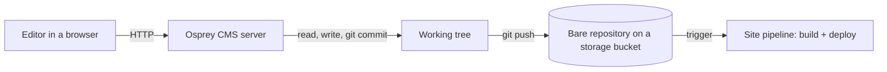

# Git CMS — [CMS]

A content management system whose only database is a git repository. A web developer builds a site in any generator (Eleventy, Next.js, Astro, plain HTML) and commits it to a repository. They then hand the repository over to an editor, a person who only ever changes the content that the site exposes: Markdown documents and media files (images, video, audio). Every change the editor makes is a git commit. The site's own pipeline builds and deploys it from the repository, so the CMS never knows or cares which generator the site uses.

The server is written in TypeScript-flavor Osprey on the [Express port](../language/0054-TypeScriptFlavorSyntax.md#first-port-express--ts-port-express) and lives in [`src/osprey/examples/cms/`](../../../src/osprey/examples/cms/README.md).

## Configuration — [CMS-CONFIG]

The server reads its configuration from the environment once, at start.

| Variable | Meaning | Default |
| --- | --- | --- |
| `CMS_REPO` | Path of the site's git working tree | required |
| `CMS_ROOTS` | Comma-separated top-level folders the editor may change | `content,media` |
| `CMS_PORT` | Port to listen on | `4321` |
| `CMS_EDITOR` | Folder holding the Osprey Native editor's web build: `index.html`, `host.css` and `host.js` | `src/osprey/examples/cms/editor` |
| `CMS_AUTHOR_NAME`, `CMS_AUTHOR_EMAIL` | The identity every commit is made with; no quotes or line breaks | `Osprey CMS`, `cms@localhost` |

A missing or unsafe `CMS_REPO` stops the server with a message before it listens ([CMS-PATH-SAFE]).

## Paths — [CMS-PATH-SAFE]

The tree lists only paths that pass this rule, so the editor is never shown a file it would then be refused. Every path the browser sends is relative to the repository and is accepted only when all of these hold. Anything else is answered `400` with the reason, and no file or git command is touched.

- It is at most 200 bytes long and uses only `A-Z a-z 0-9 . _ - /`.
- It has no empty segment, and no segment starts with `.`, so `..`, `.git` and hidden files are unreachable.
- Its first segment is one of `CMS_ROOTS`, and it has at least two segments.

Git runs through a shell, so this rule is also what keeps a path from injecting a command: no accepted path contains a quote, space, `$`, `;` or backtick.

## Kinds — [CMS-KINDS]

A file's kind comes from its lowercase extension: `md` and `markdown` are `markdown`; `png jpg jpeg gif webp svg avif` are `image`; `mp4 webm mov` are `video`; `mp3 wav ogg m4a flac` are `audio`; anything else is `other`. Only `markdown` files are edited as text; only media kinds may be uploaded.

## HTTP API — [CMS-API]

Every JSON reply is `application/json; charset=utf-8`. Every failure is JSON `{"error": "<reason>"}` with a `4xx` or `5xx` status, never an empty or fake success.

| Request | Reply |
| --- | --- |
| `GET /`, `GET /host.css`, `GET /host.js` | The editor's page, stylesheet and script, each with its own type |
| `GET /api/tree` | `{"roots": ["content", …], "files": [{"path": "content/index.md", "kind": "markdown"}, …]}`, sorted by path, every file under every root ([CMS-API-TREE]) |
| `GET /api/file?path=P` | The Markdown text of `P`, `text/plain; charset=utf-8`; `404` when missing, `400` when `P` is not `markdown` |
| `PUT /api/file?path=P` with the Markdown as the body | Writes `P` (creating its folders), commits it, `{"commit": "<sha>", "path": P}` ([CMS-API-SAVE]); saving never publishes |
| `DELETE /api/file?path=P` | Removes `P` from the tree and commits, `{"commit": "<sha>", "path": P}`; `404` when missing |
| `POST /api/upload?path=P&part=I&parts=N` with base64 text as the body | Stores part `I` of `N` (`0 ≤ I < N ≤ 4096`). Parts before the last reply `{"received": I}`; the last part decodes every part into `P`, commits, `{"commit": "<sha>", "path": P}` ([CMS-API-UPLOAD]) |
| `GET /api/media?path=P` | The bytes of media file `P` as base64 text, for the editor's preview |
| `GET /api/history` | `{"commits": [{"sha": …, "subject": …, "date": …}, …]}`, newest first, at most 20 |
| `GET /api/status` | `{"unpublished": n, "remote": true, "reason": ""}`, the saved commits the remote lacks; `{"unpublished": 0, "remote": false, "reason": …}` when the working tree has no upstream ([CMS-PUBLISH]) |
| `POST /api/publish` | Pushes every saved commit to the upstream, `{"published": n, "commit": "<HEAD sha>"}`; publishing again replies `"published": 0` ([CMS-PUBLISH]) |

### Tree — [CMS-API-TREE]

The tree lists files, not folders; a folder appears through the paths of its files. Hidden entries (a name starting with `.`) are never listed.

### Save — [CMS-API-SAVE]

A save that changes nothing still replies `200` with the current `HEAD` commit, so a double save is harmless. The commit subject is `Edit <path>`, `Delete <path>` or `Upload <path>`.

### Upload — [CMS-API-UPLOAD]

The native HTTP server accepts request bodies up to 1 MiB and an Osprey string cannot hold a NUL byte, so media travels as base64 text in parts of at most 768 KiB each. The browser splits the file; the server keeps each part under `.git/cms-upload/` and, on the last part, joins and decodes them with the system `base64` tool into the target path. A part that arrives out of order, a missing part, or base64 that does not decode is an error, and the target file is left as it was.

## Publish — [CMS-PUBLISH]

Saving commits to the working tree only; the live site never changes on save. Publishing is an explicit editor action: `POST /api/publish` pushes the saved commits to the working tree's upstream, and the site's pipeline (a GitHub Action, Cloud Build trigger, or any CI that watches the repository) builds and deploys from there. A failed push is an error reply and the commits stay local for the next publish.

## Storage and deploy — [CMS-DEPLOY]

The upstream can be any git remote. To keep the repository on a storage bucket, point it at a bucket-backed remote (for example a bare repository on a mounted bucket, or a `git-remote-s3`/`gcs` helper).

## Tests — [CMS-E2E]

`make -C src/osprey/examples/cms e2e` builds the server under GC and ARC, creates a throwaway site repository, and drives the API as an editor would: list, open, edit, create, delete, upload an image in several parts, preview it, read the history, check that saves never reach the remote, publish and publish again, and send every unsafe path in [CMS-PATH-SAFE]. Each step asserts the reply and the resulting git log and file bytes.
