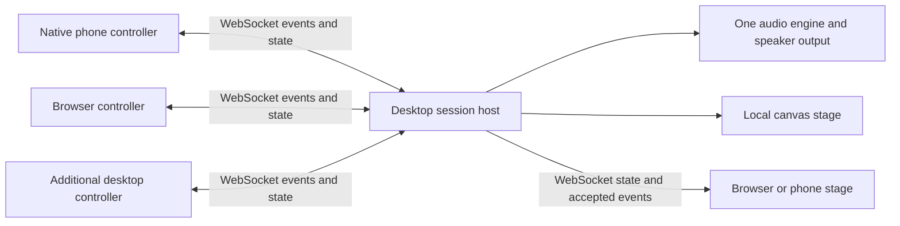

# Pocket Orchestra [ORCHESTRA]

Status — proposed application specification. Implementation and platform verification are pending.

Pocket Orchestra lets people turn their phones into musical instruments and play together through a desktop's speakers and animated stage. A desktop application hosts the session. Native phone applications, browser controllers and additional desktop controllers connect to it over WebSockets on the local network. The desktop owns musical time, synthesis, mixing and session state.

The delivery sequence and evidence checklist live in [the implementation plan](../../plans/pocket-orchestra.md). This specification defines acceptance requirements, rather than claiming current host support.

## The performance [ORCHESTRA-EXPERIENCE]

The conductor starts a session, selects an audio output and displays a join QR code. Players open the controller page or enter the address in the native app, choose a name and request admission. The conductor admits them and each chooses an instrument. A browser stage can be opened on another display. Closing the session releases every voice and connection.

The opening scene is a dark, spacious stage with a distinct shape and colour for each player. Touch produces immediate local feedback. The shared stage responds to events accepted by the host. A percussion hit expands into a ring, bass movement draws a ribbon, and sustained harmony grows a constellation. Visual identity also uses shape, labels and motion, so colour is never the sole identifier.

| Instrument | Gesture | Musical response | Stage response |
| --- | --- | --- | --- |
| Percussion | Tap six large pads | Six short synthesised drum voices | Rings and brief particle bursts |
| Bass ribbon | Drag horizontally, move vertically for tone | Scale-constrained monophonic pitch and timbre | A continuous ribbon following pitch and intensity |
| Chord field | Press one of four regions, drag for expression | Sustained chords in the session key | A constellation whose size follows expression |

The conductor selects key, scale, tempo, player levels and mute state. Instrument changes release the player's current voices. A prominent Silence action releases every voice immediately. Each instrument has keyboard and accessible control equivalents. Tilt is a later extension after touch, pointer and keyboard play are verified.

## Platform and rendering contract [ORCHESTRA-PLATFORMS]

| Platform | Required roles | Native surface | Canvas surface |
| --- | --- | --- | --- |
| macOS | Host, controller, stage | SwiftUI controls and system dialogs | Shared instrument widgets and stage |
| Windows | Host, controller, stage | WinUI controls and system dialogs | Shared instrument widgets and stage |
| iOS | Controller, stage | SwiftUI controls | Shared instrument widgets and stage |
| Android | Controller, stage | Android platform controls | Shared instrument widgets and stage |
| Web | Controller, stage | Semantic HTML controls | Shared instrument widgets and stage |

For the web, native means browser-provided HTML controls. Each native mobile or desktop build uses compiled Osprey application logic. The browser uses the same application logic compiled to WebAssembly. Hosts implement platform capabilities and rendering. Instrument rules, state transitions, layout intent and protocol decisions belong to shared Osprey code.

Every required platform supports both a Native controls presentation and a Canvas controls presentation of the controller and session settings. The native presentation embeds the expressive canvas instrument alongside platform controls. The canvas presentation draws the buttons, pickers, sliders and instrument surface from shared view data. Switching presentations preserves the session, instrument, values and accessible actions, and releases active touches to prevent stuck notes. The stage is canvas-rendered in both presentations.

Actual host-widget inspection and interaction tests must establish this distinction. Rendering a platform-looking button on a canvas does not satisfy the native-control requirement. System permission and device dialogs remain platform capabilities.

Linux is a follow-on desktop target. Its native-widget host, audio adapter and test infrastructure require a separate readiness decision. Initial completion requires every row above, including Windows.

## Session topology [ORCHESTRA-NETWORK]

The host includes the session server and serves bundled browser assets. Controllers send musical control events. The host sends acknowledgements, accepted performance events, clock information and state snapshots. Audio is generated on the host, with a single output clock. Remote stages display the performance without playing a second copy of the sound.

The initial release targets a shared local network, eight simultaneous controllers and two remote stage viewers. It starts without a cloud account or Internet service. Wi-Fi client isolation, firewall denial and unavailable interfaces produce actionable connection status. The host displays its reachable address and a manual entry alternative to QR joining. A short join code identifies admission within a known host address and does not perform network discovery.

### Connection and trust [ORCHESTRA-NETWORK-TRUST]

The conductor explicitly starts LAN hosting and chooses the exposed interface. Local mode serves HTTP and uses same-origin `ws://`. The join screen identifies this as an unencrypted local session, suitable for a trusted network. Admission uses a random, expiring invitation token and conductor approval. The QR places the invitation in the URL fragment, which the client exchanges in the initial protocol message and clears from the visible URL. Tokens are omitted from diagnostics and request logs.

A token admits a controller or a view-only stage and never grants conductor privileges. Approved clients receive scoped, expiring reconnect credentials. Ending a session invalidates all credentials. Rate limits cover unauthenticated handshakes and admission attempts. Server checks include permitted browser origins, request path, protocol version, message size and role permissions. Native clients authenticate with the same application protocol even when an Origin header is absent.

A secure deployment profile requires HTTPS and `wss://` with a certificate trusted by every participant. Its certificate provisioning is separate delivery work. The browser compatibility spike must test real mobile Safari, Chrome and Firefox policies and local-network prompts. The application must not depend on a browser-specific mixed-content exemption. Browser WebSocket deployment guidance is documented by [MDN](https://developer.mozilla.org/en-US/docs/Web/API/WebSockets_API/Writing_WebSocket_client_applications).

### Protocol [ORCHESTRA-NETWORK-PROTOCOL]

Declare protocol, domain, effect-result and saved-session models in typeDiagram, then generate the supported language representations. Generated model changes must be reproducible. Transport decoding and validation happen once at the boundary, producing typed messages for Osprey logic. Models and generation must follow the [typeDiagram reference](https://typediagram.dev/docs/).

The first protocol uses versioned JSON text messages. Evaluate TDBIN during the transport spike for payload size and codec availability. Adopt binary framing only after all participating adapters have verified codecs and interoperability. The existing runtime rejects binary messages, so binary transport is a dependency if selected.

| Message family | Required content and behaviour |
| --- | --- |
| Hello / Admit / Reject | Protocol version, requested role, invitation or reconnect credential, bounded display name, typed rejection reason |
| Welcome / Snapshot | Session identity, connection epoch, assigned player identity, current revision, tempo, key, roster and active instrument state |
| Gesture | Connection epoch, increasing sequence, client monotonic time, instrument, touch identity, start/update/end/cancel and bounded normalised values |
| Accepted / StateChanged | Authoritative event sequence, revision and host execution time, with validated event or changed state |
| ClockProbe / ClockReply | Probe identity and monotonic timestamps for round-trip and clock-offset estimation |
| Heartbeat / Leave / Fault | Liveness, orderly departure and typed failure details with retry guidance |

The host assigns identity from the authenticated connection. A client cannot choose another player's identity or send conductor commands. Duplicate or decreasing gesture sequences are ignored within an epoch. Reconnect creates a new epoch, releases old voices and sends a fresh snapshot. Queued musical gestures from the old connection are discarded. State revision gaps request resynchronisation.

Limit an application message to 4 KiB and a display name to 32 characters. Snapshots exceeding this limit use bounded, revision-consistent chunks. Reject invalid UTF-8, unknown variants, non-finite numbers, out-of-range values and excessive nesting before allocation or state mutation. Each player may hold at most ten active touches. Limits must be constants shared by generation, validation and tests.

Continuous updates are coalesced per touch before sending, at most 60 batches per second. Starts, ends, cancels and Silence retain ordering. Bound each peer's pending queue to 64 KiB. If terminal events cannot be queued, disconnect that peer and release its voices. A slow viewer must never block audio or other controllers.

### Timing and recovery [ORCHESTRA-NETWORK-TIMING]

WebSockets use ordered reliable delivery, so packet loss can delay newer gestures behind earlier data. Clock estimation and buffering cannot remove this delay. Measure its musical impact in the first spike.

The host clock is authoritative. Immediate mode schedules a valid event at the next available audio block. Beat mode schedules it to the next grid boundary after the host's current scheduling horizon. The UI displays the selected mode and measured connection health. Accepted events carry their actual execution time so remote stages can align animation to the host clock estimate.

Send heartbeats every 500 ms. After 1.5 seconds without valid traffic, release that connection's voices and mark it disconnected. Socket close, suspension, instrument change and pointer cancellation also release voices. A returning controller reconnects with bounded exponential backoff, receives a snapshot and requires a fresh gesture. It never replays a held note automatically. Host sleep or restart ends the performance session.

## Audio and visual execution [ORCHESTRA-ENGINE]

Provide continuous low-latency audio output through platform audio adapters on macOS and Windows. One audio engine mixes all voices. Prepare instruments and buffers before performance. The real-time callback performs bounded work without network operations, file I/O, blocking locks or managed allocation. Pass validated commands through a bounded queue. Device loss releases voices and exposes a recoverable audio fault. Device replacement requires explicit restart of audio.

Share musical mapping, synthesis definitions and deterministic visual state in Osprey. Establish which generated code is safe for the real-time callback before placing synthesis there. Reuse tested synth and signal-flow logic where it fits. The current Prism sample generates a one-second WAV and invokes playback, so continuous polyphonic audio needs additional capability work.

Use host frame events to evolve bounded canvas scenes. Visual quality may reduce particle count under load while preserving controls and sound. Rendering and remote viewers cannot hold the audio thread. Each player's visual response is derived from an accepted musical event and its timestamp, supporting reproducible playback in tests.

## Effects and ownership [ORCHESTRA-EFFECTS]

Keep session transition, instrument mapping and scene evolution pure. Express transport, monotonic time, audio output, entropy, platform lifecycle, storage and structured diagnostics through effects or the existing native capability boundary. Every fallible operation returns a typed Result or is answered by a declared effect. The application renders actionable failures without substituting fake success.

Production handlers use real sockets, clocks and devices. Test handlers supply an in-memory network, a virtual clock, captured audio commands and deterministic entropy. Both execute the same session and instrument logic. Real adapter integration tests additionally exercise actual sockets and audio lifecycle. A simulated transport alone cannot establish framing, operating-system or timing correctness.

Follow the leased-view ownership and lifecycle rules of [Osprey Native](0053-NativeSharedViews.md) and reuse [UI machines and accessibility semantics](../platforms/UiMachines.md). Network completions enter the host's serial application event boundary. Audio and network threads never retain borrowed UI buffers.

## Accessibility and lifecycle [ORCHESTRA-ACCESS]

All actions have accessible names, roles, values and focus order in both presentations. Pads work through activation, ribbon values through accessible sliders, and sustained notes through explicit start/stop actions. Support keyboard play, large text and touch targets, reduced motion and a static stage. Reduced motion removes bursts and camera movement while preserving musical information. Avoid flashing effects.

Native clients show local-network permission failures and recovery instructions. Browser joining also works by manual URL entry without camera or motion permissions. Rotation, safe-area changes, keyboard appearance and window resizing preserve usable controls. Backgrounding cancels held gestures. Remote stage tabs resynchronise when foregrounded. Output starts at a conservative level, with visible master volume and Silence controls.

## Acceptance and evidence [ORCHESTRA-ACCEPTANCE]

The following thresholds are proposed release targets, to be confirmed against named reference devices during the first spike. Changes require recorded measurements and a specification update.

- A newcomer joins an already running session and produces a sound within 30 seconds, excluding installation and permission prompts.
- With eight controllers at the permitted event rate and two viewers for ten minutes, queues remain bounded and no voice remains active after its release or timeout.
- On the documented reference LAN, physical input-to-speaker latency in immediate mode has p95 at most 50 ms. Report p50, p95 and p99, Wi-Fi conditions, audio settings and device models. Host receipt-to-scheduling measurements alone do not establish this result.
- Local gesture feedback appears within one display frame under reference load. The stage targets 60 frames per second with p95 frame time at most 20 ms on the named reference hardware.
- In synchronised stage mode, measured remote visual onset differs from host audio onset by at most 50 ms at p95 on that LAN.
- A complete ensemble journey passes on macOS and Windows hosts with physical iOS and Android controllers plus browser controllers. Browser coverage includes Safari, Chromium and Firefox. Each required platform passes native and canvas presentation journeys.
- Host-free tests replay join, reject, play, simultaneous touches, instrument change, mute, Silence, duplicate messages, invalid payloads, congestion, loss, reconnection, suspension and session shutdown through the production state logic.
- Real transport tests cover fragmented frames, origin and role rejection, bounded queues and disconnect cleanup. Audio tests check deterministic samples or numeric tolerances, clipping limits, voice release and device failure. Physical loopback measurements establish latency.
- Both headless and windowed platform suites capture screenshots against reviewed platform goldens and exercise accessible controls. Canvas goldens use deterministic seeds and virtual time. Native goldens are specific to the platform.
- Build and static analysis, parallel tests with coverage, and coverage checks run in the repository's required CI phases. Every requirement above links to its implementation, tests and retained evidence before completion.

## Existing support and delivery gaps [ORCHESTRA-READINESS]

The [runtime WebSocket contract](../runtime/0015-WebSockets.md) currently describes a send-only native client surface, an echo/broadcast server without an application receive interface, rejected `wss://`, rejected binary messages, ignored server paths and unchecked UTF-8. Pocket Orchestra requires a bidirectional, per-peer adapter with validated routing, authentication and lifecycle. Select and test the host capability implementation before relying on this runtime surface.

The [Prism synth](../../../src/osprey/examples/synth/README.md) provides reusable musical and canvas examples, while continuous real-time output remains a delivery gap. The [mobile casting plan](../../plans/0053-casting-gpui-mobile.md) records incomplete mobile host verification. Every required native/canvas combination must be proved for this application, including multitouch and accessible controls.

## Current playable delivery [ORCHESTRA-DELIVERY-PLAYABLE]

The first delivered slice is the macOS desktop audio server and browser phone ribbon described in `src/osprey/examples/pocket_orchestra/README.md`. Osprey owns the session and pitch mapping; its synth sine kernel supplies samples to a Swift mixer and AVAudioEngine. The browser uses semantic HTML controls plus canvas. Native desktop invite, volume, metering and silence controls are implemented in AppKit.

This slice uses a dedicated WebSocket port immediately after the HTTP port, an origin allowlist, one random invitation per process lifetime and eight-controller admission. It has no conductor approval flow, reconnect credentials, stage-viewer role, clock synchronisation, beat scheduling or native phone client. Its compact `join`/`touch`/`heartbeat`/`ack`/`silenced` protocol is an initial subset of the contract above; identity always comes from the server connection. Closing or expiring a peer releases its voices. Silence clears the ensemble and notifies controllers to require fresh gestures.

Integration evidence covers real sockets, eighty voices, Chromium and WebKit browser controllers, PCM pitch/bounds/silence checks and the Mac audio device. The callback consumes a preallocated SPSC ring; synthesis and networking still share the main thread, so hard-real-time isolation is not established. Windows, physical-phone latency, native phone presentations, device-loss recovery and the remaining full acceptance matrix are outstanding, not inferred from browser emulation.
