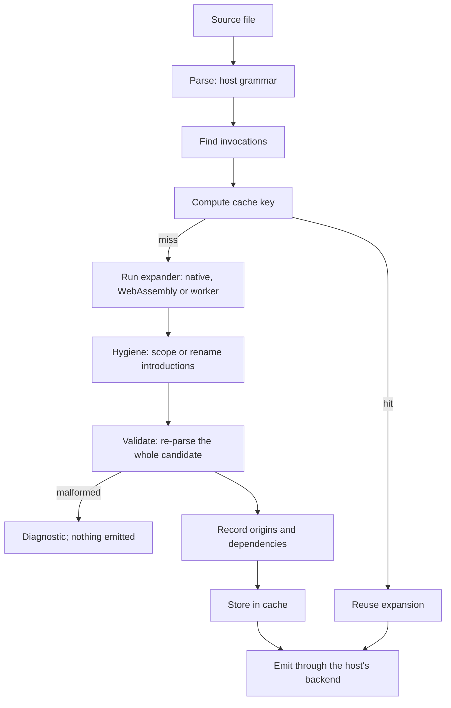

# Expansion engine [EXPAND]

**Status:** **specified, not implemented.** Delivery is [plan 0062](../../plans/0062-metaprogramming.md). The language contract this engine serves is [spec 0056](../language/0056-Metaprogramming.md); editor behaviour is [macro tooling](../tooling/MacroTooling.md).

## Aim `[EXPAND-AIM]`

The expansion engine runs expanders and enforces the kernel of [META-KERNEL](../language/0056-Metaprogramming.md#kernel-meta-kernel). It is written to serve more than one language. [dmx](https://dmx.dev/docs/) already runs this pipeline for Dart: parse with tree-sitter, build a context, render, apply hygiene, re-parse, emit, with expanders in any language behind a persistent worker. This specification states the same pipeline without Dart in it, so that one engine, or two engines that speak one protocol, can serve Dart, Osprey and languages added later.

The engine knows nothing about what a macro means. It knows how to run an expander within limits, turn its answer into syntax, check that answer against the kernel, record where it came from and remember it.

## Parts `[EXPAND-PARTS]`



The engine has a neutral core and one **host adapter** per language.

| Part | Neutral core | Host adapter supplies |
| --- | --- | --- |
| Parse | Lossless tree with spans; token trees | The tree-sitter grammar and its invocation shapes |
| Find | Invocation list, order, identity | Which nodes are invocations |
| Run | Tiers, limits, sandbox, protocol | Nothing |
| Hygiene | Scope sets, or renaming for text | Binder extraction: which nodes bind which names |
| Validate | Re-parse and refuse | The grammar; optionally a deeper check |
| Origin | Span maps and invocation chains | Nothing |
| Cache | Keys, dependencies, early cutoff | The answers to reflective questions |
| Emit | Atomic, byte-exact outside the expansion | A backend: in memory, part file, or inline region |

- `[EXPAND-HOST]` A host adapter never weakens a stage. Hygiene, validation and origin recording run for every expansion, whatever produced it. This is dmx's rule that its last stages are unconditional, kept as the engine's first rule.
- `[EXPAND-HOST-OSPREY]` Osprey's adapter uses the `tree-sitter-osprey` grammar and the canonical AST, validates by handing the expanded module to `check_program` ([META-KERNEL-RECHECK](../language/0056-Metaprogramming.md#kernel-meta-kernel)), and emits **in memory**: the expansion exists in the compilation and is never written into a source file or committed ([REPO-NO-ARTIFACTS]).
- `[EXPAND-HOST-DART]` dmx's adapter validates by re-parsing and emits into regions of the user's file, because Dart's compiler cannot be extended. The same expander can therefore serve a language whose compiler cooperates and one whose compiler does not.

## One engine or two `[EXPAND-CHOICE]`

How Osprey and dmx come to share this is a decision the plan makes with evidence, not one this document makes in advance. Three arrangements meet the contract:

| Arrangement | Shared | Fits when |
| --- | --- | --- |
| **Shared protocol** | The worker protocol and its typeDiagram models only | The two cores differ in kind: dmx's is text-first, Osprey's is syntax-first |
| **Shared core crate** | Run, cache, origin, sandbox, protocol, in one Rust crate with two adapters | The neutral parts above prove identical in both |
| **One engine** | Everything; Osprey is a host adapter of the generalised dmx | dmx gains scope sets and syntax-object expansions, which its own specification plans as semantic expansion |

The shared protocol is required whichever is chosen, so an expander written for one host runs under the other. The rule that decides the rest is `[EXPAND-CHOICE-RULE]`: code that would exist twice with the same behaviour is shared, and nothing is shared that would force Osprey's kernel to accept text where it has syntax objects.

## Expander tiers `[EXPAND-TIERS]`

| Tier | What runs | Use |
| --- | --- | --- |
| Native | Rust inside the compiler | Mechanisms the toolchain ships; pattern macros |
| Evaluator | Osprey level-1 code, run by the compile-time evaluator | Macros written in Osprey, compile-time evaluation, templates |
| Worker | A persistent external process speaking the protocol | Engines in other languages; providers such as dmx |

- `[EXPAND-EVALUATOR]` There is one evaluator contract: run level-1 Osprey with a step limit, a memory limit and only compile-time effect handlers, and agree with run-time semantics ([META-EVAL-AGREE](../language/0056-Metaprogramming.md#compile-time-evaluation-meta-eval)). Two implementations can meet it: an interpreter over the typed canonical AST, and the existing wasm32 backend with an embedded WebAssembly runtime. The plan builds one first and adds the second only if a measured budget requires it; if both exist, a differential test holds them equal.
- A worker is started once per build or editor session and reused. Starting a process per invocation is prohibited.
- A tier is not visible to the program. Moving an expander between tiers changes speed, never output.

## Sandbox `[EXPAND-SANDBOX]`

- The evaluator has no host calls except the compile-time effect handlers. It cannot reach a file, socket, clock or environment variable.
- A worker runs with a scrubbed environment, a working directory limited to its declared inputs, no network where the operating system can deny it, and lower CPU priority. What the operating system cannot deny is caught by [EXPAND-VERIFY].
- Every run has a deadline and a memory limit. Exceeding either is one diagnostic at the invocation ([META-KERNEL-EXPLICIT](../language/0056-Metaprogramming.md#kernel-meta-kernel)).
- A worker binary shipped by a package is identified by content hash in the lock file. An unlisted binary does not run.

## Protocol `[EXPAND-PROTOCOL]`

The worker protocol carries one invocation to an expander and one expansion back. Its messages are declared in typeDiagram and the code on both sides is generated from that model; nobody hand-writes a second copy. The framing is [tdbin](https://typediagram.dev/docs/tdbin.html), with a JSON rendering for debugging and for dmx's existing workers.

```typeDiagram
typeDiagram
alias Syntax = String
alias Declaration = String
type Position { line: Int column: Int }
type Span { file: String start: Position end: Position }
union Shape { Expression {} Attribute {} Block {} Literal {} }
type Invocation { expander: String shape: Shape arguments: Syntax attached: Option<Declaration> site: Span }
type Answer { question: String answer: String }
type Request { version: Int id: String invocation: Invocation answers: List<Answer> }
type SpanMap { outputOffset: Int template: Span }
union Expansion { Tree { syntax: Syntax } Text { text: String introduced: List<String> spans: List<SpanMap> } }
union Severity { Error {} Warning {} Note {} }
type Note { span: Span message: String }
type Fix { title: String span: Span replacement: String }
type Diagnostic { code: String severity: Severity span: Span message: String notes: List<Note> fixes: List<Fix> }
type InputRead { path: String digest: String }
type Response { version: Int id: String expansion: Option<Expansion> questions: List<String> diagnostics: List<Diagnostic> inputs: List<InputRead> }
```

- The model above is the shape, not the final field list: `Syntax` and `Declaration` stand for the encoded syntax tree and the reflective declaration, which the plan lands as full models beside the code generated from them.
- `[EXPAND-PROTOCOL-ASK]` An expander that needs a reflective answer it was not sent returns `questions` and no expansion. The engine answers and asks again. Every answer is recorded as a dependency, so no expander reads the compiler's state directly.
- Requests carry an `id` that responses echo; a worker may answer out of order.
- `version` mismatches, malformed frames, output outside the protocol, a crash and a timeout are each a diagnostic. None is skipped.
- A `Diagnostic.span` is a span of the request's `arguments` or `site`. An expander cannot point outside what it was given.

## Text expanders `[EXPAND-TEXT]`

Template engines and workers in other languages produce text. Text is admitted at the edge and nowhere else.

- A `Text` expansion lists every name it binds in `introduced` and maps output offsets to template positions in `spans`.
- The engine parses the text with the host grammar, compares the binders it finds with `introduced`, and reports any it was not told about. It then gives the parsed tree a fresh introduction scope like any other expansion. From here on the expansion is syntax.
- A host without scope sets (Dart) renames introduced names deterministically instead. The observable rule is the same: an introduced name never captures or collides with a user's name, and a collision that cannot be avoided is a diagnostic.
- Text that does not parse is refused whole. Nothing is emitted from an invocation that failed.

## Cache `[EXPAND-CACHE]`

An expansion is a memoised query [Mokhov et al. 2018].

- Its key is: the expander's identity and content hash, the engine and protocol versions, the invocation's syntax, every reflective answer it received, and the content hash of every input it read.
- An expansion is reused while its key is unchanged. A changed source file whose invocations have unchanged keys re-expands nothing.
- **Early cutoff:** an expansion that is recomputed and comes out equal does not invalidate what depends on it.
- The cache is shared by `osprey build`, `osprey check`, the test runner and the language server. An answer computed by one is valid for the others.
- A cached expansion stores its diagnostics, origins and dependencies, so a cache hit reports exactly what a miss would.

## Shared infrastructure `[EXPAND-SHARED]`

[Type disciplines](../language/0050-TypeDisciplines.md#checker-protocol-types-discipline-protocol) already run an external checker with one deadline, a versioned protocol, keyed binary and result caches, and declared dependencies. Running an expander needs the same things. They are one implementation: the process runner, deadline, protocol framing, binary cache and dependency digests are factored out of `osprey-project`'s discipline code and used by both. A second copy for macros is a defect.

## Budgets `[EXPAND-BUDGETS]`

Budgets are measured on a named reference machine and corpus, published with the benchmark, and gated in CI once met. They are targets until the plan records a measurement.

| Measure | Target |
| --- | --- |
| A file with no invocations | No measurable cost ([META-NO-HARM](../language/0056-Metaprogramming.md#the-existing-language-is-untouched-meta-no-harm)) |
| Cache hit, per invocation | ≤ 20 µs |
| Pattern macro, per invocation | ≤ 50 µs |
| Evaluator macro, per invocation | ≤ 500 µs |
| Worker round trip, per invocation | ≤ 300 µs after start |
| Worker start, once per session | ≤ 400 ms |
| Editor: one file edited, diagnostics refreshed | ≤ 50 ms of expansion work |

## Verification `[EXPAND-VERIFY]`

- **Determinism:** CI runs every expander twice per invocation and on two hosts and fails on any byte of difference, including a worker that is deliberately non-deterministic, which the suite includes.
- **Conformance:** one suite of invocations with golden expansions runs against every tier and, for shared expanders, against every host adapter.
- **Hygiene:** each text expander is run with colliding names and with an `introduced` list that omits a binder; the second must be reported.
- **Refusal:** malformed output, a crash, a timeout and an undeclared file read each produce their diagnostic and emit nothing.
- **Cache:** a build after no change expands nothing; a change to an input file, a reflective answer or an expander's hash expands exactly the invocations that depend on it.

## References

Mokhov, Mitchell and Peyton Jones 2018; the [dmx specification](https://github.com/Nimblesite/dmx/blob/main/docs/specs/SPEC.md) (architecture, extensions, hygiene, validation, conformance). Full entries are in the [research basis](../../research/metaprogramming/README.md).
