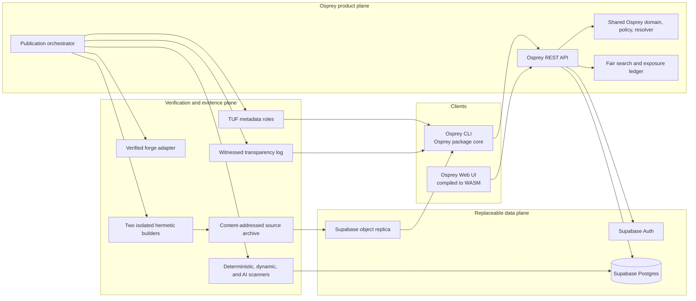
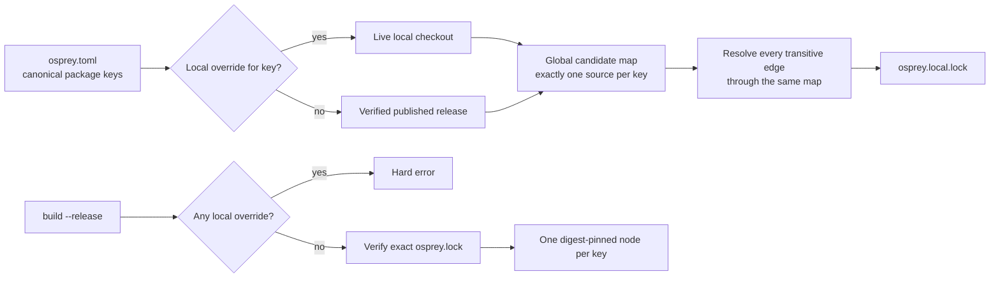

# Osprey Package Registry and Manager

> **Two rules govern everything below.**
>
> 1. **ALL OSPREY.** Every executable part of the package system is written in
>    Osprey: server, CLI, host effects, tests, oracles, and tooling. No Rust, no
>    shim, no other language, no exceptions. `[PACKAGE-IMPLEMENTATION-LANGUAGE]`
> 2. **A WORKING API THAT SERVES WORKING PACKAGES COMES FIRST.** The first
>    deliverable is an Osprey registry server that serves package source from a
>    plain folder, with no database, and a client that downloads and verifies
>    it. Anyone can stand one up on any host or network and point a client at
>    it. Every other feature in this spec layers onto that running service.
>    `[PACKAGE-FOLDER-REGISTRY]`
>
> Supabase, with GCP for services that must sit beside it, is the later hosted
> data plane. It is not needed to build, run, or use a registry, and it never
> replaces the folder registry.

**Status:** normative target; implementation is in progress under [`registry/`](../../../registry/README.md), whose README states what runs. Delivery is fixed by [plan 0020](../../plans/0020-package-manager.md); evidence is in [Package-manager research](../../package-manager-research.md).

This specification defines a source-derived, content-addressed package system.
It deliberately rejects uploaded archives, publisher binaries, lifecycle hooks,
SemVer constraints, popularity ranking, and AI-as-authority. Security decisions
come from verifiable evidence; compatibility comes from contracts and checks;
discovery gives relevant new work a measured chance to be seen.

The key words `MUST`, `MUST NOT`, `SHOULD`, and `MAY` are to be interpreted as
described by BCP 14 (RFC 2119 and RFC 8174) when they appear in capitals. A
feature is not implemented merely because this document specifies it.

## Research basis `[PACKAGE-RESEARCH]`

Every design decision below traces to the annotated corpus in
[Package-manager research](../../package-manager-research.md) — peer-reviewed
findings on breaking-change rates, NP-complete resolution, test/coverage
blind spots, TUF/in-toto supply-chain controls, ranking fairness, and AI
false-positive base rates. That document, not registry custom, is the
evidence record; this specification states only the resulting rules.

## Decided design `[PACKAGE-DECISIONS]`

| Topic | Normative decision |
| --- | --- |
| Versioning | There is no SemVer field or range language. Identity is a release digest; compatibility is an epoch; ordering is a monotonic ordinal. |
| Git | A commit is provenance, never package identity or publication authority. Tags and branches are display-only. |
| Publication | A publisher signs a release intent naming a forge repository, subdirectory, and commit. The registry fetches and assembles the source; uploads are rejected. |
| Binaries | Public packages contain Osprey source and closed-format declared data. Native binaries, native source, object files, arbitrary generators, and install hooks are rejected. |
| Native dependencies | A package declares a system capability. Osprey reports approved OS-provider packages but never downloads them or invokes Homebrew, apt, or another installer. |
| Local development | `osprey use <path>` overlays a canonical package key everywhere in the graph; switching back never edits dependency declarations. |
| Release resolution | Every source, dependency, toolchain, target, policy, and system input is digest-pinned, and each package key occurs exactly once. Local overlays are forbidden. |
| Upgrades | The solver proposes eligible candidates; contract analysis, compilation, client-impact analysis, tests, and security policy decide whether the new lock activates. |
| Implementation language | The entire package system is Osprey: CLI, parser, resolver, host effects, cryptography, adapters, registry, web UI, tests, and operational tools. There is no Rust host or other implementation-language exception. |
| First registry | A folder registry: an Osprey API that serves every release found under one directory, with no database. Anyone can run one on any host or network and point a client at it. See `[PACKAGE-FOLDER-REGISTRY]`. |
| Hosted platform | Supabase later supplies Postgres, authentication, and object-storage replicas behind the same API. It is never a cryptographic trust root, and the folder registry remains a supported deployment. |
| AI | Every submission receives AI review, but AI can only add evidence or quarantine for confirmation. It cannot approve or permanently reject a release by itself. |
| Discovery | Default rank excludes downloads, dependents, stars, impressions, publisher revenue, and sponsorship. Merit plus measured exposure determines order. |

The compatibility epoch intentionally retains the one defensible idea behind a
major version: an explicit incompatible contract lineage. It discards the false
precision of author-asserted minor and patch numbers.

## Goals and exclusions `[PACKAGE-GOALS]`

The system MUST make these operations unsurprising: create a package, publish
from source, add a dependency, explain a conflict, reproduce a build, inspect
trust evidence, and recover from compromise. Anyone with a verified scope MUST
be able to publish without popularity, invitation, payment, or an established
download history.

The public registry is not a general operating-system package manager, binary
distribution service, container registry, secrets store, advertising market, or
remote build-script runner. Private registries MAY relax license visibility;
they MUST NOT weaken identity, provenance, resolver, or client-verification rules.

## Threat model and invariants `[PACKAGE-THREATS]`

Osprey trusts the client verifier, authentic bootstrap root, monotonic local
trust state, anti-rollback UTC for `Current`, and stated primitives. Within budget,
an adversary may simultaneously control every unsigned registry service,
mirror, CDN and datastore; one of three applicable targets keys; two of five
root keys; one of four witnesses; either reference builder; and any scanner or
model. Acceptance fails closed, although confidentiality and availability may
fail. Root integrity is not claimed after three root-key compromises, release
authorization after two applicable targets-key compromises, log accountability
after the log plus two of four witnesses and cross-log are compromised, source
authorization after its publication principal is compromised, or reproduction
when both builders collude. A malicious publisher can author malicious logic
that analysis misses: Osprey guarantees attribution, bounded execution and
auditable evidence, not semantic benignness. Exact ceremonies are in spec 0030.

The following invariants hold even under those assumptions:

1. A release is immutable and named by independently recomputable content.
2. No single online key authorizes a client-visible release or root rotation.
3. Before resolve/fetch/run/activation the client verifies fresh metadata, log,
   source, closure and policy; offline audit reports only `ReproducibleAsOf`.
4. Installing a package executes no package-controlled code.
5. A build consumes only declared, digest-addressed inputs and has no network.
6. No score, popularity signal, database row, or AI verdict creates trust.
7. Replacement and name reuse are impossible; corrections are new evidence or
   new immutable releases.
8. A dependency performs no ambient I/O. Every file, process, network,
   terminal or device access in a package is either an effect its consumer
   handles or an ambient capability the root manifest granted
   (`[PACKAGE-CAPABILITY-CONFINEMENT]`).

The goal is the elimination of every supply-chain attack class by construction.
Each class below is removed by a named rule, and a gate in
`[PACKAGE-CONFORMANCE]` or `[PACKAGE-REGISTRY-CONFORMANCE]` proves the rule
instead of detecting the attack:

| Attack class | Removed by |
| --- | --- |
| Install-time or build-time code execution | Invariant 4. The format has no lifecycle hooks, build scripts or generators, and nothing in a package runs during fetch, install, lock, build-plan creation or activation. |
| Publisher-supplied archive, binary or generated file | `[PACKAGE-PUBLISH]`: the registry derives the release from a bound forge commit; uploads are rejected. |
| Tampered, substituted or replayed bytes | Invariant 1 and `[PACKAGE-SOURCE-CANONICAL]`: a release is its independently recomputed `SourceDigest`, checked before any write and again before any build. |
| Floating versions | `[PACKAGE-IDENTITY]` and `[PACKAGE-MANIFEST]`: epochs and floors, exact locks, no SemVer, no ranges, no `latest`. |
| Dependency confusion, typosquatting, confusables | `[PACKAGE-NAMES]` and `[PACKAGE-RESOLUTION]`: one scoped key, exactly one source per key in any graph, confusable and case-fold rejection, no published path or Git dependency. |
| Exfiltration or sabotage from a dependency's own code | Invariant 8 and `[PACKAGE-CAPABILITY-CONFINEMENT]`: a published package reaches no file, process, network or terminal except through effects the consumer handles or capabilities the root granted. |
| Native payloads and installers | `[PACKAGE-MANIFEST]` system capabilities: Osprey reports approved providers and never downloads or installs a native component. |
| Compromised registry, mirror, CDN or datastore | Invariants 2 and 3 and `[PACKAGE-TRUST]`: TUF thresholds, consistent snapshots, expiry and version floors; no single online component can make a client accept unauthorized, rolled-back, frozen or substituted source. |
| Silent rewriting of history | `[PACKAGE-TRUST]`: an append-only transparency log with inclusion and consistency proofs and a witness quorum. |
| Unreproducible or substituted builds | Invariant 5 and `[PACKAGE-PUBLISH]`: two separately administered hermetic builders must agree bit for bit before publication. |
| Revoked or yanked code kept in use | `[PACKAGE-TRUST]` status chain: a known revocation blocks every build and activation except isolated audit reproduction. |
| Local override leaking into a release | `[PACKAGE-LOCAL-OVERRIDE]`: release mode fails on any overlay, duplicate key or unpinned input. |


## Capability confinement `[PACKAGE-CAPABILITY-CONFINEMENT]`

Algebraic effects already make an Osprey library unable to perform an effect its
caller does not handle. The one remaining door is the set of ambient builtins
that any function may call without declaring anything: `readFile`, `writeFile`,
`gpuLoad`, `loadTensor`, `spawnProcess`, `awaitProcess`, `cleanupProcess`,
`input`, `termRawMode`, and every `http*` and `websocket*` builtin. Confinement
closes that door for every published package, so the effect system becomes the
whole security boundary.

- Each ambient builtin belongs to exactly one **ambient capability**, named in
  the capability grammar of `[PACKAGE-MANIFEST]`: `io/files` (`readFile`,
  `writeFile`, `gpuLoad`, `loadTensor`), `io/process` (`spawnProcess`,
  `awaitProcess`, `cleanupProcess`), `io/network` (every `http*` and
  `websocket*` builtin) and `io/terminal` (`input`, `termRawMode`). The map is a
  fixture derived from the compiler's builtin list; a builtin the map does not
  name is `io/unknown` and rejects publication until the map is updated.
- A release's **capability surface** is the set of ambient capabilities whose
  builtins its canonical source tree names, plus its `[system.*]` capabilities.
  The conformance scan of `[PACKAGE-CONFORMANCE]` computes it over the tree and
  nothing else. Osprey has no reflection, string dispatch or evaluation, so a
  name scan is exact; declaring a function, binding or parameter with one of
  those names in a published package is a publication error, so shadowing
  cannot hide a call. The surface is part of the release record, is served by
  the catalog and is pinned per release in every lock.
- A published package may use no ambient capability unless the root manifest
  grants it on that dependency explicitly:
  `"@acme/cli" = { epoch = 1, min_release = 0, capabilities = ["io/process"] }`.
  Grants are never transitive: a dependency of a dependency needs the root's own
  grant on its key. A root project's own source is unconfined. Grants name
  ambient capabilities (`io/…`) only: a `[system.*]` capability in a surface is
  declared, not granted, because its plane answers it (`[PACKAGE-MANIFEST]`,
  `[PACKAGE-PYTHON-UV]`), so a release that declares `python/interop` is a
  candidate without a grant and the lock still pins the name in its surface.
- The resolver treats an ungranted ambient capability exactly as an ungranted
  system capability (`[PACKAGE-RESOLUTION]`): the release is not a candidate,
  and `resolution.capability` names the key and the capability.
- `fetch` and `build` recompute the surface of every installed tree and fail
  with `capability.surface` when it differs from the lock. The folder registry
  enforces all of this today, because its client holds every candidate's
  verified source; Milestone B adds the signed surface to catalog metadata so
  an excluded candidate is never fetched.
- Plan 0020 records a compiler request so the type level repeats the proof:
  refuse an ambient builtin in a dependency source root unless the root grants
  its capability. Until then the scan is the gate and the lock is the evidence.

## Hardening rules `[PACKAGE-HARDENING]`

The invariants above hold by construction; the rules here are the concrete
gates a penetration test of a conforming client or folder registry meets, each
with a stable code and a test that asserts the code by name. They apply from
Milestone 0 and need no trust plane. They follow the current public guidance
for registries and clients: the OpenSSF/CISA Principles for Package Repository
Security (General Capabilities and CLI Tooling levels), SLSA source and build
tracks, PEP 740 index attestations and PEP 751 lock attestation identities,
uv's index-pinning rules, and the 2025–2026 incident record (lockfile
injection, scope-mirroring dependency confusion, compromised maintainer
releases of long-pinned packages, import-time payloads, and self-propagating
publish worms).

### Server rules

- S1. A response is a pure function of method, path and the catalog built at
  startup. Serving a request never reads the filesystem, spawns a process or
  consults any other state, so there is no path to traverse and no state to
  poison between requests.
- S2. Methods other than `GET` answer `405` with `Allow: GET`. Query strings
  are ignored. Unknown paths, wrong segment counts and unknown keys or digests
  answer `404` `application/problem+json`. A problem body carries only the
  code, status and title from the server's own table; it never echoes request
  bytes.
- S3. Every response carries `X-Content-Type-Options: nosniff`,
  `Content-Security-Policy: default-src 'none'` and
  `Referrer-Policy: no-referrer`. A digest-addressed response (one with an
  `ETag`) carries `Cache-Control: public, max-age=31536000, immutable`; every
  other response carries `Cache-Control: no-cache`. The server sets no cookie
  and sends no CORS credential header.
- S4. The runtime bounds every request: 1 MiB per request, 32 KiB of headers,
  5 s to receive it, and a connection past any bound is dropped before the
  server program runs. A conforming runtime MUST bound all three; the numbers
  are the runtime's contract, reported by `doctor`.
- S5. The runtime speaks plain HTTP. A registry reachable beyond loopback MUST
  sit behind a TLS-terminating reverse proxy that also rate-limits. Integrity
  never depends on the transport (C1); listing freshness does until the signed
  snapshot of `[PACKAGE-TRUST]` lands, and the operator documentation says so.
- S6. A served release directory's bytes never change. The server recomputes
  digests only at startup, so an edited release reappears under a new digest
  and its old `ReleaseId` leaves the listing; clients detect both (C5).
- S7. The walk gate rejects, never skips, every non-regular entry: symlink,
  hard link, device, FIFO, socket, executable bit, submodule, LFS pointer and
  any kind the walker cannot name (`source.kind.*`). The walker never follows
  a symlink.

### Client rules

- C1. Gates run in this order on every fetched body, and the install directory
  is created only after the last one passes: body size (`bundle.too-large`,
  128 MiB), strict JSON (`json.depth` at 64 levels, duplicate members, invalid
  UTF-8), bundle shape (`bundle.shape`), the path grammar of every entry
  (`path.*`: absolute, `.` and `..` segments, backslash, control bytes,
  reserved device stems, case-fold collisions, length), the kind gate, the
  submission limits (`source.too-many-files` at 10 000, `source.too-large` at
  50 MiB), then the recomputed `SourceDigest` equal to the bundle's claim
  (`bundle.digest-mismatch`) and to the digest the client asked for
  (`bundle.unexpected-digest`).
- C2. A filesystem path is composed only from values that passed a grammar:
  `[PACKAGE-NAMES]` for scope and name and the 64-lowercase-hex digest grammar
  of `[PACKAGE-IDENTITY]`. The install directory
  `.osprey/packages/@scope/name/<hex>/` derives from the verified bundle's own
  identity, never from the listing row that pointed to it, a lock entry or a
  command-line word.
- C3. The lock decoder applies the same grammars to every key and digest it
  reads; a failure is `lock.shape`. A lock names what to install and nothing
  more: it cannot make the client write outside `.osprey/packages`, run
  anything, or change the registry URL, which is a flag and never lock content.
- C4. `fetch` (no target), `verify` and `build` never resolve, never read a
  listing and never choose: they install, check and compile exactly the
  digests the lock names. `verify.manifest-digest` or `verify.dependencies`
  stops `build` before the compiler starts. This is the lockfile-injection
  defence: a change that edits the lock without the manifest is refused, and
  a swapped release is one changed 64-hex line in review.
- C5. `lock` is the only command that chooses releases. It fails closed, with
  nothing written, on two registry behaviours: `lock.release-replaced` when a
  listed release shares key, epoch and ordinal with a release of the current
  lock but carries a different digest (an edited release or an equivocating
  registry), and `lock.release-vanished` when a release of the current lock is
  absent from the listing (rollback, freeze or yank). The second is accepted
  only with `--accept-removals`, which the output names. A current lock that
  does not decode is refused with its `lock.*` code rather than replaced, so a
  damaged lock is never silently regenerated; only an absent lock is a fresh
  start. A listed release whose manifest is rejected is excluded as a
  candidate with `lock.invalid-manifest`, never selected.
- C6. Installing executes nothing: no hook, script, generator or import-time
  step exists in the format, and install copies verified text files. `build`
  compiles each installed tree through its own `source_roots` and
  `python_sources`, both resolved inside that verified tree, and copies
  nothing else from a dependency's manifest: its `entry`, `[modules]` and
  `[system]` tables never enter the derived project. What a dependency can
  reach at run time is bounded by `[PACKAGE-CAPABILITY-CONFINEMENT]`.
- C7. Every line the frontend prints passes one sanitizer that replaces each
  byte below 0x20 and the byte 0x7F with `?`, so a registry- or lock-supplied
  string cannot carry a terminal escape sequence. A server problem code is
  printed only when it is in the client's own table; any other status prints
  as `fetch.registry-status <n>`.
- C8. The client sends only `GET`, only to the base URL it was given, only on
  `/v1/...` paths it builds from validated grammar. The runtime follows no
  redirect: a `3xx` is `fetch.registry-status <n>`. Credentials are never read
  from a lock or a manifest.
- C9. Every parser is total and bounded: JSON depth 64, at most 256 plain
  bytes per recursion step, SHA-256 under the guarded arithmetic policy, and
  no parser aborts the process on hostile input; it returns a code.

### Python plane rules

- P1. The generated `pyproject.toml` of `[PACKAGE-PYTHON-UV]` declares no index
  and sets `[tool.uv] index-strategy = "first-index"`, the uv default that
  prevents dependency confusion across indexes. uv recognises named indexes
  only when `pyproject.toml` defines them, so environment or command-line
  index settings cannot redirect a locked package.
- P2. An interop tree's own `pyproject.toml` MUST NOT declare
  `[[tool.uv.index]]` (`python.index-forbidden`) or a `[tool.uv.sources]` entry
  of kind `git`, `url`, or a `path` outside its tree
  (`python.source-forbidden`). Only the generated workspace file names sources.
- P3. `uv.lock` MUST carry a hash for every distribution
  (`python.uv-lock-hashes`); installation is `uv sync --frozen`, which never
  relocks, and verification is `uv lock --check --offline`.
- P4. When uv exposes PEP 751 attestation identities, the lock records them
  and a changed publisher identity between locks is `python.publisher-changed`:
  a warning in format `0`, a refusal once `[PACKAGE-TRUST]` lands.

### Disclosure

- D1. The repository publishes `SECURITY.md`: how to report a vulnerability
  privately, what is in scope, and the response target. This is General
  Capabilities Level 1 of the OpenSSF principles; a folder registry has no
  accounts, so the authentication and authorization categories do not apply
  to it.

### Probe table

A penetration test of a conforming deployment observes exactly these answers.
Each row is asserted by name in a registry test.

| Probe | Expected answer | Asserted by |
| --- | --- | --- |
| `POST /v1/packages`, `PUT`, `DELETE`, `HEAD` | `405`, `Allow: GET`, `api.method-not-allowed` | `router_tests` |
| `GET /v1/releases/../../etc/passwd/source`, `%2e%2e`, overlong digests | `404 catalog.unknown-release`; no filesystem access | `router_tests` (S1) |
| Any `/v1/...` response | `nosniff`, `default-src 'none'`, `no-referrer`, the right `Cache-Control` | `router_tests` |
| Bundle whose `files[].path` is `../x`, `/etc/x`, `a\b`, `CON`, `A.osp` beside `a.osp` | `path.*` before any write | `paths_tests`, `source` fixtures |
| Bundle with a symlink, executable or LFS pointer entry | `source.kind.*` or `source.lfs-pointer` | `paths_tests`, `folder/refusals` fixtures |
| Bundle body over 128 MiB, 10 001 files, or 50 MiB + 1 of content | `bundle.too-large`, `source.too-many-files`, `source.too-large` | `bundle_tests` |
| Bundle whose `digest` claims another release, or whose bytes differ from the claim | `bundle.unexpected-digest`, `bundle.digest-mismatch` | `bundle_tests`, `vectors` |
| JSON 65 levels deep, duplicate member, lone surrogate, raw control byte | `json.depth`, `json.duplicate-key`, `json.bad-surrogate`, `json.control-character` | `json_tests` |
| Lock with `"scope": "../.."`, `"digest": "sha256:../x"`, unsorted or duplicate packages | `lock.shape`, `lock.order`, `lock.duplicate-key`; no install path formed | `lockfile_tests` |
| Lock edited to another digest with the manifest untouched | `verify.manifest-digest` or `verify.digest`; `build` runs no compiler | `verify_tests`, `build_tests` |
| Registry now serves a different digest for a locked `e1.r2` | `lock.release-replaced`, nothing written | `lock_tests` |
| Registry drops a locked release from its listing | `lock.release-vanished` unless `--accept-removals` | `lock_tests` |
| Problem title or package key containing `\x1b[2J` | printed as `?[2J` | `reports_tests` |
| Interop `pyproject.toml` with a `git` source or an extra index | `python.source-forbidden`, `python.index-forbidden` | `python_tests` (with the uv plane, plan 0020 Phase 2) |

## Architecture `[PACKAGE-ARCHITECTURE]`



The browser never receives a Supabase service credential and never writes the
database directly. All authorization passes through the Osprey API. Signing
keys live in offline custody or external HSM/KMS services, not Postgres or
Supabase environment variables. Replacing Supabase cannot change a package ID.

The diagram shows the complete hosted system. The first deployment is far
smaller: the Osprey REST API reading releases from a folder, and the Osprey CLI
downloading from it (`[PACKAGE-FOLDER-REGISTRY]`). The data plane is replaceable
by design, and a directory on disk is its first and permanent implementation.
Supabase is an additional implementation, not a prerequisite.

Osprey implements every package-system component. Osprey effect handlers provide cryptography, filesystem transactions, HSM access, forge protocols, sandbox control, and compiler invocation. There is one shared Osprey package-core implementation across server, CLI, and WASM.

## Implementation language `[PACKAGE-IMPLEMENTATION-LANGUAGE]`

The package manager and registry MUST be implemented 100% in Osprey. All executable source delivered for this system MUST be `.osp` or `.ospml`, including command parsing and routing, manifest parsing, domain rules, resolution, canonical serialization, hashing and signature handling, locks, caches, filesystem atomicity, process isolation, authentication, network protocols, HSM/forge adapters, API services, publication and verification pipelines, scoring, discovery, browser behavior, tests, independent reference implementations, migration runners, and operational tooling.

A Rust host, Rust CLI bridge, native shim, shell launcher, or implementation in any other language MUST NOT be introduced for the package system. Calling a non-Osprey package implementation through an Osprey wrapper does not satisfy this requirement. The browser application MUST be compiled from Osprey to WebAssembly; handwritten application JavaScript is not permitted.

The existing compiler and runtime are build and execution infrastructure, not locations for package-system implementation. The Osprey frontend MUST invoke the existing compiler through Osprey process effects; this work MUST NOT add package-specific code to the compiler or runtime in another language. Existing operating-system interfaces, installed libraries, and external services remain platform dependencies. Their use does not authorize new non-Osprey adapters, wrappers, or package logic. Osprey bindings and effect handlers own every package interaction with those dependencies.

The canonical typeDiagram model, TOML manifests, JSON fixtures, declarative database schemas/RLS policies, uv lock files, styles, and deployment configuration are data, not alternative implementation languages. They MUST NOT contain executable package behavior. Generated machine code, WebAssembly, and compiler-generated interop are build artifacts, not handwritten source exceptions.

If Osprey cannot express or safely perform a required operation, implementation MUST record the missing capability and an Osprey regression case as a delivery blocker. It MUST NOT substitute another language, invent an unverified security primitive, weaken the contract, or report the blocked feature as complete. Cryptography and host operations retain every audit, conformance, and platform requirement in specs 0029–0032.

Conformance MUST verify this language requirement over the complete package-system source and build graph. An implementation that moves any package component, test, oracle, host handler, or operational tool into another language is non-conforming.

## Folder registry `[PACKAGE-FOLDER-REGISTRY]`

**This is the first deliverable and the delivery priority of the whole
package system.** No other phase may delay it. The first deliverable is a
working registry API that serves working packages. It needs no database, no account, and no hosted
service. An operator drops package source trees into one directory, starts the
Osprey registry server on any host, and points clients at its base URL. The
same server stays a supported deployment after the hosted platform exists, so
any team can run a private or offline registry on its own network.

The server, the client, and every test MUST be Osprey under
`[PACKAGE-IMPLEMENTATION-LANGUAGE]`. A folder registry MUST NOT require a
database, an account, a hosted service, or any component outside the Osprey
server and the files under its root.

### Layout

```text
<registry-root>/
  @scope/name/<epoch>.<ordinal>/    one release: its complete source tree
    osprey.toml
    src/...
```

- A release directory holds the package's source exactly as published: the
  manifest plus every source and declared data file.
- `@scope/name` follows `[PACKAGE-NAMES]`. `<epoch>.<ordinal>` are the
  epoch and ordinal of `[PACKAGE-IDENTITY]`: positive integers written in
  decimal without sign or leading zeros, so the first release is `1.1`.
- A release directory is immutable once served. A new release is a new
  `<epoch>.<ordinal>` directory; editing a served release is an operator error
  that the server reports as a digest change, never silently serves.
- Files and directories that `[PACKAGE-SOURCE-CANONICAL]` excludes or rejects
  make the release invalid. The server lists the reason and does not serve it.

### Operation

The server takes its root directory, bind address, and port from one JSON
configuration file. It MUST serve on any address the host can bind, including
non-loopback addresses, so one registry can serve a whole network. Running a
registry needs only the Osprey toolchain, the server, and the folder.

### Catalog

At startup the server walks the root, validates each release, and computes its
`SourceDigest` with the shared core. The catalog is the set of valid releases
keyed by digest. A restart rebuilds it; there is no other state. The client's
`publish --folder <registry-root> [--breaking]` places a project as the next
release of that folder: the release tree is the manifest, every file under its
`source_roots`, its `python_sources`, its declared assets and its legal documents, checked and
digested exactly as the server will before a byte is written, at the next
ordinal of the newest epoch, at the next epoch with `--breaking`, or at `1.1`
for a new package. The authenticated `publish` of spec 0030 replaces this once
the trust plane exists.

**[PACKAGE-LICENSE-DISTRIBUTION]** Root `LICENSE`, `COPYING`, `NOTICE`, `AUTHORS` and `THIRD_PARTY_NOTICES` files, including `.txt` and `.md` forms, and the complete `LICENSES/` directory are included automatically, case-insensitively, without asset declarations. They participate in `SourceDigest` and remain in the source bundle and installed tree. Ports retain original copyrights, applicable conditions and modification notices; the original contribution license does not replace upstream terms. Applications redistributing compiled derivatives must supply the applicable documents with their distribution.

### Endpoints

The folder registry implements the public-read subset of `[PACKAGE-API]` at the
same paths:

| Request | Response |
| --- | --- |
| `GET /v1/health` | Server status and catalog counts. |
| `GET /v1/packages` | Every package key with its releases, ordered by key then epoch then ordinal. |
| `GET /v1/packages/{scope}/{name}` | One key's releases: epoch, ordinal, digest. |
| `GET /v1/releases/{digest}` | One release's key, epoch, ordinal, digest, and file list. |
| `GET /v1/releases/{digest}/source` | The release's source bundle. |

Every body is RFC 8785 canonical JSON. A release response carries its digest as
a strong `ETag`. Errors are `application/problem+json` with a stable `code`.

### Source bundle

The download format is one canonical JSON document:

```json
{"digest":"<SourceDigest hex>","epoch":0,"files":[{"path":"osprey.toml","text":"..."}],"key":"@scope/name","ordinal":3}
```

`files` is sorted by unsigned path bytes and holds every file of the release
as UTF-8 text. The client MUST recompute `SourceDigest` from `files` and
reject the bundle unless it equals both `digest` and the digest it requested.
Transport is therefore untrusted: a proxy or mirror can serve the bytes
without being believed.

A bundle carries text only because the runtime cannot yet send or read bytes
containing NUL (`files.binary-read` in the registry blockers). Binary declared
assets are served once that blocker is resolved; until then a release that
declares one is invalid in a folder registry.

### Client

The package command frontend fetches a release by key and epoch, or by digest,
from a configured registry base URL. It verifies the bundle, then writes the
tree under `.osprey/packages/@scope/name/<digest>/`. A later phase may expose
the same command through the `osprey` binary; any such entry point dispatches
to the Osprey frontend and adds no package logic to the compiler.

### Folder lock

Until the trust plane exists there is no TUF snapshot, provenance, or SBOM to
pin, so a folder registry cannot produce the `ReleaseLockfile` of spec 0031. Its
client writes `osprey.lock` in folder-lock format `0` instead, as RFC 8785
canonical JSON:

```json
{"format":0,"packages":[{"dependencies":[...],"release":{...},"surface":[...]}],"root":{"dependencies":[...],"manifestDigest":"sha256:..."}}
```

- `root.manifestDigest` is the root's canonical `PackageManifest` digest and
  `root.dependencies` its `DependencyEdge` list, both as `[PACKAGE-MANIFEST]`
  projects them. `root.python` is present only when the graph has a Python
  plane: `{"pyprojectDigest","uvLockDigest"}`, the `sha256:` digests of the
  generated `.osprey/python/pyproject.toml` and its `uv.lock`
  (`[PACKAGE-PYTHON-UV]`); any other shape is `lock.shape`.
- `packages` holds one entry per selected release, ordered by `ReleaseId`: the
  `ReleaseId`, the Runtime/Build `DependencyEdge` list of its manifest, and
  `surface`, its capability surface as a canonical set of strings
  (`[PACKAGE-CAPABILITY-CONFINEMENT]`); a decoder refuses any other shape with
  `lock.shape`.
- The development lock `osprey.local.lock` of `[PACKAGE-LOCAL-OVERRIDE]` is the
  same document plus `overrides`, present only when non-empty: one
  `{"epoch","manifestDigest","package","path"}` per key taken from a local
  checkout, sorted by key. An overridden key appears in `packages` with its
  checkout's source digest, its overlay epoch and its baseline's ordinal (zero
  without a baseline), so the release lock's bytes never carry the member and a
  development lock with no overrides is byte-identical to a release lock.
- The selection is the output of the one resolver of `[PACKAGE-RESOLUTION]`
  over the registry's releases. There is no greedy fallback here either.
- Build and run commands MUST fail when `manifestDigest` differs from the
  current manifest's, or when an installed tree's `SourceDigest` differs from
  its `ReleaseId` digest. They never resolve or access the network.
- `fetch` with no target installs every locked release under
  `.osprey/packages/@scope/name/<digest>/` through the same verified download
  as `fetch <digest>`, skipping a tree whose `SourceDigest` already matches.
  `verify --offline` reports `verify.no-lock` (no decodable lock),
  `verify.manifest-digest`, `verify.dependencies`, `verify.missing` and
  `verify.digest`; `build` runs that check first and then compiles the root
  with every installed tree's own `source_roots` and `python_sources` as
  extra inputs. A target-less `fetch` without a lock is `install.no-lock`.
- Format `0` locks are integrity-only. A client that has the trust plane
  rejects them for `build --release`; Milestone B replaces them with the
  `ReleaseLockfile`.

### Trust

A folder registry proves integrity, not authority: the digest shows that the
bytes match what was requested, not who published them. The TUF metadata,
transparency log, and provenance of `[PACKAGE-REGISTRY]` layer onto these same
endpoints in Milestone B without changing the layout, the bundle, or the paths.

## Names and ownership `[PACKAGE-NAMES]`

A canonical name is `@scope/name`. Components contain only lowercase ASCII
letters, digits, and interior hyphens; a scope is 1-39 characters and a name is
1-63. Unicode display names are allowed but never resolve. Unscoped names are
invalid, and only the project governance role can publish under `@osprey`.

Scopes are backed by stable principal IDs, not mutable email domains. The
registry warns on skeleton/confusable similarity and quarantines evidence of
impersonation, but similarity alone cannot suppress a legitimate package.
Package names and scopes are permanent tombstones after deletion.

Normal transfer requires signatures from old and new owners, a 30-day public
notice, and a logged finalization. Recovery without the old owner requires a
30-day quarantine plus approval by two of three independent registry-security
custodians. Every ownership and recovery event is transparent and appealable.

## Release identity and compatibility `[PACKAGE-IDENTITY]`

A release is displayed as:

```text
@scope/name@e3.r42#sha256:7c…
```

- `e3` is the registry-assigned compatibility epoch.
- `r42` is the package-wide, strictly increasing release ordinal.
- The digest is the authoritative identity.

The initial release is epoch 1. `osprey publish` claims compatibility with the
current epoch; `osprey publish --breaking` always opens the next epoch. The
registry rejects a compatible claim when public types, values, constructors,
effects, capabilities, FFI ABI, platform/toolchain floor, or machine-checkable
contracts break. A breaking claim bumps the epoch even when analysis finds no
break. Maintainers MUST declare behavior changes that static analysis cannot see.

Tags and human labels MAY be shown beside a release, but manifests, locks, API
selectors, and CLI selectors MUST reject them as constraints. If a hidden break
is discovered later, the bad release is yanked or revoked and an advisory is
logged. Its epoch and digest are never rewritten; the correction is a new
release in a new epoch.

`SourceDigest` hashes a domain-separated canonical tree containing sorted path,
file-mode class, byte length, and SHA-256 of each raw file. Its exact byte
grammar and selected-root rules are fixed by `[PACKAGE-SOURCE-CANONICAL]` in
spec 0030. Symlinks, submodules, LFS pointers, devices, executable bits, path
traversal, case collisions, and non-portable names are rejected.
`ReleaseDigest` covers the package key, epoch, source digest, manifest digest,
and deterministic build-plan digest. Hash envelopes carry an algorithm ID so a
future package-format revision can introduce another algorithm without
reinterpreting existing identifiers.

For a package key, one `ReleaseDigest` maps permanently to one epoch and
ordinal. Repeating the same release envelope returns the original `ReleaseId`
and can only append evidence; it never allocates another ordinal.

## Registry publication, trust, and discovery `[PACKAGE-REGISTRY]`

Source collection, payload policy, the publish sequence, TUF and transparency,
AI review, maintenance evidence, and fair discovery are normative in specs
[0030](0030-PackageRegistryTrustAndDiscovery.md) and
[0032](0032-PackageEvidenceAndDiscovery.md). Both are part of this contract,
not optional service profiles.

## Manifests, system capabilities, and locks `[PACKAGE-MANIFEST]`

The existing `osprey.toml` is the single portable manifest. Published
dependencies name one epoch and a minimum ordinal; upper bounds, SemVer, peer
dependencies, optional dependency features, Git URLs, tags, branches, and path
dependencies are invalid. A dependency always retains its canonical package
key, regardless of whether development obtains its source locally or from the
registry. `min_release = 0` means any release in the epoch; positive values set
an additive-contract floor. A root entry may add `capabilities = [...]`, the
ambient capabilities the root grants that one key under
`[PACKAGE-CAPABILITY-CONFINEMENT]`; each name follows the capability grammar
(`manifest.dependency.capability` otherwise), the grants of one key across the
three tables merge into one canonical set, and the canonical manifest carries
them as `grants` (spec 0031 `DependencyGrant`).

```toml
[project]
name = "ledger"
source_roots = ["src"]
[package]
name = "@finch/ledger"
license = "Apache-2.0"
summary = "Immutable ledger primitives"
keywords = ["ledger", "transactions"]
[dependencies]
"@osprey/http" = { epoch = 2, min_release = 17 }
[system.sqlite]
capability = "sqlite/c-api"
min_revision = 3045000
```

`[project].python_sources` names the project's Osprey Python-flavor files
(spec 0041: extension `.py`, first line `# osprey: flavor=python`) as
root-confined relative paths; the list is part of the canonical manifest and
so of its digest. A published manifest keeps every listed path inside one of
its `source_roots` (`manifest.python-source-unrooted`), so the capability scan
of `[PACKAGE-CAPABILITY-CONFINEMENT]` covers it, and every `.py` file in a
release tree carries the marker line or the release is refused
(`source.python-flavor-header`, `[PACKAGE-SOURCE-CANONICAL]`). A Python-flavor
file is Osprey source the Osprey compiler reads; nothing in a release is ever
run by CPython.

A system capability name is one or more segments of `[a-z0-9][a-z0-9.-]{0,63}`
joined by single `/` characters, at most 128 bytes in all, such as
`sqlite/c-api`; `min_revision` is a non-negative integer and each capability
appears once per manifest. A threshold-signed registry/enterprise catalog—not
the publisher—maps a system capability to approved providers, artifacts, native
closures and provenance.
`osprey doctor` uses an authorized read-only host effect and prints that guidance;
it never invokes an installer. SQLite can stay outside the Osprey registry.

Every root-witness lock activates Runtime/Build/Test edges from its selected root
and Runtime/Build, never Test, from non-root nodes. Published libraries attach
that witness lock; consumers resolve their own. The lock uses RFC 8785
canonical JSON and pins the selected-root tree, every package source, manifest,
build plan, dependency edge, compiler/runtime/toolchain, target and flags,
system-provider artifact and its native closure, inferred effect/capability set,
provenance, SBOM, catalog/TUF snapshot, solver policy, and resolution
explanation by identity and digest. There are no floating inputs in a release
lock, and the hermetic build exposes no undeclared environment input.

Before RFC 8785 serialization, scalars, UTC timestamps, every set-like list's
sort/duplicate identity, and each protocol-ordered exception follow
`[PACKAGE-TYPE-INVARIANTS]` in spec 0031. Locks store a structured resolution
proof with stable reason codes; prose and localization remain outside lock data.

Build and run commands never resolve or access the network. They fail when the
manifest and selected lock disagree. `osprey lock` writes only the release lock;
`osprey lock --local` writes only the development lock. `use` atomically changes
the root overlay and development lock through an immutable state generation and
one atomic active-generation pointer. `add`, `remove`, and `update` refresh the
registry-only base and development lock while preserving overlays; removal
deletes that key's override only if it leaves the complete development closure.
A complete solution replaces the release lock,
`publishedBaseLock`, and matching per-key baselines before locals are revalidated;
otherwise both base-lock fields are absent while valid per-key baselines remain;
an invalid retained local aborts everything. A cached release lock remains
reproducible byte for byte after metadata expiry, but is non-activatable until
freshness is re-established. A known revocation blocks normal building and all
activation; only isolated `--audit-revoked` reproduction may consume it.

## Python interop dependencies through uv `[PACKAGE-PYTHON-UV]`

The Osprey resolver selects Osprey releases and nothing else. A package whose
Osprey code calls real Python through spec 0042 needs CPython and Python
distributions, and that plane has its own resolver and lock: uv. Osprey drives
uv instead of modelling Python packages a second time. The Python flavor of
spec 0041 needs none of this; it is Osprey source and has no Python dependency.

- A package that uses Python interop declares `[system.python]` with
  `capability = "python/interop"` and `min_revision` as the minimum CPython
  version spelled `MMmmpp` (`31200` is 3.12.0). Its root holds `pyproject.toml`
  (PEP 621 `name`, `requires-python`, `dependencies`) and `uv.lock`. Both are
  ordinary tree entries under `[PACKAGE-SOURCE-CANONICAL]`, inside
  `SourceDigest`. The PEP 621 `version` field is Python's identity for uv; the
  package's Osprey identity stays epoch and ordinal, and `[PACKAGE-MANIFEST]`
  still rejects every version field in `osprey.toml`.
- `osprey lock` composes one uv project for the whole Osprey graph after
  resolution: `.osprey/python/pyproject.toml` depends by path source
  (`[tool.uv.sources] name = { path = ... }`) on the root's own `pyproject.toml`
  when it has one and on the installed tree of every locked release that
  declares `python/interop`; `requires-python` is the intersection of theirs and
  the declared floors. It then runs `uv lock` there, so uv resolves the union of
  every member's Python requirements into one `.osprey/python/uv.lock`, and
  records `sha256` digests of both generated files under `root.python` in
  `osprey.lock`. uv's lock pins every Python distribution by hash itself.
- `osprey fetch` runs `uv sync --frozen` in `.osprey/python`, creating the one
  environment the project's Python interop uses. `python/interop` is the single
  system capability whose provider Osprey invokes, because the developer
  declared the plane and uv is its resolver; Osprey never installs uv, CPython
  or an OS package, and `doctor` reports the `python/uv` and interpreter floors
  as guidance like every other capability.
- `verify --offline` regenerates `.osprey/python/pyproject.toml` from the lock,
  compares both digests, and runs `uv lock --check --offline`; `build` and `run`
  run that check and fail on any mismatch. They never resolve, sync or access
  the network. Codes: `python.pyproject-missing`, `python.uv-lock-missing`,
  `python.workspace-digest`, `python.uv-lock-stale`, `python.environment-missing`;
  a `uv lock` or `uv sync --frozen` that exits non-zero is `python.uv-lock-failed`
  or `python.uv-sync-failed` with its status, and the lock is not written.
- A graph with no member leaves `root.python` out of the lock, writes no
  project and never runs uv; `doctor` reports a missing uv as guidance.
- A release lock of Milestone B pins the same two digests; a hermetic build
  consumes the synced environment and the per-distribution hashes in `uv.lock`
  as declared inputs.

## Local and published source switching `[PACKAGE-LOCAL-OVERRIDE]`

`osprey use ../local/http` never rewrites `[dependencies]`; it replaces an
existing key. For a new dependency, `osprey add ../local/http [--epoch N]`
resolves a key baseline first: if published, it writes `min_release` equal to
that ordinal and stores its exact `ReleaseId` on the override; if none exists,
it writes zero and is development-only. A complete registry-only solution also
writes the base/release lock; otherwise `publishedBaseLock` is absent. Manifest,
root overlay, optional base, and development lock change atomically. Only the root
`osprey.local.toml` participates.
`osprey use @osprey/http --published` removes the mapping, and `osprey use
--list` shows every active override, baseline, epoch, path, and current source
digest. `osprey use --clear` applies `--published` to every mapping as one
transaction and changes nothing if any baseline cannot activate. Override keys
are unique; `global` means the selected workspace graph, never an account/parent.



```toml
[overrides."@osprey/http"]
path = "../http"
epoch = 2
baseline = "@osprey/http@e2.r17#sha256:7c..."
```

The overlay is package-key based and applies once to the whole graph. If a local
package depends on another key with an active override, that dependency is local;
otherwise it resolves from the signed catalog. Root, transitive, build, and test
edges therefore see the same selected source. An override replaces the published
candidate; it never adds a second instance. Conflicting requirements fail with a
single conflict explanation instead of installing two versions.

Baseline selection uses the existing development lock's published node, else the
exact release-lock node, else one result from the pinned catalog. Its key/epoch
must match and ordinal satisfy every inbound floor. No baseline is valid only
when no eligible release exists and every floor is zero; its epoch defaults to
one, and `--epoch N` is required for another unpublished lineage. A local uses
the same key, passes epoch contracts, has its baseline ordinal or zero, and
cannot impersonate a later release. Explicit
`update` resolves a published base including overlaid keys, replaces matching
baselines and revalidates locals atomically; only `update --breaking` changes an
override epoch, and failure changes nothing. A local manifest change requires
`osprey lock --local`; source edits stay live without re-resolution.

Only the selected root's overlay participates in resolution. Any
`osprey.local.toml` or `osprey.local.lock` inside an overridden package is
ignored. Each development build traverses with no-follow handles, snapshots each
live root/local tree into read-only CAS, and compiles only that snapshot. It
revalidates contracts, effects/capabilities and policy, then emits a signed
receipt with actual source, build-plan, SBOM, environment and output digests. A
live edit never mutates lock topology implicitly.

Development state always records each override's exact replaced `ReleaseId`.
It writes a registry-only base only when the entire manifest has a complete
registry solution. Switching back regenerates only the development lock from
that ID/base plus remaining overlays, preserving unrelated pins and never
updating an ordinal. A baseline-free `add` first needs `osprey lock` after publication. An
exact captured yank may be restored; a missing/revoked baseline preserves the
overlay and fails.

`osprey.local.toml` and `osprey.local.lock` are non-portable development state,
ignored by generated source-control rules and excluded from publication.
`osprey build --release` parses only overlay header/keys; it never follows paths
or local content, and any mapping hard fails. The selected root is the nearest
ancestor with `osprey.toml`; discovery never descends or crosses a filesystem
boundary. Its locks, overlay, and journal are adjacent to that manifest. The root
tree digest excludes those controls, unselected roots, and outputs; every
dependency is a registry `ReleaseId`. A multi-root repository therefore has one
adjacent release lock per root and cannot release-depend on an unpublished
sibling: publish the sibling, then lock the dependent root.

Bare `build`, `run`, `test`, and `docs` always select `osprey.local.lock`, keeping
the root source live, and never resolve. A missing/stale lock fails only with
`osprey lock --local` as remediation. `build --release` alone selects
`osprey.lock` after the empty-overlay preflight.

`osprey build --release` performs no resolution, fallback, substitution, or
network access. It verifies every pinned digest and requires exactly one node for
every package key across the entire build. A missing/mismatched input, unknown
system artifact, active override, duplicate key, stale lock, or unavailable
digest is a hard error. This uniqueness rule has no process-isolation, target,
feature, or tool-dependency exception.

New resolution, fetch, or activation requires unexpired TUF metadata. Offline
reproduction verifies only the bytes and proofs as of the lock's pinned
checkpoint; it cannot assert current non-revocation and its output cannot run or
activate. A known revocation is monotonic: isolated audit reproduction requires
`--audit-revoked`, never activates, never substitutes a graph, and never alters
the bytes being reproduced.

## Complete deterministic resolution `[PACKAGE-RESOLUTION]`

The one resolver is a complete incremental CDCL-backed lexicographic MaxSAT
solver written in Osprey. Package releases become Boolean candidates; catalog,
manifest, target, capability, trust, and uniqueness rules become hard clauses.
Learned incompatibility derivations produce `why` output and minimal conflict
cores. There is no greedy fallback.

Hard constraints require a complete dependency closure, exact epochs, minimum
ordinals, an acyclic package graph, supported target/toolchain, pinned system
capabilities, exactly one selected source per package key across every edge, and
no revoked, quarantined, or policy-blocking release. Fresh candidate selection
also excludes yanks; an exact yanked node already in the current/captured base
remains reproducible and activatable but is never chosen afresh. Local resolution
uses overlays as hard replacements; release resolution excludes them entirely.

For each registry candidate `r`, the core recomputes signed integer cost facts:
`V(r)=sum(roundDiv(severityWeight*reachabilityFactor,10_000))` over non-blocking
advisories. `overdueDays=(overdueMilliseconds+86_399_999) div 86_400_000`, and
`D(r)` sums each `V` term times `min(overdueDays,3_650)`; `U(r)` and `E(r)` count
Unknown checklist and required-evidence items. Let `M` be the greatest ordinal
among eligible releases plus `r` itself when it is a permitted captured yank;
`L(r)=M-ordinal`. Fixed local nodes contribute zero. For graph `G`, minimize:

```text
(sum V, sum D, sum U, sum E, changedIdentities(current,G),
 nonRootPackageCount + systemInputCount, sum L)
```

`changedIdentities` counts package keys/capabilities whose selected identity is
added, removed, or differs. A tuple tie compares package tuples
`(key,epoch,ordinal DESC,digest)` then system tuples
`(capability,provider,revision,digest)` in spec-0031 canonical order.

All time-dependent metrics, including overdue days, are evaluated at the signed
catalog snapshot's `asOf`, never the host clock. Safe downgrades are valid.
Identical root/manifest, current locks, and complete canonical
`ResolutionContext`—catalog/`asOf`, TUF/log, policy, build environment and system
inputs—plus development overlays/local manifests MUST produce byte-identical
locks/proofs. No conflict admits another release of the same package key.

`osprey update` validates the candidate closure by compiling and type/effect
checking it, diffing public API/ABI/contracts, analyzing affected clients,
running unit/integration/property/mutation tests, and reevaluating vulnerability
policy. `osprey update --breaking` evaluates one newer epoch at a time and emits
a migration report; it never silently crosses an epoch.

## Canonical domain types `[PACKAGE-TYPES]`

The normative typeDiagram model, including published releases, local overlays,
selected roots, exact locks, and assessments, is
[Package Domain Model](0031-PackageDomainModel.md). Generated Osprey types MUST
come from that model rather than a handwritten duplicate.

## REST API and command surface `[PACKAGE-API]`

The API is versioned REST/JSON. GraphQL is not part of v1. Public reads include
`GET /v1/search`, `/packages/{scope}/{name}`, `/releases/{digest}`,
`/releases/{digest}/source`, `/evidence`, `/advisories`, `/metadata`, and
`/proofs`. Authenticated writes include `POST /v1/release-intents`, `/yanks`,
`/revocations`, `/transfers`, and `/appeals`. Writes require `Idempotency-Key`;
lists use stable cursor pagination; immutable responses carry digest ETags; and
errors use `application/problem+json` with a stable code and remediation.

The server can preview a resolution, but only the locally verified resolver can
write a trusted lock. The minimal CLI is:

```text
osprey login                         osprey package init
osprey add <key-or-path> [--epoch N] osprey remove @scope/name
osprey lock [--local] [--accept-removals]  osprey update [--breaking]
osprey use <path> [--epoch N]       osprey use @scope/name --published
osprey use --list|--clear           osprey build --release
osprey fetch                         osprey tree
osprey why @scope/name              osprey audit
osprey verify [--offline]           osprey doctor
osprey build --release [--audit-revoked]
osprey publish [--breaking]         osprey yank <release>
```

`add`, `remove`, `lock`, `update`, and `use` print the graph/source/security
delta before one atomic update. Development output prominently lists local
overrides; release output proves there are none. Conflict output identifies the
smallest incompatible requirements and concrete remediations. Package pages
expose exact source, commit, digest, epoch/ordinal, dependencies,
effects/capabilities, provenance/log proofs, assessment components/confidence,
advisories, and history.

## Conformance gates `[PACKAGE-CONFORMANCE]`

General availability requires all of these, with no waiver path:

- every delivered package-system executable component, including host effects, tests, independent oracles, and operational tooling, satisfies `[PACKAGE-IMPLEMENTATION-LANGUAGE]`;
- adversarial TUF, threshold-key, rollback, freeze, equivocation, witness, CAS,
  and compromised-mirror test vectors pass in every client;
- resolver property tests prove closure, uniqueness, constraint satisfaction,
  completeness on bounded exhaustive graphs, determinism, and stable conflict
  explanations; differential tests agree with an independent oracle;
- local-overlay tests switch root and transitive packages both directions
  without editing dependency declarations; release tests reject every overlay,
  duplicate key, floating input, stale digest, and unpinned system artifact;
- canonical-source and lock vectors are byte-identical on Linux, macOS, and
  Windows, and two independent builders reproduce every public candidate;
- publication rejects every forbidden payload/hook and withstands archive,
  parser, decompression, and resource-exhaustion corpora;
- scanner evaluation meets the stated production-prior thresholds, with AI
  automatically demoted to advisory when it does not;
- fair-ranking simulations and live propensity audits meet both relevance and
  exposure budgets without popularity inputs;
- disaster exercises rotate root/online keys, revoke a release, restore from
  independent CAS/log replicas, and rebuild the catalog without Supabase;
- an independent security audit closes all critical and high findings.
