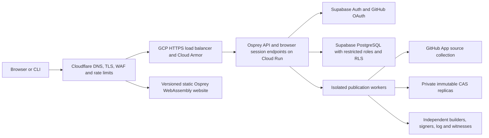

# Package Registry Deployment and Ownership

**Status:** normative delivery target; hosted authentication, ownership enforcement and deployment are not implemented. This completes the operational and tenancy requirements of [plan 0020](../../plans/0020-package-manager.md). The [rollout plan](../../plans/0020-package-manager-rollout.md) defines sequencing and required evidence. Existing [publication and trust requirements](0030-PackageRegistryTrustAndDiscovery.md) remain mandatory.

## Security boundary `[PACKAGE-HOSTED-BOUNDARY]`

The public website and API MUST enforce authorization in Osprey and independently constrain database access with Supabase PostgreSQL RLS. A valid login, organization membership, GitHub installation, or uploaded file MUST NOT by itself authorize publication. Every accepted release needs current scoped authority, the exact signed authorization, source verification and trust gates in spec 0030.

The threat model includes hostile authenticated users, forged tenant IDs, stale/revoked sessions, removed maintainers, malicious source and prose, stolen credentials, replay, concurrent ownership changes, cache leakage, direct-origin access and compromised online components. Database owners and superusers can bypass RLS; independent signatures, witnesses and client verification protect release acceptance against database compromise. RLS does not establish publisher signatures or source safety. Availability and compromised publisher devices remain operational risks; “100% secure” is not a measurable acceptance criterion. All requirements below require retained passing evidence and independent security review before public writes.

The implementation language contract `[PACKAGE-IMPLEMENTATION-LANGUAGE]` applies: website application logic compiles from Osprey to WebAssembly; API, auth adapters, crypto, publication workers, tests and operational tooling are Osprey. PostgreSQL DDL, constraints, grants and RLS policies are declarative infrastructure. Package policy MUST NOT move into SQL procedures, JavaScript Workers or another package-specific host. Missing Osprey capabilities block rollout.

## Deployment topology `[PACKAGE-HOSTED-TOPOLOGY]`

Use distinct local, staging and production Supabase projects, GCP resources, storage, GitHub OAuth applications, GitHub Apps, signing identities and secrets. Default runtime region is `australia-southeast1`; select a compatible Supabase region and record the actual choice and latency. Account IDs, domains and capacity limits MUST be inventoried before provisioning; reference projects' IDs and secrets MUST NOT be reused.

The website gets a dedicated hostname, separate from the existing language documentation site; the API gets a dedicated hostname. Exact hostnames are deployment inputs, not asserted existing DNS. Host the prebuilt WASM website in a dedicated Cloudflare Pages Direct Upload project, with immutable deployment IDs and prior-deployment rollback; no Pages Functions or automatic unaudited push deployments. The Osprey operations client publishes the prebuilt artifact through the platform API. Registry writes and all application data access go through the Osprey API. Hostile package documentation uses a third, cookieless origin per `[PACKAGE-PUBLISH]`. No service credentials enter a browser bundle. See [Pages prebuilt deployment](https://developers.cloudflare.com/pages/get-started/direct-upload/) and [rollback](https://developers.cloudflare.com/pages/configuration/rollbacks/).

NAP and TradiSite's Cloudflare → Cloud Run → Supabase shape is retained. Their JavaScript host-rewrite Worker is replaced with a declarative GCP HTTPS load balancer/serverless NEG so package-specific executable infrastructure stays Osprey. This also avoids depending on an Enterprise-only Cloudflare Host override. Bind an origin certificate for the public API hostname using DNS validation; the load balancer accepts that hostname directly. Cloudflare uses Full (strict), HTTPS redirects, TLS 1.2 or later and HSTS after certificate/subdomain checks. See [Cloudflare rule availability](https://developers.cloudflare.com/rules/origin-rules/) and [Google's ingress contract](https://docs.cloud.google.com/run/docs/securing/ingress).

## Origin and HTTP controls `[PACKAGE-HOSTED-EDGE]`

- Cloud Run ingress MUST be `internal-and-cloud-load-balancing`; disable its default `run.app` URL and remove alternative domain mappings and revision-tag access routes. Cloud Armor permits current Cloudflare egress ranges to the API load balancer and denies other public traffic. CIDR updates are reviewed declarative changes, with failed updates retaining the last valid rules.
- Registrar, Cloudflare, GCP, Supabase and GitHub administration require individual accounts, phishing-resistant MFA, least privilege and audited recovery; no shared administrator credentials. Enable registrar transfer lock and zone DNSSEC, verify DS records and separately secure registrar recovery. Restrict rule readers/editors because the edge header value is sensitive configuration. Review changes without replacing unrelated zone rules.
- A hostname-scoped Cloudflare request transform MUST overwrite the client-supplied edge-secret header. The API checks a high-entropy per-environment secret in constant time before routing, parsing auth or touching the database. Missing production configuration prevents startup. The secret also blocks another Cloudflare tenant proxying the origin; an IP allowlist alone does not.
- Configure Cloud Run startup/liveness probes on a dedicated management port and minimal health handler returning no tenant, version, configuration or dependency data; the load balancer must not route to that port. No public handler is exempt from the secret gate. Serverless NEGs do not use load-balancer health checks. Cloudflare injects the secret for OPTIONS too. A direct OPTIONS request must not enter any business handler; preflight can only return an exact allowlisted CORS response. Probe-port isolation requires a staging test, not an assumed health-path exemption.
- Reject unknown hosts, invalid methods, duplicate security headers, oversized headers/bodies and ambiguous encoding. Trust forwarded IP/protocol only through the validated ingress chain. Never use `CF-Ray`, `User-Agent`, `Origin`, CORS or a caller's user/scope header as authentication.
- Allow credentialed browser requests only from the exact website origin, with explicit methods/headers, `Vary: Origin`, and no wildcard origin. Cookie mutations require CSRF tokens and Origin validation. CLI bearer requests remain supported without browser challenges.
- Cache only anonymous public catalog responses and digest-addressed published objects. Session/auth endpoints, callbacks, mutations, private organization data and errors use `no-store`; bypass edge caching for Authorization and session cookies. No cache rule overrides these controls. Mutable security/status metadata obeys signed expiry and freshness in spec 0030; revocation is never cached as an immutable release body.
- Target online status publication within ten minutes of an accepted yank/revocation, alert on breach and purge mutable status/catalog caches immediately. This operational target is not a cryptographic guarantee of instant client discovery: a withholding server can present a previously valid status until its signed 24-hour expiry under spec 0030. Test this maximum freeze window and monotonic known-revocation refusal explicitly; do not advertise immediate global revocation.
- Enforce edge IP limits plus API limits keyed by verified principal, scope, package and operation. Bound login, invitation, enrollment and publication rates independently. Set worker queue, resource, spend and instance ceilings; reject excess work before collection/building. Record numeric limits and tested load in the release evidence.
- Website CSP restricts scripts/assets/connections to explicit required origins, denies framing, plugins and base injection, and applies `nosniff` and a restrictive referrer policy. Package source/data downloads are attachments from the content origin, never executable website assets.

## Authentication and GitHub `[PACKAGE-HOSTED-AUTH]`

The initial interactive login provider is GitHub OAuth through Supabase Auth. Publishing additionally requires an enrolled WebAuthn credential and the exact assertion in spec 0030. Configure recovery and additional login providers only after their account-linking and recovery tests pass; neither email ownership nor a provider username creates package authority.

Use Authorization Code + PKCE with one-use state, an API-held Supabase verifier and a ten-minute login transaction. GitHub's OAuth callback is the environment's exact Supabase Auth callback: Supabase validates its provider flow and exchanges GitHub's authorization code. Supabase then redirects its own authorization code only to the exact Osprey API callback allowlisted for that environment. Bind this callback to the initiating browser, verify state and reject replay, missing verifier, cross-environment callbacks and arbitrary `next` URLs. The API exchanges the Supabase code using its held verifier, then issues an opaque, host-only `Secure`, `HttpOnly`, `SameSite=Lax` session cookie, with server-side encrypted token storage. The WASM app uses API session endpoints; it does not require a browser Supabase SDK or token persistence in localStorage. The provider flow is documented in [Supabase's GitHub guide](https://supabase.com/docs/guides/auth/social-sign-in/auth-github).

Verify Supabase access tokens with pinned issuer/audience, an explicit RS256/ES256 algorithm allowlist, configured JWKS URL, signature, UUID subject, expiry and bounded clock skew. Never follow token-supplied key URLs or accept production HS256. Unknown keys get a bounded JWKS refresh; authentication fails if verification cannot complete. Default access-token life is ten minutes, browser inactivity limit thirty minutes, absolute session life twelve hours, and privileged reauthentication freshness five minutes. Check session revocation and principal suspension on every authenticated request, including private reads; logout invalidates the registry session immediately. Cached JWT signature validity alone does not prove a live session. See [Supabase session semantics](https://supabase.com/docs/guides/auth/sessions).

Keep a stable registry principal ID separate from mutable usernames/emails and Supabase's authentication subject. Bind it through verified provider identity `(issuer, provider, immutable provider subject)`; GitHub bindings use numeric user/organization/repository/installation IDs. A newly linked OAuth identity, automatic email match or recovered Supabase account does not inherit signing credentials or organization authority without the existing principal's fresh credential proof or the recovery ceremony. Test Supabase's actual [automatic identity-linking behavior](https://supabase.com/docs/guides/auth/auth-identity-linking); disabling a UI button is insufficient. An unapproved identity change denies all affected authenticated access, including private reads, until revalidation; only the isolated revalidation/recovery flow remains available.

The GitHub OAuth login application and GitHub App for repository collection are separate credentials. Login grants no repository publication authority. The App is installed only on selected repositories, with read-only contents/metadata and only permissions required to verify current administration and installation access. Repository enrollment proves both scope publication authority and current forge-admin authority over the same expiring nonce. Ownership of a GitHub org name or App installation alone cannot claim an existing registry scope. Explicit, separately approved registry membership is authoritative; never auto-import all GitHub org members as maintainers.

Recheck installation status, stable repository owner/ID, configured branch reachability and current binding before every source collection and final publication. Suspension, uninstall, deletion or repository transfer freezes new writes pending revalidation; delayed webhooks cannot preserve authority. Verify webhook HMAC-SHA256 over the raw bounded body before parsing, deduplicate delivery IDs, reject replay and reconcile provider state. Webhooks can revoke/freeze, never grant publication authority. See [GitHub signature validation](https://docs.github.com/en/webhooks/using-webhooks/validating-webhook-deliveries).

CLI login uses a one-use browser handoff bound to CLI PKCE, explicit confirmation and an exact loopback redirect; never send a bearer token through a URL. Store API-access credentials in the OS credential store; they cannot sign publications. Every human CLI publication invokes the browser's enrolled WebAuthn ceremony over the exact spec 0030 payload. CI authentication uses short-lived, audience-bound workflow identity mapped to an explicit package grant; its publication signature still follows spec 0030. Delegated CI authority means a scoped workflow identity, never a third signature mechanism. Long-lived personal tokens and a generic service key are not publishing credentials.

## Organization ownership and package authority

[Organization Package Governance](0045-OrganizationPackageGovernance.md) is the authoritative ownership/maintenance contract. Every package belongs to one organization and retains the canonical `@organization/package` key. Personal ownership and global leaf names do not exist. Each package has one non-null administrator drawn from that org's active memberships; only that administrator manages explicit per-package permissions. Multiple users may hold publishing and other permissions concurrently. Organization custodianship grants no implicit package authority.

The canonical typeDiagram and DataProvider migration define organization/membership identities, the single administrator FK, same-org permission grants, handovers, invitations, maintenance reports and governance events. Package administrator handover preserves org ownership; cross-org succession uses a new key and the existing 30-day ownership notice/recovery rules. Organization ownership, administrator permissions and maintenance rules live in spec 0045.

## RLS enforcement `[PACKAGE-OWNERSHIP-RLS]`

Use private application schemas, not automatically exposed `public` tables. Disable unused Data/GraphQL/Realtime interfaces and exclude registry schemas from exposed schema lists. Revoke schema, table, sequence and function defaults from `PUBLIC`, `anon`, `authenticated` and generic service roles; explicitly grant only required operations to dedicated application roles. Direct Supabase REST/RPC/GraphQL/Realtime requests MUST NOT become an alternate publishing or administration API. See [Supabase API hardening](https://supabase.com/docs/guides/api/securing-your-api).

The API connects through TLS-verified Supabase pooling as a dedicated restricted login, never `postgres`, a schema owner, superuser, `BYPASSRLS` or service-role key. It cannot SET ROLE to an elevated role, create objects/functions, change policies/grants or execute arbitrary definer routines. Runtime, migrator, collector, eligibility writer and audit roles are separate; the public API cannot obtain worker/admin database credentials. Each runtime role has both `ENABLE ROW LEVEL SECURITY` and `FORCE ROW LEVEL SECURITY` on accessible tables and no TRUNCATE/DDL/owner privileges. `FORCE` does not constrain a superuser or `BYPASSRLS` role. See [PostgreSQL RLS semantics](https://www.postgresql.org/docs/current/ddl-rowsecurity.html).

Authenticated request database work begins an explicit transaction, then parameterizes transaction-local identity settings from a cryptographically verified token and live registry session: principal, auth subject, session, selected scope, freshness and authority epoch. Private/mutation policies require a non-null active principal/session and look up current membership/package grants in the database. Anonymous reads use a separate restricted public-reader role with SELECT-only RLS policies limited to published projections/objects and signed public status; it has no private-table grants, no session-setting authority for authenticated work and no writes. A caller-provided scope may select a resource but cannot establish membership. JWT user metadata and cached org-role claims are never authorization truth. Commit/rollback clears identity; query cancellation, errors and connection reuse MUST preserve this isolation. Missing transaction/context on an authenticated operation returns an explicit internal error and performs no query. This custom trusted API context is not a claim that `auth.uid()` works without configuration; select one documented context source and test every policy against it.

RLS predicates MUST cover SELECT, INSERT `WITH CHECK`, UPDATE `USING` and `WITH CHECK`, and DELETE separately. Rechecking both old and new ownership prevents reparenting. Use restrictive tenant/status predicates so another permissive policy cannot OR away the boundary. Column grants and immutable-key constraints protect ownership, roles, signer identity, status and digests; row visibility alone is insufficient. Application roles cannot supply arbitrary approval/quorum evidence or change a job's package/actor/digest to satisfy a policy.

Keep authorization facts readable without recursive policies: ordinary roles can read their own active membership/grant rows, while dedicated administration operations use narrowly scoped role grants and predicates. Do not solve recursion with a general `SECURITY DEFINER` or `USING (true)` administration role. Any unavoidable definer helper needs a separate reviewed specification, pinned search path, restricted owner/EXECUTE and adversarial tests; until then it blocks rollout. Authorization transitions and proof verification remain in Osprey; database constraints/policies independently enforce which rows and columns those transitions may touch.

Ownership/role/grant mutations and publication finalization use serializable transactions, a consistent scope → package lock order, expected authority epochs, unique reservations and bounded retries. All competing revocation, transfer and grant paths acquire the same authority locks. A finalization may commit before a removal, or fail after it; stale authority must never commit after removal. External builders/logs cannot share a DB transaction: use an idempotent outbox and durable frozen operation identity. Independent signers revalidate the exact authorization/epochs before signing. Only the eligibility writer can project a fully proved release; API users cannot INSERT/UPDATE it directly. A crash, timeout or log failure leaves a retryable pending operation, never premature eligibility.

RLS protects a trusted API's verified identity context, not a fully compromised API holding database credentials and forging that context. Restrict credentials/network/SQL execution, parameterize all queries, and retain independent publication signatures. Test this boundary explicitly rather than claiming a GUC authenticates itself.

## Source publication and storage `[PACKAGE-HOSTED-PUBLISH]`

There is no public package-file upload, presigned upload URL or caller-writable source bucket. “Upload a package” means submit a signed intent for a bound repository/commit. Reject tar/multipart/arbitrary-byte publication at both HTTP and storage interfaces. The registry fetches the exact revision using its scoped GitHub App, validates source and declared data, and freezes the canonical source digest before any build. Keep all source limits, forbidden payloads, credential thresholds and final-authorization rules from `[PACKAGE-PUBLISH]` unchanged.

The Osprey collector accepts only configured forge API endpoints and stable repository IDs; no arbitrary clone URLs or client-controlled redirect destinations. Bound redirects, downloads, decompression, paths and Git objects; reject symlinks/submodules/LFS substitution per the existing source contract and deny internal/metadata-network access. Builders receive no Supabase credentials, GitHub tokens, edge secrets or signing keys; network-denied disposable execution reads only assigned CAS inputs. No publisher code runs in the API.

All CAS and quarantine buckets are private. Browser/user roles have no INSERT/UPDATE/DELETE, list or signed-upload privileges. A dedicated storage writer can only create the exact job/digest object with overwrite/upsert denied; existing objects are verified and reused, never replaced. Public reads are an explicit published-object projection through the API/CDN; private intents, quarantined source, raw provider responses and credentials never share that projection. Digest verification and retained independent replicas protect against storage administrators or corruption; Storage RLS alone cannot make objects immutable to an administrator.

## Release and recovery gates `[PACKAGE-HOSTED-RELEASE]`

Build a native Osprey API container and static WASM artifact from one reviewed commit, with immutable image/artifact digests and a manifest binding compiler, policy, schema, frontend, API and tests. Deploy the identical artifacts through staging and production, with pinned secret versions. Runtime secrets are in Secret Manager and Supabase's provider configuration; deployment uses short-lived federated CI identity with separate deploy/migration/runtime permissions. No secrets enter an image, build argument, log or frontend.

Migrations are reviewed explicit operations before traffic, never image build or app startup. Apply additive schema/policy changes, run positive and negative RLS tests as actual runtime roles, verify policy/grant/default-privilege drift, then deploy a compatible no-traffic revision. The candidate smoke-test route MUST retain load-balancer ingress, WAF/edge authentication and an operator-only restriction; prove the selected revision is reached without reopening a public run.app/tag URL. Missing safe candidate routing blocks promotion. Promotion uses a saved previous image/revision and frontend digest. Rollback changes traffic/artifacts only; do not roll back nonce consumption, revocations, signed status, audit history or ownership epochs. Incompatible migrations freeze writes and require forward repair.

Every deployment/publishing job, including staging, frontend-only and manual redeploy, MUST depend on an unconditional fresh `audit` job for its exact source SHA and `make audit`. Network/scanner failure fails deployment. Preserve existing required checks, coverage floors and Dependabot staging; add release gates without weakening them. The temporary local-only registry-test arrangement in plan 0020 ends before hosted deployment, not after public launch.

Keep off-provider encrypted database backups/PITR and separately backed-up CAS, ownership/proof history, configuration and trust metadata. Define and measure an initial RPO of at most five minutes for acknowledged ownership/nonce/audit state and RTO of at most four hours. Recovery cannot reopen writes until restored state is reconciled with the independent signed log and all acknowledged security events; when reconciliation is impossible, keep writes frozen. Existing immutable public reads can continue only within the client's trust/freshness rules. Restore stable principal IDs using logged verified binding/recovery proofs, never email matching. Exercise project loss, leaked credentials, compromised origin and interrupted publication before launch.

Operate authenticated notification delivery for invitations, owner/credential changes and recovery holds, with SPF/DKIM/DMARC for email, delivery-failure alerts and a separate credential-authenticated account inbox. Delivery is not ownership proof. Define retention/access/deletion handling for private profile/session/notification data before enrollment; public audit history contains stable opaque IDs and commitments, never emails/provider subjects/IPs or raw private evidence, consistent with spec 0030. Delete or minimize private PII without deleting security history or recycling ownership IDs.

## Conformance `[PACKAGE-HOSTED-CONFORMANCE]`

Every row below requires a named Osprey test, positive control, retained result at the exact deployment SHA and unchanged-state assertions for rejected writes. Database tests MUST connect as the production runtime roles and also probe direct Supabase endpoints with public keys/user tokens; running everything as a migrator is invalid evidence.

| Area | Required adversarial evidence |
| --- | --- |
| Origin | Edge succeeds; run.app, revision URL, LB IP/Host spoof, another CF zone, missing/duplicate/wrong secret and direct OPTIONS cannot access application routes; production missing-secret startup fails |
| Authentication | GitHub login/refresh/logout succeeds; state/PKCE replay, wrong issuer/audience/key/algorithm, expired JWT, revoked session, cross-environment callback, CSRF and open redirect fail |
| Identity | GitHub rename/email collision/recycled handle and Supabase auto-link do not inherit authority or private reads; unapproved link/recovery cannot use existing signing credentials |
| Tenant isolation | A/B orgs plus outsider: enumerate every read/write/join/view/function/storage path; guessed IDs, new-row tenant substitution, cross-scope foreign keys and role mass assignment fail |
| Grants | Unscoped/personal ownership, reserved-name claim and GitHub-org impersonation fail; org custodians and the single package admin need explicit publishing grants; publishers cannot delegate/administer or publish a sibling; invitation role ceilings enforced |
| Lifecycle | Removed member retains a valid JWT and queued job but loses private access/writes; a second package admin, revoked-admin membership, custodian takeover, simultaneous handovers, pre-signed yanks, expired invitations and credential revocation races fail atomically; recovery quorum/notifications/holds proven |
| Pooling/RLS | Alternate A/B/anonymous requests on the same pool connection after success/error/cancel/rollback; no identity leak; missing context/transaction errors; role cannot elevate, alter policies or exploit definer/default grants |
| Publication | Happy path produces exactly one verified release; replay, stale epochs, forged workflow, missing WebAuthn quorum, changed commit/challenge, upload bypass, forged job/result and concurrent finalizations fail |
| Forge/storage | Bad webhook signature/replay, uninstall/transfer with delayed webhook, SSRF/redirects, archive bombs/path escape, overwrite/upsert/list/sign-upload and quarantined-source reads fail |
| Browser/cache | Hostile prose cannot execute or read cookies; user A's authenticated response never reaches B/anonymous through CDN; public download verifies digest; status freshness/revocation survives cache |
| Operations | Exact-SHA audit failure blocks every deploy; failed migration/canary cannot promote; rollback preserves security history; measured project-loss restore meets RPO/RTO and prevents nonce reuse |

Public writes remain disabled until all of this specification and the applicable spec 0030 conformance suite pass, the rollout rehearsal succeeds and an independent review closes every critical/high finding. No authenticated “temporary upload” path may bypass these gates.
