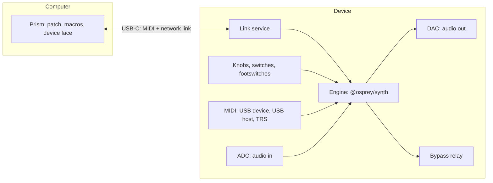

# Prism device [DEVICE]

Status: specified, not built. Delivery is tracked in the [Prism hardware plan](../../plans/prism-hardware.md). The typed models are in [device.td](../../designs/prism-device/device.td) and the hardware and face designs in [Prism device designs](../../designs/prism-device/README.md).

A Prism device is a small box that plays a Prism patch with no computer attached. It is either a **sound source** (MIDI in, audio out) or an **effects pedal** (audio in, audio out). It runs the synthesis engine from `@osprey/synth` and nothing else: no Prism, no screen, no editor. Its knobs and switches turn the patch's macros ([PRISM-INSTRUMENT]). Plugged into a computer, Prism shows which patch the device is playing, follows its knobs live and deploys a new patch to it.

Prism is the factory. The reference device below is one **profile**; a different box (a four-knob pedal, a sixteen-knob desktop synth) is a new profile and a new board, with the same engine, firmware and link.

## Device profile [DEVICE-PROFILE]

A profile is a typed description of one hardware design, declared in [device.td](../../designs/prism-device/device.td) and shipped with that design's firmware. It names the physical controls (kind, position on the panel, printed label area), the audio inputs and outputs with their channel layouts, the MIDI ports, the supported sample rates and block sizes, the patch slot count and the engine's measured cost budget. Prism reads the profile from the device itself ([DEVICE-LINK-HELLO]), so a device Prism has never seen still gets a correct face ([PRISM-INSTRUMENT-DEVICE]).

A profile is data. Adding a profile never changes the engine or Prism.

## Reference hardware [DEVICE-HW]

The reference design is an open hardware board around a Raspberry Pi compute module. The first prototype is a Raspberry Pi 5 with an audio board and breadboarded controls; the carrier board replaces both with the same parts, so the firmware does not change between them.

### Compute [DEVICE-HW-COMPUTE]

- Raspberry Pi Compute Module 5, 4 GB RAM, 16 GB eMMC, **without** the wireless option. No radio means a smaller attack surface and no radio certification. Prototype: Raspberry Pi 5, 4 GB.
- A heat spreader couples the module to the metal enclosure, so the audio core is never thermally throttled. Throttling is detected and reported ([DEVICE-ENGINE-FAULT]).

### Audio [DEVICE-HW-AUDIO]

- I2S audio from the module to a TI PCM5122 DAC and a TI PCM1863 ADC, 24-bit, 48 kHz by default and 96 kHz optional. The prototype uses a HiFiBerry DAC+ADC Pro, which carries the same two parts and has a mainline Linux device-tree overlay.
- The codec board owns the audio clocks from its own crystal oscillators and is the I2S clock master, so the clock does not depend on the module's PLL jitter.
- **Outputs:** stereo 6.35 mm (1/4") jacks at line level and a 3.5 mm headphone output with its own amplifier.
- **Inputs:** stereo 6.35 mm jacks. A switch selects **line** or **instrument** per input; instrument level goes through a 1 MΩ buffer with up to +20 dB of gain, so a guitar or bass plugs straight in.
- The analog section has its own low-noise regulator and ground plane, joined to digital ground at one point under the codec.

### True bypass [DEVICE-HW-BYPASS]

In effects-pedal role, a relay connects each input jack directly to its output jack whenever the effect is bypassed, the engine is restarting or the box has no power. The relay's unpowered state is bypass. A pedal that crashes, reboots or loses its power lead never cuts the player's signal.

### Controls [DEVICE-HW-CONTROLS]

- **Eight knobs:** 10 kΩ linear potentiometers read by an MCP3208 12-bit SPI ADC against a precision 3.0 V reference, not the 3.3 V rail.
- **Four toggle switches:** two two-way and two three-way, on GPIO with pull-ups.
- **Two footswitches:** soft-touch momentary, on GPIO. Left is bypass in effects-pedal role and a macro in sound-source role; right is the next patch slot or a macro, per patch ([DEVICE-CONTROLS-FOOT]).
- **LEDs:** one RGB status LED and one LED per footswitch.
- A test header carries each knob's wiper line, so the factory jig can drive the knobs electrically ([DEVICE-FACTORY-TEST]).

### MIDI [DEVICE-HW-MIDI]

- **USB-C device port:** the device is a class-compliant USB MIDI 1.0 device, so any computer, phone or tablet plays it with no driver. The same port carries the link to Prism ([DEVICE-LINK]) and can power the box.
- **USB-A host port:** class-compliant USB MIDI keyboards and controllers plug straight in.
- **TRS MIDI in and out (3.5 mm, Type A):** for hardware with DIN MIDI, through a standard TRS-to-DIN adapter. The input is opto-isolated as the MIDI electrical specification requires, on a UART at 31,250 baud.
- All three ports merge into one event stream with sample-accurate timestamps ([SYNTH-RENDER]). MIDI out echoes the device's own knob and switch moves as control changes, so the box can drive other gear.

### Power and enclosure [DEVICE-HW-POWER]

- 9–12 V DC, centre-negative 2.1 mm barrel (the pedalboard standard), at least 2 A, with reverse-polarity protection and a buck converter to 5 V. USB-C power is ORed in through an ideal diode, so the box runs from a computer alone when no pedal supply is plugged in.
- A Hammond 1590XX-size die-cast aluminium enclosure: knobs and toggles on the top face, footswitches at the player's end, jacks on the sides, USB at the back.
- The hardware sources (KiCad schematic and board, enclosure drilling, panel template) live in the repository. Gerbers, bills of materials and fabrication outputs are generated by the build, never committed ([REPO-NO-ARTIFACTS]).

## Firmware [DEVICE-OS]

The firmware is a minimal embedded Linux whose only job is to run the engine. It is not a general-purpose computer.

- **Built with Buildroot** from pinned sources: a mainline kernel with PREEMPT_RT, BusyBox, ALSA, the USB gadget stack and the engine. No package manager, no shell on any port, no login, no SSH, no Wi-Fi, no network service except the USB link.
- **Read-only root.** The system image is a read-only squashfs. Patches and settings live on a separate data partition, written atomically: write a new file, flush it, rename it over the old one. Pulling the power during a deploy leaves the previous patch playing on next boot.
- **A/B images.** An update writes the inactive image, boots it once, and keeps it only if the engine reports healthy audio within 10 s; otherwise the device falls back to the previous image ([DEVICE-LINK-UPDATE]).
- **Signed.** The updater accepts only images signed by the release key. Where the board's secure boot is enabled, the boot chain checks the same key.
- **Real-time audio.** One CPU core is isolated for audio. The audio thread runs at a real-time priority, pinned to that core, with its memory locked and no swap. It talks to the ALSA hardware device directly: no sound server, 64-frame periods, two periods.
- **Boot to sound in 5 s or less**, measured from power on to the first patch audible at the output.
- **Watchdog.** A hardware watchdog restarts the engine if the audio thread stops answering. In effects-pedal role the relay is in bypass for the whole restart ([DEVICE-HW-BYPASS]).

Bare-metal firmware is a possible later step behind the same engine boundary. Linux is the first step because its USB MIDI host and gadget drivers, I2S codec drivers and flash file systems already work on this hardware.

## Engine [DEVICE-ENGINE]

The engine is an Osprey program that links `@osprey/synth` and nothing else: no Prism, no `@osprey/native`, no UI, no VST3 host. It is compiled for 64-bit ARM Linux ([DEVICE-ENGINE-TARGET]) with ARC memory management. It loads a patch, prepares its graph and renders it block by block, under the same real-time contract as every other host ([SYNTH-RENDER]).

- **Patches are data ([DEVICE-ENGINE-DATA]).** A deployed patch is a `PatchDocument` ([SYNTH-GRAPH]): nodes, cables, macros and parameter values. The device never receives or runs code from a computer. Every patch is checked by the engine's own graph preparation before it plays, whatever Prism already checked.
- **Roles ([DEVICE-ENGINE-ROLES]).** A patch whose graph reads the device's audio input is an **effect**. A patch whose graph reads MIDI notes is a **source**. A patch can be both (a vocoder, a harmoniser). The device plays a patch in the role its graph declares; a patch that reads neither is refused.
- **Supported nodes ([DEVICE-ENGINE-NODES]).** The device runs the synth package's own processors. A patch containing a VST3 node, a node that needs a file the device does not hold, or a node the device's engine version does not know is refused at deploy, naming each node and why.
- **Budget ([DEVICE-ENGINE-BUDGET]).** Each processor kind has a measured cost per block on the profile's hardware, shipped in the profile. A patch is accepted only if its cost at the profile's maximum polyphony fits within 70% of one block's deadline. A refused patch names its most expensive nodes and their costs, so the user knows what to cut.
- **Patch changes ([DEVICE-ENGINE-SWAP]).** A new patch or slot is prepared outside the audio thread and swapped in at a block boundary with a 20 ms equal-power crossfade, so a change never clicks. Value-only edits keep every oscillator phase, filter state and delay line ([SYNTH-GRAPH-REPLACE]).
- **Faults ([DEVICE-ENGINE-FAULT]).** Non-finite output, a missed deadline, thermal throttling or a failed patch is a typed fault: the block is muted (or bypassed in effects-pedal role), the status LED shows the fault, a bounded counter records it, and the link reports it to Prism. The engine never exits on a fault ([FAILURE-EXPLICIT]).
- **The same engine on the computer ([DEVICE-ENGINE-VIRTUAL]).** The engine also builds for the computer as a **virtual device**: the same program, a virtual profile, audio to a file or the sound card, and the same link. Prism, the link and the deploy journeys are tested against it in CI with no hardware.

### ARM Linux target [DEVICE-ENGINE-TARGET]

`osprey --target=linux-arm64` compiles a program and its C runtime for `aarch64-unknown-linux-gnu`. It is a new compiler target, and the same rules apply as for every target: red stops the build ([COMPILER-RED-FAILS]), the runtime is hardened, and the test corpus runs on it under ARC. The corpus runs in CI on GitHub's ARM Linux runners, so no emulator is needed.

## Controls on the device [DEVICE-CONTROLS]

The device's knobs and switches are the patch's macros ([PRISM-INSTRUMENT-DEVICE]). A knob never addresses a module parameter directly.

- **Knob reading ([DEVICE-CONTROLS-KNOB]).** Each knob is sampled at 1 kHz, filtered with a median of three, and held with a hysteresis of 4 counts, so a knob at rest never jitters the sound. The reading maps to a macro amount from 0 to 1, which reaches the audio through the macro's smoothing ([PRISM-INSTRUMENT-SMOOTH]).
- **Pickup ([DEVICE-CONTROLS-PICKUP]).** A knob's position and the patch's saved macro amount usually differ after a patch loads. The saved amount holds until the knob passes through it, and then the knob takes over, so loading a patch never jumps the sound. Until the knob takes over, the status LED shows which way to turn it. A device setting replaces pickup with **jump**, where the knob takes over at once.
- **Switches ([DEVICE-CONTROLS-SWITCH]).** A two-way switch sets 0 or 1 and a three-way switch 0, 0.5 or 1. Switches have no pickup: the switch is always right.
- **Footswitches ([DEVICE-CONTROLS-FOOT]).** A press is debounced for 5 ms. In effects-pedal role, left is bypass. Each footswitch assignment is **toggle** (press flips the macro between 0 and 1) or **hold** (1 while held). A long press of 1 s on the right footswitch moves to the next patch slot.
- **MIDI ([DEVICE-CONTROLS-MIDI]).** Program change *n* selects slot *n*. MIDI learn bindings deployed with the patch ([PRISM-INSTRUMENT-REMOTE]) move their macros on the device exactly as in Prism. A knob and a MIDI controller on one macro follow the last one moved.

## Link to Prism [DEVICE-LINK]

The USB-C port is a composite USB device: a USB MIDI port and a USB network link. The link is the only network the device has. The device answers on that link only, at a link-local address, and is found through mDNS on that interface. Messages are declared in [device.td](../../designs/prism-device/device.td) and encoded as tdbin, each frame length-prefixed and refused above 1 MiB.

- **Hello ([DEVICE-LINK-HELLO]).** On connect the device sends its serial number, firmware and engine versions, profile, active slot and each slot's patch hash and name.
- **What is playing ([DEVICE-LINK-SHOW]).** Prism's Devices panel lists each connected device and the patch it is playing. If the hash matches a patch in the open project, Prism opens that patch on its device face. Otherwise Prism fetches the patch from the device and opens it as a new unsaved patch, so nothing the device plays is ever unknown to its owner.
- **Live ([DEVICE-LINK-LIVE]).** Knob, switch and footswitch moves stream to Prism, and the device face follows them on screen. Macro edits in Prism stream to the device and are heard at once, with no redeploy. Meters and faults arrive at 30 Hz.
- **Deploy ([DEVICE-LINK-DEPLOY]).** **Deploy to device** sends the patch, its device face assignments and its MIDI bindings to a chosen slot. Prism checks the patch against the profile first and shows every refusal before sending. The device checks again ([DEVICE-ENGINE-DATA]), writes the slot atomically and answers **deployed** with the new hash or **refused** with each reason. A refused deploy leaves every slot as it was.
- **Firmware update ([DEVICE-LINK-UPDATE]).** Prism sends a signed image over the link to the inactive A/B image ([DEVICE-OS]) and shows the result after the device reboots and reports healthy.
- **Safety ([DEVICE-LINK-SAFETY]).** Being plugged in by USB is the trust boundary: there is no wireless or wired network to reach the device from elsewhere. The decoder checks every length and value before it allocates. No message can run code, name a file or change the firmware without a valid signature. A malformed message is refused with its reason and the link stays up.

## Factory [DEVICE-FACTORY]

Prism turns a patch into a product. The factory workflow builds the same device many times, each one tested.

- **Product bundle ([DEVICE-FACTORY-BUNDLE]).** A bundle is a profile, a firmware image and the patches for each slot, with their faces. It is built by `make` from the repository and the project file, and never committed.
- **Provisioning ([DEVICE-FACTORY-PROVISION]).** A provisioning command flashes the bundle to a new board over USB, writes its serial number and runs the device test. A board that fails any step is marked failed and never shipped with a partial image.
- **Device test ([DEVICE-FACTORY-TEST]).** A jig cables each output to an input and drives each knob's wiper from the test header. The test plays a known patch, sweeps every knob and switch, and checks that each one moves its macro, that the audio round trip is within its measured gain and noise, that MIDI in and out loop back, and that the relay bypasses with the power off. The test writes a report per serial number.
- **Panel artwork ([DEVICE-FACTORY-PANEL]).** The device face's printable overlay ([PRISM-INSTRUMENT-DEVICE-LABELS]) is the product's control labelling.

## Proof obligations [DEVICE-PROOFS]

Per the repository's proof rule, every part of the device that can be formally verified with Osprey's proof kernel is, against the shipped Osprey source:

- Knob reading: the filtered and held value stays within 0 to 1 and does not change while the raw reading moves less than the hysteresis.
- Pickup: before takeover the macro amount equals the saved amount, and takeover changes the amount by no more than one knob step.
- Budget: an accepted patch's summed cost is within its stated share of the deadline.
- Frame decoder: no decoded length exceeds the frame, and no frame exceeds 1 MiB.

Each proof must fail on a relevant mutation of the source, and runs in CI.

## Verification [DEVICE-VERIFY]

- **Virtual device journeys** in CI: connect Prism to the virtual device, read Hello, deploy many patches to many slots, refuse unsupported nodes, over-budget patches and malformed frames with their reasons, move every control and check every macro and the rendered audio, swap patches without a click (no sample step above the crossfade bound), and survive engine faults.
- **ARM Linux corpus:** the full test corpus under ARC on `linux-arm64`.
- **Hardware journeys** run locally on a connected device through `make` targets, not in CI, until a hardware runner exists: boot to sound time, round-trip latency at 64 frames (target under 5 ms), 24 hours without a missed deadline at full budget, power pulled during deploy and during update, bypass with the power off.
