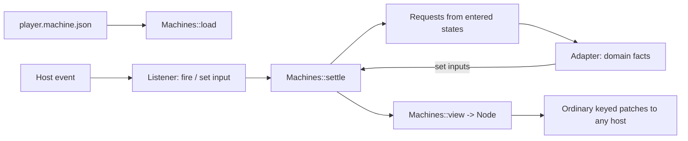

# UI machines

Spec · 1 November 2026 · [UI-MACHINE]

An Osprey Native interface can be **data, not code**: one machine document holds the inputs, the state machines, the view and the skins. A designer ships one file and every platform plays it. The document is JSON, and `ui::Machines` in [`@osprey/native`](../../../packages/native/README.md) interprets it. The interpreter turns the document and its current inputs into ordinary `Node` trees, so every host that speaks [UI-PROTOCOL] (GPUI, WinUI, VS Code, Apple, Android) renders a machine with no change. The application code that remains is a small adapter: it feeds domain facts in as inputs and answers the requests a state makes.



## Document [UI-MACHINE-DOC]

```json
{
  "schema": 1,
  "name": "casting-player",
  "inputs": { "...": "[UI-MACHINE-INPUTS]" },
  "layers": [ { "...": "[UI-MACHINE-LAYERS]" } ],
  "view": { "...": "[UI-MACHINE-VIEW]" },
  "skins": { "...": "[UI-MACHINE-SKINS]" }
}
```

`schema` must be `1`. A document is validated completely when it loads, and a fault is refused with an error naming its JSON path, such as `layers[0].transitions[3].to: no state named "plaing"`. Nothing is partly applied, and an unknown member, kind or input is an error, not something to ignore ([FAILURE-EXPLICIT]). A document holds no code, URLs, scripts or expressions beyond the condition forms below.

## Inputs [UI-MACHINE-INPUTS]

Inputs are the machine's whole state besides the layers' current states.

| Type | Value | Notes |
| --- | --- | --- |
| `bool` | `true` / `false` | |
| `number` | a JSON number | Held as a float |
| `text` | a string | |
| `trigger` | — | Set by firing; consumed when a settle finishes |
| `list` | an array of `{"key", "label"}` | Choices for a picker, such as discovered receivers |

`"inputs": {"position": {"type": "number", "value": 0}}` declares an input with its initial value. Both a listener and the adapter set inputs; neither can set an undeclared one, or one of the wrong type.

## Layers, states and transitions [UI-MACHINE-LAYERS]

```json
{
  "name": "playback",
  "initial": "empty",
  "states": {
    "ready":      { "enter": [] },
    "connecting": { "enter": [ { "request": "cast.start", "with": ["file", "receiver"] } ] }
  },
  "transitions": [
    { "from": "ready", "to": "connecting", "when": { "fired": "play" } },
    { "from": "*",     "to": "failed",     "when": { "input": "error", "ne": "" } }
  ]
}
```

Layers run in parallel; each has exactly one current state. A **settle** follows each change of inputs:

1. For each layer in document order, the first transition whose `from` is the current state (or `*`, unless the target is already current) and whose `when` holds moves the layer to `to`, and the entered state's `enter` requests are collected in order.
2. Triggers are cleared after the first round, so a trigger fires at most one transition per layer.
3. Step 1 repeats until no transition fires. More than 32 rounds is reported as a fault, so a cycle is reported rather than spun.

A request is `{"request": name, "with": [input names]}`. The adapter receives its name and the inputs' values at the moment of entry, does the work, and reports the results by setting inputs. A request never names a host capability; the adapter decides how to do it.

### Conditions [UI-MACHINE-WHEN]

| Form | Holds when |
| --- | --- |
| `{"input": n, "eq": v}` / `"ne"` / `"lt"` / `"gt"` | Comparing input `n` with the literal `v` (`lt`/`gt` only for numbers) |
| `{"fired": t}` | Trigger `t` fired since the last settle |
| `{"state": layer, "in": [names]}` | That layer's current state is listed |
| `{"all": [c…]}` / `{"any": [c…]}` / `{"not": c}` | The usual connectives |

## View [UI-MACHINE-VIEW]

The view is one node template in the protocol's vocabulary: `stack`, `text`, `label`, `badge`, `button`, `picker`, `toggle`, `meter`, `progress`, `image`, `spacer`, `divider`, `framed`, `scene` (the disc, with `rotate` bound to an input) and `empty`. Its members are the matching `Ui` constructor's arguments. Every node may also carry:

- `"when": condition`: a node whose condition fails is left out, along with its children.
- `"{{name}}"` inside any string member: the input's value, with a filter: `{{position|clock}}` is `mm:ss`, `{{volume|percent}}` a whole percentage, `{{rate|short}}` a number without a trailing `.0`, `{{position|over:duration:610:129}}` position ÷ duration × 610 + 129, and `{{volume|scale:302:99}}` volume × 302 + 99. The last two place canvas shapes. `{{title|fit:30}}` cuts the text to at most 30 characters, replacing the last with an ellipsis when cut. `{{receivers|count:56:16}}` is the list input's length × 56 + 16, used to size a menu panel. `{{level|fixed:0:1000:0}}` writes level × 1000 + 0 with exactly 0 decimals; `{{control|fixed:2}}` writes 0.7 as `0.70`. `{{process|expo:1:0.02:20}}` sweeps exponentially: 0.02 × (20 ÷ 0.02)^process with one decimal, so 0.7 writes `2.5`, for a cutoff from 20 Hz to 20 kHz. Anything else, such as a track title, is an input the adapter sets.
- `"enabled": condition` on controls.
- `"on"`: the listener. `{"fire": t}` fires a trigger; `{"set": n}` sets an input from the control's value: the choice key of a picker, a toggle's flag or a button's literal `"value"`. With both, the input is set first and then the trigger fires, so one press can choose a value and ask for it.

A `scene` draws `shapes`: `{"shape": "disc", "x", "y", "radius"}` or a rectangle `{"x", "y", "w", "h", "angle", "turn"}` centred on its position and rotated by `angle + turn` radians, drawn as a filled polygon so every host can turn it. Each takes a `colour` (`#RRGGBB`, or `@token` from the chosen skin, either of which may be a `{{template}}`, so `@{{processHealth}}` picks the token an input names), an `alpha` from 0 to 1 and a `depth`; any number may be a `{{template}}`, so a rectangle can turn with an input.

Each control's binding is the framework's ordinary typed binding, so ordinals, staleness and kind checks are exactly [UI-EVENTS]. Regions remain keyed by the template's top-level children.

## Skins [UI-MACHINE-SKINS]

`"skins": {"sherbet": {"name": "Sherbet Signal", "tokens": {...}, "motion": "disc"}}` maps a skin id to [UI-THEME] tokens and a motion preset. The text input `skin` chooses the skin. An unknown skin falls back to the first skin and sets the text input `skinFault`. A skin without a canvas is only colours and motion, never layout, controls or labels. Swapping any skin keeps every input and state.

## Canvas skins [UI-MACHINE-CANVAS]

A skin may carry `"canvas": {"width", "height", "atlas": [image paths relative to the `assets` input], "shapes": [...], "listeners": [...]}`. When the chosen skin has a canvas, the whole view is one scene drawn from the canvas instead of the native view template. Units are the artboard's own mock pixels; the host scales the artboard to the window.

| Shape | Members and form |
| --- | --- |
| `sprite` | `index`, `x`, `y`, `w`, `h`, `angle`, `alpha`, `depth`; an atlas image |
| `text` | `text`, `x`, `y`, `size`, `colour`, `anchor`, `weight`, `depth`; system-font lettering with the top of the line at `y`, anchored 0 left, 1 centre or 2 right |
| `rounded` | `x`, `y`, `w`, `h`, `radius`, `colour`, `alpha`, `depth`, optional `stroke`; a rounded rectangle, filled, or outlined `stroke` wide |
| `triangle` | `x`, `y`, `w`, `h`, `colour`, `alpha`, `depth` |
| `disc` | `x`, `y`, `radius`, `colour`, `alpha`, `depth` |
| `turned` | `x`, `y`, `w`, `h`, `angle`, `turn`, `colour`, `alpha`, `depth`; a sprite rotated by an input, used for the spinning disc |

Every shape takes `when` and templated numbers. Listeners are hit areas `{"x","y","w","h","when","on"}` with the same `on` lever as view controls, or `"slide": {"set", "min", "max", "fire", "of"}` for a slider whose pointer position across the area sets the input between `min` and `max`; `of` names the input the slider shows, used by the accessibility tree. A release inside the first listener in document order whose area holds the point and whose `when` holds acts. The host sends pointer events in scene units.

## Repeated shapes and listeners [UI-MACHINE-EACH]

A shape or listener with `"each": {"in": listInput, "dx": n, "dy": n}` is stamped once per item of the list input. `{{item.key}}`, `{{item.label}}` and `{{item.index}}` are replaced inside every string member, and numeric `x` and `y` are offset by index × `dx` and index × `dy`. The casting player's receiver menu row is:

```json
{
  "x": 263, "y": 790, "w": 340, "h": 56,
  "each": { "in": "receivers", "dy": 56 },
  "role": "menuitem",
  "label": "{{item.label}}",
  "on": { "set": "receiver", "value": "{{item.key}}", "fire": "chooseReceiver" },
  "when": { "state": "menu", "in": ["receivers"] }
}
```

## Menus [UI-MACHINE-MENU]

The casting player's dropdowns use a `menu` layer with states `closed`, `receivers` and `rates`. Popup listeners fire toggle triggers. Row listeners repeated with `each` set the input and fire a choose trigger, which also closes the menu. A full-canvas dismiss listener with `role: none` fires `dismiss` whenever the menu is not closed; its document order leaves the row and popup hit areas ahead of it.

```json
[
  { "from": "receivers", "to": "closed", "when": { "any": [{ "fired": "toggleReceivers" }, { "fired": "chooseReceiver" }, { "fired": "dismiss" }] } },
  { "from": "rates", "to": "closed", "when": { "any": [{ "fired": "toggleRates" }, { "fired": "chooseRate" }, { "fired": "dismiss" }] } },
  { "from": "*", "to": "receivers", "when": { "fired": "toggleReceivers" } },
  { "from": "*", "to": "rates", "when": { "fired": "toggleRates" } }
]
```

## Accessibility [UI-MACHINE-A11Y]

Every listener carries `role` (`button`, `slider`, `popup`, `menuitem`, or `none` for a hit area that is not announced) and a templated `label`. `Templates::semantics machine` is the accessibility tree: a JSON list, in hit order, of every live listener with role ≠ `none` as `{role, label, x, y, w, h}`, plus `value` for a slider (the `of` input).

`Templates::act (machine, label, fraction)` activates the element with that label as a screen reader or an AI agent would: a slider is set `fraction` of the way across, anything else is pressed, and an unknown label changes nothing. Hosts map the tree to the platform's accessibility API (AccessKit: NSAccessibility on macOS, UI Automation on Windows, AT-SPI on Linux). This host mapping is specified here and is not yet implemented. Tests and agents read and act on the tree without a host.

## Opened files [UI-MACHINE-OPEN]

A file the platform asks the application to open (Finder, a document association) arrives as the lifecycle phase `open:<path>`; the application's adapter decides what to do with it. The GPUI host collects `on_open_urls` and delivers each on the next frame.

## Testing [UI-MACHINE-TEST]

Because a machine is data, a test drives it without a host: load the document, set inputs or fire listeners as a host event would, and assert the states, the requests and the rendered nodes. The adapter's domain work runs under effects, so tests answer them with doubles. [examples/casting](../../../examples/casting/README.md) is the reference application: its adapter calls `@osprey/chromecast`, whose `Wire` effect a test answers with an in-memory Cast device. `examples/casting/test/main.ospml` drives the Sherbet canvas through pointer events alone, locating every control by its accessible label from `semantics`, and asserts the lettered text of the artboard and the labels offered in each state.

## Signal flow [UI-MACHINE-FLOW]

[`@osprey/signal_flow`](../../../packages/signal_flow/README.md) is a signal-flow graph editor written as one machine document. Five nodes in fixed roles (control, source, process, output and monitor) are joined by three signal connections and one modulation connection. Each node has an `<role>On` switch, and the control and process nodes each have a parameter from 0 to 1. Pressing a node selects it into the inspector. The adapter answers `flow.record`, `flow.undo` and `flow.redo`. It evaluates the path after every change and feeds back `level`, `delivered`, `monitored`, each node's health (`Healthy`, `Degraded`, `Offline` or `Bypassed`) and `canUndo`/`canRedo`. A bypassed process passes its input through unchanged.

### Skins [UI-MACHINE-FLOW-SKINS]

The four skins, Topology, Notation, Paper and Prism, are canvases sliced from the designs in `packages/signal_flow/design/` by `skins/build.py`. Each backdrop is its mock with every live part painted out. The canvas then draws the switches, sliders, values, health rows, selection ring, bypass dimming, ports and the whole inspector from the inputs. The title opens a menu of the four skins. Changing skin keeps every input, state and the undo history.

## Later

A host may interpret the document natively, so that only input changes cross the boundary. The document and the conditions are designed to make that possible; it is not implemented.
