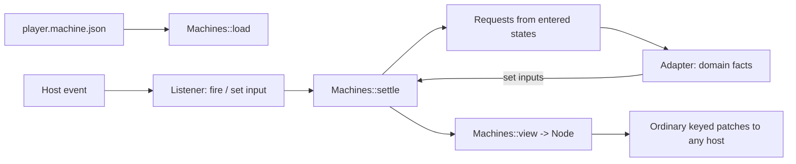

# UI machines

Spec · 1 November 2026 · [UI-MACHINE]

An Osprey Native interface can be **data, not code**: one machine document holds the inputs, the state machines, the view and the skins. It takes its cues from Rive, where a designer ships one file with artboards, state machines and inputs, and every platform's runtime plays it. Here the document is JSON, and `ui::Machines` in [`@osprey/native`](../../../packages/native/README.md) interprets it. The interpreter turns the document and its current inputs into ordinary `Node` trees, so every host that speaks [UI-PROTOCOL] (GPUI, WinUI, VS Code, Apple, Android) renders a machine with no change. The application code that remains is a small adapter: it feeds domain facts in as inputs and answers the requests a state makes.



## Document [UI-MACHINE-DOC]

```json
{
  "schema": 1,
  "name": "casting-player",
  "inputs": { "...": "[UI-MACHINE-INPUTS]" },
  "layers": [ { "...": "[UI-MACHINE-LAYERS]" } ],
  "view": { "...": "[UI-MACHINE-VIEW]" },
  "skins": { "...": "[UI-MACHINE-SKINS]" }
}
```

`schema` must be `1`. A document is validated completely when it loads, and a fault is refused with an error naming its JSON path, such as `layers[0].transitions[3].to: no state named "plaing"`. Nothing is partly applied, and an unknown member, kind or input is an error, not something to ignore ([FAILURE-EXPLICIT]). A document holds no code, URLs, scripts or expressions beyond the condition forms below.

## Inputs [UI-MACHINE-INPUTS]

Inputs are the machine's whole state besides the layers' current states, like Rive's inputs and view-model properties.

| Type | Value | Notes |
| --- | --- | --- |
| `bool` | `true` / `false` | |
| `number` | a JSON number | Held as a float |
| `text` | a string | |
| `trigger` | — | Set by firing; consumed when a settle finishes |
| `list` | an array of `{"key", "label"}` | Choices for a picker, such as discovered receivers |

`"inputs": {"position": {"type": "number", "value": 0}}` declares an input with its initial value. Both a listener and the adapter set inputs; neither can set an undeclared one, or one of the wrong type.

## Layers, states and transitions [UI-MACHINE-LAYERS]

```json
{
  "name": "playback",
  "initial": "empty",
  "states": {
    "ready":      { "enter": [] },
    "connecting": { "enter": [ { "request": "cast.start", "with": ["file", "receiver"] } ] }
  },
  "transitions": [
    { "from": "ready", "to": "connecting", "when": { "fired": "play" } },
    { "from": "*",     "to": "failed",     "when": { "input": "error", "ne": "" } }
  ]
}
```

Layers run in parallel, as Rive's state machine layers do; each has exactly one current state. A **settle** follows each change of inputs:

1. For each layer in document order, the first transition whose `from` is the current state (or `*`, unless the target is already current) and whose `when` holds moves the layer to `to`, and the entered state's `enter` requests are collected in order.
2. Triggers are cleared after the first round, so a trigger fires one transition per layer, as a Rive trigger does.
3. Step 1 repeats until no transition fires. More than 32 rounds is reported as a fault, so a cycle is reported rather than spun.

A request is `{"request": name, "with": [input names]}`. The adapter receives its name and the inputs' values at the moment of entry, does the work, and reports the results by setting inputs. A request never names a host capability; the adapter decides how to do it.

### Conditions [UI-MACHINE-WHEN]

| Form | Holds when |
| --- | --- |
| `{"input": n, "eq": v}` / `"ne"` / `"lt"` / `"gt"` | Comparing input `n` with the literal `v` (`lt`/`gt` only for numbers) |
| `{"fired": t}` | Trigger `t` fired since the last settle |
| `{"state": layer, "in": [names]}` | That layer's current state is listed |
| `{"all": [c…]}` / `{"any": [c…]}` / `{"not": c}` | The usual connectives |

## View [UI-MACHINE-VIEW]

The view is one node template in the protocol's vocabulary: `stack`, `text`, `label`, `badge`, `button`, `picker`, `toggle`, `meter`, `progress`, `image`, `spacer`, `divider`, `framed`, `scene` (the disc, with `rotate` bound to an input) and `empty`. Its members are the matching `Ui` constructor's arguments. Every node may also carry:

- `"when": condition`: a node whose condition fails is left out, along with its children.
- `"{{name}}"` inside any string member: the input's value, with a filter: `{{position|clock}}` is `m:ss` and `{{volume|percent}}` is a whole percentage. Anything else, such as a track title, is an input the adapter sets.
- `"enabled": condition` on controls.
- `"on"`: the listener. `{"fire": t}` fires a trigger; `{"set": n}` sets an input from the control's value: the choice key of a picker, a toggle's flag or a button's literal `"value"`. With both, the input is set first and then the trigger fires, so one press can choose a value and ask for it.

A `scene` draws `shapes`: `{"shape": "disc", "x", "y", "radius"}` or a rectangle `{"x", "y", "w", "h", "angle", "turn"}` centred on its position and rotated by `angle + turn` radians, drawn as a filled polygon so every host can turn it. Each takes a `colour` (`#RRGGBB`, or `@token` from the chosen skin), an `alpha` from 0 to 1 and a `depth`; any number may be a `{{template}}`, so a rectangle can turn with an input.

Each control's binding is the framework's ordinary typed binding, so ordinals, staleness and kind checks are exactly [UI-EVENTS]. Regions remain keyed by the template's top-level children.

## Skins [UI-MACHINE-SKINS]

`"skins": {"sherbet": {"name": "Sherbet Signal", "tokens": {...}, "motion": "disc"}}` maps a skin id to [UI-THEME] tokens and a motion preset. The text input `skin` chooses the skin. An unknown skin falls back to the first skin and sets the text input `skinFault`. A skin is only colours and motion, never layout, controls or labels, so swapping it keeps every input and state.

## Testing [UI-MACHINE-TEST]

Because a machine is data, a test drives it without a host: load the document, set inputs or fire listeners as a host event would, and assert the states, the requests and the rendered nodes. The adapter's domain work runs under effects, so tests answer them with doubles. [examples/casting](../../../examples/casting/README.md) is the reference application: its adapter calls `@osprey/chromecast`, whose `Wire` effect a test answers with an in-memory Cast device.

## Later

A host may interpret the document natively, so that only input changes cross the boundary. The document and the conditions are designed to make that possible; it is not implemented.
