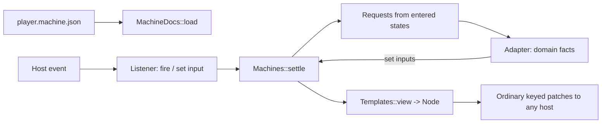

# UI machines

Spec · 1 November 2026 · [UI-MACHINE]

An Osprey Native interface can be **data, not code**: one machine document holds the inputs, the state machines, the view and the skins. A designer ships one file and every platform plays it. The document is JSON. In [`@osprey/native`](../../../packages/native/README.md), `ui::MachineDocs::load` checks it and decodes it once into typed records (`Value`, `Condition`, `MachineLayer`, `Template`, `Stamp`, `Area`, `Skin`). `ui::Machines` settles those records and `ui::Templates` and `ui::Canvases` render them, and nothing past the decoder reads JSON. The interpreter turns the document and its current inputs into ordinary `Node` trees, so every host that speaks [UI-PROTOCOL] (GPUI, WinUI, VS Code, Apple, Android) renders a machine with no change. The application code that remains is a small adapter: it feeds domain facts in as inputs and answers the requests a state makes.



## Document [UI-MACHINE-DOC]

```json
{
  "schema": 1,
  "name": "casting-player",
  "inputs": { "...": "[UI-MACHINE-INPUTS]" },
  "layers": [ { "...": "[UI-MACHINE-LAYERS]" } ],
  "view": { "...": "[UI-MACHINE-VIEW]" },
  "skins": { "...": "[UI-MACHINE-SKINS]" }
}
```

`schema` must be `1`. A document is validated completely when it loads, and a fault is refused with an error naming its JSON path, such as `layers[0].transitions[3].to: no state named "plaing"`. Nothing is partly applied, and an unknown member, kind or input is an error, not something to ignore ([FAILURE-EXPLICIT]). A document holds no code, URLs, scripts or expressions beyond the condition forms below.

## Inputs [UI-MACHINE-INPUTS]

Inputs are the machine's whole state besides the layers' current states.

| Type | Value | Notes |
| --- | --- | --- |
| `bool` | `true` / `false` | |
| `number` | a JSON number | Held as a float |
| `text` | a string | |
| `trigger` | — | Set by firing; consumed when a settle finishes |
| `list` | an array of `{"key", "label"}` | Choices for a picker, such as discovered receivers |

`"inputs": {"position": {"type": "number", "value": 0}}` declares an input with its initial value. Both a listener and the adapter set inputs; neither can set an undeclared one, or one of the wrong type.

## Layers, states and transitions [UI-MACHINE-LAYERS]

```json
{
  "name": "playback",
  "initial": "empty",
  "states": {
    "ready":      { "enter": [] },
    "connecting": { "enter": [ { "request": "cast.start", "with": ["file", "receiver"] } ] }
  },
  "transitions": [
    { "from": "ready", "to": "connecting", "when": { "fired": "play" } },
    { "from": "*",     "to": "failed",     "when": { "input": "error", "ne": "" } }
  ]
}
```

Layers run in parallel; each has exactly one current state. A **settle** follows each change of inputs:

1. For each layer in document order, the first transition whose `from` is the current state (or `*`, unless the target is already current) and whose `when` holds moves the layer to `to`, and the entered state's `enter` requests are collected in order.
2. Triggers are cleared after the first round, so a trigger fires at most one transition per layer.
3. Step 1 repeats until no transition fires. More than 32 rounds is reported as a fault, so a cycle is reported rather than spun.

A request is `{"request": name, "with": [input names]}`. The adapter receives its name and the inputs' values at the moment of entry, does the work, and reports the results by setting inputs. A request never names a host capability; the adapter decides how to do it.

### Conditions [UI-MACHINE-WHEN]

| Form | Holds when |
| --- | --- |
| `{"input": n, "eq": v}` / `"ne"` / `"lt"` / `"gt"` | Comparing input `n` with the literal `v` (`lt`/`gt` only for numbers) |
| `{"fired": t}` | Trigger `t` fired since the last settle |
| `{"state": layer, "in": [names]}` | That layer's current state is listed |
| `{"all": [c…]}` / `{"any": [c…]}` / `{"not": c}` | The usual connectives |

## View [UI-MACHINE-VIEW]

The view is one node template in the protocol's vocabulary: `stack`, `text`, `label`, `badge`, `button`, `picker`, `toggle`, `meter`, `progress`, `image`, `spacer`, `divider`, `framed`, `scene` (the disc, with `rotate` bound to an input) and `empty`. Its members are the matching `Ui` constructor's arguments. Every node may also carry:

- `"when": condition`: a node whose condition fails is left out, along with its children.
- `"{{name}}"` inside any string member: the input's value, with a filter: `{{position|clock}}` is `mm:ss`, `{{volume|percent}}` a whole percentage, `{{rate|short}}` a number without a trailing `.0`, `{{position|over:duration:610:129}}` position ÷ duration × 610 + 129, and `{{volume|scale:302:99}}` volume × 302 + 99. The last two place canvas shapes. `{{title|fit:30}}` cuts the text to at most 30 characters, replacing the last with an ellipsis when cut. `{{receivers|count:56:16}}` is the list input's length × 56 + 16, used to size a menu panel. `{{level|fixed:0:1000:0}}` writes level × 1000 + 0 with exactly 0 decimals; `{{control|fixed:2}}` writes 0.7 as `0.70`. `{{process|expo:1:0.02:20}}` sweeps exponentially: 0.02 × (20 ÷ 0.02)^process with one decimal, so 0.7 writes `2.5`, for a cutoff from 20 Hz to 20 kHz. Anything else, such as a track title, is an input the adapter sets.
- `"enabled": condition` on controls.
- `"on"`: the listener. `{"fire": t}` fires a trigger; `{"set": n}` sets an input from the control's value: the choice key of a picker, a toggle's flag or a button's literal `"value"`. With both, the input is set first and then the trigger fires, so one press can choose a value and ask for it.

A `scene` draws `shapes`: `{"shape": "disc", "x", "y", "radius"}` or a rectangle `{"x", "y", "w", "h", "angle", "turn"}` centred on its position and rotated by `angle + turn` radians, drawn as a filled polygon so every host can turn it. Each takes a `colour` (`#RRGGBB`, or `@token` from the chosen skin, either of which may be a `{{template}}`, so `@{{processHealth}}` picks the token an input names), an `alpha` from 0 to 1 and a `depth`; any number may be a `{{template}}`, so a rectangle can turn with an input.

Each control's binding is the framework's ordinary typed binding, so ordinals, staleness and kind checks are exactly [UI-EVENTS]. Regions remain keyed by the template's top-level children.

## Skins [UI-MACHINE-SKINS]

`"skins": {"sherbet": {"name": "Sherbet Signal", "tokens": {...}, "motion": "disc"}}` maps a skin id to [UI-THEME] tokens and a motion preset. The text input `skin` chooses the skin. An unknown skin falls back to the first skin and sets the text input `skinFault`. A skin without a canvas is only colours and motion, never layout, controls or labels. Swapping any skin keeps every input and state.

## Canvas skins [UI-MACHINE-CANVAS]

A skin may carry `"canvas": {"width", "height", "atlas": [image paths relative to the `assets` input], "shapes": [...], "listeners": [...]}`. When the chosen skin has a canvas, the whole view is one scene drawn from the canvas instead of the native view template. Units are the artboard's own mock pixels, drawn at the canvas's fixed `zoom` (default 1) window pixels per unit from the region's top left; resizing the window only reveals more or less of it. A `zoom` of 0 fits the canvas to the window whole, so it grows and shrinks with it. At a fixed zoom a larger window gives the canvas room instead: the host reports the region's size in canvas units, the machine keeps it as `viewWidth` and `viewHeight` where it declares them, and `spareWidth` and `spareHeight` as how far the region outgrows the canvas's own `width` and `height`, never below 0. The scene grows by that room, and a shape or listener adds `{{spareWidth}}` or `{{spareHeight}}` to its position to stay with the region's right or bottom edge at its own size. The Prism skin does: its inspector and the header's undo move right, its legend and keyboard deck move down, and the graph between them is a grid larger than any window, so the room is more grid to place nodes on.

| Shape | Members and form |
| --- | --- |
| `sprite` | `index`, `x`, `y`, `w`, `h`, `angle`, `alpha`, `depth`; an atlas image |
| `text` | `text`, `x`, `y`, `size`, `colour`, `anchor`, `weight`, `depth`; system-font lettering with the top of the line at `y`, anchored 0 left, 1 centre or 2 right |
| `rounded` | `x`, `y`, `w`, `h`, `radius`, `colour`, `alpha`, `depth`, optional `stroke`; a rounded rectangle, filled, or outlined `stroke` wide |
| `triangle` | `x`, `y`, `w`, `h`, `colour`, `alpha`, `depth` |
| `disc` | `x`, `y`, `radius`, `colour`, `alpha`, `depth` |
| `turned` | `x`, `y`, `w`, `h`, `angle`, `turn`, `colour`, `alpha`, `depth`; a sprite rotated by an input, used for the spinning disc |
| `polyline` | `points` as `[[x, y], ...]`, `stroke`, `colour`, `alpha`, `depth`; a line through the points |
| `cable` | `points` as two ends `[[x1, y1], [x2, y2]]`, `stroke`, `colour`, `depth`, optional `dash` and arrow `size`; a curve that leaves and enters along whichever axis its ends are further apart on, dashed `dash` on and off, with an arrowhead at its middle |

Every shape takes `when` and templated numbers. A templated number may fill to several numbers separated by spaces, which add: `"{{sourceX}} 314"` is 314 moved by the `sourceX` input. Listeners are hit areas `{"x","y","w","h","when","on"}` with the same `on` lever as view controls, or `"slide": {"set", "min", "max", "fire", "of"}` for a slider whose pointer position across the area sets the input between `min` and `max`; `of` names the input the slider shows, used by the accessibility tree. The host sends pointer events in scene units, each pressed or not ([UI-MACHINE-DRAG]).

### Dragging [UI-MACHINE-DRAG]

A press grips the first listener in document order whose area holds the point and whose `when` holds. The release then acts on the listener under it, once. A move with nothing pressed is a hover and changes nothing. A listener with `"drag": {"x": numberInput, "y": numberInput}` drags those inputs: once the pointer has moved more than 4 units from the press, each move sets them so the grabbed point stays under the pointer, and the release leaves them there without acting. A press that stays within 4 units is still a click. A slider follows the pointer without firing while held, and its release sets it once more and fires. `Canvases::holding` and `Canvases::sliding` tell an adapter that the pointer is down, so it can wait for the release before reacting.

## Repeated shapes and listeners [UI-MACHINE-EACH]

A shape or listener with `"each": {"in": listInput, "dx": n, "dy": n}` is stamped once per item of the list input. `{{item.key}}`, `{{item.label}}` and `{{item.index}}` are replaced inside every string member, and numeric `x` and `y` are offset by index × `dx` and index × `dy`. The casting player's receiver menu row is:

```json
{
  "x": 263, "y": 790, "w": 340, "h": 56,
  "each": { "in": "receivers", "dy": 56 },
  "role": "menuitem",
  "label": "{{item.label}}",
  "on": { "set": "receiver", "value": "{{item.key}}", "fire": "chooseReceiver" },
  "when": { "state": "menu", "in": ["receivers"] }
}
```

## Menus [UI-MACHINE-MENU]

The casting player's dropdowns use a `menu` layer with states `closed`, `receivers` and `rates`. Popup listeners fire toggle triggers. Row listeners repeated with `each` set the input and fire a choose trigger, which also closes the menu. A full-canvas dismiss listener with `role: none` fires `dismiss` whenever the menu is not closed; its document order leaves the row and popup hit areas ahead of it.

```json
[
  { "from": "receivers", "to": "closed", "when": { "any": [{ "fired": "toggleReceivers" }, { "fired": "chooseReceiver" }, { "fired": "dismiss" }] } },
  { "from": "rates", "to": "closed", "when": { "any": [{ "fired": "toggleRates" }, { "fired": "chooseRate" }, { "fired": "dismiss" }] } },
  { "from": "*", "to": "receivers", "when": { "fired": "toggleReceivers" } },
  { "from": "*", "to": "rates", "when": { "fired": "toggleRates" } }
]
```

## Accessibility [UI-MACHINE-A11Y]

Every listener carries `role` (`button`, `slider`, `popup`, `menuitem`, or `none` for a hit area that is not announced) and a templated `label`. A `none` listener only repeats what an announced one does, such as a click away from an open menu, which its popup also closes. A label says what the element does and is never cut short by an empty value or repeated, so an agent reading the tree can tell every element apart: `Semantics::unclear` is empty in each app's suite. An element with `drag` is `movable`. `Canvases::semantics machine` is the accessibility tree: a typed `Accessible` list, in hit order, of every live listener whose role is not `none`. Each element has `accessRole`, the filled `accessLabel`, its bounds and, for a slider, `accessValue` (the `of` input). `Canvases::roleName` gives the role's name for a host.

`Canvases::act (machine, label, fraction)` activates the element with that label as a screen reader or an AI agent would: a slider is set `fraction` of the way across, anything else is pressed, and an unknown label changes nothing. A canvas artboard carries the tree to its host: `Ui::described` attaches it to the `Scene` node, and the encoder sends it as the node's `access` list (`role`, `label`, `x`, `y`, `w`, `h` in scene units, `value`, `min`, `max` and `movable`). The GPUI host lays one invisible element over the scene per entry, at its bounds, with the AccessKit role (`button` and `popup` as `Button`, `slider` as `Slider`, `menuitem` as `MenuItem`), the label and, for a slider, its value and range. AccessKit announces these through NSAccessibility on macOS, UI Automation on Windows and AT-SPI on Linux. An assistive Click is sent as a pointer press and release at the element's centre. SetValue, Increment and Decrement on a slider land at that value along it, clamped to its range, with one step a twentieth of the range. The application therefore cannot tell a screen reader or an agent from a hand (`hosts/gpui/src/scene/access.rs`). The WinUI host lays one invisible `Button` or `Slider` over the scene per entry, with the label as its automation name, and a UI Automation Invoke or SetValue lands the same way (`hosts/winui/OspreyHost/Scenery.cs`). No platform accessibility API has a drag, so a `movable` element's drag is offered to agents through the `drag` step below and `Semantics`, and a screen reader cannot perform it. Tests and agents read and act on the same tree without a host: `@osprey/uitest` decodes `access` from each envelope.

## Opened files [UI-MACHINE-OPEN]

A file the platform asks the application to open (Finder, a document association) arrives as the lifecycle phase `open:<path>`; the application's adapter decides what to do with it. The GPUI host collects `on_open_urls` and delivers each on the next frame.

## Testing [UI-MACHINE-TEST]

Because a machine is data, a test drives it without a host: load the document, set inputs or fire listeners as a host event would, and assert the states, the requests and the rendered nodes. The adapter's domain work runs under effects, so tests answer them with doubles. [examples/casting](../../../examples/casting/README.md) is the reference application: its adapter calls `@osprey/chromecast`, whose `Wire` effect a test answers with an in-memory Cast device. `examples/casting/test/main.ospml` drives the Sherbet canvas through pointer events alone, locating every control by its accessible label from `semantics`, and asserts the lettered text of the artboard and the labels offered in each state.

[`@osprey/uitest`](../../../packages/uitest/README.md) is the framework those tests use. `Read` is its only JSON code: it decodes each envelope a session sends into a typed `Rendered` view of `Control` records, canvas lettering and requests. `Views` finds controls by label, text or title. `Semantics` reads the `Accessible` tree and computes pointer positions. `Events` encodes presses, choices, pointers, completions, frames and lifecycle phases as host event text. Its own suite (`packages/uitest/tests`), the casting suite and the signal-flow suite run under `make _ui-test`.

### One script, with or without a window [UI-MACHINE-SELF-TEST]

Each desktop app keeps one `self-test.json` beside it, whose steps name only what a screen reader announces and what a person reads: `wait` and `gone` for words, `invoke` for anything pressed, `set` for a slider's value, `drag` for a movable element by a distance in scene units, `toggle`, `choose`, `type`, `key`, `frames`, `sleep` and `shot`. Coordinates have no step. Every action goes through the accessibility tree, so a script failing to find a control means a screen reader or an agent could not find it either.

The same file runs three ways. `run.sh --self-test <script> <records> --headless` drives the GPUI host at the real C boundary with no window; a capability is answered as `--smoke` answers it, a `run` printing nothing and succeeding. Without `--headless` it opens the real window, runs the real capabilities and waits as a person would. `OspreyHost.exe --self-test` drives the WinUI window ([WINUI-HOST-SELF-TEST]). `make _gpui-self-test` runs every app with no window on Mac and Linux CI, in seconds beyond the compile, and `GPUI_WINDOW=` opens real windows, which the Mac runner does since it has a display; Windows CI runs every app in a real sandboxed window. Linux CI has no display or GPU, so it stays windowless.

Every `shot` writes `<name>.access.txt`, and every failure prints the same tree, one element a line, so an agent reads what it may act on without a picture.

## Signal flow [UI-MACHINE-FLOW]

[`@osprey/signal-flow`](../../../packages/signal_flow/README.md) is a signal-flow graph editor written as one machine document. Five nodes in fixed roles (control, source, process, output and monitor) are joined by three signal connections and one modulation connection. Each node has an `<role>On` switch, and the control and process nodes each have a parameter from 0 to 1. Pressing a node selects it into the inspector. The adapter answers `flow.record`, `flow.undo` and `flow.redo`. It evaluates the path after every change and feeds back `level`, `delivered`, `monitored`, each node's health (`Healthy`, `Degraded`, `Offline` or `Bypassed`) and `canUndo`/`canRedo`. A bypassed process passes its input through unchanged.

### Skins [UI-MACHINE-FLOW-SKINS]

The four skins, Topology, Notation, Paper and Prism, are canvases sliced from the designs in `packages/signal_flow/design/` by `scripts/signal-flow-skins/build.py`. Each backdrop is its mock with every live part painted out. The canvas then draws the switches, sliders, values, health rows, selection ring, bypass dimming, ports and the whole inspector from the inputs. The title opens a menu of the four skins. Changing skin keeps every input, state and the undo history. In Prism every node is its own sprite, cut from the mock with its port labels, over a graph rebuilt from whole grid periods of empty canvas. Pressing a node's body drags it: its sprite, controls, listeners and both ends of each `cable` follow its `<role>X` and `<role>Y` offset inputs.

### Prism synth [UI-MACHINE-FLOW-SYNTH]

[examples/synth](../../../examples/synth/README.md) plays the Prism skin as a synthesiser. Under the graph, the Prism skin's keyboard deck shows two octaves of keys, C3 to B4, while the `keys` input is 1; the synth sets it at launch, and the bare editor stays 828 tall. A key sets `note` to its name and fires `strike`, the `keys` layer asks `synth.strike`, and Flow leaves any request outside `flow.` on the machine for the application built on it. The Oscillator is a sine, triangle, saw or square at the struck key's equal-tempered pitch (A3 is 220 Hz), chosen by its Wave menu. The LFO sweeps the Filter's cutoff (20 × 1000^process Hz) by up to depth × 2 octaves each way, at the rate its Rate menu names as a note length at 120 bpm. The Filter is a two-pole low-pass, and the Master gates the output and scales it by its Level. Each sample is a pure function of the patch and its index, rendered at 11 025 Hz as an 8-bit mono WAV. Only a struck key returns a `run` request, which writes the clip and plays it; the deck lights the key and shows its note and pitch. Launch, every switch, slider, menu, undo, selection and drag return none, and so does a key on a silent patch. A key strikes on release, like any listener. The app opens as a bare window, 1152 by 756 points with the traffic lights in the Prism header, under the Prism icon; a larger window keeps every control its size and gives the graph more room.

## Later

A host may interpret the document natively, so that only input changes cross the boundary. The document and the conditions are designed to make that possible; it is not implemented.
