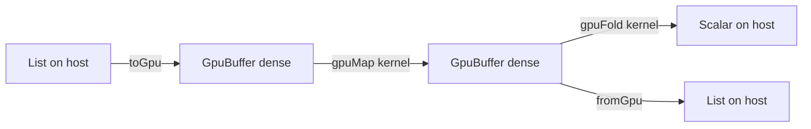
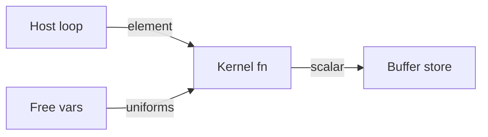

# GPU Computation

**Status: partially implemented.** The typed buffer surface, kernel purity checking, host execution, and direct Metal/OpenCL execution of `gpuMatMul` exist today. General extracted-kernel device emission, SPIR-V/WebGPU coverage, and optional CUDA interoperability remain roadmap work; the staged plan and its detailed checklist live in [plan 0023](../../plans/0023-gpu-computation.md). The scholarly work each design choice rests on is cited inline and collected in [References](#references--gpu-research) at the end of this document.

GPU computation in Osprey is a language surface, not a bound library. The type system separates host data from device-shaped data, and the compiler proves at compile time that every kernel is pure — a kernel that logs, performs an effect, or calls something the checker cannot see is a compile error, not a runtime fault. This is the same machinery that already rejects an unhandled effect ([0017](../language/0017-AlgebraicEffects.md)), pointed at data parallelism: parallel-safe by construction, checked before anything runs.



## Buffers — [GPU-BUFFER]

`GpuBuffer<T>` is an opaque, immutable, densely-packed array — the device-transferable representation of a sequence. It is distinct from `List<T>`: a list is a persistent structure optimized for sharing; a buffer is contiguous unboxed storage laid out the way accelerator memcpy and coalesced access require. Buffers are values like any other — they obey the same ownership analysis and memory backends as every heap value ([0018](../compiler/0018-MemoryManagement.md)), and a buffer's copy on the device ([GPU-BUFFER-RESIDENT]) is released when the buffer is.

Buffer allocation is total: a negative length, a length whose byte count would overflow, and a failed data allocation all yield the **empty** buffer. Combinator loops bound their trip counts by allocated lengths and every store is bounds-checked, so a failed allocation is observably the empty buffer — never a partial result, an out-of-bounds write, or a trap.

### Element restriction — [GPU-BUFFER-ELEM]

Buffer elements are scalars: `int`, `float`, or `bool`. This is the regular, first-order device sublanguage that every production functional GPU language restricts device data to — Futhark ([Henriksen et al., PLDI 2017](https://doi.org/10.1145/3062341.3062354)) and Accelerate ([McDonell et al., ICFP 2013](https://doi.org/10.1145/2500365.2500595)) both make this restriction, because representing sum types and pointers on SIMT hardware is an open research problem (the flattening line of work: [Blelloch, CACM 1996](https://doi.org/10.1145/227234.227246); [Bergstrom et al., PPoPP 2013](https://doi.org/10.1145/2442516.2442525)). Strings, lists, records, and unions stay on the host side of the boundary; full ADTs and pattern matching remain available in host code, including the code that builds and consumes buffers. A non-scalar element is a compile error at the call that would create it.

The restriction has one spelling in the compiler: inference enforces it at the call site (`crates/osprey-types/src/builtin_constraints.rs`), and codegen backstops it with the single predicate `gpu::is_scalar` (`crates/osprey-codegen/src/gpu.rs`), consulted alike by element stores, kernel results, reduction accumulators, builtin-kernel slots and extracted-kernel uniforms ([GPU-KERNEL-EXTRACT]).

## Buffer built-ins

### `toGpu(source) -> GpuBuffer<T>` — [GPU-BUFFER-FROM-LIST]

Produces a dense buffer from a host `List<T>` — or, per [GPU-BUFFER-FUSE], from an `Iterator<T>`. `T` must satisfy [GPU-BUFFER-ELEM]. The element type comes from the source, whether that source is a literal, a list value returned by a function, or a list built at runtime — a float list copies in as a float buffer, never as raw words.

```osprey
let buf = toGpu([1, 2, 3, 4])
```

```osprey-ml
let buf = toGpu [1, 2, 3, 4]
```

#### Buffer literals — [GPU-BUFFER-LITERAL]

A **literal** argument to `toGpu` stores its elements straight into the dense buffer at constant indices. No list is built — neither the flat literal block nor an `OspreyList` — so the form above emits one `osprey_gpu_alloc` call and four indexed stores, with no intermediate list or copy loop. The runtime constructor allocates the buffer header and payload separately and zero-fills the payload. The result is identical to copying a list of the same elements; only the lowering differs.

#### Iterator fusion — [GPU-BUFFER-FUSE]

`toGpu` is also a **consuming stage of an iterator pipeline**, accepting an `Iterator<T>` wherever it accepts a `List<T>`. The pending `map`/`filter` stages replay inside the single counted loop that fills the buffer, so a chain never materializes an intermediate collection:

```osprey
let buf = range(0, 1000) |> filter(isEven) |> map(square) |> toGpu()
```

```osprey-ml
buf = range (0, 1000) |> filter isEven |> map square |> toGpu ()
```

A `filter` stage leaves the kept count unknown until the loop has run, so the buffer is allocated at the range's span and the exact prefix is published on completion — the compaction `gpuFilter` performs. An inverted or empty range yields an empty buffer.

This is fusion in the [Futhark](https://futhark-lang.org)/Accelerate sense, and the reason the surface needs no separate buffer builder: the iterator pipeline is one.

### `fromGpu(buffer: GpuBuffer<T>) -> List<T>` — [GPU-BUFFER-TO-LIST]

Materializes a buffer back into a host list. The element type crosses with the values: a `GpuBuffer<float>` becomes a `List<float>` whose elements read back as floats, not as the machine words the list runtime stores them in. Round-tripping is therefore lossless in both directions for every scalar [GPU-BUFFER-ELEM] admits.

### `gpuLength(buffer: GpuBuffer<T>) -> int` — [GPU-BUFFER-LENGTH]

The element count. Constant time.

### `gpuLoad(path: string, offset: int, count: int) -> Result<GpuBuffer<float>, Error>` — [GPU-BUFFER-LOAD]

Reads `count` little-endian IEEE-754 binary32 values starting at byte `offset` of the file at `path`, widening each exactly to the double word a `GpuBuffer<float>` holds — the layout of llm.c's checkpoints and of any raw dump of a float32 array. A `count` of zero yields the empty buffer. The result is the whole buffer or an `Error`, never a partially filled buffer: a file holding fewer than `count` values from `offset` is `file ends before the tensor does`, so a truncated weight file never loads as a smaller model. An `Error` also leaves no buffer behind under any memory backend — the buffer allocated for the result is released before the reason is reported, which the ARC corpus lane's zero-leak sentinel and `memory_golden_tests.c` both count.

Every failure is an `Error` whose message names the operation, the path and the reason, through the channel `readFile` uses ([BUILTIN-FILE-ERRMSG](0012-Built-InFunctions.md#failure-reasons--builtin-file-errmsg)): the operating system's own wording for a file that is missing or unreadable and for a negative `offset` (`Invalid argument`), `a negative element count`, the short-read sentence above, and `read failed` when the stream reports an error mid-way.

```osprey
let wte = gpuLoad("gpt2_124M.bin", 1024, 50257 * 768) ?: toGpu([0.0])
```

```osprey-ml
wte = gpuLoad ("gpt2_124M.bin", 1024, 50257 * 768) ?: toGpu [0.0]
```

### `gpuLoadTensor(path: string, name: string) -> Result<GpuBuffer<float>, Error>` — [GPU-BUFFER-TENSOR]

Reads one named tensor out of a [safetensors](https://github.com/huggingface/safetensors/blob/main/README.md) file — the Hugging Face interchange format: an 8-byte little-endian header length `N`, then `N` bytes of JSON mapping each tensor name to its `dtype`, `shape` and `data_offsets`, then the tensor bytes — into a `GpuBuffer<float>`. The entry is located by its quoted name followed by a colon, so `h.1.attn.weight` never matches inside `h.11.attn.weight`, and the header's entry order is irrelevant: `__metadata__` may come first or last. `data_offsets` are relative to the start of the data section, byte `8 + N`. Four storage types are admitted and each widens exactly: `F64`, `F32`, `F16` (binary16, including subnormals, infinities and NaN) and `BF16` (the upper sixteen bits of a binary32). The byte span must be a whole number of elements.

The tensor's `shape` is read past but **not returned**: a buffer is rank-1, which [plan 0023](../../plans/0023-gpu-computation.md) names as the first surface gap, so the program states the shape it knows to [GPU-MATMUL]. Until a multi-dimensional index space exists this is the honest contract rather than a shape the type cannot carry.

Errors are an `Error` naming the file or the tensor and one of: `shorter than a safetensors header prefix`, `header length is not plausible for safetensors` (above 100 MiB), `file ends inside the header`, `no tensor of that name in the header`, `dtype is not F64, F32, F16 or BF16`, `data_offsets are missing or inverted`, `byte span is not a whole number of elements` — plus every reason [GPU-BUFFER-LOAD] reports for reading the bytes themselves.

```osprey
let wte = gpuLoadTensor("model.safetensors", "wte.weight") ?: toGpu([0.0])
```

```osprey-ml
wte = gpuLoadTensor ("model.safetensors", "wte.weight") ?: toGpu [0.0]
```

## Kernels

A *kernel* is the function value passed to a GPU combinator. Kernels are written as ordinary Osprey functions or lambdas — there is no separate kernel language, no annotation, and no restrictions beyond purity and the element restriction at the boundary.

### `gpuMap(buffer: GpuBuffer<T>, kernel: fn(T) -> U) -> GpuBuffer<U>` — [GPU-MAP]

Applies `kernel` independently to every element. Because the checker proves `kernel` performs no effects, every application is independent by construction and the combinator is parallelizable without analysis. `U` must satisfy [GPU-BUFFER-ELEM].

```osprey
fn square(x) = x * x
let squares = toGpu([1, 2, 3, 4]) |> gpuMap(square)
```

```osprey-ml
square x = x * x
let squares = toGpu [1, 2, 3, 4] |> gpuMap square
```

### `gpuFold(buffer: GpuBuffer<T>, initial: U, combine: fn(U, T) -> U) -> U` — [GPU-FOLD]

Reduces a buffer to one value. The accumulator must itself be a scalar ([GPU-BUFFER-ELEM]) so the reduction can execute on device hardware; a record accumulator is a compile error at the `gpuFold` call. `combine` is applied left-to-right, and that order is the contract, not a host detail: [GPU-BACKEND-HOST] is the reference semantics and [GPU-ROADMAP] holds every later backend to the host's bytes, so a device backend may reassociate a reduction only where it produces the host's exact result and must otherwise run it in the host's order. A non-associative combine therefore means the same thing on every backend — it is slower to offload, never different. On a device that order is one thread walking the buffer, so a reduction over a large buffer is written as a per-element kernel that folds each row with `fold` over a `range` and a `gpuFold` over the rows: the same two-level sum under every backend, computed in parallel. GPT-2's gradient checksums take this shape.

```osprey
fn add(a, b) = a + b
let total = toGpu([1, 2, 3, 4]) |> gpuFold(0, add)
```

```osprey-ml
add (a, b) = a + b
total = toGpu [1, 2, 3, 4] |> gpuFold 0 add
```

### `gpuZipWith(a: GpuBuffer<T>, b: GpuBuffer<U>, kernel: fn(T, U) -> V) -> GpuBuffer<V>` — [GPU-ZIPWITH]

Elementwise binary combination — the primitive every vector, tensor, and particle workload builds on. The result takes the shorter operand's length, so a ragged pair truncates rather than reading past the end. The kernel is held to [GPU-KERNEL-PURE] exactly as `gpuMap`'s is.

```osprey
fn dot(xs, ys) = gpuZipWith(xs, ys, fn(x: float, y: float) => x * y)
    |> gpuFold(0.0, fn(a: float, v: float) => a + v)
```

```osprey-ml
dot (xs, ys) =
    gpuZipWith (xs, ys, \(x : float, y : float) => x * y)
        |> gpuFold 0.0 (\(a : float, v : float) => a + v)
```

The float slots are named here only because `dot`'s own parameters are unconstrained — nothing in this definition says which element type the buffers hold. Over a buffer whose type is known, a kernel needs no annotation at all: its parameters come from the buffer ([GPU-KERNEL-ELEM-TYPING]).

```osprey
let total = toGpu([1.5, 2.5]) |> gpuFold(0.0, fn(a, v) => a + v)
```

```osprey-ml
total = toGpu [1.5, 2.5] |> gpuFold 0.0 (\(a, v) => a + v)
```

### `gpuIota(n: int) -> GpuBuffer<int>` — [GPU-IOTA]

The index buffer `[0, n)`. Kernels see element values, not positions, so gather, stencil, and matrix addressing all start from `gpuIota`: map over the indices and read neighbours with `gpuGet`. A non-positive `n` names an empty range, so it yields an empty buffer rather than an error — the half-open interval `[0, n)` is empty for every `n <= 0`.

### `gpuGet(buffer: GpuBuffer<T>, index: int) -> Result<T, Error>` — [GPU-GET]

Bounds-checked read of one element at the buffer's element type. An out-of-bounds index returns `Error` rather than a sentinel value, so a wrong gather is a visible failure, not silent zeros. Usable inside a kernel — reading a buffer is pure — which is how a `gpuIota`-driven kernel expresses matrix rows and stencils.

```osprey
fn at(m, i) = gpuGet(m, i) ?: 0.0
fn rowSum(m, r) = at(m, r * 3) + at(m, r * 3 + 1)
```

```osprey-ml
at (m, i) = gpuGet (m, i) ?: 0.0
rowSum (m, r) = at (m, r * 3) + at (m, r * 3 + 1)
```

### `gpuScan(buffer: GpuBuffer<T>, initial: T, combine: fn(T, T) -> T) -> GpuBuffer<T>` — [GPU-SCAN]

Inclusive prefix scan: element `i` of the result is `combine` folded over the source through element `i`, seeded with `initial` — so the first element is `combine(initial, src[0])`, not `src[0]`, and the result always has the source's length. Scan is *the* classic parallel primitive — segmented scans and flag vectors are how nested data parallelism flattens onto flat hardware ([Blelloch, CACM 1996](https://doi.org/10.1145/227234.227246); [NESL](https://www.cs.cmu.edu/~scandal/nesl.html)). The order contract is `gpuFold`'s: element `i` is the left-to-right fold through `i` on every backend. A device backend may substitute the work-efficient parallel scan only where it reproduces the host's exact bytes, and falls back to the sequential order where it cannot. No device form exists yet: a selected device declines `gpuScan`, and the run stops naming it ([GPU-BACKEND-DEVICE]).

### `gpuFilter(buffer: GpuBuffer<T>, predicate: fn(T) -> bool) -> GpuBuffer<T>` — [GPU-FILTER]

Stream compaction: keeps the elements the pure predicate accepts, preserving source order. The host backend fills a source-length scratch buffer and publishes the kept prefix; a device backend implements the same contract with a scan-based compaction. No device form exists yet: a selected device declines `gpuFilter`, and the run stops naming it ([GPU-BACKEND-DEVICE]).

## Dense linear algebra

### `gpuMatMul(left: GpuBuffer<float>, right: GpuBuffer<float>, rows: int, inner: int, cols: int) -> Result<GpuBuffer<float>, Error>` — [GPU-MATMUL]

The dense product of a `rows × inner` matrix and an `inner × cols` matrix, both row-major in flat float buffers, as the row-major `rows × cols` buffer: `out[r * cols + c]` is the sum over `k` from `0` to `inner - 1` of `left[r * inner + k] * right[k * cols + c]`. The sum is accumulated **in `k` order starting from `0.0`, in double, with each product formed before it is added** — no fused multiply-add. That order is the contract, exactly as [GPU-FOLD]'s is: a device backend may reassociate or contract only where it produces the host's bytes. The host walks `r`, then `k`, then `c`, which writes each output row contiguously and still accumulates every element in `k` order; the test that pins the order sums `2^53 + 1 - 2^53` to `0.0` where any other association gives `1.0`.

The element type is `float` only, fixed by the signature: an int buffer operand is a type error at the call, never a silent widening. A shape the operands do not have is an `Error`, never a partial buffer: `gpuMatMul: left operand: has N elements, the stated shape needs M` (likewise `right operand`), `gpuMatMul: result: rows * cols is negative or overflows`, or the operating system's out-of-memory wording when the result cannot be allocated. Any zero dimension with consistent lengths yields the zero-filled `rows × cols` result — empty when `rows` or `cols` is zero, all zeros when `inner` is.

A matrix is a flat buffer plus the shape the program states, because a buffer is rank-1; the multi-dimensional surface [plan 0023](../../plans/0023-gpu-computation.md) owes is what removes the three shape arguments.

```osprey
fn linear(x, w, tokens, inputs, outputs) = gpuMatMul(x, w, tokens, inputs, outputs)
let logits = linear(hidden, wte, 64, 768, 50257) ?: toGpu([0.0])
```

```osprey-ml
linear (x, w, tokens, inputs, outputs) = gpuMatMul (x, w, tokens, inputs, outputs)
logits = linear (hidden, wte, 64, 768, 50257) ?: toGpu [0.0]
```

## Kernel purity — [GPU-KERNEL-PURE]

The compiler rejects any GPU combinator call whose kernel performs an algebraic effect **that a handler must discharge at run time**, directly or through any chain of helpers and lambdas. An effect a *static* handler has already erased ([0017-AlgebraicEffects.md](../language/0017-AlgebraicEffects.md)) is not present in the kernel by the time this gate runs, so it is not an effect the kernel performs — the rule is about what reaches the device, not about how the source was written. The proof reuses the static effect discharge machinery ([EFFECTS-STATIC-DISCHARGE](../language/0017-AlgebraicEffects.md)): the kernel's operation summary must be empty of every effect but one. The exception is `Arith` ([0037](../language/0037-ArithmeticEffects.md)): on the host backend a kernel's arithmetic dispatches to the enclosing policy exactly as any lambda's does, so a kernel may *require* an `Arith` policy without failing this gate (`effect_rows/gpu.rs::gpu_kernel_verdict` filters it), and the boundary rule a device backend must then meet is stated under [GPU-KERNEL-EXTRACT]. Wrapping the call in any other handler does not lift the restriction — a handler makes an effect *dischargeable*, but a kernel body still cannot leave the device to reach one, so the requirement is purity, not handledness.

Effect-typed parallelism is the studied way to draw this line: Dex distinguishes the parallelism-destroying `State` effect from a parallelism-preserving accumulation effect ([Paszke et al., ICFP 2021](https://arxiv.org/abs/2104.05372)), on effect-system foundations from Koka ([Leijen, 2014](https://arxiv.org/abs/1406.2061)); which handler shapes commute with parallel evaluation at all is formalized in "Parallel Algebraic Effect Handlers" ([Xie, Johnson, Maclaurin, Paszke, ICFP 2024](https://doi.org/10.1145/3674651)) — the theory closest to Osprey's handlers. Today's rule is the sound conservative point on that spectrum: an effect row empty of everything but `Arith`. A parallelism-preserving accumulation effect, if ever added, must be justified against that work.

The check fails closed: a kernel whose effects the checker cannot prove (for example, a function value received as a parameter from an unknown call site, or a closure whose provenance analysis widens out) is rejected with a `cannot prove GPU kernel pure` error. Passing a named function or an inline lambda always gives the checker what it needs.

When the checker *can* see the kernel's provenance and the answer is no, it says so instead: the rejection names the dynamic operations the body still requires, because that is evidence of a dynamic row rather than an absence of evidence. That wording is normative in [STAGE-GPU-DIAG](../language/0017-AlgebraicEffects.md#gpu-legality--stage-gpu-legal), which generalizes this section's empty-row rule to stage legality.

```osprey
effect Log { write: fn(string) -> Unit }
fn loud(x) = {
    perform Log.write("saw it")   // kernel performs Log.write
    x
}
// COMPILE ERROR: kernel body is not stage-legal; it requires dynamic effects: Log.write
// let bad = toGpu([1]) |> gpuMap(loud)
```

```osprey-ml
effect Log
    write : string => Unit

loud x =
    perform Log.write "saw it"   (* kernel performs Log.write *)
    x
(* COMPILE ERROR: kernel body is not stage-legal; it requires dynamic effects: Log.write *)
(* bad = toGpu [1] |> gpuMap loud *)
```

## Kernel expressiveness

### Kernel forms — [GPU-KERNEL-FORM]

Every pure function form is a valid kernel. Normatively that means all of: a named top-level function, an inline lambda, a lambda with a **block body containing local bindings**, a closure capturing enclosing locals (a folded scalar piped back into a `gpuMap`), and helpers reached from the kernel — including **recursive** helpers such as a row walk over a flat matrix. The purity proof ([GPU-KERNEL-PURE]) is the only gate; syntax shape is never one.

Every form above compiles and runs today, without annotations. A recursive helper is **monomorphised**: the call site's argument types fix one instantiation, which is emitted as a real function and called, and the self-call inside it becomes a direct recursive call to that same symbol (`crates/osprey-codegen/src/monofn.rs`). This is the one place polymorphism is resolved by emitting a definition rather than by inlining; the language-wide rule is unchanged, because inlining cannot specialise a body that calls itself.

A recursive function whose **return type** inference cannot resolve has no signature to emit and is still rejected with `annotate its return type so it is emitted as a real function` (fail-closed). Parameter annotations are no longer required.

Block-bodied lambdas support local bindings in both flavors, including an indented ML callback body inside a combinator argument. The `kernel_frontier` twins execute the same block-bodied and recursive-helper cases; their generated IR must also agree ([FLAVOR-ML-LAYOUT](../language/0023-LanguageFlavors.md)).

### Kernel element typing — [GPU-KERNEL-ELEM-TYPING]

A kernel's parameter types flow **from the buffer**: in `gpuMap(buf, kernel)` with `buf: GpuBuffer<float>`, the kernel's parameter *is* `float`, and bare arithmetic inside the kernel (`a + b`) must type at `float` — never silently default to `int`. Defaulting is only permissible when a parameter is genuinely unconstrained by every consuming slot.

A lambda kernel gets this: call arguments are checked against the callee's signature, and a lambda argument is inferred **after** the slots its siblings pin, so `gpuFold(0.0, fn(a, v) => a + v)` over a float buffer types at `float` in either operand order (`crates/osprey-types/src/expr.rs::positional_arg_types`). No annotation is required, and the associativity of the arithmetic no longer decides.

A **named** context-free function gets it too. `fn plus(a, b) = a + b` leaves its overload OPEN rather than defaulting at its own definition, and the choice is made once, after all unification, from whatever the operands finally became (`crates/osprey-types/src/expr.rs::deferred_arith`). Folded over a float buffer it is a float addition; used only on integers it is still the integer one. No annotation, no float literal, no rewrite of the call site. Kernels are inside the arithmetic totality guarantee like any other code ([ARITH-TOTAL](../language/0037-ArithmeticEffects.md#the-guarantee--arith-total)).

The operand does **not** generalize, because there is no numeric class to quantify over: one definition gets one overload. A helper used at BOTH `int` and `float` in a single program is therefore a type error (`cannot unify int with float`) rather than a silent reinterpretation — write the two definitions, or annotate. A lambda is unaffected either way: it is a runtime value with one ABI, its parameters are already pinned by its slot, and its body never leaves an overload open.

### Element conversion — [GPU-CONVERT]

Scalar element types convert **explicitly, inside kernels** — never implicitly at buffer boundaries. The required primitive is `toFloat(n: int) -> float` (round-to-nearest-even; exact for `|n| <= 2^53`), which makes the canonical float-pipeline seed expressible:

```osprey
let xs = gpuIota(100000) |> gpuMap(toFloat)
```

```osprey-ml
xs = gpuIota 100000 |> gpuMap toFloat
```

`toFloat` is a total widening — every `int` has a nearest `double` — so it returns a bare `float` rather than a `Result`, and it registers in [0012-Built-InFunctions.md](0012-Built-InFunctions.md) with a docs entry like every builtin. It is usable both as a direct call and, as above, as a first-class kernel passed by name. The reverse direction already exists as checked truncation on the arithmetic side and is out of scope for buffers.

### Kernel math — [BUILTIN-MATH]

The unary float functions `sqrt`, `exp`, `ln` and `tanh` ([BUILTIN-MATH](0012-Built-InFunctions.md)) are pure and total over IEEE doubles, so a kernel may call them or *be* one of them by name: `gpuMap(exp)` extracts a kernel whose body is the intrinsic call, with no closure cell and no environment ([GPU-KERNEL-EXTRACT]). They take a `float` and nothing else — an int buffer is widened explicitly with `toFloat` first, as above — and they never perform an `Arith` operation, so a kernel written from them needs no policy. The same rule covers every other pure, total, scalar float function a numerical port needs: the trigonometric (`sin`, `cos`, `tan`, `asin`, `acos`, `atan`, `atan2`), hyperbolic (`sinh`, `cosh`, `asinh`, `acosh`, `atanh`), logarithmic (`log2`, `log10`, `log1p`, `expm1`), special (`erf`, `erfc`) and rounding (`floor`, `ceil`, `trunc`, `round`, `pow`, `hypot`, `fmod`, `copysign`) families of [BUILTIN-MATH-TRIG], [BUILTIN-MATH-HYPERBOLIC], [BUILTIN-MATH-LOG], [BUILTIN-MATH-SPECIAL] and [BUILTIN-MATH-ROUNDING]; the binary32 emulation [BUILTIN-FLOAT32]; the bit-level views [BUILTIN-FLOAT-BITS]; and the bitwise word builtins [BUILTIN-BITWISE]. `floatToInt` is the one exception: its `Result` channel is not a scalar, so a combinator's slot rejects it and the kernel stays on the host.

`sqrt` is correctly rounded on every host, like the four operations, so a value computed from them alone has one byte-exact answer everywhere. `exp`, `ln`, `tanh` and the other transcendental functions are each host's libm (glibc, musl under WASI, Darwin, Bionic), whose last digits differ: a golden that must hold on every corpus lane never prints such a value and compares it within a tolerance instead — `tests/core/gpu/transformer.test.osp` uses 1e-9 for everything downstream of `exp` or `tanh` and exact comparison for everything else, including LayerNorm. The universal special values stay exact: `exp(0.0)` is `1.0`, `exp(-1000.0)` is `0.0`, `ln(1.0)` is `0.0`, `tanh(±1000.0)` is `±1.0`. The rounding and bitwise families require exact host/device agreement: `floor`, `ceil`, `trunc`, `round`, `fmod`, `copysign`, the `float32`/`floatBits` families and the shifts retain their bit-level contracts. Exact goldens check that requirement on the backends they execute; the device verification limits are recorded below.

```osprey
let probabilities = scores |> gpuMap(exp)
let activations = pre |> gpuMap(fn(x) => 0.5 * x * (1.0 + tanh(0.7978845608 * (x + 0.044715 * x * x * x))))
```

```osprey-ml
probabilities = scores |> gpuMap exp
activations = pre |> gpuMap (\x => 0.5 * x * (1.0 + tanh (0.7978845608 * (x + 0.044715 * x * x * x))))
```

## Kernel extraction — [GPU-KERNEL-EXTRACT]

Each **admissible** kernel a combinator runs is compiled **once**, as a standalone module-scope function with a flat scalar signature, and the loop over the buffer calls it per element. The forms that decline are listed under [Which kernels are extracted](#which-kernels-are-extracted); they run correctly on the host backend, and a device backend must reject them with a diagnostic rather than silently execute a host pointer. This is not an optimization detail: an extracted kernel with a first-order scalar ABI and no captured environment is exactly the artifact a PTX, AIR or SPIR-V emitter consumes, so [GPU-BACKEND-DEVICE] becomes a target driver rather than a rewrite.



### The extracted ABI

A kernel function takes, in this order:

1. **Uniforms** — the kernel body's free variables from the enclosing scope,
   one leading parameter each, ordered by identifier name. They are loop
   invariants: the host evaluates each once *before* the loop and passes the
   same operand at every call. Only a scalar (`int`, `float`, `bool`) or a
   `GpuBuffer` handle may be a uniform — the same restriction
   [GPU-BUFFER-ELEM] places on element data, for the same reason.
2. **Element slots** — the kernel's own declared parameters, typed from the
   buffer's element type per [GPU-KERNEL-ELEM-TYPING]; `gpuFold` and
   `gpuScan` pass the accumulator first, then the element.

There is **no environment pointer and no closure struct**. A capturing kernel compiles to a function whose captures are arguments, not to a heap cell with a hidden `env` parameter. The return is a scalar.

A kernel that would return an unhandled `Result` is rejected before the program links, at one of two gates. `gpuFold`, `gpuScan` and `gpuFilter` have signatures that pin the kernel's result — the accumulator's own type, or `bool` — so inference rejects such a kernel at the call (`cannot unify int with Result<int, Error>`). `gpuMap` and `gpuZipWith` leave the result type `U` free, so the gate is codegen's scalar backstop on the stored element: `a gpuMap kernel result cannot be an unhandled Result; handle it inside the kernel`. Handle failure inside the kernel with `?:` or `match`.

Arithmetic MUST preserve the region's policy at the kernel boundary ([ARITH-TOTAL](../language/0037-ArithmeticEffects.md#the-guarantee--arith-total)). Current selected-device fault recovery does not satisfy that requirement: a fault aborts instead of invoking the runtime policy. On the host backend a kernel's `Arith` operations are exempt from the stage-legality row ([STAGE-GPU-LEGAL](../language/0017-AlgebraicEffects.md#gpu-legality--stage-gpu-legal)) and dispatch to the enclosing policy exactly as any lambda's do, so a kernel with fallible arithmetic compiles only where a region installs a policy; with none, the program is rejected at its entry. A device fault records a fault word and aborts the launch ([GPU-DEVICE-FAULT]); callers needing recovery must select the host backend explicitly. `handle static Arith` is rejected.

### Which kernels are extracted

- A **named function** kernel reuses its own definition. It already has an
  emitted symbol with a concrete signature, and the host loop already calls
  it — extraction emits nothing new and copies nothing.
- An **inline lambda** is lifted to a fresh module-scope function, its free
  variables becoming leading uniform parameters.
- An **unannotated (generic) function** kernel is specialised at its call site with the buffer's element type and lifted when its body fits the extracted ABI. A **recursive** function gets its own emitted definition per instantiation ([GPU-KERNEL-FORM]), because its body cannot be specialised by inlining.
- A **locally let-bound lambda with a known body** is lifted using its definition-time environment, including a concrete lambda that also has a closure cell for ordinary calls. Immutable scalar and buffer captures become uniforms; shadowing at the launch site must not replace them. An applied generic callback retains its type instantiation while selecting the body, so float slots remain floats. A module-stored lambda retains its ordinary storage and prefix ABI. An opaque computed function value (a record field or an unknown call result) keeps its closure-cell call because its body and environment cannot be recovered statically; a device backend must reject it rather than silently offload a host pointer.
- A **scalar builtin passed by name** (`gpuMap(toFloat)`, `gpuMap(abs)`, or `gpuZipWith(..., wrapAdd)`) is lifted into a scalar function containing its ordinary intrinsic lowering. Its argument types come from the combinator slots, so float `abs` keeps a `double` ABI. The wrapper has no closure cell or environment pointer. The same rule covers total saturating arithmetic, `intDiv` and the float functions ([BUILTIN-MATH]); fallible integer builtins retain the enclosing `Arith` policy, operation arguments, recovery values and element order. Lexical bindings take precedence over builtin names. A builtin whose scheme takes or returns a host handle or a `Result` is not a kernel at all: the combinator's scalar slot types reject it during inference, before extraction is consulted, so the extraction-time scheme check (`admissible`) is a backstop no source program reaches.
- A lambda whose body reads a name the lifted function cannot see — a
  let-bound lambda, a function-typed local, a handler-owned mutable cell —
  keeps the inlined lowering rather than emitting a call to a symbol that was
  never defined.

`builtin_kernels_are_extracted_with_specialized_scalar_abis` pins scalar definitions and intrinsic instructions in both flavors. `every_gpu_combinator_propagates_arithmetic_and_outer_recovery_requirements` checks missing, sufficient and insufficient policies for all five combinators in both flavors. The existing `kernel_frontier` twins assert conversion rounding, float and integer absolute values, all six total arithmetic builtins, accumulator boundaries, lexical shadowing and ordered handler recovery under both extraction modes.

`closed_generic_kernels_extract_with_their_definition_environment` and its ML counterpart require all five combinators to emit scalar kernel definitions with leading captured uniforms, float element slots and source capture metadata. The `kernel_frontier` twins additionally pin launch-site shadowing, live mutable-cell identity, managed captures when extraction declines, and exact overflow arguments and recovery through the active arithmetic policy. `kernels_reducing_through_higher_order_helpers_keep_their_device_form` requires a kernel that reduces through a helper taking a lambda to launch, never decline, and to emit the same device source from every flavor.

The `file_scope_generic_binding` twins assert declaration-scope reads through ordinary and GPU callbacks despite launch-site shadowing, including module-stored generic lambdas.

Declining to extract is always safe: it is the pre-extraction lowering, which produces the same values, and it never changes what a program prints.

### Determinism and flavor equivalence

Generated kernel symbols are numbered by a per-module counter advanced only by extraction, in AST walk order. No part of a kernel's name comes from a source position, an identifier spelling, a file path or a source hash, so a Default/ML twin pair still emits byte-identical IR ([FLAVOR-IR-EQUIV], [0023-LanguageFlavors.md](../language/0023-LanguageFlavors.md)).

### Native debugging

Extracted host kernels preserve the source lambda's declaration and body locations in their own `DISubprogram`. Primitive source arguments and immutable captured uniforms remain inspectable at a breakpoint inside the kernel, including a block's trailing value. Uniforms precede element parameters in the native ABI; the debugger shows their source names as captures and numbers formal element parameters after them. This uses the same immutable debug storage as ordinary lambdas ([DEBUGGER-LAMBDA-SCOPES](../compiler/DebugArtifacts.md#lambda-scopes-debugger-lambda-scopes)).

`extracted_kernel_debug_scopes_keep_uniforms_and_source_parameters` and `every_extracting_combinator_preserves_its_source_arguments` assert the metadata in both flavors. The editor's `extracted GPU kernel breakpoints expose uniforms and locals` tests pause a real host kernel and inspect the source parameter, uniform and calculated local. These checks cover native host execution; they make no device-debugging claim.

### Differential guarantee

Extraction is a lowering choice, never a semantic one. The compiler retains the pre-extraction inlined lowering behind the `OSPREY_GPU_KERNELS` environment switch (`extract`, the default, or `inline`; any other value is an error, never a silent fallback), and `crates/run_test_corpus.sh` runs the whole `tests/core/gpu` corpus both ways and requires byte-identical output — under every memory backend and on wasm32. Two code generators for one semantics, held to one golden, exactly as [GPU-BACKEND-HOST] holds device backends to the host's.

## Execution backends

### Vendor independence — [GPU-BACKEND-PORTABILITY]

**Osprey GPU computation is an alternative to CUDA and must work across GPU vendors.** Apple, AMD, Intel, NVIDIA, and other compute-capable GPUs are in scope. The same Osprey source, typed buffers, kernel ABI, effects, and numerical contracts must work unchanged through the appropriate device backend. GPU computation must be usable outside the CUDA ecosystem: installing CUDA, owning an NVIDIA GPU, or translating Osprey kernels into CUDA C/C++ must never be a requirement of the core language or portable runtime.

Osprey owns kernel compilation, scheduling, buffer management, and dispatch. Backend adapters communicate with platform GPU APIs and drivers, such as Metal, OpenCL, Vulkan/SPIR-V, Direct3D, and WebGPU; they implement one shared device contract rather than separate vendor-specific programming models. Hardware capabilities are negotiated explicitly. A backend must preserve the specified arithmetic, including binary64 accumulation and ordering, using device-side emulation where necessary; silently reducing precision or substituting CPU execution does not meet the GPU contract. Unsupported capabilities require a diagnostic naming the device and operation.

CUDA interoperability and acceleration are optional capabilities. Osprey may invoke CUDA libraries or provide a CUDA adapter on NVIDIA systems, but neither defines the GPU language nor supplies the mandatory implementation for other backends. CUDA is also a valid performance comparison where the hardware supports it. Passing a CUDA-only benchmark does not establish portable GPU support.

Full cross-vendor kernel coverage is a delivery requirement, not a claim that every combinator already runs on a device. A GPU backend must demonstrate actual device dispatch, unchanged-source parity with the host oracle, and the GPT-2 reference application on its platform before it is advertised as working.

### Host baseline — [GPU-BACKEND-HOST]

Every GPU program has defined, deterministic semantics with no GPU present: the host backend executes each combinator as a native counted loop over the dense buffer. The only fusion implemented today is the iterator pipeline into `toGpu` ([GPU-BUFFER-FUSE]); each combinator otherwise allocates its result buffer and runs its own loop. Combinator-to-combinator array fusion in the [Futhark](https://futhark-lang.org)/Accelerate sense (the load-bearing optimization: [McDonell et al., ICFP 2013](https://doi.org/10.1145/2500365.2500595)) is planned alongside the device IR, not present. This is the reference semantics device backends must match, it is what the differential test harness verifies under every memory backend and on wasm32, and it remains the reference for device execution. Metal and OpenCL matrix products transfer this same dense unboxed layout; transfers and synchronization are real costs, not eliminated by adopting the surface.

### Device backends — [GPU-BACKEND-DEVICE]

Each device-admissible kernel is compiled to the **device dialect**; host extraction ([GPU-KERNEL-EXTRACT]) alone does not establish device support. The dialect is a C-family source shared by Metal and OpenCL (`compiler/runtime/gpu_f64.metal`, `gpu_math64.metal`, `gpu_device_lib.metal`), which the running program's kernels extend (`crates/osprey-codegen/src/gpu_device.rs`). The dialect has three word types — `long` for `int`, the bits of a binary64 for `float`, `bool` — and reaches the GPU through one shared dispatch contract (`compiler/runtime/gpu_device.h`): a kernel name, the program's kernel source, element buffers, a result buffer, a fault word, the element count and the kernel's uniforms, each a scalar word or a buffer handle bound as its words and its length. Both adapters compile the library and the program's kernels once, keep one pipeline per kernel name, and execute `gpuMatMul` through the same path as every compiled kernel. No CUDA code, SDK or NVIDIA-specific representation is involved.

The emitter lowers a kernel body from its AST: literals, parameters, captured uniforms, file-scope literal constants, `+ - * / %` and the comparisons, `&&`/`||` with the host's short circuit, unary minus and `!`, `intDiv`, `toFloat`, `abs`, `wrapAdd`/`wrapSub`/`wrapMul`, `sqrt`/`exp`/`ln`/`tanh` and every other function of [BUILTIN-MATH] and its sections, the `float32`/`floatBits` conversions, the bitwise builtins, `gpuLength` of a captured buffer, `gpuGet(buffer, index) ?: default` over a captured buffer, a `match` with `true`/`false` arms, an immutable `let`, a `fold` over a `range(start, end)` as an in-order loop, and calls to the program's own functions, inlined at the AST level with each scalar argument bound once and each lambda or named-function argument inlined wherever the helper calls it, in the scopes it closed over — so a reduction written through a higher-order helper (`addAll(size, fn(c) => …)`) keeps its device form. Everything else — a string, a list, a record, a computed function value (a record field or an unknown call result), a `fold` over anything but a range, a `match` over anything but a boolean or a `gpuGet` result, recursion — **declines**: the kernel keeps its host lowering and its launch site records the reason. `gpuScan` and `gpuFilter` have no device form yet and decline as a whole.

Every launch site asks the runtime first (`osprey_gpu_launch`). The answer is 1 when the selected device completed the work, in which case the result buffer holds it on the device ([GPU-BUFFER-RESIDENT]) or the reduction's accumulator holds it on the host, or 0 when the host is selected, in which case the host loop runs. `gpuMap` and `gpuZipWith` run one thread per element; `gpuFold` runs one thread that folds in element order, so [GPU-FOLD]'s host-order result is preserved exactly. A declined launch site asks the runtime too (`osprey_gpu_declined`): the host runs the host loop, and a selected device aborts the program naming the launch and the reason — a kernel inside a region that selected a device is never silently run on the CPU.

Float arithmetic on the device uses the library's software binary64 implementation. `gpu_shader_tests.c` compiles the shader sources as host C and checks add, subtract, multiply, divide, comparisons, integer conversions and square root against the host's IEEE results bit for bit over sampled words. These are library tests; hardware dispatch is checked separately.

`exp`, `ln` and `tanh` use 128-bit fixed-point evaluation before rounding to binary64. Their sampled tests allow one ulp against the host's rounded `long double` reference and require at least 99% exact agreement. The extended unary functions allow 16 ulps; `pow`, `atan2` and `hypot` allow 64 ulps. These bounds describe the current tests, not a proof of correct rounding for every input. Host and device transcendental results may differ; code requiring the host's exact libm output must use the host backend ([FLOAT-IEEE-RESULTS]).

The rounding, bit-view and shift families retain their exact-result contract. The C suite checks rounding, binary32 conversion, remainder, sign copying and shifts against host references. The `scalar_contracts` corpus twins run `floatFromBits` followed by `floatBits` through emitted kernels over 12 words covering signed zeros, finite values, infinities, NaN payloads and subnormals. Both twins passed under Default, GC and ARC (zero live objects), and WebAssembly on 2026-10-25. A forced Metal run on Apple M4 Max also dispatched all 12 words and preserved them exactly; this does not establish OpenCL hardware coverage.

#### Faults — [GPU-DEVICE-FAULT]

A device kernel cannot reach a runtime `Arith` policy ([ARITH-TOTAL](../language/0037-ArithmeticEffects.md#the-guarantee--arith-total)). An integer operation that would overflow, an `intDiv` or `%` by zero, or a float division by zero records a fault word instead (`FAULT_OVERFLOW`, `FAULT_DIVIDE_BY_ZERO`, `FAULT_REMAINDER_BY_ZERO` in `gpu_device_lib.metal`), and when the dispatch completes with a fault the runtime aborts the program naming the kernel and the fault. The caller must select the host backend when runtime recovery is required; the implementation does not automatically route a faulting device kernel to that policy. An accepted kernel containing `n + 1` under a wrapping handler returns the wrapped value on the host but aborts on Metal/OpenCL when `n` is the maximum integer. Explicit `wrapAdd` succeeds on all three. This is the [device-recovery delivery gap](../language/0037-ArithmeticEffects.md#device-recovery-arith-device-recovery) against the required arithmetic contract.

`gpuIota`, `toGpu`, `gpuLoad` and `gpuLoadTensor` build their buffers on the host; from the first launch that reads one, the buffer is resident on the device ([GPU-BUFFER-RESIDENT]). The kernel-to-kernel fusion the host backend also lacks remains roadmap work in [plan 0023](../../plans/0023-gpu-computation.md). Backend selection must satisfy [GPU-BACKEND-PORTABILITY]; the Metal and OpenCL adapters are the two that exist, and SPIR-V and WebGPU adapters implement the same dispatch contract over the same dialect.

#### Device-resident buffers — [GPU-BUFFER-RESIDENT]

A buffer has one copy on the selected device, created from its words the first time a launch reads or writes it and bound to every later launch without another transfer. A launch's result buffer stays on the device: no words come back until the host reads them, through `gpuGet`, `fromGpu`, a product's host fallback or a loader, and then the whole buffer comes down once. A `gpuFold` result is a scalar, so it comes straight back to the accumulator. The weights of a model upload once, every intermediate buffer of a layer stays where the next kernel reads it, and the only downloads are the values the program itself inspects.

A buffer is immutable at the language surface, so the two copies never diverge; the one write path, the runtime's own fill of a fresh buffer, forgets the device copy, which a later launch recreates. The device copy belongs to the buffer: when the memory backend reclaims the buffer, its finalizer releases the device object ([MEM-BACKENDS-CUSTOM](../compiler/0018-MemoryManagement.md#backend-hook-abi-mem-backends-custom)), so under ARC a device buffer dies at the last release and under the tracing GC at the sweep that reclaims its owner. A download that fails aborts the program naming the device; a buffer never reads back as zeros.

### Device selection — [GPU-DEVICE]

`gpuDevice() -> string` names the active execution backend. The host backend reports `"host"`; device backends report device names (`"metal:0"`, `"opencl:0"`, and planned `"vulkan:0"`/`"webgpu:0"`; optional CUDA interoperability may report `"cuda:0"`). The `"auto"` selection resolves an available compute device by capability rather than vendor; `gpuDevice()` reports the resolved backend, never `"auto"`. A program can branch on it, and a benchmark can record which backend produced its numbers.

Choosing where arithmetic runs is an *effect*, not a global switch. A program declares the operations it needs as a static effect, writes its arithmetic against them, and a handler decides how each operation executes; the compiler discharges the handler before the program runs ([STAGE-HANDLE-STATIC], [STAGE-BACKEND]). This is the construct that makes Osprey's GPU story a language feature rather than a library: selection is lexical, testable and capability-checked exactly like every other effect, and the same source runs under a handler over host lists or a handler over the GPU surface with no change.

```osprey
static effect Tensor<B> {
    build: fn(int, fn(int) -> float) -> B
    get: fn(B, int) -> float
    device: fn() -> string
}

fn onLists(work) = {
    handle static Tensor<List<float>> {
        build n f => range(0, n) |> map(f) |> toList()
        get b i => listGet(b, i) ?: 0.0
        device => "lists"
    }
    work()
}

fn onGpu(work) = {
    handle static Tensor<GpuBuffer<float>> {
        build n f => gpuIota(n) |> gpuMap(f)
        get b i => gpuGet(b, i) ?: 0.0
        device => gpuDevice()
    }
    work()
}

// The model never names a buffer type; the handler installed around it does.
fn halves(n) = perform Tensor.build(n, fn(i) => toFloat(i) * 1.5)
fn report() = "${perform Tensor.device()}: ${perform Tensor.get(halves(4), 3)}"

print("${onLists(report)} / ${onGpu(report)}")  // lists: 4.5 / host: 4.5
```

```osprey-ml
static effect Tensor B
    build : (int, (int) -> float) => B
    get : (B, int) => float
    device : Unit => string

onLists work =
    handle static Tensor<List<float>>
        build n f => range 0 n |> map f |> toList
        get b i => listGet b i ?: 0.0
        device => "lists"
    work ()

onGpu work =
    handle static Tensor<GpuBuffer<float>>
        build n f => gpuIota n |> gpuMap f
        get b i => gpuGet b i ?: 0.0
        device => gpuDevice ()
    work ()

halves n = perform Tensor.build n (\i => toFloat i * 1.5)
report () = "${perform Tensor.device ()}: ${perform Tensor.get (halves 4) 3}"

print "${onLists report} / ${onGpu report}"  // lists: 4.5 / host: 4.5
```

A static handler must answer every operation of its effect ([STAGE-STATIC-TOTAL]); an instantiation never answers another ([EFFECTS-GENERIC-INSTANTIATION]); a callback an arm forwards to `gpuMap`, `gpuZipWith` or `gpuFold` is held to [GPU-KERNEL-PURE], and one that performs a runtime effect is rejected by name. The reference program is GPT-2 (`examples/gpt2`): generation and a training step written once against a ten-operation `Tensor<B>` effect, run by `onLists` and `onGpu` with identical tokens, loss and gradient sums on the host. Tested device runs produce the same tokens with small numeric differences from host transcendental evaluation. `gpuDevice()` reports which backend the GPU-surface handler is executing on and the model prints that answer on its first line, so a run never claims hardware it did not use ([GPU-BACKEND-DEVICE]).

Within the GPU-surface handler, `OSPREY_GPU=host|auto|metal|opencl` is the bootstrap selection of the device every kernel and product runs on ([GPU-BACKEND-DEVICE]). Unset or `host` preserves the host oracle; `auto` selects Metal in a macOS runtime and OpenCL elsewhere. The iOS, Android and wasm32 runtimes carry no adapter, so any other selection there is the no-adapter `Error`. Explicit GPU selection never substitutes CPU execution when device initialization, compilation, allocation, dispatch, or readback fails: `gpuMatMul` returns `Error`, a kernel launch aborts naming the kernel, and an unknown selection is an `Error` naming the expected backends. `gpuDevice()` reports the resolved adapter (`metal:0 (<device>)`, `opencl:0 (<device>)`). `OSPREY_GPU_TRACE=1` reports every completed dispatch with its kernel and thread count; the first is always reported. A handler that selects the device lexically will replace this bootstrap selection.

## Roadmap invariant — [GPU-ROADMAP]

*Non-normative on implementation:* this section constrains how the staged work proceeds, not what any code path does, so it has no implementing file. Its one requirement — that stages ratchet — is enforced by the harness gates the plan lists, not by a compiler behaviour.

Implementation is staged in [plan 0023](../../plans/0023-gpu-computation.md), which carries the stage descriptions and the detailed TODO checklist. The normative invariant this spec imposes on every stage: stages ratchet — each keeps `make ci` green and the differential harness byte-exact, and a later stage must not change the meaning of any program accepted by an earlier stage.

## GPU compute and GPUI rendering — [GPU-VS-GPUI]

Osprey reaches the GPU in two unrelated ways, and neither depends on the other.

| | GPU compute (this document) | GPUI rendering ([0046](../platforms/0046-GpuiDesktopHost.md)) |
| --- | --- | --- |
| What runs on the GPU | Osprey's own kernels: `gpuMap`, `gpuFold`, `gpuMatMul` and extracted kernels, compiled by Osprey to the device dialect | Zed's GPUI renderer, written in Rust: its shaders rasterize quads, paths, glyphs and sprites |
| Who writes the GPU code | The Osprey compiler, from Osprey source the purity checker accepted | GPUI's authors; Osprey never emits a shader for drawing |
| What Osprey hands over | Dense scalar buffers ([GPU-BUFFER]) and a kernel | A scene: a list of typed primitives (rect, disc, strip, sprite, glyphs, path) encoded as JSON by `@osprey/native` ([UI-SCENE]) |
| Boundary | The device dispatch contract in `compiler/runtime/gpu_device.h`, inside the Osprey runtime | The C ABI `start`/`dispatch` of an Osprey static library, called by the Rust host |
| Result | Numbers come back to the Osprey program (`fromGpu`, a scalar) | Pixels on screen; only input events come back |
| Use it for | Numerical work: tensors, simulations, GPT-2 inference | Windows, controls, 2D scenes and animation |

GPU compute is raw access: the program's own arithmetic runs on the device, with Osprey's arithmetic contract and purity proof carried to it. GPUI is a retained UI framework that happens to draw with the GPU; an Osprey application under the GPUI host is ordinary CPU code that returns a description of what to draw each frame, and the Rust host turns that description into GPUI elements and paths. The two compose: an application could compute a field with `gpuMap`, read it back, and draw it as a GPUI scene, but nothing in either path requires the other, and the GPUI host never shares a device buffer with Osprey's compute backends.

## References — [GPU-RESEARCH]

*Non-normative:* a bibliography, not a requirement. It has no implementing code and no test.

The scholarly and vendor work Osprey's GPU features are grounded in. Inline citations above point here; the design decisions these produced are recorded in [plan 0023](../../plans/0023-gpu-computation.md). Every entry was re-verified against its primary source on 2026-10-12.

**The device sublanguage and functional GPU compilation**

- Henriksen, Serup, Elsman, Henglein, Oancea. *Futhark: Purely Functional
  GPU-Programming with Nested Parallelism and In-Place Array Updates.*
  PLDI 2017. <https://doi.org/10.1145/3062341.3062354> — the blueprint for
  [GPU-BUFFER-ELEM]'s first-order scalar device sublanguage and the host
  backend's reference semantics.
- Henriksen, Thorøe, Elsman, Oancea. *Incremental Flattening for Nested
  Data Parallelism.* PPoPP 2019.
  <https://doi.org/10.1145/3293883.3295707> — why nested parallelism is
  deferred rather than naively flattened.
- Henriksen. *A Comparison of OpenCL, CUDA, and HIP as Compilation Targets
  for a Functional Array Language.* FProPer 2024
  (<https://futhark-lang.org/publications.html>) — the directly comparable
  study for [GPU-BACKEND-DEVICE]'s substrate choice. The same group's
  WebGPU backend work (Paarmann, 2024; Andreasen, 2025) is the closest prior
  art for a functional array language on WGSL.
- Chakravarty, Keller, Lee, McDonell, Grover. *Accelerating Haskell Array
  Codes with Multicore GPUs.* DAMP 2011.
  <https://doi.org/10.1145/1926354.1926358> — type-level host/device
  separation, the model for `GpuBuffer` vs `List`.
- McDonell, Chakravarty, Keller, Lippmeier. *Optimising Purely Functional
  GPU Programs.* ICFP 2013. <https://doi.org/10.1145/2500365.2500595> —
  array fusion as the load-bearing optimization behind [GPU-BACKEND-HOST].
- Köpcke, Steuwer, Gorlatch. *Descend: A Safe GPU Systems Programming
  Language.* PLDI 2024. <https://doi.org/10.1145/3656411> — the imperative
  counterpart: CUDA-parity performance with ownership and lifetimes tracked
  in the type system.
- *Modular GPU Programming with Typed Perspectives* (Prism / the Bundl
  calculus). PLDI 2026, Distinguished Paper.
  <https://doi.org/10.1145/3808290> — the granularity of thread control as
  a type; the model for making collective operations composable if Osprey's
  device sublanguage ever exposes them.
- *Kuiper: verified and efficient GPU programming.* ARRAY 2025 — dependent
  types and concurrent separation logic over the GPU memory hierarchy,
  extracting to specialised CUDA.
- Higher Order Company. *HVM2 / Bend* — a massively parallel interaction-
  combinator evaluator compiling higher-order functional programs to C and
  CUDA (<https://github.com/HigherOrderCO/Bend>); the other functional-on-GPU
  route, without static guarantees.

**Parallel primitives and flattening foundations**

- Blelloch. *Programming Parallel Algorithms.* CACM 1996.
  <https://doi.org/10.1145/227234.227246> — scan as the fundamental
  primitive behind [GPU-FOLD]/[GPU-SCAN]; the
  [NESL](https://www.cs.cmu.edu/~scandal/nesl.html) nested-data-parallel
  line.
- Bergstrom, Fluet, Rainey, Reppy, Rosen, Shaw. *Data-Only Flattening for
  Nested Data Parallelism.* PPoPP 2013.
  <https://doi.org/10.1145/2442516.2442525> — the frontier that justifies
  keeping ADTs at the boundary.

**Effects and parallelism**

- Leijen. *Koka: Programming with Row-Polymorphic Effect Types.* MSFP
  2014. <https://arxiv.org/abs/1406.2061> — the effect-system foundation
  Osprey's handlers descend from.
- Paszke, Johnson, Duvenaud, Vytiniotis, Radul, Johnson, Ragan-Kelley,
  Maclaurin. *Getting to the Point: Index Sets and Parallelism-Preserving
  Autodiff for Pointful Array Programming* (Dex). ICFP 2021.
  <https://arxiv.org/abs/2104.05372> — parallelism-preserving vs
  parallelism-destroying effects, the theory behind [GPU-KERNEL-PURE];
  implementation at <https://github.com/google-research/dex-lang>.
- Xie, Johnson, Maclaurin, Paszke. *Parallel Algebraic Effect Handlers.*
  ICFP 2024 (Proc. ACM Program. Lang. 8, ICFP).
  <https://doi.org/10.1145/3674651> — which handler shapes commute with
  parallel evaluation; governs any future relaxation of the kernel effect-row
  rule and the stage-5 `Gpu` effect.

**Device code generation and scheduling**

- Tillet, Kung, Cox. *Triton: An Intermediate Language and Compiler for
  Tiled Neural Network Computations.* MAPL 2019.
  <https://doi.org/10.1145/3315508.3329973> — the tile abstraction. Triton's
  in-tree **Gluon** dialect exposes Blackwell's `tcgen05`/TMA primitives
  directly where the high-level abstraction cannot find the codegen.
- NVIDIA. *CUDA Tile IR* — an MLIR Tile dialect, Python bindings, bytecode
  and conformance suite, open-sourced 2025-12-04 under Apache-2.0 alongside
  CUDA 13.1 (<https://github.com/NVIDIA/cuda-tile>); the tile-level target a
  stage 4+ emitter could lower to instead of raw PTX.
- Chen et al. *TVM: An Automated End-to-End Optimizing Compiler for Deep
  Learning.* OSDI 2018.
  <https://www.usenix.org/conference/osdi18/presentation/chen> — graph- and
  operator-level scheduling with learned cost models; with Halide, the
  separation stage 7 follows.
- Ragan-Kelley, Barnes, Adams, Paris, Durand, Amarasinghe. *Halide:
  Decoupling Algorithms from Schedules for High-Performance Image
  Processing.* PLDI 2013. <https://doi.org/10.1145/2491956.2462176>; the
  autoscheduler is [Adams et al., SIGGRAPH
  2019](https://doi.org/10.1145/3306346.3322967).
- Ikarashi, Bernstein, Reinking, Genc, Ragan-Kelley. *Exo: Externalized
  Rewriting for Hardware Accelerators.* PLDI 2022.
  <https://doi.org/10.1145/3519939.3523446> — user-extensible scheduling.
- Spector, Arora, Singhal, Fu, Ré. *ThunderKittens: Simple, Fast, and
  Adorable AI Kernels.* ICLR 2025. <https://arxiv.org/abs/2410.20399> —
  16×16 register tiles, managed shared-memory layouts and explicit
  asynchronous workers: the expressiveness bar for a schedule layer on
  tensor-core hardware.
- NVIDIA. *CUTLASS / CuTe* layout algebra (<https://github.com/NVIDIA/cutlass>);
  *Categorical Foundations for CuTe Layouts*, 2026,
  <https://arxiv.org/abs/2601.05972> — composition, logical product and
  division of layouts, the vocabulary a memory-hierarchy surface must be
  able to express.
- Verdoolaege, Juega, Cohen, Gómez, Tenllado, Catthoor. *Polyhedral
  Parallel Code Generation for CUDA* (PPCG). ACM TACO 2013.
  <https://doi.org/10.1145/2400682.2400713>; the tiling/fusion algorithm is
  [Bondhugula et al., PLDI 2008](https://doi.org/10.1145/1375581.1375595)
  (Pluto).
- MLIR GPU dialect stack:
  [`gpu`](https://mlir.llvm.org/docs/Dialects/GPU/),
  [`nvgpu`](https://mlir.llvm.org/docs/Dialects/NVGPU/),
  [`nvvm`](https://mlir.llvm.org/docs/Dialects/NVVMDialect/) — the
  progressive-lowering substrate weighed at stage 4's decision checkpoint.
- LLVM. [*User Guide for the NVPTX Back-end*](https://llvm.org/docs/NVPTXUsage.html)
  and [*Compiling CUDA with clang*](https://llvm.org/docs/CompileCudaWithLLVM.html)
  — the incremental, wasm-shaped device path; the LLVM **SPIR-V backend**
  is an official target since LLVM 20 (added to `LLVM_ALL_TARGETS`), so the
  same textual-IR emitter can feed Vulkan/WebGPU.

**Target specifications**

- NVIDIA, *PTX ISA* (per CUDA release); Apple, *Metal Shading Language
  Specification* 4.1 (2026-06-04); W3C, *WebGPU* and *WGSL* (Candidate
  Recommendation); Khronos, *SPIR-V* 1.6 and the *Vulkan 1.4* SPIR-V
  environment (Vulkan 1.4 released 2024-12-03, mandating SPIR-V 1.0–1.6);
  Khronos, *Slang* (hosted since 2024-11-21; one source to SPIR-V, HLSL,
  GLSL, WGSL and MSL) — the dialects a device emitter must speak, and the
  one that already speaks all of them.

**Reference workloads**

- Karpathy. *llm.c* — GPT-2 pretraining in plain C and CUDA
  (<https://github.com/karpathy/llm.c>): a ~1 000-line fp32 CPU reference
  (`train_gpt2.c`), the CUDA mainline (`train_gpt2.cu`) and a ladder of
  kernels from naive to tuned. The reference application plan 0023 holds
  every surface gap against, on the host today and on the device at stage 4.
- Godoy et al. *Mojo: MLIR-Based Performance-Portable HPC Science Kernels
  on GPUs for the Python Ecosystem.* SC Workshops 2025 (WACCPD, best paper).
  <https://arxiv.org/abs/2509.21039> — seven-point stencil, BabelStream,
  miniBUDE and Hartree-Fock on H100 and MI300A; "competitive with CUDA and
  HIP for memory-bound kernels", with gaps on AMD atomics and fast-math
  compute-bound kernels. The micro-benchmark set stage 4's gate reuses.

**Autodiff (stage 7)**

- Moses, Churavy. *Instead of Rewriting Foreign Code for Machine Learning,
  Automatically Synthesize Fast Gradients* (Enzyme). NeurIPS 2020; and
  Moses, Churavy, Paehler, Hückelheim, Narayanan, Schanen, Doerfert.
  *Reverse-Mode Automatic Differentiation and Optimization of GPU Kernels
  via Enzyme.* SC 2021 (<https://c.wsmoses.com/papers/EnzymeGPU.pdf>) —
  compiler-level AD over optimised LLVM IR, the first reverse-mode AD of GPU
  kernels; the natural fit for a compiler that already emits LLVM IR.
- *JAX Autodiff from a Linear Logic Perspective.* POPL 2026.
  <https://doi.org/10.1145/3776654> — the JAX/Dex autodiff core as a linear
  λ-calculus with a Curry-Howard reading, sound qualitatively and
  quantitatively.
- Elliott. *The Simple Essence of Automatic Differentiation.* ICFP 2018.
  <https://arxiv.org/abs/1804.00746> — the categorical core for a
  functional language's AD.
- Bangaru, Wu, Li, Munkberg, et al. *SLANG.D: Fast, Modular and
  Differentiable Shader Programming.* SIGGRAPH Asia 2023.
  <https://doi.org/10.1145/3618353> — autodiff as a type-system feature
  with compile-time safety, not a library.
- Hu et al. *DiffTaichi: Differentiable Programming for Physical
  Simulation.* ICLR 2020. <https://arxiv.org/abs/1910.00935>; the layout
  decoupling is [Taichi, SIGGRAPH Asia
  2019](https://doi.org/10.1145/3355089.3356506).

**Portability layers**

- Edwards, Trott, Sunderland. *Kokkos: Enabling Manycore Performance
  Portability.* JPDC 2014. <https://doi.org/10.1016/j.jpdc.2014.07.003> —
  execution/memory-space abstraction for the stage-6 portability story.
