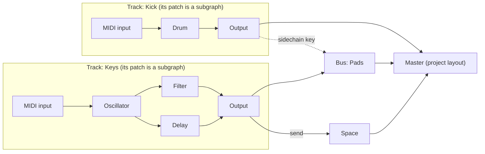
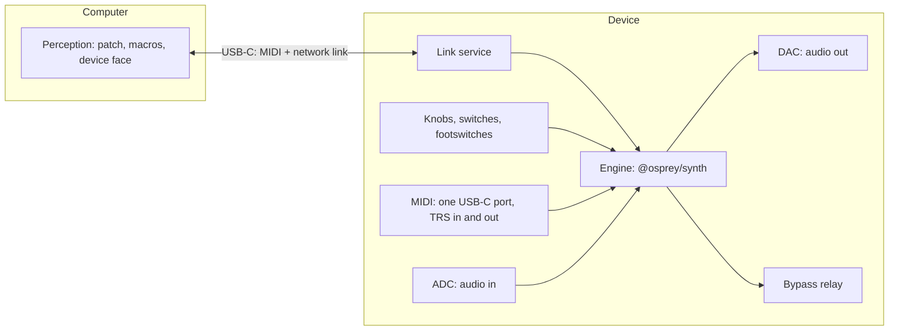
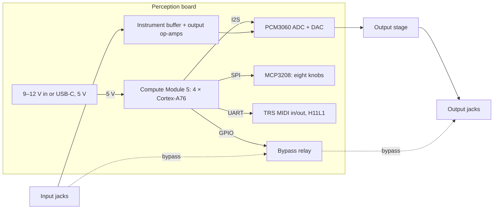
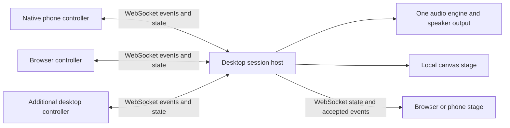

# Perception: studio, plug-in and devices

What Perception is, who it is for and how it is described come from the [Perception messaging](../../messaging/perception%20messaging.md); this specification states the requirements behind it.

**Perception Studio** is a modular synth daw, a VST3 plug-in and host, and a hardware synth factory: a patch is played in the daw, loaded inside another daw as the **Perception Modular** VST3 plug-in, or flashed to a device that runs it with no computer. All of it is built on the [synth package](Synth.md); the package never depends on Perception. Perception was called Prism: the code, make targets, file names and specification IDs still say Prism until they are renamed.

## 🚨 DIRECTIVE: PERFORMANCE OPTIMISATION NECESSARY, ESPECIALLY ON EMBEDDED DEVICES 🚨 [DEVICE-PERF]

**Performance optimisation is not optional and never finished.** The engine that runs in Perception is the engine that runs on the device, and the device has a slower CPU and a hard 1.33 ms deadline per 64-frame block. Today the engine renders 0.37 s of audio per second on a Mac, mostly in reference counting and allocation ([DAW-TRANSPORT-LIVE-SPEED]). That must improve many times over, and it is worked on **in parallel with everything else**, not as a gate that holds other work back.

- Every change to the engine, the synth package or the code the compiler generates for them is measured for speed, and a change that makes the device slower is a defect.
- The render callback allocates, frees and blocks nothing ([TARGET-EMBEDDED-REALTIME]).
- Per-processor costs are measured on the device's own CPU ([DEVICE-ENGINE-BUDGET]), recorded, and only go down.
- The acceptance stereo patch must run at 70% or less of the deadline on one core ([DEVICE-HW-COMPUTE]). Until it does, that is the most important open item on the device.

## Perception Studio: the daw [DAW]

### 🚨 CRITICAL: SYNTH TRANSPARENCY [DAW-TRANSPARENCY] 🚨

**ABSOLUTE INVARIANT. THE USER CAN SEE EVERYTHING THAT MANIPULATES A SIGNAL, IN THE UI.**

- **Every stage that changes audio is a node or a control the user can see** on the Timeline, the Bus routing page or a Track patch: every module, cable, send, gain, pan, EQ, compressor, limiter, reverb and effect. If it touches the signal, the user can see it, select it, change it and remove it.
- **There is no hidden processing. None.** The engine adds no limiter, no clipper, no soft clip, no tanh, no normalisation, no automatic gain, no ceiling, no dither and no make-up gain of its own, anywhere: not on a track, not on a bus, not on Master, not on Play and not on Render.
- **Master passes exactly what reaches it.** Master has no processing unless the user puts it there. A user who wants a limiter on Master adds a limiter module to Master, where it is shown like any other module.
- **What the user hears and what is exported is the graph's own output, untouched.** Code that alters the signal anywhere the UI does not show breaks this invariant. It is a defect. Remove it from the code, and never document it as a feature.

### 🚨 CRITICAL: PLAYING AND RENDERING BOTH RUN THE ENTIRE AUDIO GRAPH, AND ITS OUTPUT IS MASTER [DAW-GRAPH-OUTPUT] 🚨

- **Playing and rendering both spin up the entire audio graph:** every track, patch, send, bus, the Space and Master, running together block by block ([DAW-RENDER-PLAY]).
- **That graph has exactly one output, and it is the Master channel.** Nothing else ever leaves the graph.
- **Playing** sends Master's output to the speakers. It writes no file ([DAW-TRANSPORT-LIVE]).
- **Rendering** dumps Master's output to the export file. It plays nothing ([DAW-RENDER-MASTER]).
- No track, note, bus or stem is ever played, rendered or exported on its own.

Status: in progress. The daw runs on the FerroUI host. It opens a project, shows the Timeline, Mix and patch pages, saves edits into the project file, and plays bars through the engine. The [delivery plan](../../plans/synth/daw.md) records what is verified.

The daw is the [Perception](../../../src/osprey/examples/daw/PRISM.md) patch studio with a song around it. It opens a project, lets you edit each track's notes, mix and patch, plays it and saves it back to the same file.

### Install on macOS [DAW-MACOS-INSTALL]

Run `make -C src/toolchain/targets/macos prism` to install **Perception** in Applications. Open it from Spotlight. The first launch copies the example project into Application Support so reinstalling Perception preserves edits to it. Set `SONG=<project.json>` to open another project after installation.

### Built around the person using it [DAW-HUMAN]

Each screen serves one task: writing a part, hearing it, mixing it or routing it. Each rule below is checked in the app.

- **A screen holds what its task needs.** Timeline is for notes, Bus routing for the mix and where sound goes, Track patch for the sound itself. An element stays only if it does something or tells the user something they act on. Captions that repeat a title, controls that do nothing yet and pointers to another panel are removed.
- **A value is changed where it is shown.** A slider, a note or a cable is edited in place. No screen asks the user to go somewhere else to change what it displays ([DAW-INSPECTOR]).
- **Every command is in the menu bar, with a shortcut** ([DAW-KEYS]). The canvas keeps only what is used all the time: the page tabs and the transport. Nothing can be done with the pointer only.
- **The user's habits come first.** Shortcuts follow a keymap the user chooses or writes, so hands trained on another studio keep working ([DAW-KEYS]).
- **Targets fit a hand.** A socket, a fader or a key is large enough to hit without aiming, and a control under the pointer wins over artwork that overlaps it.
- **The app says what it is doing.** The footer names what is sounding and the last thing that happened. A failure says what failed in the user's terms and leaves the work as it was.
- **Nothing is lost by exploring.** A page with nothing to show says so. Leaving a page saves what changed, or keeps the page open and says why.
- **One look, one set of controls.** Every control is drawn in the Perception skin on a dark canvas, whatever the system's appearance, and every panel uses the controls of [DAW-CONTROLS]. A control that looks like it came from another app is a defect.
- **Everything undoes.** Undo and Redo are standard editor commands and reach every edit on every page: notes, mix, routing, patch modules, cables and parameters. One user action is one undo step.

### Infinitely modular [DAW-MODULAR]

A patch holds any number of modules and cables, a track any patch, and a project any number of tracks, buses and sends. A bus can feed another bus.

- **A module has fixed ports ([DAW-MODULAR-PORTS]).** Each module has a fixed set of inputs (audio, MIDI, control) and a single audio output, plus MIDI or OSC outputs where it makes them. The number of modules and cables is unbounded; a module's ports are not.
- **An output fans out by itself ([DAW-MODULAR-FANOUT]).** A single output can feed any number of inputs. The user drags cables from the same output to each input they want, and every one receives the same signal. Splitting a signal needs no Split module, no extra step and no loss of level.
- **Only what reaches the Output sounds ([DAW-PATCH-HEARD]).** A patch can hold any number of modules, but none of them does anything until its audio is cabled, directly or through other modules, to the patch's Output. Unwired modules are silent and cost nothing.
- **Every channel has the project's layout ([DAW-MODULAR-LAYOUT]).** Every audio channel (track, bus, Space and Master) carries as many physical audio channels as the project's layout sets: mono, stereo (the default), 5.1, 7.1 or any other. Changing the layout changes it everywhere. A feature is a module, a command or a store, never a special case in one screen.

#### The project is a graph [DAW-GRAPH]

**The project is one graph of cables. A patch is a subgraph.** Its nodes are tracks, buses, the Space, Master and the modules inside every patch. Its cables carry audio, MIDI and OSC. A patch is a graph of the same kind nested inside a track node: its inputs are the track's inputs, and its one Output is the track's output. There is no fixed mixer strip and no per-track pipeline.

- **Tracks are where sound starts.** A track originates audio from its patch. It can also take inputs: MIDI (its own notes, another track's MIDI, a live keyboard or OSC control) and audio (another track's output, a sidechain, a live instrument).
- **Every track can go anywhere.** Audio and MIDI tracks alike can be cabled to any other node that accepts them: a bus, another track's input, a sidechain, the Space or Master. A track is not tied to a fixed strip.
- **Master is the graph's one output ([DAW-GRAPH-OUTPUT], [DAW-MIX-MASTER]).** Every route ends there. Master carries the project's channel layout (stereo by default) and processes nothing unless the user adds modules to it ([DAW-TRANSPARENCY]).
- **A patch is a subgraph ([DAW-GRAPH-SUBGRAPH]).** Its modules run in the same block loop as every bus and Master. A patch is never run on its own and mixed in later.

- **A patch has an Output, not a master.** A patch ends in an **Output** module. There is no "Master" module inside a patch. A track's Output is routed to the project's main channel (Master) by default, and the user can route it to any bus instead ([DAW-MIX-BUS]).
- **A patch has inputs.** A patch can declare audio inputs and MIDI inputs as modules of its own. What arrives on them (the track's notes, another track's audio, a sidechain, a live instrument) is whatever is routed to them, and the patch decides what to do with it by its cables. A patch that ignores an input simply leaves it unwired.
- **Routing is cables.** Sound and control go only where a cable or a route sends them. The only implicit connection is a track's Output to Master.

### Controls [DAW-CONTROLS]

Every panel uses the same small set of controls, drawn as the design draws them: the toggle, the dial, the slider, the menu and the button. A parameter looks and behaves the same in a module's card, in the inspector and in the Patch Controls panel.

- **Dial ([DAW-CONTROLS-DIAL]).** A number is a round dial with its value beside it. Press on the dial or the number, hold, and move the pointer up to raise the value or down to lower it. The pointer's sideways movement does nothing, so the hand can drift. Holding Shift moves in fine steps. Double-press returns the default. The number can be typed. The arrow keys step it when the dial has focus. The dial shows its value as an arc from the minimum, and its unit beside the number.
- **Slider.** A number can instead be a horizontal or vertical slider where a length reads better than an angle: a fader in the mixer, a send level, a position in time. It is set by a press or a drag along its length and has the same fine step, default, typing and arrow keys as the dial.
- **Toggle, menu, button.** An on/off value is a toggle. One choice from a few names is a menu showing the current name. An action is a button named for what it does.

A text box that reformats while the user types, a control that only points at another panel, and a platform-styled widget in place of one of these are defects.

### Accessibility [DAW-ACCESS]

Every command and every control can be used without a pointer, without sight and without sound.

- **Keyboard.** Every control takes focus, shows that it has it, and is operated by the keyboard. Tab order follows reading order. Every command has a shortcut and is in the command palette ([DAW-COMMANDS]).
- **Assistive technology.** Every control reports its role, its name, its value with its unit, and its state to the platform's accessibility interface, and every change is announced. A control drawn on the canvas reports the same as a platform control would.
- **Seeing.** Text and controls keep a contrast of at least 4.5 to 1. Nothing is told by colour alone: a cable's kind, a selected track and a playing transport each also have a shape, a label or a position. The app follows the system's larger-text and reduced-motion settings.
- **Hearing.** What is sounding is always shown as well as heard: the transport state, the position and the meters.
- **Targets.** A target is at least 24 points across.

### Commands [DAW-COMMANDS]

Everything the daw can do is a **command**: a stable name, a title, its arguments and whether it can run now. One list of commands feeds the menus, the shortcuts ([DAW-KEYS]), the command palette and automation, so a command added once appears in all four.

- **Command palette.** A shortcut opens a box in the middle of the window, as in VS Code. Typing filters the commands by any part of their title, Return runs the highlighted one, and Escape closes it. Each row shows the command's shortcut. A command that needs an argument asks for it in the same box (a track, a bus, a number).
- **Stacks.** A stack is a command made of other commands: a name, a title, its own parameters and an ordered list of steps, each a command with its arguments. A step's argument is a fixed value or one of the stack's parameters, so "New bus, send the selected track to it" is one command that asks for a level. A stack may contain stacks; one that would contain itself is refused when it is defined, with the reason. A stack is one step of undo. It stops at the first step that is refused, says which step and why, and leaves the project as it was before the stack began. Stacks are kept in a file the user can edit, checked on loading the way a keymap is, and they appear in the palette, in the menus and to an agent like any other command.
- **Shortcuts.** A shortcut runs a command, plain or stacked, with or without arguments ([DAW-KEYS]). So one key can run one command, one command with a fixed argument (send level to −6 dB), or a whole stack.
- **For an AI agent.** The same commands run from outside the window: by name with their arguments, one line in and one line out saying what happened or why it was refused. The list of commands with their arguments and current availability can be read the same way, so an agent can discover what it may do. A command run this way goes through the same checks and the same undo history as one run by hand.

### Storage [DAW-STORE]

Where a project is kept is a pluggable layer behind one interface: open, save, list and history. The project model does not know which store is in use.

**Persistence is an abstraction ([DAW-STORE-ABSTRACT]).** Nothing outside the store reads or writes a project directly. The editor, the engine and the commands open and save through the store interface. The store is an effect, so a test or the app can swap it. **Not built yet:** today the daw calls `SongFiles` and file reads and writes directly. Putting them behind the store interface comes before any second store is added.

- **JSON file.** One project file on disk ([DAW-PROJECT]). This is what ships today.
- **Database.** The project as rows, for large projects and shared libraries.
- **Git.** Every save is a commit, so the project has versions, a history to browse and a way back to any of them.

### Keyboard [DAW-KEYS]

Every command has a name, a place in the menu bar and a shortcut. The menus are File (open, save, render), Edit (undo, redo), View (the three pages, Modules, Patch Controls) and Transport (return to start, play and stop the song, loop, previous and next track and bar). There is no command that plays a patch, a track or a note on its own: everything heard is Master ([DAW-GRAPH-OUTPUT]). A menu shows each command's shortcut beside it, so the menu bar is also the list of shortcuts.

A **keymap** assigns the shortcuts. The daw ships three: **Perception**, **Ableton style** and **Logic style**, the last two following those studios' habits where the daw has the same command (Space plays and stops, Tab or a single letter changes view). The user picks one from the menu, and the choice is kept for the next launch. A keymap is also a file the user can edit: a name and one line per command with its keys. Loading a file checks it first: an unknown command or two commands on one shortcut is refused with the reason, and the keymap in use stays. A command the file leaves out keeps its Perception shortcut, so no command is ever without one. A line may name a stack as well as a plain command, and may give arguments after the name, so the same command can sit on several keys with a different argument on each ([DAW-COMMANDS]).

### One project file [DAW-PROJECT]

A song is one JSON file, and nothing about a song lives anywhere else. Its root holds exactly five things ([DAW-PROJECT-ROOT]): `title`, `tempo`, `sampleRate`, `buses` and `tracks`. Nothing else belongs at the root: there is no master drive, no shared reverb, no intro recording and no sustains. Drive and reverb are modules a user puts in a patch or on a bus. Each track stores its notes, gain, pan, destination bus, sends and the complete patch it plays. The JSON file is today's store only; the project reaches it through the persistence abstraction ([DAW-STORE-ABSTRACT]).

- **One model ([DAW-PROJECT-MODEL]).** [daw.td](../../../src/osprey/examples/daw/daw.td) declares the project. The Osprey types are generated from it. The JSON keys are the typeDiagram field names. The editor and the file both follow this model; neither keeps a parallel format.
- **Patches in the project ([DAW-PROJECT-PATCH]).** A built-in instrument opens in Perception as one voice node wired to the output. A routed patch opens as its own graph. A patch edited in Perception is written back into its track in the project file. Opening the file again restores the same graph, its pitch and velocity bindings, and its cables.
- **Lossless round trip ([DAW-PROJECT-ROUNDTRIP]).** `SongFiles::encode` writes every key that `SongFiles::decode` reads. A decoded project re-encodes to identical text. A JSON encoding failure is an error, never a `"null"` file.
- **Checked edits ([DAW-PROJECT-EDIT]).** Gain must be 0–4 and pan −1 (left) to 1 (right). A refused edit, or an edit to a track that does not exist, leaves the project unchanged and says why.
- **Saving ([DAW-PROJECT-SAVE]).** Save reads its own encoded text back before writing. A project that would not reopen is never written over the old file. A path containing a quote is refused. Osprey has no file-rename primitive, so the final write is not atomic.

### Transport [DAW-TRANSPORT]

**Play is real time ([DAW-TRANSPORT-LIVE]).** This is the daw's first requirement: an app that makes the user wait for a render before hearing the song is not usable. Play makes sound at once and keeps making it at the speed the music is written, and the playhead moves with what is heard. Play never renders the range to a file first and plays the file afterwards.

1. **Range ([DAW-TRANSPORT-RANGE]).** Play runs from the start marker to the end marker. The start marker is the playhead's bar. The end marker is the song's end until the user moves it. Both markers are lines down the lanes with handles on the ruler, and the user drags either one left or right. The end marker is always after the start marker: an end at or before the start counts as the song's end.
2. **Loop ([DAW-TRANSPORT-LOOP]).** A Loop toggle in the transport. With Loop on, Play repeats the range from the start marker to the end marker until Stop. With Loop off, Play runs once and rings out.
3. **Live stream.** The app encodes the current project, unsaved edits included, to `<song>/live/project.json` beside the engine and runs `daw <project.json> <folder> <from-beat> <beats> live|loop`. The engine runs the graph forward block by block ([DAW-RENDER-PLAY]) and prints each block of Master as soon as it is made; the blocks go straight into the audio device adapter (`osprey-vst-worker audio-device`). Nothing is written to a WAV and nothing waits for the range to finish.
4. **Following ([DAW-TRANSPORT-FOLLOW]).** The device answers every block with the frames it has accepted and the frames it has finished playing. While the song plays, every display frame moves the playhead to the beat being heard: the frame clock, held between those two counts ([timeline_geometry.ospml](../../../src/osprey/examples/daw/src/timeline_geometry.ospml), `heardSeconds`). The lanes scroll to keep the playhead in view, the piano roll turns its page every two bars, and the position readout shows `bar.beat`. When sound waits, the playhead waits.
5. **Stop** cancels the stream's whole process group at once and puts the playhead back on the start marker. While anything is in flight, Play refuses with "The song is already playing; Stop first."
6. A refused project never reaches the device: the engine writes its reason to `<folder>/fault.txt` and the app shows it as "Playback failed: …".
7. **Live controls ([DAW-TRANSPORT-LIVE-CONTROLS]).** Each accepted dial or fader movement updates its displayed value and publishes the same value to the playing song. The producer reads the latest complete revision between device blocks. A held note keeps its clock, envelope and compatible processor state through a parameter change.
8. **No hidden level control ([DAW-TRANSPARENCY]).** Play sends Master's output to the device exactly as the graph makes it. Nothing clips, limits or scales it on the way.

**The engine must be faster than real time ([DAW-TRANSPORT-LIVE-SPEED]).** This is not negotiable. Real-time play needs the engine to make every block faster than it plays, with room to spare: at least 1.5× real time on the reference song (17 tracks) on one performance core. Measured on 2026-11-21, the live stream of the codex song makes 0.37 s of audio per second (17.1 s of audio in 45.8 s), with reference counting and allocation taking most of the time, so the device runs empty and the sound breaks up. Until the engine meets the target, live play of a full song is not acceptable and this requirement is not met. It is the largest open defect in the daw.

**Playback buffers ahead ([DAW-TRANSPORT-LIVE-SPEED]).** Play never waits on a note it could have made earlier. Notes are made ahead of the playhead, at low priority, and kept on disk (`render/note_cache.ospml`); the live stream joins a prepared note at its current sample, so a note published mid-play changes neither its attack nor its handoff. A truncated or unreadable prepared note is made again, never played.

**Start latency ([DAW-TRANSPORT-LIVE-LATENCY]).** Play buffers 5 to 10 ms of audio before the device starts, and no more: at 48 kHz that is 240 to 480 frames. The first sound follows the Play command by that buffer plus the device's own output latency. Interactive playback primes the adapter with two 160-frame blocks (6.67 ms of audio). The producer flushes each block and waits for the adapter’s receipt before sending another. Project loading, rendering and device startup also contribute to the measured Play-to-sound time.

**MIDI clock ([DAW-TRANSPORT-MIDI-CLOCK]).** Playing is synchronised with the MIDI clock. The transport is one clock in beats, and audio, the playhead and MIDI all read it.

1. **Sending.** While the song plays, the daw sends MIDI timing clock (0xF8, 24 per quarter note) from the same sample clock that drives the audio, so an external sequencer, drum machine or arpeggiator stays in time with what is heard. Play from the song's first beat sends Start (0xFA); Play from any other start marker sends Song Position Pointer (0xF2, in sixteenth notes) and then Continue (0xFB); Stop sends Stop (0xFC). A loop sends Song Position Pointer at each return to the start marker.
2. **Following.** With external sync on, the daw follows an incoming MIDI clock: Start, Continue, Stop and Song Position Pointer move the transport, and the tempo follows the incoming clock's rate. The tempo shown is the tempo heard.
3. Clock messages are scheduled against the audio device's played-frame count, not against the display or a wall-clock timer, so they do not drift from the audio.
4. The clock source (internal or external) and the MIDI ports are project settings in [daw.td](../../../src/osprey/examples/daw/daw.td).

Not built: the daw has no MIDI port access yet.

### Rendering the song [DAW-RENDER]

**Render song** runs the whole project graph, as it currently stands, and writes Master's output to the export file `<song>/song/song.wav`. That is all rendering is: Master, dumped to the export file. Rendering is not playing. A render sends nothing to the speakers, and Play writes no file. Both run the same engine on the same project snapshot ([DAW-RENDER-PLAY]).

1. The app encodes the current project to `<song>/song/project.json` and empties the old `song.wav`, then runs `daw <project.json> <folder>` (no beats: the whole song, intro and sustains included) with a two-hour limit.
2. Only a WAV longer than its header counts. A refusal shows the engine's message: "Rendering failed: …". A finished render says "Rendered <path>." and plays nothing.
3. An unchanged project keeps its audio and says it "is already this project" without rendering.
4. Play and Render song share one transport: while either is in flight, both refuse with "The song is already playing; Stop first." Stop cancels either one.

Outside the app, `make -C src/toolchain/targets/macos daw-render SONG=<project.json>` renders the same Master to `target/daw/<project>/song.wav`.

**Rendering exports Master and nothing else ([DAW-RENDER-MASTER]).** To render is to run the entire project graph and write the output of the Master channel to the export file. Render song and `daw-render` render. Play does not ([DAW-TRANSPORT-LIVE]). A render produces exactly one audio result: Master, in the project's channel layout (stereo by default). **Exporting anything other than Master is banned.** No note, track, bus, send, patch or Space is ever rendered or exported on its own, whether whole, ahead of the playhead, into a cache, as a stem, to memory or to a file. Each one only produces the current block inside the running graph, and that block is summed toward Master. Every file a render writes holds only Master frames. The `part-N.wav`, `piece.wav` and `tail.wav` files beside `song.wav` are consecutive stretches of that one Master, joined into it. There are no stems, there is no stem export, and no option asks for one. Code or a document that renders or exports anything except Master is a defect. The code gets fixed, and this rule is never relaxed.

**Playing and rendering run the same graph ([DAW-RENDER-PLAY]).** Playing and rendering are different jobs that run the graph the same way: the whole graph forward in time, one block of frames at a time. Each block, every source produces that block, every cable carries it, every node (group EQ and compressor, sidechain, Space reverb) processes it and keeps its state for the next block, and Master receives the sum. Only Master's output leaves the graph. Playing sends it to the speakers. Rendering writes it to the export file. Nothing runs track by track: no note and no track is made whole on its own or ahead of its block, and nothing is mixed afterwards. Master's output is the same for any block size and any track order. The engine reports progress through the song in time, never per track.

### Timeline transport [DAW-TRANSPORT-TIMELINE]

The Timeline carries the transport, and its state is in the project model ([daw.td](../../../src/osprey/examples/daw/daw.td)), not in the view.

- **Playhead ([DAW-TRANSPORT-PLAYHEAD]).** A position in beats, shown as `bar.beat` and as a line across the lanes and the piano roll. Tapping the ruler sets it. It is saved with the project. Built so far: whole bars, a line down the lanes, and not yet saved.
- **Start and Stop ([DAW-TRANSPORT-START]).** Start plays in real time from the start marker to the end marker ([DAW-TRANSPORT-LIVE]). Stop halts and leaves the playhead where playback began. While idle, Stop is disabled and leaves the playhead and selection in place ([DAW-TRANSPORT-STOP-IDLE]). Use Return to Start to move to the start of the song.
- **Range, Loop and Following** are defined under [Transport](#transport-daw-transport): [DAW-TRANSPORT-RANGE], [DAW-TRANSPORT-LOOP] and [DAW-TRANSPORT-FOLLOW].

### Timeline zoom [DAW-TIMELINE-ZOOM]

The Timeline zooms in time, and zooming is one gesture from wherever the hand already is. The same rules hold for the lanes and for the piano roll.

- **Range.** From the whole song in the window down to one beat across it. The song strip always shows the whole song with the visible part framed, so the person never loses their place.
- **Pinch and scroll.** A trackpad pinch zooms. Cmd with the scroll wheel zooms. Both zoom about the pointer: the bar under the pointer stays under it. A plain horizontal scroll, or Shift with the wheel, moves along the song.
- **Keys.** Zoom In and Zoom Out are commands with shortcuts in every keymap ([DAW-KEYS]), in the View menu and in the palette ([DAW-COMMANDS]). So are Zoom to Fit (the whole song) and Zoom to Selection (the selected bars, notes or track's clips). From the keyboard, zoom is about the playhead.
- **Strip.** Dragging the frame in the song strip moves the view; dragging an edge of the frame zooms it. Double-pressing the strip zooms to fit.
- **Height.** Track rows grow and shrink the same way with Alt held (Alt with pinch or wheel, and their own two commands), so a dense arrangement or one detailed track both fit.
- **What stays.** The ruler changes its divisions with the zoom (bars, then beats, then sixteenths) so labels never crowd or thin out. Zoom changes only the view: it is not an edit, it is not in the undo history, and it never moves the playhead or the selection. Each project remembers its zoom and position.
- **Feel.** Zoom is continuous, not stepped: one notch of the wheel is a small, even change, and the view answers within one display frame ([DAW-PERF]).

### Dynamics [DAW-DYNAMICS]

The compressor and the limiter are modules the user adds to a track's patch, a bus or Master, where the UI shows them like any other module. Nothing adds them by default, and Master has neither unless the user puts it there ([DAW-TRANSPARENCY]). Their formulas are [dynamics_math.ospml](../../../src/osprey/packages/synth/src/dynamics_math.ospml) ([SYNTH-DYNAMICS]). The components hold only state.

- **Compressor ([DAW-DYNAMICS-COMPRESSOR]).** Feed-forward in the log domain (Giannoulis, Massberg and Reiss, JAES 2012). Threshold, ratio and a soft knee with a continuous slope. A detector blended between peak and RMS. Attack and release smooth the gain reduction, not the signal. The release is program-dependent: a fast and a slow detector run together and the deeper wins. A sidechain input with its own high-pass, a make-up gain control and a dry/wet mix. Channels are linked: every channel takes the reduction of the loudest.
- **Limiter ([DAW-DYNAMICS-LIMITER]).** A true-peak brickwall. The detector oversamples four times (ITU-R BS.1770-4) so peaks between samples count. The lowest required gain is held across the lookahead and averaged over the same window, so the gain has arrived when the peak leaves the delay: no overshoot and no clipping. The release is program-dependent like the compressor's. The output never exceeds the ceiling (default −1 dBTP).
- **Multiband dynamics and EQ ([DAW-DYNAMICS-MULTIBAND]).** A multiband compressor and a multiband limiter split the signal with Linkwitz–Riley crossovers (3 to 5 bands, movable crossover points), which sum back flat when every band is left alone. Each band has its own threshold, ratio, knee, attack, release, make-up and solo/bypass. The multiband limiter holds each band under its own ceiling before the full-band true-peak limiter. They are modules the user adds to a patch, a bus or Master. There is no built-in Master chain. The EQ is the daw's parametric EQ ([DAW-EQ]). The synth package owns the native Osprey crossover and gain formulas. Acceptance: the crossovers sum flat within 0.01 dB, each band compresses only its own range, and a band limiter keeps its band under its own ceiling.
- **Pitch effects ([DAW-PITCH-EFFECTS]).** The FFT pitch shifter ([SYNTH-SPECTRAL-PITCH-EFFECT], semitones ±12 and cents ±100) and autotune ([SYNTH-SPECTRAL-AUTOTUNE]) are effects on a track's audio, in its patch or on a bus. Autotune can follow the key and scale or the timeline's notes. The engine compensates each one's declared latency, so a shifted or corrected track stays in time with the rest of the song.
- **Meters ([DAW-DYNAMICS-METER]).** Both report gain reduction in dB, and the limiter reports true peak, in the Mix page.
- **Proof ([DAW-DYNAMICS-PROOF]).** Tests hold a sine above the threshold to the curve within 0.01 dB, and hold full-scale inter-sample peaks under the ceiling.

### Buses and sidechain [DAW-MIX-BUS]

A project declares buses next to its tracks ([daw.td](../../../src/osprey/examples/daw/daw.td): `Bus`, `Equaliser`, `Compressor`). A track with `bus` set sums into that bus instead of Master; an empty `bus` goes straight to Master. A track may only name a bus the song declares. The Output chooser in Timeline and Mix lists Master and every declared group. Creating a stereo group and assigning the track writes a single project edit. Empty names, Master and case-insensitive duplicates are refused.

**Every path ends in Master ([DAW-MIX-MASTER]).** A track reaches Master directly, through any chain of groups ([DAW-MIX-BUS-OUTPUT]), through its Space send or through its patch's outlet sends ([DAW-MIX-BUS-TAP]). Master sums them all. No route ends anywhere else.

- **EQ ([DAW-MIX-BUS-EQ]).** Three bands from two one-pole splits at 250 Hz and 4 kHz, each with a gain from −24 to 24 dB. At 0 dB the bands add back up to the input.
- **Compressor ([DAW-MIX-BUS-COMPRESSOR]).** Threshold, ratio 1–20, knee 0–24 dB, attack and release 0–2 s, using the [dynamics_math.ospml](../../../src/osprey/packages/synth/src/dynamics_math.ospml) curve and detector. Both sides take one gain.
- **Sidechain ([DAW-MIX-BUS-SIDECHAIN]).** `sidechain` names a track. Its signal, at its gain, drives the detector, so a kick ducks a pad bus. Empty means the bus keys itself from its louder side. A sidechain that is not a track in the song is refused.
- **Group output ([DAW-MIX-BUS-OUTPUT]).** After EQ, compression and gain, a stereo group feeds its named `output` group. An empty or omitted output feeds Master. All upstream groups mix into a destination before its processing runs. The group declaration order does not change the sound. Paths may span any number of declared groups. The editor refuses missing destinations and feedback cycles, including on silent groups, and preserves the previous route. A track’s Space send remains independent of its dry groups.
- The codex project routes `glow` and `tablepad` to a `pads` bus keyed by `kick`.

#### Internal outlet sends [DAW-MIX-BUS-TAP]

A track’s `sends` list connects its patch outlets to named stereo groups. Each send has a track-local `sendId`, a source node identity, a zero-based outlet, a bus name, an independent linear level from 0 to 1 and an enabled flag. Projects without this list open with an empty list.

The engine takes all enabled taps from the same note evaluation as the main output, before the track gain and pan. Stereo outlets preserve their channels. Mono outlets feed the center of the stereo bus at equal power. Split exposes each individual channel of a wider outlet. The note’s attack and release apply to the tapped audio. Multiple sends may share an outlet or feed the same bus. Invalid endpoints, non-audio ports, absent buses, duplicate send identities and levels outside the range fail validation.

**Routing → Patch sends…** opens the selected track’s sends beside its patch or mix graph. Each entry identifies the module and outlet, the level and mute state, and the group path to Master. A multi-send graph card opens the same inspector. Paging exposes every send and selecting one edits its stable track-local identity. Inside the send editor, the other routes from its outlet page independently. Changing pages preserves the unsaved level, source and destination.

### Spectral analysis and mix advice [DAW-ANALYSIS]

The daw analyses each track, bus and Master and says whether the sound sits where its instrument should.

- **Spectrum ([DAW-ANALYSIS-SPECTRUM]).** An STFT ([SYNTH-ADVANCED-SPECTRAL]) averaged into bands, shown on the Mix page per track, bus and Master, with peak and RMS levels.
- **Track scope ([DAW-ANALYSIS-TRACK]).** Selecting a track on the Timeline shows its waveform and band spectrum in the track panel; a Scope module in the patch is not needed to see a track. The panel says in words whether the energy lies where the track's notes and instrument put it.
- **Pitch fit ([DAW-ANALYSIS-PITCH]).** For pitched tracks, the measured fundamental and partials against the notes the timeline plays: reports detuning in cents and partials missing or out of place.
- **Instrument ranges ([DAW-ANALYSIS-RANGE]).** Each instrument kind declares where its fundamental and body energy should lie. The analysis reports energy outside those ranges, such as sub-bass rumble on a hat, or a bass with no fundamental.
- **Advice ([DAW-ANALYSIS-ADVICE]).** It suggests concrete EQ moves: the band, a gain in dB and the reason (masking between two tracks in the same band, a resonance, mud at 200–500 Hz, harshness at 2–5 kHz, a low end that needs a cut). An accepted suggestion becomes a checked edit to the bus or track EQ in the project.
- **Masking ([DAW-ANALYSIS-MASKING]).** Two tracks that crowd one band are named together, with which to cut and which to keep.
- Analysis formulas in native Osprey; the analysis is deterministic and tested against synthetic signals with known spectra.
- **Mix checks fail the build ([DAW-ANALYSIS-GATE]).** Every example project has mix checks, the daw's unit tests. They render the project's Master and fail when a check on it is broken: tonal balance per band against the project's genre target, true peak and integrated loudness (LUFS) in range, no clipping and low end mono-compatible. Score checks read the project file, never audio: each pitched track's notes lie within its range. `make` runs them for every project in `tracks/`, and a bad mix is red like a failing test.
- **Where it slipped ([DAW-ANALYSIS-TIMELINE]).** Checks run per window along the song, not only on the whole mix. A failed check is shown at once as a loud alert and a red marker on the Timeline at the bars where it fails, naming the track or bus, the check, the measured value and the limit (for example "bars 17–18: kick and bass mask each other at 60–90 Hz, 9 dB over"). Tapping it moves the playhead there and opens the track. The same failures, with bar numbers, are what `make` reports.
- **Genre targets ([DAW-ANALYSIS-GENRE]).** A project names its genre in daw.td. Each genre has a target tonal-balance curve with tolerance, a loudness range and a dynamic-range range, stored as data and versioned.
- **AI review ([DAW-ANALYSIS-AI]).** A model is given the measured spectrum, loudness and masking report, plus the genre, and returns findings in a typed schema (band, problem, suggested move, confidence). Its findings are advisory and shown with the deterministic checks; they never replace or override them. It runs behind an effect, with a timeout and no network in CI. The model and prompt are pinned, so the same project gets the same review.

### MIDI keyboard [DAW-MIDI]

A connected MIDI keyboard is a live MIDI input to the selected track. Its notes play through that track's patch inside the running project graph and are heard from Master, never from the patch alone ([DAW-GRAPH-OUTPUT]). It also records into the track's timeline.

- **Input ([DAW-MIDI-INPUT]).** The host lists MIDI sources (CoreMIDI on the Mac, WinRT MIDI on Windows) and delivers note on, note off, velocity, pitch bend, sustain and controllers to the app as events through the native boundary, each with its time.
- **Play ([DAW-MIDI-PLAY]).** Notes enter the selected track at their velocity, run through the whole graph and are heard from Master. This needs the realtime audio path ([DAW-PERF]).
- **Record ([DAW-MIDI-RECORD]).** With record armed, played notes are written into the track at the playhead, with their length and velocity, quantised only if asked.
- **Learn ([DAW-MIDI-LEARN]).** A controller is bound to a patch setting by moving it; the binding is stored in the project.

### OSC [DAW-OSC]

The daw answers Open Sound Control over UDP, so a control surface, a lighting desk or a script can drive it.

- **Addresses ([DAW-OSC-ADDRESS]).** `/transport/start`, `/transport/stop`, `/transport/position <beats>`, `/track/<n>/gain`, `/track/<n>/pan`, `/track/<n>/send`, `/track/<n>/patch/<node>/<setting>` and `/track/<n>/note <pitch> <velocity>`. They are generated from the project model, so every stored value has an address.
- **Checked ([DAW-OSC-CHECK]).** A message is an edit like any other: the same ranges apply ([DAW-PROJECT-EDIT]), and a refused one is answered with its reason.
- **Feedback ([DAW-OSC-FEEDBACK]).** The daw sends the playhead, meters and changed values to subscribed peers.
- **Bound to the machine ([DAW-OSC-SAFETY]).** The port listens on localhost unless the user opens it to the network; a packet is parsed with bounds checks and can never run code or name a file.

### Performance [DAW-PERF]

**A render takes at most a fifth of the song's length ([DAW-PERF-RENDER]).** A render that runs at real time, or slower, has failed. A 5 minute song with basic tracks and routing renders, through the whole graph into Master and onto disk, in about one minute or less. No project in `tracks/`, however dense its patches, takes more than half its length. Anything slower is a defect. Every pointer event must answer within one display frame. The [plan](../../plans/synth/daw.md) holds the profile, the owners and the targets: two bars of the codex project in under 14 s, and a Perception drag move under 5 ms mean.

**Track patch windows [DAW-PAGES-PATCH-WINDOW].** Opening a track patch keeps its arrangement window open. Patch controls edit the same song. Closing the patch window leaves the arrangement available, and reopening the track restores its saved nodes, cables and control values. Choosing a module on the patch window's canvas shows its properties in the patch panel docked in that window, never on the arrangement window. Each window keeps its own size: the patch window's panel and toolbar sit inside the patch window however the arrangement window is sized, and the song page stays centred in its own window.

**VST3 editor windows [PRISM-ROUTING-VST-WINDOW].** On macOS, select a hosted node in Patch Controls and choose Open plug-in window. Perception opens the vendor’s native editor for that node, exchanges normalized parameter changes with the patch, and lets the user focus or close the editor. An unresponsive editor times out independently and the patch controls remain available.

**Song timing [DAW-HEADER-TIMING].** Click BPM or Meter in the header to edit the tempo and time signature. Apply saves both to the song and updates the bar grid. Undo restores the previous timing.

### The inspector [DAW-INSPECTOR]

Selecting a module shows it in the patch panel docked beside the canvas, never on the canvas itself: its name and a dial for each parameter with its value and unit. The panel's Close puts it away and lets go of the module. Connect and disconnect cables on the canvas. Right-click a node and choose **Delete node** to remove it. File → Settings stores the VST3 folder. Perception discovers its plug-ins in the background on launch and when the folder changes. A press or a drag on a slider sets the parameter, as one undoable edit. This is the same for a module the skin draws and for one it does not.

### Pages [DAW-PAGES]

**Resizing the window never resizes a control ([DAW-LAYOUT-FIXED-SCALE]).** This is a hard rule. Every control, label, card, cable and key keeps its size at every window size. Resizing only frees up canvas space or reduces it: a larger window shows more canvas, more lanes and more rows, and a smaller one shows fewer and scrolls. The patch canvas has its own zoom and pan ([DAW-LAYOUT-FILL]), set by the user; the window's size never changes them. A list that holds more rows than fit scrolls row by row, by its scrollbar and by the wheel.

One window shows three views of one session. **Timeline** shows the tracks, the song overview and a two-bar piano roll for the selected track. **Mix** shows each track's gain, pan and destination. **Patch** is Perception showing the selected track's patch. Tapping a track selects it. **Open patch** shows that track's patch. Leaving the patch page first saves the patch into the project; if the save fails, the patch stays open with the reason. Selecting a note in the piano roll and changing its velocity changes only that note, and the project is saved.

**Dragging notes and velocity ([DAW-PIANO-DRAG]).** Press a note and drag horizontally to move its start in sixteenth-note steps relative to its original timing, or vertically to change pitch by semitones. Drag its velocity stem vertically to set the level from 0 to 1. The roll and inspector preview the edit while the pointer is held. Release saves that one note to the project. Escape discards the preview.

| [Timeline](../../../src/osprey/examples/daw/screens/timeline.png) | [Track patch](../../../src/osprey/examples/daw/screens/track-patch.png) | [Mix](../../../src/osprey/examples/daw/screens/mix.png) |
| --- | --- | --- |
| Tracks, song overview, piano roll and track inspector | The selected track's patch in Perception | Gain, pan and Space send per track, saved on release |

**Save project** writes the current track patch and its layout alongside the timeline and mix without changing the view. Render a full song with `make -C src/toolchain/targets/macos daw-render`.

#### Video journey [DAW-VIDEO]

`make -C src/toolchain/targets/macos/tests daw-video` opens the codex project in a real window and clicks and drags it the way a user does. On the Timeline it selects glass at bar 19, drags a note's velocity and the track's Space send. On the Patch page it drags a Delay in from the module list, wires it between the smoother and the output and inspects the partials. On Mix it pulls a send, which shows the side-chained group bus, then opens the Space reverb. Back on the Timeline it presses **Play**. `PRISM_BINARY` pins the host, so a concurrent rebuild cannot move the controls during a take. After every step a window screenshot must differ from the one before, and Play must reach the audio device, or the journey fails. It records the window to `target/daw-video/prism-journey.mp4`, with the Master blocks Play sent to the device as the soundtrack, and keeps the step screenshots beside it.

### Math [DAW-MATH]

[arrange_math.ospml](../../../src/osprey/examples/daw/src/arrange_math.ospml) holds timing, envelopes, pan, mix ranges and the excerpt window. [timeline_geometry.ospml](../../../src/osprey/examples/daw/src/timeline_geometry.ospml) holds bars and page geometry. The engine calls the native arrangement functions. The synthesis proof suite checks sustain and release against `ArrangeMath.enveloped`, the device-clock bounds against `TimelineGeometry.heardSeconds`, the drag threshold against `DialMath.moved`, and the pointer offset against the canvas geometry.

### Scope [DAW-SCOPE]

The [Timeline designs](../../designs/prism-timeline/README.md) propose more than this application ships. Only the parts with a clear use are in scope:

- The current app includes the timeline and piano roll, one patch per track, main outputs, stereo groups, group sidechains and the independent Space send. Transport and project commands are available from the menu bar.
- Nested racks still require engine and editor support. A detached Timeline requires a second FerroUI window sharing the project session.
- **Channels ([SYNTH-GRAPH-CHANNELS], [DAW-MODULAR-LAYOUT]):** every track, bus, Space and Master carries as many channels as the project's layout sets, stereo by default. Playing and rendering carry every channel from source to Master. Nothing folds a track to mono.
- **Engine limits:** at most 64 tracks. Its limits are documented in the [daw README](../../../src/osprey/examples/daw/README.md).

## Instrument builder [PRISM-INSTRUMENT]

Status: specified, not built. The synth package's `Macros` module validates and applies macros today ([SYNTH-ADVANCED-PRISM]); Perception has no instrument face yet. The [instrument builder plan](../../plans/synth/instrument.md) tracks delivery. The [design screenshots](../../designs/prism-timeline/README.md#instrument-builder-prism-instrument) show Play, Edit and MIDI learn.

This contract belongs to [the daw](Perception.md#perception-studio-the-daw-daw): an instrument is stored in the project file and played through the project graph ([DAW-GRAPH-OUTPUT]).

An instrument is a patch with a performer's face on it. The patch keeps its modules and cables; the instrument hides them and shows only the controls the user chose. Each control is a **macro**: one knob, slider, toggle or pad that moves one or more module parameters at once (Brightness turning a filter's cutoff up and its resonance down, for example). The instrument is stored with its patch in the project file ([DAW-PROJECT-PATCH]), so reopening the project restores the same face.

- **Two modes ([PRISM-INSTRUMENT-MODES]).** A patch has a Patch view (the canvas) and an Instrument view. The Instrument view is in Play mode or Edit mode, switched by a command with a shortcut in every keymap ([DAW-KEYS]). Switching views or modes never changes a value or the sound.
- **Play mode ([PRISM-INSTRUMENT-PLAY]).** Only the instrument's controls are shown; no module, cable or socket is visible. Turning a control moves its macro as one undoable edit ([DAW-CONTROLS], [DAW-HUMAN]), and the patch is heard through Master as always ([DAW-GRAPH-OUTPUT]). Notes from the MIDI keyboard play the instrument as they play the track ([DAW-MIDI-PLAY]).
- **Edit mode ([PRISM-INSTRUMENT-EDIT]).** The user adds a control from the list of control kinds, then moves it by dragging, resizes it by its handles and places it anywhere on the instrument's face, snapping to the Perception spacing grid. They rename its label, choose its kind and delete it. Controls keep their size when the window resizes ([DAW-LAYOUT-FIXED-SCALE]). Each change is one undo step.
- **Macro mappings ([PRISM-INSTRUMENT-MACRO]).** In Edit mode a control lists its targets: a module parameter each, with a range (from and to, which may be reversed) and a curve. One control can drive many parameters, and one parameter can be driven by at most one macro, so no two controls fight over a value. A target whose module is deleted from the patch is removed from the macro with a notice naming it; a macro left without targets is shown as unmapped, never silently dropped. Mappings use the synth package's `Macros` (declared ranges, curves, smoothing), so a macro moves exactly the values a dial on the module would.
- **MIDI and OSC control ([PRISM-INSTRUMENT-REMOTE]).** Each control can be bound to a MIDI controller by moving it while the control is in learn ([DAW-MIDI-LEARN]), and has an OSC address `/track/<n>/instrument/<control>` ([DAW-OSC-ADDRESS]) so a phone surface such as TouchOSC drives it. Bindings are stored with the instrument. A remote change goes through the same checked edit as a turn on screen ([DAW-OSC-CHECK]), and the control on screen follows it; changed values are sent back to subscribed OSC peers ([DAW-OSC-FEEDBACK]).
- **Accessible ([DAW-ACCESS]).** Every instrument control reports its user-given name, value, range and kind, takes keyboard focus in its layout order and steps by arrow keys.

### Macros in the patch [PRISM-INSTRUMENT-PATCH]

A macro belongs to the patch, not to the screen. The synth package's `PatchDocument` already holds `macros` beside its nodes and cables ([SYNTH-GRAPH]), so a patch saved, copied to another track or deployed to a device carries its macros with it. The face (control kinds, positions, sizes and labels) is stored beside the patch in the project file, because it is presentation. A macro's current amount, from 0 to 1, is saved with the patch, so reopening the project or loading the patch on a device starts from the same sound.

- **Amount is the only state ([PRISM-INSTRUMENT-AMOUNT]).** A macro stores its amount; each target value is computed from it by `Macros.apply` and never stored twice. Turning a module dial that a macro drives detaches that target from the macro with a notice naming both, so the two never disagree.
- **Smoothing ([PRISM-INSTRUMENT-SMOOTH]).** Amount changes reach the audio as ramps through the synth package's `Smoothers` with a declared time (default 20 ms), never as steps, in Perception and on a device alike ([SYNTH-RENDER]).
- **Curves ([PRISM-INSTRUMENT-CURVE]).** A target's curve is its `exponent`, from 0.25 to 4, as `Macros` checks today. Reversed ranges are allowed. The mapping from amount to value is monotone and stays inside the target's range; that is a proof obligation ([PRISM-INSTRUMENT-PROOF]).

### Device faces [PRISM-INSTRUMENT-DEVICE]

A screen face can be any shape; a hardware face cannot. A **device profile** ([DEVICE-PROFILE]) lists a device's physical controls: their kinds, positions and labels. Choosing a profile for a patch's instrument switches Edit mode to a **device face**: the controls are the device's own, drawn where they sit on the box, and cannot be added, moved, resized or deleted. The user assigns a macro to each physical control instead.

- **Assigning ([PRISM-INSTRUMENT-DEVICE-ASSIGN]).** Each physical control takes at most one macro; each macro sits on at most one physical control. A macro with no physical control can still be set from Perception and by MIDI. A physical control with no macro is shown as unassigned on screen and does nothing on the device.
- **Kinds must fit ([PRISM-INSTRUMENT-DEVICE-KIND]).** A knob takes a continuous macro. A two-way switch takes a macro played at 0 or 1, and a three-way switch at 0, 0.5 or 1. A footswitch takes a macro it toggles or holds, chosen per assignment. A macro whose control kind does not match is refused with the reason, never converted silently.
- **One patch, many faces ([PRISM-INSTRUMENT-DEVICE-FACES]).** A patch keeps its screen face and one device face per profile it has been assigned to. Switching between them never changes a value or the sound ([PRISM-INSTRUMENT-MODES]).
- **Panel labels ([PRISM-INSTRUMENT-DEVICE-LABELS]).** From a device face, Perception exports a printable panel overlay: an SVG at the profile's panel size with each control's macro name under it. The overlay is generated when asked and never committed ([REPO-NO-ARTIFACTS]).

### Proof obligations [PRISM-INSTRUMENT-PROOF]

Per [MATH-CODE], the mapping formulas are written in Osprey and proved in Lean against the shipped source:

- `FitMath.macroValue` is monotone in the amount for every curve from 0.25 to 4, stays within the target's range for every amount from 0 to 1, and returns the range's ends at 0 and 1.
- A switch position maps to exactly one of its declared amounts.
- Each proof fails on a relevant mutation of the source, and runs in CI with the other synth proofs ([SYNTH-DSP-PROOFS-PRODUCTION]).

## Perception device [DEVICE]

Status: specified, not built. Delivery is tracked in the [device plan](../../plans/synth/device.md). The typed models are in [device.td](../../designs/prism-device/device.td) and the hardware and face designs in [Perception device designs](../../designs/prism-device/README.md).

A Perception device is a small box that plays a Perception patch with no computer attached. It is either a **sound source** (MIDI in, audio out) or an **effects pedal** (audio in, audio out). It runs the synthesis engine from `@osprey/synth` and nothing else: no Perception, no screen, no editor. Its knobs and switches turn the patch's macros ([PRISM-INSTRUMENT]). Plugged into a computer, Perception shows which patch the device is playing, follows its knobs live and deploys a new patch to it.

Perception is the factory. The reference device below is one **profile**; a different box (a four-knob pedal, a sixteen-knob desktop synth) is a new profile and a new board, with the same engine, firmware and link.

### Device profile [DEVICE-PROFILE]

A profile is a typed description of one hardware design, declared in [device.td](../../designs/prism-device/device.td) and shipped with that design's firmware. It names the physical controls (kind, position on the panel, printed label area), the audio inputs and outputs with their channel layouts, the MIDI ports, the supported sample rates and block sizes, the patch slot count and the engine's measured cost budget. Perception reads the profile from the device itself ([DEVICE-LINK-HELLO]), so a device Perception has never seen still gets a correct face ([PRISM-INSTRUMENT-DEVICE]).

A profile is data. Adding a profile never changes the engine or Perception.

### Firmware [DEVICE-OS]

The firmware is **Raspberry Pi OS Lite (64-bit)**, the standard Raspberry Pi operating system, with the engine installed as its one service. Nothing custom or obscure: the same OS, kernel packages, drivers and tools every Raspberry Pi uses, so anyone who knows a Pi knows the device ([DEVICE-RESEARCH-OS]).

- **Standard OS, standard tools.** The image is Raspberry Pi OS Lite built with Raspberry Pi's own image builder, `rpi-image-gen`, from a pinned package list: the standard Raspberry Pi kernel, ALSA, the USB gadget modules and the engine. It is flashed with Raspberry Pi Imager (prototype microSD) or `rpiboot` (the module's eMMC). Any other image can be flashed the same way.
- **Locked down by configuration, not by a custom OS.** No desktop, no Wi-Fi, no SSH and no login on any port in release images; the only network service is the USB link. Development images enable SSH over the USB link.
- **Read-only root.** The root file system runs under Raspberry Pi OS's own overlay file system option, so nothing on it changes at run time. Patches and settings live on a separate data partition, written atomically: write a new file, flush it, rename it over the old one. Pulling the power during a deploy leaves the previous patch playing on next boot.
- **A/B images.** Two system partitions and the Raspberry Pi firmware's own `tryboot` mechanism: an update writes the inactive image, boots it once, and keeps it only if the engine reports healthy audio within 10 s; otherwise the device falls back to the previous image ([DEVICE-LINK-UPDATE]).
- **Signed.** The updater accepts only images signed by the release key. Where the board's secure boot is enabled, the boot chain checks the same key.
- **Real-time audio, the way other Pi instruments do it ([DEVICE-OS-KERNEL]).** The device runs Linux with the **standard Raspberry Pi kernel**, as Zynthian, PiPedal and Patchbox OS do by default ([DEVICE-RESEARCH-OS]). Real-time behaviour comes from how the engine runs, not from a special kernel. **Wiggle room:** the kernel is one package in the image list. Raspberry Pi's real-time (PREEMPT_RT) kernel is a drop-in swap, the same option Patchbox OS offers, taken only if the 24-hour journey records dropouts on the standard kernel ([DEVICE-VERIFY]). Nothing else in the firmware or engine changes with it. One CPU core is isolated for audio. The audio thread runs at `SCHED_FIFO` priority, pinned to that core, with its memory locked and no swap. It talks to the ALSA hardware device directly: no sound server, 64-frame periods by default, never a setting that could exceed the 10 ms bound ([DEVICE-HW-LATENCY-LIMITS]).
- **Boot to sound in 15 s or less**, measured from power on to the first patch audible at the output. A standard OS boots slower than a minimal one; in effects-pedal role the bypass relay passes the player's signal for the whole boot ([DEVICE-HW-BYPASS]).
- **Watchdog.** A hardware watchdog restarts the engine if the audio thread stops answering. In effects-pedal role the relay is in bypass for the whole restart ([DEVICE-HW-BYPASS]).

Bare-metal firmware, in the style of MiniDexed on Circle, is a later step behind the same engine boundary ([TARGET-EMBEDDED-BARE]). Raspberry Pi OS is the first step because its USB MIDI host and gadget drivers, I2S codec drivers and flash file systems already work on this hardware, as Elk Audio OS, Zynthian and PiPedal show ([DEVICE-RESEARCH-PRIOR]).

### Engine [DEVICE-ENGINE]

The engine is an Osprey program that links `@osprey/synth` and nothing else: no Perception, no `@osprey/native`, no UI, no VST3 host. It is compiled for 64-bit ARM Linux ([DEVICE-ENGINE-TARGET]) with ARC memory management. It loads a patch, prepares its graph and renders it block by block, under the same real-time contract as every other host ([SYNTH-RENDER]).

- **Patches are data ([DEVICE-ENGINE-DATA]).** A deployed patch is a `PatchDocument` ([SYNTH-GRAPH]): nodes, cables, macros and parameter values. The device never receives or runs code from a computer. Every patch is checked by the engine's own graph preparation before it plays, whatever Perception already checked.
- **Roles ([DEVICE-ENGINE-ROLES]).** A patch whose graph reads the device's audio input is an **effect**. A patch whose graph reads MIDI notes is a **source**. A patch can be both (a vocoder, a harmoniser). The device plays a patch in the role its graph declares; a patch that reads neither is refused.
- **Supported nodes ([DEVICE-ENGINE-NODES]).** The device runs the synth package's own processors. A patch containing a VST3 node, a node that needs a file the device does not hold, or a node the device's engine version does not know is refused at deploy, naming each node and why.
- **Budget ([DEVICE-ENGINE-BUDGET]).** Each processor kind has a measured cost per block on the profile's hardware, shipped in the profile. A patch is accepted only if its cost at the profile's maximum polyphony fits within 70% of one block's deadline. A refused patch names its most expensive nodes and their costs, so the user knows what to cut.
- **Patch changes ([DEVICE-ENGINE-SWAP]).** A new patch or slot is prepared outside the audio thread and swapped in at a block boundary with a 20 ms equal-power crossfade, so a change never clicks. Value-only edits keep every oscillator phase, filter state and delay line ([SYNTH-GRAPH-REPLACE]).
- **Faults ([DEVICE-ENGINE-FAULT]).** Non-finite output, a missed deadline, thermal throttling or a failed patch is a typed fault: the block is muted (or bypassed in effects-pedal role), the status LED shows the fault, a bounded counter records it, and the link reports it to Perception. The engine never exits on a fault ([FAILURE-EXPLICIT]).
- **The same engine on the computer ([DEVICE-ENGINE-VIRTUAL]).** The engine also builds for the computer as a **virtual device**: the same program, a virtual profile, audio through the computer's sound card or to a file, and the same link. It is how the whole concept is tested before any hardware is bought ([DEVICE-VERIFY-CONCEPT]).

#### Embedded target [DEVICE-ENGINE-TARGET]

The engine is compiled with `osprey --target=linux-arm64`, specified in [Embedded targets](../compiler/EmbeddedTargets.md) ([TARGET-EMBEDDED-LINUX]). The render callback is compiled as real-time code: the compiler and Clang's RealtimeSanitizer prove it never allocates, frees or blocks ([TARGET-EMBEDDED-REALTIME]).

### Controls on the device [DEVICE-CONTROLS]

The device's knobs and switches are the patch's macros ([PRISM-INSTRUMENT-DEVICE]). A knob never addresses a module parameter directly.

- **Knob reading ([DEVICE-CONTROLS-KNOB]).** Each knob is sampled at 1 kHz, filtered with a median of three, and held with a hysteresis of 4 counts, so a knob at rest never jitters the sound. The reading maps to a macro amount from 0 to 1, which reaches the audio through the macro's smoothing ([PRISM-INSTRUMENT-SMOOTH]).
- **Pickup ([DEVICE-CONTROLS-PICKUP]).** A knob's position and the patch's saved macro amount usually differ after a patch loads. The saved amount holds until the knob passes through it, and then the knob takes over, so loading a patch never jumps the sound. Until the knob takes over, the status LED shows which way to turn it. A device setting replaces pickup with **jump**, where the knob takes over at once.
- **Switches ([DEVICE-CONTROLS-SWITCH]).** A two-way switch sets 0 or 1 and a three-way switch 0, 0.5 or 1. Switches have no pickup: the switch is always right.
- **Footswitches ([DEVICE-CONTROLS-FOOT]).** A press is debounced for 5 ms. In effects-pedal role, left is bypass. Each footswitch assignment is **toggle** (press flips the macro between 0 and 1) or **hold** (1 while held). A long press of 1 s on the right footswitch moves to the next patch slot.
- **MIDI ([DEVICE-CONTROLS-MIDI]).** Program change *n* selects slot *n*. MIDI learn bindings deployed with the patch ([PRISM-INSTRUMENT-REMOTE]) move their macros on the device exactly as in Perception. A knob and a MIDI controller on one macro follow the last one moved.

### Link to Perception [DEVICE-LINK]

When a computer is plugged into the device's single USB-C port, the port is a composite USB device: a USB MIDI port and a USB network link ([DEVICE-HW-USB]). The link is the only network the device has. The device answers on that link only, at a link-local address, and is found through mDNS on that interface. Messages are declared in [device.td](../../designs/prism-device/device.td) and encoded as tdbin, each frame length-prefixed and refused above 1 MiB.

- **Hello ([DEVICE-LINK-HELLO]).** On connect the device sends its serial number, firmware and engine versions, profile, active slot and each slot's patch hash and name.
- **What is playing ([DEVICE-LINK-SHOW]).** Perception's Devices panel lists each connected device and the patch it is playing. If the hash matches a patch in the open project, Perception opens that patch on its device face. Otherwise Perception fetches the patch from the device and opens it as a new unsaved patch, so nothing the device plays is ever unknown to its owner.
- **Live ([DEVICE-LINK-LIVE]).** Knob, switch and footswitch moves stream to Perception, and the device face follows them on screen. Macro edits in Perception stream to the device and are heard at once, with no redeploy. Meters and faults arrive at 30 Hz.
- **Deploy ([DEVICE-LINK-DEPLOY]).** **Deploy to device** sends the patch, its device face assignments and its MIDI bindings to a chosen slot. Perception checks the patch against the profile first and shows every refusal before sending. The device checks again ([DEVICE-ENGINE-DATA]), writes the slot atomically and answers **deployed** with the new hash or **refused** with each reason. A refused deploy leaves every slot as it was.
- **Firmware update ([DEVICE-LINK-UPDATE]).** Perception sends a signed image over the link to the inactive A/B image ([DEVICE-OS]) and shows the result after the device reboots and reports healthy.
- **Safety ([DEVICE-LINK-SAFETY]).** Being plugged in by USB is the trust boundary: there is no wireless or wired network to reach the device from elsewhere. The decoder checks every length and value before it allocates. No message can run code, name a file or change the firmware without a valid signature. A malformed message is refused with its reason and the link stays up.

### Factory [DEVICE-FACTORY]

Perception turns a patch into a product. The factory workflow builds the same device many times, each one tested.

- **Product bundle ([DEVICE-FACTORY-BUNDLE]).** A bundle is a profile, a firmware image and the patches for each slot, with their faces. It is built by `make` from the repository and the project file, and never committed.
- **Provisioning ([DEVICE-FACTORY-PROVISION]).** A provisioning command flashes the bundle to a new board over USB, writes its serial number and runs the device test. A board that fails any step is marked failed and never shipped with a partial image.
- **Device test ([DEVICE-FACTORY-TEST]).** A jig cables each output to an input and drives each knob's wiper from the test header. The test plays a known patch, sweeps every knob and switch, and checks that each one moves its macro, that the audio round trip is within its measured gain and noise, that MIDI in and out loop back, and that the relay bypasses with the power off. The test writes a report per serial number.
- **Panel artwork ([DEVICE-FACTORY-PANEL]).** The device face's printable overlay ([PRISM-INSTRUMENT-DEVICE-LABELS]) is the product's control labelling.

### Proof obligations [DEVICE-PROOFS]

Per the repository's proof rule, every part of the device that can be formally verified with Osprey's proof kernel is, against the shipped Osprey source:

- Knob reading: the filtered and held value stays within 0 to 1 and does not change while the raw reading moves less than the hysteresis.
- Pickup: before takeover the macro amount equals the saved amount, and takeover changes the amount by no more than one knob step.
- Budget: an accepted patch's summed cost is within its stated share of the deadline.
- Frame decoder: no decoded length exceeds the frame, and no frame exceeds 1 MiB.

Each proof must fail on a relevant mutation of the source, and runs in CI.

### Verification [DEVICE-VERIFY]

#### Test the concept before any hardware [DEVICE-VERIFY-CONCEPT]

The whole idea is proven on a Mac, with nothing soldered and nothing bought. No part is ordered until this passes. It uses only the virtual device ([DEVICE-ENGINE-VIRTUAL]) and standard tools:

| What is tested | How, with no hardware |
| --- | --- |
| A patch from Perception plays on a device with no Perception in it | The engine runs as its own program on the Mac; Perception deploys to it over the link |
| Knobs, toggles and footswitches turn macros | The device face in Perception is the panel: its on-screen knobs, switches and footswitches send the same control events the real ones will, through the same pickup and smoothing code ([DEVICE-CONTROLS]) |
| Synth role | A MIDI keyboard plugged into the Mac plays the virtual device; sound comes from the Mac's output |
| Effects-pedal role | A guitar or any input on the Mac's audio interface goes through the patch and out |
| Perception shows what the device is playing; slots; refusals; faults | The same link messages as the real device ([DEVICE-LINK]) |
| The real device program | The same 64-bit ARM Linux executable that the firmware will run is built and run in a stock Debian ARM container (Docker), and takes a deployed patch over the link |
| The firmware image builds | `rpi-image-gen` builds the Raspberry Pi OS image with the engine in it ([DEVICE-OS]) |

What this cannot show, and what the prototype is for: real latency and dropouts, the audio converter, physical knobs and jacks, booting and flashing a real Pi, and the USB-C port's two roles. No off-the-shelf emulator models a Pi 5 or this board ([DEVICE-RESEARCH-OS]).

- **Virtual device journeys** in CI: connect Perception to the virtual device, read Hello, deploy many patches to many slots, refuse unsupported nodes, over-budget patches and malformed frames with their reasons, move every control and check every macro and the rendered audio, swap patches without a click (no sample step above the crossfade bound), and survive engine faults.
- **ARM Linux corpus:** the full test corpus under ARC on `linux-arm64`.
- **Hardware journeys** run locally on a connected device through `make` targets, not in CI, until a hardware runner exists: boot to sound time, round-trip latency at 64 frames (target under 5 ms), 24 hours without a missed deadline at full budget, power pulled during deploy and during update, bypass with the power off.

## Perception device hardware [DEVICE-HW]

Status: specified, not built. This is the reference hardware for the [Perception device](Perception.md#perception-device-device). The [hardware plan](../../plans/synth/device.md#hardware-device-hw-plan) tracks delivery. Every choice below cites the [hardware research](#research-findings-device-research); the [device designs](../../designs/prism-device/README.md) hold the panel and enclosure drawings.

The product is a **Raspberry Pi Compute Module 5 on one purpose-built carrier**, the **Perception board**, in a die-cast pedal enclosure. The prototype is a **stock Raspberry Pi 5 with an audio HAT** ([DEVICE-HW-PROTOTYPE]). A Raspberry Pi plus one purpose-built audio and control board is the pattern norns, Zynthian and PiPedal already proved ([DEVICE-RESEARCH-PRIOR]). The compute module is the product's choice because a Pi 5 with a HAT and cooler does not fit under the controls in a 35 mm-deep pedal shell ([DEVICE-HW-ENCLOSURE]). It must meet three requirements:

1. **Low latency.** Audio in to audio out takes under 5 ms, a MIDI note to its sound under 5.5 ms worst case, and neither can ever exceed 10 ms ([DEVICE-HW-LATENCY]).
2. **Fast enough for a decent stereo patch.** The default patch must run in stereo with headroom ([DEVICE-HW-COMPUTE]).
3. **Under AUD 500 to build one** ([DEVICE-HW-BUDGET]).

### Latency [DEVICE-HW-LATENCY]

The bound comes from Wessel and Wright: at most 10 ms from gesture to sound and at most 1 ms of jitter ([DEVICE-RESEARCH-LATENCY]). The device targets half that.

ALSA runs with two periods of 64 frames (1.33 ms each). The DSP of a block happens inside the output buffering, so it adds no time of its own as long as it finishes within the period ([DEVICE-ENGINE-BUDGET]).

| Stage | At 48 kHz, 64 frames | Basis |
| --- | ---: | --- |
| ADC group delay | 0.36 ms | PCM3060: 17.4/fs ([DEVICE-RESEARCH-AUDIO]) |
| Input: one period | 1.33 ms | a block is processed once it is full |
| Output: two periods | 2.67 ms | the block being played and the one being rendered |
| DAC group delay | 0.42 ms | PCM3060: 20/fs |
| **Audio round trip** | **4.8 ms** | PiPedal measured 5.8 ms at 64 frames on a Pi 4 over a USB interface ([DEVICE-RESEARCH-RT]); I2S avoids the USB stage |
| MIDI in, TRS | 0.96 ms | 3 bytes × 10 bits at 31,250 baud |
| MIDI in, USB | up to 1 ms | full-speed polling interval |
| Wait for the next block | up to 1.33 ms | an event is rendered at its sample offset in the next block |
| **Note to sound** | **5.4 ms worst case, about 4.1 ms typical** | MIDI in, wait, two output periods, DAC |

Both are about half the 10 ms bound. At 32 frames the round trip is 2.8 ms and note to sound 3.4 ms worst case, at twice the per-block overhead.

- **Buffer limits ([DEVICE-HW-LATENCY-LIMITS]).** The firmware offers periods of 32, 64 and 128 frames at 48 kHz. 64 is the default. A setting whose worst-case round trip would exceed 10 ms is refused, not offered. 96 kHz halves each period's time at double the CPU cost.
- **Jitter ([DEVICE-HW-LATENCY-JITTER]).** Events carry sample offsets within the block ([SYNTH-RENDER]), so MIDI timing jitter is bounded by the input path, not by the block size. On a Pi 5 under stress, a `SCHED_FIFO` loop's worst-case delay was measured at 1.8 ms on the standard kernel and 0.22 ms on the real-time kernel ([DEVICE-RESEARCH-RT]); the device starts on the standard kernel like other Pi instruments and keeps the real-time kernel as a drop-in swap ([DEVICE-OS-KERNEL]). Wessel and Wright's 1 ms jitter bound is the target: a steady delay is tolerated far better than a varying one ([DEVICE-RESEARCH-LATENCY]).
- **Measured, not assumed ([DEVICE-HW-LATENCY-VERIFY]).** The hardware journeys measure round trip with a loopback cable and note to sound with a MIDI loopback, over 24 hours at full budget, and record mean, worst case and jitter ([DEVICE-VERIFY]).

### Compute [DEVICE-HW-COMPUTE]

- **Compute Module 5, 4 GB RAM, 16 GB eMMC, no wireless** (CM5004016, AUD 139.95, [DEVICE-HW-BUDGET]). The same BCM2712 and four Cortex-A76 cores as the Pi 5, 2–3× a Pi 4 ([DEVICE-RESEARCH-COMPUTE]). One core is isolated for audio ([DEVICE-OS]); the others run MIDI, controls and the link. The engine needs well under 1 GB. No radio means a smaller attack surface and no radio certification.
- **Why a compute module.** It is lower than a Pi 5 with a HAT and cooler, so the stack fits the shell under the pots and footswitches; its eMMC replaces a microSD card that can work loose on a stage; and it costs less than a Pi 5 plus a card and cooler ([DEVICE-HW-BUDGET]). The carrier must provide USB, power and boot circuits, which Raspberry Pi's published CM5 IO board design already shows.
- **Same software.** A Pi 5 and a CM5 run the same image apart from the device tree overlay, so the prototype tests the product's firmware ([DEVICE-HW-PROTOTYPE]).
- **A decent stereo patch.** The acceptance patch is two oscillators, a filter, two envelopes, an LFO, a stereo delay and a stereo reverb, eight voices, stereo out at 48 kHz. It must use no more than 70% of the 64-frame deadline on one core ([DEVICE-ENGINE-BUDGET]). The Pi 5 has the CPU for this; today Osprey's engine does not ([DEVICE-PLAN-SPEED]).
- **Cooling.** Fanless: an isolated thermal path from the module to the aluminium shell ([DEVICE-HW-ENCLOSURE]). The SoC must stay at or below 75 °C under the 24-hour journey in a 35 °C room: a 10 °C margin under the 85 °C point where the CM5 throttles, which matters more on a CM5 because it has less metal to sink heat than a Pi 5 ([DEVICE-RESEARCH-COMPUTE]). Throttling is reported as a fault ([DEVICE-ENGINE-FAULT]).

### The Perception board [DEVICE-HW-BOARD]

One four-layer carrier for the Compute Module 5, derived from Raspberry Pi's CM5 IO board design. Every circuit on it except the module connectors, USB and boot also fits a Raspberry Pi HAT+ board, so the audio and control circuits can be tested on a Pi 5 first ([DEVICE-RESEARCH-AUDIO], [DEVICE-HW-PROTOTYPE]). Its KiCad sources live in the repository; fabrication outputs are generated by the build and never committed ([REPO-NO-ARTIFACTS]).

#### Audio [DEVICE-HW-AUDIO]

- **Codec: TI PCM3060.** One stereo 24-bit ADC (up to 96 kHz) and DAC (up to 192 kHz), with a mainline Linux driver ([DEVICE-RESEARCH-AUDIO]). It runs as I2S clock master from a dedicated low-jitter 12.288 MHz oscillator on its SCKI input (256 fs at 48 kHz), so audio timing does not depend on the module's clocks. The codec has no crystal circuit of its own.
- **Prototype: HiFiBerry DAC2 ADC Pro.** Until the Perception board exists, this board provides the same I2S path with a supported overlay ([DEVICE-HW-PROTOTYPE]).
- **Outputs:** stereo 6.35 mm (1/4") jacks at line level from an op-amp stage that turns the codec's differential outputs single-ended, and a 3.5 mm headphone output with its own amplifier.
- **Inputs:** stereo 6.35 mm jacks. A switch per input selects **line** or **instrument**; instrument level passes through a 1 MΩ op-amp buffer with up to +20 dB of gain, so a guitar or bass plugs straight in.
- **Clean power:** the analog section has its own low-noise regulator and ground plane, joined to digital ground at one point under the codec.

#### True bypass [DEVICE-HW-BYPASS]

In effects-pedal role, a relay connects each input jack directly to its output jack whenever the effect is bypassed, the engine is restarting or the box has no power. The relay's unpowered state is bypass, so a pedal that crashes, reboots or loses power never cuts the player's signal.

#### Controls [DEVICE-HW-CONTROLS]

- **Eight knobs:** 10 kΩ linear potentiometers read by an MCP3208 12-bit SPI ADC against a precision 3.0 V reference, not the 3.3 V rail ([DEVICE-RESEARCH-IO]).
- **Four toggle switches:** two two-way and two three-way, on GPIO with pull-ups.
- **Two footswitches:** soft-touch momentary, on GPIO ([DEVICE-CONTROLS-FOOT]).
- **LEDs:** one RGB status LED and one LED per footswitch.
- **Test header:** each knob's wiper is on a header, so the factory jig drives the knobs electrically ([DEVICE-FACTORY-TEST]).

#### MIDI [DEVICE-HW-MIDI]

The device speaks **MIDI 1.0** on two kinds of connection. Every modern MIDI keyboard has at least one of them.

| Connection | MIDI type | Plugs into it |
| --- | --- | --- |
| **USB-C** (the one USB port, [DEVICE-HW-USB]) | USB MIDI 1.0 class-compliant (USB Device Class Definition for MIDI Devices): no driver on any computer, phone or tablet | A computer running Perception, or any class-compliant USB MIDI keyboard or controller |
| **TRS MIDI IN and OUT** (two 3.5 mm jacks, Type A, RP-054) | MIDI 1.0 serial at 31,250 baud | A keyboard or synth with 5-pin DIN MIDI, through a standard Type A TRS-to-DIN adapter, or gear with TRS MIDI directly |

- **A modern MIDI keyboard ([DEVICE-HW-MIDI-KEYBOARD]).** Almost every current keyboard is a class-compliant USB MIDI device. It plugs straight into the USB-C port with a USB cable (USB-C to USB-C, or USB-C to the keyboard's USB-B), and the device powers it ([DEVICE-HW-POWER]). A keyboard with only 5-pin DIN MIDI uses TRS MIDI IN with a Type A adapter. No computer is needed in either case.
- **TRS electrical.** The input is opto-isolated with an H11L1, which works at 3.3 V; the output uses the 3.3 V resistor values from the 2014 electrical update, CA-033 ([DEVICE-RESEARCH-IO]). Both use the module's UART.
- **MIDI out** echoes the device's own knob, switch and footswitch moves as control changes on both connections, so the box can drive other gear.
- **MIDI 2.0.** Linux already has USB MIDI 2.0 support ([DEVICE-RESEARCH-IO]). The device speaks MIDI 1.0 first; MIDI 2.0 over USB is a later addition and never replaces 1.0, because most keyboards speak only 1.0.

#### One USB port for everything [DEVICE-HW-USB]

The device has **one USB-C port**, and it does everything: plays a keyboard, connects to a computer for patching, carries firmware updates and can power the box. USB lets one port do this because a Type-C port can switch roles by what is plugged into it (dual-role, DRP):

- **A computer plugged in → device role.** The port is a composite USB device: USB MIDI, the network link to Perception ([DEVICE-LINK]), firmware updates ([DEVICE-LINK-UPDATE]), and factory flashing of the eMMC ([DEVICE-FACTORY-PROVISION]). The computer may also power the box ([DEVICE-HW-POWER]).
- **A keyboard plugged in → host role.** The port is a USB host: the keyboard is a USB MIDI device the box reads directly, and the box supplies its 5 V. A small USB hub in this role takes a keyboard and a second controller.
- **Both a keyboard and the computer.** Plug the keyboard into the computer. Perception forwards the keyboard's notes to the device over the link, with their timestamps, so patching and playing happen together through the one port.
- **How the role is chosen.** A TI TUSB320 Type-C controller reads the cable's CC lines, drives the CM5's `USB_OTG_ID` pin and switches the module's USB 2.0 controller between device and host through Linux's USB role switch, which its mainline driver supports ([DEVICE-RESEARCH-IO]). The role change is reported to the engine as an event; it never interrupts audio.
- **Fallback ([DEVICE-HW-USB-RISK]).** The CM5's USB 2.0 port switches role through its `USB_OTG_ID` pin, which Raspberry Pi's datasheet describes but does not officially support. The board is therefore laid out with footprints for a second, device-only USB-C port for the computer. It stays unfitted if role switching passes on Raspberry Pi's CM5 IO board, and is fitted if it does not. Either way the design is settled before layout.
- **Prototype.** The Pi 5's USB-C port runs in device role (`dtoverlay=dwc2,dr_mode=peripheral`), and the keyboard goes into one of the Pi's USB-A ports until the Perception board's Type-C controller exists.

#### Power [DEVICE-HW-POWER]

- **Barrel:** 9–12 V DC, centre-negative 2.1 mm (the pedalboard standard), with reverse-polarity protection and a buck converter to 5 V. Required supply: **at least 18 W** (9 V at 2 A, or 12 V at 1.5 A). The budget at 5 V: module up to 2.0 A under load, keyboard up to 0.5 A, audio, relay and LEDs 0.3 A, so 2.8 A (14 W), leaving about 15% headroom after conversion losses.
- **Powering a keyboard:** in host role the port supplies 5 V through a current-limited switch at 500 mA, the USB 2.0 default, and advertises that on the Type-C CC line. A keyboard that needs more uses its own supply. An overload trips the switch and is reported; it never browns out the module.
- **Powered by the computer:** in device role the box runs from USB-C alone when the computer advertises 3 A at 5 V through Type-C current detection, which Mac USB-C ports do. On a weaker port, the engine does not start until the barrel is connected, and the link still works so Perception can say why.
- **Keyboard with no computer** needs the barrel supply, because the box is then powering the keyboard.
- Sources are isolated from each other, and a brownout puts the relay in bypass ([DEVICE-HW-BYPASS]).

### Enclosure [DEVICE-HW-ENCLOSURE]

The case comes in two stages, and the first one is simple:

1. **Starter case: a 3D-printed box ([DEVICE-HW-ENCLOSURE-PRINTED]).** The first devices are the prototype electronics in a printed box sized to fit whatever is inside, including a Pi 5 with an audio HAT. It holds the knobs, switches, footswitches and jacks in the panel layout below, so the playing experience and the device face in Perception are already right. It is for the bench and the studio, not the stage: no drop, stomp-load or sealing requirement applies to it. Its model files live in the repository; printed parts are never committed ([REPO-NO-ARTIFACTS]).
2. **Eventual case: the die-cast road case** described in the rest of this section and in [DEVICE-HW-RUGGED]. It comes later, with the Perception board, and nothing before it waits for it.

The eventual enclosure is drawn in the [device designs](../../designs/prism-device/README.md#enclosure-device-hw-enclosure), with its panel layout, connector faces and release checks. Constraints from this specification for that case:

- A Hammond 1590WXX die-cast aluminium box: the 1590XX (145 × 121 × 39 mm, about 35 mm inside, walls 2.0–2.25 mm) in its liquid-resistant version with a silicone lid gasket ([DEVICE-RESEARCH-PRICES]). Hammond's deeper 1590X, on the same footprint, is the fallback if the frozen parts do not fit.
- Knobs and toggles on the top face, footswitches at the player's end, audio jacks on the sides (inputs right, outputs left, as on a pedalboard). At the back: the one USB-C port, the barrel power jack and TRS MIDI IN and OUT. No USB-A port.
- Fanless: the module is thermally coupled to the shell through an isolated spreader ([DEVICE-HW-COMPUTE]).
- A printed panel overlay from Perception's device face labels the controls ([PRISM-INSTRUMENT-DEVICE-LABELS]).

### Rugged [DEVICE-HW-RUGGED]

This section applies to the **eventual** die-cast case, not to the 3D-printed starter case ([DEVICE-HW-ENCLOSURE-PRINTED]). The finished product is stomped on, kicked, dropped off a stage and packed in a gig bag. It is a **hard case** built like a road pedal, not a desktop gadget.

- **Shell.** Die-cast aluminium with walls of at least 2 mm; the 1590XX drawing gives 2.00–2.25 mm. Powder-coated or anodised. No plastic panels, windows or bezels anywhere. Stainless O-ring lid screws (Hammond 1590WMS100) into the casting's bosses, at the gasketed torque of 25–30 cN·m.
- **Footswitches.** Metal-bodied switches bolted through the shell with a washer and locknut, so a stomp loads the aluminium, never the board. Rated for at least 1,000,000 actuations. The top face takes a 100 kg standing load on either footswitch without deforming.
- **Knobs and toggles.** Metal-shaft potentiometers and metal-bushing toggles, each fixed to the shell by its own panel nut; the board only carries their pins. Short bat-handle toggles; low-profile knobs below the footswitch caps so a boot slides off them ([DEVICE-HW-ENCLOSURE]).
- **Connectors.** Every jack and the USB-C receptacle is nutted or screwed to the shell wall, so a yanked cable pulls against the case, not the solder joints. The USB-C receptacle is a panel-mount, through-hole-anchored part rated for at least 10,000 insertions.
- **Inside.** The Perception board and module are held on a bracket fixed to the shell, with flexible, latched harnesses to the panel parts. The board is conformally coated against moisture and spilled drinks. The compute module is clamped, not only held by its connectors.
- **Sealing.** The 1590XX is sold as IP54, and the 1590WXX adds a silicone lid gasket. Every drilled opening keeps that splash resistance with sealed or O-ring hardware; drilling makes the rating a claim to test, not to assume ([DEVICE-RESEARCH-PRICES]).
- **Tested ([DEVICE-HW-RUGGED-VERIFY]).** The assembled device passes, powered and playing: drop and topple to IEC 60068-2-31 from 1 m onto concrete on every face and edge; shock to IEC 60068-2-27; vibration to IEC 60068-2-64; 100 kg on each footswitch; a 50 N pull on every connected cable. After each test it still plays the acceptance patch with no new fault, and the bypass still passes signal with the power off.

### Prototype [DEVICE-HW-PROTOTYPE]

Before the Perception board: a Raspberry Pi 5, a HiFiBerry DAC2 ADC Pro, an MCP3208 with eight knobs, toggles and footswitches, and the TRS MIDI circuit on the UART, first on a breadboard and then in the 3D-printed starter case ([DEVICE-HW-ENCLOSURE-PRINTED]). Firmware and engine are identical to the product; only the device tree overlay differs. The prototype runs every hardware journey ([DEVICE-VERIFY]) before the Perception board is laid out.

### Budget [DEVICE-HW-BUDGET]

One unit of the eventual product in its die-cast case, AUD including GST, 26 November 2026. The starter build in a printed box is costed below the table. Cited prices are from the [research](#enclosure-and-prices-device-research-prices); the others are estimates and are replaced by quotes when parts are ordered.

| Part | AUD | Basis |
| --- | ---: | --- |
| Compute Module 5, 4 GB, 16 GB eMMC, no wireless (CM5004016) | 140 | AUD 139.95, cited; out of stock on this date |
| Perception board, assembled in a run of five (PCM3060, MCP3208, op-amps, relay, H11L1, TUSB320, regulators) | 110 | estimate |
| Thermal spreader and pads | 10 | estimate |
| Eight pots and knobs | 40 | estimate |
| Four toggles and two footswitches | 40 | estimate |
| Jacks: four 6.35 mm, one headphone, two TRS MIDI, one barrel, one USB-C | 35 | estimate |
| Hammond 1590WXX, gasketed, with stainless O-ring screws | 40 | estimate; the plain 1590XX is AUD 26.81, cited |
| Rugged hardware: panel-mount USB-C, metal toggles and footswitch nuts, bracket, gasket, conformal coat | 30 | estimate |
| Drilling and printed panel | 30 | estimate |
| **Total** | **475** | under AUD 500 |

Raspberry Pi raised 4 GB prices twice in 2026 as memory costs rose, and the CM5 was out of stock on this date ([DEVICE-RESEARCH-COMPUTE]). AUD 25 of headroom covers one more rise of that size; a larger one breaks the budget and is reported, not absorbed.

The prototype is a Raspberry Pi 5 4 GB (AUD 178.42, cited), a microSD card, the HiFiBerry DAC2 ADC Pro (AUD 119.90, cited) and breadboard parts, about AUD 450 before the enclosure. A 3D-printed starter case adds about AUD 20 of filament, an estimate. A pedal power supply is not included; most players already own one.

### Research findings [DEVICE-RESEARCH]

Collected 26 November 2026. Each decision above cites a finding here; the [embedded target](../compiler/EmbeddedTargets.md) cites them too. Prices are single-unit retail snapshots from the cited pages on this date; check them again before ordering.

#### How low the latency must be [DEVICE-RESEARCH-LATENCY]

- Wessel and Wright set the accepted bound for computer instruments: **at most 10 ms** from gesture to sound, with variation (jitter) of **at most 1 ms**. They measured their own systems at about 7 ms. [Problems and Prospects for Intimate Musical Control of Computers (NIME 2001, arXiv repost)](https://arxiv.org/pdf/2010.01570)
- McPherson, Jack and Moro measured common instrument platforms against that bound and argued jitter matters as much as the mean. Their Bela platform runs synchronous audio and sensor processing with **sub-millisecond latency and jitter under 50 µs**. [Action-Sound Latency: Are Our Tools Fast Enough? (NIME 2016)](https://core.ac.uk/download/77040721.pdf), [An Environment for Submillisecond-Latency Audio and Sensor Processing on BeagleBone Black (AES 2015)](https://www.aes.org/e-lib/browse.cfm?elib=17755)
- Jack, Mehrabi, Stockman and McPherson tested percussionists and amateurs at 0 ms, 10 ms, 10 ± 3 ms and 20 ms. Both groups rated **10 ± 3 ms and 20 ms** worse than zero latency, but found **no significant difference between a steady 10 ms and zero**. Jitter, not only delay, costs quality. [Action-sound Latency and the Perceived Quality of Digital Musical Instruments (Music Perception 36(1), 2018)](https://qmro.qmul.ac.uk/xmlui/bitstream/handle/123456789/44614/Jack%20Action-sound%20Latency%202018%20Accepted.pdf?sequence=1)
- The user's requirement is the same: stay under about 10 ms. The device therefore targets **5 ms or less** for both audio round trip and note to sound, and never configures a buffer that could exceed 10 ms.

#### Real-time Linux on a Raspberry Pi [DEVICE-RESEARCH-RT]

- PREEMPT_RT is in mainline Linux since **6.12**, with arm64 among the first architectures. No out-of-tree patch is needed. [Phoronix: PREEMPT_RT merged for Linux 6.12](https://phoronix.com/news/Linux-6.12-Does-Real-Time)
- On a **Raspberry Pi 5**, a 250 Hz control loop at `SCHED_FIFO` priority 99 had a worst-case latency of **224 µs under stress** on PREEMPT_RT, against 1,848 µs on the standard kernel (their Table 4; the paper measures its own loop, not `cyclictest`). [Giacomossi et al., Scheduling Analysis of UAV Flight Control Workloads on PREEMPT_RT Linux Using a Raspberry Pi 5 (arXiv 2604.19275)](https://arxiv.org/html/2604.19275) A 64-frame period at 48 kHz is 1,333 µs, so the worst case leaves most of the period for DSP.
- Xenomai, as used by Elk Audio OS, beats PREEMPT_RT on round-trip latency and usable CPU at a given buffer size on a Raspberry Pi 4 with a HiFiBerry board. [Vignati, Zambon and Turchet, AES e-library 21553](https://aes2.org/publications/elibrary-page/?id=21553) Elk claims down to 1 ms round trip; its open-source build supports only the Pi 4, and the full Xenomai OS is commercially licensed. [Elk Audio OS paper](https://people.kth.se/~carlofi/publication/96/), [Elk supported hardware](https://elk-audio.github.io/elk-docs/html/intro/supported_hw.html)
- PiPedal, an open-source Raspberry Pi guitar pedal, measured **5.8 ms** round trip at 64 frames on a Pi 4 with a USB interface and a stock kernel, and recommends a 64-bit OS (about 40% faster audio code than 32-bit) and cooling to avoid throttling above about 60–70 °C. [PiPedal: Optimizing Audio Latency](https://rerdavies.github.io/pipedal/AudioLatency.html)
- Zynthian users report about **5.2 ms** theoretical latency on a Pi 5 with the Zynthian V5 sound card. [Zynthian forum: expected latency with Raspberry Pi 5](https://discourse.zynthian.org/t/expected-latency-with-raspberry-pi-5-raspberry-pi-dac-pro-pianoteq-for-live-playing/13397)

**Decision:** Linux with the standard Raspberry Pi kernel, which is what comparable Pi instruments ship by default ([DEVICE-RESEARCH-OS]). Raspberry Pi's PREEMPT_RT kernel is the drop-in swap if measured dropouts require it. Xenomai is not used: it needs an out-of-tree kernel and, for Elk's full OS, a commercial licence.

#### Operating system [DEVICE-RESEARCH-OS]

- **Raspberry Pi OS Lite (64-bit)** is the standard, vendor-supported OS for the Pi 5 and CM5, based on Debian. Zynthian, PiPedal and norns all run on Raspberry Pi OS or Debian, not a custom distribution.
- Raspberry Pi publishes `rpi-image-gen` to build customised Raspberry Pi OS images from a package list; images flash with Raspberry Pi Imager. [Raspberry Pi: introducing rpi-image-gen](https://www.raspberrypi.com/news/introducing-rpi-image-gen-build-highly-customised-raspberry-pi-software-images/), [rpi-image-gen](https://github.com/raspberrypi/rpi-image-gen)
- **What other Pi instruments run.** All of them run Linux. PiPedal runs on stock Raspberry Pi OS or Ubuntu and says real-time kernels "are preferred but not required", giving "better (but not dramatically better) latency". [PiPedal: audio latency](https://rerdavies.github.io/pipedal/AudioLatency.html) Patchbox OS, Blokas's Raspberry Pi OS for audio, boots the standard kernel by default and offers a real-time kernel from a menu. [Patchbox OS Bookworm beta](https://community.blokas.io/t/beta-patchbox-os-bookworm-arm64-2024-04-04/5163) Zynthian's forum says its images use the default preemptive kernel. [Zynthian forum: realtime kernel](https://discourse.zynthian.org/t/realtime-kernel-for-raspi/1063) Korg's wavestate, modwave and opsix are built on Raspberry Pi Compute Modules. [Raspberry Pi: Korg case study](https://www.leocom.kr/RaspberryPi/success/pdf/221031-Korg-Case-Study.pdf)
- Raspberry Pi publishes a PREEMPT_RT build of its 6.12 kernel as the package `linux-image-rpi-v8-rt`, selected in `config.txt`. [Raspberry Pi forums: RPi 6.12 kernel builds](https://forums.raspberrypi.com/viewtopic.php?t=388298), [Applying PREEMPT_RT in 2026?](https://forums.raspberrypi.com/viewtopic.php?t=396623)
- **No emulator models the device.** QEMU emulates Raspberry Pi boards only up to the 4B, with no Pi 5; Corellium's Arm Virtual Hardware has a Pi 5 model in its cloud but no model of the audio codec. Because the OS is Debian arm64, the engine itself runs unchanged in any stock Debian arm64 container or VM on an Apple-silicon Mac; audio timing needs the real prototype. [QEMU Raspberry Pi boards](https://qemu.readthedocs.io/en/master/system/arm/raspi.html), [Corellium: Raspberry Pi 5 components](https://support.avh.corellium.com/devices/rpi5/rpi5-supported-hardware-components)

**Decision:** Raspberry Pi OS Lite with its standard kernel, not Buildroot or another custom distribution: do what the other Pi instruments do. The real-time kernel stays available as a one-package swap. It is standard and simple, at the cost of a larger image and a slower boot than a minimal build.

#### Prior art: open instruments on small computers [DEVICE-RESEARCH-PRIOR]

| Project | Hardware | What we take from it |
| --- | --- | --- |
| [Bela](https://opensource.com/article/18/6/bela-high-performance-audio) | BeagleBone, Xenomai, PRU-driven codec | Audio and sensors sampled in the same callback; latency and jitter measured and published |
| [Elk Audio OS](https://midi.org/elk-audio-os-for-everyone) | Raspberry Pi 4, Xenomai | A headless engine (Sushi) controlled over a network link; an appliance OS with no desktop |
| [Zynthian](https://zynthian.org/technical-specifications) | Raspberry Pi 5, I2S sound card | An open Pi synth with knobs and MIDI that ships today |
| [PiPedal](https://rerdavies.github.io/pipedal/AudioLatency.html) | Raspberry Pi 4 and 5 | A Pi effects pedal; latency and thermal measurements |
| [norns](https://monome.org/docs/norns/) and its [shield](https://github.com/monome/norns) | Raspberry Pi | An open-hardware shield that turns a stock Pi into the instrument |
| [MiniDexed](https://github.com/probonopd/MiniDexed/discussions/621) on [Circle](https://github.com/rsta2/circle/discussions/387) | Raspberry Pi, bare metal | A synth engine with no OS at all, booting straight to sound |
| [Daisy Seed](https://www.electro-smith.com/daisy/daisy) | STM32 Cortex-M7, 480 MHz, AKM codec | Sub-millisecond bare-metal audio for about USD 21–30; far less memory and CPU than a Pi |
| [Pisound](https://blokas.io/pisound/) | Raspberry Pi HAT | Audio plus DIN MIDI on one HAT; DIN MIDI loopback measured at 2.1 ms |

**Decision:** follow the norns, Zynthian and PiPedal pattern of a Raspberry Pi plus one purpose-built audio and control board, running the standard Raspberry Pi OS ([DEVICE-RESEARCH-OS]) with a headless engine controlled over a link, as Elk does. The product puts a Compute Module 5 on that board, because a Pi 5 with a HAT and cooler does not fit a 35 mm-deep pedal shell; the prototype is a stock Pi 5 with an audio HAT. Bare metal (Circle) and microcontrollers (Daisy) are later targets for the same engine ([TARGET-EMBEDDED-BARE]).

#### Compute [DEVICE-RESEARCH-COMPUTE]

- The Raspberry Pi 5's Cortex-A76 cores are **2–3×** a Pi 4 in general CPU benchmarks. [Phoronix: Raspberry Pi 5 benchmarks](https://phoronix.com/review/raspberry-pi-5-benchmarks) Pianoteq, a physical-modelling piano, runs live on a Pi 5. [Blokas community: Pianoteq on Raspberry Pi 5](https://community.blokas.io/t/pianoberry-pianoteq-8-1-33-ms-latency-on-raspberry-pi-5/5627?page=2)
- No published Pi 5 polyphony benchmark exists for synth engines comparable to `@osprey/synth`. The engine's own cost table must be measured on the device ([DEVICE-ENGINE-BUDGET]).
- The hardware is fast enough for a decent stereo patch. **Osprey's engine is not yet**: it renders 0.37 s of audio per second on a Mac today, mostly in reference counting and allocation ([DAW-TRANSPORT-LIVE-SPEED]). Engine performance is therefore the most important work for the device; it proceeds in parallel with the hardware, not before it ([DEVICE-PERF]).
- **Compute Module 5 price.** Raspberry Pi raised every 4 GB product by USD 15 in February 2026 and again by USD 25 in 2026 because LPDDR4 memory costs more than doubled, so the launch list prices in the [CM5 product brief](https://pip-assets.raspberrypi.com/categories/944-raspberry-pi-compute-module-5/documents/RP-008181-DS-10-cm5-product-brief.pdf) are stale. [Raspberry Pi: more memory-driven price rises (2 Feb 2026)](https://www.raspberrypi.com/news/more-memory-driven-price-rises/), [Hackster: second 2026 rise](https://www.hackster.io/news/raspberry-pi-hikes-prices-by-up-to-150-as-the-ai-bubble-hits-hard-confirms-raspberry-pi-6-plans-711d4384a4dd) The 4 GB, 16 GB eMMC, no-wireless CM5004016 is **AUD 139.95** at Core Electronics, **out of stock** on 26 November 2026. [Core Electronics: CM5 non-wireless](https://core-electronics.com.au/raspberry-pi/boards/compute-module-5/non-wireless.html)
- **CM5 power and heat.** The CM5 datasheet gives a typical operating current of 900 mA at 5 V and throttles the SoC to keep it below 85 °C; it has less metal to sink heat than a Pi 5. [CM5 datasheet, §4.3.3 and §4.4](https://pip-assets.raspberrypi.com/categories/944-raspberry-pi-compute-module-5/documents/RP-008180-DS-8-cm5-datasheet.pdf)
- A CM5 carrier must also carry USB, power and boot circuits. That costs design effort, not unit price: the module is cheaper than a Pi 5 plus a microSD card and cooler, and it is the only option that fits the shell.

#### Audio converters [DEVICE-RESEARCH-AUDIO]

- **Prototype:** HiFiBerry DAC2 ADC Pro: Burr-Brown DAC and ADC, 24-bit up to 192 kHz, 112 dB DAC and 110 dB ADC SNR, input gain −12 to +32 dB, AUD 119.90 in stock. [HiFiBerry DAC2 ADC Pro datasheet](https://www.hifiberry.com/docs/data-sheets/datasheet-dac2-adc-pro/), [shop](https://www.hifiberry.com/shop/boards/hifiberry-dac2-adc-pro)
- **Perception board:** TI PCM3060: one 24-bit stereo ADC (16–96 kHz) and DAC (16–192 kHz) in a TSSOP-28, about USD 3–6, with a mainline Linux driver. ADC and DAC are each master or slave independently. It has no crystal oscillator of its own: the system clock (SCKI) comes from an external oscillator. Group delay is **17.4/fs** for the ADC and **20/fs** for the DAC, 0.36 ms and 0.42 ms at 48 kHz. [TI PCM3060 datasheet SLAS533B](https://www.ti.com/lit/ds/symlink/pcm3060.pdf), [TI PCM3xxx Linux drivers](https://www.ti.com/tool/PCM3XXX-DRIVERS), [LCSC price](https://www.lcsc.com/product-detail/C2651841.html) Its outputs are differential, so the board carries an op-amp stage to the jacks.
- **HAT format:** Raspberry Pi HAT+ specification (2024), which replaces the 2014 HAT standard. [HAT+ specification](https://datasheets.raspberrypi.com/hat/hat-plus-specification.pdf)

#### Controls and MIDI [DEVICE-RESEARCH-IO]

- MCP3208: 8-channel, 12-bit SPI ADC, 2.7–5.5 V, about USD 2. [Microchip datasheet DS21298](https://www.microchip.com/content/dam/mchp/documents/APID/ProductDocuments/DataSheets/21298e.pdf), [Octopart](https://octopart.com/part/microchip/MCP3208T-CI%2FSL)
- MIDI electrical: the 2014 update (CA-033) allows 3.3 V transmitters and adds optional RF filtering; the Pi's 3.3 V UART needs an opto-isolator that works at 3.3 V, such as the H11L1. [CA-033](https://midi.org/wp-content/uploads/wpforo/default_attachments/1709416667-ca33-MIDI-10-Electrical-Specification-Update.pdf)
- TRS MIDI: RP-054 (2018) standardises TRS; Type A is the common pinout. [Hackaday on RP-054](https://hackaday.com/2018/08/23/midi-association-releases-spec-for-trs-jacks)
- USB MIDI device: the Pi 5's USB-C port exposes the SoC's OTG controller (USB 2.0) with `dtoverlay=dwc2,dr_mode=peripheral`; the board must then be powered another way. [Raspberry Pi white paper: Using OTG mode on Raspberry Pi SBCs](https://pip-assets.raspberrypi.com/categories/685-app-notes-guides-whitepapers/documents/RP-009276-WP-1-Using%20OTG%20mode%20on%20Raspberry%20Pi%20SBCs.pdf)

- **One dual-role USB-C port.** The Linux driver for the TI TUSB320 Type-C controller reports the attached role and drives Linux's USB role switch, so one port can be USB host for a keyboard and USB device for a computer. [Linux: extcon-usbc-tusb320 usb_role_switch support (2023)](https://lkml.iu.edu/hypermail/linux/kernel/2303.2/04620.html), [Linux: TUSB320xA Type-C DRP port controller driver](https://lore.kernel.org/all/871qzcd3tw.fsf@bang-olufsen.dk/T/) The DesignWare dwc2 controller on the Pi supports host, peripheral and dual-role (`dr_mode=otg`). [Linux dwc2 binding](https://www.kernel.org/doc/Documentation/devicetree/bindings/usb/dwc2.yaml) **Risk:** the CM5 datasheet says its USB 2.0 port "can operate in USB On-The-Go (OTG) mode. While not officially documented, some users have successfully enabled this functionality"; the `USB_OTG_ID` pin selects the role and grounding it makes the CM5 a host. The TUSB320's ID output can drive that pin, but device role on a CM5 must be proven on the CM5 IO board before the Perception board is laid out. [CM5 datasheet](https://pip-assets.raspberrypi.com/categories/944-raspberry-pi-compute-module-5/documents/RP-008180-DS-6-cm5-datasheet.pdf)
- **USB MIDI 2.0.** Linux's `snd-usb-audio` supports USB MIDI 2.0 (UMP) devices and falls back to MIDI 1.0. [Linux: MIDI 2.0 on Linux](https://docs.kernel.org/sound/designs/midi-2.0.html)

#### Real-time safety tooling [DEVICE-RESEARCH-RTSAFE]

- Clang's **RealtimeSanitizer** (`-fsanitize=realtime`) fails at run time when a `[[clang::nonblocking]]` function allocates, locks or makes another blocking call. Clang's **function effect analysis** uses the same attribute to find violations at compile time. [Clang: RealtimeSanitizer](https://clang.llvm.org/docs/RealtimeSanitizer.html) Osprey's C runtime and generated LLVM IR can use both, so the no-allocation callback contract ([SYNTH-RENDER]) is checked by existing tools, not by hand.

#### Enclosure and prices [DEVICE-RESEARCH-PRICES]

| Part | Price | Source |
| --- | --- | --- |
| Compute Module 5, 4 GB, 16 GB eMMC, no wireless (CM5004016) | AUD 139.95 inc GST, out of stock | [Core Electronics](https://core-electronics.com.au/raspberry-pi/boards/compute-module-5/non-wireless.html) |
| Raspberry Pi 5, 4 GB | AUD 178.42 inc GST, in stock | [Core Electronics](https://core-electronics.com.au/raspberry-pi-5-model-b-4gb.html) |
| HiFiBerry DAC2 ADC Pro (prototype only) | AUD 119.90, in stock | [HiFiBerry](https://www.hifiberry.com/shop/boards/hifiberry-dac2-adc-pro) |
| TI PCM3060 | USD 3–6 | [LCSC](https://www.lcsc.com/product-detail/C2651841.html) |
| MCP3208 | about USD 2 | [Octopart](https://octopart.com/part/microchip/MCP3208T-CI%2FSL) |
| Hammond 1590XX (145 × 121 × 39 mm, IP54) | AUD 26.81 inc GST | [RS Australia](https://au.rs-online.com/web/p/general-purpose-enclosures/7568792) |

The [Hammond 1590XX drawing](https://www.hammfg.com/files/parts/pdf/1590XX.pdf) gives 145.20 × 121.20 mm outside, 139.00 × 115.00 mm inside at the narrowest point of the tapered casting, wall dimensions of **2.00 and 2.25 mm**, and 35.05 mm inside height. The same drawing lists the **1590WXX**, a liquid-resistant version with a silicone gasket, and stainless O-ring cover screws (1590WMS100). Its Australian price was not found; it is budgeted as an estimate.

## Pocket Orchestra [ORCHESTRA]

Status — proposed application specification. Implementation and platform verification are pending.

Pocket Orchestra lets people turn their phones into musical instruments and play together through a desktop's speakers and animated stage. A desktop application hosts the session. Native phone applications, browser controllers and additional desktop controllers connect to it over WebSockets on the local network. The desktop owns musical time, synthesis, mixing and session state.

The delivery sequence and evidence checklist live in [the implementation plan](../../plans/synth/pocket-orchestra.md). This specification defines acceptance requirements, rather than claiming current host support.

### The performance [ORCHESTRA-EXPERIENCE]

The conductor starts a session, selects an audio output and displays a join QR code. Players open the controller page or enter the address in the native app, choose a name and request admission. The conductor admits them and each chooses an instrument. A browser stage can be opened on another display. Closing the session releases every voice and connection.

The opening scene is a dark, spacious stage with a distinct shape and colour for each player. Touch produces immediate local feedback. The shared stage responds to events accepted by the host. A percussion hit expands into a ring, bass movement draws a ribbon, and sustained harmony grows a constellation. Visual identity also uses shape, labels and motion, so colour is never the sole identifier.

| Instrument | Gesture | Musical response | Stage response |
| --- | --- | --- | --- |
| Percussion | Tap six large pads | Six short synthesised drum voices | Rings and brief particle bursts |
| Bass ribbon | Drag horizontally, move vertically for tone | Scale-constrained monophonic pitch and timbre | A continuous ribbon following pitch and intensity |
| Chord field | Press one of four regions, drag for expression | Sustained chords in the session key | A constellation whose size follows expression |

The conductor selects key, scale, tempo, player levels and mute state. Instrument changes release the player's current voices. A prominent Silence action releases every voice immediately. Each instrument has keyboard and accessible control equivalents. Tilt is a later extension after touch, pointer and keyboard play are verified.

### Platform and rendering contract [ORCHESTRA-PLATFORMS]

| Platform | Required roles | Native surface | Canvas surface |
| --- | --- | --- | --- |
| macOS | Host, controller, stage | SwiftUI controls and system dialogs | Shared instrument widgets and stage |
| Windows | Host, controller, stage | WinUI controls and system dialogs | Shared instrument widgets and stage |
| iOS | Controller, stage | SwiftUI controls | Shared instrument widgets and stage |
| Android | Controller, stage | Android platform controls | Shared instrument widgets and stage |
| Web | Controller, stage | Semantic HTML controls | Shared instrument widgets and stage |

For the web, native means browser-provided HTML controls. Each native mobile or desktop build uses compiled Osprey application logic. The browser uses the same application logic compiled to WebAssembly. Hosts implement platform capabilities and rendering. Instrument rules, state transitions, layout intent and protocol decisions belong to shared Osprey code.

Every required platform supports both a Native controls presentation and a Canvas controls presentation of the controller and session settings. The native presentation embeds the expressive canvas instrument alongside platform controls. The canvas presentation draws the buttons, pickers, sliders and instrument surface from shared view data. Switching presentations preserves the session, instrument, values and accessible actions, and releases active touches to prevent stuck notes. The stage is canvas-rendered in both presentations.

Actual host-widget inspection and interaction tests must establish this distinction. Rendering a platform-looking button on a canvas does not satisfy the native-control requirement. System permission and device dialogs remain platform capabilities.

Linux is a follow-on desktop target. Its native-widget host, audio adapter and test infrastructure require a separate readiness decision. Initial completion requires every row above, including Windows.

### Session topology [ORCHESTRA-NETWORK]

The host includes the session server and serves bundled browser assets. Controllers send musical control events. The host sends acknowledgements, accepted performance events, clock information and state snapshots. Audio is generated on the host, with a single output clock. Remote stages display the performance without playing a second copy of the sound.

The initial release targets a shared local network, eight simultaneous controllers and two remote stage viewers. It starts without a cloud account or Internet service. Wi-Fi client isolation, firewall denial and unavailable interfaces produce actionable connection status. The host displays its reachable address and a manual entry alternative to QR joining. A short join code identifies admission within a known host address and does not perform network discovery.

#### Connection and trust [ORCHESTRA-NETWORK-TRUST]

The conductor explicitly starts LAN hosting and chooses the exposed interface. Local mode serves HTTP and uses same-origin `ws://`. The join screen identifies this as an unencrypted local session, suitable for a trusted network. Admission uses a random, expiring invitation token and conductor approval. The QR places the invitation in the URL fragment, which the client exchanges in the initial protocol message and clears from the visible URL. Tokens are omitted from diagnostics and request logs.

A token admits a controller or a view-only stage and never grants conductor privileges. Approved clients receive scoped, expiring reconnect credentials. Ending a session invalidates all credentials. Rate limits cover unauthenticated handshakes and admission attempts. Server checks include permitted browser origins, request path, protocol version, message size and role permissions. Native clients authenticate with the same application protocol even when an Origin header is absent.

A secure deployment profile requires HTTPS and `wss://` with a certificate trusted by every participant. Its certificate provisioning is separate delivery work. The browser compatibility spike must test real mobile Safari, Chrome and Firefox policies and local-network prompts. The application must not depend on a browser-specific mixed-content exemption. Browser WebSocket deployment guidance is documented by [MDN](https://developer.mozilla.org/en-US/docs/Web/API/WebSockets_API/Writing_WebSocket_client_applications).

#### Protocol [ORCHESTRA-NETWORK-PROTOCOL]

Declare protocol, domain, effect-result and saved-session models in typeDiagram, then generate the supported language representations. Generated model changes must be reproducible. Transport decoding and validation happen once at the boundary, producing typed messages for Osprey logic. Models and generation must follow the [typeDiagram reference](https://typediagram.dev/docs/).

The first protocol uses versioned JSON text messages. Evaluate TDBIN during the transport spike for payload size and codec availability. Adopt binary framing only after all participating adapters have verified codecs and interoperability. The existing runtime rejects binary messages, so binary transport is a dependency if selected.

| Message family | Required content and behaviour |
| --- | --- |
| Hello / Admit / Reject | Protocol version, requested role, invitation or reconnect credential, bounded display name, typed rejection reason |
| Welcome / Snapshot | Session identity, connection epoch, assigned player identity, current revision, tempo, key, roster and active instrument state |
| Gesture | Connection epoch, increasing sequence, client monotonic time, instrument, touch identity, start/update/end/cancel and bounded normalised values |
| Accepted / StateChanged | Authoritative event sequence, revision and host execution time, with validated event or changed state |
| ClockProbe / ClockReply | Probe identity and monotonic timestamps for round-trip and clock-offset estimation |
| Heartbeat / Leave / Fault | Liveness, orderly departure and typed failure details with retry guidance |

The host assigns identity from the authenticated connection. A client cannot choose another player's identity or send conductor commands. Duplicate or decreasing gesture sequences are ignored within an epoch. Reconnect creates a new epoch, releases old voices and sends a fresh snapshot. Queued musical gestures from the old connection are discarded. State revision gaps request resynchronisation.

Limit an application message to 4 KiB and a display name to 32 characters. Snapshots exceeding this limit use bounded, revision-consistent chunks. Reject invalid UTF-8, unknown variants, non-finite numbers, out-of-range values and excessive nesting before allocation or state mutation. Each player may hold at most ten active touches. Limits must be constants shared by generation, validation and tests.

Continuous updates are coalesced per touch before sending, at most 60 batches per second. Starts, ends, cancels and Silence retain ordering. Bound each peer's pending queue to 64 KiB. If terminal events cannot be queued, disconnect that peer and release its voices. A slow viewer must never block audio or other controllers.

#### Timing and recovery [ORCHESTRA-NETWORK-TIMING]

WebSockets use ordered reliable delivery, so packet loss can delay newer gestures behind earlier data. Clock estimation and buffering cannot remove this delay. Measure its musical impact in the first spike.

The host clock is authoritative. Immediate mode schedules a valid event at the next available audio block. Beat mode schedules it to the next grid boundary after the host's current scheduling horizon. The UI displays the selected mode and measured connection health. Accepted events carry their actual execution time so remote stages can align animation to the host clock estimate.

The host sends WebSocket protocol pings every 500 ms. Each authenticated connection has at most one unanswered ping. A matching native pong renews the authenticated connection's lease, so coalesced browser JavaScript timers can leave a live controller connected. Application heartbeat messages also renew the lease. After 1.5 seconds without valid traffic, release that connection's voices and mark it disconnected. Socket close, suspension, instrument change and pointer cancellation also release voices. A returning controller reconnects with bounded exponential backoff, receives a snapshot and requires a fresh gesture. It never replays a held note automatically. Host sleep or restart ends the performance session.

### Audio and visual execution [ORCHESTRA-ENGINE]

Provide continuous low-latency audio output through platform audio adapters on macOS and Windows. One audio engine mixes all voices. Prepare instruments and buffers before performance. The real-time callback performs bounded work without network operations, file I/O, blocking locks or managed allocation. Pass validated commands through a bounded queue. Device loss releases voices and exposes a recoverable audio fault. Device replacement requires explicit restart of audio.

Share musical mapping, synthesis definitions and deterministic visual state in Osprey. Establish which generated code is safe for the real-time callback before placing synthesis there. Reuse tested synth and signal-flow logic where it fits. The current Perception sample generates a one-second WAV and invokes playback, so continuous polyphonic audio needs additional capability work.

Use host frame events to evolve bounded canvas scenes. Visual quality may reduce particle count under load while preserving controls and sound. Rendering and remote viewers cannot hold the audio thread. Each player's visual response is derived from an accepted musical event and its timestamp, supporting reproducible playback in tests.

### Effects and ownership [ORCHESTRA-EFFECTS]

Keep session transition, instrument mapping and scene evolution pure. Express transport, monotonic time, audio output, entropy, platform lifecycle, storage and structured diagnostics through effects or the existing native capability boundary. Every fallible operation returns a typed Result or is answered by a declared effect. The application renders actionable failures without substituting fake success.

Production handlers use real sockets, clocks and devices. Test handlers supply an in-memory network, a virtual clock, captured audio commands and deterministic entropy. Both execute the same session and instrument logic. Real adapter integration tests additionally exercise actual sockets and audio lifecycle. A simulated transport alone cannot establish framing, operating-system or timing correctness.

Follow the leased-view ownership and lifecycle rules of [Osprey Native](../applications/0053-NativeSharedViews.md) and reuse [UI machines and accessibility semantics](../platforms/UiMachines.md). Network completions enter the host's serial application event boundary. Audio and network threads never retain borrowed UI buffers.

### Accessibility and lifecycle [ORCHESTRA-ACCESS]

All actions have accessible names, roles, values and focus order in both presentations. Pads work through activation, ribbon values through accessible sliders, and sustained notes through explicit start/stop actions. Support keyboard play, large text and touch targets, reduced motion and a static stage. Reduced motion removes bursts and camera movement while preserving musical information. Avoid flashing effects.

Native clients show local-network permission failures and recovery instructions. Browser joining also works by manual URL entry without camera or motion permissions. Rotation, safe-area changes, keyboard appearance and window resizing preserve usable controls. Backgrounding cancels held gestures. Remote stage tabs resynchronise when foregrounded. Output starts at a conservative level, with visible master volume and Silence controls.

### Acceptance and evidence [ORCHESTRA-ACCEPTANCE]

The following thresholds are proposed release targets, to be confirmed against named reference devices during the first spike. Changes require recorded measurements and a specification update.

- A newcomer joins an already running session and produces a sound within 30 seconds, excluding installation and permission prompts.
- With eight controllers at the permitted event rate and two viewers for ten minutes, queues remain bounded and no voice remains active after its release or timeout.
- On the documented reference LAN, physical input-to-speaker latency in immediate mode has p95 at most 50 ms. Report p50, p95 and p99, Wi-Fi conditions, audio settings and device models. Host receipt-to-scheduling measurements alone do not establish this result.
- Local gesture feedback appears within one display frame under reference load. The stage targets 60 frames per second with p95 frame time at most 20 ms on the named reference hardware.
- In synchronised stage mode, measured remote visual onset differs from host audio onset by at most 50 ms at p95 on that LAN.
- A complete ensemble journey passes on macOS and Windows hosts with physical iOS and Android controllers plus browser controllers. Browser coverage includes Safari, Chromium and Firefox. Each required platform passes native and canvas presentation journeys.
- Host-free tests replay join, reject, play, simultaneous touches, instrument change, mute, Silence, duplicate messages, invalid payloads, congestion, loss, reconnection, suspension and session shutdown through the production state logic.
- Real transport tests cover fragmented frames, origin and role rejection, bounded queues and disconnect cleanup. Audio tests check deterministic samples or numeric tolerances, clipping limits, voice release and device failure. Physical loopback measurements establish latency.
- Both headless and windowed platform suites capture screenshots against reviewed platform goldens and exercise accessible controls. Canvas goldens use deterministic seeds and virtual time. Native goldens are specific to the platform.
- Build and static analysis, parallel tests with coverage, and coverage checks run in the repository's required CI phases. Every requirement above links to its implementation, tests and retained evidence before completion.

### Existing support and delivery gaps [ORCHESTRA-READINESS]

The [runtime WebSocket contract](../runtime/0015-WebSockets.md) currently describes a send-only native client surface, an echo/broadcast server without an application receive interface, rejected `wss://`, rejected binary messages, ignored server paths and unchecked UTF-8. Pocket Orchestra requires a bidirectional, per-peer adapter with validated routing, authentication and lifecycle. Select and test the host capability implementation before relying on this runtime surface.

The [Perception synth](../../../src/osprey/examples/daw/PRISM.md) provides reusable musical and canvas examples, while continuous real-time output remains a delivery gap. The [mobile casting plan](../../plans/0053-casting-gpui-mobile.md) records incomplete mobile host verification. Every required native/canvas combination must be proved for this application, including multitouch and accessible controls.

### Current playable delivery [ORCHESTRA-DELIVERY-PLAYABLE]

The first delivered slice is the macOS desktop audio server and browser phone ribbon described in `src/osprey/examples/pocket_orchestra/README.md`. Osprey owns the session and pitch mapping; its UI-free synth performance kernels supply four selectable timbres and metallic modulation to a Swift mixer and AVAudioEngine. Per-controller echo and reverb racks retain bounded delay storage on the producer thread. The browser uses semantic HTML controls plus canvas. Native desktop invite, volume, metering and silence controls are implemented in AppKit.

The macOS device producer requests a Mach real-time scheduling policy for its 2 ms work interval, with a 1 ms computation budget. It restores time-sharing before session cleanup. Policy failures stop startup or report a shutdown fault through the existing diagnostic boundary. Headless sessions use the regular scheduler. Tests inspect the kernel policy on an owned thread, verify repeated start and stop, and check both device sessions' scheduling lifecycle in persisted diagnostics.

This slice uses a dedicated WebSocket port immediately after the HTTP port, an origin allowlist, one random invitation per process lifetime and eight-controller admission. It has no conductor approval flow, reconnect credentials, stage-viewer role, clock synchronisation, beat scheduling or native phone client. Its compact `join`/`settings`/`touch`/`heartbeat`/`ack`/`silenced` protocol is an initial subset of the contract above; identity always comes from the server connection. Closing or expiring a peer releases its voices. Silence clears the ensemble and notifies controllers to require fresh gestures.

Integration evidence covers real sockets, eighty voices, Chromium and WebKit browser controllers, PCM pitch/bounds/silence checks and the Mac audio device. The callback consumes a preallocated SPSC ring; synthesis and session updates share a dedicated OS thread, isolated from AppKit. Hard-real-time isolation is not established. Windows, physical-phone latency, native phone presentations and the remaining full acceptance matrix are outstanding, not inferred from browser emulation.

#### Playable sound controls [ORCHESTRA-SOUND]

Each authenticated controller selects Glass, Bass, Pulse or Orbit and normalized tone, echo, reverb and metallic-warp amounts. The phone's expression selector maps vertical gestures and its accessible range control to one amount at a time while retaining the others. Settings share the gesture sequence, reject invalid ranges or stale edits, preserve other controllers' patches and release touches when the instrument changes. Echo and reverb have release tails. Disconnect, expiry and conductor Silence clear the affected feedback memory. The synthesizer smooths gain, tone, warp and effect mix, and bounds the combined output to 0.8.

#### Output recovery [ORCHESTRA-AUDIO-RECOVERY]

AVAudioEngine configuration notifications schedule restart work on the producer thread. A health check retries unavailable output once per second. Recovery retains the source format and uses the engine's output conversion when the device rate changes. The regression stops a real engine, delivers its configuration notification and checks that a held note resumes. Physical route-change testing remains part of the hardware acceptance work.

#### Persistent diagnostics [ORCHESTRA-DIAGNOSTICS]

Controller, transport, session and device events share one bounded diagnostic sink. Normal launches persist JSON lines under `~/Library/Logs/Osprey/LightOrchestra` and publish unified logs. The authenticated HTTP diagnostic endpoint remains available when a controller WebSocket disconnects. Token redaction, bounded event batches, bounded pending records and per-process 2 MiB rotation apply. Tests check persistence, rejected authentication/origins and absence of invitation secrets.

## How Perception uses the synth package [PERCEPTION-SYNTH]

These rules are about the application, so they are stated here and not in the package specification.

### Showcase songs [SYNTH-SHOWCASE]

The shipped daw songs together play every synthesis family the toolkit has, each on its own audible track: subtractive, FM/phase modulation, phase distortion, wavetable, additive, granular, spectral (morph, freeze and formant pitch), and physical (waveguide string, bowed string, modal bar and bell, mesh membrane, resonator), plus the sampled intro. A test opens each song and checks that every family is present, so a family cannot quietly drop out.

### Reference continuous device execution [SYNTH-DEVICE-QUEUE]

Perception owns one bounded audio-device session. Completed graph blocks are encoded outside the callback and transferred as canonical 48 kHz mono/stereo float32 WAV. macOS queues them through AudioQueue and hosts VST sessions alongside the device. Windows converts the float samples to 16-bit PCM for WinMM and reclaims buffers as the device returns them. Both adapters bound the queue and accept 1–8192 frames with finite samples within -1..1. Invalid layouts, lengths, amplitudes, queue timeouts and mismatched acknowledgments are explicit failures.

Perception transfers 2048 graph frames at a time, while VST processing packets remain at most 256 frames. A typed pending device record retains the exact graph, sample clock and component states until the device acknowledges the transfer. Audio slices are reused across blocks. Audition drains every accepted frame; continuous Play schedules further blocks until Stop. Stop during opening first adopts the returned handle and then releases it, preventing a late-open resource leak. Host shutdown also releases owned sessions.

The reference producer allocates and runs outside the device callback. A native loaded-binary journey streamed 985088 frames through JX10, two ADelay instances, LFO modulation and the real device with zero queue-empty observations, then verified worker disposal. Queue-empty counters record the device's observations. Perception applies graph edits at restart. Transactional live replacement and host latency compensation remain outstanding.

Queue-empty observations must be monotonic within a device session. The controller rejects decreasing counters and retains a visible warning for a nonzero count through the audition completion. The backend emits a structured `audio.queue_empty` diagnostic when that count increases, outside the audio callback. A deliberate producer pause exercises this path on the real device.

Latest verification (2026-11-16): the final sustained native reruns failed the unchanged zero-empty-queue assertion, including a rerun without concurrent test compilation. Earlier successful 985088-frame evidence is not reproducible reliability. Exact finite VST-chain PCM still passes. Continuous playback is experimental pending producer-throughput work; do not treat this branch as release-ready.

### Auditioning a hosted graph

Perception snapshots the graph and plug-in bindings when an audition begins. Editing or deleting a live node cannot change the running snapshot; stale/duplicate process completions cannot advance it. The native journey drives a real mda JX10 through two real ADelay instances and stereo playback, independently checking every effect's PCM against the preceding output. This proves hosted graph playback, not continuous device callbacks or persistence across auditions.

### Formula melodies in the editor

In Perception, choose **Add component → Formula melody**. The inspector's **Formula over step t** field applies a formula when you press Return. A formula that does not parse leaves the patch unchanged, and the editor message names the column. Under the field, the inspector lists the first 16 notes the formula plays, by name, for example `Plays C4 G4 D4 A4 …`. A saved project stores the formula in the patch node's `asset` with the component `formulaNotes`. A stored formula that no longer parses refuses the track with the same fault.

### Perception module interfaces [PRISM-ADVANCED-UI]

Use the single graph studio, palette, selected inspector, keyboard and transport. Package descriptors give units, limits and availability. Perception's `editor.td` owns selection, job identity and view state. Typed Signals supply applied observations. Stable IDs distinguish duplicate nodes. Provide accessible native controls and keyboard routing. Read bounded snapshots at most 30 Hz. Animation frames never schedule synthesis.

| Module | Node card | Inspector and interaction |
| --- | --- | --- |
| Granular | Source, active/capacity, Size, Density, Freeze, typed ports | Waveform, numeric region endpoints and handles, scan cursor, bounded grain markers, pitch, scan, direction, spread, seed and boundary mode. Distinguish Load sample, Capture, Freeze and Clear capture. |
| Physical | Model, pitch, decay, excitation and energy | Exciter and Body sections, contact/pickup positions and mode spectrum. Strike and keyboard send timestamped gestures. Show applied constrained morph values and selected coupling topology. |
| Neural transfer/DDSP | Model, status, input mode, wet mix and measured latency | Show channels, rate, license, provenance, availability, latent or harmonic/noise controls, confidence, meters and deadline errors. Support load cancellation. |
| Neural codec | Codec, bandwidth and asset status | Encode, Decode, metadata, progress, Cancel and Preview. Bound typed token edits by codec. |
| Text-to-sound | Job status and asset name | Prompt, duration, seed, model, Generate, Cancel, Preview and Insert sample. Retain the previous result during regeneration. Prevent late insertion. |
| Combined method | Texture, Material, Interaction and energy | Shared-body contact map, grain timeline and mode-energy view. Show allowance, constrained updates, seed and controller mode. Offer analytic and learned modes by capability. |

Show Empty, Preparing, Ready, Running and Failed where applicable. Show model/sample errors with retry or replacement. An unavailable processor cannot start playback. Persist versioned parameters, asset/model hashes, seed and intended controller mode. Load missing resources as relinkable unresolved nodes. Undo/redo affects accepted edits and bindings and invalidates pending replies by revision.

Show configured and applied values when they differ. Give every graphic an accessible label and numeric/text alternative, including contact location and modal energy. Order focus from source/model through parameters, routing and actions. Preserve usable ports and unclipped controls during drag, resize, zoom and keyboard navigation. Windows uses WinUI and the per-app sandbox contract. Document file/model capabilities per host.

Drive insertion, two same-kind instances, input selection, editing, modulation, keyboard playing, pointer/keyboard routing, freeze, model switch, cancellation, undo/redo, save/reload and missing-resource recovery through Perception. Headless and windowed journeys compare committed goldens, assert accessible names/focus order and verify actual audio or asset changes. Require a 10-minute maximum-workload device run with zero starvation, measured latency and callback allocation/lock instrumentation on Windows and every other advertised host. Retain existing queue-starvation failures as a delivery dependency.
