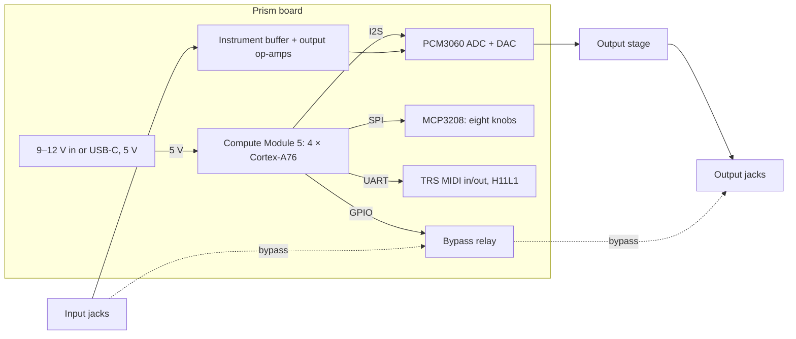

# Prism device hardware [DEVICE-HW]

Status: specified, not built. This is the reference hardware for the [Prism device](PrismDevice.md). The [hardware plan](../../plans/synth/hardware.md) tracks delivery. Every choice below cites the [hardware research](../../research/synthesis/hardware.md); the [device designs](../../designs/prism-device/README.md) hold the panel and enclosure drawings.

The product is a **Raspberry Pi Compute Module 5 on one purpose-built carrier**, the **Prism board**, in a die-cast pedal enclosure. The prototype is a **stock Raspberry Pi 5 with an audio HAT** ([DEVICE-HW-PROTOTYPE]). A Raspberry Pi plus one purpose-built audio and control board is the pattern norns, Zynthian and PiPedal already proved ([DEVICE-RESEARCH-PRIOR]). The compute module is the product's choice because a Pi 5 with a HAT and cooler does not fit under the controls in a 35 mm-deep pedal shell ([DEVICE-HW-ENCLOSURE]). It must meet three requirements:

1. **Low latency.** Audio in to audio out, and a MIDI note to its sound, take 5 ms or less, and can never exceed 10 ms ([DEVICE-HW-LATENCY]).
2. **Fast enough for a decent stereo patch.** The default patch must run in stereo with headroom ([DEVICE-HW-COMPUTE]).
3. **Under AUD 500 to build one** ([DEVICE-HW-BUDGET]).

## Latency [DEVICE-HW-LATENCY]

The bound comes from Wessel and Wright: at most 10 ms from gesture to sound and at most 1 ms of jitter ([DEVICE-RESEARCH-LATENCY]). The device targets half that.

| Stage | Budget at 48 kHz | Basis |
| --- | --- | --- |
| Input buffering, 2 × 64 frames | 2.67 ms worst case | ALSA period of 64 frames is 1.33 ms |
| DSP of one block | within 1.33 ms | must finish inside the period ([DEVICE-ENGINE-BUDGET]) |
| Output buffering, 64 frames | 1.33 ms | |
| ADC and DAC digital filters | under 1 ms combined | codec datasheet group delay; measured on the device |
| **Audio round trip** | **5 ms or less** | PiPedal measured 5.8 ms at 64 frames on a Pi 4 over USB ([DEVICE-RESEARCH-RT]); I2S avoids the USB stage |
| MIDI in, TRS | about 1 ms for a 3-byte note at 31,250 baud | |
| MIDI in, USB | up to 1 ms polling | |
| **Note to sound** | **5 ms or less** | MIDI in, then one block and the output buffer |

- **Buffer limits ([DEVICE-HW-LATENCY-LIMITS]).** The firmware offers periods of 32, 64 and 128 frames at 48 kHz. 64 is the default. A setting whose worst-case round trip would exceed 10 ms is refused, not offered. 96 kHz halves each period's time at double the CPU cost.
- **Jitter ([DEVICE-HW-LATENCY-JITTER]).** Events carry sample offsets within the block ([SYNTH-RENDER]), so MIDI timing jitter is bounded by the input path, not by the block size. The PREEMPT_RT worst case measured on a Pi 5 is 224 µs, well inside 1 ms ([DEVICE-RESEARCH-RT]).
- **Measured, not assumed ([DEVICE-HW-LATENCY-VERIFY]).** The hardware journeys measure round trip with a loopback cable and note to sound with a MIDI loopback, over 24 hours at full budget, and record mean, worst case and jitter ([DEVICE-VERIFY]).

## Compute [DEVICE-HW-COMPUTE]

- **Compute Module 5, 4 GB RAM, 16 GB eMMC, no wireless** (USD 95 list). The same BCM2712 and four Cortex-A76 cores as the Pi 5, 2–3× a Pi 4 ([DEVICE-RESEARCH-COMPUTE]). One core is isolated for audio ([DEVICE-OS]); the others run MIDI, controls and the link. The engine needs well under 1 GB. No radio means a smaller attack surface and no radio certification.
- **Why a compute module.** It is lower than a Pi 5 with a HAT and cooler, so the stack fits the shell under the pots and footswitches; its eMMC replaces a microSD card that can work loose on a stage; and it costs less than a Pi 5 plus a card and cooler ([DEVICE-HW-BUDGET]). The carrier must provide USB, power and boot circuits, which Raspberry Pi's published CM5 IO board design already shows.
- **Same software.** A Pi 5 and a CM5 run the same image apart from the device tree overlay, so the prototype tests the product's firmware ([DEVICE-HW-PROTOTYPE]).
- **A decent stereo patch.** The acceptance patch is two oscillators, a filter, two envelopes, an LFO, a stereo delay and a stereo reverb, eight voices, stereo out at 48 kHz. It must use no more than 70% of the 64-frame deadline on one core ([DEVICE-ENGINE-BUDGET]). The Pi 5 has the CPU for this; today Osprey's engine does not ([DEVICE-PLAN-SPEED]).
- **Cooling.** Fanless: an isolated thermal path from the module to the aluminium shell ([DEVICE-HW-ENCLOSURE]). The CPU must stay below the throttling range PiPedal measured (about 60–70 °C) under the 24-hour journey ([DEVICE-RESEARCH-RT]). Throttling is reported as a fault ([DEVICE-ENGINE-FAULT]).

## The Prism board [DEVICE-HW-BOARD]

One four-layer carrier for the Compute Module 5, derived from Raspberry Pi's CM5 IO board design. Every circuit on it except the module connectors, USB and boot also fits a Raspberry Pi HAT+ board, so the audio and control circuits can be tested on a Pi 5 first ([DEVICE-RESEARCH-AUDIO], [DEVICE-HW-PROTOTYPE]). Its KiCad sources live in the repository; fabrication outputs are generated by the build and never committed ([REPO-NO-ARTIFACTS]).

### Audio [DEVICE-HW-AUDIO]

- **Codec: TI PCM3060.** One stereo 24-bit ADC and DAC, 96 kHz capable, with a mainline Linux driver ([DEVICE-RESEARCH-AUDIO]). It runs as I2S clock master from its own low-jitter crystal, so audio timing does not depend on the Pi's clocks.
- **Prototype: HiFiBerry DAC2 ADC Pro.** Until the Prism board exists, this board provides the same I2S path with a supported overlay ([DEVICE-HW-PROTOTYPE]).
- **Outputs:** stereo 6.35 mm (1/4") jacks at line level from an op-amp stage that turns the codec's differential outputs single-ended, and a 3.5 mm headphone output with its own amplifier.
- **Inputs:** stereo 6.35 mm jacks. A switch per input selects **line** or **instrument**; instrument level passes through a 1 MΩ op-amp buffer with up to +20 dB of gain, so a guitar or bass plugs straight in.
- **Clean power:** the analog section has its own low-noise regulator and ground plane, joined to digital ground at one point under the codec.

### True bypass [DEVICE-HW-BYPASS]

In effects-pedal role, a relay connects each input jack directly to its output jack whenever the effect is bypassed, the engine is restarting or the box has no power. The relay's unpowered state is bypass, so a pedal that crashes, reboots or loses power never cuts the player's signal.

### Controls [DEVICE-HW-CONTROLS]

- **Eight knobs:** 10 kΩ linear potentiometers read by an MCP3208 12-bit SPI ADC against a precision 3.0 V reference, not the 3.3 V rail ([DEVICE-RESEARCH-IO]).
- **Four toggle switches:** two two-way and two three-way, on GPIO with pull-ups.
- **Two footswitches:** soft-touch momentary, on GPIO ([DEVICE-CONTROLS-FOOT]).
- **LEDs:** one RGB status LED and one LED per footswitch.
- **Test header:** each knob's wiper is on a header, so the factory jig drives the knobs electrically ([DEVICE-FACTORY-TEST]).

### MIDI [DEVICE-HW-MIDI]

- **USB-C device port:** the module's USB 2.0 OTG port in peripheral mode is a class-compliant USB MIDI device and carries the link to Prism ([DEVICE-LINK]). The same port flashes the eMMC in the factory ([DEVICE-FACTORY-PROVISION]). On the prototype this is the Pi 5's USB-C port with `dtoverlay=dwc2,dr_mode=peripheral` ([DEVICE-RESEARCH-IO]).
- **USB-A host port:** takes class-compliant USB MIDI keyboards and controllers, and powers a bus-powered keyboard within its current budget.
- **TRS MIDI in and out (3.5 mm, Type A, RP-054):** the input is opto-isolated with an H11L1, which works at 3.3 V; the output uses the 3.3 V resistor values from the 2014 electrical update, CA-033 ([DEVICE-RESEARCH-IO]). Both use the Pi's UART at 31,250 baud.

### Power [DEVICE-HW-POWER]

- **Barrel:** 9–12 V DC, centre-negative 2.1 mm (the pedalboard standard), at least 2 A, with reverse-polarity protection and a buck converter to 5 V.
- **USB-C:** the box also runs from USB-C alone when the source advertises enough current through USB Type-C current detection; the board measures it and refuses to boot the audio engine on a source too weak for the USB host load and boot transients. With both connected, the barrel powers the box and the USB-C data link keeps working.
- Sources are isolated from each other, and a brownout puts the relay in bypass ([DEVICE-HW-BYPASS]).

## Enclosure [DEVICE-HW-ENCLOSURE]

The enclosure is drawn in the [device designs](../../designs/prism-device/README.md#enclosure-device-hw-enclosure), with its panel layout, connector faces and release checks. Constraints from this specification:

- A Hammond 1590XX die-cast aluminium box, 145 × 121 × 39 mm with about 35 mm inside ([DEVICE-RESEARCH-PRICES]). Hammond's deeper 1590X, on the same footprint, is the fallback if the frozen parts do not fit.
- Knobs and toggles on the top face, footswitches at the player's end, audio jacks on the sides (inputs right, outputs left, as on a pedalboard), USB-C, USB-A, power and TRS MIDI at the back.
- Fanless: the module is thermally coupled to the shell through an isolated spreader ([DEVICE-HW-COMPUTE]).
- A printed panel overlay from Prism's device face labels the controls ([PRISM-INSTRUMENT-DEVICE-LABELS]).

## Prototype [DEVICE-HW-PROTOTYPE]

Before the Prism board: a Raspberry Pi 5, a HiFiBerry DAC2 ADC Pro, an MCP3208 with eight knobs, toggles and footswitches on a breadboard, and the TRS MIDI circuit on the UART. Firmware and engine are identical to the product; only the device tree overlay differs. The prototype runs every hardware journey ([DEVICE-VERIFY]) before the Prism board is laid out.

## Budget [DEVICE-HW-BUDGET]

One unit, AUD including GST, 26 November 2026. Cited prices are from the [research](../../research/synthesis/hardware.md#enclosure-and-prices-device-research-prices); the others are estimates and are replaced by quotes when parts are ordered.

| Part | AUD | Basis |
| --- | ---: | --- |
| Compute Module 5, 4 GB, 16 GB eMMC, no wireless | 160 | USD 95 list, cited, converted with GST |
| Prism board, assembled in a run of five (PCM3060, MCP3208, op-amps, relay, H11L1, USB, regulators) | 110 | estimate |
| Thermal spreader and pads | 10 | estimate |
| Eight pots and knobs | 40 | estimate |
| Four toggles and two footswitches | 40 | estimate |
| Jacks: four 6.35 mm, one headphone, two TRS MIDI, one barrel | 35 | estimate |
| Hammond 1590XX | 27 | cited |
| Drilling and printed panel | 30 | estimate |
| **Total** | **452** | under AUD 500 |

The prototype is a Raspberry Pi 5 4 GB (AUD 178, cited), a microSD card, the HiFiBerry DAC2 ADC Pro (about AUD 115) and breadboard parts, about AUD 450 before the enclosure. A pedal power supply is not included; most players already own one.
