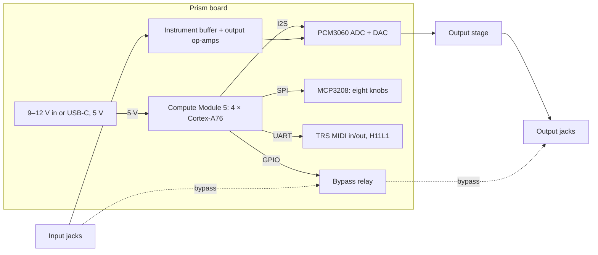

# Prism device hardware [DEVICE-HW]

## 🚨 DIRECTIVE: PERFORMANCE OPTIMISATION NECESSARY, ESPECIALLY ON EMBEDDED DEVICES 🚨 [DEVICE-PERF]

**Performance optimisation is not optional and never finished.** The engine that runs in Prism is the engine that runs on the device, and the device has a slower CPU and a hard 1.33 ms deadline per 64-frame block. Today the engine renders 0.37 s of audio per second on a Mac, mostly in reference counting and allocation ([DAW-TRANSPORT-LIVE-SPEED]). That must improve many times over, and it is worked on **in parallel with everything else**, not as a gate that holds other work back.

- Every change to the engine, the synth package or the code the compiler generates for them is measured for speed, and a change that makes the device slower is a defect.
- The render callback allocates, frees and blocks nothing ([TARGET-EMBEDDED-REALTIME]).
- Per-processor costs are measured on the device's own CPU ([DEVICE-ENGINE-BUDGET]), recorded, and only go down.
- The acceptance stereo patch must run at 70% or less of the deadline on one core ([DEVICE-HW-COMPUTE]). Until it does, that is the most important open item on the device.

Status: specified, not built. This is the reference hardware for the [Prism device](PrismDevice.md). The [hardware plan](../../plans/synth/hardware.md) tracks delivery. Every choice below cites the [hardware research](../../research/synthesis/hardware.md); the [device designs](../../designs/prism-device/README.md) hold the panel and enclosure drawings.

The product is a **Raspberry Pi Compute Module 5 on one purpose-built carrier**, the **Prism board**, in a die-cast pedal enclosure. The prototype is a **stock Raspberry Pi 5 with an audio HAT** ([DEVICE-HW-PROTOTYPE]). A Raspberry Pi plus one purpose-built audio and control board is the pattern norns, Zynthian and PiPedal already proved ([DEVICE-RESEARCH-PRIOR]). The compute module is the product's choice because a Pi 5 with a HAT and cooler does not fit under the controls in a 35 mm-deep pedal shell ([DEVICE-HW-ENCLOSURE]). It must meet three requirements:

1. **Low latency.** Audio in to audio out takes under 5 ms, a MIDI note to its sound under 5.5 ms worst case, and neither can ever exceed 10 ms ([DEVICE-HW-LATENCY]).
2. **Fast enough for a decent stereo patch.** The default patch must run in stereo with headroom ([DEVICE-HW-COMPUTE]).
3. **Under AUD 500 to build one** ([DEVICE-HW-BUDGET]).

## Latency [DEVICE-HW-LATENCY]

The bound comes from Wessel and Wright: at most 10 ms from gesture to sound and at most 1 ms of jitter ([DEVICE-RESEARCH-LATENCY]). The device targets half that.

ALSA runs with two periods of 64 frames (1.33 ms each). The DSP of a block happens inside the output buffering, so it adds no time of its own as long as it finishes within the period ([DEVICE-ENGINE-BUDGET]).

| Stage | At 48 kHz, 64 frames | Basis |
| --- | ---: | --- |
| ADC group delay | 0.36 ms | PCM3060: 17.4/fs ([DEVICE-RESEARCH-AUDIO]) |
| Input: one period | 1.33 ms | a block is processed once it is full |
| Output: two periods | 2.67 ms | the block being played and the one being rendered |
| DAC group delay | 0.42 ms | PCM3060: 20/fs |
| **Audio round trip** | **4.8 ms** | PiPedal measured 5.8 ms at 64 frames on a Pi 4 over a USB interface ([DEVICE-RESEARCH-RT]); I2S avoids the USB stage |
| MIDI in, TRS | 0.96 ms | 3 bytes × 10 bits at 31,250 baud |
| MIDI in, USB | up to 1 ms | full-speed polling interval |
| Wait for the next block | up to 1.33 ms | an event is rendered at its sample offset in the next block |
| **Note to sound** | **5.4 ms worst case, about 4.1 ms typical** | MIDI in, wait, two output periods, DAC |

Both are about half the 10 ms bound. At 32 frames the round trip is 2.8 ms and note to sound 3.4 ms worst case, at twice the per-block overhead.

- **Buffer limits ([DEVICE-HW-LATENCY-LIMITS]).** The firmware offers periods of 32, 64 and 128 frames at 48 kHz. 64 is the default. A setting whose worst-case round trip would exceed 10 ms is refused, not offered. 96 kHz halves each period's time at double the CPU cost.
- **Jitter ([DEVICE-HW-LATENCY-JITTER]).** Events carry sample offsets within the block ([SYNTH-RENDER]), so MIDI timing jitter is bounded by the input path, not by the block size. The PREEMPT_RT worst case measured for a `SCHED_FIFO` loop on a Pi 5 under stress is 224 µs, well inside 1 ms ([DEVICE-RESEARCH-RT]). Wessel and Wright's 1 ms jitter bound is the target: a steady delay is tolerated far better than a varying one ([DEVICE-RESEARCH-LATENCY]).
- **Measured, not assumed ([DEVICE-HW-LATENCY-VERIFY]).** The hardware journeys measure round trip with a loopback cable and note to sound with a MIDI loopback, over 24 hours at full budget, and record mean, worst case and jitter ([DEVICE-VERIFY]).

## Compute [DEVICE-HW-COMPUTE]

- **Compute Module 5, 4 GB RAM, 16 GB eMMC, no wireless** (CM5004016, AUD 139.95, [DEVICE-HW-BUDGET]). The same BCM2712 and four Cortex-A76 cores as the Pi 5, 2–3× a Pi 4 ([DEVICE-RESEARCH-COMPUTE]). One core is isolated for audio ([DEVICE-OS]); the others run MIDI, controls and the link. The engine needs well under 1 GB. No radio means a smaller attack surface and no radio certification.
- **Why a compute module.** It is lower than a Pi 5 with a HAT and cooler, so the stack fits the shell under the pots and footswitches; its eMMC replaces a microSD card that can work loose on a stage; and it costs less than a Pi 5 plus a card and cooler ([DEVICE-HW-BUDGET]). The carrier must provide USB, power and boot circuits, which Raspberry Pi's published CM5 IO board design already shows.
- **Same software.** A Pi 5 and a CM5 run the same image apart from the device tree overlay, so the prototype tests the product's firmware ([DEVICE-HW-PROTOTYPE]).
- **A decent stereo patch.** The acceptance patch is two oscillators, a filter, two envelopes, an LFO, a stereo delay and a stereo reverb, eight voices, stereo out at 48 kHz. It must use no more than 70% of the 64-frame deadline on one core ([DEVICE-ENGINE-BUDGET]). The Pi 5 has the CPU for this; today Osprey's engine does not ([DEVICE-PLAN-SPEED]).
- **Cooling.** Fanless: an isolated thermal path from the module to the aluminium shell ([DEVICE-HW-ENCLOSURE]). The SoC must stay at or below 75 °C under the 24-hour journey in a 35 °C room: a 10 °C margin under the 85 °C point where the CM5 throttles, which matters more on a CM5 because it has less metal to sink heat than a Pi 5 ([DEVICE-RESEARCH-COMPUTE]). Throttling is reported as a fault ([DEVICE-ENGINE-FAULT]).

## The Prism board [DEVICE-HW-BOARD]

One four-layer carrier for the Compute Module 5, derived from Raspberry Pi's CM5 IO board design. Every circuit on it except the module connectors, USB and boot also fits a Raspberry Pi HAT+ board, so the audio and control circuits can be tested on a Pi 5 first ([DEVICE-RESEARCH-AUDIO], [DEVICE-HW-PROTOTYPE]). Its KiCad sources live in the repository; fabrication outputs are generated by the build and never committed ([REPO-NO-ARTIFACTS]).

### Audio [DEVICE-HW-AUDIO]

- **Codec: TI PCM3060.** One stereo 24-bit ADC (up to 96 kHz) and DAC (up to 192 kHz), with a mainline Linux driver ([DEVICE-RESEARCH-AUDIO]). It runs as I2S clock master from a dedicated low-jitter 12.288 MHz oscillator on its SCKI input (256 fs at 48 kHz), so audio timing does not depend on the module's clocks. The codec has no crystal circuit of its own.
- **Prototype: HiFiBerry DAC2 ADC Pro.** Until the Prism board exists, this board provides the same I2S path with a supported overlay ([DEVICE-HW-PROTOTYPE]).
- **Outputs:** stereo 6.35 mm (1/4") jacks at line level from an op-amp stage that turns the codec's differential outputs single-ended, and a 3.5 mm headphone output with its own amplifier.
- **Inputs:** stereo 6.35 mm jacks. A switch per input selects **line** or **instrument**; instrument level passes through a 1 MΩ op-amp buffer with up to +20 dB of gain, so a guitar or bass plugs straight in.
- **Clean power:** the analog section has its own low-noise regulator and ground plane, joined to digital ground at one point under the codec.

### True bypass [DEVICE-HW-BYPASS]

In effects-pedal role, a relay connects each input jack directly to its output jack whenever the effect is bypassed, the engine is restarting or the box has no power. The relay's unpowered state is bypass, so a pedal that crashes, reboots or loses power never cuts the player's signal.

### Controls [DEVICE-HW-CONTROLS]

- **Eight knobs:** 10 kΩ linear potentiometers read by an MCP3208 12-bit SPI ADC against a precision 3.0 V reference, not the 3.3 V rail ([DEVICE-RESEARCH-IO]).
- **Four toggle switches:** two two-way and two three-way, on GPIO with pull-ups.
- **Two footswitches:** soft-touch momentary, on GPIO ([DEVICE-CONTROLS-FOOT]).
- **LEDs:** one RGB status LED and one LED per footswitch.
- **Test header:** each knob's wiper is on a header, so the factory jig drives the knobs electrically ([DEVICE-FACTORY-TEST]).

### MIDI [DEVICE-HW-MIDI]

The device speaks **MIDI 1.0** on two kinds of connection. Every modern MIDI keyboard has at least one of them.

| Connection | MIDI type | Plugs into it |
| --- | --- | --- |
| **USB-C** (the one USB port, [DEVICE-HW-USB]) | USB MIDI 1.0 class-compliant (USB Device Class Definition for MIDI Devices): no driver on any computer, phone or tablet | A computer running Prism, or any class-compliant USB MIDI keyboard or controller |
| **TRS MIDI IN and OUT** (two 3.5 mm jacks, Type A, RP-054) | MIDI 1.0 serial at 31,250 baud | A keyboard or synth with 5-pin DIN MIDI, through a standard Type A TRS-to-DIN adapter, or gear with TRS MIDI directly |

- **A modern MIDI keyboard ([DEVICE-HW-MIDI-KEYBOARD]).** Almost every current keyboard is a class-compliant USB MIDI device. It plugs straight into the USB-C port with a USB cable (USB-C to USB-C, or USB-C to the keyboard's USB-B), and the device powers it ([DEVICE-HW-POWER]). A keyboard with only 5-pin DIN MIDI uses TRS MIDI IN with a Type A adapter. No computer is needed in either case.
- **TRS electrical.** The input is opto-isolated with an H11L1, which works at 3.3 V; the output uses the 3.3 V resistor values from the 2014 electrical update, CA-033 ([DEVICE-RESEARCH-IO]). Both use the module's UART.
- **MIDI out** echoes the device's own knob, switch and footswitch moves as control changes on both connections, so the box can drive other gear.
- **MIDI 2.0.** Linux already has USB MIDI 2.0 support ([DEVICE-RESEARCH-IO]). The device speaks MIDI 1.0 first; MIDI 2.0 over USB is a later addition and never replaces 1.0, because most keyboards speak only 1.0.

### One USB port for everything [DEVICE-HW-USB]

The device has **one USB-C port**, and it does everything: plays a keyboard, connects to a computer for patching, carries firmware updates and can power the box. USB lets one port do this because a Type-C port can switch roles by what is plugged into it (dual-role, DRP):

- **A computer plugged in → device role.** The port is a composite USB device: USB MIDI, the network link to Prism ([DEVICE-LINK]), firmware updates ([DEVICE-LINK-UPDATE]), and factory flashing of the eMMC ([DEVICE-FACTORY-PROVISION]). The computer may also power the box ([DEVICE-HW-POWER]).
- **A keyboard plugged in → host role.** The port is a USB host: the keyboard is a USB MIDI device the box reads directly, and the box supplies its 5 V. A small USB hub in this role takes a keyboard and a second controller.
- **Both a keyboard and the computer.** Plug the keyboard into the computer. Prism forwards the keyboard's notes to the device over the link, with their timestamps, so patching and playing happen together through the one port.
- **How the role is chosen.** A TI TUSB320 Type-C controller reads the cable's CC lines, drives the CM5's `USB_OTG_ID` pin and switches the module's USB 2.0 controller between device and host through Linux's USB role switch, which its mainline driver supports ([DEVICE-RESEARCH-IO]). The role change is reported to the engine as an event; it never interrupts audio.
- **The open risk ([DEVICE-HW-USB-RISK]).** The CM5 datasheet calls OTG on this port "not officially documented". Device role on a CM5 is proven on Raspberry Pi's CM5 IO board, with USB MIDI and the link running, before the Prism board is laid out. If it cannot be made reliable, the fallback is a second, device-only USB-C port for the computer, and this section changes before layout.
- **Prototype.** The Pi 5's USB-C port runs in device role (`dtoverlay=dwc2,dr_mode=peripheral`), and the keyboard goes into one of the Pi's USB-A ports until the Prism board's Type-C controller exists.

### Power [DEVICE-HW-POWER]

- **Barrel:** 9–12 V DC, centre-negative 2.1 mm (the pedalboard standard), with reverse-polarity protection and a buck converter to 5 V. Required supply: **at least 18 W** (9 V at 2 A, or 12 V at 1.5 A). The budget at 5 V: module up to 2.0 A under load, keyboard up to 0.5 A, audio, relay and LEDs 0.3 A, so 2.8 A (14 W), leaving about 15% headroom after conversion losses.
- **Powering a keyboard:** in host role the port supplies 5 V through a current-limited switch at 500 mA, the USB 2.0 default, and advertises that on the Type-C CC line. A keyboard that needs more uses its own supply. An overload trips the switch and is reported; it never browns out the module.
- **Powered by the computer:** in device role the box runs from USB-C alone when the computer advertises 3 A at 5 V through Type-C current detection, which Mac USB-C ports do. On a weaker port, the engine does not start until the barrel is connected, and the link still works so Prism can say why.
- **Keyboard with no computer** needs the barrel supply, because the box is then powering the keyboard.
- Sources are isolated from each other, and a brownout puts the relay in bypass ([DEVICE-HW-BYPASS]).

## Enclosure [DEVICE-HW-ENCLOSURE]

The case comes in two stages, and the first one is simple:

1. **Starter case: a 3D-printed box ([DEVICE-HW-ENCLOSURE-PRINTED]).** The first devices are the prototype electronics in a printed box sized to fit whatever is inside, including a Pi 5 with an audio HAT. It holds the knobs, switches, footswitches and jacks in the panel layout below, so the playing experience and the device face in Prism are already right. It is for the bench and the studio, not the stage: no drop, stomp-load or sealing requirement applies to it. Its model files live in the repository; printed parts are never committed ([REPO-NO-ARTIFACTS]).
2. **Eventual case: the die-cast road case** described in the rest of this section and in [DEVICE-HW-RUGGED]. It comes later, with the Prism board, and nothing before it waits for it.

The eventual enclosure is drawn in the [device designs](../../designs/prism-device/README.md#enclosure-device-hw-enclosure), with its panel layout, connector faces and release checks. Constraints from this specification for that case:

- A Hammond 1590WXX die-cast aluminium box: the 1590XX (145 × 121 × 39 mm, about 35 mm inside, walls about 3.1 mm) in its liquid-resistant version with a silicone lid gasket ([DEVICE-RESEARCH-PRICES]). Hammond's deeper 1590X, on the same footprint, is the fallback if the frozen parts do not fit.
- Knobs and toggles on the top face, footswitches at the player's end, audio jacks on the sides (inputs right, outputs left, as on a pedalboard). At the back: the one USB-C port, the barrel power jack and TRS MIDI IN and OUT. No USB-A port.
- Fanless: the module is thermally coupled to the shell through an isolated spreader ([DEVICE-HW-COMPUTE]).
- A printed panel overlay from Prism's device face labels the controls ([PRISM-INSTRUMENT-DEVICE-LABELS]).

## Rugged [DEVICE-HW-RUGGED]

This section applies to the **eventual** die-cast case, not to the 3D-printed starter case ([DEVICE-HW-ENCLOSURE-PRINTED]). The finished product is stomped on, kicked, dropped off a stage and packed in a gig bag. It is a **hard case** built like a road pedal, not a desktop gadget.

- **Shell.** Die-cast aluminium with walls of at least 2.5 mm; the 1590XX drawing gives about 3.1 mm. Powder-coated or anodised. No plastic panels, windows or bezels anywhere. Stainless O-ring lid screws (Hammond 1590WMS100) into the casting's bosses, at the gasketed torque of 25–30 cN·m.
- **Footswitches.** Metal-bodied switches bolted through the shell with a washer and locknut, so a stomp loads the aluminium, never the board. Rated for at least 1,000,000 actuations. The top face takes a 100 kg standing load on either footswitch without deforming.
- **Knobs and toggles.** Metal-shaft potentiometers and metal-bushing toggles, each fixed to the shell by its own panel nut; the board only carries their pins. Short bat-handle toggles; low-profile knobs below the footswitch caps so a boot slides off them ([DEVICE-HW-ENCLOSURE]).
- **Connectors.** Every jack and the USB-C receptacle is nutted or screwed to the shell wall, so a yanked cable pulls against the case, not the solder joints. The USB-C receptacle is a panel-mount, through-hole-anchored part rated for at least 10,000 insertions.
- **Inside.** The Prism board and module are held on a bracket fixed to the shell, with flexible, latched harnesses to the panel parts. The board is conformally coated against moisture and spilled drinks. The compute module is clamped, not only held by its connectors.
- **Sealing.** The 1590XX is sold as IP54, and the 1590WXX adds a silicone lid gasket. Every drilled opening keeps that splash resistance with sealed or O-ring hardware; drilling makes the rating a claim to test, not to assume ([DEVICE-RESEARCH-PRICES]).
- **Tested ([DEVICE-HW-RUGGED-VERIFY]).** The assembled device passes, powered and playing: drop and topple to IEC 60068-2-31 from 1 m onto concrete on every face and edge; shock to IEC 60068-2-27; vibration to IEC 60068-2-64; 100 kg on each footswitch; a 50 N pull on every connected cable. After each test it still plays the acceptance patch with no new fault, and the bypass still passes signal with the power off.

## Prototype [DEVICE-HW-PROTOTYPE]

Before the Prism board: a Raspberry Pi 5, a HiFiBerry DAC2 ADC Pro, an MCP3208 with eight knobs, toggles and footswitches, and the TRS MIDI circuit on the UART, first on a breadboard and then in the 3D-printed starter case ([DEVICE-HW-ENCLOSURE-PRINTED]). Firmware and engine are identical to the product; only the device tree overlay differs. The prototype runs every hardware journey ([DEVICE-VERIFY]) before the Prism board is laid out.

## Budget [DEVICE-HW-BUDGET]

One unit of the eventual product in its die-cast case, AUD including GST, 26 November 2026. The starter build in a printed box is costed below the table. Cited prices are from the [research](../../research/synthesis/hardware.md#enclosure-and-prices-device-research-prices); the others are estimates and are replaced by quotes when parts are ordered.

| Part | AUD | Basis |
| --- | ---: | --- |
| Compute Module 5, 4 GB, 16 GB eMMC, no wireless (CM5004016) | 140 | AUD 139.95, cited; out of stock on this date |
| Prism board, assembled in a run of five (PCM3060, MCP3208, op-amps, relay, H11L1, TUSB320, regulators) | 110 | estimate |
| Thermal spreader and pads | 10 | estimate |
| Eight pots and knobs | 40 | estimate |
| Four toggles and two footswitches | 40 | estimate |
| Jacks: four 6.35 mm, one headphone, two TRS MIDI, one barrel, one USB-C | 35 | estimate |
| Hammond 1590WXX, gasketed, with stainless O-ring screws | 40 | estimate; the plain 1590XX is AUD 26.81, cited |
| Rugged hardware: panel-mount USB-C, metal toggles and footswitch nuts, bracket, gasket, conformal coat | 30 | estimate |
| Drilling and printed panel | 30 | estimate |
| **Total** | **475** | under AUD 500 |

Raspberry Pi raised 4 GB prices twice in 2026 as memory costs rose, and the CM5 was out of stock on this date ([DEVICE-RESEARCH-COMPUTE]). AUD 25 of headroom covers one more rise of that size; a larger one breaks the budget and is reported, not absorbed.

The prototype is a Raspberry Pi 5 4 GB (AUD 178.42, cited), a microSD card, the HiFiBerry DAC2 ADC Pro (AUD 119.90, cited) and breadboard parts, about AUD 450 before the enclosure. A 3D-printed starter case adds about AUD 20 of filament, an estimate. A pedal power supply is not included; most players already own one.
