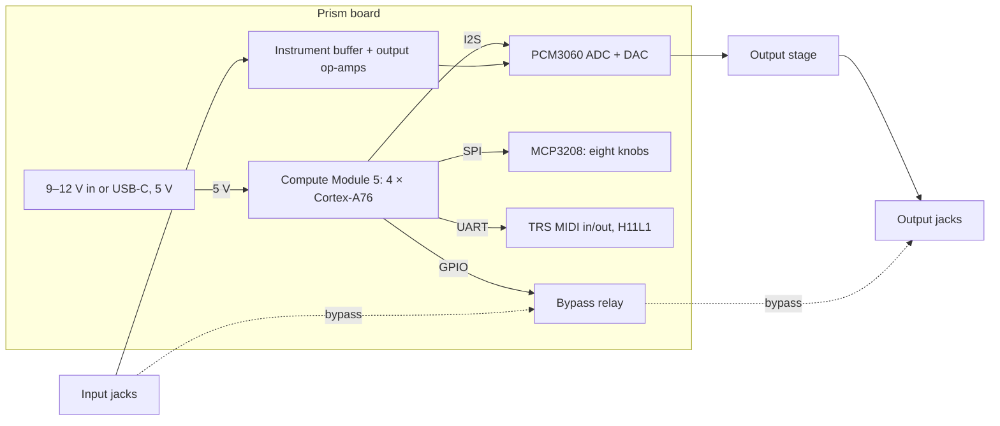

# Prism device hardware [DEVICE-HW]

## 🚨 DIRECTIVE: PERFORMANCE OPTIMISATION NECESSARY, ESPECIALLY ON EMBEDDED DEVICES 🚨 [DEVICE-PERF]

**Performance optimisation is not optional and never finished.** The engine that runs in Prism is the engine that runs on the device, and the device has a slower CPU and a hard 1.33 ms deadline per 64-frame block. Today the engine renders 0.37 s of audio per second on a Mac, mostly in reference counting and allocation ([DAW-TRANSPORT-LIVE-SPEED]). That must improve many times over, and it is worked on **in parallel with everything else**, not as a gate that holds other work back.

- Every change to the engine, the synth package or the code the compiler generates for them is measured for speed, and a change that makes the device slower is a defect.
- The render callback allocates, frees and blocks nothing ([TARGET-EMBEDDED-REALTIME]).
- Per-processor costs are measured on the device's own CPU ([DEVICE-ENGINE-BUDGET]), recorded, and only go down.
- The acceptance stereo patch must run at 70% or less of the deadline on one core ([DEVICE-HW-COMPUTE]). Until it does, that is the most important open item on the device.

Status: specified, not built. This is the reference hardware for the [Prism device](PrismDevice.md). The [hardware plan](../../plans/synth/device.md#hardware-device-hw-plan) tracks delivery. Every choice below cites the [hardware research](#research-findings-device-research); the [device designs](../../designs/prism-device/README.md) hold the panel and enclosure drawings.

The product is a **Raspberry Pi Compute Module 5 on one purpose-built carrier**, the **Prism board**, in a die-cast pedal enclosure. The prototype is a **stock Raspberry Pi 5 with an audio HAT** ([DEVICE-HW-PROTOTYPE]). A Raspberry Pi plus one purpose-built audio and control board is the pattern norns, Zynthian and PiPedal already proved ([DEVICE-RESEARCH-PRIOR]). The compute module is the product's choice because a Pi 5 with a HAT and cooler does not fit under the controls in a 35 mm-deep pedal shell ([DEVICE-HW-ENCLOSURE]). It must meet three requirements:

1. **Low latency.** Audio in to audio out takes under 5 ms, a MIDI note to its sound under 5.5 ms worst case, and neither can ever exceed 10 ms ([DEVICE-HW-LATENCY]).
2. **Fast enough for a decent stereo patch.** The default patch must run in stereo with headroom ([DEVICE-HW-COMPUTE]).
3. **Under AUD 500 to build one** ([DEVICE-HW-BUDGET]).

## Latency [DEVICE-HW-LATENCY]

The bound comes from Wessel and Wright: at most 10 ms from gesture to sound and at most 1 ms of jitter ([DEVICE-RESEARCH-LATENCY]). The device targets half that.

ALSA runs with two periods of 64 frames (1.33 ms each). The DSP of a block happens inside the output buffering, so it adds no time of its own as long as it finishes within the period ([DEVICE-ENGINE-BUDGET]).

| Stage | At 48 kHz, 64 frames | Basis |
| --- | ---: | --- |
| ADC group delay | 0.36 ms | PCM3060: 17.4/fs ([DEVICE-RESEARCH-AUDIO]) |
| Input: one period | 1.33 ms | a block is processed once it is full |
| Output: two periods | 2.67 ms | the block being played and the one being rendered |
| DAC group delay | 0.42 ms | PCM3060: 20/fs |
| **Audio round trip** | **4.8 ms** | PiPedal measured 5.8 ms at 64 frames on a Pi 4 over a USB interface ([DEVICE-RESEARCH-RT]); I2S avoids the USB stage |
| MIDI in, TRS | 0.96 ms | 3 bytes × 10 bits at 31,250 baud |
| MIDI in, USB | up to 1 ms | full-speed polling interval |
| Wait for the next block | up to 1.33 ms | an event is rendered at its sample offset in the next block |
| **Note to sound** | **5.4 ms worst case, about 4.1 ms typical** | MIDI in, wait, two output periods, DAC |

Both are about half the 10 ms bound. At 32 frames the round trip is 2.8 ms and note to sound 3.4 ms worst case, at twice the per-block overhead.

- **Buffer limits ([DEVICE-HW-LATENCY-LIMITS]).** The firmware offers periods of 32, 64 and 128 frames at 48 kHz. 64 is the default. A setting whose worst-case round trip would exceed 10 ms is refused, not offered. 96 kHz halves each period's time at double the CPU cost.
- **Jitter ([DEVICE-HW-LATENCY-JITTER]).** Events carry sample offsets within the block ([SYNTH-RENDER]), so MIDI timing jitter is bounded by the input path, not by the block size. On a Pi 5 under stress, a `SCHED_FIFO` loop's worst-case delay was measured at 1.8 ms on the standard kernel and 0.22 ms on the real-time kernel ([DEVICE-RESEARCH-RT]); the device starts on the standard kernel like other Pi instruments and keeps the real-time kernel as a drop-in swap ([DEVICE-OS-KERNEL]). Wessel and Wright's 1 ms jitter bound is the target: a steady delay is tolerated far better than a varying one ([DEVICE-RESEARCH-LATENCY]).
- **Measured, not assumed ([DEVICE-HW-LATENCY-VERIFY]).** The hardware journeys measure round trip with a loopback cable and note to sound with a MIDI loopback, over 24 hours at full budget, and record mean, worst case and jitter ([DEVICE-VERIFY]).

## Compute [DEVICE-HW-COMPUTE]

- **Compute Module 5, 4 GB RAM, 16 GB eMMC, no wireless** (CM5004016, AUD 139.95, [DEVICE-HW-BUDGET]). The same BCM2712 and four Cortex-A76 cores as the Pi 5, 2–3× a Pi 4 ([DEVICE-RESEARCH-COMPUTE]). One core is isolated for audio ([DEVICE-OS]); the others run MIDI, controls and the link. The engine needs well under 1 GB. No radio means a smaller attack surface and no radio certification.
- **Why a compute module.** It is lower than a Pi 5 with a HAT and cooler, so the stack fits the shell under the pots and footswitches; its eMMC replaces a microSD card that can work loose on a stage; and it costs less than a Pi 5 plus a card and cooler ([DEVICE-HW-BUDGET]). The carrier must provide USB, power and boot circuits, which Raspberry Pi's published CM5 IO board design already shows.
- **Same software.** A Pi 5 and a CM5 run the same image apart from the device tree overlay, so the prototype tests the product's firmware ([DEVICE-HW-PROTOTYPE]).
- **A decent stereo patch.** The acceptance patch is two oscillators, a filter, two envelopes, an LFO, a stereo delay and a stereo reverb, eight voices, stereo out at 48 kHz. It must use no more than 70% of the 64-frame deadline on one core ([DEVICE-ENGINE-BUDGET]). The Pi 5 has the CPU for this; today Osprey's engine does not ([DEVICE-PLAN-SPEED]).
- **Cooling.** Fanless: an isolated thermal path from the module to the aluminium shell ([DEVICE-HW-ENCLOSURE]). The SoC must stay at or below 75 °C under the 24-hour journey in a 35 °C room: a 10 °C margin under the 85 °C point where the CM5 throttles, which matters more on a CM5 because it has less metal to sink heat than a Pi 5 ([DEVICE-RESEARCH-COMPUTE]). Throttling is reported as a fault ([DEVICE-ENGINE-FAULT]).

## The Prism board [DEVICE-HW-BOARD]

One four-layer carrier for the Compute Module 5, derived from Raspberry Pi's CM5 IO board design. Every circuit on it except the module connectors, USB and boot also fits a Raspberry Pi HAT+ board, so the audio and control circuits can be tested on a Pi 5 first ([DEVICE-RESEARCH-AUDIO], [DEVICE-HW-PROTOTYPE]). Its KiCad sources live in the repository; fabrication outputs are generated by the build and never committed ([REPO-NO-ARTIFACTS]).

### Audio [DEVICE-HW-AUDIO]

- **Codec: TI PCM3060.** One stereo 24-bit ADC (up to 96 kHz) and DAC (up to 192 kHz), with a mainline Linux driver ([DEVICE-RESEARCH-AUDIO]). It runs as I2S clock master from a dedicated low-jitter 12.288 MHz oscillator on its SCKI input (256 fs at 48 kHz), so audio timing does not depend on the module's clocks. The codec has no crystal circuit of its own.
- **Prototype: HiFiBerry DAC2 ADC Pro.** Until the Prism board exists, this board provides the same I2S path with a supported overlay ([DEVICE-HW-PROTOTYPE]).
- **Outputs:** stereo 6.35 mm (1/4") jacks at line level from an op-amp stage that turns the codec's differential outputs single-ended, and a 3.5 mm headphone output with its own amplifier.
- **Inputs:** stereo 6.35 mm jacks. A switch per input selects **line** or **instrument**; instrument level passes through a 1 MΩ op-amp buffer with up to +20 dB of gain, so a guitar or bass plugs straight in.
- **Clean power:** the analog section has its own low-noise regulator and ground plane, joined to digital ground at one point under the codec.

### True bypass [DEVICE-HW-BYPASS]

In effects-pedal role, a relay connects each input jack directly to its output jack whenever the effect is bypassed, the engine is restarting or the box has no power. The relay's unpowered state is bypass, so a pedal that crashes, reboots or loses power never cuts the player's signal.

### Controls [DEVICE-HW-CONTROLS]

- **Eight knobs:** 10 kΩ linear potentiometers read by an MCP3208 12-bit SPI ADC against a precision 3.0 V reference, not the 3.3 V rail ([DEVICE-RESEARCH-IO]).
- **Four toggle switches:** two two-way and two three-way, on GPIO with pull-ups.
- **Two footswitches:** soft-touch momentary, on GPIO ([DEVICE-CONTROLS-FOOT]).
- **LEDs:** one RGB status LED and one LED per footswitch.
- **Test header:** each knob's wiper is on a header, so the factory jig drives the knobs electrically ([DEVICE-FACTORY-TEST]).

### MIDI [DEVICE-HW-MIDI]

The device speaks **MIDI 1.0** on two kinds of connection. Every modern MIDI keyboard has at least one of them.

| Connection | MIDI type | Plugs into it |
| --- | --- | --- |
| **USB-C** (the one USB port, [DEVICE-HW-USB]) | USB MIDI 1.0 class-compliant (USB Device Class Definition for MIDI Devices): no driver on any computer, phone or tablet | A computer running Prism, or any class-compliant USB MIDI keyboard or controller |
| **TRS MIDI IN and OUT** (two 3.5 mm jacks, Type A, RP-054) | MIDI 1.0 serial at 31,250 baud | A keyboard or synth with 5-pin DIN MIDI, through a standard Type A TRS-to-DIN adapter, or gear with TRS MIDI directly |

- **A modern MIDI keyboard ([DEVICE-HW-MIDI-KEYBOARD]).** Almost every current keyboard is a class-compliant USB MIDI device. It plugs straight into the USB-C port with a USB cable (USB-C to USB-C, or USB-C to the keyboard's USB-B), and the device powers it ([DEVICE-HW-POWER]). A keyboard with only 5-pin DIN MIDI uses TRS MIDI IN with a Type A adapter. No computer is needed in either case.
- **TRS electrical.** The input is opto-isolated with an H11L1, which works at 3.3 V; the output uses the 3.3 V resistor values from the 2014 electrical update, CA-033 ([DEVICE-RESEARCH-IO]). Both use the module's UART.
- **MIDI out** echoes the device's own knob, switch and footswitch moves as control changes on both connections, so the box can drive other gear.
- **MIDI 2.0.** Linux already has USB MIDI 2.0 support ([DEVICE-RESEARCH-IO]). The device speaks MIDI 1.0 first; MIDI 2.0 over USB is a later addition and never replaces 1.0, because most keyboards speak only 1.0.

### One USB port for everything [DEVICE-HW-USB]

The device has **one USB-C port**, and it does everything: plays a keyboard, connects to a computer for patching, carries firmware updates and can power the box. USB lets one port do this because a Type-C port can switch roles by what is plugged into it (dual-role, DRP):

- **A computer plugged in → device role.** The port is a composite USB device: USB MIDI, the network link to Prism ([DEVICE-LINK]), firmware updates ([DEVICE-LINK-UPDATE]), and factory flashing of the eMMC ([DEVICE-FACTORY-PROVISION]). The computer may also power the box ([DEVICE-HW-POWER]).
- **A keyboard plugged in → host role.** The port is a USB host: the keyboard is a USB MIDI device the box reads directly, and the box supplies its 5 V. A small USB hub in this role takes a keyboard and a second controller.
- **Both a keyboard and the computer.** Plug the keyboard into the computer. Prism forwards the keyboard's notes to the device over the link, with their timestamps, so patching and playing happen together through the one port.
- **How the role is chosen.** A TI TUSB320 Type-C controller reads the cable's CC lines, drives the CM5's `USB_OTG_ID` pin and switches the module's USB 2.0 controller between device and host through Linux's USB role switch, which its mainline driver supports ([DEVICE-RESEARCH-IO]). The role change is reported to the engine as an event; it never interrupts audio.
- **Fallback ([DEVICE-HW-USB-RISK]).** The CM5's USB 2.0 port switches role through its `USB_OTG_ID` pin, which Raspberry Pi's datasheet describes but does not officially support. The board is therefore laid out with footprints for a second, device-only USB-C port for the computer. It stays unfitted if role switching passes on Raspberry Pi's CM5 IO board, and is fitted if it does not. Either way the design is settled before layout.
- **Prototype.** The Pi 5's USB-C port runs in device role (`dtoverlay=dwc2,dr_mode=peripheral`), and the keyboard goes into one of the Pi's USB-A ports until the Prism board's Type-C controller exists.

### Power [DEVICE-HW-POWER]

- **Barrel:** 9–12 V DC, centre-negative 2.1 mm (the pedalboard standard), with reverse-polarity protection and a buck converter to 5 V. Required supply: **at least 18 W** (9 V at 2 A, or 12 V at 1.5 A). The budget at 5 V: module up to 2.0 A under load, keyboard up to 0.5 A, audio, relay and LEDs 0.3 A, so 2.8 A (14 W), leaving about 15% headroom after conversion losses.
- **Powering a keyboard:** in host role the port supplies 5 V through a current-limited switch at 500 mA, the USB 2.0 default, and advertises that on the Type-C CC line. A keyboard that needs more uses its own supply. An overload trips the switch and is reported; it never browns out the module.
- **Powered by the computer:** in device role the box runs from USB-C alone when the computer advertises 3 A at 5 V through Type-C current detection, which Mac USB-C ports do. On a weaker port, the engine does not start until the barrel is connected, and the link still works so Prism can say why.
- **Keyboard with no computer** needs the barrel supply, because the box is then powering the keyboard.
- Sources are isolated from each other, and a brownout puts the relay in bypass ([DEVICE-HW-BYPASS]).

## Enclosure [DEVICE-HW-ENCLOSURE]

The case comes in two stages, and the first one is simple:

1. **Starter case: a 3D-printed box ([DEVICE-HW-ENCLOSURE-PRINTED]).** The first devices are the prototype electronics in a printed box sized to fit whatever is inside, including a Pi 5 with an audio HAT. It holds the knobs, switches, footswitches and jacks in the panel layout below, so the playing experience and the device face in Prism are already right. It is for the bench and the studio, not the stage: no drop, stomp-load or sealing requirement applies to it. Its model files live in the repository; printed parts are never committed ([REPO-NO-ARTIFACTS]).
2. **Eventual case: the die-cast road case** described in the rest of this section and in [DEVICE-HW-RUGGED]. It comes later, with the Prism board, and nothing before it waits for it.

The eventual enclosure is drawn in the [device designs](../../designs/prism-device/README.md#enclosure-device-hw-enclosure), with its panel layout, connector faces and release checks. Constraints from this specification for that case:

- A Hammond 1590WXX die-cast aluminium box: the 1590XX (145 × 121 × 39 mm, about 35 mm inside, walls 2.0–2.25 mm) in its liquid-resistant version with a silicone lid gasket ([DEVICE-RESEARCH-PRICES]). Hammond's deeper 1590X, on the same footprint, is the fallback if the frozen parts do not fit.
- Knobs and toggles on the top face, footswitches at the player's end, audio jacks on the sides (inputs right, outputs left, as on a pedalboard). At the back: the one USB-C port, the barrel power jack and TRS MIDI IN and OUT. No USB-A port.
- Fanless: the module is thermally coupled to the shell through an isolated spreader ([DEVICE-HW-COMPUTE]).
- A printed panel overlay from Prism's device face labels the controls ([PRISM-INSTRUMENT-DEVICE-LABELS]).

## Rugged [DEVICE-HW-RUGGED]

This section applies to the **eventual** die-cast case, not to the 3D-printed starter case ([DEVICE-HW-ENCLOSURE-PRINTED]). The finished product is stomped on, kicked, dropped off a stage and packed in a gig bag. It is a **hard case** built like a road pedal, not a desktop gadget.

- **Shell.** Die-cast aluminium with walls of at least 2 mm; the 1590XX drawing gives 2.00–2.25 mm. Powder-coated or anodised. No plastic panels, windows or bezels anywhere. Stainless O-ring lid screws (Hammond 1590WMS100) into the casting's bosses, at the gasketed torque of 25–30 cN·m.
- **Footswitches.** Metal-bodied switches bolted through the shell with a washer and locknut, so a stomp loads the aluminium, never the board. Rated for at least 1,000,000 actuations. The top face takes a 100 kg standing load on either footswitch without deforming.
- **Knobs and toggles.** Metal-shaft potentiometers and metal-bushing toggles, each fixed to the shell by its own panel nut; the board only carries their pins. Short bat-handle toggles; low-profile knobs below the footswitch caps so a boot slides off them ([DEVICE-HW-ENCLOSURE]).
- **Connectors.** Every jack and the USB-C receptacle is nutted or screwed to the shell wall, so a yanked cable pulls against the case, not the solder joints. The USB-C receptacle is a panel-mount, through-hole-anchored part rated for at least 10,000 insertions.
- **Inside.** The Prism board and module are held on a bracket fixed to the shell, with flexible, latched harnesses to the panel parts. The board is conformally coated against moisture and spilled drinks. The compute module is clamped, not only held by its connectors.
- **Sealing.** The 1590XX is sold as IP54, and the 1590WXX adds a silicone lid gasket. Every drilled opening keeps that splash resistance with sealed or O-ring hardware; drilling makes the rating a claim to test, not to assume ([DEVICE-RESEARCH-PRICES]).
- **Tested ([DEVICE-HW-RUGGED-VERIFY]).** The assembled device passes, powered and playing: drop and topple to IEC 60068-2-31 from 1 m onto concrete on every face and edge; shock to IEC 60068-2-27; vibration to IEC 60068-2-64; 100 kg on each footswitch; a 50 N pull on every connected cable. After each test it still plays the acceptance patch with no new fault, and the bypass still passes signal with the power off.

## Prototype [DEVICE-HW-PROTOTYPE]

Before the Prism board: a Raspberry Pi 5, a HiFiBerry DAC2 ADC Pro, an MCP3208 with eight knobs, toggles and footswitches, and the TRS MIDI circuit on the UART, first on a breadboard and then in the 3D-printed starter case ([DEVICE-HW-ENCLOSURE-PRINTED]). Firmware and engine are identical to the product; only the device tree overlay differs. The prototype runs every hardware journey ([DEVICE-VERIFY]) before the Prism board is laid out.

## Budget [DEVICE-HW-BUDGET]

One unit of the eventual product in its die-cast case, AUD including GST, 26 November 2026. The starter build in a printed box is costed below the table. Cited prices are from the [research](#enclosure-and-prices-device-research-prices); the others are estimates and are replaced by quotes when parts are ordered.

| Part | AUD | Basis |
| --- | ---: | --- |
| Compute Module 5, 4 GB, 16 GB eMMC, no wireless (CM5004016) | 140 | AUD 139.95, cited; out of stock on this date |
| Prism board, assembled in a run of five (PCM3060, MCP3208, op-amps, relay, H11L1, TUSB320, regulators) | 110 | estimate |
| Thermal spreader and pads | 10 | estimate |
| Eight pots and knobs | 40 | estimate |
| Four toggles and two footswitches | 40 | estimate |
| Jacks: four 6.35 mm, one headphone, two TRS MIDI, one barrel, one USB-C | 35 | estimate |
| Hammond 1590WXX, gasketed, with stainless O-ring screws | 40 | estimate; the plain 1590XX is AUD 26.81, cited |
| Rugged hardware: panel-mount USB-C, metal toggles and footswitch nuts, bracket, gasket, conformal coat | 30 | estimate |
| Drilling and printed panel | 30 | estimate |
| **Total** | **475** | under AUD 500 |

Raspberry Pi raised 4 GB prices twice in 2026 as memory costs rose, and the CM5 was out of stock on this date ([DEVICE-RESEARCH-COMPUTE]). AUD 25 of headroom covers one more rise of that size; a larger one breaks the budget and is reported, not absorbed.

The prototype is a Raspberry Pi 5 4 GB (AUD 178.42, cited), a microSD card, the HiFiBerry DAC2 ADC Pro (AUD 119.90, cited) and breadboard parts, about AUD 450 before the enclosure. A 3D-printed starter case adds about AUD 20 of filament, an estimate. A pedal power supply is not included; most players already own one.

## Research findings [DEVICE-RESEARCH]

Collected 26 November 2026. Each decision above cites a finding here; the [embedded target](../compiler/EmbeddedTargets.md) cites them too. Prices are single-unit retail snapshots from the cited pages on this date; check them again before ordering.

### How low the latency must be [DEVICE-RESEARCH-LATENCY]

- Wessel and Wright set the accepted bound for computer instruments: **at most 10 ms** from gesture to sound, with variation (jitter) of **at most 1 ms**. They measured their own systems at about 7 ms. [Problems and Prospects for Intimate Musical Control of Computers (NIME 2001, arXiv repost)](https://arxiv.org/pdf/2010.01570)
- McPherson, Jack and Moro measured common instrument platforms against that bound and argued jitter matters as much as the mean. Their Bela platform runs synchronous audio and sensor processing with **sub-millisecond latency and jitter under 50 µs**. [Action-Sound Latency: Are Our Tools Fast Enough? (NIME 2016)](https://core.ac.uk/download/77040721.pdf), [An Environment for Submillisecond-Latency Audio and Sensor Processing on BeagleBone Black (AES 2015)](https://www.aes.org/e-lib/browse.cfm?elib=17755)
- Jack, Mehrabi, Stockman and McPherson tested percussionists and amateurs at 0 ms, 10 ms, 10 ± 3 ms and 20 ms. Both groups rated **10 ± 3 ms and 20 ms** worse than zero latency, but found **no significant difference between a steady 10 ms and zero**. Jitter, not only delay, costs quality. [Action-sound Latency and the Perceived Quality of Digital Musical Instruments (Music Perception 36(1), 2018)](https://qmro.qmul.ac.uk/xmlui/bitstream/handle/123456789/44614/Jack%20Action-sound%20Latency%202018%20Accepted.pdf?sequence=1)
- The user's requirement is the same: stay under about 10 ms. The device therefore targets **5 ms or less** for both audio round trip and note to sound, and never configures a buffer that could exceed 10 ms.

### Real-time Linux on a Raspberry Pi [DEVICE-RESEARCH-RT]

- PREEMPT_RT is in mainline Linux since **6.12**, with arm64 among the first architectures. No out-of-tree patch is needed. [Phoronix: PREEMPT_RT merged for Linux 6.12](https://phoronix.com/news/Linux-6.12-Does-Real-Time)
- On a **Raspberry Pi 5**, a 250 Hz control loop at `SCHED_FIFO` priority 99 had a worst-case latency of **224 µs under stress** on PREEMPT_RT, against 1,848 µs on the standard kernel (their Table 4; the paper measures its own loop, not `cyclictest`). [Giacomossi et al., Scheduling Analysis of UAV Flight Control Workloads on PREEMPT_RT Linux Using a Raspberry Pi 5 (arXiv 2604.19275)](https://arxiv.org/html/2604.19275) A 64-frame period at 48 kHz is 1,333 µs, so the worst case leaves most of the period for DSP.
- Xenomai, as used by Elk Audio OS, beats PREEMPT_RT on round-trip latency and usable CPU at a given buffer size on a Raspberry Pi 4 with a HiFiBerry board. [Vignati, Zambon and Turchet, AES e-library 21553](https://aes2.org/publications/elibrary-page/?id=21553) Elk claims down to 1 ms round trip; its open-source build supports only the Pi 4, and the full Xenomai OS is commercially licensed. [Elk Audio OS paper](https://people.kth.se/~carlofi/publication/96/), [Elk supported hardware](https://elk-audio.github.io/elk-docs/html/intro/supported_hw.html)
- PiPedal, an open-source Raspberry Pi guitar pedal, measured **5.8 ms** round trip at 64 frames on a Pi 4 with a USB interface and a stock kernel, and recommends a 64-bit OS (about 40% faster audio code than 32-bit) and cooling to avoid throttling above about 60–70 °C. [PiPedal: Optimizing Audio Latency](https://rerdavies.github.io/pipedal/AudioLatency.html)
- Zynthian users report about **5.2 ms** theoretical latency on a Pi 5 with the Zynthian V5 sound card. [Zynthian forum: expected latency with Raspberry Pi 5](https://discourse.zynthian.org/t/expected-latency-with-raspberry-pi-5-raspberry-pi-dac-pro-pianoteq-for-live-playing/13397)

**Decision:** Linux with the standard Raspberry Pi kernel, which is what comparable Pi instruments ship by default ([DEVICE-RESEARCH-OS]). Raspberry Pi's PREEMPT_RT kernel is the drop-in swap if measured dropouts require it. Xenomai is not used: it needs an out-of-tree kernel and, for Elk's full OS, a commercial licence.

### Operating system [DEVICE-RESEARCH-OS]

- **Raspberry Pi OS Lite (64-bit)** is the standard, vendor-supported OS for the Pi 5 and CM5, based on Debian. Zynthian, PiPedal and norns all run on Raspberry Pi OS or Debian, not a custom distribution.
- Raspberry Pi publishes `rpi-image-gen` to build customised Raspberry Pi OS images from a package list; images flash with Raspberry Pi Imager. [Raspberry Pi: introducing rpi-image-gen](https://www.raspberrypi.com/news/introducing-rpi-image-gen-build-highly-customised-raspberry-pi-software-images/), [rpi-image-gen](https://github.com/raspberrypi/rpi-image-gen)
- **What other Pi instruments run.** All of them run Linux. PiPedal runs on stock Raspberry Pi OS or Ubuntu and says real-time kernels "are preferred but not required", giving "better (but not dramatically better) latency". [PiPedal: audio latency](https://rerdavies.github.io/pipedal/AudioLatency.html) Patchbox OS, Blokas's Raspberry Pi OS for audio, boots the standard kernel by default and offers a real-time kernel from a menu. [Patchbox OS Bookworm beta](https://community.blokas.io/t/beta-patchbox-os-bookworm-arm64-2024-04-04/5163) Zynthian's forum says its images use the default preemptive kernel. [Zynthian forum: realtime kernel](https://discourse.zynthian.org/t/realtime-kernel-for-raspi/1063) Korg's wavestate, modwave and opsix are built on Raspberry Pi Compute Modules. [Raspberry Pi: Korg case study](https://www.leocom.kr/RaspberryPi/success/pdf/221031-Korg-Case-Study.pdf)
- Raspberry Pi publishes a PREEMPT_RT build of its 6.12 kernel as the package `linux-image-rpi-v8-rt`, selected in `config.txt`. [Raspberry Pi forums: RPi 6.12 kernel builds](https://forums.raspberrypi.com/viewtopic.php?t=388298), [Applying PREEMPT_RT in 2026?](https://forums.raspberrypi.com/viewtopic.php?t=396623)
- **No emulator models the device.** QEMU emulates Raspberry Pi boards only up to the 4B, with no Pi 5; Corellium's Arm Virtual Hardware has a Pi 5 model in its cloud but no model of the audio codec. Because the OS is Debian arm64, the engine itself runs unchanged in any stock Debian arm64 container or VM on an Apple-silicon Mac; audio timing needs the real prototype. [QEMU Raspberry Pi boards](https://qemu.readthedocs.io/en/master/system/arm/raspi.html), [Corellium: Raspberry Pi 5 components](https://support.avh.corellium.com/devices/rpi5/rpi5-supported-hardware-components)

**Decision:** Raspberry Pi OS Lite with its standard kernel, not Buildroot or another custom distribution: do what the other Pi instruments do. The real-time kernel stays available as a one-package swap. It is standard and simple, at the cost of a larger image and a slower boot than a minimal build.

### Prior art: open instruments on small computers [DEVICE-RESEARCH-PRIOR]

| Project | Hardware | What we take from it |
| --- | --- | --- |
| [Bela](https://opensource.com/article/18/6/bela-high-performance-audio) | BeagleBone, Xenomai, PRU-driven codec | Audio and sensors sampled in the same callback; latency and jitter measured and published |
| [Elk Audio OS](https://midi.org/elk-audio-os-for-everyone) | Raspberry Pi 4, Xenomai | A headless engine (Sushi) controlled over a network link; an appliance OS with no desktop |
| [Zynthian](https://zynthian.org/technical-specifications) | Raspberry Pi 5, I2S sound card | An open Pi synth with knobs and MIDI that ships today |
| [PiPedal](https://rerdavies.github.io/pipedal/AudioLatency.html) | Raspberry Pi 4 and 5 | A Pi effects pedal; latency and thermal measurements |
| [norns](https://monome.org/docs/norns/) and its [shield](https://github.com/monome/norns) | Raspberry Pi | An open-hardware shield that turns a stock Pi into the instrument |
| [MiniDexed](https://github.com/probonopd/MiniDexed/discussions/621) on [Circle](https://github.com/rsta2/circle/discussions/387) | Raspberry Pi, bare metal | A synth engine with no OS at all, booting straight to sound |
| [Daisy Seed](https://www.electro-smith.com/daisy/daisy) | STM32 Cortex-M7, 480 MHz, AKM codec | Sub-millisecond bare-metal audio for about USD 21–30; far less memory and CPU than a Pi |
| [Pisound](https://blokas.io/pisound/) | Raspberry Pi HAT | Audio plus DIN MIDI on one HAT; DIN MIDI loopback measured at 2.1 ms |

**Decision:** follow the norns, Zynthian and PiPedal pattern of a Raspberry Pi plus one purpose-built audio and control board, running the standard Raspberry Pi OS ([DEVICE-RESEARCH-OS]) with a headless engine controlled over a link, as Elk does. The product puts a Compute Module 5 on that board, because a Pi 5 with a HAT and cooler does not fit a 35 mm-deep pedal shell; the prototype is a stock Pi 5 with an audio HAT. Bare metal (Circle) and microcontrollers (Daisy) are later targets for the same engine ([TARGET-EMBEDDED-BARE]).

### Compute [DEVICE-RESEARCH-COMPUTE]

- The Raspberry Pi 5's Cortex-A76 cores are **2–3×** a Pi 4 in general CPU benchmarks. [Phoronix: Raspberry Pi 5 benchmarks](https://phoronix.com/review/raspberry-pi-5-benchmarks) Pianoteq, a physical-modelling piano, runs live on a Pi 5. [Blokas community: Pianoteq on Raspberry Pi 5](https://community.blokas.io/t/pianoberry-pianoteq-8-1-33-ms-latency-on-raspberry-pi-5/5627?page=2)
- No published Pi 5 polyphony benchmark exists for synth engines comparable to `@osprey/synth`. The engine's own cost table must be measured on the device ([DEVICE-ENGINE-BUDGET]).
- The hardware is fast enough for a decent stereo patch. **Osprey's engine is not yet**: it renders 0.37 s of audio per second on a Mac today, mostly in reference counting and allocation ([DAW-TRANSPORT-LIVE-SPEED]). Engine performance is therefore the most important work for the device; it proceeds in parallel with the hardware, not before it ([DEVICE-PERF]).
- **Compute Module 5 price.** Raspberry Pi raised every 4 GB product by USD 15 in February 2026 and again by USD 25 in 2026 because LPDDR4 memory costs more than doubled, so the launch list prices in the [CM5 product brief](https://pip-assets.raspberrypi.com/categories/944-raspberry-pi-compute-module-5/documents/RP-008181-DS-10-cm5-product-brief.pdf) are stale. [Raspberry Pi: more memory-driven price rises (2 Feb 2026)](https://www.raspberrypi.com/news/more-memory-driven-price-rises/), [Hackster: second 2026 rise](https://www.hackster.io/news/raspberry-pi-hikes-prices-by-up-to-150-as-the-ai-bubble-hits-hard-confirms-raspberry-pi-6-plans-711d4384a4dd) The 4 GB, 16 GB eMMC, no-wireless CM5004016 is **AUD 139.95** at Core Electronics, **out of stock** on 26 November 2026. [Core Electronics: CM5 non-wireless](https://core-electronics.com.au/raspberry-pi/boards/compute-module-5/non-wireless.html)
- **CM5 power and heat.** The CM5 datasheet gives a typical operating current of 900 mA at 5 V and throttles the SoC to keep it below 85 °C; it has less metal to sink heat than a Pi 5. [CM5 datasheet, §4.3.3 and §4.4](https://pip-assets.raspberrypi.com/categories/944-raspberry-pi-compute-module-5/documents/RP-008180-DS-8-cm5-datasheet.pdf)
- A CM5 carrier must also carry USB, power and boot circuits. That costs design effort, not unit price: the module is cheaper than a Pi 5 plus a microSD card and cooler, and it is the only option that fits the shell.

### Audio converters [DEVICE-RESEARCH-AUDIO]

- **Prototype:** HiFiBerry DAC2 ADC Pro: Burr-Brown DAC and ADC, 24-bit up to 192 kHz, 112 dB DAC and 110 dB ADC SNR, input gain −12 to +32 dB, AUD 119.90 in stock. [HiFiBerry DAC2 ADC Pro datasheet](https://www.hifiberry.com/docs/data-sheets/datasheet-dac2-adc-pro/), [shop](https://www.hifiberry.com/shop/boards/hifiberry-dac2-adc-pro)
- **Prism board:** TI PCM3060: one 24-bit stereo ADC (16–96 kHz) and DAC (16–192 kHz) in a TSSOP-28, about USD 3–6, with a mainline Linux driver. ADC and DAC are each master or slave independently. It has no crystal oscillator of its own: the system clock (SCKI) comes from an external oscillator. Group delay is **17.4/fs** for the ADC and **20/fs** for the DAC, 0.36 ms and 0.42 ms at 48 kHz. [TI PCM3060 datasheet SLAS533B](https://www.ti.com/lit/ds/symlink/pcm3060.pdf), [TI PCM3xxx Linux drivers](https://www.ti.com/tool/PCM3XXX-DRIVERS), [LCSC price](https://www.lcsc.com/product-detail/C2651841.html) Its outputs are differential, so the board carries an op-amp stage to the jacks.
- **HAT format:** Raspberry Pi HAT+ specification (2024), which replaces the 2014 HAT standard. [HAT+ specification](https://datasheets.raspberrypi.com/hat/hat-plus-specification.pdf)

### Controls and MIDI [DEVICE-RESEARCH-IO]

- MCP3208: 8-channel, 12-bit SPI ADC, 2.7–5.5 V, about USD 2. [Microchip datasheet DS21298](https://www.microchip.com/content/dam/mchp/documents/APID/ProductDocuments/DataSheets/21298e.pdf), [Octopart](https://octopart.com/part/microchip/MCP3208T-CI%2FSL)
- MIDI electrical: the 2014 update (CA-033) allows 3.3 V transmitters and adds optional RF filtering; the Pi's 3.3 V UART needs an opto-isolator that works at 3.3 V, such as the H11L1. [CA-033](https://midi.org/wp-content/uploads/wpforo/default_attachments/1709416667-ca33-MIDI-10-Electrical-Specification-Update.pdf)
- TRS MIDI: RP-054 (2018) standardises TRS; Type A is the common pinout. [Hackaday on RP-054](https://hackaday.com/2018/08/23/midi-association-releases-spec-for-trs-jacks)
- USB MIDI device: the Pi 5's USB-C port exposes the SoC's OTG controller (USB 2.0) with `dtoverlay=dwc2,dr_mode=peripheral`; the board must then be powered another way. [Raspberry Pi white paper: Using OTG mode on Raspberry Pi SBCs](https://pip-assets.raspberrypi.com/categories/685-app-notes-guides-whitepapers/documents/RP-009276-WP-1-Using%20OTG%20mode%20on%20Raspberry%20Pi%20SBCs.pdf)

- **One dual-role USB-C port.** The Linux driver for the TI TUSB320 Type-C controller reports the attached role and drives Linux's USB role switch, so one port can be USB host for a keyboard and USB device for a computer. [Linux: extcon-usbc-tusb320 usb_role_switch support (2023)](https://lkml.iu.edu/hypermail/linux/kernel/2303.2/04620.html), [Linux: TUSB320xA Type-C DRP port controller driver](https://lore.kernel.org/all/871qzcd3tw.fsf@bang-olufsen.dk/T/) The DesignWare dwc2 controller on the Pi supports host, peripheral and dual-role (`dr_mode=otg`). [Linux dwc2 binding](https://www.kernel.org/doc/Documentation/devicetree/bindings/usb/dwc2.yaml) **Risk:** the CM5 datasheet says its USB 2.0 port "can operate in USB On-The-Go (OTG) mode. While not officially documented, some users have successfully enabled this functionality"; the `USB_OTG_ID` pin selects the role and grounding it makes the CM5 a host. The TUSB320's ID output can drive that pin, but device role on a CM5 must be proven on the CM5 IO board before the Prism board is laid out. [CM5 datasheet](https://pip-assets.raspberrypi.com/categories/944-raspberry-pi-compute-module-5/documents/RP-008180-DS-6-cm5-datasheet.pdf)
- **USB MIDI 2.0.** Linux's `snd-usb-audio` supports USB MIDI 2.0 (UMP) devices and falls back to MIDI 1.0. [Linux: MIDI 2.0 on Linux](https://docs.kernel.org/sound/designs/midi-2.0.html)

### Real-time safety tooling [DEVICE-RESEARCH-RTSAFE]

- Clang's **RealtimeSanitizer** (`-fsanitize=realtime`) fails at run time when a `[[clang::nonblocking]]` function allocates, locks or makes another blocking call. Clang's **function effect analysis** uses the same attribute to find violations at compile time. [Clang: RealtimeSanitizer](https://clang.llvm.org/docs/RealtimeSanitizer.html) Osprey's C runtime and generated LLVM IR can use both, so the no-allocation callback contract ([SYNTH-RENDER]) is checked by existing tools, not by hand.

### Enclosure and prices [DEVICE-RESEARCH-PRICES]

| Part | Price | Source |
| --- | --- | --- |
| Compute Module 5, 4 GB, 16 GB eMMC, no wireless (CM5004016) | AUD 139.95 inc GST, out of stock | [Core Electronics](https://core-electronics.com.au/raspberry-pi/boards/compute-module-5/non-wireless.html) |
| Raspberry Pi 5, 4 GB | AUD 178.42 inc GST, in stock | [Core Electronics](https://core-electronics.com.au/raspberry-pi-5-model-b-4gb.html) |
| HiFiBerry DAC2 ADC Pro (prototype only) | AUD 119.90, in stock | [HiFiBerry](https://www.hifiberry.com/shop/boards/hifiberry-dac2-adc-pro) |
| TI PCM3060 | USD 3–6 | [LCSC](https://www.lcsc.com/product-detail/C2651841.html) |
| MCP3208 | about USD 2 | [Octopart](https://octopart.com/part/microchip/MCP3208T-CI%2FSL) |
| Hammond 1590XX (145 × 121 × 39 mm, IP54) | AUD 26.81 inc GST | [RS Australia](https://au.rs-online.com/web/p/general-purpose-enclosures/7568792) |

The [Hammond 1590XX drawing](https://www.hammfg.com/files/parts/pdf/1590XX.pdf) gives 145.20 × 121.20 mm outside, 139.00 × 115.00 mm inside at the narrowest point of the tapered casting, wall dimensions of **2.00 and 2.25 mm**, and 35.05 mm inside height. The same drawing lists the **1590WXX**, a liquid-resistant version with a silicone gasket, and stainless O-ring cover screws (1590WMS100). Its Australian price was not found; it is budgeted as an estimate.
