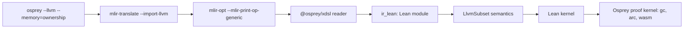

# IR to Lean [IR-LEAN]

The IR to Lean framework turns the LLVM IR the compiler emitted into a Lean value, gives that value an executable meaning, and proves theorems about it. The first user is `--memory=ownership`: the theorems say the emitted code frees what it owns exactly once. The design is meant to grow to every kind of IR the compiler emits.

Status: in progress. [The plan](../../plans/ir-to-lean.md) lists what is built, what is measured and what is open. Nothing here is wired into the required `CI` check yet.

## Pipeline [IR-LEAN-PIPELINE]

1. The compiler writes LLVM IR for a tracked program.
2. LLVM's own importer converts it to MLIR's LLVM dialect, and `mlir-opt` prints it in MLIR generic syntax. No code of ours parses LLVM text.
3. `@osprey/xdsl` reads the generic syntax into operations, blocks and regions.
4. `ir_lean` writes each defined function as a Lean `LlvmSubset.Func`.
5. Lean checks hand-stated theorems about those functions, and Osprey's proof kernel replays them.

## Interchange format [IR-LEAN-FORMAT]

The interchange format is MLIR generic syntax, as printed by `mlir-opt --mlir-print-op-generic`. Every operation has one shape: results, a quoted name, operands, successors, properties, regions, attributes and a function type. Any MLIR tool can read it, including xDSL and Lean-MLIR.

## Reader [IR-LEAN-READER]

`src/osprey/packages/xdsl` is a Python-flavor port of the reading half of [xDSL](https://github.com/xdslproject/xdsl) (Apache-2.0 with LLVM exceptions), compared against commit `efd7a0e7`:

| Module | Ports | Notes |
| --- | --- | --- |
| `Lexer` | `xdsl/utils/mlir_lexer.py` | Same token kinds and grammars. Lexes a line at a time. |
| `Ir` | `xdsl/ir/core.py`, `xdsl/dialects/builtin.py` | Closed records. An operand is the defining value's name, not an object link. |
| `AttrParser` | `xdsl/parser/attribute_parser.py`, LLVM types from `xdsl/dialects/llvm.py` | An attribute with no record is kept as `UnregisteredAttr` text. |
| `Parser` | generic half of `xdsl/parser/core.py` | Generic form only; no custom assembly formats. |

Rules:

- **[IR-LEAN-READER-TOTAL]** Reading never guesses. A malformed module is an `Error` naming the line. An attribute or type outside the port is kept as text, and a consumer that needs its structure refuses it.
- **[IR-LEAN-READER-PURE]** The package performs no effect. Index arithmetic uses the wrapping builtins, so a caller needs no `Arith` handler.

## Translation [IR-LEAN-TRANSLATE]

`src/osprey/examples/proof/ir_lean` is the command `ir_lean <module.mlir> <Namespace> [function-prefix ...]`. It prints a Lean module that defines one `Func` per defined function, a `module`, and a `Nat` constant per function.

- Values, blocks and functions are numbered in order of first definition.
- Every defined function keeps its position, so `(.fn n)` names the same function whether or not that function translated.
- A function with an operation, extern or type outside the subset becomes the empty function `⟨[]⟩`, which faults when run. The reason is written beside it as `REFUSED`.
- A function also gets a signature name without its `$mono` number, such as `«grow(ptr,i64)»`, when only one function has that signature.
- A file that cannot be read or parsed prints one `IR-LEAN-FAILED` line, which is not Lean.

The operation table follows xDSL's LLVM dialect: operand order, the property names `elem_type`, `rawConstantIndices`, `predicate` and `callee`, and the `icmp` predicate numbering.

## Lean syntax [IR-LEAN-SYNTAX]

`src/toolchain/benchmarks/proof/tools/LlvmSubset/Syntax.lean` defines the subset in the shape of MLIR's LLVM dialect: every operand is a value, a constant is an operation, and a branch passes arguments to its target block.

| Kind | Supported |
| --- | --- |
| Operations | `const`, `alloca`, `store`, `load`, `gep`, casts (`bitcast`, `ptrtoint`, `inttoptr`, `zext`, `sext`, `trunc`), `add`, `sub`, `mul`, `and`, `or`, `xor`, `shl`, `icmp`, `select`, `call` |
| Terminators | `ret`, `br`, `condBr`, `unreachable` |
| Types | integers, pointers, structs, arrays; sizes and field offsets follow clang's 64-bit layout |
| Runtime calls (`Ext`) | `osp_alloc`, `osp_alloc_tagged`, `osp_alloc_tagged_noinit`, `osp_ownership_free`, `osprey_list_append_of`, `osprey_list_length` |

`Ext` in Lean and `EXTERNS` in `ir_lean/src/ops.py` name the same entry points and change together.

## Memory model [IR-LEAN-MEMORY]

Memory is a list of allocations that only grows. A pointer is an allocation number and a byte offset, so a freed allocation stays recognisable. The shape follows Lean-MLIR's `SLLVM` memory model (block identifiers, live or dead blocks, pointer as block plus offset).

- A value is a plain integer or a pointer. `ptrtoint`, `inttoptr` and `bitcast` keep the value, so a pointer boxed into an `i64` still names its allocation. `null` is `int 0`.
- Each allocation records whether it is live, whether it is on the heap, its size, its layout word, its stored words, and for a runtime-managed object its abstract contents.
- A persistent list is an abstract object: its elements, whether they are managed, and whether a derived version has taken them over.
- `osp_ownership_free` frees the allocation and then everything it owns: the words its layout mask marks ([GC-ARC-PERCEUS]), or a list's managed elements unless a newer version took them.

Every memory-safety violation is a `Fault`: use after free, double free, out of bounds, read of an unwritten word, free of a stack slot, free of an interior pointer. A run that answers a value committed none.

Stated limits:

- Words are keyed by byte offset; a load of a different width than the store at that offset is not distinguished.
- Stack slots are never freed.
- The model is stricter than the runtime: the runtime ignores a second free of a block it no longer tracks, and the model faults.

## Execution [IR-LEAN-EXEC]

`LlvmSubset/Exec.lean` runs one function block by block. It is total: fuel bounds the call depth and the block transitions of each call. Lean evaluates it inside a proof and can compile it.

Memory changes only through four primitives in `LlvmSubset/Memory.lean`: `allocBlk`, `liveBlk`, `touch` and `killBlk`.

## General theorem [IR-LEAN-GENERAL]

`LlvmSubset.run_follows_ledger` in `LlvmSubset/Ledger.lean`:

> For every module, every function, every argument list and every amount of fuel: a run that starts from a state the ownership ledger accepts and answers at all took only steps the ledger accepts.

So every allocation the run reached is in a valid ledger state, live with exactly one owner or dead. The proof shows each of the four primitives is a step `OwnershipLedger.step` accepts, then carries that through every definition up to `runFn`. It uses the axioms `propext` and `Quot.sound` only.

What it does not say: it does not show that a run answers. A per-function theorem ([IR-LEAN-EMITTED]) shows that for one function, for every input. The compiler-wide statement, that every function the compiler emits answers, is open ([plan 0045](../../plans/0045-compile-time-ownership.md) V8). The ledger's borrow and move actions name compiler slots, which do not exist at the IR level; the IR-level view gives each live allocation one owner.

## Kernel cost [IR-LEAN-FORCE] [IR-LEAN-KERNEL-RFL]

- **[IR-LEAN-KERNEL-RFL]** The tactic `kernel_rfl` closes `a = b` with `Eq.refl a` and leaves the check to Lean's kernel. Lean's elaborator does not finish its own check on a symbolic run. A false statement is refused by the kernel.
- **[IR-LEAN-FORCE]** `LlvmSubset/Force.lean` rebuilds the state from its constructors after every instruction. Each function is proved to be the identity. Osprey's kernel evaluates by substitution without sharing, so a state used twice is evaluated twice; forcing hands the next step data instead of a pending computation. Stack cells are forced. Heap payloads, list elements and integer values can be arbitrary theorem parameters and pass through unchanged.
- The state carries no proofs. An earlier version carried a ledger proof inside the state; terms grew at every step, one replay took about two minutes, and the WASM kernel trapped.

## Theorems about emitted code [IR-LEAN-EMITTED]

`src/toolchain/benchmarks/proof/tools/EmittedOwnership.lean` states theorems about `single_owner.test.osp`, for every input:

| Theorem | Statement |
| --- | --- |
| `growScalar` | `grow(xs, x)` over scalars returns the longer list, frees the old list once and leaves nothing else alive. |
| `growManaged` | The same over managed elements: the element moves into the new list and is not freed with the old one. |
| `growWhen` | On the growing path the old list is freed once; on the other path the list comes back untouched and nothing is freed. |

A statement names what a caller can see (`Seen`): the object the result points at, the live heap objects and the number freed. It names no allocation numbers, so it survives a change in how many stack slots the compiler reserves.

## Mutations [IR-LEAN-MUTATION]

Each mutant is valid LLVM IR in the subset and must lose its theorem at Lean's kernel: `leak`, `double-free` and `early-free` against `growScalar`, and `stale-phi` against `growWhen`. `scripts/proof/ir-lean.sh` builds them from the emitted IR.

## Differential check [IR-LEAN-DIFFERENTIAL]

Not built. The model must be checked against the real binary on random inputs on every CI run:

- **Exact tier.** Functions whose only runtime calls are `osp_alloc*` and `osp_ownership_free`: the model and the binary agree on the return value and on every allocation (size, layout) and free, in order.
- **Boundary tier.** Functions that call container entry points: they agree on the result's contents, on which root objects are freed, and on the live-object balance at return.
- The runtime needs an allocation and free trace, armed by an environment variable, at its allocation, free and `osp_ownership_free` entry points.

## Lean-MLIR [IR-LEAN-MLIR]

[Lean-MLIR](https://github.com/opencompl/lean-mlir) is not a dependency. Checked at commit `b8c4a771`:

- Its `SLLVM` memory model has no deallocation, no calls, no branches between blocks, and stores integers only.
- Its generic syntax tree holds one block per region.
- It is pinned to Lean nightly-2025-12-01 and a Mathlib nightly; Osprey's proofs and kernel replay are pinned to Lean 4.25.0.
- Its `LeanMLIR` library does not build alone: `Dialects/LLVM/Semantics.lean` imports the outer `SSA` project.

The framework keeps Lean-MLIR's conventions (MLIR's LLVM dialect shape, block-and-offset pointers) so that a later move onto it is mechanical once it has calls, deallocation and control flow.
