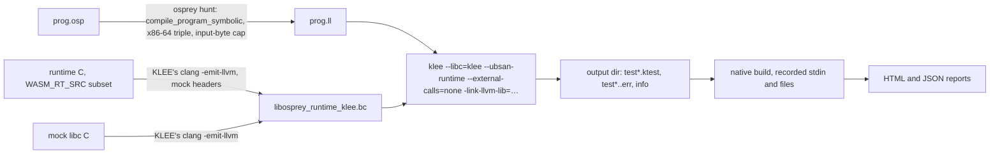

# Symbolic bug hunting with KLEE

**Status: `osprey hunt` ships — mock C library, runtime bitcode, findings, native replay and the corpus scripts. The typed function harness ([SYMEX-HARNESS-TYPED](../compiler/KleeCodegen.md#synthetic-entry-point-symex-harness-typed)), `libkleeRuntest` replay, regression-test generation ([SYMEX-REGRESSION](#regression-tests--symex-regression)), Windows and the proof benchmarks ([SYMEX-PROOF](#proof-of-the-comparison--symex-proof)) are not built.** [Plan 0034](../../plans/0034-symbolic-execution.md) tracks delivery. The compiler's side (symbolic codegen, the synthetic entry point, the runtime bitcode) is specified in [KLEE code generation](../compiler/KleeCodegen.md).

`osprey hunt` compiles an Osprey program to a textual LLVM module, links a mock C library in place of the system libc, and runs [KLEE](https://klee-se.org) on the result — symbolic execution by KLEE. Input bytes, file contents, entropy and clock readings are symbolic, so KLEE explores the paths they drive within the input, runtime-model and execution budgets. Findings include source locations, concrete inputs and a native replay verdict; unsupported operations and unfinished paths remain explicit limits.

Programs need no annotations. A program that reads `input()` or `readFile` is explored as written, from `main` with symbolic stdin and files. Exploring a function that takes arguments, by building symbolic arguments from its inferred type, is designed but not built ([SYMEX-HARNESS-TYPED](../compiler/KleeCodegen.md#synthetic-entry-point-symex-harness-typed)).

## Tool selection — `[SYMEX-TOOL]`

Hunt uses KLEE to interpret the LLVM IR Osprey already emits. The supported setup uses a separate engine installation and Osprey's symbolic runtime bitcode. Checked on 2026-10-24 against primary sources:

| Fact | Source |
|---|---|
| KLEE 3.3 released 15 October 2026; LLVM 15–19 supported, 18 recommended, 15 dropped after 3.3 | [release notes](https://github.com/klee/klee/releases/tag/v3.3), `CMakeLists.txt` refuses LLVM < 15 |
| License: University of Illinois/NCSA | [LICENSE.TXT](https://github.com/klee/klee/blob/master/LICENSE.TXT) |
| Homebrew `klee` 3.3 bottled for arm64 macOS (Sequoia, Tahoe, Golden Gate) and x86_64 Linux, built on `llvm@19`, with `ENABLE_POSIX_RUNTIME=OFF` and `ENABLE_KLEE_UCLIBC=OFF` | [formula](https://github.com/Homebrew/homebrew-core/blob/HEAD/Formula/k/klee.rb) |
| Linux arm64 is not supported: the formula pins x86_64 there because KLEE stalls (issues 1670, 1767) | same formula |
| Docker `klee/klee:3.3`, Snap, Nix and FreeBSD packages; no Windows build | [getting started](https://klee-se.org/getting-started/) |
| Symbolic stdin, files and arguments come from the POSIX runtime plus klee-uclibc, which the macOS package does not build | [coreutils tutorial](https://klee-se.org/tutorials/testing-coreutils/), formula above |

The last row is why this tool ships its own mock libc: on macOS the only way to make input symbolic is a self-contained module, and a self-contained module runs identically on every host.

Alternatives considered, same date:

| Engine | License, activity | Why not the engine here |
|---|---|---|
| [crux-llvm](https://github.com/GaloisInc/crucible) (Galois) | BSD-3, release 0.12 January 2026, prebuilt macOS arm64, Ubuntu and **Windows** binaries, accepts LLVM 3.6–23 bitcode | A bounded verifier: loops need `--iteration-bound`, values are made symbolic with `crucible_*` calls, no searcher over unbounded input. It has no symbolic file or stdin model either, so it would need the same mocks. It is the fallback if KLEE's LLVM pin becomes a blocker, and the only route to a native Windows run |
| [Owi](https://github.com/OCamlPro/owi) (OCamlPro) | AGPL-3.0, active, multicore, works on Wasm; Osprey already emits `wasm32-wasip1` | Whether Owi models WASI imports is not documented on its site; without that the Osprey module would be rejected or need WASI stubs. AGPL. Prebuilt binaries are Linux amd64 only; macOS is `opam install owi`. Worth a prototype on the wasm32 output if KLEE blocks, because the pthread-free runtime subset already compiles there |
| [SymCC](https://github.com/eurecom-s3/symcc) | GPL-3.0, "understaffed, best effort", LLVM 8–18 | Concolic: runs the real program natively with an instrumented libc, so inputs are driven by execution, not solved for; Linux oriented |
| [haybale](https://github.com/PLSysSec/haybale) | MIT, last commit 2023, LLVM ≤ 14 | Unmaintained and cannot read current IR |
| [SeaHorn](https://github.com/seahorn/seahorn) | Docker on Linux | A verifier for proving invariants, not a bug hunter |

KLEE finds bugs and never proves their absence. Rust's [Kani](https://github.com/model-checking/kani) proves properties up to an unwind bound but needs a `#[kani::proof]` harness per property; Haskell's QuickCheck and LiquidHaskell are random testing and refinement types, not symbolic execution of compiled code.

## Beyond stock KLEE

Running KLEE by hand gives a fixed-size symbolic stdin, a libc model that only builds on Linux, and raw `.err` files. This tool improves on each of those:

| Area | Stock KLEE workflow | `osprey hunt` |
|---|---|---|
| Harnesses | Hand-written `klee_make_symbolic` calls, or `kani::any()` per harness in Rust | None today: the program runs from `main` with symbolic stdin and files; the typed harness is not built yet |
| Input length | `-sym-stdin N` reads exactly N bytes | Length is itself symbolic in `[0, N]`, so every early EOF is explored |
| Environment | Entropy, clock and `fopen` results are concrete; `-max-fail` injects a fixed number of failures | All symbolic, which explores rare randomness and error-handling branches |
| Output | `printf` and `puts` run natively even under `--external-calls=none` | Mocks still read every byte they would print, so out-of-bounds reads in output paths are caught |
| Model gaps | Unmodelled external calls run concretely on the host, or KLEE warns | Every unmodelled call aborts with its own finding class, naming the function |
| Location | LLVM IR / C frames | Osprey `file:line` from debug metadata, plus the runtime C frame |
| Triage | `klee-replay` needs the POSIX runtime; `libkleeRuntest` needs a hand-linked binary | Each finding is replayed on the real native binary and marked reproduced or KLEE-only |
| Follow-up | Manual | Manual today; the regression-test writer is not built |
| Hosts | Symbolic environment on Linux only | The same module on macOS and Linux, with identical findings; Windows (WSL2) is not built yet |

## Proof of the comparison — `[SYMEX-PROOF]`

The table above is a claim until it is measured; this section is a contract for work that is not built yet. `benchmarks/symex/` will hold the same planted bugs in four languages and one script that runs every tool and writes the results, in the same style as the cross-language performance suite in `benchmarks/`.

**The subjects.** Each bug is written four times with identical behaviour and the same input format:

| Language | Tool | Harness it requires |
|---|---|---|
| Osprey | `osprey hunt` | None |
| C | KLEE 3.3 in `klee/klee:3.3`, `--libc=uclibc --posix-runtime -sym-stdin` | A `main` plus `klee_make_symbolic` for the function harness |
| Rust | Kani (`#[kani::proof]` with `kani::any()`) and KLEE on rustc's LLVM IR | One proof harness per function, with an unwind bound chosen by hand |
| Haskell | QuickCheck through `Arbitrary` | One property per function, with a generator per type |

**The bugs.** Each is a short program with one defect, in `cases/<name>/{osprey,c,rust,haskell}/`:

| Case | Defect | Why it's in |
|---|---|---|
| `needle` | Crash when stdin is one specific 8-byte sequence | Random testing has a one-in-2⁶⁴ chance; symbolic execution solves for it |
| `offbyone` | Index equals the length after a parse | The classic memory bug |
| `shortread` | Loop assumes input is at least 4 bytes | Found only if input length is symbolic |
| `openfail` | Unchecked `fopen` result deref | Found only if the environment is symbolic |
| `rarerandom` | Divide by zero when a random byte is 0 | Found only if entropy is symbolic |
| `tagged` | Wrong variant handled in a 3-way union | Type-directed harness vs hand-built generator |
| `nested` | Bug on a `List<Record>` of length 3 with one field at a boundary | Depth of the type-directed builder |
| `clean` | No defect | Catches false positives |

**The metrics,** recorded per case and tool by `benchmarks/symex/run.sh` into `results/results.json`, with `report.py` rendering `results/README.md`:

| Metric | Meaning |
|---|---|
| `found` | The tool reported the planted defect, in `clean` it reported nothing |
| `harness_loc` | Lines a human wrote beyond the program itself: harnesses, generators, `make_symbolic` calls, unwind bounds, build flags |
| `seconds` | Wall time to the first report of the defect, with a 300 s cap, median of 5 runs |
| `located` | The report names the source line of the defect |
| `reproduced` | The tool confirmed the defect on a native binary, with the triggering input |
| `regression` | The tool left behind a runnable failing test |
| `false_positives` | Reports in `clean`, plus reports in other cases that are not the planted defect |

**What counts as superior.** For `osprey hunt` to be called better than the stock KLEE, Kani and QuickCheck workflows, the checked-in results must show all of this at once:

1. `found` on every defect case, and zero `false_positives` in `clean`.
2. `harness_loc` of 0 on every case, against a non-zero count for every other tool.
3. `located`, `reproduced` and `regression` true on every defect case; no other tool gets all three.
4. `seconds` within 2× of the fastest tool on every case it also finds.

If any row fails, the README reports it as it is, and the delivery checklist stays open. The results run on a documented machine, with the versions of KLEE, Kani, GHC and QuickCheck recorded in `results.json`.

**What is not claimed.** Kani proves the absence of a defect up to its unwind bound; `osprey hunt` only finds defects, and the README says so beside the table. For code that stays within Osprey's managed operations, memory failures point to compiler, runtime or model defects. Explicit C calls cross that boundary and can deliberately abort, as the crash demo does; classify a finding from its source and replay evidence. QuickCheck's `shrink` gives small counterexamples that KLEE's solver outputs don't always match; `seconds` and `found` are the comparison, not counterexample size.

## Pipeline



## Installing KLEE — `[SYMEX-INSTALL]`

| Host | Install | Notes |
|---|---|---|
| macOS arm64 | `brew install klee` (3.3 on `llvm@19`) | The supported install |
| Linux x86_64 | `brew install klee` | arm64 Linux is unsupported upstream |
| Windows | Not yet implemented; KLEE would run inside WSL2 ([SYMEX-HOSTS](#hosts--symex-hosts)) | — |

KLEE runs natively on the host; there is no container in this pipeline. The supported install is Homebrew's `klee` 3.3 built on `llvm@19`; `osprey hunt` does not check KLEE's or LLVM's version at startup. `make` finds KLEE's `clang` through `OSPREY_KLEE_PREFIX` / `OSPREY_KLEE_LLVM` or the Homebrew prefixes (`scripts/make/config.mk`); `make build` on a machine without that toolchain skips the runtime bitcode with a note, and `osprey hunt` then exits `2` suggesting `brew install klee`.

## CLI

### `osprey hunt <file> [--max-time <seconds>] [--max-memory <mb>] [--input-bytes <n>] [--out <dir>] [--json] [--no-html] [--no-json] [--no-replay] [--quiet]` — `[SYMEX-CLI]`

- Explores the program from `main` with symbolic stdin and files. `<file>` is one `.osp`/`.ospml` program or a project root (a directory holding `osprey.toml`, or that manifest), loaded exactly as `osprey <file>` loads it.
- `--input-bytes` caps every symbolic byte stream (stdin and each opened file). The default is 64; the maximum is 4096, the mock libc's stream cap. A parse of the input forks on every symbolic byte, so the cap decides whether a run can finish: measured on `tests/hunt/clean.osp` with a 30 s budget, 2 bytes explores 26 paths and completes them all, 4 bytes completes 18 of 122, and 8, 16 and 64 bytes complete about 17 of 347 before the budget cuts the rest. Use a small cap to finish a program's paths and the default to reach as much code as the budget allows.
- `--max-time` is KLEE's `--max-time` budget for the run, in seconds, enforced with `--watchdog`. The default is 60. When the watchdog has to kill the engine (a solver query still running at the budget, reported as "WATCHDOG: time expired"), the states it dumped on the way out are read like any other run and the report carries one more "incomplete" entry naming the kill; only an engine failure with no such cause is a tool error (exit 2), reported with the head and tail of what KLEE said.
- `--max-memory` is KLEE's `--max-memory` cap in megabytes (at least 256). The default is 2000; a whole test suite explored as one long path can need more (Vigil's `app/tests` exceeded 2000 MB after 60 s).
- `--out <dir>` saves the HTML and JSON reports alongside KLEE's output directory; without it the raw run directory is temporary and reports are saved under `target/hunt/<program-and-run-id>/`. Hunt replaces a non-empty `--out` directory only when it bears the ownership marker written by Hunt. An ordinary `info` entry does not establish ownership. Unmarked directories, including partial output from an engine failure, and symlink destinations are refused; choose a fresh directory.
- `--json` also prints the report as JSON on stdout, with no additional path messages on stdout. It takes no path.
- HTML and JSON files are enabled by default. `--no-html` and `--no-json` independently disable the corresponding saved file; `--no-json` does not suppress explicitly requested JSON stdout.
- `--no-replay` skips the native replay.
- `--quiet` suppresses the progress line on stderr. `--help` prints the synopsis and exits `0`.
- Exits `0` with no findings (or only `klee-only` findings after replay), `1` when a finding reproduced natively, when any finding exists with `--no-replay`, or when the program does not compile, and `2` for a usage or toolchain error.
- The `klee` binary comes from `OSPREY_KLEE`, else `klee` on `PATH`, else the Homebrew prefixes `/opt/homebrew/bin`, `/usr/local/bin`, `/home/linuxbrew/.linuxbrew/bin`, which GUI editors often drop from `PATH`. The runtime bitcode is `compiler/bin/libosprey_runtime_klee_gc.bc`, built by `make build` (target `_runtime_klee`); `OSPREY_KLEE_RUNTIME` overrides its path.

`make hunt FILE=<path>` wraps the CLI, and `make hunt-corpus` runs it over the corpus ([SYMEX-CORPUS](#corpus--symex-corpus)).

### GC and ARC — `[SYMEX-GC-ROOTS]`

Hunt defaults to `--memory=gc`; `--memory=arc` selects reference counting. Native replay uses the same backend. Each symbolic runtime contains the actual allocator and the same container ownership shims as its native archive, with the mock library supplying process I/O. Neither backend substitutes an allocator that keeps every object alive.

KLEE cannot scan the host stack or registers as program roots. For GC, an LLVM 19 pass registers live function frames, SSA values, stack allocations and mutable globals before execution. The collector still marks heap references and sweeps unreachable allocations. Missing instrumentation is an explicit model error. Unsupported stack control is rejected by the pass rather than silently losing roots. `OSPREY_KLEE_LLVM` selects the LLVM 19 bin directory; `libosprey_gc_roots.so` must sit beside the GC runtime. ARC uses `libosprey_runtime_klee_arc.bc` and does not run the GC pass.

The collector regression forces collections, checks caller/global/heap-linked objects survive, and verifies zero objects remain after roots are dropped. It runs in the planted-crash CI gate; success requires one completed path, no unfinished paths and no KLEE errors.

### KLEE invocation — `[SYMEX-KLEE-INVOCATION]`

Every run uses this command; the tool never lets an option through from the user:

```text
klee --libc=klee --ubsan-runtime --external-calls=none --external-call-warnings=all
     -link-llvm-lib=compiler/bin/libosprey_runtime_klee_gc.bc
     --optimize --kdalloc --rng-initial-seed=5489
     --check-div-zero --check-overshift --emit-all-errors
     --max-solver-time=30s --max-time=<S>s --watchdog --max-memory=<MB>
     --output-dir=<run dir> <program.ll>
```

The program module is textual `.ll`, which KLEE accepts directly. The compiler lowers it with `compile_program_symbolic` (crate `osprey-codegen`), and the CLI prepends `target triple = "x86_64-unknown-linux-gnu"` and its data layout on every host — KLEE's varargs lowering is x86-64 only, and an arm64 triple gives false `ptr.err` reports — then appends `@osp_hunt_input_bytes = global i64 <N>` so the `--input-bytes` cap reaches the mock's streams.

- `--libc=klee` links KLEE's own small libc (`strlen`, `strcmp`, `strncmp`, `strchr`, `strrchr`, `strcpy`, `strncpy`, `strcat`, `strtol`, `strtoul`, `atoi`, `calloc`, `abort`, `atexit`, `errno`, `tolower`, `toupper`, `memchr`, `mempcpy`) and its freestanding `memcpy`, `memmove`, `memset`, `memcmp`. The mock library defines only what those two lack ([SYMEX-MOCK-STATELESS](#stateless-models--symex-mock-stateless)). `--libc=uclibc` and `--posix-runtime` are never used; the macOS package does not build them.
- `--external-calls=none` makes any call that reaches outside the module an error instead of a native call: KLEE reports it as a `user.err` whose message begins `external calls disallowed`, which the tool classifies as `unmodelled`. KLEE still lets `printf` and `puts` with concrete arguments through under this policy, so the mock defines both.
- `--ubsan-runtime` pairs with the runtime bitcode's `-fsanitize=undefined` ([SYMEX-RUNTIME-BITCODE](../compiler/KleeCodegen.md#runtime-bitcode-symex-runtime-bitcode)).
- `--kdalloc` is KLEE's deterministic allocator with a quarantine that keeps freed addresses out of reuse, which is what makes use-after-free visible and findings identical between runs. The fixed `--rng-initial-seed` is KLEE's default, stated so the determinism claim in [SYMEX-HOSTS](#hosts--symex-hosts) has a named source.
- `--emit-all-errors` writes a test for every error, not one per (error, instruction) pair, so deduplication is the tool's ([SYMEX-FINDINGS](#classes--symex-findings)) and not KLEE's.
- `--optimize` runs KLEE's own passes over the unoptimised module, as its documentation recommends for non-trivial programs.
- `--max-solver-time=30s` bounds one solver query. `--max-time` is checked between instructions, so without it a single hard query could outlive the budget; a query that hits the bound ends its path as "incomplete", not as a finding.
- The tool kills the engine itself if it has not exited within the budget plus 120 seconds of grace for loading, linking and optimising a large module, and reports that as a toolchain error. KLEE's stderr is captured to a file, never a pipe, so a chatty run cannot stall on a full pipe.

## Mock C library

It lives in `compiler/runtime/klee/`: `hunt_stream.c` (the one stateful model), `hunt_libc.c` (stateless doubles), `hunt_math.c` (libm), `hunt_format.c` + `hunt_decimal.c` (the printf family and its exact decimal expansion), `hunt_unsupported.c` (the stubs), with headers under `include/`. It includes only headers it defines itself, plus its own `klee/klee.h` stand-in, so the library builds without KLEE installed. Every exported function is one of the models below or an unsupported stub, and the `[SYMEX-MOCK-CLOSED]` check — `llvm-nm --undefined-only` over the linked runtime bitcode, accepting only what KLEE itself provides (its intrinsics, UBSan handlers, allocator and `--libc=klee`) — runs inside `_runtime_klee` and fails the build on any symbol the mock forgot.

`hunt_mock_tests.c` holds the native unit tests and the shared harness (`hunt_mock_tests.h`), run on the host by `make _test_hunt_mock` (part of `make test`), with a shim standing in for KLEE so symbolic bytes come from a queue the test fills and every `klee_range` name is recorded. Each check asserts the call reaches the mock's double. `hunt_mock_format_tests.c` drives the printf engine through hand-written integer, string, `*` and non-finite rows and a 1,296-row float matrix (`hunt_format_cases.inc`, written by `scripts/oracles/hunt_format.py` from CPython's correctly rounded formatting), plus every truncation cap. `hunt_mock_stream_tests.c` drives every stream cap against every symbolic length, every read shape, seeks from every origin, fresh streams per open, open failure, the slot limit, modes, the standard descriptors, and the entropy, clock and object names. The float formatter was differential-fuzzed against the host libc with 200,000 random doubles across 18 formats, with zero mismatches.

### Headers — `[SYMEX-MOCK-HEADERS]`

`include/` provides the 19 system headers the portable runtime includes (`assert.h`, `ctype.h`, `errno.h`, `fcntl.h`, `inttypes.h`, `math.h`, `pthread.h`, `signal.h`, `stdio.h`, `stdlib.h`, `string.h`, `time.h`, `unistd.h`, `sys/random.h`, `sys/select.h`, `sys/stat.h`, `sys/time.h`, `sys/types.h`, `sys/wait.h`), declaring only what the runtime uses. Freestanding headers that clang supplies (`stdint.h`, `stddef.h`, `stdarg.h`, `stdbool.h`, `float.h`, `limits.h`, `stdatomic.h`) come from clang's resource directory rather than being rewritten.

### Byte streams: the one stateful model — `[SYMEX-MOCK-STREAM]`

A stream is a `malloc`ed buffer of the cap's bytes made symbolic with `klee_make_symbolic`, a length from `klee_range(0, cap + 1, name)`, and a cursor. Reads copy from the cursor and return the short count or `0` once the cursor reaches the length. The cap is `--input-bytes`, which the CLI writes into the program module as `@osp_hunt_input_bytes`, overriding the mock's weak default.

| Source | Stream |
|---|---|
| stdin: `read(0, …)` (the `osp_input` path), `fgets`/`fread` on `stdin` | One stream for the run, named `stdin` |
| `fopen(path, "r…")` | A fresh independent stream per open: `file.data:<path>` holds bytes, `file.len:<path>` holds length, and `file.ok:<path>` selects success or failure. `fseeko`/`ftello` remain consistent with the length. Distinct prefixes keep paths such as `stdin`, `x.ok` and `x.len` separate from metadata during native replay. The decoder also reads the earlier path-and-suffix witness format. |

These are the only stateful mocks. Read-until-EOF loops (`osp_input`, `readFile`'s short-read loop in `file_runtime.c`) never terminate if reads don't track a cursor, so stateless reads would turn every input loop into path explosion. Files keep no state between opens: a file written and then reopened reads back as fresh symbolic content. That over-approximates, and replay filters out any false positive it causes.

File witnesses carry the fixed integer marker `osprey.hunt.files.v2 = 2`. The decoder uses this marker to select the namespaced format; a filename prefix alone does not select it. A legacy file with that marker-like name still has its own `.len` metadata and remains a file.

### Symbolic read buffers — `[SYMEX-MOCK-READ-BUFFER]`

`readFile` uses the configured, clamped stream cap plus two bytes for its initial buffer in a symbolic build: one byte beyond the maximum possible read forces a short read, and one holds the terminator. Allocating the native 64 KiB buffer instead caused a symbolic terminator write to send a 64 KiB array to the solver even for a one-byte input. The cap does not reduce the modeled input beyond `--input-bytes`. Ordinary native builds retain their 64 KiB initial chunk and growth behavior. Mock tests cover negative, zero, small, maximum and oversized caps; the real file-input crash case must finish and reproduce within ten seconds.

### Stateless models — `[SYMEX-MOCK-STATELESS]`

| Group | Functions | Model |
|---|---|---|
| Memory | `malloc`, `calloc`, `realloc`, `free` | Not defined by the mock; KLEE intercepts them and checks bounds, use-after-free and double free per allocation |
| Output and formatting | `printf`, `fprintf`, `snprintf`, `vsnprintf`, `puts`, `fputs`, `fwrite`, … | One engine (`hunt_format.c`) formats every byte the call would print — flags `-+ 0#`, width and precision (including `*`), lengths `hh h l ll z j t`, conversions `d i u o x X c s p % f F e E g G` — into a sink, and returns the length a real call would |
| Exact decimals | float conversions | `hunt_decimal.c` expands a double through a base-1e9 bignum, so printed digits match the host libc's exactly and a program that branches on `toString(x)` explores the same paths |
| libm | `sqrt`, `exp`, `log`, `tanh`, `pow`, … (`hunt_math.c`) | Plain C — bit-level exponent handling plus short series on reduced arguments. Native tests cover signed zero, infinities, NaNs and exponent parity, plus sampled finite results; no universal ulp bound is established. KLEE concretises floating point and lowers `llvm.sqrt`/`llvm.exp`/`llvm.log` to these names |
| Strings and numbers not in `--libc=klee` | `strcspn`, `strspn`, `strerror_r`, `strerror`, `strtod`, `qsort` | Plain C implementations, so symbolic bytes flow through them exactly |
| Files | `fclose`, `ferror`, `feof`, `fseeko`/`ftello`, `remove`, `rename`, … | The stream's own bookkeeping. Streams are named, not stored, so deleting or renaming a path has nothing to act on and both succeed |
| Environment | `getenv` | Returns `NULL`, so coverage, profiler and test-filter hooks stay off |
| Entropy | `arc4random_buf`, `getrandom`, `getentropy` | Fill the buffer with fresh symbolic bytes named `entropy.<n>` |
| Clock | `clock_gettime`, `gettimeofday` | Returns a fresh symbolic, non-decreasing time named `clock.<n>` |
| Threads and descriptors | `pthread_mutex_*`, `fcntl`, `sleep`, `usleep`, `close`, `isatty` | One thread explores the program, so a mutex only has to be balanced; the rest succeed without effect (`isatty` returns `0`) |

### Unsupported stubs — `[SYMEX-MOCK-UNSUPPORTED]`

`fork`, `execl`, `execvp`, `popen`, `pclose`, `pipe`, `dup2`, `waitpid`, `kill`, `select`, `pthread_create`, `pthread_join`, `pthread_detach`, `stat` and `mkdir` — processes, threads, descriptor plumbing and the filesystem metadata API — each end their path with `klee_report_error(__FILE__, __LINE__, "unmodelled: <name>", "unmodelled.err")`. KLEE writes those as `test<N>.unmodelled.err`, kept apart from real bugs, so you can see where the mock stops being accurate. The native coroutine runtime behind dynamic `control` handlers (`effects_coro.c`, one pthread per resumable region) is outside the module for the same reason, so a program that installs such a handler stops at the region's entry with `external call outside the module: __osprey_coro_new`; static handlers are unaffected. Exploring resumable regions needs a single-stack lowering of them for the symbolic build, which is not built ([plan 0034](../../plans/0034-symbolic-execution.md)).

## Findings and replay

### Classes — `[SYMEX-FINDINGS]`

Each finding is one `test<N>.<suffix>.err` file in KLEE's output directory, paired with the concrete bytes of every symbolic object from its `test<N>.ktest`, which the tool parses itself. The suffixes are KLEE's own ([TerminationTypes.h](https://github.com/klee/klee/blob/master/include/klee/Core/TerminationTypes.h), `klee_div_zero_check.c`, `klee_overshift_check.c`):

| Class | KLEE suffixes |
|---|---|
| `memory` | `ptr.err`, `free.err`, `read_only.err`, `bad_vector_access.err`, `invalid_load.err` |
| `abort` | `abort.err`, `assert.err`, `report_error.err` |
| `arith` | `div.err`, `overshift.err`, `overflow.err` |
| `ub` | the remaining UBSan handlers: `implicit_truncation.err`, `implicit_conversion.err`, `unreachable_call.err`, `missing_return.err`, `nullable_attribute.err`, `function_type_mismatch.err`, `invalid_builtin.err`, `invalid_object_size.err` |
| `unmodelled` | `unmodelled.err` from [SYMEX-MOCK-UNSUPPORTED](#unsupported-stubs--symex-mock-unsupported), `external.err`, `exec.err`, and a `user.err` whose message begins `external calls disallowed` (how KLEE 3.3 reports a call outside the module under `--external-calls=none`); that report names no function, so the tool takes the names from KLEE's `messages.txt` and `warnings.txt` ("Disallowed call to external function") and reports `external call outside the module: <names>`, for example `__osprey_coro_new` behind resumable effects and fibers |

The `.early` files (interrupted, max depth, out of memory) and unknown suffixes such as `model.err` and `solver.err` are not findings; the report counts them under "incomplete", grouped by reason, and `--json` carries them so a corpus run can tell "clean" from "ran out of time".

Findings are deduplicated by class and the top Osprey frame (or the top C frame, or the message when there is neither). The report lists the class, the Osprey `file:line` from the top Osprey frame in KLEE's stack, the top C runtime frame, the concrete stdin and file bytes, and the replay verdict. A project's modules share one flattened line numbering in the compiled module, so for a project the tool maps that line back to the module file it was written in and reports that file's own path and line, the same mapping the checker's diagnostics use; a single-file program keeps the name its debug metadata carries. `--json` writes the same data for CI and the editor: `program`, `engine` ("KLEE"), `budgetSeconds`, `inputBytes`, `explored{paths,completed,instructions,elapsed}`, `findings[{test,class,suffix,message,file,line,runtimeFrame,stdin,files[{path,bytes}],replay,replayDetail}]`, `incomplete[{test,reason}]`, and `context` as described in [SYMEX-REPORT-HTML].

Managed Osprey operations do not expose unchecked indexing or null dereferences. A memory failure on those paths points to the compiler, runtime or symbolic model. Explicit C calls can introduce failures outside that boundary: `tests/hunt/crash.osp` intentionally aborts on `"9"`. An `abort` finding alone therefore does not establish a compiler defect. `unmodelled` findings identify operations the model cannot execute.

### Native replay — `[SYMEX-REPLAY]`

Each finding is run again on the normal native build — a release build of the program, made once per hunt — on the host running the command:

- the recorded `stdin` bytes are piped to the process's stdin;
- each recorded file is written at its relative path inside a scratch working directory; a path outside that directory is refused and the finding is skipped with the reason;
- `unmodelled` findings are skipped: they only exist under KLEE.

Keep every recorded witness until replay. For each class and source location, try later inputs when an earlier input does not reproduce; stop redundant replay once a witness reproduces. Deduplicate the final report after replay, retaining a reproduced witness and its exact stdin and file bytes in preference to a KLEE-only or skipped witness. With `--no-replay`, retain the first witness per class and location.

A signal death is `reproduced`; a clean exit — including a non-zero `main` the program chose itself, even one at or above 128 — is `klee-only`. The verdict reads the process's signal status, not a folded exit byte, so `exit(139)` is the program's choice and `SIGSEGV` is a reproduction. `unmodelled` findings are marked skipped whether or not any other finding was run. A native run that has not exited after 30 seconds (a server, a prompt loop) is killed and the finding is skipped with that reason. `klee-only` findings are reported but don't fail the command; they are usually mock over-approximation. Replay through KLEE's `libkleeRuntest` — harness arguments rebuilt by the entry point, entropy and clock served from a provider over the same recorded objects — is not implemented.

### Regression tests — `[SYMEX-REGRESSION]`

**Not built.** Every `reproduced` finding will be written to `tests/regressions/klee/<file>_<fn-or-main>_<class>.osp`, with the concrete input as literals and an `.expectedoutput` holding the correct output. The tool can't know what the correct output is, so it will write a placeholder that fails until a human fills it in, and the test stays red until the bug is fixed (the test-first rule in AGENTS.md). Running the tool again never overwrites an existing test. The `.ktest` will be kept beside the test so `--seed-file` can start a later run from it.


### Human and AI reports — `[SYMEX-REPORT-HTML]`

Every completed analysis saves `report.html` and `report.json` by default, including analyses with findings or unfinished paths. Text mode prints their absolute paths. Open the HTML file directly in a browser; it embeds the Osprey design tokens and needs no network connection or JavaScript. Report write failures are explicit tool errors (exit 2). Compilation and engine failures before analysis completes retain their existing diagnostics and do not produce a findings report.

The HTML explains each finding in plain English, identifies the source line, shows the relevant input and gives a next step. It distinguishes a reproduced native crash, an unconfirmed engine finding, an unsupported operation and unfinished exploration. An unsupported `pipe` operation means Hunt cannot simulate process spawning; increasing the time budget cannot add that support. No findings is not proof of correctness.

The expandable **For AI** section embeds the complete JSON, including every finding, replay verdict and detail, input, incomplete path, exploration count and budget. The additional `context` object records compiler version, engine executable and arguments, runtime bitcode, memory cap, replay setting, working directory, engine stderr, raw error and early-stop reports, engine info/messages/warnings, available source text, and every named symbolic object and its exact bytes for each finding (including entropy and clock inputs). Missing source text is recorded explicitly. Source text and diagnostic strings are HTML-escaped. These local artifacts contain source contents and paths; review them before sharing. The report links to this reference and the [KLEE documentation](https://klee-se.org/docs/) for deeper explanation.

### Path accounting — `[SYMEX-REPORT-PATHS]`

`explored.paths` counts different executions reached by the engine, not repeated attempts. `explored.completed` counts normal exits and excludes paths ending in a finding or interruption. Four explored paths, three normal exits, one detected/reproduced crash and zero unfinished paths is successful detection. The HTML shows separate **Paths explored** and **Normal exits** metrics, without suggesting a test pass ratio. Findings are deduplicated, so their number need not equal the number of failing paths. Native reproductions, unsupported operations and incomplete paths remain separate outcomes. An exit status of zero alone does not prove completion.

### Planted crash gate — `[SYMEX-CRASH-GATE]`

`tests/hunt/crash-cases.json` pins fifteen input cases across Default, ML and Python flavor: stdin, parsing, checked arithmetic, lists, maps, closures, recursion, unions, record invariants, JSON, file input, invalid C free and C double free. `scripts/hunt_crashes.py` runs each program independently and asserts its exact expected finding set, source locations, concrete inputs and native signals. Every finding must reproduce, each case must include a normal symbolic path, and benign stdin `Z` must exit normally with exact expected output. Missing or corrupt KTEST inputs are reported as skipped and are never replaced with invented empty input. Incomplete exploration, tool errors, missing findings, wrong inputs, KLEE-only results and skipped replay fail. Deliberate C-boundary misuse is labeled as planted, not mistaken for an unexpected compiler defect.

`make hunt-crashes` builds prerequisites and calls the strict `_test_hunt_crashes` target. CI installs KLEE and builds its runtime before this target in the existing required macOS coverage job. The required C-runtime job runs the mock and corpus tooling assertions through `_test_hunt_mock`. Missing KLEE fails the planted-crash gate; it has no skip path. Reports are uploaded as `hunt-crash-reports`.

## Corpus — `[SYMEX-CORPUS]`

`scripts/hunt_corpus.sh` runs `osprey hunt` over every `.osp`/`.ospml` under `tests/` and `examples/` (skipping `tests/hunt/` and `failscompilation`), in parallel, writing one JSON report per program; `scripts/hunt_summary.py` renders the table. Programs listed in `tests/HUNT_UNPORTABLE.txt` — one program and reason per line, the same format as `tests/WASM_UNPORTABLE.txt` — are skipped unless `--all` is given. `make hunt FILE=<path>` wraps one run, and `make hunt-corpus` sweeps the corpus. The corpus runs `main` mode only. A finding in the corpus is a defect; an "incomplete" result is not. A historical 2026-10-24 sweep covered 224 programs with no findings and 20 cut at the 20-second budget. Those unfinished runs were not proven clean. This sweep is not a required CI check.

### Quick corpus qualification — `[SYMEX-CORPUS-QUICK]`

`scripts/hunt_sample.py` inventories runnable programs under `tests`, `examples`, `Book/examples`, `packages`, `registry` and `benchmarks`, using the shared `hunt_programs.py` inventory. Each manifest app is one program; its individual modules, libraries without an entry point and deliberate compilation-rejection examples are excluded. Standalone Default/ML files, Python files carrying the Osprey flavor header, and Python-entry projects are included. Known unportable programs are attempted and reported, rather than silently dropped.

The whole CLI invocation, including compilation, engine execution and native replay, has a ten-second wall-clock deadline. The runner starts a separate process session and kills its process group on timeout. Default engine budget: eight seconds; symbolic input cap: two bytes per stream; concurrency: four. These are explicit sampling bounds, not an exhaustive check of arbitrary input sizes. The compiler and runtime are snapshotted and fingerprinted so concurrent rebuilds do not change a sweep's executable midway through.

A candidate must exit zero within ten seconds, explore at least one path, complete every explored path normally and have no findings or unfinished paths. Timeout, compile/tool error, malformed/missing report, unsupported operation, any finding or incomplete exploration excludes it. `index.html`, `results.json`, `excluded.json`, exact per-program commands/logs and `quick-corpus.txt` make the result reviewable. The candidate list is a proposed CI corpus; timing on one host is not a guarantee on another. Generated reports stay local.

## Editor

The VSCode extension's **Osprey: Hunt for Bugs** command (`osprey.hunt`, on the editor context menu and command palette for `.osp` and `.ospml` files) saves the active file, runs `osprey hunt <file> --json --quiet --max-time <osprey.hunt.maxTime>` with the same compiler the language server resolved, prints the report in the "Osprey Hunt" output channel, and publishes every finding as a diagnostic at its Osprey line with source "Osprey Hunt (KLEE)": a `reproduced` finding is an error, a `klee-only` or unreplayed one a warning, an `unmodelled` one information. A missing engine is reported with the `brew install klee` hint.

## Hosts — `[SYMEX-HOSTS]`

| Host | KLEE | Replay |
|---|---|---|
| macOS (arm64, x86_64) | Homebrew `klee`, runs natively | Native |
| Linux x86_64 | Homebrew `klee`, runs natively | Native |
| Linux arm64 | Unsupported upstream (no Homebrew bottle), so there is no `klee` to find and `osprey hunt` exits `2` naming the install | — |
| Windows | Not yet implemented; KLEE has no native build, so it will run inside WSL2 | `--replay-host=windows` is planned, to cover the Windows `#if` branches |

The bitcode is the same on every host ([SYMEX-RUNTIME-BITCODE](../compiler/KleeCodegen.md#runtime-bitcode-symex-runtime-bitcode)), KLEE's allocator and searcher seed are fixed ([SYMEX-KLEE-INVOCATION](#klee-invocation--symex-klee-invocation)), so the same program and budget produce the same findings everywhere, up to the time limit.

## Delivery checklist

Tests are written first at each step. The compiler items are specified in [KLEE code generation](../compiler/KleeCodegen.md).

- [x] **Mock library:** headers, the stream model, stateless models and unsupported stubs, with native unit tests (`make _test_hunt_mock`, part of `make test`) and the `[SYMEX-MOCK-CLOSED]` undefined-symbol check inside `_runtime_klee` (part of `make build`).
- [x] **`_runtime_klee`** builds the runtime bitcode from the shared `WASM_RT_SRC` list (minus `web_runtime` and `wasm_builtins_runtime`) plus the mock, with KLEE's clang.
- [x] **Symbolic codegen** (`compile_program_symbolic`; there is no `--klee` CLI flag): `abort()` on fatal paths, debug metadata on, no `optnone`. The planned `llvm-as` parse check over the corpus is not built; KLEE itself parses the module on every hunt.
- [ ] **`osprey hunt` main mode completion proof:** the command is implemented, but the unchanged deterministic and default-budget gates must complete every path before this item closes. Deterministic programs under `tests/hunt/`, each with an `.expected` file, run by `make _test_hunt` (part of `make test` when KLEE is installed) — `crash.osp` finds input `"9"` and reproduces its planted C abort at line 4; `clean.osp` expects no findings; `process.osp` expects one unsupported-operation finding. Fixed compiler/runtime regressions remain separate controls. The harness rejects incomplete exploration rather than treating it as a passing control.
- [ ] **`libkleeRuntest` replay**, including the entropy/clock provider, on top of the native stdin/file replay that ships today; tested by a planted bug that only fires on one symbolic random byte.
- [ ] **`[SYMEX-HARNESS-TYPED]`:** a planted bug in a function taking `List<int>` and a union must be found with `--fn`; `--all-fns` lists skips with reasons. Not built.
- [ ] **`[SYMEX-REGRESSION]`** test generation. Not built.
- [ ] **`make hunt-corpus`** with `tests/HUNT_UNPORTABLE.txt`: the script and skip list exist. The recorded 224-program run found no findings, but only 204 programs completed and 20 hit the budget. A fully completed run and a required check remain open.
- [ ] **Windows:** WSL2 run plus `--replay-host=windows`. Not yet implemented.
- [ ] **`[SYMEX-PROOF]`:** the eight cases in four languages, `run.sh`, `report.py` with a unit test, and a checked-in `results/results.json` that meets all four superiority conditions. `make ci` re-renders the README from the JSON and fails on drift. This item closes last and gates the claim in the comparison table.
