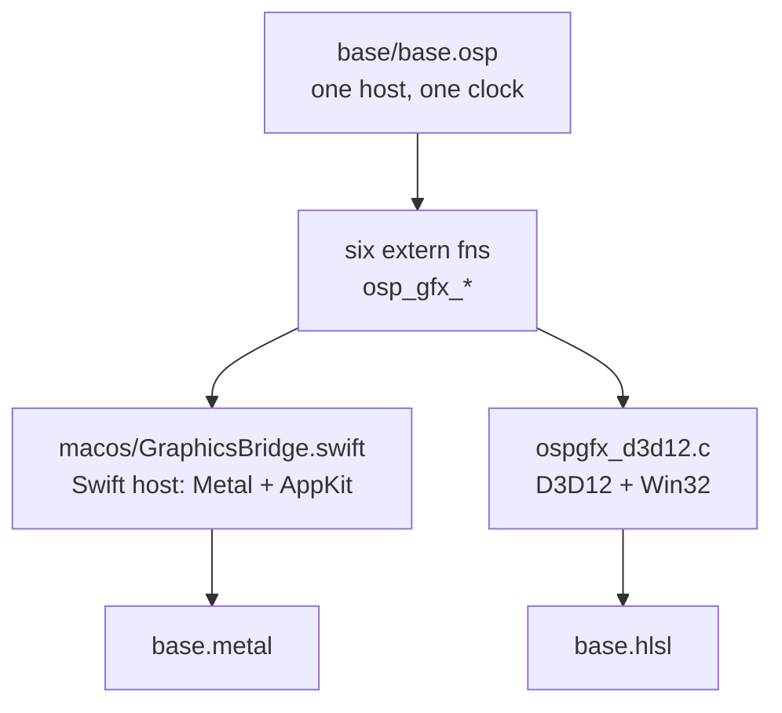

# Osprey graphics examples

Three real-time scenes — `kali`, `opal`, `character` — where Osprey runs the
scene and the GPU is the rasteriser. Osprey opens the window, reads the clock,
and recomputes the scene every frame in its own fixed-point arithmetic; a
fragment shader shades every pixel from the parameter slots Osprey pushes into
it.

On macOS a scene compiles for the [Mac slice](../../docs/specs/compiler/iOSCodegen.md#the-mac-slice-ios-target-macos)
and a Swift host links it, exactly as the [storage report](../macos/README.md)
and the iPhone apps do: Swift defines the six `osp_gfx_*` imports with
`@_cdecl` and calls `osprey_main`. On Windows the native executable links the
Direct3D 12 bridge, because no Windows host-library target exists.

**The Osprey sources are the same files on every platform.** Not ported, not
conditionally compiled, not `#ifdef`-ed: `base/base.osp` and the three
`scene.osp` entries are byte-identical whether the pixels come out of Metal or
Direct3D 12. A scene names a shader and a fragment entry inside it; each backend
resolves that name into its own dialect. That is the whole arrangement, and
everything below exists to keep it true.



## Layout

```
base/base.osp              the only host: fixed-point trig, motion + look tables
kali|opal|character/       one osprey.toml + one two-line scene.osp each
ospgfx_abi.h               the one C declaration of the Osprey-facing ABI:
                           slot count, both scales, uniform block, validation
base.metal                 macOS shader library: 3 named fragment entries
base.hlsl                  the Direct3D 12 twin of base.metal, entry for entry
macos/Bridge.h             imports ospgfx_abi.h and the scene's generated header
macos/GraphicsBridge.swift macOS host: the six imports with @_cdecl, AppKit window, Metal layer
macos/main.swift           calls osprey_main, which runs the scene until its window closes
macos/run.sh               builds a scene with scripts/macos-host.sh and runs it
ospgfx_d3d12.h             Windows bridge: D3D12 context and constants
ospgfx_d3d12_window.c      Windows bridge: the Win32 window a scene draws into
ospgfx_d3d12_setup.c       Windows bridge: one-time device/swap-chain bring-up
ospgfx_d3d12.c             Windows bridge: the six exported symbols, frame path
```

Both bridges take `ospgfx_abi.h` (the Swift host through its bridging header)
and define the same six symbols with the same semantics: values arrive in 4096ths (`osp_gfx_set`) or thousandths
(`osp_gfx_set_milli`), out-of-range slots are ignored, `osp_gfx_draw` returns 1
while the window lives and 0 once it closes, and `osp_gfx_ticks` is milliseconds
since the window opened. The slot store, the window-extent and scale validation
and the tick arithmetic are inline helpers in the header, so neither bridge can
drift from the other on them. Direct3D also returns 0 on frame recording, presentation or queue-drain failure and stops further drawing. A failed `osp_gfx_close` returns 0 and retains resources for a close retry; it releases them only after the queue drains. Portable injected-failure tests verify these paths against the real header, and the bridge compiles and draws on Windows (see Verification status).

`base/base.osp` names `examples/graphics/base.metal` on every platform. The
Windows bridge swaps the extension to `.hlsl`, which is why the scene never
learns which GPU API is underneath it.

## Running it

    make graphics                    # kali
    make graphics SCENE=opal
    make graphics SCENE=character

On macOS that builds the Mac runtime, checks `base.metal` with `xcrun metal`,
compiles the scene with `--target=macos --entry-only` (the host calls only
`osprey_main`), links the Swift host and runs it from the repository root.
`examples/graphics/macos/run.sh opal` does the same for one scene, and
`make graphics-smoke` renders every scene for 60 frames and fails unless each
reports them. `OSPREY_GFX_FRAMES=<n>` ends a scene after `n` frames. On Windows it must be run from the **MSYS2 UCRT64 shell** —
the same toolchain that builds Osprey's C runtime there — where it builds
`ospgfx.dll` plus the `libospgfx.dll.a` import library that `// @link(windows): ospgfx`
resolves, checks `base.hlsl` with `fxc.exe` when the Windows SDK's compiler is
on `PATH`, and prepends this directory to `PATH` so the DLL is found at run
time. `make graphics GFX_WARN=-Wall` drops `-Werror` if a warning blocks you.
The directives in `base/base.osp` are qualified, `// @link(windows): ospgfx`, so
they link only the Windows executable and the Mac slice never sees them.

### Building the Windows bridge with MSVC instead

    cl /nologo /O2 /W4 /LD /Fe:examples\graphics\ospgfx.dll ^
       examples\graphics\ospgfx_d3d12.c examples\graphics\ospgfx_d3d12_setup.c ^
       examples\graphics\ospgfx_d3d12_window.c

That produces `ospgfx.dll` and `ospgfx.lib`; the `#pragma comment(lib, ...)`
lines in `ospgfx_d3d12_setup.c` pull in d3d12, dxgi, d3dcompiler, dxguid and
user32, so no explicit library list is needed. Linking an Osprey binary against
it needs an MSVC-targeting driver (`OSPREY_CC=clang-cl`, or clang with
`--target=x86_64-pc-windows-msvc`), because `-lospgfx` only resolves
`ospgfx.lib` under that target. The MinGW path above is the tested-by-CI shape;
this one is offered for people already living in an MSVC toolchain.

## Verification status

`base.metal` and the Swift host render all three scenes on macOS. On an Apple
silicon Mac in October 2026, 90 frames of each on a 1920×1200 drawable ran at
102 (Kali), 114 (Opal) and 119 (Character) fps. `make macos-test` builds every
scene's host in CI; rendering needs a desktop session and a Metal GPU, so it
runs locally through `make graphics-smoke`.

**On Windows the bridge compiles, links and draws, in software.** On
2026-10-28, on GitHub's `windows-latest` runner, `make _graphics-smoke` built
the bridge with MSYS2 UCRT64's gcc and `-Wall -Werror`, compiled all four shader
entries with the Windows SDK's fxc, linked the unchanged scenes against the
bridge, and ran each in a real window on the runner's desktop for 10 frames at
480×300, at 6 to 15 fps across runs. CI keeps a picture of each window after
twenty seconds, and each shows its scene drawn. The runner has no GPU: the bridge
names the Microsoft Basic Render Driver, Windows' software rasteriser, as the
adapter that drew, so those rates measure the runner's CPU. No
hardware adapter has drawn the scenes yet. The machine the Windows work was done
on cannot show them either: its shell runs as a service in session 0, where a
flip-model swap chain cannot present.

The first compile found three mistakes, all fixed. `LoadCursorW` needs the
`IDC_ARROW` resource id cast to a wide string. `GetCPUDescriptorHandleForHeapStart`
returns its structure through a hidden pointer, so the C call passes one. And
fxc's preprocessor has no `%`, so the slot-count guard divides instead. The
bridge also gained a WARP fallback for an adapter that cannot make a Direct3D 12
device, and it names the adapter that draws on stderr.

Two things remain transcription rather than measurement. The HLSL
constant buffer packs the slot array as `float4[6]` because a `float[24]` in a
cbuffer would take a whole 16-byte register per element and silently misread
every slot — the reasoning is written out in `base.hlsl`, but only a running
frame proves it. And `rotationFromTurns` is transposed relative to its Metal
twin, because Metal's `float2x2` takes columns and HLSL's takes rows; a mistake
there compiles cleanly and spins every scene the wrong way. The pictures show
each scene drawn, but only a frame compared with the Mac's at matched uniforms
settles either.

The two backends are pinned together by
`crates/osprey-cli/tests/graphics_scenes.rs` and its `graphics_scenes/abi.rs`,
which require the two shader libraries to declare the same constants in both
directions (the one HLSL-only name, its float4 register count, is listed
explicitly), the same named fragment entries, and a uniform layout that mirrors
`ospgfx_abi.h`; and which require both bridges to include that header rather
than restate any of it, and to keep the same six exports. That catches drift; it
does not catch a shader that will not compile.

Pixel-for-pixel identity across the two platforms is **not** claimed. The
arithmetic is transcribed operation for operation, but fxc and Metal's compiler
fold, reassociate and schedule independently, so the two images should be
indistinguishable rather than bit-equal.

## What the Windows checks run

Steps 1 to 4 need no display and no GPU. Step 5 needs a desktop session.
`winui.yml` runs steps 1, 2, 3 and 5 through `make _graphics-smoke` and
`pictures.ps1` on a manual run of `ci-windows.yml`; run step 4 by hand.

1. **Compile every shader entry point.** fxc is the same compiler `D3DCompile`
   is, so this checks exactly what the bridge does at run time.

       fxc.exe -nologo -T vs_5_0 -E osp_vertex -Fo check.cso examples\graphics\base.hlsl
       fxc.exe -nologo -T ps_5_0 -E osp_fragment -Fo check.cso examples\graphics\base.hlsl
       fxc.exe -nologo -T ps_5_0 -E osp_fragment_opal -Fo check.cso examples\graphics\base.hlsl
       fxc.exe -nologo -T ps_5_0 -E osp_fragment_character -Fo check.cso examples\graphics\base.hlsl

2. **Build the bridge, warnings fatal** (MSYS2 UCRT64 shell):

       gcc -shared -O2 -Wall -Werror -o examples/graphics/ospgfx.dll \
           examples/graphics/ospgfx_d3d12.c examples/graphics/ospgfx_d3d12_setup.c \
           examples/graphics/ospgfx_d3d12_window.c \
           -Wl,--out-implib,examples/graphics/libospgfx.dll.a \
           -ld3d12 -ldxgi -ld3dcompiler -ldxguid -luser32

3. **Type-check and link the unchanged Osprey scenes.** `--compile` is what
   exercises `// @link(windows): ospgfx` against the import library from step 2.

       target/release/osprey.exe examples/graphics/kali --check
       target/release/osprey.exe examples/graphics/opal --check
       target/release/osprey.exe examples/graphics/character --check
       target/release/osprey.exe examples/graphics/kali --compile

4. **Run the drift guard:**

       cargo test -p osprey-cli --test graphics_scenes

5. **Open a window and draw.** This is the step that actually proves the
   backend, and the only one that needs a desktop:

       PATH="$PWD/examples/graphics:$PATH" \
         timeout 20 target/release/osprey.exe examples/graphics/kali --run

   The scene runs until its window is closed, so it needs a timeout, and it
   prints its own frame count and frame rate on the way out — a run that reports
   zero frames means `osp_gfx_open` refused and said why on stderr.
   `D3D12CreateDevice(NULL, ...)` asks for the default adapter; when it cannot
   make a Direct3D 12 device, the bridge falls back to WARP, the software
   rasteriser every Windows ships. Either way it names the adapter on stderr,
   so a frame rate drawn in software is never read as a GPU's.
