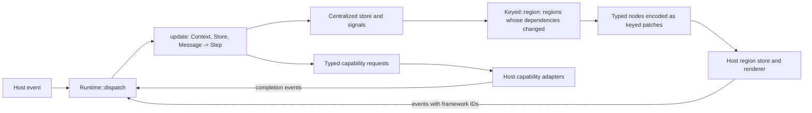

# @osprey/native

Osprey Native is an application and UI framework for native hosts. An application keeps all of its state in one Osprey store, reads it through Osprey's built-in signals, describes its screens with typed `Node` components, binds controls to typed action values and requests platform work as typed, bounded capabilities. A host renders the framework's keyed regions with its own native controls, returns events by framework-issued IDs and completes capabilities. Everything that crosses the boundary is produced by the framework through Osprey's built-in `Json`; an application never writes protocol text, kind strings or style names.

The framework names no host, product or operating system. An application is Osprey compiled to a library with a `start`/`dispatch` boundary; the host owns the window, draws the nodes with its own controls and answers capabilities. Four hosts speak the protocol today:

| Host | Where | Renders with |
| --- | --- | --- |
| GPUI desktop host | [hosts/gpui](../../hosts/gpui) ([spec 0046](../../docs/specs/platforms/0046-GpuiDesktopHost.md)) | Zed's GPU-accelerated Rust UI framework through `gpui-kit`; macOS today, Linux and Windows planned in [plan 0036](../../docs/plans/0036-gpui-desktop-host.md) |
| VS Code webview host | [vscode-extension/client/src/osprey-ui](../../vscode-extension/client/src/osprey-ui) | HTML, CSS and Codicons, with the application compiled to WebAssembly ([packages/vscode](../vscode)) |
| WinUI host | [hosts/winui](../../hosts/winui) ([spec 0048](../../docs/specs/platforms/0048-WinUiHost.md)) | WinUI controls and Segoe Fluent Icons on Windows, with the application compiled to a DLL |
| External hosts | their own repositories | Any native toolkit, such as a SwiftUI host with SF Symbols, that implements this protocol |

Anything only one host or product can do travels as a `HostCall` in a namespace that host answers ([UI-EFFECTS]), so no host's vocabulary leaks into the framework.



## Layout

| Path | Contents |
| --- | --- |
| `src/base.ospml` | `Pick::either` and `Lists`: a stable comparator sort, slices, flattening, distinctness, positions and `find`, `any`, `all` over Osprey's built-in list functions |
| `src/math.ospml` | `Math` and `Maths`: typed mathematical layout trees, `Maths::typeset` and their protocol round trip ([UI-COMPONENTS-MATH]) |
| `src/media.ospml` | `Media`: stills and films ([UI-COMPONENTS-MEDIA]) |
| `src/editor.ospml` | `Mark` and `Editors`: text editors with per-line marks and a caret ([UI-COMPONENTS-EDITOR]) |
| `src/board.ospml` | `Point`, `Stroke`, `Boards` and `Strokes`: writable boards and the strokes and lassos they deliver ([UI-COMPONENTS-BOARD]) |
| `src/symbol.ospml` | `Symbol` (semantic icons), `Platform` and `Symbols` ([UI-COMPONENTS-SYMBOLS], [UI-CONTEXT-PLATFORM]) |
| `src/node.ospml` | `Node<A>`, `Tab<A>`, `Row<A>`, `Binding<A>`, the tone, role, side and axis unions, `Splitters` and the `Ui` constructors ([UI-COMPONENTS]) |
| `src/encode.ospml` | `Encode::walk`: one depth-first walk that encodes a region and collects its bindings in ordinal order ([UI-PROTOCOL]) |
| `src/message.ospml` | `Message<A>`, `Input`, `Events::bind`, `Messages::route` and `Inputs::route`: typed delivery of taps, text, flags, choices, sizes, completions, lifecycle, frames and scene input ([UI-EVENTS], [UI-SCENE]) |
| `src/capability.ospml` | `Capability`, `Request`, `SliceWrite` and `Requests` ([UI-EFFECTS]) |
| [`../graphics`](../graphics/README.md) | `Scenes`: scene primitives and packed colours ([UI-SCENE]), in their own package, `@osprey/graphics` |
| [`../json`](../json/README.md) | `Doc`: total readers, kind checks and member builders over the built-in `Json`, in their own package, `@osprey/json` |
| `src/reactive.ospml` | The `Slices` effect for host-held slices, `Keyed::region` and `Signals::written` ([UI-SIGNALS], [UI-REGIONS]) |
| `src/theme.ospml` | `Theme`, `Token`, `Contrast` (WCAG 2 luminance and ratio) and `Themes` ([UI-THEME]) |
| `src/runtime.ospml` | `Runtime::start` and `Runtime::dispatch`: the session, the envelope and the serialized update ([UI-STORE], [UI-PROTOCOL]); `Runtime::begin` and `Runtime::proceed` for a resident session ([UI-RESIDENT]) |
| `src/document.ospml` | The typed machine document: `Value`, `Condition`, `MachineLayer`, `Template`, `Stamp`, `Area`, `Skin` and `Accessible` ([UI-MACHINE-DOC]) |
| `src/machine_doc.ospml` | `MachineDocs`: the JSON edge of a machine, which checks a document, decodes it once and encodes machine state for signals ([UI-MACHINE-DOC]) |
| `src/machine.ospml` | `Machines` and `Values`: typed inputs, parallel layers, transitions and requests settled ([UI-MACHINE](../../docs/specs/platforms/UiMachines.md)) |
| `src/templates.ospml` | `Templates`: a machine's node template and skins rendered to ordinary nodes ([UI-MACHINE-VIEW]) |
| `src/canvas.ospml` | `Canvases`: canvas artboards drawn as scene primitives, listeners hit-tested and the `Accessible` tree with `act` ([UI-MACHINE-CANVAS], [UI-MACHINE-A11Y]) |
| `src/stream.ospml` | The `SceneStream` effect and `Streams`: a resident session's rects, discs and sprites sent to the host outside the envelope ([UI-SCENE-STREAM]) |
| `tests/` | The package's suite: a two-slice probe application driven through the real `start`/`dispatch` path, plus encoding, ordinal, splitter, request, document, theme and list cases |

Every export carries a documentation comment, and the analyzer (`osprey packages/native/tests --check`) reports none missing.

## Centralized state [UI-STORE]

All application state is one Osprey store value per session, owned by the framework dispatcher. Components, screens and capability adapters never own application state; only native control state that Osprey cannot observe, such as an in-progress IME composition or a scroll offset, stays in the host.

The store is a record of **slices**, each with its own record type, because a slice's type is its signal identity ([UI-SIGNALS]). One serialized dispatcher applies `update : (Context, S, Message<A>) -> Step<S>`, where a `Step` is the next store, the capability requests to run and the host-held slices written ([UI-EFFECTS]). `Message<A>` is a framework union: a resolved UI action, a capability completion or a lifecycle phase. `Context` carries the host clock, UTC offset, `Platform` ([UI-CONTEXT-PLATFORM]), home folder and launch arguments. The framework, not application code, decodes events, rejects stale or malformed input, runs `update`, refreshes regions and encodes the envelope. Updates are pure, so tests drive the real application with fixture messages.

Small slices round-trip through the host as part of the opaque state string. Large slices are **host-held**: the host keeps their bytes by key, and the application fetches them through the `Slices.fetch` effect, answered by a host import in the native build and by fixtures in tests, before its static handler block; a write pending in the same update wins over the host's copy. This split keeps bulk data out of the opaque state, which the framework parses and re-encodes on every dispatch ([Memory boundary](#memory-boundary)); a large slice inside it would cost every keystroke a full decode.

## Signals and reactivity [UI-SIGNALS]

Reactivity uses Osprey's built-in signals ([reactive signals guide](https://www.ospreylang.dev/docs/reactive-signals/)), the way React or Flutter applications use signals: views read signals, and the runtime rebuilds only what depends on a change. Nobody maintains a dependency array, version counter or dirty flag; the compiler derives each view's dependencies.

- **Declaring a signal.** Slices are the built-in `Signal<T>` with `read : Unit => T`; neither the framework nor the application declares its own. A slice reader is `query () = (perform Signal<Query>.read ()).text`. Signal identity is the resolved instance, so `Signal<Query>` and `Signal<Selection>` are independent, and two slices must never share a payload type.
- **Supplying values.** The application has one `handle static Signal<…>` block per slice, supplying values from the centralized store or, for host-held slices, from `Slices.fetch`.
- **Regions.** A region is a keyed view function returning `Node<A>`. Each region is one `Keyed::region (frames, key, changed, view)` call inside that handler block, the built-in `signalRefreshKeyed` with the framework's placeholder node. Its compiler-derived may-read set is the snapshot's `snapshotDependencies`. Between dispatches the framework persists only each region's built-in `SignalFrame` (key, dependencies, revision) through `signalFramesJson`; the rendered value is not kept. A region whose revision did not change is not sent to the host.
- **Writes.** `update` returns the new store and the slices it wrote. The render receives the previous and next store: for each slice it asks `signalDependencies` for the slice reader's identities and supplies them as changed when the slice's encoding differs (the built-in `signalChanges`) or the host-held slice was written (`Signals::written`). Writes happen only through `update`.
- **Conservative by design.** Both arms of a runtime choice count as possible reads. An unresolved callback contributes `<unknown>` and forces a refresh, which is safer than ever retaining a stale view.

Constraints on the current compiler, each with its upstream issue:

- **Handler scope ([#274](https://github.com/Nimblesite/osprey/issues/274)).** `handle static` must lexically enclose the region refreshes; it does not discharge a callback passed in as a parameter. So the application, not the framework, writes the one signal-providing block.
- **[#272](https://github.com/Nimblesite/osprey/issues/272).** Passing a raw `signalRefresh` result straight into a call inside the handler block miscompiles. `signalRefreshKeyed` binds it internally, and regions are still bound to names before they are listed.
- **[#281](https://github.com/Nimblesite/osprey/issues/281)** (fixed in 19cf04c0). An export that reached `signalDependencies` or `signalSnapshot` vanished from library builds; identities now come from `signalDependencies` at each slice reader.
- **[#283](https://github.com/Nimblesite/osprey/issues/283)** (fixed in 3de9639d and 7aa2f553). A closure passed to a generic function from a nested `match` arm reached codegen still generic, as did a lambda whose type only a later use pinned.
- **[#284](https://github.com/Nimblesite/osprey/issues/284)** (fixed in 5f9eccf8). A view passed through a helper keeps its dependencies, so the shared `Keyed::region` helper refreshes correctly (test "a tap refreshes only the region whose signal changed"). [#286](https://github.com/Nimblesite/osprey/issues/286) will derive the changed identities from the handler values, retiring the per-slice `signalChanges` calls.
- **[#277](https://github.com/Nimblesite/osprey/issues/277)** and **[#278](https://github.com/Nimblesite/osprey/issues/278).** Generic unification depends on source-root order (list this package's root first; its base module sorts first), and the mutually recursive encoder is instantiated at one action type, so a program has one action union. Group bindings in it by the value they deliver, each group a union per feature, so every handler matches exhaustively; the binding-kind check keeps a tap from arriving as text or a flag.
- **Library export selection** (fixed in d5b234df). Every function with a scalar C signature anywhere in the program became a library export, so an inlined helper failed with "codegen emitted no definition" and an effectful one with "unhandled effect operations at library export".
- **[#282](https://github.com/Nimblesite/osprey/issues/282).** A constructor from another namespace cannot appear in a pattern, so applications take `Message` apart through `Messages::route`.
- **[#276](https://github.com/Nimblesite/osprey/issues/276)**, **[#279](https://github.com/Nimblesite/osprey/issues/279)** and **[#280](https://github.com/Nimblesite/osprey/issues/280)** (#279 and #280 fixed after 19cf04c0). Lists are transformed with the built-in `mapList`, `filterList`, `foldList` and `forEachList`; `Lists` keeps only what has no built-in yet.

## Message router migration [UI-EVENTS]

The current source API takes eleven arguments: `Messages::route (message, tapped, typed, toggled, sized, completed, phased, stroked, lassoed, framed, controlled)`. Clients using the earlier seven-argument API must add handlers for strokes, lassos, display frames and scene input before updating their native package source pin. Existing text/choice and size/cursor delivery stays in the same handlers. A client that does not support a new event must report that refusal through its application error state; silently retaining the previous state would hide the unsupported operation. Input refusals must not be disguised as unrelated capability completions.

Pin the package source revision together with its host renderer and capability adapters. Source compatibility and host wire compatibility are separate checks: validate the actual consuming app under GC and ARC, including a visible unsupported-event refusal, before replacing its pin. The process request serializer always emits the Boolean `plist` field, including `false`, for hosts that require it.

## Regions, patches and identity [UI-REGIONS]

The application lists its regions in one function that holds the `handle static` block, one `Keyed::region` per region key. The root region is always present. A region embeds another with a `Slot key` node, so the tree is a set of keyed regions rather than one serialized document. A key that disappears produces a removal, and its pending events become stale.

Every stateful or reorderable node has a stable semantic key, unique within its region. Identity is never a row index or visible label. Reconciliation in the host preserves editing, selection, expanded groups, scroll anchors and focus for surviving keys.

## Typed components [UI-COMPONENTS]

`Node<A>` is a generic union of semantic components; `A` is the application's action union. Application code builds trees with the `Ui` constructors and exhaustive matching. The framework's encoder is the only code that turns a node into protocol text, and a host rejects unknown kinds and malformed fields instead of drawing a fallback.

| Group | Components |
| --- | --- |
| Structure | `Split` (navigation columns), `Tabs`, `Screen` (title, subtitle, toolbar), `Section` (title, footer), `Aside` (a pane with a column on its leading or trailing side, divided by a splitter whose width lives in the store, [UI-COMPONENTS-SPLITTER]), `Stack`, `Layer` (children drawn over one another), `Slot`, `Spacer`, `Divider` |
| Content | `Text` with a semantic text role and tone, `Label` (text and symbol), `Icon` (a large decorative symbol), `Link` (a labelled `https` page the host opens in the browser and refuses any other address), `Evidence` and `Pair` (label/value lines), `Badge` (label, symbol, tone), `Segments` strip, `Empty` state, `Progress`, `Meter` (a labelled share of a total), `Brand`, `Swatch`, `Typeset` mathematics with spoken text ([UI-COMPONENTS-MATH]), `Image` and `Video` media ([UI-COMPONENTS-MEDIA]) |
| Collections | `Rows` with stable row keys, selection and per-row content; a row may lead with a symbol and name a group, and consecutive rows of one group share its heading |
| Controls | `Button` with role and enabled flag, `Field` (secure or multiline, committing on edit or submit), `Toggle`, `Picker`, `Disclosure` (title and revealed children; the expansion is a flag binding taken before the children's ordinals), `Editor` with per-line marks and cursor placement ([UI-COMPONENTS-EDITOR]), `Board` with host-held strokes and an optional lasso ([UI-COMPONENTS-BOARD]) |
| Presentation | `Framed` with application-authored geometry, typography and control metrics; `Alert` bound to a typed dismissal action |

`Ui::framed (style, content)` carries layout and presentation from Osprey to every host ([UI-COMPONENTS-FRAMED]). Start with `plain` imported from `ui::Frames`; named fields set dimensions, edge insets, gap, radius and semantic fill/ink/border tokens. `frameHug` preserves intrinsic width; otherwise a zero-width frame fills its proposal. Zero height keeps natural height unless `frameGrow` fills the available space. `frameAlign` positions content vertically (`start`, `center`, `end`); `frameCross` positions it horizontally (`stretch`, `start`, `center`, `end`).

On Apple, natural content that outgrows a growing pane scrolls within that pane. Content that fits keeps its authored alignment, so an empty-state card can stay centred without pushing the application header off screen.

`frameViewportHeightInset` defaults to -1, which preserves ordinary height and grow behavior. A nonnegative inset sets the frame height to the greater of `frameHeight` and the content viewport height minus that inset. For example, `plain(frameHeight = 440, frameViewportHeightInset = 270)` gives 788 points in a 1058-point content viewport. Native title bars are excluded; overflowing document height does not change the viewport. This explicit height takes precedence over grow. A scene using viewport sizing permits its page to extend below the viewport; other scenes retain their existing bounded layout. `frameScrollY` defaults to false; setting it to true makes the frame’s content scroll vertically within its authored bounds, preserving access to the last item without enlarging the frame. Combined with viewport sizing, this is a maximum height: short content keeps its natural height, with `frameHeight` as its minimum; longer content scrolls within the viewport bound.

`frameFont` selects `serif`, `sans` or `mono`; `frameTextSize` gives points/pixels and zero inherits; `frameItalic` accompanies an explicit font or size. These values inherit through nested frames and apply to text, editors and mathematics without inspecting application-specific role names. `Frames::text (family, size, italic)` constructs an intrinsic-width typography frame. `frameMathScale` multiplies the inherited text size for mathematics; zero inherits the parent scale (initially 1). A size of 34 with scale 1.08 preserves 36.72-point mathematical typography on every host. `frameLineHeight` sets the text line box in points/pixels; zero inherits. `frameTracking` sets letter spacing; zero inherits. `frameControlPadding` sets horizontal button padding, with -1 inheriting and zero drawing flush. `frameSymbolSize` sets control symbols in points/pixels; a positive value inherits through nested plain frames and zero preserves the surrounding metric. `frameControlHeight` sets the minimum button height and zero inherits; `frameQuietControls` makes plain buttons transparent and remains active through nested plain frames. `frameIconOnly` keeps the button’s accessible label while drawing its symbol, and `frameFlatRows` draws selectable rows without cards or disclosure chevrons. `frameFadeBackdrop` fades only a board’s backdrop image toward its edges, preserving live strokes. `frameTrailingSymbols` places button symbols after their labels and inherits through nested plain frames. Backdrop fading defaults to false at each frame. `frameShadow = "floating"` gives a surface a shadow with zero horizontal offset, 20-point vertical offset, 50-point CSS blur and the primary ink at 2/15 opacity; an empty value draws no shadow, and unknown names fail explicitly. Shadows do not change layout. `frameLineEdge` chooses `all`, `top`, `right`, `bottom` or `left` for the border token. `frameAlign = "baseline"` aligns an immediate horizontal stack by its first text baselines. Existing control ordinals and region provenance pass through a frame unchanged. These expanded presentation properties have regression assertions; screenshot acceptance remains pending.

`Ui::rich (runs, role)` wraps inline mathematical emphasis and syntax colours as one paragraph. Each `Ui::run (text, ink, italic)` supplies literal text, an optional semantic ink token and emphasis; hosts never tokenize the source. `Ui::themed (theme, content)` scopes the application’s palette to a subtree, and `Ui::dialog (title, content, dismiss)` exposes an accessible modal surface with an explicit dismissal binding.

`Editors::inline` keeps the existing text/cursor provenance with a compact placeholder presentation. `Boards::interactive` retains the stroke and lasso ordinals and appends a camera binding; camera movement reports absolute x/y offsets as JSON text. Framing and notes remain application state. `Ui::boundedAside` carries per-column width limits so one application’s narrow margin does not inherit another’s sidebar minimum.

Components are semantic, so a host presents each one where it is placed:

- A `Split` is the platform's navigation split view, and its first pane is the sidebar on the theme's `inset` colour. There a `Screen` stacks its children, and `Rows` are the native source list grouped under their row groups' headings. Three panes are sidebar, content and detail.
- Every other `Screen` is a page on the `canvas` colour. Its toolbar buttons join the window toolbar and a toolbar `Field` is the platform search field. A page with a child that is `Rows`, an `Empty` state, a `Slot` or an `Aside` fits the window while its other children leave that child at least 280 points: the child fills the remaining height, and each column of an aside scrolls on its own. Otherwise the whole page scrolls and an aside inside it keeps its natural height. No content, however long, makes a page taller than its window.
- Outside the sidebar, `Rows` are cards: full-row buttons whose selection shows as an inset tint and an accent outline, never colour alone. A `Section` is a bordered surface headed by its title as an eyebrow, with its footer as explanatory text.
- A presented `Alert` keeps its text until it closes, because the platform cannot rewrite one in place; newer text waits for the next presentation, and closing sends one dismissal.

Expansion, like every other control value, lives in the store; the host keeps only the text being composed and the width of a splitter being dragged. Text roles (`display`, `large`, `title`, `heading`, `lead`, `headline`, `body`, `callout`, `caption`, `eyebrow`, `mono`) and tones (`primary`, `secondary`, `accent`, `good`, `caution`, `danger`) are typed unions resolved through the theme ([UI-THEME]). Badges always carry text and a symbol; colour is never the only signal.

### Symbols [UI-COMPONENTS-SYMBOLS]

Controls accept semantic symbol names as strings. `Symbols::name` converts a typed `Symbol`, such as `Add`, `Folder` or `NoSymbol`, to its lowercase wire name; `NoSymbol` becomes an empty string. Existing string names and bundled SVG registrations remain supported. Each host maps supported names to its icon set: GPUI uses Lucide icons, VS Code uses Codicons, and Apple uses SF Symbols or registered artwork. The host suites check the framework's typed symbol inventory.

### Splitters [UI-COMPONENTS-SPLITTER]

An `Aside` carries its column's width in points and a size binding, so the width is application state like any other control value: `Ui::aside (pane, side, column, width, resize)`. `Splitters` owns the limits. A column starts 340 points wide (`Splitters::initial`) and stays between 260 (`least`) and 640 (`most`) points, and the host never narrows the pane beside it below 340 (`keep`). The encoder sends the width and all three limits, and the splitter's binding takes its ordinal after the controls of both columns, so adding a splitter leaves their ordinals unchanged.

During a drag the host previews the width within the limits Osprey sent and the room the window leaves. When the drag ends it sends the width once, as a whole number of points, and Osprey's answer replaces the preview. A size binding accepts only an integer, and `Events::bind` clamps it to the limits before the application's `update` sees it, so an application never stores a width outside them. On a phone an aside stacks its column under its pane, so there is nothing to drag.

### Bundled symbols [UI-COMPONENTS]

The Apple host reads an optional `symbols.json` from its bundled resource root: a flat mapping such as `{"moon":"icons/moon.svg"}`. Buttons and standalone icons use the registered SVG as template artwork, inheriting the surrounding ink. An absent registry or unmapped name keeps the platform symbol; malformed registries, missing declared artwork and paths escaping the resource root produce a visible icon error. The registry is bounded to 64 KiB and 128 entries, with each SVG bounded to 256 KiB. Bundle the artwork's licence with its files.

### Typeset mathematics [UI-COMPONENTS-MATH]

`Maths::typeset (tree, spoken)` produces a `Typeset` node carrying a structured `Math` tree and accessible Unicode text. Its protocol kind is `math`, with the tree in `math` and the accessible text in `spoken`; it consumes no event ordinal. `Math` supports symbols, numbers, sequences (`Seq`, since `Row` already names a selectable row), scripts, fractions, radicals, binders, operators, parentheses and big operators. The Apple host lays out the tree with bundled STIX Two Math and refuses startup if its required fonts cannot be registered. Web hosts render the same tree as MathML. Every host exposes `spoken` to assistive technology.

`Maths::encode` turns a tree into its protocol form and `Maths::decode` is its exact inverse, so `decode (encode tree)` is the same tree and a stored tree is read back rather than trusted. An unknown `kind`, a missing child, a non-object node or a non-string `text`/`symbol` is refused with an error naming the fault.

The Apple renderer keeps fitting formulae at their natural ink size. Wider formulae scroll horizontally inside their pane, retaining the complete formal statement and its spoken text.

### Media [UI-COMPONENTS-MEDIA]

`Media::image (source, alt, width, height)` is a still picture with required alternative text, scaled to fit its width while keeping its aspect ratio; `alt` is what assistive technology reads. Its protocol kind is `image` with the fields `source`, `alt`, `width` and `height`, and it consumes no event ordinal. `Media::video (source, poster, captions, alt, seconds)` is a film the person starts: it shows its poster and a play control until then, never autoplays, turns captions on by default and prints the length on the poster. Its protocol kind is `video` with `source`, `poster`, `captions` (WebVTT), `alt` and `seconds`. Neither component carries a binding: playing a video is the host's business and never reaches `update`, and the host may refuse a source outside the application's bundled files. The Apple host renders landscape films at 16:9 and reads bounded plain-text WebVTT tracks (64 KiB), including header annotations, UTF-8 BOMs and mathematical text entities. It reports missing, malformed or unsupported caption tracks and media decoding errors visibly; it does not silently play without required captions.

### Editor [UI-COMPONENTS-EDITOR]

`Editors::focused (label, value, cursor, epoch, edit, place)` opts a compact editor into application-authored focus requests. It preserves the text and caret ordinals. Existing `Editors::editor` and `Editors::inline` signatures are unchanged and emit epoch zero. The wire field `focusEpoch` defaults to zero only when absent; explicit null, a non-integer, a negative value or a value above 9,007,199,254,740,991 is refused.

A host establishes a baseline when the field first appears and retains the highest observed epoch for that field identity. Focus is requested only above that high-water mark; a decrease followed by a replay cannot request focus again. Removing the field forgets its baseline. A different keyed region creates a new field identity and baseline, so its first advance works independently of the old region's counter. Ordinary text/caret patches and unchanged epochs do not request focus. A native host never activates an inactive window to fulfill a request. The application advances the epoch for an explicit editing action, such as a symbol key; the host executes that decision. This protocol carries a caret, not a selection range.

`Editors::editor (label, value, cursor, marks, edit, place)` carries a multiline editor's label, whole text, cursor offset and per-line marks. Its text binding takes the next depth-first ordinal and its cursor binding takes the one immediately after. The host sends the whole text after each edit and sends cursor offsets in UTF-8 bytes. A cursor value arrives as `Placed`; the framework clamps a negative offset to zero and refuses a non-integer value.

Each `Editors::mark (line, underlined, tone, badge, note)` names a 1-based line. The host draws its underline in the given tone when `underlined` is true, a trailing `badge`, and its `note`; empty badge or note text draws nothing.

### Board [UI-COMPONENTS-BOARD]

`Boards::board (slice, count, lassoing, stroke, lasso)` carries the name of the host slice holding the board's strokes, the number to draw, whether the lasso is enabled, and the two bindings. The stroke binding takes the next ordinal and the lasso binding takes the one after it. The host draws strokes in `chalk` on the `board` token and sends each finished stroke once as `{"points":[[x,y],...],"width":w,"at":t}`. Points are ordered pairs of non-negative integer coordinates; the framework refuses empty points and malformed pairs.

When `lassoing` is true, the host offers a lasso and sends the enclosed strokes as a JSON array of non-negative integer indices. These arrive as `Stroked` and `Lassoed` messages respectively. The host must not send an unfinished stroke more than once or invent stroke indices.

## Bindings and events [UI-EVENTS]

A control's binding is a **typed action value**, not a callback or an event dictionary. `Button` carries an `A`; `Field`, `Toggle`, `Picker`, `Tabs` and `Rows` selection carry an `A` that names the binding, and the framework delivers `Entered`, `Switched`, `Chose` or `Act` messages with the bound action and a value of the matching type. An `Aside`'s splitter delivers `Resized` with a width in points. An `Editor` cursor delivers `Placed` with a UTF-8 byte offset; a `Board` delivers `Stroked` with a finished stroke and `Lassoed` with the selected stroke indices. A text binding can only produce a text message, a toggle only a boolean and a splitter, cursor, stroke or lasso only its matching value kind.

When encoding a region, the framework assigns each binding an opaque ID: region key, region revision and depth-first ordinal. The host returns only that ID and a bounded value. To resolve an event, the framework renders the named region from the current store, checks the revision, finds the binding by ordinal, checks the value kind and produces the typed message. Events for removed regions, stale revisions, unknown ordinals or mismatched value kinds are rejected with a visible diagnostic. The host cannot construct an arbitrary action, and a binding ID is never an authorization token.

**Closure blocker [UI-CLOSURE-BLOCKER] ([#275](https://github.com/Nimblesite/osprey/issues/275)).** The natural binding form, a closure such as `edit : string -> A` stored in a node, is not usable on the C-ABI library targets today: a closure projected out of the recursive `Node` union is rejected with `library export ... invokes a dynamic callable whose effect provenance cannot be proven`, and record field function types cannot declare a closed effect row. The data-action binding above is the supported design until Osprey can prove effect provenance through recursive aggregates or accept rows on field types.

**Field names ([#273](https://github.com/Nimblesite/osprey/issues/273)).** Codegen rejects a field access when two records share the field name and it loses track of the receiver; `--check` does not report it. Record field names are unique across this package, and an application keeps its own unique against them.

**Documented exports ([#289](https://github.com/Nimblesite/osprey/issues/289)).** Every export and type carries a `(** ... *)` documentation comment; the `undocumented-export` warning shipped in b3bdd6dd.

## Effects and capabilities [UI-EFFECTS]

Updates request platform work by returning `Request` values in their `Step`: a `Capability` with an application-chosen ticket. The runtime encodes them into the envelope; the host completes each with a `completed` event carrying the ticket, and the application ignores completions whose ticket no longer matches, so stale, cancelled and superseded work never overwrites newer state. Bulk results land in host-held slices named by the request, so large outputs never travel back through an event.

`Capability` is a typed union whose variants are mechanical primitives with explicit bounds chosen by Osprey, each one something every desktop can do: `Run` (shell-free executable, arguments, deadline, output limit), `ListDirectories`, `ReadTexts`, `StoreRead`, `StoreWrite`, `StoreList`, `StoreDelete` (app-private files), `Http` (method, URL, headers, body, response limit, deadline), `ChooseFile`, `ChooseFolder`, `SaveFile`, `MeasureFolders` ([UI-EFFECTS-MEASURE]), `Reveal`, `Cancel` and `Animate` ([UI-SCENE]). Work only one host or product can do, such as reading one operating system's settings files or opening its settings app, is a `HostCall`: a namespace, an operation, JSON arguments, a deadline, a result limit and a slice, answered only by the host that registered that namespace. A host that does not know a namespace completes the request with an error. Adapters return typed results or typed errors; they make no application decision, choose no paths beyond what Osprey named and never retry automatically. Rendering never starts work: only an explicit action, lifecycle message or completion produces requests.

### Meter [UI-COMPONENTS-METER]

`Ui::meter (label, amount, total, tone)` is a bar filled to `amount` out of `total` in `tone`, read out by `label`, such as the space a folder takes on its disk. The encoder sends `value` clamped into `0..total` and a `total` of at least 1, so a host divides safely and never draws past the end. `Progress` stays the indeterminate activity indicator.

### Measuring folders [UI-EFFECTS-MEASURE]

`MeasureFolders` measures each named folder's children to the bottom, within an entry limit and a deadline in milliseconds, and the host writes the result into the named host-held slice: `{"folders":[...]}`, in the order the folders were given. Each folder is `{path, error, missing, truncated, unreadable, bytes, visible, items, volume, entries}`, where `volume` is `{name, total, available}` and each entry is `{name, path, bytes, visible, items, hidden, folder, link, guarded}` for one child. The completion's result is `null`.

The rules are the same on every host:

- `bytes` are allocated bytes, and a file with several hard links counts once per walk. `visible` leaves out hidden items and everything below a hidden folder, as the platform's file manager hides them.
- A link is listed and never followed, so its target is not counted and the walk stays on its volume. A cloud placeholder is never opened, so nothing downloads.
- A folder that cannot be read adds one to `unreadable` and is not an error; a child that cannot be opened is listed `guarded`.
- More children than the limit are measured but not listed, and set `truncated`, as does a walk that reaches its deadline. `Cancel` with the request's ticket stops the walk, which completes with the error `cancelled`.
- The adapter sorts, hides, formats and decides nothing: [examples/storage](../../examples/storage/README.md) ranks, words and draws the result in Osprey.

### Recognition [UI-EFFECTS-RECOGNISE]

`Recognise` names the host-held slices that hold the strokes to read and a result limit, so stroke points never travel through the opaque state. Its request has kind `recognise`, a `slices` array of slice keys (each holding one stroke in the board's stroke format, as `Boards::strokeWrite` writes it) and `limit`. The host performs handwriting recognition on those strokes and completes with `{"text": "..."}`, the text bounded by that limit. A host without handwriting support completes with an error whose message is exactly `Unsupported`; the application presents that state as a disabled board lasso.

## Theme and motion [UI-THEME]

Semantic colour tokens, spacing, shapes and motion durations are Osprey values. The application's theme is sent once with the first envelope; the host resolves roles against the current appearance and never chooses raw colours itself. Contrast policy is computed and tested in Osprey (`Contrast::ratio`, WCAG 2 relative luminance). The system Reduce Motion preference always wins in the host.

### Board tokens [UI-THEME-BOARD]

`Themes::boardTokens` names the two board colours in order: `board` for the slate and `chalk` for the strokes. A theme without those tokens draws a board on `canvas` in `primary`.
## Scenes and frames [UI-SCENE]

A `Scene` node is a surface in the application's own unit space, drawn from a list of `Primitive` values: rectangles, discs, line strips, sprites by atlas index and glyph runs, each with a position, size, rotation, a packed `0xRRGGBBAA` colour and a depth that orders layers, and paths: path-builder steps (move, line, quadratic and cubic curves, arcs, polygons, close), a fill or a stroke with width, dashes and joins, a solid or linear-gradient `Paint` of float `Tint`s, and a translate-and-scale transform. `Scenes` builds them. `Ui::canvas` is a scene in window pixels, with its origin at the window's top left; `examples/gpui/painting` uses it to reproduce GPUI's own painting example pixel for pixel. The host draws the surface at its fixed `zoom` from its region's top left, never resizing it with the window, draws one pass per depth and sends keys and pointer positions with the Shift state, in scene units, through the node's single binding as `Controlled` messages; `Inputs::route` takes them apart. The encoding is one small array per primitive with a type code first, so a painter reads it without a schema and the encoder builds it in one `mapList`.

An application that animates asks for the host's frame clock with the `Animate` capability and turns it off the same way. While the clock runs, every display refresh reaches `update` as a `Frame` carrying the seconds since the previous one; `update` moves the store and the scene's region refreshes like any other. Nothing in the host steps a simulation. The framework's per-frame cost at a given entity count is measured by `hosts/gpui/bench` and recorded in [plan 0036](../../docs/plans/0036-gpui-desktop-host.md).

## Protocol [UI-PROTOCOL]

An application exports `Runtime::start (context, init, render, save, theme)` and `Runtime::dispatch (state, event, update, render, save, restore)` under names of its choosing, and imports a `*_slice` function that answers `Slices.fetch`. The start context is `{"now","offset","platform","home","arguments"}`.

**Platform [UI-CONTEXT-PLATFORM].** `platform` is the host's operating system as Rust's `std::env::consts::OS` spells it: `macos`, `ios`, `linux`, `windows`, `android` or `web`. `Context.platform` preserves the supplied string. Call `Symbols::platform` when a typed `Platform` is needed; an unknown name becomes `OtherPlatform` with the original string retained. Every result is an envelope:

| Field | Meaning |
| --- | --- |
| `version` | Protocol version; the host rejects others |
| `state` | Opaque small slices plus each region's `{ key, dependencies, revision }`; returned unchanged with the next event |
| `slices` | New bytes for host-held slices written by this update |
| `patches` | Keyed regions to replace, each a typed node tree |
| `removed` | Region keys to dispose |
| `requests` | Ordered capability requests with tickets |
| `diagnostics` | Rejected events, arithmetic faults and protocol errors, to show and log rather than hide |
| `theme` | First envelope only |

Events are `{"kind":"ui","region","revision","ordinal","value","now"}`, `{"kind":"completed","ticket","ok","result","error","now"}` and `{"kind":"lifecycle","phase","now"}`. A host bounds string length, tree depth and node count before decoding.

### Resident sessions [UI-RESIDENT]

A host that links the application into its own process, as the GPUI host does, can keep the session in the library instead of round-tripping it. The application's boundary file declares a file-scope cell holding a `Session` (`Runtime::idle store` before the first call), and its `start` and `dispatch` exports call `Runtime::begin` and `Runtime::proceed`, which take and return the live session value; a handler arm stores the returned session in the cell ([MODULES-FILE-SCOPE-BINDING](../../docs/specs/language/0025-ModulesAndNamespaces.md)). The envelope's `state` is then the marker `"resident"`, which the host returns unchanged, and no event parses, restores, saves or re-encodes the store. Every other envelope field, and every rule for resolving events, is unchanged. A `ui-edit` event cannot be recovered, because there is no prior state to read, and is refused with a diagnostic. Hosts that keep only strings, such as the VS Code webview, use `start` and `dispatch`.

### Scene stream [UI-SCENE-STREAM]

In a resident session, a changed region's scenes send their rects, discs and sprites to the host through the `SceneStream` effect, one `shape` operation per primitive, depth first in the order the encoder walks the tree and, within a scene, in list order. The scene node keeps its strips, glyphs and paths in `shapes` and reports how many primitives it streamed in `streamed` (always present, 0 when nothing streamed). The application's boundary answers `shape` with a host import, reading the fields through `Streams::code`, `Streams::index`, `Streams::value`, `Streams::colour` and `Streams::depth`:

```osprey-ml
extern native_shape (code : int) (index : int) (a : float) (b : float) (c : float) (d : float) (e : float) (tint : int) (layer : int) -> int
```

The host clears its stream before each call, gives each scene with a nonzero `streamed` the next that many streamed primitives, then draws the node's own shapes followed by the streamed ones, stably sorted by depth. A count that does not match what arrived is a diagnostic. A scene streaming 5,000 discs a frame this way keeps its envelope under 2 KB.

### Pending edits [UI-EVENTS]

Ordinary `ui` events require the current region revision. A host retaining the opaque session that issued an older control can send `{"kind":"ui-edit","prior","region","revision","ordinal","value","now"}`. The framework validates that original revision, recovers its typed binding, and looks for exactly one structurally equal binding in the current region. Missing or ambiguous bindings refuse the event without changing the current store or issuing capabilities. A successful edit updates the current session; it never restores the prior store. Labels, DOM positions and matching ordinals do not establish binding identity across revisions.

The host selects `prior` from its own bounded history. The VS Code adapter accepts string edits, retains at most 32 issued snapshots, and returns an explicit receipt before rendering the result. A normalized value therefore acknowledges delivery rather than causing repeated input. Expired controls are explicitly refused, and an edit error must remain visible alongside subsequent host diagnostics.

## Hosts

A host initializes the library once, calls it only from its UI thread, copies every returned string immediately, keeps the slices and the region store, renders nodes with native controls, maps tokens to colours and runs capability adapters off the UI thread before delivering completions back through the dispatcher. It must not filter, sort, label, validate, decide visibility or compose application screens. A host rejects a node kind or symbol it does not know with a visible diagnostic rather than drawing a guess.

## Memory boundary

Static libraries for the `macos`, `ios` and `android-*` targets and WebAssembly default to ARC; native executables default to GC and also support ARC. Exported application globals persist across host calls. Hosts must follow the generated target ABI and use its matching runtime when handling returned pointers and host-owned slice strings. The GPUI host links the static library form on the desktop, and the WinUI host loads the `windows-x64` DLL form, which also defaults to ARC ([WINUI-HOST-DLL](../../docs/specs/platforms/0048-WinUiHost.md)).

## Using the package

A consumer can list the package's source root directly, first ([#277](https://github.com/Nimblesite/osprey/issues/277)):

```toml
[project]
name = "app"
source_roots = ["../.osprey/packages/@osprey/native/src", "src"]
```

When the configured registry serves it, the same consumer declares `"@osprey/native" = { epoch = 1, min_release = 1 }` under `[dependencies]` and the client installs it under `.osprey/packages`. The package itself has no entry. `osprey packages/native/tests --check` analyses it, and `osprey packages/native/tests --run --memory=arc` runs its suite; repeat with `--memory=gc`. `python3 scripts/package_coverage.py --collect --package native` measures its own source and enforces its threshold in `coverage-thresholds.json`.
