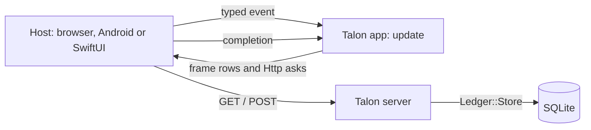

# Talon Bank: one Osprey Native app on the web, Android and iOS

Talon Bank is a small bank with accounts, deposits, withdrawals, transfers and an audit journal. The client is one [Osprey Native](../../../packages/native/README.md) app in [`app/`](app). The browser, Android and SwiftUI hosts run that same source with no per-platform code. A native Osprey server in [`src/`](src) keeps the ledger in SQLite behind effect handlers and serves the browser build.

| Platform | Host | Command |
| --- | --- | --- |
| Web | [browser host](../../../../toolchain/hosts/web) (WebAssembly) | `make -C src/toolchain/targets/web bank` |
| Android | [Android view host](../../../../toolchain/hosts/android) | `make -C src/toolchain/targets/android bank` |
| iPhone | [SwiftUI host](../../../../toolchain/hosts/swift) (iOS) | `make -C src/toolchain/targets/ios bank` |
| Mac | [SwiftUI host](../../../../toolchain/hosts/swift) | `make -C src/toolchain/targets/macos bank` |
| Windows | [WinUI host](../../../../toolchain/hosts/winui), in its AppContainer | `make -C src/toolchain/targets/windows bank` (on Windows; no headless suite or goldens yet) |

Start the server first with `make -C src/toolchain/targets/web bank`. It serves the API and the web app at <http://127.0.0.1:18790>, and resets the demo database at `/tmp/talon_bank.db` on each run. The Android target forwards that port to the device with `adb reverse`, and the iPhone simulator reaches it directly. An app launched with a server URL as its first argument talks to that server instead.

## One app

The app is a typed store, a pure update and five tab pages built from Native nodes:

| File | Contents |
| --- | --- |
| [`app/src/store.ospml`](app/src/store.ospml) | The `Bank` store, the `Account` and `Movement` records and the `BankAct` actions every control delivers |
| [`app/src/update.ospml`](app/src/update.ospml) | Every tap, edit and choice as one pure step, with validation before any request |
| [`app/src/ledger.ospml`](app/src/ledger.ospml) | The HTTP edge: requests as `Http` capabilities, and replies decoded once into records |
| [`app/src/replies.ospml`](app/src/replies.ospml) | Completed requests: listings replace the store's copy, and mutations report their outcome and reload |
| [`app/src/amounts.ospml`](app/src/amounts.ospml) | Typed amounts read as whole cents |
| [`app/src/screens.ospml`](app/src/screens.ospml), [`app/src/forms.ospml`](app/src/forms.ospml), [`app/src/parts.ospml`](app/src/parts.ospml) | Overview, Accounts, Move money, Activity, Security and the new-account dialog |
| [`app/src/app.ospml`](app/src/app.ospml) | The program the hosts run: launch, update, the tabbed root and Talon's theme |
| [`app/main.ospml`](app/main.ospml) | The three boundary exports every Native app has: `argument`, `open` and `event` |

The app never talks to a database or a socket. It asks the host for an `Http` request, the host performs it with its own networking, and the reply returns as a completion event whose body the app reads from a host-held slice:



## The server

API routes request typed operations such as `perform Ledger::Store.balance id`; they never receive a database connection. [`Ledger::sqlite`](src/store/ledger.ospml) creates a handler that captures the connection, and [`boot`](src/main.ospml) composes it with an audit handler:

```ospml
storage = Ledger::sqlite db
consoleAudit = handler Api::Audit
    log line => print "[audit] ${line}"
consoleAudit (\() => storage (\() => serve db))
```

Constructing a handler installs nothing. Calling it with a callback runs that work under the selected policy, and the compiler checks that the work has a handler for every operation it performs. [`Metrics::track`](src/store/metrics.ospml) wraps the same work in a rest-of-block `handle`.

| Concern | Implementation |
| --- | --- |
| Storage policy | `src/store/ledger.ospml`: the `Store` contract, SQLite handler factory and SQL operations |
| Audit policy | `src/api/routes.ospml`: mutation events; `src/main.ospml`: console handler |
| Request counts | `src/store/metrics.ospml`: private state and a scoped handler |
| Domain rules | `src/domain/`: whole-cent money behind the `MoneyApi` signature, account outcomes and JSON encoding |
| Web page | `src/web/pages.ospml` serves the page; `src/web/bundle.ospml` is generated by `make -C src/toolchain/targets/web bank-build` |

Transfers commit the debit, the credit and both journal entries in one SQLite transaction. A refused withdrawal returns HTTP 422 and stays in the journal. SQL values use bound parameters.

## Checks

| Command | Coverage |
| --- | --- |
| `make -C src/toolchain/targets/tests bank-app` | The app with no host: loading, tabs, filters, validation and every ledger request |
| `make -C src/toolchain/targets/tests bank` | The server's domain: money, accounts, handler state and storage guards |
| `make -C src/toolchain/targets/web/tests bank` | Real Chromium against the real server: the API, then the app found by accessible role |
| `make -C src/toolchain/targets/android/tests bank` | The Android host opens the app with no person present and presses its first control |
| `make -C src/toolchain/targets/ios/tests bank` | The same in the iPhone simulator |

The server's deterministic tour is byte-compared with [`expectedoutput`](expectedoutput) by `src/toolchain/crates/osprey-cli/tests/project_e2e.rs`.

See the [Osprey Native framework](../../../packages/native/README.md), the [effects guide](../../handlers/README.md) and the [module specification](../../../../../docs/specs/language/0025-ModulesAndNamespaces.md).
