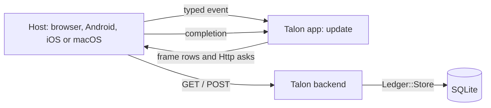

# Talon Bank: one Osprey Native app on the web, Android and iOS

Talon Bank is a small bank with accounts, deposits, withdrawals, transfers and an audit journal. It has two parts:

| Folder | What it is |
| --- | --- |
| [`app/`](app) | The client: one [Osprey Native](../../packages/native/README.md) app. The browser, Android, iOS, macOS and Windows hosts run this same source with no per-platform code. |
| [`backend/`](backend) | The server: a native Osprey program that keeps the ledger in SQLite behind effect handlers, answers the JSON API. It serves no web page: the browser build is static files served on their own. |
| [`playwright-e2e-tests/`](playwright-e2e-tests) | Browser tests: the API, the app by accessible role, and the shared journey with goldens. |

| Platform | Host | Command |
| --- | --- | --- |
| Web | [browser host](../../../toolchain/hosts/web) (WebAssembly) | `make -C src/toolchain/targets/web bank` |
| Android | [Android view host](../../../toolchain/hosts/android) | `make -C src/toolchain/targets/android bank` |
| iPhone | [SwiftUI host](../../../toolchain/hosts/swift) (iOS) | `make -C src/toolchain/targets/ios bank` |
| Mac | [SwiftUI host](../../../toolchain/hosts/swift) | `make -C src/toolchain/targets/macos bank` |
| Windows | [WinUI host](../../../toolchain/hosts/winui), in its AppContainer | `make -C src/toolchain/targets/windows bank` (on Windows) |

Start the server first with `make -C src/toolchain/targets/web bank`. It runs two processes: the server, answering the API at <http://127.0.0.1:18790>, and the web client, static files at <http://127.0.0.1:18791> that call it. The server resets the demo database at `/tmp/talon_bank.db` on each run. The Android target forwards that port to the device with `adb reverse`, and the iPhone simulator reaches it directly. An app launched with a server URL as its first argument talks to that server instead.

## The app

The app is a typed store, a pure update and five tab pages built from Native nodes:

| File | Contents |
| --- | --- |
| [`app/src/store.ospml`](app/src/store.ospml) | The `Bank` store, the `Account` and `Movement` records and the `BankAct` actions every control delivers |
| [`app/src/update.ospml`](app/src/update.ospml) | Every tap, edit and choice as one pure step, with validation before any request |
| [`app/src/ledger.ospml`](app/src/ledger.ospml) | The HTTP edge: requests as `Http` capabilities, and replies decoded once into records |
| [`app/src/replies.ospml`](app/src/replies.ospml) | Completed requests: listings replace the store's copy, and mutations report their outcome and reload |
| [`app/src/amounts.ospml`](app/src/amounts.ospml) | Typed amounts read as whole cents |
| [`app/src/screens.ospml`](app/src/screens.ospml), [`app/src/forms.ospml`](app/src/forms.ospml), [`app/src/parts.ospml`](app/src/parts.ospml) | Overview, Accounts, Move money, Activity, Security and the new-account dialog |
| [`app/src/app.ospml`](app/src/app.ospml) | The program the hosts run: launch, update, the tabbed root and Talon's theme |
| [`app/main.ospml`](app/main.ospml) | The three boundary exports every Native app has: `argument`, `open` and `event` |

The app never talks to a database or a socket. It asks the host for an `Http` request, the host performs it with its own networking, and the reply returns as a completion event whose body the app reads from a host-held slice:



## The backend

API routes request typed operations such as `perform Ledger::Store.balance id`; they never receive a database connection. [`Ledger::sqlite`](backend/store/ledger.ospml) creates a handler that captures the connection, and [`boot`](backend/main.ospml) composes it with an audit handler:

```ospml
storage = Ledger::sqlite db
consoleAudit = handler Api::Audit
    log line => print "[audit] ${line}"
consoleAudit (\() => storage (\() => serve db))
```

Constructing a handler installs nothing. Calling it with a callback runs that work under the selected policy, and the compiler checks that the work has a handler for every operation it performs. [`Metrics::track`](backend/store/metrics.ospml) wraps the same work in a rest-of-block `handle`.

| Concern | Implementation |
| --- | --- |
| Storage policy | `backend/store/ledger.ospml`: the `Store` contract, SQLite handler factory and SQL operations |
| Audit policy | `backend/api/routes.ospml`: mutation events; `backend/main.ospml`: console handler |
| Request counts | `backend/store/metrics.ospml`: private state and a scoped handler |
| Domain rules | `backend/domain/`: whole-cent money behind the `MoneyApi` signature, account outcomes and JSON encoding |
| Cross-origin access | `backend/api/routes.ospml`: every reply allows any origin and `OPTIONS` answers the browser's preflight; the API holds no cookies or credentials |

Transfers commit the debit, the credit and both journal entries in one SQLite transaction. A refused withdrawal returns HTTP 422 and stays in the journal. SQL values use bound parameters.

## One journey on every host

[`app/self-test.json`](app/self-test.json) is the one end-to-end journey. It visits every tab, deposits, transfers, overdraws and sees the refusal, enters a malformed amount, filters and searches the journal, and opens an account. Every host plays the same file against a fresh backend, and each `shot` step is compared with that host's goldens in [`app/goldens/`](app/goldens). Steps name only what a screen reader announces ([UI-MACHINE-SELF-TEST]):

| Host | Player | Goldens |
| --- | --- | --- |
| Web | Playwright, by accessible role, at desktop and phone width | `app/goldens/web/<platform>/` |
| iOS | The running app, through the shared `SelfTestRegions` | `app/goldens/ios/` |
| Android | The running app, through the same steps in Kotlin | `app/goldens/android/` |

[`playwright-e2e-tests/ledger.js`](playwright-e2e-tests/ledger.js) starts the fresh backend for each journey, so every host shows the same balances.

## Checks

| Command | Coverage |
| --- | --- |
| `make -C src/toolchain/targets/tests bank-app` | The app with no host: loading, tabs, filters, validation and every ledger request ([`app/test`](app/test)) |
| `make -C src/toolchain/targets/tests bank` | The backend's domain: money, accounts, handler state and storage guards ([`backend/test`](backend/test)) |
| `make -C src/toolchain/targets/web/tests bank` | Real Chromium against the real backend: the API, the app by accessible role, then the journey |
| `make -C src/toolchain/targets/android/tests bank` | The journey on the Android device or emulator |
| `make -C src/toolchain/targets/ios/tests bank` | The journey in the iPhone simulator |

The backend's deterministic tour is byte-compared with [`backend/expectedoutput`](backend/expectedoutput) by `src/toolchain/crates/osprey-cli/tests/project_e2e.rs`.

See the [Osprey Native framework](../../packages/native/README.md), the [effects guide](../handlers/README.md) and the [module specification](../../../../docs/specs/language/0025-ModulesAndNamespaces.md).
