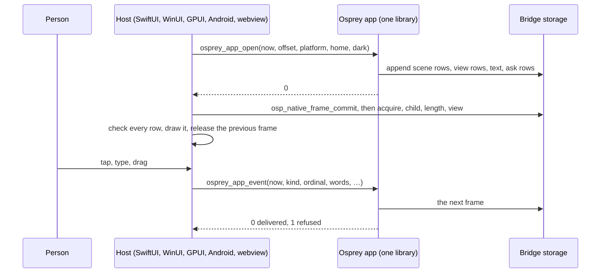
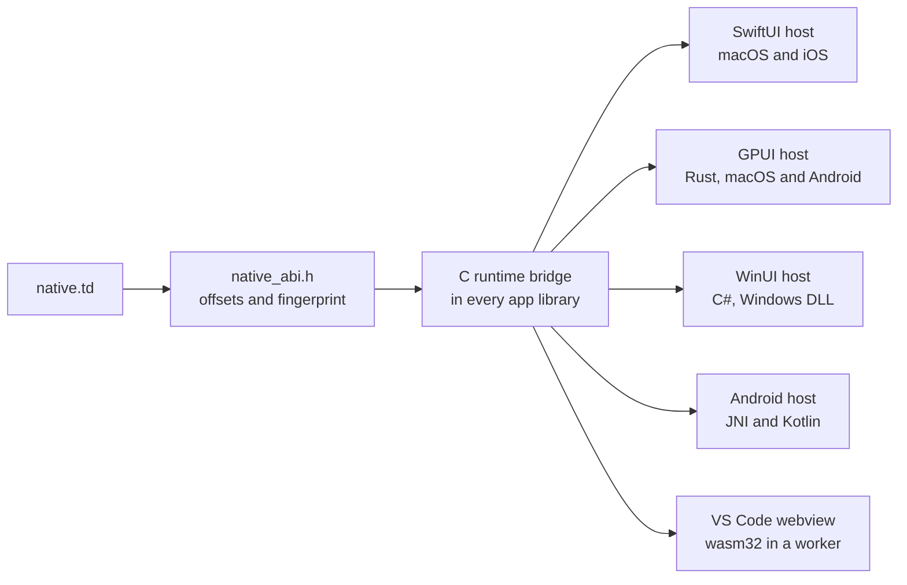



**Safe, elegant, fast:** every Osprey Native app reaches its host the same way. Each call writes one whole **frame** of fixed-width rows into memory. The host leases that memory, checks every row and draws it where it lies. The app never formats text for the host, and the host never parses any.



New here? Start with [Build a counter](/docs/osprey-native/first-app/). This page explains how the bridge works, from the Osprey code that writes a control to the Swift, Rust, C#, Kotlin and TypeScript code that draws it. It also explains why shared rows beat a serialized format such as JSON. The normative contract is [spec 0047](https://github.com/Nimblesite/osprey/blob/main/docs/specs/applications/0047-OspreyNativeHosts.md). The end-to-end explanation is [spec 0053](https://github.com/Nimblesite/osprey/blob/main/docs/specs/applications/0053-NativeSharedViews.md).

## The app is a library and the host calls it

An Osprey Native app compiles ahead of time to a library:

- a C ABI static archive on macOS, iOS, Android and the desktop targets;
- a DLL on Windows (`--target=windows-x64`);
- a live WebAssembly module for the web (`--target=wasm32`).

The compiler writes a C header beside the library. Every app exports the same three calls, plus its entry:

```c
int32_t osprey_main(void);
int64_t osprey_app_argument(const char *text);
int64_t osprey_app_open(int64_t now, int64_t offset, const char *platform, const char *home, bool dark);
int64_t osprey_app_event(int64_t now, int64_t kind, int64_t ordinal, const char *words, const char *detail,
                         double x, double y, bool down, bool shift);
```

The host calls `osprey_main` once. It then calls `osprey_app_argument` once for each launch argument, then `osprey_app_open`, then `osprey_app_event` for everything that follows. All calls come from one thread. Strings are borrowed for the length of the call.

**Every call writes one whole frame**, including an event the app refused. The app's state stays inside the library between calls. Nothing is saved, sent or restored.



## One frame, four runs

A published frame is one branch chunk that owns four sealed **runs**, always in this order:

| Run | Row | Bytes per row | Holds |
| --- | --- | --- | --- |
| Scene rows | `SceneShape` | 88 | a canvas's shapes, sprites, lettering and accessible elements |
| View rows | `ViewRow` | 152 | the controls and component rows of the screen |
| Text | — | — | the UTF-8 bytes that every row names by offset and length |
| Ask rows | `AskRow` | 32 | capability requests, slice writes and diagnostics |

Rows are fixed-width, little-endian and 8-byte aligned. A row never holds a pointer: its text is an offset and a length into the frame's one text run. A frame holds at most 2<sup>20</sup> scene rows, 2<sup>16</sup> view rows, 2<sup>24</sup> text bytes and 2<sup>16</sup> ask fields. An app that goes past a limit has its frame refused; the bridge does not grow without bound.

## The model

The bridge has one definition, [`native.td`](https://github.com/Nimblesite/osprey/blob/main/src/toolchain/schemas/native.td), written in [typeDiagram](https://typediagram.dev/docs/language-reference.html). typeDiagram generates `native_abi.h`, the header every host builds against. The header gives each field's offset and a **fingerprint** of the whole layout, for 64-bit hosts and for wasm32.

These diagrams show the frame's rows, the host event and the ownership types, taken from `native.td`. `Frame` and `HostEvent` name the four runs and the nine event arguments so you can see them as types. On the bridge they are a branch chunk and the arguments of a call.

```typediagram
typeDiagram
type Frame { scene: List<SceneShape> views: List<ViewRow> text: Bytes asks: List<AskRow> }
type ViewRow {
  kind: Int parent: Int action: Int
  textOffset: Int textLength: Int
  colour: Int background: Int
  size: Float padding: Float spacing: Float radius: Float
  weight: Int
  width: Float height: Float grow: Float
  flags: Int border: Int
  hintOffset: Int hintLength: Int
}
type SceneShape {
  code: Int index: Int
  x: Float y: Float width: Float height: Float angle: Float
  colour: Int depth: Int
  textOffset: Int textLength: Int
}
type AskRow { field: Int number: Int textOffset: Int textLength: Int }
type HostEvent { now: Int kind: Int ordinal: Int words: String detail: String x: Float y: Float down: Bool shift: Bool }
```

Every byte the host reads is reached through a lease. These are the ownership types: who may read which allocation, at which generation, and what a refusal says.

```typediagram
typeDiagram
alias ApplicationInstance = Uuid
type OwnerToken { appInstance: ApplicationInstance serial: Int }
type AllocationReference { appInstance: ApplicationInstance allocation: Int generation: Int offset: Int }
type OwnedLease { token: OwnerToken reference: AllocationReference }
type SnapshotLease { appInstance: ApplicationInstance revision: Int root: OwnedLease }
type BridgeStartup { sharedAbiFingerprint: String limits: BridgeLimits }
type BridgeLimits { chunkBytes: Int payloadBytes: Int ordinaryRecordsPerDirection: Int outstandingTickets: Int }
union BridgeError {
  LimitExceeded { requested: Int limit: Int }
  WrongInstance { expected: ApplicationInstance actual: ApplicationInstance }
  StaleAllocation { reference: AllocationReference }
  InvalidOwner { owner: OwnerToken }
  InvalidRange { offset: Int length: Int available: Int }
  InvalidLayout { expected: String actual: String }
  AllocationFailed { requested: Int }
}
```

`BridgeError` has more cases than the diagram shows; `native.td` lists all thirteen. Every bridge entry returns 0 or one plus a `BridgeError` tag, so each host turns the status into a typed refusal that names the case.

## Osprey writes the rows

An app describes its screen as a `View`, or as components such as `Button`, `Field` and `Tabs`, and decides every colour, size and space in Osprey. Rendering performs a `ViewStream` effect for each control. The boundary handles that effect with `Views::shared`, which hands each row to the runtime ([`view.ospml`](https://github.com/Nimblesite/osprey/blob/main/src/osprey/packages/native/src/view.ospml)):

```ospml
export shared work =
    handle ViewStream
        place drawn => nativeViewRow (drawn.placedKind, drawn.placedParent, drawn.placedAction, drawn.placedWords, drawn.placedLook.ink, drawn.placedLook.fill, drawn.placedLook.points, drawn.placedLook.inset, drawn.placedLook.gap, drawn.placedLook.corner, drawn.placedLook.heft)
        size fitting => nativeViewExtend (fitting.fittedRow, fitting.fittedAs.wide, fitting.fittedAs.tall, fitting.fittedAs.share, fitting.fittedAs.traits, fitting.fittedAs.edge, fitting.fittedAs.hint)
        sketch drawn => Streams::write (drawn.sketchedRow, drawn.sketchedAs)
        ask row => nativeAsk (row.askedField, row.askedNumber, row.askedText)
    work ()
```

Because the bridge is reached through an effect, a test can swap the handler. `Views::quiet` handles the same effect by dropping every row, and `@osprey/uitest` reads the rows a host would get with no host running. The rendering code never changes.

The builtin `nativeViewRow` calls `osp_native_view_row`, one function in the C runtime ([`native_bridge.h`](https://github.com/Nimblesite/osprey/blob/main/src/toolchain/compiler/runtime/native_bridge.h)). It appends one 152-byte row to the pending view run and copies the row's text once into the text run. It returns the new row's index so that children can name it as their `parent`. It refuses the frame, and returns -1, when a number is not finite, an extent is negative or a parent is not an earlier row. A `static_assert` checks the C struct against the generated layout:

```c
_Static_assert(sizeof(OspNativeView) == sizeof(td_ViewRow) &&
                   offsetof(OspNativeView, text_offset) == TD_ViewRow_textOffset_OFFSET &&
                   offsetof(OspNativeView, size) == TD_ViewRow_size_OFFSET && …,
               "OspNativeView matches the generated ViewRow layout");
```

Component apps use the same rows. A component tree is told as three more row kinds: 33 `field` for one named value, 34 `record` and 35 `list`. Each row names its parent, so a host rebuilds the typed tree and draws it with its own controls.

## The host commits, leases and reads

When an export returns, the host calls `osp_native_frame_commit`. That call takes all four pending runs in one step, seals them in place and publishes them as one frame with a new revision. No row can land half in one frame and half in the next.

The host then reads the frame:

1. `osp_native_acquire` takes the root lease of the newest frame.
2. `osp_native_child` takes one lease for each of the four runs.
3. `osp_native_length` returns each run's length in bytes.
4. `osp_native_view` returns a pointer into a run, after checking the lease, the chunk's type and that the requested range lies inside the chunk.

A **lease** is an owner token that names the app instance, the allocation, its reuse generation and the byte offset. A stale, forged, foreign or double-released lease is refused as a typed `BridgeError` and never followed. Memory is freed only when its last lease is released. The host releases the previous frame only after it holds the next one, so memory being drawn is never changed or freed underneath it.

The host trusts nothing the app wrote. Before it draws anything, it checks:

- every kind and scene code is one it knows;
- every parent is an earlier row;
- every float is finite;
- every text range lies inside the text run, on UTF-8 boundaries;
- every count stays inside the rows that follow it.

A frame that fails any check is refused whole, and the host keeps showing the last good frame.

## How each host speaks the bridge

The bridge's storage, leases and checks are written once, in C, in the Osprey runtime that each app library links. Each host reads the same frame in its own language, from structs that mirror the generated layout.



{{ capture("/assets/images/native/tally-ios.webp", "Tally on iOS: the title Tally, the count 0, Take one, Add one and Clear buttons and a name field", "Tally · iOS · the SwiftUI host draws the frame Tally wrote.", 600, 498) }}

{{ capture("/assets/images/native/tally-android.webp", "Tally on Android: the same title, count, three buttons and name field", "Tally · Android · the Android host draws the same frame from the same rows.", 600, 500) }}

Both captures are Tally's committed view-check goldens. Neither host holds a style of its own: the colours, sizes and spacing are the values in the rows, so the two screens match.

### macOS and iOS: SwiftUI

The SwiftUI host links the app's static archive. Both the Mac and the iPhone use the same `OspreyShared` library. [`SharedBridge.swift`](https://github.com/Nimblesite/osprey/blob/main/src/toolchain/hosts/swift/Sources/OspreyShared/SharedBridge.swift) opens the bridge with a random 16-byte instance identity and `TD_SHARED_FINGERPRINT`, so a pointer from another launch is refused. After each call, it commits the frame and leases the four runs. It hands `SharedRows.read` the rows as `UnsafeBufferPointer<OspNativeView>`, typed views straight over the bridge's bytes. `SharedRows` checks the rows and copies them into Swift values, then the host releases every lease before the call returns. SwiftUI draws from those values: stacks, buttons, text fields and SF Symbols.

### Windows: WinUI

On Windows the app is a DLL. It exports `osprey_native_bridge`, a table of twelve function pointers that the WinUI host calls through C# `delegate* unmanaged` pointers ([`Bridge.cs`](https://github.com/Nimblesite/osprey/blob/main/src/toolchain/hosts/winui/OspreyHost.Core/Bridge.cs)). The rows are `[StructLayout(LayoutKind.Sequential)] readonly struct`s with the same fields as the C structs. The host's fingerprint is a literal in `Bridge.cs`, and a test reads `native_abi.h` from the repository and fails as soon as the two differ. The host draws with WinUI controls and Segoe Fluent Icons, inside an AppContainer.

### GPU canvas: GPUI

The GPUI host is Rust. [`frame.rs`](https://github.com/Nimblesite/osprey/blob/main/src/toolchain/hosts/gpui/src/frame.rs) declares `#[repr(C)]` structs and asserts their sizes at compile time: 88, 152 and 32 bytes. A leased frame is an `Arc<Frame>` whose runs are `&[ViewRow]` slices made with `slice::from_raw_parts` over the bridge's bytes; no row is copied. The painter can hold an older frame while newer ones are published. `Drop` releases the leases when the last holder lets go. [`rows.rs`](https://github.com/Nimblesite/osprey/blob/main/src/toolchain/hosts/gpui/src/rows.rs) checks every row first.

### Android

The Android host is a JNI library, [`bridge.c`](https://github.com/Nimblesite/osprey/blob/main/src/toolchain/hosts/android/host/src/main/cpp/bridge.c), which owns the bridge and calls the exports on the host thread. It hands Kotlin the four runs as `NewDirectByteBuffer`s over the leased bytes, so Kotlin reads the app's memory without a copy. `Rows.kt` checks every row, Android views draw them, and every lease is released once Kotlin has read the frame.

### VS Code and the web: WebAssembly

The webview host runs the app's wasm32 build in one worker per panel ([`wasi-worker.ts`](https://github.com/Nimblesite/osprey/blob/main/src/toolchain/vscode-extension/client/src/osprey-ui/wasi-worker.ts)). The module exports the three calls and the bridge entries over its own linear memory, laid out by the same header under its wasm32 fingerprint. The worker reads 64-bit fields with `getBigInt64`, never as a JavaScript `number`, so no value above 2<sup>53</sup> loses precision. It copies the four runs out of linear memory once and passes them to the webview. [`rows.ts`](https://github.com/Nimblesite/osprey/blob/main/src/toolchain/vscode-extension/client/src/osprey-ui/webview/rows.ts) reads them with a `DataView` at the generated offsets, under the same checks as the native hosts.

### The smallest host

[`reference.c`](https://github.com/Nimblesite/osprey/blob/main/src/osprey/examples/tally/host/reference.c) is a complete host with no UI toolkit. It is also Tally's end-to-end test. It opens Tally, presses its buttons by control number, and asserts the kind, parent, action and words of every row it reads in place.

{{ capture("/assets/images/native/bridge-change.jpg", "The tutorial's Change it step: a diff renaming Add one to Add 1, then the reference host's assertion failure on row five", "From the video · change one label and the reference host, reading row five in place, fails its check.", 1280, 720) }}

## Events come back as typed calls

A person's input returns as one `osprey_app_event` call: a kind, the control it names, two texts, two numbers and two flags. The kinds are:

- 0: a control delivered its words;
- 1 to 3: a key, a pointer, or a scene's measured size;
- 4 to 7: board strokes and lassos;
- 8: a capability completed;
- 9: a lifecycle phase;
- 10: a display frame;
- 11: an appearance change.

The framework numbers each control that delivers an action, in drawing order, and keeps the actions inside the library. A control event names a number. The app looks the number up in a list it wrote itself and checks the value's kind. An unknown number or the wrong value kind is refused: the app draws the same screen again, with the reason as a diagnostic ask. **The host can never construct an action**, and a control number is never an authorization token.

Capability requests travel the other way as ask rows: reading files, running processes, network requests, storage. A host answers the requests it supports and completes each with one `completed` event. It refuses every code it does not know with a diagnostic that names it.

## Why not a JSON bridge?

Imagine the same boundary built the way many UI bridges are built: the app encodes its screen as JSON, the host parses it, and events come back as JSON too. One button might look like this:

```json
{"kind":"press","parent":3,"action":1,"text":"Add one",
 "look":{"ink":"#FFFFFFFF","fill":"#2F6FEBFF","size":17.0,"padding":12.0,"radius":10.0,"weight":600}}
```

Every frame would pay for that text twice, once to write it and once to read it. Osprey's bridge writes the same button as one 152-byte row and the host reads it where it lies.

{{ capture("/assets/images/native/bridge-row.jpg", "Tally's Add one button as one ViewRow: nineteen labelled cells from kind to hintLength, and its words in the text run", "From the video · the same button as one 152-byte ViewRow; its words live in the frame's text run.", 1280, 720) }}

| | A hypothetical JSON bridge | The shared-memory bridge |
| --- | --- | --- |
| Writing a control | Build objects, format every number as decimal text, escape every string | Write 19 machine words, copy the text once |
| Reading a control | Tokenize, allocate a dictionary per node, convert text back to numbers | Read a field at a known offset |
| Intermediate trees | One on each side, per frame | None between the rows and the host's own controls |
| Garbage | Strings and maps every frame, on both sides | A frame is four runs and one branch chunk |
| Type agreement | Each host's parser and the app must agree by convention; a renamed key fails silently or at runtime | One `native.td`; a layout mismatch is refused at startup by its fingerprint |
| Numbers | JavaScript reads JSON numbers as doubles; 64-bit values above 2<sup>53</sup> lose precision | Fixed `int64` and `float64` fields; JavaScript reads them as `bigint` |
| A malformed message | Partly parsed, partly applied, or a guessed default | Refused whole; the last good frame stays |
| State | Tempting to send the whole model across and back | The state never leaves the library |

### Why shared memory is better than serialization

- **No formatting work.** Serialization converts values to text and back. For a UI that redraws on every event and every display frame, that conversion is pure overhead. Shared rows are already in the form the host reads.
- **One copy of the text.** Each string is copied once into the text run. The host borrows it in place, or copies it once into its own toolkit.
- **Constant-time access.** A host reaches row *n* at offset *n* × 152. A parser has to read everything before row *n* to find it.
- **Checked types, not conventions.** The layout is generated from one schema and fingerprinted. A host built for a different layout cannot open the bridge at all.
- **Bounded and fallible.** Budgets for bytes, chunks and owners are fixed when the bridge opens. A failed allocation refuses the frame; it never produces an empty successful frame.
- **Safe sharing.** Frames are immutable once sealed and reference counted through leases, so a GPU painter can draw one frame while the app writes the next.

"Shared memory" here means memory shared between the app and its host **inside one process**. It is ordinary heap memory that the bridge owns, outside the GC and ARC heaps. The bridge creates no operating-system shared-memory object, file mapping, socket or named handle, so no other process gets anything to attach to.

Speed follows from the design. Flock streams thousands of birds as scene rows: 5,000 sprites cost about 7 ms a frame, `update` included. The framework's per-frame cost is measured by `src/toolchain/hosts/gpui/bench` and recorded in [plan 0037](https://github.com/Nimblesite/osprey/blob/main/docs/plans/0037-osprey-native.md).

### Where text formats still appear

Text crosses in three places only:

- the result text of a capability completion;
- the contents of host-held slices that capability adapters fill;
- the VS Code webview's one copy of the raw rows across its process boundary, which is still rows, not a text format.

Formats owned by the outside world, such as HTTP bodies, stay inside the adapter that speaks them.

## Safety rules, in short

- Frames are immutable once sealed, and every read goes through a lease.
- Every read is bounds checked by the bridge, and every row is checked again by the host.
- A failed call or a refused frame publishes nothing.
- The C bridge's tests run under both memory backends. They cover stale leases, exhausted limits, allocation failure at each step, publication, synchronization failure, concurrent readers and writers, and refused values ([`host_import_tests.c`](https://github.com/Nimblesite/osprey/blob/main/src/toolchain/compiler/runtime/host_import_tests.c)).

Host coverage varies by app. The host conformance suite, one fixture set that drives every host through this boundary, is still delivery work in plan 0037. Osprey is actively evolving; validate it against your workload.

[Osprey Native →](/docs/osprey-native/) · [Tally, the sample app](https://github.com/Nimblesite/osprey/tree/main/src/osprey/examples/tally) · [Host contract](https://github.com/Nimblesite/osprey/blob/main/docs/specs/applications/0047-OspreyNativeHosts.md) · [The schema](https://github.com/Nimblesite/osprey/blob/main/src/toolchain/schemas/native.td)


