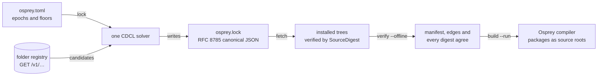



An Osprey package is source code, published as a folder and pinned by the digest of its bytes. You add one, Osprey locks the exact release, checks every byte and builds it with no network. The client runs on macOS and Linux; Windows is not supported yet. The specs cover [manifests and commands](/spec/0029-packagemanagement/), [trust services](/spec/0030-packageregistrytrustanddiscovery/), the [domain model](/spec/0031-packagedomainmodel/) and [verification evidence](/spec/0032-packageevidenceanddiscovery/).

## Publishers and package ownership

In the planned hosted registry, an organization owns each package. A **publisher** is a user with an explicit `publish-release` grant for that package. Its administrator can grant publishing to several accepted organization members, set an expiry, and revoke one user's grant while the others keep publishing.

For example, the administrator of `@atlas/audio` can grant Alice and Robin publishing access. Either can authorize a release of `@atlas/audio` with their own credential. Publishing `@atlas/mixer` requires a separate grant. Only the package administrator can delegate publishing, including granting it to themselves. Today, the local folder registry supports `publish --folder`; hosted account and grant management are under development.

## Add and remove packages in VS Code



1. Run **Osprey: Manage Packages**. The local registry is labelled *audit unverified* because no trust service has checked it.

{{ capture("/assets/images/packages/workspace-open.jpg", "Osprey package workspace in VS Code, local registry marked audit unverified", "Manage Packages: the local registry is marked audit unverified.", 2400, 1600) }}

2. Browse the catalog. Names like `numpy` are Osprey source ports, not CPython packages.

{{ capture("/assets/images/packages/workspace-browse-5.jpg", "Package catalog listing Osprey source ports", "The catalog: Osprey source ports.", 2400, 1600) }}

3. Open a release. It is named by epoch and ordinal, not SemVer.

{{ capture("/assets/images/packages/workspace-details.jpg", "Release details with epoch, ordinal and audit status", "Release details: epoch, ordinal and audit status.", 2400, 1600) }}

4. Add it. The confirmation repeats the unverified-registry warning.

{{ capture("/assets/images/packages/workspace-add-confirm.jpg", "Confirmation dialog for adding a package, with the unverified-registry warning", "Confirm the addition.", 2400, 1600) }}

{{ capture("/assets/images/packages/workspace-installed.jpg", "Installed dependency with its release and finding status", "Installed: the release and its finding status.", 2400, 1600) }}

5. Select it and remove it.

{{ capture("/assets/images/packages/workspace-remove.jpg", "Selected dependency before removal", "Select the dependency.", 1920, 1280) }}

{{ capture("/assets/images/packages/workspace-remove-confirm.jpg", "Removal confirmation for the selected dependency", "Confirm the removal.", 2400, 1600) }}

{{ capture("/assets/images/packages/workspace-after-remove.jpg", "Empty installed list after removal", "The installed list is empty again.", 2400, 1600) }}

Each step edits `osprey.toml` and relocks `osprey.lock`. [Packages in VS Code](/docs/packages-in-vscode/) has the same steps as a watch page.

## Run the local registry

The local registry serves the packages in this repository's `src/osprey/packages/` folder (`@osprey/re`, `@osprey/torch`, `@osprey/native` and the rest) on `http://127.0.0.1:8787`, the address the client and the VS Code extension use by default.

**In VS Code**, run **Osprey: Start Local Package Registry** or click **Registry: off** in the status bar. The extension bundles the server and the packages, so no checkout is needed. Its log is the **Osprey Package Registry** output channel.

**From a checkout**, build the toolchain and serve:

```sh
make build
make -C src/osprey/packages registry-serve
```

Add and fetch a dependency with the client:

```sh
echo "add @osprey/re --registry http://127.0.0.1:8787 --project $PWD/my-app" | ./target/osprey-pkg
echo "fetch --project $PWD/my-app --registry http://127.0.0.1:8787" | ./target/osprey-pkg
```

## Try the sample registry

`make -C src/osprey/packages registry-serve-sample` serves `src/osprey/packages/manager/sample-registry`, the small `@demo` packages the end-to-end consumer depends on:

```sh
make build
./target/release/osprey build src/osprey/packages/manager/cli -o target/osprey-pkg
make -C src/osprey/packages registry-serve-sample
```

Leave the server running. In another terminal at the repository root, resolve and build the sample consumer, which already declares its dependency on `@demo/report`:

```sh
echo "lock --project $PWD/src/osprey/packages/manager/e2e/consumer --registry http://127.0.0.1:8787" | ./target/osprey-pkg
echo "fetch --project $PWD/src/osprey/packages/manager/e2e/consumer --registry http://127.0.0.1:8787" | ./target/osprey-pkg
echo "verify --offline --project $PWD/src/osprey/packages/manager/e2e/consumer" | ./target/osprey-pkg
echo "build --run --compiler $PWD/target/release/osprey --project $PWD/src/osprey/packages/manager/e2e/consumer" | ./target/osprey-pkg
```

Each command ends with `status: 0` on success. The client reads commands from stdin, so it can't set an exit status, and paths can't contain spaces.

## Resolve, fetch, then build offline



`lock` picks exact releases, `fetch` downloads them, and `verify --offline`, `build` and `build --run` recheck every digest without touching the registry. A hosted registry with public publishing is planned; until then, publish with `publish --folder <registry-root>`.

## A registry is a folder

No account, database or hosted service. Each release is a folder:

```text
my-registry/
  @demo/
    maths/
      1.1/        osprey.toml, src/...
      1.2/
    greeting/
      1.1/
    report/
      1.1/        depends on @demo/maths and @demo/greeting
```

Epochs and release ordinals both start at 1.

The server validates and digests every release, then serves the catalog:

```sh
make -C src/osprey/packages registry-serve-sample   # serves src/osprey/packages/manager/sample-registry on http://127.0.0.1:8787
curl http://127.0.0.1:8787/v1/packages
curl http://127.0.0.1:8787/v1/packages/demo/maths
```

| Endpoint | Returns |
| --- | --- |
| `GET /v1/health` | liveness |
| `GET /v1/packages` | every package key with its releases |
| `GET /v1/packages/{scope}/{name}` | the releases of one key, ordered by epoch and ordinal |
| `GET /v1/releases/{digest}` | one release's identity and manifest digest |
| `GET /v1/releases/{digest}/source` | the canonical JSON source bundle |

A release with a symlink, an executable bit, a case-fold collision, an LFS pointer or a non-ASCII path is refused at startup.

To serve your own folder, edit `src/osprey/packages/manager/api/registry-server.json` and run the server:

```json
{ "root": "/srv/osprey-packages", "address": "0.0.0.0", "port": 8787 }
```

## Fetching verifies every byte

The client recomputes each bundle's `SourceDigest` before writing a file. A tampered bundle, wrong key, missing release or unreachable registry each fails with its own code.

```sh
echo "fetch @demo/report --registry http://127.0.0.1:8787" | ./target/osprey-pkg
```

The release lands in `.osprey/packages/@demo/report/<digest>/`. Fetch by epoch (`@demo/report@e1`) or by digest (`sha256:…`) too. This proves you build the bytes the server holds, not who published them.

## Release numbers: epoch and ordinal, not SemVer

Releases are numbered by **epoch** and **ordinal**:

- An **epoch** is an additive compatibility lineage: code for epoch 2 release 17 keeps its contract on release 18. Breaking changes start a new epoch.
- An **ordinal** counts releases inside an epoch. It only grows.

A dependency names one epoch and a floor:

```toml
[dependencies]
"@osprey/http" = { epoch = 2, min_release = 17 }
```

`min_release = 0` accepts any release in the epoch. There are no ranges, carets, prerelease tags, Git URLs or peer dependencies, and the whole graph gets one release per key.

## The manifest

`osprey.toml` is the only manifest; package tables sit beside the compiler's `[project]` table:

```toml
[project]
name = "ledger"
source_roots = ["src"]

[package]
name = "@finch/ledger"
license = "Apache-2.0"
summary = "Immutable ledger primitives"
keywords = ["ledger", "transactions"]

[dependencies]
"@osprey/http" = { epoch = 2, min_release = 17 }

[system.sqlite]
capability = "sqlite/c-api"
min_revision = 3045000
```

Floats, dates, non-ASCII text and unknown keys are rejected with their line and column. Licenses are SPDX expressions.

A package can be written in the **Python flavor**: list its `.py` files in `[project].python_sources`, each starting with `# osprey: flavor=python`. Osprey compiles them, so ports such as `@osprey/numpy` publish like any other package.

Root `LICENSE`, `COPYING`, `NOTICE`, `AUTHORS`, `THIRD_PARTY_NOTICES` and `LICENSES/` are always published and digested with the release.

A **system capability** names something the OS provides, such as SQLite's C API. `osprey-pkg doctor` says what is missing; Osprey never downloads native code or runs Homebrew, apt or any installer.

## Resolution picks one release per package

A deterministic CDCL SAT solver picks the graph. It prefers, in order: fewest changes to the current lock, fewest packages, newest releases. A graph with no solution fails with `resolution.epoch-conflict`, `resolution.cycle`, `resolution.missing-package` or `resolution.capability`, naming the packages involved. Input order never changes the result.

## The lock pins exact releases

`osprey.lock` is canonical JSON (RFC 8785):

```json
{"format":0,"packages":[{"dependencies":[...],"release":{...}}],"root":{"dependencies":[...],"manifestDigest":"sha256:..."}}
```

It pins the manifest digest, and each release's key, epoch, ordinal, `SourceDigest`, edges and capabilities.

- `osprey-pkg lock` consults the registry, runs the solver and prints `+`, `=`, `~` and `-` deltas. `add`, `remove`, `update` and `use` also invoke relocking.
- `osprey-pkg fetch` installs every locked release, skipping a tree whose digest already matches.
- `osprey-pkg verify --offline` and build preparation never resolve or fetch. They fail when the manifest digest differs from the lock, when the dependency edges differ, when a locked release is not installed, or when an installed tree's digest no longer matches.

Packages have no install hooks or build scripts. A failed relock restores the manifest, but a crash mid-write is not yet safe (no atomic rename or fsync).

## Commands

| Command | What it does |
| --- | --- |
| `help` | the command surface |
| `--json <command> …` | any command's report as one canonical JSON line, `{"lines":[…],"status":N}`, for editors and automation |
| `doctor` | the blocked host capabilities and system-capability guidance |
| `package init [--name <project>]` | write the smallest accepted `osprey.toml` where none exists |
| `add @scope/name [--epoch N]` | pick the key's newest epoch (or the lineage you name) and its newest release as the floor, write the dependency line and relock; the previous manifest is restored if relocking fails |
| `add <path> [--epoch N]` | declare the checkout's package key with its published baseline as the floor (zero when unpublished), relock the release lock when a baseline exists, then map the checkout and relock the development lock |
| `remove @scope/name` | drop the dependency line and relock, printing the `-` lines |
| `use <path> [--epoch N]`, `use @scope/name --published`, `use --list`, `use --clear` | develop against a local checkout: the mapping goes into `osprey.local.toml`, `osprey.local.lock` is relocked with the checkout in place of every published candidate of that key, and `[dependencies]` is never rewritten |
| `lock --local` | relock the development lock after a local manifest change; plain `lock` never sees the overlay |
| `build --release` | refuse while any override is active, then build from `osprey.lock` |
| `update [--breaking]` | relock without the current choices being sticky, so every key moves to its epoch's newest release; `--breaking` first moves each dependency with a newer epoch to it and prints one `epoch @scope/name eN -> eM` line per change |
| `fetch @scope/name[@e<epoch>]`, `fetch <digest>` | download, verify and install one release |
| `fetch` | install every release in `osprey.lock` |
| `lock [--registry <url>] [--accept-removals]` | list the registry once, fetch and verify every release, resolve `[dependencies]` and write `osprey.lock`, printing `+`, `=`, `~` and `-` per package; refuses, writing nothing, a re-served digest (`lock.release-replaced`), a dropped locked release (`lock.release-vanished`, unless `--accept-removals`) and a current lock that does not decode |
| `verify --offline` | check manifest, lock and installed trees without the network |
| `build [--run] [--compiler <path>]` | verify, then compile (and run) through the selected compiler; defaults to `osprey` on PATH |
| `tree` | the locked graph as an indented tree, `(build)` on build edges, ` *` on a key already shown |
| `why @scope/name` | every chain of edges from your project to that locked package, one line each |
| `publish --folder <registry-root> [--breaking]` | place this project as the next release of a folder registry, checked and digested exactly as the server will; the server reads the folder at startup |
| `audit`, `yank`, `login` | specified in spec 0029; answered with a "not yet implemented" status today |

## Python and uv

The Osprey resolver selects Osprey releases. Programs using [Python interop](/spec/0042-pythoninterop/) resolve and lock their CPython dependencies through [uv](https://docs.astral.sh/uv/):

- A package that needs Python declares `[system.python]` with `capability = "python/interop"` and a CPython floor, and ships an ordinary `pyproject.toml` and `uv.lock` in its root. Both are part of its `SourceDigest` like any other file.
- `osprey-pkg lock` generates one uv project under `.osprey/python/` that depends by path on the root and on every installed release that declares the capability, runs `uv lock` so uv resolves the union of their Python requirements, and pins the digests of the generated project and of `uv.lock` inside `osprey.lock`.
- `osprey-pkg fetch` runs `uv sync --frozen` to create the environment. `verify` and `build` (including `build --run`) regenerate the project, compare digests and run `uv lock --check --offline`; they never sync and never go online. Their codes are `python.pyproject-missing`, `python.uv-lock-missing`, `python.workspace-digest`, `python.uv-lock-stale` and `python.environment-missing`; a uv command that fails is `python.uv-lock-failed` or `python.uv-sync-failed` with its exit status. A failed uv operation prevents writing the new Osprey lock; generated Python workspace files may already exist.
- A graph with no member declaring the capability has no `root.python` in its lock, gets no generated project and never runs uv.

Osprey never installs uv or CPython; `osprey-pkg doctor` reports where uv is, or that it is missing and needed only by packages declaring `python/interop`. The [Python flavor](/docs/python/flavor/) needs none of this: it is Osprey source with no Python dependency.

## Supply-chain controls and remaining work

Rows marked **Milestone B** are designed in spec 0029 `[PACKAGE-THREATS]` but not built. No control here proves a dependency is benign.

| Threat | Control and delivery status |
| --- | --- |
| Malicious code inside a dependency | **Ambient capability checks.** `lock` scans named ambient builtins and declared system capabilities, requires the root's `io/…` grants per dependency, and pins the surface in the lock. Grants are not transitive. `fetch`, `verify --offline` and `build` recompute the surface and reject a mismatch with `capability.surface`. Source scanning marks raw native declarations as unclassified in all three syntax flavors; bundle validation and local `publish --folder` reject them before registry writes. These checks do not establish complete runtime confinement of untrusted packages. |
| Install-time code execution | Osprey source packages have no lifecycle hooks, build scripts or post-install step. Python interop delegates environment creation to `uv sync --frozen`; the Osprey source-only guarantee does not cover Python dependency installation. |
| Publisher-supplied archives | Milestone B: the registry will derive releases from bound forge commits. Today, `publish --folder` validates a local source tree and places it in the registry folder; it does not authenticate a forge commit. |
| Tampered or substituted bytes | A release is its canonical `SourceDigest`. The client recomputes it before writing a single file; a lock pins it; `build` refuses a tree whose digest drifted. |
| Floating versions | A dependency names an epoch and a floor; the lock pins exact releases. `build`, including `build --run`, never resolves dependencies. |
| Dependency confusion and typosquatting | One canonical scoped key per package, exactly one source per key in every graph, published path and Git dependencies rejected, Unicode confusables and case-fold collisions refused by the name and path grammars. |
| Native binaries and installers | Native needs are declared system capabilities; `doctor` reports guidance. Approved provider catalogs are planned. Osprey never downloads a native binary or invokes an OS package installer. |
| Compromised registry, mirror or CDN | Milestone B: a TUF 1.0 trust root with 3-of-5 offline keys, 2-of-3 release roles, consistent snapshots, expiry and version floors, so no single online component can make a client accept unauthorized, rolled-back, frozen, expired or substituted source. |
| Silent history rewriting | Milestone B: every publication, yank, revocation and build is an in-toto attestation in an append-only transparency log with inclusion and consistency proofs, witnessed by a 3-of-4 quorum. |
| Unreproducible builds | Milestone B: two separately administered hermetic SLSA Build L3 platforms must produce bit-identical results before anything is published, with SPDX SBOMs and provenance attached. |
| Revoked or yanked releases | Milestone B: a monotonic signed status chain. Cached locks will survive a yank; a known revocation will block every build and activation except isolated audit reproduction. |
| Local overrides leaking into releases | Development overlays live in separate files and locks; `build --release` fails on any override, duplicate key or unpinned input. |

The registry does not yet prove who published a release or how fresh the catalog is; that is [spec 0030](/spec/0030-packageregistrytrustanddiscovery/).

## Input validation and current limits

**Server.** A response is a pure function of method, path and the catalog built at startup, so no request can reach the filesystem or a process. Anything but `GET` is `405` with `Allow: GET`; traversal, percent-encoded and malformed paths are `404` problems that never echo request bytes. Every response carries `X-Content-Type-Options: nosniff`, `Content-Security-Policy: default-src 'none'` and `Referrer-Policy: no-referrer`; digest-addressed responses are `Cache-Control: public, max-age=31536000, immutable`, everything else `no-cache`. The runtime bounds a request to 1 MiB, its headers to 32 KiB and its arrival to 5 seconds. Beyond loopback, the registry sits behind a TLS-terminating, rate-limiting reverse proxy.

**Client.** Every fetched body passes, in order: a 128 MiB size bound, strict JSON (depth 64, duplicate keys, bad surrogates, control bytes), the bundle shape, the path grammar of every entry (absolute paths, `..`, backslashes, device names, case collisions), the file-kind gate, the 10,000-file and 50 MiB limits, and finally the recomputed `SourceDigest` against both the bundle's claim and the digest that was asked for. Only then does a directory get created, and its name is built from the verified identity, never from a listing row, a lock line or a command-line word. The lock decoder applies the same name and digest grammars (`lock.shape`). Lock-based `fetch`, `verify` and `build` never resolve or read a listing; fetching a package by name consults the listing to select a release; a lock edited without its manifest stops `build` before the compiler starts. `lock` refuses a registry that serves a different digest for a locked release (`lock.release-replaced`) or drops one (`lock.release-vanished`). Printed lines are sanitized so no server string can carry a terminal escape. The client follows no redirects and reads no credentials from locks or manifests.

**Python plane.** The generated `pyproject.toml` pins `index-strategy = "first-index"` and declares no index; an interop tree may not add indexes (`python.index-forbidden`) or `git`, `url` or outside-`path` sources (`python.source-forbidden`); `uv.lock` must carry a hash for every distribution or `lock` refuses it (`python.uv-lock-hashes`); sync is `uv sync --frozen`. Each rule stops `lock` before uv runs or before the folder lock is written.

**Disclosure.** `SECURITY.md` at the repository root says how to report privately and what the response target is.

| Probe | Answer |
| --- | --- |
| `POST`, `PUT`, `DELETE`, `HEAD` on any route | `405`, `Allow: GET` |
| `/v1/releases/../../etc/passwd/source`, `%2e%2e`, `%40scope` | `404` from the catalog alone |
| Bundle path `../x`, `/etc/x`, `a\b`, `CON`, `A.osp` beside `a.osp` | `path.*` before any write |
| Bundle over 128 MiB, 10,001 files, 50 MiB + 1 of content | `bundle.too-large`, `source.too-many-files`, `source.too-large` |
| Bundle claiming another digest, or with altered bytes | `bundle.unexpected-digest`, `bundle.digest-mismatch` |
| Lock with `"scope": "../.."` or `"digest": "sha256:../x"` | `lock.shape`, no path formed |
| Lock edited to another digest, manifest untouched | `verify.manifest-digest` or `verify.digest`; no compiler run |
| Registry swaps the digest of a locked release | `lock.release-replaced`, nothing written |
| Problem title containing `\x1b[2J` | printed as `?[2J` |

## Where the code lives

| Directory | Contents |
| --- | --- |
| `src/osprey/packages/manager/core/` | names, identities, digests, canonical JSON, SHA-256, the source grammar, the manifest model, the objective |
| `src/osprey/packages/manager/manifest/` | the TOML parser and manifest rules, with their own test project |
| `src/osprey/packages/manager/resolver/` | the CDCL engine and the package resolver |
| `src/osprey/packages/manager/api/` | the folder-registry server and its pure router |
| `src/osprey/packages/manager/cli/` | the command frontend: package init, add, remove, update, lock, fetch, verify, build, tree, why |
| `src/osprey/packages/manager/host/` | the host effects: files, tree, web, process, console |
| `src/osprey/packages/manager/tests/` | the suites and the declarative fixtures with independently computed goldens |
| `src/osprey/packages/manager/e2e/` | the end-to-end demo: server, fetch, lock, verify, build |
| `src/toolchain/schemas/package-registry.td` | the canonical typeDiagram model shared with spec 0031 |

Run everything with `make -C src/osprey/packages registry-test`.
