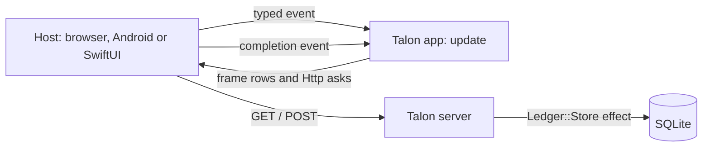
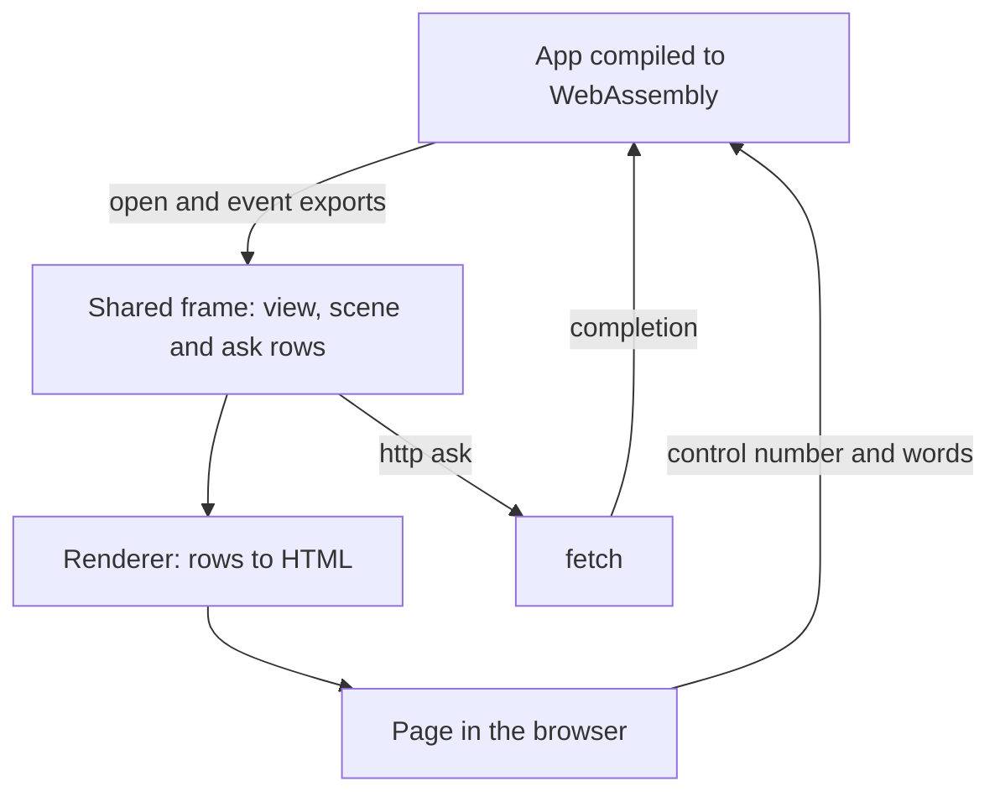



An Osprey web app is an [Osprey Native](/docs/osprey-native/) app compiled to WebAssembly. Its state, its rules and its screens are Osprey. The browser host draws the screens as HTML and performs the app's HTTP requests. The same source, with no per-platform code, runs on Android and the iPhone through their own hosts. [Talon Bank](https://github.com/Nimblesite/osprey/tree/main/src/osprey/examples/talon) is the working example, with a native Osprey server and SQLite behind it.

{{ capture("/assets/images/native/web-bank.png", "Talon Bank overview in Chromium: the portfolio total, the client accounts and recent activity", "Talon Bank in Chromium, drawn by the web host from the app's WebAssembly build.", 1440, 960) }}

## Run Talon Bank

From a checkout of the repository, start the server. It builds the app for the browser, serves the API and the page, and seeds a fresh demo database:

```sh
make -C src/toolchain/targets/web bank
```

Open <http://127.0.0.1:18790>. With the server running, open the same app on another platform:

```sh
make -C src/toolchain/targets/android bank   # the Android device or emulator named by OSPREY_ANDROID_SERIAL
make -C src/toolchain/targets/ios bank       # the iPhone simulator
make -C src/toolchain/targets/macos bank     # a Mac window
```

## One source, every platform

The app lives in one folder, [`app/`](https://github.com/Nimblesite/osprey/tree/main/src/osprey/examples/talon/app). Each host loads the same compiled app and draws it with its own controls: HTML in the browser, Android views on Android and SwiftUI on Apple platforms.

| Platform | Host | The app is compiled as |
| --- | --- | --- |
| Web | Browser host | WebAssembly, inlined in the page's script |
| Android | Android view host | A shared library beside the host |
| iPhone and Mac | SwiftUI host | A static library linked into the app |

{{ capture("/assets/images/native/web-bank-phone.png", "Talon Bank on a 390 point wide phone screen in Chromium, with the tab bar above the portfolio", "The same page on a phone-sized screen.", 390, 844) }}

{{ capture("/assets/images/native/talon-mac.webp", "Talon Bank in a macOS SwiftUI window in dark appearance, with the same five tabs, accounts and activity", "The same app on the Mac, drawn by SwiftUI.", 1400, 937) }}

## The store and the update

All client state is one record, the store. Every control delivers a typed action, and `update` turns the store and the action into the next store:

```ospml
type Bank =
    bankServer : string
    bankPage : string
    bankMode : string
    bankBusy : bool
    bankAccounts : List<Account>
    bankJournal : List<Movement>
    bankDraft : Draft
    bankNotice : Notice
```

Validation runs in `update`, before any request is made, so every platform refuses the same input in the same words:

```ospml
transfer store =
    draft = store.bankDraft
    cents = Amounts::cents draft.draftAmount
    match draft.draftFrom == draft.draftTo
        true => refused (store, "Choose two accounts", "Source and destination must be different.")
        false => match number draft.draftFrom > 0 && number draft.draftTo > 0 && cents > 0
            false => refused (store, "Check the transfer", "Choose both accounts and enter a positive amount.")
            true => sending (store, "transfer", "/api/transfer", Ledger::paired (number draft.draftFrom, number draft.draftTo, cents, trim draft.draftNote))
```

Amounts are read as whole cents. `$1,980.25` becomes `198025`, and anything that is not a plain positive amount becomes zero, which every form refuses.

## Screens are typed nodes

A screen is a function from the store to Native nodes: pages, sections, fields, pickers and buttons. Each control names the action it delivers. The host decides how a picker or a button looks on its platform.

```ospml
export move store = Ui::screen ("Move money", "Client funds, in motion", Screens::tools (),
    [Ui::picker ("Movement", modes (), store.bankMode, PickMode), form store, guidance ()])
```

The five pages are tabs. The new-account dialog and the notice sit over them while they apply.

{{ capture("/assets/images/native/web-bank-move.png", "Move money page with Movement, From account, To account, Amount and Description fields and a Confirm transfer button", "Move money: every field and picker is a node in the app.", 1440, 960) }}

## Requests are capabilities

The app never opens a socket. It asks the host for an `Http` request, the host performs it with the platform's own networking, and the reply comes back as a later event. The reply's body waits in a host-held slice named by the request:

```ospml
export call (server, ticket, method, path, body) = Requests::ask (ticket, ui::Http(method = method,
    url = server + path, headers = [jsonHeader ()], body = body, responseLimit = replyLimit (),
    deadline = replyDeadline (), responseSlice = ticket))
```

The reply is decoded once, at this edge, into `Account` and `Movement` records. No JSON reaches the screens.



On the server, routes perform typed operations such as `perform Ledger::Store.balance id`. A SQLite handler answers them, so no route holds a database connection. A transfer commits the debit, the credit and both journal entries in one transaction.

{{ capture("/assets/images/native/web-bank-activity.png", "Activity page listing credits, debits and a declined withdrawal with a search field and a Show picker", "Activity: the journal as the last reply listed it.", 1440, 960) }}

## How the browser runs it

The build compiles the app with `--target=wasm32` and inlines it in one script beside the host. The page runs the app directly, one call at a time:



The renderer and the event client are the ones the VS Code extension uses for its Native panels. Build any Native app for the browser the same way:

```sh
node src/toolchain/hosts/web/scripts/build.mjs --app path/to/app --title "My app" --out build/web
```

## Test it

The app's own tests drive it through the boundary every host calls, with no host and no server. A test finds controls by their labels and answers each request itself. A shortened deposit test:

```ospml
test ("a deposit is validated before anything is sent, then sent once", \() => bench (\() =>
    loaded ()
    press "Deposit"
    typed ("Amount", "-4")
    press "Confirm deposit"
    askedNothing ()
    typed ("Amount", "$1,250.50")
    press "Confirm deposit"
    expect (asked (), "POST http://127.0.0.1:18790/api/deposit {\"account\":1,\"cents\":125050,\"note\":\"\"} deposit")))
```

The browser suite runs real Chromium against the real server and finds every control by its accessible role and name.

```sh
make -C src/toolchain/targets/tests bank-app   # the app, no host
make -C src/toolchain/targets/web/tests bank   # Chromium against the server
make -C src/toolchain/targets/android/tests bank
make -C src/toolchain/targets/ios/tests bank
```

{{ capture("/assets/images/native/web-bank-security.png", "Security page listing storage isolation, atomic transfers, the audit trail and whole-cent arithmetic", "Security: a page of the demo app, not proof of runtime confinement.", 1440, 960) }}

## Current limits

- The browser host answers `http` requests only. A request for files, processes or other capabilities completes with an error.
- The page needs JavaScript and WebAssembly; there is no server-rendered fallback.
- The browser host allows HTTPS anywhere, and HTTP only to the page's own origin or this machine.
- The demo server listens on `127.0.0.1` with no authentication. It is a teaching example, not a deployable bank.

## Source tour

| Part | Source |
| --- | --- |
| Store and actions | [`app/src/store.ospml`](https://github.com/Nimblesite/osprey/blob/main/src/osprey/examples/talon/app/src/store.ospml) |
| Update and validation | [`app/src/update.ospml`](https://github.com/Nimblesite/osprey/blob/main/src/osprey/examples/talon/app/src/update.ospml) |
| HTTP edge | [`app/src/ledger.ospml`](https://github.com/Nimblesite/osprey/blob/main/src/osprey/examples/talon/app/src/ledger.ospml), [`app/src/replies.ospml`](https://github.com/Nimblesite/osprey/blob/main/src/osprey/examples/talon/app/src/replies.ospml) |
| Screens | [`app/src/screens.ospml`](https://github.com/Nimblesite/osprey/blob/main/src/osprey/examples/talon/app/src/screens.ospml), [`app/src/forms.ospml`](https://github.com/Nimblesite/osprey/blob/main/src/osprey/examples/talon/app/src/forms.ospml) |
| App tests | [`app/test/main.ospml`](https://github.com/Nimblesite/osprey/blob/main/src/osprey/examples/talon/app/test/main.ospml) |
| Server and storage | [`src/main.ospml`](https://github.com/Nimblesite/osprey/blob/main/src/osprey/examples/talon/backend/main.ospml), [`src/store/ledger.ospml`](https://github.com/Nimblesite/osprey/blob/main/src/osprey/examples/talon/backend/store/ledger.ospml) |
| Browser host | [`src/toolchain/hosts/web`](https://github.com/Nimblesite/osprey/tree/main/src/toolchain/hosts/web) |

See also [Osprey Native](/docs/osprey-native/), [Build an iOS and Android app](/docs/mobile-apps/) and [algebraic effects](/docs/algebraic-effects/).
