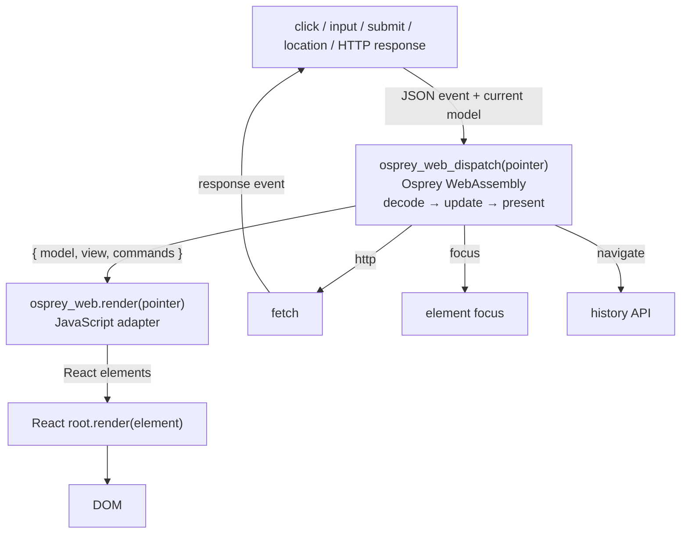
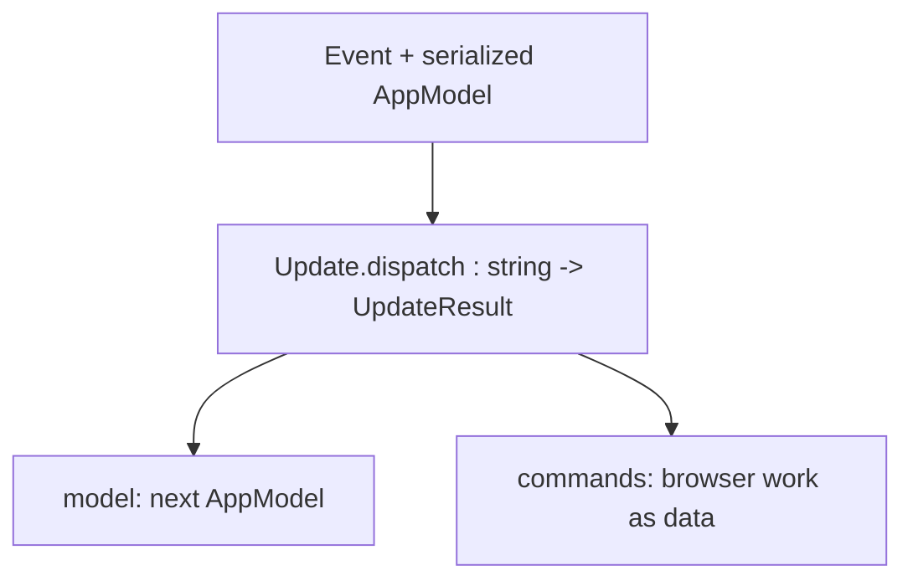



An Osprey web app keeps all of its logic in Osprey: the model, the routes, validation and a description of the view. That code compiles to WebAssembly. A small JavaScript host passes browser events in, and React draws the view Osprey returns. [Talon Bank](https://github.com/Nimblesite/osprey/tree/main/src/osprey/examples/projects/modules) is the working example, with a native Osprey server behind it.

{{ capture("/assets/images/native/web-bank.png", "Talon Bank dashboard in Chromium after the Osprey WebAssembly client starts", "Talon Bank in Chromium: the dashboard after the Osprey WebAssembly client starts.", 1440, 960) }}

## Run Talon Bank

You need Node.js 20 or later, the Osprey toolchain, `clang` with the Wasm backend, `wasm-ld` and a WASI sysroot. On macOS:

```bash
brew install lld wasi-libc
make -C src/toolchain/targets/web bank-build   # compile the client, bundle React and embed the Wasm
make -C src/toolchain/targets/web bank         # run the native server and open the app
```

The app is served at `http://127.0.0.1:18790`. The build bundles React, the host and the CSS with esbuild, compiles the client with `osprey … --target=wasm32 --memory=arc --compile`, and embeds the Wasm bytes in a generated `bundle.ospml` that the server returns as `/app.js` and `/app.css`. That file is generated: edit the client, host or styles and rebuild. Embedding is a choice; a static host can serve the `.wasm` file separately.

{{ capture("/assets/images/native/web-bank-accounts.png", "Talon Bank Accounts route rendered by React from an Osprey view document", "Accounts: Osprey picks the page; React draws its view.", 1440, 960) }}

## One event, start to finish

Every click, keystroke, URL change and HTTP response takes the same path:



The [client entry point](https://github.com/Nimblesite/osprey/blob/main/src/osprey/examples/projects/modules/client/src/main.ospml) is the whole browser boundary:

```osprey-ml
// Browser composition root. The compiler exposes osprey_web_dispatch as a
// callable wasm export; _start invokes main for the initial render.
namespace talon

import talon::App
import talon::Bridge

extern osprey_web_render (payload : string) -> int

browser () = handler Bridge::Render
    present envelope =>
        _rendered = osprey_web_render envelope
        envelope

osprey_web_dispatch payload =
    _envelope = App::receive (browser ()) payload
    0

main () =
    _envelope = App::start (browser ())
    0
```

1. JavaScript instantiates the `.wasm` with WASI and the `osprey_web` imports, then calls `_start`, which runs `main`.
2. `App::start` builds the first model and asks for accounts and activity.
3. `Bridge::present` hands `{model, view, commands}` to the render import. JavaScript keeps the model as an opaque string and renders the view.
4. Commands run after React commits, so a new element can take focus.
5. Each later event carries the latest model into `osprey_web_dispatch`, which presents the next envelope.

Deep links and back/forward send `{kind:"location",value:window.location.hash}` through the same loop, and Osprey validates the route.

## Osprey describes the view; React draws it

The view is JSON. The adapter maps each node to [`createElement`](https://react.dev/reference/react/createElement) and calls `root.render` once per update, so React's normal [render and commit](https://react.dev/learn/render-and-commit) updates the DOM. There is no generated JSX and no bank-specific component tree.

```json
{
  "tag": "button",
  "props": { "id": "refresh-data", "className": "button primary", "event": "click", "type": "button" },
  "children": [{ "tag": "span", "props": { "className": "button-label" }, "text": "Refresh" }]
}
```

Keys come from `node.key`, `props.key`, `props.id`, then the node's position. Stable ids keep DOM state such as focus, as React's [key rules](https://react.dev/learn/preserving-and-resetting-state) describe.

Events are data too. `props.event` names the event, and the adapter sends a small message back instead of running logic in JavaScript:

| Browser interaction | Message to Osprey |
|----|----|
| Click | `{kind:"click", id}` |
| Input or change | `{kind:"input", id, name?, value?}` |
| Submit | `{kind:"submit", id, data}`, with `data` as JSON-encoded `FormData` |
| Key | Event kind, element id and key |
| Back, forward or deep link | `{kind:"location", value}` |

The adapter rejects `dangerouslySetInnerHTML` and `onX` props, and text stays React text, so React escapes it. An input that changes the app before submit is [controlled](https://react.dev/reference/react-dom/components/input#controlling-an-input-with-a-state-variable): handle its event and return the value in the next view. Otherwise leave it uncontrolled and read the form on submit.

{{ capture("/assets/images/native/web-bank-activity.png", "Talon Bank Activity route before a search", "Activity before filtering.", 1440, 960) }}

{{ capture("/assets/images/native/web-bank-filter.png", "Talon Bank Activity filtered by typing vintage into the search box", "Typing vintage: the list follows the updated Osprey model.", 1440, 960) }}

## State is one Osprey record

Talon's [`AppModel`](https://github.com/Nimblesite/osprey/blob/main/src/osprey/examples/projects/modules/client/src/model.ospml) holds the route, loading flags, notices, open menus, filters, the selected account and the API documents. Each event produces the next record and a list of commands:



The host attaches the latest model to every event, so the second HTTP response sees the first one's update. React owns only what the browser owns: input values, focus, selection, history and requests in flight. Snapshots are not saved or shared between tabs; version and validate them before you persist them.

{{ capture("/assets/images/native/web-bank-move.png", "Talon Bank Move money form described by the Osprey application", "Move money: the form controls are described by Osprey.", 1440, 960) }}

## Browser work is returned as commands

An update never calls the browser. It returns the work as data, and JavaScript does it:

```osprey-ml
module Commands
    export hydrate : Unit -> string
    hydrate () = Json::arr (
        http "accounts" "GET" "/api/accounts" "" + "," +
        http "activity" "GET" "/api/activity" "")
```

| Command | Host action | Result |
|----|----|----|
| `http` | Same-origin `fetch` with an `X-Osprey-Request-Id` header | Dispatches `{kind:"http",id,status,data}` |
| `focus` | Focuses an element on the next frame | None |
| `navigate` | `history.pushState` or `replaceState` | Later back/forward sends `location` |

An update is deterministic for a given event and model. Add a capability as a command, its host code and, if needed, a completion event, and test both directions.

## Effects choose where the code runs

The server declares `Ledger::Store` for storage and `Api::Audit` for logging. At startup it installs SQLite and console handlers:

```osprey-ml
storage = Ledger::sqlite db
consoleAudit = handler Api::Audit
    log line => print "[audit] ${line}"
consoleAudit (\() => storage (\() => serve db))
```

Tests install an in-memory store around the same code. The client does the same with rendering: `Bridge::Render` is an effect, the browser handler above sends the envelope to JavaScript, and tests swap in a handler that inspects the output with no JavaScript at all.

The server and the client share the bank's `Money` module. Its signature exposes `Cents` and an abstract `Amount`, so callers go through `Money::fromCents`, `Money::show` and `Money::toCents`, and the compiler rejects a raw integer where an amount is required.

Value handlers, `handle` and `handle static` work on WebAssembly. Dynamic `control` operations need native continuations and are rejected before linking; see [feature status](/status/#algebraic-effects).

## What each layer owns

| Layer | Owns | Does not own |
|----|----|----|
| Osprey client (`.osp` or `.ospml`) | Model, transitions, routes, validation, view, commands | DOM, React hooks, `fetch`, history |
| Wasm ABI | String transfer, allocation, the dispatch export, render and command imports | Components or networking |
| JavaScript host | Wasm lifecycle, the opaque model, event messages, running commands | Domain rules |
| React | Creating and reconciling elements in one root | The application model |
| Osprey server | HTTP routes, SQLite, storage and audit handlers, embedded assets | Browser rendering |

## The Wasm boundary

The compiler and runtime only move strings and expose an entry point. The JSON schema belongs to the app.

| Export | Purpose |
|----|----|
| `memory` | WebAssembly linear memory |
| `_start` | WASI startup |
| `osp_alloc(length: i64)` | Reserve bytes for a message from JavaScript |
| `osprey_web_dispatch(pointer)` | Deliver one event; exported when the function exists |

`osp_alloc` takes a `BigInt` from JavaScript and may grow memory, so take a fresh `memory.buffer` view after calling it.

| Import | Purpose |
|----|----|
| `osprey_web.render(pointer)` | Receive a render envelope |
| `osprey_web.command(pointer)` | Receive commands outside an envelope |

In Osprey these are ordinary externs:

```osprey
extern fn osprey_web_render(payload: string) -> int
extern fn osprey_web_command(payload: string) -> int
```

Every crossing is a NUL-terminated UTF-8 string. A render envelope looks like this:

```json
{
  "model": "{\"route\":\"overview\",\"loading\":\"true\"}",
  "view": { "tag": "main", "props": {}, "children": [] },
  "commands": [{ "kind": "http", "id": "accounts", "method": "GET", "url": "/api/accounts", "body": "" }]
}
```

The output is a WASI Preview 1 command module. Talon's host supplies a small browser WASI for arguments, clocks, random bytes, stdout and the scheduler; other calls return `ENOSYS`. HTTP goes through `fetch`, not WASI sockets.

Wasm builds default to ARC (`libosprey_runtime_wasm_arc.a`), which frees memory in linear memory without the WebAssembly GC proposal. Tracing GC is not available on this target.

## Build your own app

Copy the reference host and replace its Talon-specific names; it is not published to npm.

```text
my-app/
  client/
    osprey.toml
    src/
      main.ospml       # main + osprey_web_dispatch
      model.ospml      # serializable state
      update.ospml     # Event × Model -> Model × Commands
      view.ospml       # view document constructors
      commands.ospml   # browser work as data
      bridge.ospml     # envelope + osprey_web_render extern
  web/
    src/
      host.js          # Wasm lifecycle and commands
      protocol.js      # JSON node -> React element
      wasi.js          # minimal WASI Preview 1
      index.jsx
```

```bash
osprey path/to/my-app/client --target=wasm32 --memory=arc --compile -o path/to/app.wasm
```

Serve it over HTTP, not from a file, because module loading and `fetch` need an origin. Keep one serializable model, keep browser calls out of `update`, give stateful nodes stable ids, add commands and completion events in pairs, validate messages on both sides, and keep large binary data out of the envelope.

## Test it

```bash
cd src/osprey/examples/projects/modules/web && npm test        # protocol, host, embedding, WASI
make -C src/toolchain/targets/web/tests bank                    # real client and server in Chromium
cargo test --manifest-path src/toolchain/Cargo.toml -p osprey-cli wasm::tests
```

The Chromium suite covers startup, routes, HTTP round trips, forms, responsive navigation and injection-safe text.

## Native Android and iOS

The [native Talon Bank apps](https://github.com/Nimblesite/osprey/tree/main/src/osprey/examples/projects/modules/mobile) reuse these screens, validation, transitions and commands. SwiftUI and Android widgets draw the same view tree, and a mobile handler returns the envelope through the C ABI to the same bank API.

{{ capture("/assets/images/native/web-bank-security.png", "Talon Bank security page, an application demo rather than proof of runtime confinement", "Security page: an application demo, not proof of runtime confinement.", 1440, 960) }}

## Current limits

- The host is a reference implementation, not a versioned package, and there is no `osprey new web` scaffold.
- View, event, command and model schemas are app conventions, not compiler-checked types, with no protocol versioning.
- Every event sends the full view and serializes the model; there is no incremental protocol.
- Rendering is client-only (`createRoot`), so there is no server-rendered HTML.
- WebAssembly rejects fibers, socket HTTP and WebSocket, processes, the terminal and arbitrary C imports before code generation.
- Routing is hash-based only: no path deep links, route parameters or React Router.
- HTTP commands have no cancellation, timeout or stale-response check.
- The host blocks raw HTML and callback props but trusts tags, URLs and most DOM properties. Treat view documents as trusted app output.

## Source tour

| Concern | File |
|----|----|
| Composition and pages | [`client/src/app.ospml`](https://github.com/Nimblesite/osprey/blob/main/src/osprey/examples/projects/modules/client/src/app.ospml) |
| Model | [`client/src/model.ospml`](https://github.com/Nimblesite/osprey/blob/main/src/osprey/examples/projects/modules/client/src/model.ospml) |
| Transitions | [`client/src/update.ospml`](https://github.com/Nimblesite/osprey/blob/main/src/osprey/examples/projects/modules/client/src/update.ospml) |
| View | [`client/src/ui.ospml`](https://github.com/Nimblesite/osprey/blob/main/src/osprey/examples/projects/modules/client/src/ui.ospml) |
| Commands | [`client/src/commands.ospml`](https://github.com/Nimblesite/osprey/blob/main/src/osprey/examples/projects/modules/client/src/commands.ospml) |
| Render boundary | [`client/src/bridge.ospml`](https://github.com/Nimblesite/osprey/blob/main/src/osprey/examples/projects/modules/client/src/bridge.ospml) |
| Wasm and React lifecycle | [`web/src/host.js`](https://github.com/Nimblesite/osprey/blob/main/src/osprey/examples/projects/modules/web/src/host.js) |
| Element and event protocol | [`web/src/protocol.js`](https://github.com/Nimblesite/osprey/blob/main/src/osprey/examples/projects/modules/web/src/protocol.js) |
| Browser WASI | [`web/src/wasi.js`](https://github.com/Nimblesite/osprey/blob/main/src/osprey/examples/projects/modules/web/src/wasi.js) |
| Build pipeline | [`web/scripts/build.mjs`](https://github.com/Nimblesite/osprey/blob/main/src/osprey/examples/projects/modules/web/scripts/build.mjs) |
| Wasm runtime | [`web_runtime.c`](https://github.com/Nimblesite/osprey/blob/main/src/toolchain/compiler/runtime/web_runtime.c) |
| Wasm linker | [`wasm.rs`](https://github.com/Nimblesite/osprey/blob/main/src/toolchain/crates/osprey-cli/src/wasm.rs) |

See also the [WebAssembly target spec](/spec/0022-webassemblytarget/), the [effects guide](/docs/effects/), [modules and namespaces](/spec/0025-modulesandnamespaces/) and [memory management](/spec/0018-memorymanagement/).
