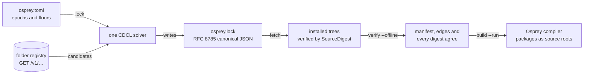



Resolve, verify and build source packages with the Osprey package client. Its filesystem and process handlers currently use POSIX `find`, `mkdir` and shell redirection; Windows host support is not established. The [implementation contract](/spec/0029-packagemanagement/) keeps package-system logic in Osprey.

The contracts cover [manifests and commands](/spec/0029-packagemanagement/), [trust services](/spec/0030-packageregistrytrustanddiscovery/), the [domain model](/spec/0031-packagedomainmodel/) and [verification evidence](/spec/0032-packageevidenceanddiscovery/).

## Add and remove packages in VS Code

Browse the registry, inspect a release, add a package and remove it from your project in the package workspace. The video shows all 19 available packages and the actual confirmation and installation screens.



Follow [Packages in VS Code](/docs/packages-in-vscode/) for the screenshots and step-by-step instructions. The registry connection is already configured in the video.

{{ capture("/assets/images/packages/workspace-open.jpg", "Open Osprey: Manage Packages · the local registry is explicitly marked audit unverified.", "Open Osprey: Manage Packages · the local registry is explicitly marked audit unverified.", 2400, 1600) }}

## Get started with the working registry

The folder registry and package client run today. The public package website, hosted publishing and trust services are planned; you do not need them to try packages locally or run a private registry.

### Run the local registry

The local registry serves the packages in this repository's `src/packages/` folder (`@osprey/re`, `@osprey/torch`, `@osprey/native` and the rest) on `http://127.0.0.1:8787`, the address the client and the VS Code extension use by default.

**In VS Code**, run **Osprey: Start Local Package Registry**, click **Registry: off**, or choose the command from an `osprey.toml` context menu. Manage/Add/Remove Package offers to start it when the configured address is unavailable. The extension bundles the server and package snapshot; no checkout is needed. Read its **Osprey Package Registry** output channel. Stop it with **Osprey: Stop Local Package Registry** or the status-bar item.

**From a checkout**, build the toolchain and serve:

```sh
make build
make -C src/packages registry-serve
```

The target builds client/server, publishes `src/packages/` into `target/local-registry`, applies source/capability/digest checks and serves the result. Add and fetch a dependency with the client:

```sh
echo "add @osprey/re --registry http://127.0.0.1:8787 --project $PWD/my-app" | ./target/osprey-pkg
echo "fetch --project $PWD/my-app --registry http://127.0.0.1:8787" | ./target/osprey-pkg
```

### Try the sample registry

`make -C src/packages registry-serve-sample` serves `src/packages/manager/sample-registry`, the small `@demo` packages the end-to-end consumer depends on:

```sh
make build
./target/release/osprey build src/packages/manager/cli -o target/osprey-pkg
make -C src/packages registry-serve-sample
```

Leave the server running. In another terminal at the repository root, resolve and build the sample consumer, which already declares its dependency on `@demo/report`:

```sh
echo "lock --project $PWD/src/packages/manager/e2e/consumer --registry http://127.0.0.1:8787" | ./target/osprey-pkg
echo "fetch --project $PWD/src/packages/manager/e2e/consumer --registry http://127.0.0.1:8787" | ./target/osprey-pkg
echo "verify --offline --project $PWD/src/packages/manager/e2e/consumer" | ./target/osprey-pkg
echo "build --run --compiler $PWD/target/release/osprey --project $PWD/src/packages/manager/e2e/consumer" | ./target/osprey-pkg
```

Check each command's final `status: N`: success is `0`. This stdin frontend cannot set a process exit status and splits on whitespace, so paths with spaces are unsupported. `--compiler` overrides the default `osprey` on PATH. For your own project, declare dependencies in `osprey.toml` and pass its absolute directory with `--project`.

## Public registry: delivery status

The hosted package website, search, authenticated publishing and trust evidence are planned. Today, use the local registry or `publish --folder <registry-root>`; restart the folder server after publication. Public `login` and signed publication are unavailable.

The planned website lets you review source, dependencies, effects, capabilities, advisories and release history. Your manifest, lock and client verification determine what you build; installed locked trees support offline builds. Supabase will supply Postgres, authentication and storage behind a versioned Osprey API. Clients will verify releases and trust proofs. The folder registry remains available for private networks and self-hosting.

Public publication will use a signed intent naming a forge repository and commit; the registry will assemble and verify the source. [Plan 0020](https://github.com/Nimblesite/osprey/blob/main/docs/plans/0020-package-manager.md) tracks delivery.

{{ capture("/assets/images/packages/workspace-installed.jpg", "After adding a dependency, the editor shows the installed release and its finding status. Audit unverified.", "After adding a dependency, the editor shows the installed release and its finding status. Capture status: audit unverified.", 2400, 1600) }}

## Resolve, fetch, then build offline



`lock` selects exact releases through the solver. `fetch` downloads their source. After installation, `verify --offline`, `build` and `build --run` verify the lock and installed trees without registry access. The application started by `build --run` may still use the network. Each verification step re-derives its digests.

## A registry is a folder

A registry needs no account, no database and no hosted service. It is a directory where each release is a folder named after the package and its release identity:

```text
my-registry/
  @demo/
    maths/
      1.1/        osprey.toml, src/...
      1.2/
    greeting/
      1.1/
    report/
      1.1/        depends on @demo/maths and @demo/greeting
```

Epochs and release ordinals both start at 1.

The Osprey server walks that root, validates every release against the canonical source rules, computes each release's `SourceDigest`, and serves the catalog over HTTP:

```sh
make -C src/packages registry-serve-sample   # serves src/packages/manager/sample-registry on http://127.0.0.1:8787
curl http://127.0.0.1:8787/v1/packages
curl http://127.0.0.1:8787/v1/packages/demo/maths
```

| Endpoint | Returns |
| --- | --- |
| `GET /v1/health` | liveness |
| `GET /v1/packages` | every package key with its releases |
| `GET /v1/packages/{scope}/{name}` | the releases of one key, ordered by epoch and ordinal |
| `GET /v1/releases/{digest}` | one release's identity and manifest digest |
| `GET /v1/releases/{digest}/source` | the canonical JSON source bundle |

Every response carries a digest `ETag`; errors are `application/problem+json`. A release directory that breaks a rule (a symlink, an executable bit, a case-fold collision, an LFS pointer, a path outside the ASCII grammar) is refused at startup with a stable reason code and never served.

To serve your own folder on your network, edit `src/packages/manager/api/registry-server.json` and run the server:

```json
{ "root": "/srv/osprey-packages", "address": "0.0.0.0", "port": 8787 }
```

## The client verifies every byte

The client downloads a release's canonical source bundle, recomputes its `SourceDigest` and compares it with the identity it asked for before writing a single file. A tampered bundle, a wrong key, a missing release or an unreachable registry each fail with their own stable code.

```sh
echo "fetch @demo/report --registry http://127.0.0.1:8787" | ./target/osprey-pkg
```

The release lands in `.osprey/packages/@demo/report/<digest>/`. You can also fetch by epoch (`fetch @demo/report@e1`) or directly by digest (`fetch sha256:…`). The folder registry proves integrity: the bytes you build are the bytes the server holds. It does not yet prove who published them; that is the trust plane of Milestone B, described below.

{{ capture("/assets/images/packages/workspace-details.jpg", "A release uses an epoch and ordinal; inspect its details and unverified audit status.", "A release uses an epoch and ordinal; inspect its details and unverified audit status.", 2400, 1600) }}

## No SemVer

A package key such as `@osprey/http` identifies releases by **epoch** and **ordinal**, rather than SemVer:

- An **epoch** is an additive compatibility lineage: code for epoch 2 release 17 keeps its contract on release 18. Breaking changes start a new epoch.
- An **ordinal** counts releases inside an epoch. It only grows.

A dependency names one epoch and a floor:

```toml
[dependencies]
"@osprey/http" = { epoch = 2, min_release = 17 }
```

`min_release = 0` accepts any release in the epoch. Osprey release identities have no upper bounds, ranges, caret/tilde notation, prerelease tags or version strings. Python interop projects retain the separate version fields uv requires. Peer dependencies, optional features, Git URLs, branches and published path dependencies are rejected by the manifest rules with the line and column of the offending key. Resolution selects one release and epoch per key for the entire graph.

{{ capture("/assets/images/packages/workspace-add-confirm.jpg", "Review the package and the unverified-registry warning before confirming an addition.", "Review the package and the unverified-registry warning before confirming an addition.", 2400, 1600) }}

## The manifest

`osprey.toml` is the only manifest. The `[project]` table is what the compiler already reads; the package tables sit beside it:

```toml
[project]
name = "ledger"
source_roots = ["src"]

[package]
name = "@finch/ledger"
license = "Apache-2.0"
summary = "Immutable ledger primitives"
keywords = ["ledger", "transactions"]

[dependencies]
"@osprey/http" = { epoch = 2, min_release = 17 }

[system.sqlite]
capability = "sqlite/c-api"
min_revision = 3045000
```

The strict TOML subset accepts tables, table arrays, dotted/quoted keys, inline tables, integers, strings and booleans. It rejects floats, dates, non-ASCII text and unknown keys with located errors before hashing. Names use scoped ASCII; licenses use SPDX expressions. Source-root duplicates and case-fold collisions are rejected.

A published package may be written in Osprey's **Python flavor**: `[project].python_sources` lists its `.py` files, each beginning with `# osprey: flavor=python`, inside a source root. The list is part of the canonical manifest, the marker is checked on every file of a release tree (`source.python-flavor-header`), and the Osprey compiler reads those files as Osprey source. Python-flavor `.py` files are compiled by Osprey rather than run by CPython, so ports such as `@osprey/numpy` publish exactly like any other package.

Locked builds work with Default and Python-flavor sources. The client writes its derived compiler project under the selected project's `.osprey/build/`, with source paths relative to that manifest. On 25 October 2026, real compiler checks passed for both flavors: bare `build`, `build --run`, and builds selected by relative or absolute `--project` paths from another directory. These checks do not establish cross-platform host support.

Package publication automatically retains root `LICENSE`, `COPYING`, `NOTICE`, `AUTHORS` and `THIRD_PARTY_NOTICES` files (including `.txt`/`.md` forms) and the complete `LICENSES/` directory. These documents are included in the release digest and remain after fetch/install. The [package license audit](https://github.com/Nimblesite/osprey/tree/main/packages) distinguishes API-only Osprey implementations from specifically copied or adapted source and data. Original Osprey contributions carry MIT; identified reused material retains its applicable terms and notices. Compiled application distributions must supply the applicable documents too.

A **system capability** names something the operating system provides, such as SQLite's C API. The hosted design maps capabilities to signed, approved providers; that provider catalog is not implemented. Today, `osprey-pkg doctor` prints system-capability guidance and host blockers. Osprey never downloads a native component and never invokes Homebrew, apt or any installer.

## Resolution

The deterministic CDCL SAT solver enforces root requirements, candidate edges, one release per key across epochs, and an acyclic graph. It uses watched literals, first-UIP learning, deterministic decisions and a proof trace. There is no greedy fallback. Its lexicographic objective is: minimise changes from the current lock, then package count, then technical lag, then the canonical graph vector.

Unsatisfiable graphs report stable codes and package keys: `resolution.epoch-conflict`, `resolution.cycle`, `resolution.missing-package` or `resolution.capability`. Explanations come from a deletion-minimised UNSAT core and follow the specification's cause order. Input order changes neither the lock nor the explanation. A bounded exhaustive test oracle independently checks search and optimality; it shares candidate and explanation helpers and does not independently derive conflict cores.

{{ capture("/assets/images/packages/workspace-remove.jpg", "Selected dependency in the package workspace before removal. Audit unverified.", "Select the installed dependency before removing it; keep its finding status in view. Capture status: audit unverified.", 1920, 1280) }}

## Locks

Until the trust plane exists, the client writes `osprey.lock` in folder-lock format `0`, as RFC 8785 canonical JSON:

```json
{"format":0,"packages":[{"dependencies":[...],"release":{...}}],"root":{"dependencies":[...],"manifestDigest":"sha256:..."}}
```

It pins the root manifest's digest and dependency edges, and for every selected release its identity (key, epoch, ordinal and `SourceDigest`), edges and capability surface. Graphs declaring Python interop also pin the generated Python project and uv lock under `root.python`. Three rules follow from it:

- `osprey-pkg lock` consults the registry, runs the solver and prints `+`, `=`, `~` and `-` deltas. `add`, `remove`, `update` and `use` also invoke relocking.
- `osprey-pkg fetch` installs every locked release, skipping a tree whose digest already matches.
- `osprey-pkg verify --offline` and build preparation never resolve or fetch. They fail when the manifest digest differs from the lock, when the dependency edges differ, when a locked release is not installed, or when an installed tree's digest no longer matches.

`build` compiles the project through the existing compiler with the installed packages as source roots. `build --run` then executes your program, whose own effects may use the network; there is no standalone package-client `run` command. Osprey packages have no install hooks or build scripts. Packages declaring Python interop also use the separate uv environment described below.

Local manifest/lock updates roll back on a reported relock failure. Crash-safe activation is still blocked on atomic rename and fsync support; rollback is not a durable filesystem transaction.

{{ capture("/assets/images/packages/workspace-remove-confirm.jpg", "Removal requires a confirmation for the selected dependency. Audit unverified.", "Removal requires a confirmation for the selected dependency. Capture status: audit unverified.", 2400, 1600) }}

## Commands

| Command | What it does |
| --- | --- |
| `help` | the command surface |
| `--json <command> …` | any command's report as one canonical JSON line, `{"lines":[…],"status":N}`, for editors and automation |
| `doctor` | the blocked host capabilities and system-capability guidance |
| `package init [--name <project>]` | write the smallest accepted `osprey.toml` where none exists |
| `add @scope/name [--epoch N]` | pick the key's newest epoch (or the lineage you name) and its newest release as the floor, write the dependency line and relock; the previous manifest is restored if relocking fails |
| `add <path> [--epoch N]` | declare the checkout's package key with its published baseline as the floor (zero when unpublished), relock the release lock when a baseline exists, then map the checkout and relock the development lock |
| `remove @scope/name` | drop the dependency line and relock, printing the `-` lines |
| `use <path> [--epoch N]`, `use @scope/name --published`, `use --list`, `use --clear` | develop against a local checkout: the mapping goes into `osprey.local.toml`, `osprey.local.lock` is relocked with the checkout in place of every published candidate of that key, and `[dependencies]` is never rewritten |
| `lock --local` | relock the development lock after a local manifest change; plain `lock` never sees the overlay |
| `build --release` | refuse while any override is active, then build from `osprey.lock` |
| `update [--breaking]` | relock without the current choices being sticky, so every key moves to its epoch's newest release; `--breaking` first moves each dependency with a newer epoch to it and prints one `epoch @scope/name eN -> eM` line per change |
| `fetch @scope/name[@e<epoch>]`, `fetch <digest>` | download, verify and install one release |
| `fetch` | install every release in `osprey.lock` |
| `lock [--registry <url>] [--accept-removals]` | list the registry once, fetch and verify every release, resolve `[dependencies]` and write `osprey.lock`, printing `+`, `=`, `~` and `-` per package; refuses, writing nothing, a re-served digest (`lock.release-replaced`), a dropped locked release (`lock.release-vanished`, unless `--accept-removals`) and a current lock that does not decode |
| `verify --offline` | check manifest, lock and installed trees without the network |
| `build [--run] [--compiler <path>]` | verify, then compile (and run) through the selected compiler; defaults to `osprey` on PATH |
| `tree` | the locked graph as an indented tree, `(build)` on build edges, ` *` on a key already shown |
| `why @scope/name` | every chain of edges from your project to that locked package, one line each |
| `publish --folder <registry-root> [--breaking]` | place this project as the next release of a folder registry, checked and digested exactly as the server will; the server reads the folder at startup |
| `audit`, `yank`, `login` | specified in spec 0029; answered with a "not yet implemented" status today |

{{ capture("/assets/images/packages/workspace-browse-5.jpg", "The catalog includes Osprey source ports; their names do not mean CPython packages are loaded implicitly. Audit unverified.", "The catalog includes Osprey source ports; their names do not mean CPython packages are loaded implicitly. Capture status: audit unverified.", 2400, 1600) }}

## Python and uv

The Osprey resolver selects Osprey releases. Programs using [Python interop](/spec/0042-pythoninterop/) resolve and lock their CPython dependencies through [uv](https://docs.astral.sh/uv/):

- A package that needs Python declares `[system.python]` with `capability = "python/interop"` and a CPython floor, and ships an ordinary `pyproject.toml` and `uv.lock` in its root. Both are part of its `SourceDigest` like any other file.
- `osprey-pkg lock` generates one uv project under `.osprey/python/` that depends by path on the root and on every installed release that declares the capability, runs `uv lock` so uv resolves the union of their Python requirements, and pins the digests of the generated project and of `uv.lock` inside `osprey.lock`.
- `osprey-pkg fetch` runs `uv sync --frozen` to create the environment. `verify` and `build` (including `build --run`) regenerate the project, compare digests and run `uv lock --check --offline`; they never sync and never go online. Their codes are `python.pyproject-missing`, `python.uv-lock-missing`, `python.workspace-digest`, `python.uv-lock-stale` and `python.environment-missing`; a uv command that fails is `python.uv-lock-failed` or `python.uv-sync-failed` with its exit status. A failed uv operation prevents writing the new Osprey lock; generated Python workspace files may already exist.
- A graph with no member declaring the capability has no `root.python` in its lock, gets no generated project and never runs uv.

Osprey never installs uv or CPython; `osprey-pkg doctor` reports where uv is, or that it is missing and needed only by packages declaring `python/interop`. The [Python flavor](/docs/python-flavor/) needs none of this: it is Osprey source with no Python dependency.

{{ capture("/assets/images/packages/workspace-after-remove.jpg", "After removal, the installed list is empty; the registry audit remains unverified.", "After removal, the installed list is empty; the registry audit remains unverified.", 2400, 1600) }}

## Supply-chain controls and remaining work

Spec 0029 `[PACKAGE-THREATS]` defines the threat model. The folder registry implements source validation, digest verification and capability checks; authenticated publication and public trust proofs remain Milestone B work. These controls do not establish that a dependency is benign.

| Threat | Control and delivery status |
| --- | --- |
| Malicious code inside a dependency | **Ambient capability checks.** `lock` scans named ambient builtins and declared system capabilities, requires the root's `io/…` grants per dependency, and pins the surface in the lock. Grants are not transitive. `fetch`, `verify --offline` and `build` recompute the surface and reject a mismatch with `capability.surface`. Source scanning marks raw native declarations as unclassified in all three syntax flavors; bundle validation and local `publish --folder` reject them before registry writes. These checks do not establish complete runtime confinement of untrusted packages. |
| Install-time code execution | Osprey source packages have no lifecycle hooks, build scripts or post-install step. Python interop delegates environment creation to `uv sync --frozen`; the Osprey source-only guarantee does not cover Python dependency installation. |
| Publisher-supplied archives | Milestone B: the registry will derive releases from bound forge commits. Today, `publish --folder` validates a local source tree and places it in the registry folder; it does not authenticate a forge commit. |
| Tampered or substituted bytes | A release is its canonical `SourceDigest`. The client recomputes it before writing a single file; a lock pins it; `build` refuses a tree whose digest drifted. |
| Floating versions | A dependency names an epoch and a floor; the lock pins exact releases. `build`, including `build --run`, never resolves dependencies. |
| Dependency confusion and typosquatting | One canonical scoped key per package, exactly one source per key in every graph, published path and Git dependencies rejected, Unicode confusables and case-fold collisions refused by the name and path grammars. |
| Native binaries and installers | Native needs are declared system capabilities; `doctor` reports guidance. Approved provider catalogs are planned. Osprey never downloads a native binary or invokes an OS package installer. |
| Compromised registry, mirror or CDN | Milestone B: a TUF 1.0 trust root with 3-of-5 offline keys, 2-of-3 release roles, consistent snapshots, expiry and version floors, so no single online component can make a client accept unauthorized, rolled-back, frozen, expired or substituted source. |
| Silent history rewriting | Milestone B: every publication, yank, revocation and build is an in-toto attestation in an append-only transparency log with inclusion and consistency proofs, witnessed by a 3-of-4 quorum. |
| Unreproducible builds | Milestone B: two separately administered hermetic SLSA Build L3 platforms must produce bit-identical results before anything is published, with SPDX SBOMs and provenance attached. |
| Revoked or yanked releases | Milestone B: a monotonic signed status chain. Cached locks will survive a yank; a known revocation will block every build and activation except isolated audit reproduction. |
| Local overrides leaking into releases | Development overlays live in separate files and locks; `build --release` fails on any override, duplicate key or unpinned input. |

Today's folder registry verifies source integrity, pins releases, checks capability surfaces and enforces one source per key. It does not yet prove who published a release or how fresh the catalog is. The trust services in [spec 0030](/spec/0030-packageregistrytrustanddiscovery/), compromise simulations and independent security audit are delivery requirements, not completed assurances.

## Input validation and current limits

Spec 0029 `[PACKAGE-HARDENING]` defines validation gates with stable diagnostic codes, asserted by name in registry tests.

**Server.** A response is a pure function of method, path and the catalog built at startup, so no request can reach the filesystem or a process. Anything but `GET` is `405` with `Allow: GET`; traversal, percent-encoded and malformed paths are `404` problems that never echo request bytes. Every response carries `X-Content-Type-Options: nosniff`, `Content-Security-Policy: default-src 'none'` and `Referrer-Policy: no-referrer`; digest-addressed responses are `Cache-Control: public, max-age=31536000, immutable`, everything else `no-cache`. The runtime bounds a request to 1 MiB, its headers to 32 KiB and its arrival to 5 seconds. Beyond loopback, the registry sits behind a TLS-terminating, rate-limiting reverse proxy.

**Client.** Every fetched body passes, in order: a 128 MiB size bound, strict JSON (depth 64, duplicate keys, bad surrogates, control bytes), the bundle shape, the path grammar of every entry (absolute paths, `..`, backslashes, device names, case collisions), the file-kind gate, the 10,000-file and 50 MiB limits, and finally the recomputed `SourceDigest` against both the bundle's claim and the digest that was asked for. Only then does a directory get created, and its name is built from the verified identity, never from a listing row, a lock line or a command-line word. The lock decoder applies the same name and digest grammars (`lock.shape`). Lock-based `fetch`, `verify` and `build` never resolve or read a listing; fetching a package by name consults the listing to select a release; a lock edited without its manifest stops `build` before the compiler starts. `lock` refuses a registry that serves a different digest for a locked release (`lock.release-replaced`) or drops one (`lock.release-vanished`). Printed lines are sanitized so no server string can carry a terminal escape. The client follows no redirects and reads no credentials from locks or manifests.

**Python plane.** The generated `pyproject.toml` pins `index-strategy = "first-index"` and declares no index; an interop tree may not add indexes (`python.index-forbidden`) or `git`, `url` or outside-`path` sources (`python.source-forbidden`); `uv.lock` must carry a hash for every distribution or `lock` refuses it (`python.uv-lock-hashes`); sync is `uv sync --frozen`. Each rule stops `lock` before uv runs or before the folder lock is written.

**Disclosure.** `SECURITY.md` at the repository root says how to report privately and what the response target is.

| Probe | Answer |
| --- | --- |
| `POST`, `PUT`, `DELETE`, `HEAD` on any route | `405`, `Allow: GET` |
| `/v1/releases/../../etc/passwd/source`, `%2e%2e`, `%40scope` | `404` from the catalog alone |
| Bundle path `../x`, `/etc/x`, `a\b`, `CON`, `A.osp` beside `a.osp` | `path.*` before any write |
| Bundle over 128 MiB, 10,001 files, 50 MiB + 1 of content | `bundle.too-large`, `source.too-many-files`, `source.too-large` |
| Bundle claiming another digest, or with altered bytes | `bundle.unexpected-digest`, `bundle.digest-mismatch` |
| Lock with `"scope": "../.."` or `"digest": "sha256:../x"` | `lock.shape`, no path formed |
| Lock edited to another digest, manifest untouched | `verify.manifest-digest` or `verify.digest`; no compiler run |
| Registry swaps the digest of a locked release | `lock.release-replaced`, nothing written |
| Problem title containing `\x1b[2J` | printed as `?[2J` |

## Where the code lives

| Directory | Contents |
| --- | --- |
| `src/packages/manager/core/` | names, identities, digests, canonical JSON, SHA-256, the source grammar, the manifest model, the objective |
| `src/packages/manager/manifest/` | the TOML parser and manifest rules, with their own test project |
| `src/packages/manager/resolver/` | the CDCL engine and the package resolver |
| `src/packages/manager/api/` | the folder-registry server and its pure router |
| `src/packages/manager/cli/` | the command frontend: package init, add, remove, update, lock, fetch, verify, build, tree, why |
| `src/packages/manager/host/` | the host effects: files, tree, web, process, console |
| `src/packages/manager/tests/` | the suites and the declarative fixtures with independently computed goldens |
| `src/packages/manager/e2e/` | the end-to-end demo: server, fetch, lock, verify, build |
| `src/schemas/package-registry.td` | the canonical typeDiagram model shared with spec 0031 |

Run everything with `make -C src/packages registry-test`. The registry README in the repository records the measured host-capability blockers and the compiler limits the code works around. Plan 0020 tracks delivery phase by phase.
