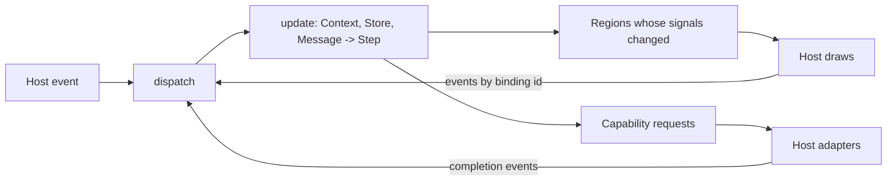

Osprey Native is the framework for writing applications in Osprey. The application owns everything a test can state: its state, its update function, its screens, the actions a control fires and the words a person reads. A **host** owns what only a platform can do: drawing, input, windows, files, network and the clock. Write the application once and it runs on every host unchanged.

The name says the application compiles to native code and reaches native services. It does not say the host draws with native widgets, and it is not React Native: that framework is explicitly not for the web, while Osprey Native treats web hosts as first-class. One host draws with SwiftUI, one with HTML and CSS inside VS Code, and the next draws with GPU primitives.

## How it works

The application keeps all of its state in one store and reads it through Osprey's built-in signals. Screens are typed `Node` trees, built with the `Ui` constructors, grouped into keyed regions. A control is bound to a typed action. Platform work is a typed capability request: read a folder, fetch a URL, save a file.

A host calls two functions, `start` and `dispatch`. Each returns an envelope: the opaque session to hand back next time, the regions whose signals changed, the capability requests to run and any diagnostics. The host draws the regions, runs the requests, and sends back events by the ids the framework issued. The host never interprets an action or a model; the compiler derives which regions depend on which signals, so only the regions that changed are sent.

Because `update` is pure, the application's tests drive the real `start`/`dispatch` path with fixture messages and assert the envelopes. No host is needed to test an application.

## The hosts

| Host | Draws with | Runs on | Status |
| --- | --- | --- | --- |
| SwiftUI | SwiftUI controls | macOS and iOS, in [Vigil](https://github.com/Nimblesite/vigil) | running |
| Webview | HTML, CSS, Codicons | VS Code on every desktop | running, used by the [package manager](/docs/packages-in-vscode/) |
| Browser | HTML, CSS | any browser | planned |
| GPUI | GPU primitives | macOS first, then Linux and Windows | planned |

The SwiftUI and GPUI hosts link the application as a C ABI static library. The webview and browser hosts run it as WebAssembly and exchange one JSON frame per call. Both carry the same envelope.

A host may draw only the nodes it knows and answer only the capabilities it supports. Anything else is rejected with a diagnostic, never drawn as a guess. Every host runs the same recorded-event conformance set, so two hosts cannot disagree about what a screen means.

## Where things are

- [`packages/native`](https://github.com/Nimblesite/osprey/tree/main/packages/native): the framework and its tests.
- [`packages/vscode`](https://github.com/Nimblesite/osprey/tree/main/packages/vscode): typed VS Code capabilities for applications hosted in the extension.
- [Osprey Native and its hosts](/spec/0047-OspreyNativeHosts/): the host contract, transports, coverage and conformance.
- [GPUI desktop host](/spec/0046-GpuiDesktopHost/) and its [plan](https://github.com/Nimblesite/osprey/blob/main/docs/plans/0036-gpui-desktop-host.md).

Osprey is actively evolving. The framework runs Vigil and the package manager's editor today; the browser and GPUI hosts, the conformance suite and the coverage matrix are delivery work tracked in [plan 0037](https://github.com/Nimblesite/osprey/blob/main/docs/plans/0037-osprey-native-hosts.md).
