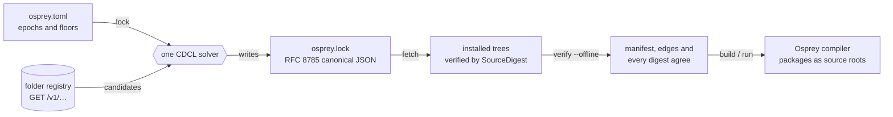

Osprey's package manager is written in Osprey from the HTTP server down to the SHA-256. The registry API, the client, the TOML parser, the manifest rules, the canonical digests, the CDCL resolver, the lock and the tests are Osprey source compiled by the Osprey compiler. There is no Rust host, no shell bridge, no JavaScript service and no database behind the first registry. The binding contract is spec 0029's [`[PACKAGE-IMPLEMENTATION-LANGUAGE]`](/spec/0029-packagemanagement/), and a conformance gate in the test suite rejects any executable file in the package system that is not Osprey.

The design is fixed by [spec 0029](/spec/0029-packagemanagement/), [spec 0030](/spec/0030-packageregistrytrustanddiscovery/), [spec 0031](/spec/0031-packagedomainmodel/) and [spec 0032](/spec/0032-packageevidenceanddiscovery/). This page is the working guide to what those specs mean in practice and what runs today.

## One flow, one resolver, no network after the lock



`lock` is the only step that talks to a registry or runs the solver. Everything to its right works offline from `osprey.lock`, and every step re-derives the digests it depends on rather than trusting a cache.

## A registry is a folder

A registry needs no account, no database and no hosted service. It is a directory where each release is a folder named after the package and its release identity:

```text
my-registry/
  @demo/
    maths/
      1.0/        osprey.toml, src/...
      1.1/
    greeting/
      1.0/
    report/
      1.0/        depends on @demo/maths and @demo/greeting
```

The Osprey server walks that root, validates every release against the canonical source rules, computes each release's `SourceDigest`, and serves the catalog over HTTP:

```sh
make registry-serve          # serves registry/sample-registry on http://127.0.0.1:8787
curl http://127.0.0.1:8787/v1/packages
curl http://127.0.0.1:8787/v1/packages/demo/maths
```

| Endpoint | Returns |
| --- | --- |
| `GET /v1/health` | liveness |
| `GET /v1/packages` | every package key with its releases |
| `GET /v1/packages/{scope}/{name}` | the releases of one key, ordered by epoch and ordinal |
| `GET /v1/releases/{digest}` | one release's identity and manifest digest |
| `GET /v1/releases/{digest}/source` | the canonical JSON source bundle |

Every response carries a digest `ETag`; errors are `application/problem+json`. A release directory that breaks a rule (a symlink, an executable bit, a case-fold collision, an LFS pointer, a path outside the ASCII grammar) is refused at startup with a stable reason code and never served.

To serve your own folder on your network, edit `registry/api/registry-server.json` and run the server:

```json
{ "root": "/srv/osprey-packages", "address": "0.0.0.0", "port": 8787 }
```

## The client verifies every byte

The client downloads a release's canonical source bundle, recomputes its `SourceDigest` and compares it with the identity it asked for before writing a single file. A tampered bundle, a wrong key, a missing release or an unreachable registry each fail with their own stable code.

```sh
echo "fetch @demo/report --registry http://127.0.0.1:8787" | ./target/osprey-pkg
```

The release lands in `.osprey/packages/@demo/report/<digest>/`. You can also fetch by epoch (`fetch @demo/report@1`) or directly by digest (`fetch sha256:…`). The folder registry proves integrity: the bytes you build are the bytes the server holds. It does not yet prove who published them; that is the trust plane of Milestone B, described below.

The client reads one command line from standard input and prints `status: N` as its last line, because Osprey has no argument-vector or exit-status builtin yet. Those are recorded as blocked host capabilities, not design choices.

## No SemVer

Osprey releases have no version numbers. A package key such as `@osprey/http` has a sequence of releases, each identified by an **epoch** and an **ordinal**:

- An **epoch** is a compatibility lineage. Every release inside an epoch is an additive contract over the ones before it: code written against `@osprey/http` epoch 2 release 17 keeps compiling and keeps its meaning on release 18. A breaking change starts a new epoch.
- An **ordinal** counts releases inside an epoch. It only grows.

A dependency names one epoch and a floor:

```toml
[dependencies]
"@osprey/http" = { epoch = 2, min_release = 17 }
```

`min_release = 0` accepts any release in the epoch. There are no upper bounds, no ranges, no caret or tilde, no pre-release tags and no version strings anywhere. Peer dependencies, optional features, Git URLs, branches and published path dependencies are rejected by the manifest rules with the line and column of the offending key. This keeps the resolver's job honest: for every package key exactly one release is selected, from exactly one epoch, and it is the one the whole graph can agree on.

## The manifest

`osprey.toml` is the only manifest. The `[project]` table is what the compiler already reads; the package tables sit beside it:

```toml
[project]
name = "ledger"
source_roots = ["src"]

[package]
name = "@finch/ledger"
license = "Apache-2.0"
summary = "Immutable ledger primitives"
keywords = ["ledger", "transactions"]

[dependencies]
"@osprey/http" = { epoch = 2, min_release = 17 }

[system.sqlite]
capability = "sqlite/c-api"
min_revision = 3045000
```

The parser is a strict TOML subset written in Osprey: tables, arrays of tables, dotted and quoted keys, inline tables, integers, strings and booleans. Floats, dates and non-ASCII text are rejected with located codes. Names are scoped ASCII, licenses are SPDX expressions, source roots are checked for duplicates and case-fold collisions, and every unknown table or key is an error before anything is hashed. A spec example round-trips to its canonical JSON and manifest digest byte for byte.

A published package may be written in Osprey's **Python flavor**: `[project].python_sources` lists its `.py` files, each beginning with `# osprey: flavor=python`, inside a source root. The list is part of the canonical manifest, the marker is checked on every file of a release tree (`source.python-flavor-header`), and the Osprey compiler reads those files as Osprey source. Nothing in a release is ever run by CPython, so ports such as `@osprey/numpy` publish exactly like any other package.

A **system capability** names something the operating system provides, such as SQLite's C API. The registry maps capabilities to approved providers and `osprey-pkg doctor` prints that guidance. Osprey never downloads a native component and never invokes Homebrew, apt or any installer.

## Resolution

Resolution is one deterministic solver, with no greedy fallback and no "good enough" path. The engine is a conflict-driven clause-learning SAT solver written in Osprey: two watched literals per clause, first-unique-implication-point learning, deterministic decisions, a proof trace of every learned clause, and a core of the input clauses behind an unsatisfiable result. The package layer builds hard clauses for root requirements, each candidate's own edges, one release per key across all epochs, and an acyclic package graph, then minimises a lexicographic cost tuple exactly in the order the spec fixes: changed releases against the current lock first, then package count, then technical lag, with the canonical graph vector as the final tie-break.

An unsatisfiable graph is explained deterministically, with a stable code and the package keys it concerns: `resolution.epoch-conflict` names the keys that demand two epochs, `resolution.cycle` names the ring, `resolution.missing-package` names the key no release satisfies, `resolution.capability` names the key whose ambient capability the root did not grant. The packages an explanation names come from the solver's own proof: every hard clause records the package keys it is about, the UNSAT core behind the refutation is minimised by deletion until no clause can be dropped, and the explanation is chosen, in the order the spec fixes, among the causes that hold for the keys that minimal core mentions. The same module explains for the exhaustive test oracle, and the two agree on all fourteen fixtures byte for byte. The same inputs in any order produce the same lock and the same explanation, and an independent exhaustive oracle in the test suite agrees with the solver on every bounded fixture.

## Locks

Until the trust plane exists, the client writes `osprey.lock` in folder-lock format `0`, as RFC 8785 canonical JSON:

```json
{"format":0,"packages":[{"dependencies":[...],"release":{...}}],"root":{"dependencies":[...],"manifestDigest":"sha256:..."}}
```

It pins the root manifest's digest and dependency edges, and for every selected release its identity (key, epoch, ordinal and `SourceDigest`) and its own edges. Three rules follow from it:

- `osprey-pkg lock` is the only command that resolves. It talks to the registry, runs the solver and prints what changed as `+`, `~` and `-` lines.
- `osprey-pkg fetch` installs every locked release, skipping a tree whose digest already matches.
- `osprey-pkg verify --offline`, `osprey-pkg build` and `osprey-pkg run` never resolve and never touch the network. They fail when the manifest digest differs from the lock, when the dependency edges differ, when a locked release is not installed, or when an installed tree's digest no longer matches.

`build` compiles the project through the existing compiler with every installed package's `src` as an extra source root. Nothing in a package is ever executed during fetch, install or build.

## Commands

| Command | What it does |
| --- | --- |
| `help` | the command surface |
| `--json <command> …` | any command's report as one canonical JSON line, `{"lines":[…],"status":N}`, for editors and automation |
| `doctor` | the blocked host capabilities and system-capability guidance |
| `package init [--name <project>]` | write the smallest accepted `osprey.toml` where none exists |
| `add @scope/name [--epoch N]` | pick the key's newest epoch (or the lineage you name) and its newest release as the floor, write the dependency line and relock; manifest and lock change together or not at all |
| `add <path> [--epoch N]` | declare the checkout's package key with its published baseline as the floor (zero when unpublished), relock the release lock when a baseline exists, then map the checkout and relock the development lock |
| `remove @scope/name` | drop the dependency line and relock, printing the `-` lines |
| `use <path> [--epoch N]`, `use @scope/name --published`, `use --list`, `use --clear` | develop against a local checkout: the mapping goes into `osprey.local.toml`, `osprey.local.lock` is relocked with the checkout in place of every published candidate of that key, and `[dependencies]` is never rewritten |
| `lock --local` | relock the development lock after a local manifest change; plain `lock` never sees the overlay |
| `build --release` | refuse while any override is active, then build from `osprey.lock` |
| `update [--breaking]` | relock without the current choices being sticky, so every key moves to its epoch's newest release; `--breaking` first moves each dependency with a newer epoch to it and prints one `epoch @scope/name eN -> eM` line per change |
| `fetch @scope/name[@epoch]`, `fetch <digest>` | download, verify and install one release |
| `fetch` | install every release in `osprey.lock` |
| `lock [--registry <url>] [--accept-removals]` | list the registry once, fetch and verify every release, resolve `[dependencies]` and write `osprey.lock`, printing `+`, `=`, `~` and `-` per package; refuses, writing nothing, a re-served digest (`lock.release-replaced`), a dropped locked release (`lock.release-vanished`, unless `--accept-removals`) and a current lock that does not decode |
| `verify --offline` | check manifest, lock and installed trees without the network |
| `build [--run]` | verify, then compile (and run) through the compiler |
| `tree` | the locked graph as an indented tree, `(build)` on build edges, ` *` on a key already shown |
| `why @scope/name` | every chain of edges from your project to that locked package, one line each |
| `publish --folder <registry-root> [--breaking]` | place this project as the next release of a folder registry, checked and digested exactly as the server will; the server reads the folder at startup |
| `audit`, `yank`, `login` | specified in spec 0029; answered with a "not yet implemented" status today |

## Python and uv

The Osprey resolver selects Osprey releases and nothing else. When an Osprey program calls real Python through [Python interop](/spec/0042-pythoninterop/), its Python packages belong to a plane that already has an excellent resolver and lock: [uv](https://docs.astral.sh/uv/). Osprey drives uv instead of modelling Python packages twice.

- A package that needs Python declares `[system.python]` with `capability = "python/interop"` and a CPython floor, and ships an ordinary `pyproject.toml` and `uv.lock` in its root. Both are part of its `SourceDigest` like any other file.
- `osprey-pkg lock` generates one uv project under `.osprey/python/` that depends by path on the root and on every installed release that declares the capability, runs `uv lock` so uv resolves the union of their Python requirements, and pins the digests of the generated project and of `uv.lock` inside `osprey.lock`.
- `osprey-pkg fetch` runs `uv sync --frozen` to create the environment. `verify`, `build` and `run` regenerate the project, compare digests and run `uv lock --check --offline`; they never sync and never go online. Their codes are `python.pyproject-missing`, `python.uv-lock-missing`, `python.workspace-digest`, `python.uv-lock-stale` and `python.environment-missing`; a uv command that fails is `python.uv-lock-failed` or `python.uv-sync-failed` with its exit status, and nothing is written.
- A graph with no member declaring the capability has no `root.python` in its lock, gets no generated project and never runs uv.

Osprey never installs uv or CPython; `osprey-pkg doctor` reports where uv is, or that it is missing and needed only by packages declaring `python/interop`. The [Python flavor](/docs/python-flavor/) needs none of this: it is Osprey source with no Python dependency.

## Supply-chain security is the design, not a feature

Every known class of package supply-chain attack is removed by construction rather than detected after the fact. The threat model is spec 0029 `[PACKAGE-THREATS]`; this is what each rule buys you.

| Attack | How Osprey removes it |
| --- | --- |
| Malicious code inside a dependency | **Capability confinement.** Osprey's effects already stop a library performing an effect its caller does not handle. The only other way to reach a file, process, network or terminal is one of the compiler's ambient builtins, and a published package may use none of them unless your manifest grants that capability on that dependency: `{ epoch = 1, min_release = 0, capabilities = ["io/process"] }`. `lock` recomputes every candidate's surface from its verified source (the ambient builtins it names, outside comments and strings, plus its `[system.*]` capabilities), drops any release whose surface your manifest does not grant on that key, and pins the surface of each locked package in `osprey.lock`; `fetch`, `verify --offline` and `build` recompute it from the installed tree and stop with `capability.surface` if it differs. Grants are never transitive: a dependency of a dependency needs your own grant on its key, and a published source that declares a builtin's name is refused at publication so no declaration can hide a call from the scan. |
| Install-time code execution | Nothing in a package is ever executed during fetch, install, lock, build-plan creation or activation. There are no lifecycle hooks, no build scripts, no post-install step. |
| Publisher-supplied archives | A release is derived from a bound forge commit by the registry itself; no upload, archive, generated file or native payload can enter the catalog. |
| Tampered or substituted bytes | A release is its canonical `SourceDigest`. The client recomputes it before writing a single file; a lock pins it; `build` refuses a tree whose digest drifted. |
| Floating versions | No SemVer, no ranges, no "latest". A dependency names an epoch and a floor; the lock pins exact releases; `build` and `run` never resolve. |
| Dependency confusion and typosquatting | One canonical scoped key per package, exactly one source per key in every graph, published path and Git dependencies rejected, Unicode confusables and case-fold collisions refused by the name and path grammars. |
| Native binaries and installers | Native needs are declared system capabilities. Osprey reports approved providers and never downloads a binary or invokes an installer. |
| Compromised registry, mirror or CDN | Milestone B: a TUF 1.0 trust root with 3-of-5 offline keys, 2-of-3 release roles, consistent snapshots, expiry and version floors, so no single online component can make a client accept unauthorized, rolled-back, frozen, expired or substituted source. |
| Silent history rewriting | Milestone B: every publication, yank, revocation and build is an in-toto attestation in an append-only transparency log with inclusion and consistency proofs, witnessed by a 3-of-4 quorum. |
| Unreproducible builds | Milestone B: two separately administered hermetic SLSA Build L3 platforms must produce bit-identical results before anything is published, with SPDX SBOMs and provenance attached. |
| Revoked or yanked releases | A monotonic signed status chain. Cached locks survive a yank; a known revocation blocks every build and activation except isolated audit reproduction. |
| Local overrides leaking into releases | Development overlays live in separate files and locks; `build --release` fails on any override, duplicate key or unpinned input. |

Today's folder registry delivers the first six rows: integrity, no execution, no floating inputs, one source per key. It does not yet prove who published a release or how fresh the catalog is; those are the Milestone B rows, specified in full in [spec 0030](/spec/0030-packageregistrytrustanddiscovery/) and layered onto the same endpoints. Every rule has a conformance gate, every parser and protocol boundary is fuzzed, and general availability waits on compromise simulations of every role plus an independent security audit whose findings are published.

## Hardened for the penetration test

Spec 0029 `[PACKAGE-HARDENING]` turns the threat model into gates with stable codes, each asserted by name in a registry test. These are the answers a tester gets today.

**Server.** A response is a pure function of method, path and the catalog built at startup, so no request can reach the filesystem or a process. Anything but `GET` is `405` with `Allow: GET`; traversal, percent-encoded and malformed paths are `404` problems that never echo request bytes. Every response carries `X-Content-Type-Options: nosniff`, `Content-Security-Policy: default-src 'none'` and `Referrer-Policy: no-referrer`; digest-addressed responses are `Cache-Control: public, max-age=31536000, immutable`, everything else `no-cache`. The runtime bounds a request to 1 MiB, its headers to 32 KiB and its arrival to 5 seconds. Beyond loopback, the registry sits behind a TLS-terminating, rate-limiting reverse proxy.

**Client.** Every fetched body passes, in order: a 128 MiB size bound, strict JSON (depth 64, duplicate keys, bad surrogates, control bytes), the bundle shape, the path grammar of every entry (absolute paths, `..`, backslashes, device names, case collisions), the file-kind gate, the 10,000-file and 50 MiB limits, and finally the recomputed `SourceDigest` against both the bundle's claim and the digest that was asked for. Only then does a directory get created, and its name is built from the verified identity, never from a listing row, a lock line or a command-line word. The lock decoder applies the same name and digest grammars (`lock.shape`). `fetch`, `verify` and `build` never resolve or read a listing; a lock edited without its manifest stops `build` before the compiler starts. `lock` refuses a registry that serves a different digest for a locked release (`lock.release-replaced`) or drops one (`lock.release-vanished`). Printed lines are sanitized so no server string can carry a terminal escape. The client follows no redirects and reads no credentials from locks or manifests.

**Python plane.** The generated `pyproject.toml` pins `index-strategy = "first-index"` and declares no index; an interop tree may not add indexes (`python.index-forbidden`) or `git`, `url` or outside-`path` sources (`python.source-forbidden`); `uv.lock` must carry a hash for every distribution or `lock` refuses it (`python.uv-lock-hashes`); sync is `uv sync --frozen`. Each rule stops `lock` before uv runs or before the folder lock is written.

**Disclosure.** `SECURITY.md` at the repository root says how to report privately and what the response target is.

| Probe | Answer |
| --- | --- |
| `POST`, `PUT`, `DELETE`, `HEAD` on any route | `405`, `Allow: GET` |
| `/v1/releases/../../etc/passwd/source`, `%2e%2e`, `%40scope` | `404` from the catalog alone |
| Bundle path `../x`, `/etc/x`, `a\b`, `CON`, `A.osp` beside `a.osp` | `path.*` before any write |
| Bundle over 128 MiB, 10,001 files, 50 MiB + 1 of content | `bundle.too-large`, `source.too-many-files`, `source.too-large` |
| Bundle claiming another digest, or with altered bytes | `bundle.unexpected-digest`, `bundle.digest-mismatch` |
| Lock with `"scope": "../.."` or `"digest": "sha256:../x"` | `lock.shape`, no path formed |
| Lock edited to another digest, manifest untouched | `verify.manifest-digest` or `verify.digest`; no compiler run |
| Registry swaps the digest of a locked release | `lock.release-replaced`, nothing written |
| Problem title containing `\x1b[2J` | printed as `?[2J` |

## Where the code lives

| Directory | Contents |
| --- | --- |
| `registry/core/` | names, identities, digests, canonical JSON, SHA-256, the source grammar, the manifest model, the objective |
| `registry/manifest/` | the TOML parser and manifest rules, with their own test project |
| `registry/resolver/` | the CDCL engine and the package resolver |
| `registry/api/` | the folder-registry server and its pure router |
| `registry/cli/` | the command frontend: package init, add, remove, update, lock, fetch, verify, build, tree, why |
| `registry/host/` | the host effects: files, tree, web, process, console |
| `registry/tests/` | the suites and the declarative fixtures with independently computed goldens |
| `registry/e2e/` | the end-to-end demo: server, fetch, lock, verify, build |
| `schemas/package-registry.td` | the canonical typeDiagram model shared with spec 0031 |

Run everything with `make registry-test`. The registry README in the repository records the measured host-capability blockers and the compiler limits the code works around. Plan 0020 tracks delivery phase by phase.
