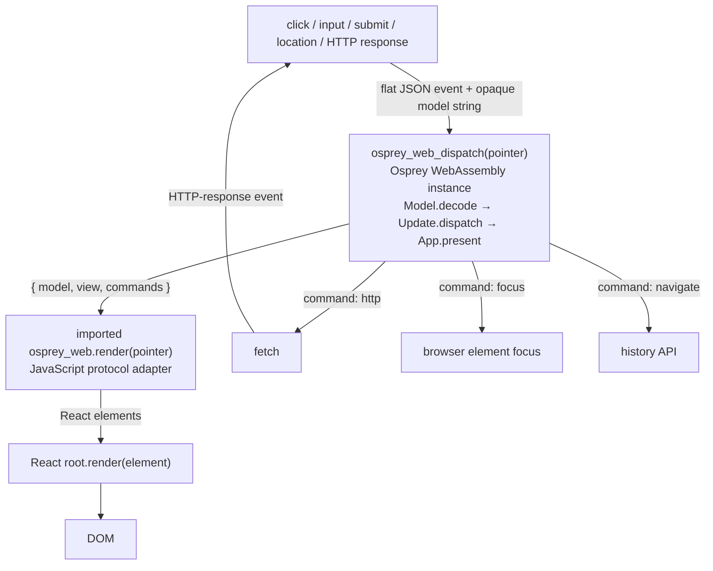
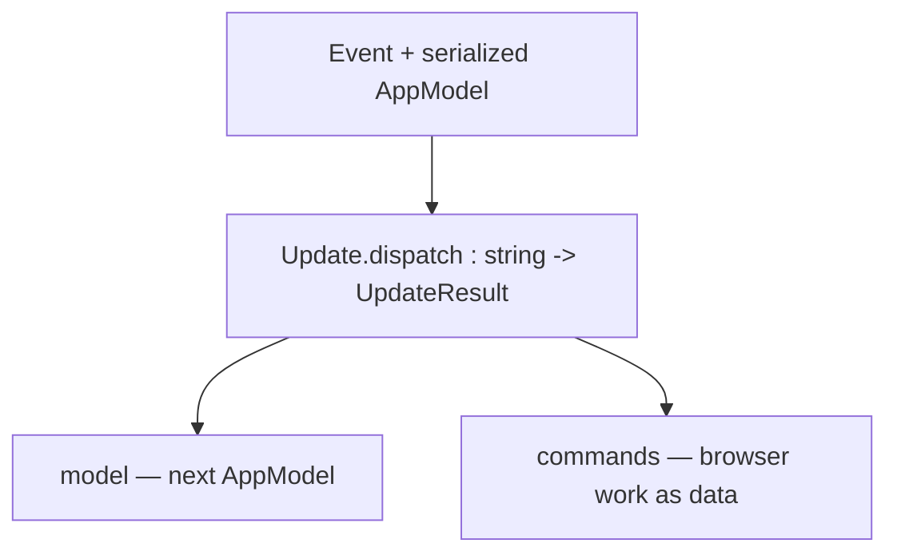
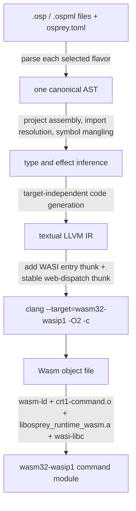



[Talon Bank](https://github.com/Nimblesite/osprey/tree/main/examples/projects/modules) uses algebraic effects for storage, audit logging and browser rendering. Reusable handlers select SQLite and console output on the server, or the browser bridge in the WebAssembly client. Tests replace these implementations around the same application code.

Osprey owns the model, transitions, routes, validation and view description. A JavaScript host executes browser commands and gives the view to React, which updates the DOM. Start with the [effects guide](/docs/effects/) if `handler` and `perform` are new to you.

The host is an application reference in this repository. Its protocol and source can be adapted for another app; there is no published framework package or `osprey new web` scaffold.

{{ capture("/assets/images/native/web-bank.png", "Talon Bank · the actual Chromium dashboard after the Osprey WebAssembly client is ready.", "Talon Bank · the actual Chromium dashboard after the Osprey WebAssembly client is ready.", 1440, 960) }}

## The architecture at a glance



Osprey sends one render envelope per update. JavaScript parses it once; React reconciles the DOM.

## What each layer owns

| Layer | Owns | Does not own |
|----|----|----|
| Osprey client (`.osp` or `.ospml`) | Serializable model, transitions, routes, validation, view document, command descriptions | DOM nodes, React hooks, `fetch`, browser history |
| Wasm web ABI | UTF-8 string transfer, allocation entry point, stable dispatch export, render/command imports | A component model or networking API |
| JavaScript host | Wasm lifecycle, opaque model retention, event normalization, command execution, telemetry | Domain transitions or page-specific rules |
| React | Element creation and reconciliation inside one root | The authoritative application model |
| Native Osprey server in Talon Bank | HTTP routes, SQLite adapter, storage/audit handlers, embedded assets | Browser rendering |

The server and Wasm client share the bank’s `Money` module. Its signature exposes an integer `Cents` alias and an abstract `Amount`: callers use `Money::fromCents`, `Money::show` and `Money::toCents` while the record representation stays private. The compiler rejects direct construction, field access and passing a raw integer where an amount is required. Native tests cover both source flavors and all three allocators; the browser journeys exercise the same module through WebAssembly.

## The complete startup and event loop

The [client entry point](https://github.com/Nimblesite/osprey/blob/main/examples/projects/modules/client/src/main.ospml) defines the browser-facing dispatcher and `main`:

```osprey-ml
// Browser composition root. The compiler exposes osprey_web_dispatch as a
// callable wasm export; _start invokes main for the initial render.
namespace talon

import talon::App
import talon::Bridge

extern osprey_web_render (payload : string) -> int

browser () = handler Bridge::Render
    present envelope =>
        _rendered = osprey_web_render envelope
        envelope

osprey_web_dispatch payload =
    _envelope = App::receive (browser ()) payload
    0

main () =
    _envelope = App::start (browser ())
    0
```

1. Instantiate the `.wasm` with WASI, `osprey_web.render` and `osprey_web.command` imports; attach its exported memory and call `_start`.
2. `_start` calls `main`. The browser handler wraps `App::start`, which creates the initial model and account/activity requests.
3. `Bridge::present` emits `{model, view, commands}` through the render import. JavaScript reads its NUL-terminated JSON, retains the opaque model and renders React elements.
4. Execute commands after requesting the React commit, so newly rendered focus targets can appear.
5. For each browser event, attach the latest model, allocate UTF-8 bytes with a trailing NUL and call `osprey_web_dispatch`.
6. The dispatcher installs a fresh browser handler, decodes the event and model, and presents the updated envelope.

Startup deep links and back/forward dispatch `{kind:"location",value:window.location.hash}` through this same loop. Osprey validates the route.

{{ capture("/assets/images/native/web-bank-accounts.png", "Accounts route · Osprey selects the page and React renders its view document.", "Accounts route · Osprey selects the page and React renders its view document.", 1440, 960) }}

## How React fits in

One [`React root`](https://react.dev/reference/react-dom/client/createRoot) renders each Osprey view. The adapter recursively maps JSON nodes to [`React elements`](https://react.dev/reference/react/createElement):

``` json
{
  "tag": "button",
  "props": {
    "id": "refresh-data",
    "className": "button primary",
    "event": "click",
    "type": "button"
  },
  "children": [
    { "tag": "span", "props": { "className": "button-label" }, "text": "Refresh" }
  ]
}
```

`tag` becomes the first `createElement` argument, filtered DOM props become the second, and text/children become the remaining arguments. Calling `root.render(nextTree)` lets React compare the new tree with the previous one and update the DOM through its normal [render-and-commit lifecycle](https://react.dev/learn/render-and-commit). There is no generated JSX and no bank-specific React component hierarchy.

The adapter chooses a key in this order: `node.key`, `props.key`, `props.id`, then the node's structural path. Stable keys and stable positions allow React to preserve matching DOM nodes; changing them can reset node-local state. See React's explanation of [`key` and state preservation](https://react.dev/learn/preserving-and-resetting-state).

### Events

Osprey declares an event name as data in `props.event` or `props.events`. The adapter installs the corresponding React handler and follows React's normal [event model](https://react.dev/learn/responding-to-events), but sends a small message rather than running domain logic in JavaScript.

| Browser interaction | Message returned to Osprey |
|----|----|
| Click | `{kind:"click", id}` |
| Input/change | `{kind:"input", id, name?, value?}` |
| Submit | `{kind:"submit", id, data}` where `data` is a JSON-encoded `FormData` object |
| Key event | Event kind, element id, and key value |
| Back/forward/deep link | `{kind:"location", value}` |

The adapter prevents default form submission and anchor navigation where it owns the event, then stops propagation. It rejects `dangerouslySetInnerHTML` and DOM props shaped like executable `onX` handlers; events must pass through the declared protocol. Text remains ordinary React text, so React escapes it.

### React state versus Osprey state

Application state is an Osprey record. React renders it; the browser retains input values, history, focus, selection, in-flight requests and telemetry.

For an input that affects the app before submission, handle its event and return the value in the next view, following React's [controlled-input contract](https://react.dev/reference/react-dom/components/input#controlling-an-input-with-a-state-variable). Otherwise leave it uncontrolled and serialize its form at submit.

## The Wasm message ABI

The ABI is intentionally smaller than the application protocol. The compiler and runtime only know how to move strings and expose an entry point; the JSON schema belongs to the host and application.

### Wasm exports consumed by JavaScript

| Export | Purpose |
|----|----|
| `memory` | Shared WebAssembly linear memory |
| `_start` | WASI command-module startup |
| `osp_alloc(length: i64)` | Reserve bytes for a host-to-Wasm message |
| `osprey_web_dispatch(pointer)` | Deliver one event to the Osprey app; exported when that source function exists |

At the JavaScript boundary the `i64` allocation length is normally a `BigInt`. Allocation may grow memory, so the host obtains a fresh `memory.buffer` view after calling `osp_alloc`, copies the message, and then dispatches its pointer.

### JavaScript imports consumed by Wasm

| Import | Purpose |
|----|----|
| `osprey_web.render(pointer)` | Receive a complete render envelope |
| `osprey_web.command(pointer)` | Receive one command or command array outside a render envelope |

Osprey source sees ordinary extern functions:

``` osprey
extern fn osprey_web_render(payload: string) -> int
extern fn osprey_web_command(payload: string) -> int
```

The current Talon client places commands in its render envelope, so it uses the render import for both the view and scheduled work. The separate command import remains available for applications that need it.

### Render envelope

``` json
{
  "model": "{\"route\":\"overview\",\"loading\":\"true\"}",
  "view": { "tag": "main", "props": {}, "children": [] },
  "commands": [
    { "kind": "http", "id": "accounts", "method": "GET", "url": "/api/accounts", "body": "" }
  ]
}
```

`model` is an opaque JSON string from the host's perspective. `view` is the React-neutral element tree. `commands` is an array interpreted after rendering. Every crossing is a NUL-terminated UTF-8 string.

{{ capture("/assets/images/native/web-bank-filter.png", "Type vintage into Activity search · the visible list follows the updated Osprey model.", "Type vintage into Activity search · the visible list follows the updated Osprey model.", 1440, 960) }}

{{ capture("/assets/images/native/web-bank-activity.png", "Talon Bank Activity route before entering a search", "Activity before filtering · compare these rows with the search result below.", 1440, 960) }}

## State management in Osprey

Talon's [`AppModel`](https://github.com/Nimblesite/osprey/blob/main/examples/projects/modules/client/src/model.ospml) is the authoritative application snapshot. It contains route selection, loading flags, notices, modal/menu state, filters, the selected account, and JSON API documents.

The transition shape is explicit:



Each dispatch decodes the model, matches the event, creates an immutable next record and encodes the new snapshot. The host retains that string opaquely and attaches its latest value to every event. Consequently, the second hydration response sees the first response's update.

Snapshots are not automatically persisted or shared between tabs. Version and validate them before adding storage. Talon's string fields, `"true"`/`"false"` flags and nested JSON documents are application conventions; a reusable framework needs explicit codecs and versioning.

A handler-owned state module lasts for its installed region. Because `_start` finishes before later JavaScript dispatches, that region would not remain installed across events. This example round-trips snapshots instead.

{{ capture("/assets/images/native/web-bank-move.png", "Move money · native browser form controls are described by the Osprey application.", "Move money · native browser form controls are described by the Osprey application.", 1440, 960) }}

## Browser work is represented as commands

An update describes work; JavaScript performs it:

``` osprey-ml
module Commands
    export hydrate : Unit -> string
    hydrate () = Json::arr (
        http "accounts" "GET" "/api/accounts" "" + "," +
        http "activity" "GET" "/api/activity" "")
```

The current host understands three command kinds:

| Command | Host action | Completion path |
|----|----|----|
| `http` | Same-origin `fetch`; adds an `X-Osprey-Request-Id` | Dispatches `{kind:"http",id,status,data}` with raw response text |
| `focus` | Focuses an element on the next animation frame | No return event |
| `navigate` | Calls `history.pushState` or `replaceState` | Osprey has already changed its route; later back/forward emits `location` |

Updates remain deterministic for an event and model. Add capabilities through a command schema, host implementation and, when needed, completion event; test both directions.

## Algebraic effects: what runs where

The server declares `Ledger::Store` for storage and `Api::Audit` for logging. `Ledger::sqlite db` creates a callable storage handler capturing the database. The startup boundary composes it with the audit handler:

```osprey-ml
storage = Ledger::sqlite db
consoleAudit = handler Api::Audit
    log line => print "[audit] ${line}"
consoleAudit (\() => storage (\() => serve db))
```

Calling a handler with a callback installs it while that work runs. Tests supply an in-memory store, reuse it across operations, and create independent stores for separate scenarios. The surrounding `Metrics::track` block supplies the request counter.

The client uses the same handler model for its rendering boundary. In [`Bridge`](https://github.com/Nimblesite/osprey/blob/main/examples/projects/modules/client/src/bridge.ospml):

```osprey-ml
export effect Render
    present : string => string

// The browser-only main file installs this policy.
browser () = handler Bridge::Render
    present envelope =>
        _rendered = osprey_web_render envelope
        envelope
```

`Bridge::present` performs `Render.present` with the envelope. Startup and dispatch each install the browser handler; tests replace it to inspect output without JavaScript.

HTTP, focus and navigation remain JSON commands executed by JavaScript. These application conventions do not make arbitrary browser APIs into compiler-provided effects.

### Target support

Value handlers, rest-of-block `handle` and `handle static` work on WebAssembly. Dynamic `control` operations need native continuations and are rejected before linking. See [feature status](/status/#algebraic-effects).

## How an Osprey project becomes `.wasm`



The Wasm driver adds `__main_void`, which WASI's `_start` calls, and adds a stable `osprey_web_dispatch` forwarding thunk when project assembly has mangled the source function name. `wasm-ld` always exports `osp_alloc` and exports the dispatcher when present.

The output is a WASI Preview 1 command module, not a `wasm32-unknown-unknown` library. The Talon host supplies a small browser WASI implementation for process arguments/environment, clocks, random bytes, stdout, and scheduler calls. Unsupported calls return `ENOSYS`. Browser HTTP still uses JavaScript `fetch`; it is not a WASI socket call from Osprey.

### Wasm memory today

Osprey values and strings use WebAssembly linear memory. Wasm builds default to **ARC**, linking `libosprey_runtime_wasm_arc.a`; `--memory=arc` selects it explicitly. This uses the managed allocator and ARC ownership shims, not the WebAssembly GC proposal. Tracing GC is unavailable for this target.

Measure linear-memory growth in long-running apps, especially when retaining large serialized models or render documents. Keep host/Wasm string ownership at the ABI boundary.

## Build and run Talon Bank

You need Node.js 20 or later, the Osprey compiler toolchain, `clang` with the Wasm backend, `wasm-ld`, and a WASI sysroot. On macOS, the repository's expected Wasm dependencies are:

``` bash
brew install lld wasi-libc
```

From the repository root:

``` bash
# Compile the Osprey client, bundle React/host/CSS, and embed the Wasm bytes.
make -C apps bank-web

# Rebuild the browser bundle, run the native Osprey server, and open the app.
make -C apps bank
```

The application is served at `http://127.0.0.1:18790`. The generated `examples/projects/modules/src/web/bundle.ospml` contains the minified CSS and JavaScript, including base64-encoded Wasm. It is generated source: change the client, host, or styles and rerun `make -C apps bank-web` rather than editing it.

The example's web build performs four jobs:

1.  esbuild bundles React, the host, and CSS for the browser;
2.  `osprey examples/projects/modules/client --target=wasm32 --memory=arc --compile` builds the multi-file client project;
3.  the embed script replaces one sentinel with the Wasm bytes; and
4.  it generates an Osprey `Bundle` module whose `style()` and `script()` values the native server returns as `/app.css` and `/app.js`.

Embedding is a deployment choice, not an ABI requirement. A static host could serve the `.wasm`, JavaScript, and CSS separately and fetch the Wasm bytes at startup.

## Build your own app

A minimal project follows the same boundaries:

``` text
my-app/
  client/
    osprey.toml
    src/
      main.ospml       # main + osprey_web_dispatch
      model.ospml      # serializable application state
      update.ospml     # Event × Model -> Model × Commands
      view.ospml       # JSON element-document constructors
      commands.ospml   # browser work as data
      bridge.ospml     # envelope + osprey_web_render extern
  web/
    src/
      host.js          # Wasm lifecycle and command interpreter
      protocol.js      # JSON node -> React element
      wasi.js          # minimal WASI Preview 1 host
      index.jsx
```

Start by adapting the reference host rather than installing it from npm; the package is private and still contains Talon-specific names, error copy, and telemetry. Keep the ABI functions and protocol adapter generic as you replace those details.

Compile a directory project by pointing the compiler at the directory that contains `osprey.toml`:

``` bash
osprey path/to/my-app/client --target=wasm32 --memory=arc --compile -o path/to/app.wasm
```

Then bundle or load the module with a host that supplies its WASI and `osprey_web` imports. Serve the app over HTTP rather than opening an HTML file directly; browser module loading and `fetch` are origin-based.

When extending the framework:

- keep one authoritative serializable model;
- keep `update` free of direct browser calls and return command data;
- assign stable ids or keys to nodes whose DOM-local state must survive;
- add commands and completion events in pairs;
- validate messages at both sides of the Wasm boundary;
- keep large binary data out of JSON render envelopes; and
- add a migration rule before persisting model strings across releases.

## Source tour

| Concern | Reference implementation |
|----|----|
| Composition and page selection | [`client/src/app.ospml`](https://github.com/Nimblesite/osprey/blob/main/examples/projects/modules/client/src/app.ospml) |
| Serializable model | [`client/src/model.ospml`](https://github.com/Nimblesite/osprey/blob/main/examples/projects/modules/client/src/model.ospml) |
| Event transitions | [`client/src/update.ospml`](https://github.com/Nimblesite/osprey/blob/main/examples/projects/modules/client/src/update.ospml) |
| View constructors | [`client/src/ui.ospml`](https://github.com/Nimblesite/osprey/blob/main/examples/projects/modules/client/src/ui.ospml) |
| Browser commands | [`client/src/commands.ospml`](https://github.com/Nimblesite/osprey/blob/main/examples/projects/modules/client/src/commands.ospml) |
| Render boundary | [`client/src/bridge.ospml`](https://github.com/Nimblesite/osprey/blob/main/examples/projects/modules/client/src/bridge.ospml) |
| Wasm + React lifecycle | [`web/src/host.js`](https://github.com/Nimblesite/osprey/blob/main/examples/projects/modules/web/src/host.js) |
| Element/event protocol | [`web/src/protocol.js`](https://github.com/Nimblesite/osprey/blob/main/examples/projects/modules/web/src/protocol.js) |
| Browser WASI shim | [`web/src/wasi.js`](https://github.com/Nimblesite/osprey/blob/main/examples/projects/modules/web/src/wasi.js) |
| Compile/bundle pipeline | [`web/scripts/build.mjs`](https://github.com/Nimblesite/osprey/blob/main/examples/projects/modules/web/scripts/build.mjs) |
| Wasm ABI runtime | [`compiler/runtime/web_runtime.c`](https://github.com/Nimblesite/osprey/blob/main/compiler/runtime/web_runtime.c) |
| Compiler Wasm linker | [`crates/osprey-cli/src/wasm.rs`](https://github.com/Nimblesite/osprey/blob/main/crates/osprey-cli/src/wasm.rs) |

{{ capture("/assets/images/native/web-bank-security.png", "Talon Bank security page · an application demo, not evidence of complete runtime confinement.", "Talon Bank security page · an application demo, not evidence of complete runtime confinement.", 1440, 960) }}

## Current limitations

- The host is a reference implementation, not a versioned public web package.
- The JSON view, event, command, and model schemas are application conventions rather than compiler-checked framework types, and there is no protocol-version negotiation.
- Rendering sends the complete view document and serializes the model on every event; there is no incremental Wasm-side component protocol.
- The renderer is client-only. It uses `createRoot`, not server rendering or `hydrateRoot`, so initial app content is not pre-rendered HTML.
- WebAssembly rejects unsupported fibers, socket HTTP/WebSocket, process, terminal and arbitrary C imports before code generation. Approved browser imports and supported host filesystem operations remain available.
- Dynamic control handlers require native continuation support; value-operation handlers work on Wasm.
- The current Wasm runtime uses the non-reclaiming allocator, so a long-lived app must watch linear-memory growth.
- Routing is hash-based only. The example has no pathname deep links, route parameters, query parser, or React Router integration.
- HTTP commands run concurrently without cancellation, timeout, or stale-response generation checks; applications with overlapping requests must add those policies.
- React protects text and the adapter blocks raw HTML/callback props, but the host still trusts protocol-provided tags, URLs, and most DOM properties. Treat view documents as trusted application output, not sanitized third-party input.
- The example protocol is JSON and synchronous at the boundary. Very large or high-frequency payloads may need a narrower or binary protocol, but that is not implemented by the reference host.

## Testing the full stack

``` bash
# JavaScript protocol, host, embedding, and WASI unit tests
cd examples/projects/modules/web
npm test

# Compile the real Osprey client/server and drive it in Chromium
cd ../../../..
make -C apps bank-e2e

# Compiler Wasm ABI/linker tests
cargo test -p osprey-cli wasm::tests
```

The browser suite covers Wasm boot, route changes, HTTP round trips, model updates, forms, responsive navigation, bridge telemetry, and injection-safe text rendering. The compiler's Wasm differential suite separately compares the portable Osprey examples with their native expected output.

## Native Android and iOS

The [native Talon Bank apps](https://github.com/Nimblesite/osprey/tree/main/examples/projects/modules/mobile) reuse these Osprey screens, validation, state transitions, and command descriptions. SwiftUI and Android widgets render the same view tree; a mobile handler returns its envelope through the C ABI. They connect to the same bank API, with native form controls and a shared font and palette. See the mobile README for build commands and platform test results.

## Related documentation

- [WebAssembly target specification](/spec/0022-webassemblytarget/)
- [Algebraic effects guide](/docs/effects/)
- [Algebraic effects specification](/spec/0017-algebraiceffects/)
- [Modules, namespaces, and state modules](/spec/0025-modulesandnamespaces/)
- [Memory-management backends](/spec/0018-memorymanagement/)
- [React `createRoot`](https://react.dev/reference/react-dom/client/createRoot)
- [React `createElement`](https://react.dev/reference/react/createElement)
- [React render and commit](https://react.dev/learn/render-and-commit)
- [React event handling](https://react.dev/learn/responding-to-events)
- [React controlled inputs](https://react.dev/reference/react-dom/components/input#controlling-an-input-with-a-state-variable)
- [React state preservation and keys](https://react.dev/learn/preserving-and-resetting-state)
